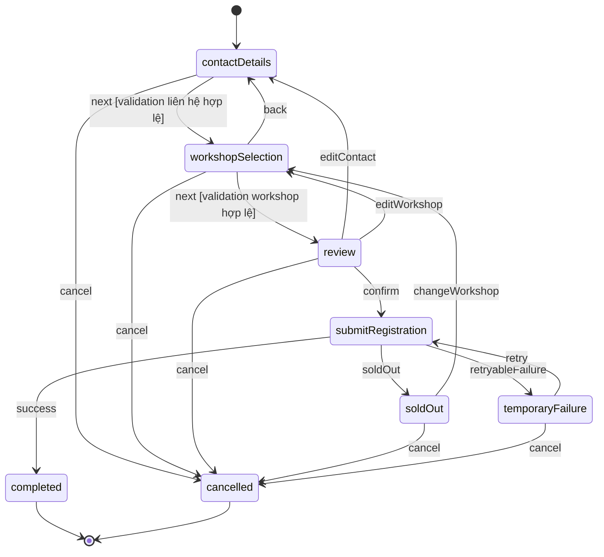
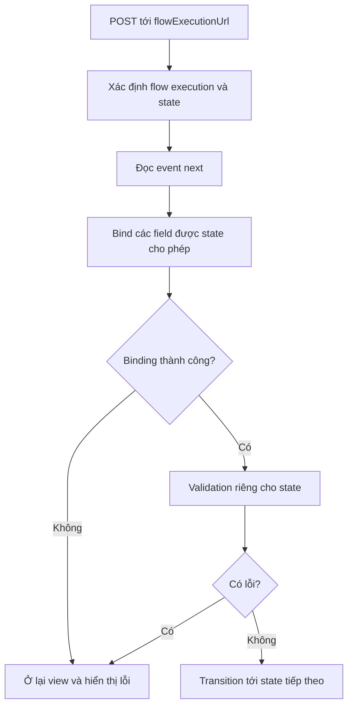

# Biểu mẫu đăng ký nhiều bước có kiểm tra theo màn hình

Một biểu mẫu đăng ký nhiều bước (*wizard*) không chỉ gồm các trang có nút “Tiếp tục” và “Quay lại”. Ứng dụng cần biết dữ liệu nào được nhập ở mỗi bước, khi nào được phép chuyển màn, phải giữ lại dữ liệu nào và khi nào mới được ghi kết quả nghiệp vụ. **Spring Web Flow** biểu diễn hành trình này bằng các **state**, **event** và **transition**, đồng thời cung cấp cơ chế binding, validation và scope cho từng lần thực thi.

Trong chương **Thực hành tổng hợp**, bài này xây dựng flow đăng ký workshop gồm ba màn hình:

1. **Thông tin liên hệ:** nhập họ tên và email, kiểm tra riêng hai trường này.
2. **Chọn workshop:** chọn workshop và số lượng chỗ, kiểm tra riêng hai trường ở bước thứ hai.
3. **Xem lại và xác nhận:** hiển thị toàn bộ bản nháp, cho sửa thông tin và chỉ gọi service lưu sau khi người dùng xác nhận.

Bài thực hành kết nối những kiến thức của module **SPRING_WEB_FLOW**: thiết kế state/event/transition, form binding, validation theo màn, flow scope, tích hợp Spring MVC và phục hồi khi lỗi. Ví dụ minh họa XML flow definition, JavaBean, validator và JSP. Các class/service và view của ứng dụng phải được đăng ký, đồng thời kiểm tra tương thích với phiên bản Spring MVC/Spring Web Flow đang sử dụng.

## 1. Xác định tiêu chí nghiệp vụ

Flow nhận các trường `fullName`, `email`, `workshopId` và `seats`. Chúng được thu thập ở các thời điểm khác nhau:

| Màn hình | Dữ liệu được nhập | Điều kiện để đi tiếp |
| --- | --- | --- |
| Thông tin liên hệ (`contactDetails`) | Họ tên, email | Họ tên không trống, giới hạn độ dài; email hợp lệ |
| Chọn workshop (`workshopSelection`) | Mã workshop, số chỗ | Có workshop hợp lệ; số chỗ từ 1 đến 5 |
| Xem lại (`review`) | Không nhập lại bản nháp | Chỉ hiển thị, sửa hoặc xác nhận |
| Xác nhận (`submitRegistration`) | Không có form trực tiếp | Service kiểm tra lại quyền, điều kiện nghiệp vụ, tính toàn vẹn và ghi dữ liệu |

Quy tắc quan trọng là **chỉ kiểm tra những trường người dùng có thể nhập tại màn hình hiện tại**. Ở bước liên hệ, trường `workshopId` còn trống là hoàn toàn bình thường. Nếu validator buộc trường này hợp lệ ngay tại bước đầu, người dùng sẽ bị chặn trước khi có cơ hội chọn workshop.

Các tình huống cần thiết kế từ đầu: người dùng quay lại sửa, hủy khi form đang sai, workshop hết chỗ trong thời gian xem lại, lỗi lưu tạm thời và gửi xác nhận lặp vì mất phản hồi.

## 2. Thiết kế sơ đồ state và event

| State | Loại | Trách nhiệm |
| --- | --- | --- |
| `contactDetails` | `view-state` | Bind/validate họ tên và email |
| `workshopSelection` | `view-state` | Bind/validate workshop và số chỗ |
| `review` | `view-state` | Hiển thị bản nháp đã nhập |
| `submitRegistration` | `action-state` | Gọi service tạo đăng ký |
| `soldOut` | `view-state` | Cho thay đổi lựa chọn nếu đã hết chỗ |
| `temporaryFailure` | `view-state` | Hướng dẫn phục hồi khi gặp lỗi tạm thời |
| `completed` | `end-state` | Kết thúc thành công |
| `cancelled` | `end-state` | Kết thúc do hủy |



Nút `next` có thể xuất hiện ở hai màn, nhưng **state hiện tại** quyết định bộ validation nào chạy và state đích tương ứng. Khi binding hoặc validation lỗi, Web Flow giữ nguyên view-state để hiển thị lỗi. Đây không phải một event `error` mà lập trình viên cần tự bịa ra cho mọi lần nhập sai.

`review` chỉ đọc dữ liệu; lệnh lưu thuộc `submitRegistration`. Khi người dùng đang ở `contactDetails`, cố gửi `confirm` không thể hợp lệ nếu state đó không có transition tương ứng. Tuy nhiên kiểm soát transition không thay cho kiểm tra quyền và dữ liệu tại service.

## 3. Tổ chức mã nguồn mẫu

Một bố cục dự án sử dụng JSP có thể là:

```text
src/main/java/com/example/registration/
  RegistrationDraft.java
  RegistrationValidator.java
  RegistrationAction.java
  RegistrationOutcome.java
  RegistrationService.java

src/main/webapp/WEB-INF/
  flows/registration/registration-flow.xml
  views/registration/contact.jsp
  views/registration/workshop.jsp
  views/registration/review.jsp
  views/registration/sold-out.jsp
  views/registration/retry.jsp
  views/registration/completed.jsp
  views/registration/cancelled.jsp
```

Vị trí file chỉ là một lựa chọn tổ chức; **FlowDefinitionRegistry** xác định nơi nạp định nghĩa flow, còn Spring MVC `ViewResolver` ánh xạ tên view tới JSP. Spring Web Flow sử dụng `FlowExecutor` để tạo/tiếp tục execution và `FlowHandlerMapping` cùng `FlowHandlerAdapter` để tích hợp xử lý request.

Cần phân biệt flow definition `registration` với flow execution của từng người dùng. Hai người có thể cùng chạy một định nghĩa, nhưng bản nháp của họ phải được quản lý riêng.

## 4. Model mang dữ liệu qua các màn hình

Tạo JavaBean có getter/setter để Spring binding cập nhật các trường form. `requestId` được tạo trên server, dùng để bảo vệ thao tác xác nhận khi bị gửi lặp.

```java
package com.example.registration;

import java.io.Serializable;
import java.util.UUID;

public class RegistrationDraft implements Serializable {
    private static final long serialVersionUID = 1L;

    private String fullName;
    private String email;
    private String workshopId;
    private int seats = 1;

    private final String requestId = UUID.randomUUID().toString();

    public RegistrationDraft() {}

    public String getFullName() { return fullName; }
    public void setFullName(String fullName) {
        this.fullName = fullName;
    }

    public String getEmail() { return email; }
    public void setEmail(String email) { this.email = email; }

    public String getWorkshopId() { return workshopId; }
    public void setWorkshopId(String workshopId) {
        this.workshopId = workshopId;
    }

    public int getSeats() { return seats; }
    public void setSeats(int seats) { this.seats = seats; }

    public String getRequestId() { return requestId; }
}
```

Trong XML flow sẽ khai báo:

```xml
<var name="registration" class="com.example.registration.RegistrationDraft"/>
```

Biến `registration` tồn tại trong **flow scope** của execution. Khi `contactDetails` chuyển sang `workshopSelection`, họ tên/email vẫn còn. Tương tự, khi quay từ `review` về màn chọn workshop, người dùng vẫn thấy các lựa chọn trước đó.

Đừng đưa bản nháp của một execution vào session attribute có tên cố định dùng chung cho mọi tab. Nếu quy trình cần tồn tại sau khi flow hết hạn, có thể lưu bản nháp ở cơ sở dữ liệu rồi để flow giữ một khóa tham chiếu, nhưng phải kiểm tra lại quyền và tính hợp lệ khi khôi phục.

**Không bind `requestId` từ form:** người dùng không nên tự gửi khóa định danh nghiệp vụ của yêu cầu. Trong ví dụ, field này chỉ có getter và không xuất hiện trong `<binder>`.

## 5. Validation theo từng view-state

Spring Web Flow có cơ chế gọi validator tương ứng với model và view-state. Với model tên `registration`, có thể đăng ký bean `registrationValidator` và cung cấp các phương thức:

- `validateContactDetails(RegistrationDraft, ValidationContext)` cho bước liên hệ.
- `validateWorkshopSelection(RegistrationDraft, ValidationContext)` cho bước chọn workshop.

Các ví dụ dưới đây dùng `ValidationContext` và `MessageBuilder` của Spring Binding. Cần bảo đảm quy ước bean và việc kích hoạt validation đúng với phiên bản Spring Web Flow đã cấu hình.

```java
package com.example.registration;

import java.util.Set;
import org.springframework.binding.message.MessageBuilder;
import org.springframework.binding.message.MessageContext;
import org.springframework.binding.validation.ValidationContext;
import org.springframework.stereotype.Component;
import org.springframework.util.StringUtils;

@Component("registrationValidator")
public class RegistrationValidator {
    private static final Set<String> WORKSHOP_IDS =
        Set.of("SPRING-INTRO", "SPRING-ADVANCED");

    public void validateContactDetails(
            RegistrationDraft draft, ValidationContext context) {
        MessageContext messages = context.getMessageContext();

        if (!StringUtils.hasText(draft.getFullName())) {
            error(messages, "fullName", "Họ tên không được để trống.");
        } else if (draft.getFullName().trim().length() > 100) {
            error(messages, "fullName", "Họ tên tối đa 100 ký tự.");
        }

        String email = draft.getEmail();
        if (!StringUtils.hasText(email)) {
            error(messages, "email", "Cần nhập email.");
        } else if (!looksLikeEmail(email)) {
            error(messages, "email", "Email chưa đúng định dạng.");
        }
    }

    public void validateWorkshopSelection(
            RegistrationDraft draft, ValidationContext context) {
        MessageContext messages = context.getMessageContext();

        if (!StringUtils.hasText(draft.getWorkshopId())) {
            error(messages, "workshopId", "Hãy chọn workshop.");
        } else if (!WORKSHOP_IDS.contains(draft.getWorkshopId())) {
            error(messages, "workshopId", "Workshop không hợp lệ.");
        }

        if (draft.getSeats() < 1 || draft.getSeats() > 5) {
            error(messages, "seats", "Số chỗ phải từ 1 đến 5.");
        }
    }

    private static void error(
            MessageContext messages, String field, String text) {
        messages.addMessage(new MessageBuilder()
            .error().source(field).defaultText(text).build());
    }

    private static boolean looksLikeEmail(String email) {
        int at = email.indexOf('@');
        int dot = email.lastIndexOf('.');
        return at > 0 && dot > at + 1 && dot < email.length() - 1;
    }
}
```

Hàm `looksLikeEmail` chỉ minh họa vị trí kiểm tra, chưa phải bộ xác thực email đầy đủ. Trong ứng dụng thật, nên dùng Bean Validation `@Email` hoặc thư viện validation phù hợp. Danh sách workshop cũng phải lấy từ nguồn dữ liệu được phép sử dụng; service lưu cần kiểm tra lại thay vì tin vào lựa chọn của form.

### Cẩn thận khi kết hợp Bean Validation và validator theo state

Nếu dùng `@NotBlank` cho **mọi** field của `RegistrationDraft` và hệ thống chạy Bean Validation nhóm Default khi chuyển **mọi** màn hình, `workshopId` còn trống có thể chặn người dùng ngay ở bước liên hệ. Hướng xử lý là sử dụng **validation groups/hints theo màn**, hoặc chọn phương thức `validate<StateId>` theo đúng cơ chế của dự án và tránh vòng validation toàn model gây xung đột.

Ví dụ trên chủ động không đặt annotation bắt buộc lên các field để tập trung vào validator theo state. Với dự án dùng nhiều cơ chế, cần kiểm tra chính xác cái nào được gọi ở mỗi transition.

### Binding khác validation

Khi người dùng gửi `seats=abc`, Spring không thể chuyển chuỗi đó sang `int`. Đây là **lỗi binding/conversion**. Khi người dùng gửi `seats=8`, conversion thành công nhưng vi phạm quy tắc 1–5; đây là **lỗi validation**. Cả hai nên được hiển thị tại màn `workshopSelection`, cạnh trường `seats`.

## 6. Định nghĩa flow XML hoàn chỉnh

Dưới đây là flow mẫu. Nó giả định các bean `registrationAction`, `registrationValidator` và các view đã được cấu hình. Các class và tên event là do ứng dụng tự định nghĩa.

```xml
<?xml version="1.0" encoding="UTF-8"?>
<flow xmlns="http://www.springframework.org/schema/webflow"
      xmlns:xsi="http://www.w3.org/2001/XMLSchema-instance"
      xsi:schemaLocation="
          http://www.springframework.org/schema/webflow
          http://www.springframework.org/schema/webflow/spring-webflow.xsd"
      start-state="contactDetails">

    <var name="registration"
         class="com.example.registration.RegistrationDraft"/>

    <!-- Màn 1: chỉ cho phép bind fullName, email -->
    <view-state id="contactDetails"
                view="registration/contact"
                model="registration">
        <binder>
            <binding property="fullName"/>
            <binding property="email"/>
        </binder>

        <transition on="next" to="workshopSelection"
                    bind="true" validate="true"/>
        <transition on="cancel" to="cancelled"
                    bind="false" validate="false"/>
    </view-state>

    <!-- Màn 2: chỉ cho phép bind workshopId, seats -->
    <view-state id="workshopSelection"
                view="registration/workshop"
                model="registration">
        <binder>
            <binding property="workshopId"/>
            <binding property="seats"/>
        </binder>

        <transition on="next" to="review"
                    bind="true" validate="true"/>
        <transition on="back" to="contactDetails"
                    bind="false" validate="false"/>
        <transition on="cancel" to="cancelled"
                    bind="false" validate="false"/>
    </view-state>

    <!-- Màn review chỉ đọc bản nháp -->
    <view-state id="review" view="registration/review">
        <transition on="editContact" to="contactDetails"/>
        <transition on="editWorkshop" to="workshopSelection"/>
        <transition on="confirm" to="submitRegistration"/>
        <transition on="cancel" to="cancelled"/>
    </view-state>

    <!-- Chỉ action này gọi service lưu đăng ký -->
    <action-state id="submitRegistration">
        <evaluate expression="registrationAction.submit(registration)"/>
        <transition on="success" to="completed"/>
        <transition on="soldOut" to="soldOut"/>
        <transition on="retryableFailure" to="temporaryFailure"/>
    </action-state>

    <view-state id="soldOut" view="registration/sold-out">
        <transition on="changeWorkshop" to="workshopSelection"/>
        <transition on="cancel" to="cancelled"/>
    </view-state>

    <view-state id="temporaryFailure" view="registration/retry">
        <transition on="retry" to="submitRegistration"/>
        <transition on="cancel" to="cancelled"/>
    </view-state>

    <end-state id="completed" view="registration/completed"/>
    <end-state id="cancelled" view="registration/cancelled"/>
</flow>
```

Đọc những phần cốt lõi:

1. `<var>` tạo model tồn tại qua các màn của một flow execution.
2. Hai `view-state` cùng sử dụng `model="registration"`, nhưng mỗi `<binder>` chỉ liệt kê các property mà màn đó được phép sửa.
3. `next` có `bind="true" validate="true"` để cập nhật và kiểm tra trước khi chuyển.
4. `back` và `cancel` trên màn workshop có `bind="false" validate="false"` để có thể rời màn ngay cả khi đang có dữ liệu nhập dở.
5. `review` không bind lại toàn bộ dữ liệu từ trình duyệt.
6. `submitRegistration` trả về các event đã phân loại từ action; không cho form tự phát `success`.
7. `completed` và `cancelled` kết thúc flow với kết quả khác nhau.

**Hệ quả của `bind="false"` ở nút Back:** nếu người dùng đã sửa lựa chọn trên màn workshop nhưng chưa nhấn “Xem lại”, các giá trị mới ở form **không được lưu vào bản nháp** khi bấm “Quay lại”. Nếu yêu cầu sản phẩm cần giữ cả dữ liệu chưa hợp lệ đang nhập, hãy thiết kế riêng hành vi binding khi quay lại và cách giải quyết lỗi chuyển đổi kiểu.

## 7. Tạo JSP nhập thông tin liên hệ

Trong `contact.jsp`, dùng Spring Form Tags để bind và hiển thị lỗi của từng field:

```jsp
<%@ taglib prefix="form" uri="http://www.springframework.org/tags/form" %>

<h1>Thông tin liên hệ</h1>

<form:form modelAttribute="registration"
           action="${flowExecutionUrl}"
           method="post">

    <div>
        <label for="fullName">Họ và tên</label>
        <form:input path="fullName" id="fullName"/>
        <form:errors path="fullName" cssClass="field-error"/>
    </div>

    <div>
        <label for="email">Email</label>
        <form:input path="email" id="email" type="email"/>
        <form:errors path="email" cssClass="field-error"/>
    </div>

    <button type="submit" name="_eventId_next">
        Tiếp tục
    </button>
    <button type="submit" name="_eventId_cancel">
        Hủy
    </button>
</form:form>
```

`flowExecutionUrl` là URL gắn với execution hiện tại do Web Flow cung cấp. Tham số/nút tên `_eventId_next` phát event `next`, `_eventId_cancel` phát event `cancel`. Hãy thống nhất tên trong JSP và XML.

`<form:errors>` thể hiện lỗi của đúng property khi validation context đã được gắn với form model trong view. HTML `type="email"` chỉ hỗ trợ trình duyệt; server vẫn phải kiểm tra vì HTTP client có thể bỏ qua validation của trình duyệt.

## 8. Tạo JSP chọn workshop và xem lại

Trong `workshop.jsp`:

```jsp
<%@ taglib prefix="form" uri="http://www.springframework.org/tags/form" %>

<h1>Chọn workshop và số chỗ</h1>

<form:form modelAttribute="registration"
           action="${flowExecutionUrl}"
           method="post">

    <div>
        <label for="workshopId">Workshop</label>
        <form:select path="workshopId" id="workshopId">
            <form:option value="" label="-- Chọn workshop --"/>
            <form:option value="SPRING-INTRO"
                         label="Spring Web Flow cơ bản"/>
            <form:option value="SPRING-ADVANCED"
                         label="Spring Web Flow nâng cao"/>
        </form:select>
        <form:errors path="workshopId" cssClass="field-error"/>
    </div>

    <div>
        <label for="seats">Số chỗ (1–5)</label>
        <form:input path="seats" id="seats"
                    type="number" min="1" max="5"/>
        <form:errors path="seats" cssClass="field-error"/>
    </div>

    <button type="submit" name="_eventId_next">
        Xem lại
    </button>
    <button type="submit" name="_eventId_back">
        Quay lại
    </button>
    <button type="submit" name="_eventId_cancel">
        Hủy
    </button>
</form:form>
```

Nếu người dùng nhập `seats=8` và bấm “Xem lại”, `validateWorkshopSelection` phát lỗi `seats`. Flow giữ `workshopSelection`; thông điệp xuất hiện cạnh ô số chỗ. Nếu bấm “Quay lại”, transition `back` bỏ qua validation để về `contactDetails`.

Trong `review.jsp`, hiển thị dữ liệu bằng JSTL thay vì gửi các hidden field chứa toàn bộ bản nháp:

```jsp
<%@ taglib prefix="c" uri="http://java.sun.com/jsp/jstl/core" %>

<h1>Xem lại đăng ký</h1>

<dl>
    <dt>Họ tên</dt>
    <dd><c:out value="${registration.fullName}"/></dd>

    <dt>Email</dt>
    <dd><c:out value="${registration.email}"/></dd>

    <dt>Workshop</dt>
    <dd><c:out value="${registration.workshopId}"/></dd>

    <dt>Số chỗ</dt>
    <dd><c:out value="${registration.seats}"/></dd>
</dl>

<form action="${flowExecutionUrl}" method="post">
    <c:if test="${not empty _csrf}">
        <input type="hidden"
               name="${_csrf.parameterName}"
               value="${_csrf.token}"/>
    </c:if>

    <button type="submit" name="_eventId_editContact">
        Sửa thông tin
    </button>
    <button type="submit" name="_eventId_editWorkshop">
        Sửa workshop
    </button>
    <button type="submit" name="_eventId_confirm">
        Xác nhận đăng ký
    </button>
    <button type="submit" name="_eventId_cancel">
        Hủy
    </button>
</form>
```

`<c:out>` escape nội dung động để giảm nguy cơ XSS. Khi sử dụng Spring Security CSRF protection, form POST cần token hợp lệ; mẫu dùng `_csrf` khi Security cung cấp thuộc tính này. `form:form` có thể tự tích hợp cơ chế chèn token khi cấu hình RequestDataValueProcessor thích hợp.

### Vì sao không dùng hidden field cho toàn bộ dữ liệu review?

Nếu gửi lại `email`, `workshopId` và `seats` từ hidden input rồi coi đó là dữ liệu đáng tin, người dùng có thể sửa request thủ công. Ở màn review, flow đã có `registration` trong flow scope; chỉ cần gửi event xác nhận. Dù vậy, service vẫn kiểm tra dữ liệu khi thực hiện nghiệp vụ.

## 9. Kết quả nghiệp vụ và lỗi kỹ thuật tại bước xác nhận

Ví dụ một service contract với hai kết quả nghiệp vụ:

```java
package com.example.registration;

public enum RegistrationOutcome {
    CONFIRMED,
    SOLD_OUT
}
```

```java
package com.example.registration;

public interface RegistrationService {
    RegistrationOutcome registerOnce(
        String requestId,
        String fullName,
        String email,
        String workshopId,
        int seats
    );
}
```

`RegistrationAction` chuyển kết quả của service thành event mà `action-state` có thể dùng:

```java
package com.example.registration;

import org.springframework.stereotype.Component;
import org.springframework.webflow.execution.Event;

@Component("registrationAction")
public class RegistrationAction {
    private final RegistrationService service;

    public RegistrationAction(RegistrationService service) {
        this.service = service;
    }

    public Event submit(RegistrationDraft draft) {
        try {
            RegistrationOutcome outcome = service.registerOnce(
                draft.getRequestId(),
                draft.getFullName(),
                draft.getEmail(),
                draft.getWorkshopId(),
                draft.getSeats()
            );

            if (outcome == RegistrationOutcome.CONFIRMED) {
                return new Event(this, "success");
            }
            if (outcome == RegistrationOutcome.SOLD_OUT) {
                return new Event(this, "soldOut");
            }
            throw new IllegalStateException("Unexpected outcome");

        } catch (TemporaryRegistrationException ex) {
            // Chỉ bắt loại lỗi mà ứng dụng đã phân loại là phục hồi được.
            return new Event(this, "retryableFailure");
        }
    }
}
```

`TemporaryRegistrationException` là exception do ứng dụng định nghĩa; để biên dịch ví dụ cần có class này và implementation của service. Những event như `soldOut` hay `retryableFailure` là tên **do ứng dụng đặt**, Spring Web Flow không tự biết cách phân loại lỗi SQL hoặc timeout thành các event đó.

Service thật phải thực hiện:

- Xác thực quyền tham gia và kiểm tra lại toàn bộ dữ liệu trước khi ghi.
- Kiểm tra workshop còn mở và số chỗ còn đủ ở ranh giới transaction, giải quyết trường hợp nhiều người đăng ký cùng lúc.
- Áp dụng khóa idempotency `requestId` để hai lần confirm/retry của một yêu cầu logic không tạo hai bản ghi.
- Phân biệt **kết quả nghiệp vụ `SOLD_OUT`** với **lỗi kỹ thuật**; timeout chưa thể kết luận là hết chỗ.
- Khi commit có thể đã thành công nhưng phản hồi bị mất, tra cứu kết quả theo khóa yêu cầu trước khi cho retry.

Bài dùng `temporaryFailure` cho lỗi kỹ thuật đã được phân loại và có chính sách phục hồi. Các lỗi lập trình, lỗi cấu hình hoặc exception chưa nhận diện không tự biến thành event `retryableFailure`; chúng cần đi qua cơ chế exception handling của ứng dụng. Nút “Hủy” ở màn retry chỉ dừng flow, không thể khẳng định giao dịch chưa xảy ra nếu kết quả commit chưa rõ.

## 10. Hiểu thứ tự xử lý một event “Tiếp tục”



Ví dụ:

1. `email=abc` tại `contactDetails` có thể bind thành String, nhưng validator trả lỗi định dạng.
2. `seats=abc` tại `workshopSelection` gây lỗi conversion khi bind sang `int`.
3. `seats=9` bind thành công, nhưng validator báo vượt giới hạn.
4. `back` và `cancel` bỏ qua binding/validation do cấu hình transition.
5. `confirm` từ `review` gọi action, còn `next` ở màn nhập không trực tiếp ghi dữ liệu.

**Mọi ràng buộc kinh doanh quan trọng cần được kiểm tra lại trong service.** Trạng thái workshop còn chỗ có thể thay đổi sau khi người dùng mở màn review; validation ở form không bảo đảm tính nhất quán transaction.

## 11. Scope, điều hướng ngược và hết phiên

| Scope hoặc nơi lưu | Ví dụ dữ liệu | Vòng đời |
| --- | --- | --- |
| `requestScope` | Giá trị trung gian của một request | Một lần xử lý |
| `viewScope` | Trạng thái hiển thị phụ của một màn | Một view-state |
| `flashScope` | Thông báo dùng ngắn hạn khi chuyển bước | Vài lần xử lý ngắn hạn theo Web Flow |
| `flowScope` | Bản nháp `registration` và requestId | Suốt một flow execution |
| Database | Đăng ký đã commit hoặc bản nháp dài hạn | Độc lập với flow |

Nút “Quay lại” trong form là **event Web Flow**, khác nút Back của trình duyệt. Trình duyệt có thể hiển thị trang HTML đã cache hoặc gửi lại URL chứa execution key cũ; cơ chế snapshot/history phụ thuộc cấu hình repository của Web Flow.

Khi execution hết hạn hoặc đã kết thúc, ứng dụng nên có trang thông báo và đường bắt đầu lại rõ ràng. Nếu muốn khôi phục dữ liệu, nạp một bản nháp bền vững theo quyền truy cập; không tự dùng event từ execution cũ để thực hiện giao dịch mới.

## 12. Kịch bản kiểm thử tích hợp hành trình

Kiểm thử cần quan sát **state đang đứng, lỗi theo field, dữ liệu trong scope và số lần service được gọi**.

| Kịch bản | Hành động | Kỳ vọng |
| --- | --- | --- |
| Khởi động flow | Start `registration` | State `contactDetails` |
| Thiếu họ tên | `next` với họ tên trống | Giữ `contactDetails`, lỗi `fullName` |
| Sai email | `next` với email sai | Giữ `contactDetails`, lỗi `email` |
| Bước 1 hợp lệ | Điền đúng liên hệ → `next` | Sang `workshopSelection` dù workshop chưa chọn |
| Không chọn workshop | `next` | Giữ `workshopSelection`, lỗi `workshopId` |
| Nhập số chỗ sai kiểu | `seats=abc` → `next` | Lỗi binding tại `workshopSelection` |
| Nhập quá số chỗ | `seats=9` → `next` | Lỗi validation tại `workshopSelection` |
| Hủy khi form sai | `cancel` | `cancelled`, service chưa được gọi |
| Quay về | `back` | `contactDetails`, giữ họ tên/email đã lưu |
| Màn review | Workshop hợp lệ → `next` | `review`, chưa có thao tác ghi |
| Sửa liên hệ | `editContact` từ `review` | `contactDetails`, giữ workshop và số chỗ |
| Sửa workshop | `editWorkshop` | `workshopSelection`, giữ thông tin liên hệ |
| Xác nhận | `confirm`, trả `CONFIRMED` | `completed`, ghi đúng một yêu cầu |
| Hết chỗ | `confirm`, trả `SOLD_OUT` | `soldOut`, cho lựa chọn khác |
| Lỗi tạm thời | Service ném exception đã phân loại | `temporaryFailure`, chưa khẳng định commit |
| Retry | `retry` cùng requestId | Kết quả nhất quán, không ghi trùng |
| Event sai state | Gửi `confirm` từ `contactDetails` | Không được vượt qua màn nhập |
| Execution hết hạn | Gửi execution key cũ | Xử lý hết phiên, không tạo giao dịch mới |

Mã giả một đường thành công có quay lại:

```text
startFlow("registration")
  -> currentState == "contactDetails"

submit("next", fullName="Lan", email="lan@example.com")
  -> currentState == "workshopSelection"
  -> service.callCount == 0

submit("next", workshopId="SPRING-INTRO", seats=2)
  -> currentState == "review"

submit("editContact")
  -> currentState == "contactDetails"
  -> draft.workshopId == "SPRING-INTRO"

submit("next", fullName="Lan Anh", email="lan@example.com")
submit("next", workshopId="SPRING-INTRO", seats=2)
  -> currentState == "review"

mockServiceOutcome(CONFIRMED)
submit("confirm")
  -> currentState == "completed"
  -> service.callCount == 1
```

Đoạn trên là **pseudocode**, không phải API test chạy trực tiếp. Khi triển khai có thể dùng công cụ kiểm thử flow của Spring Web Flow kết hợp mock service. Riêng việc bảo đảm idempotency/concurrency cần test tích hợp với storage và transaction thật hoặc môi trường tương đương.

## 13. Các lỗi thường gặp

**Validator chạy toàn model ở bước đầu.** Người dùng chưa chọn workshop mà bị báo lỗi workshop ngay tại màn liên hệ. Kiểm tra cấu hình Bean Validation và sử dụng validation theo state/group đúng thời điểm.

**Quên `<binder>` ở mỗi màn.** Request có thể tác động tới property không thuộc bước hiện tại. Hạn chế whitelist field và kiểm tra quyền tại service.

**Nút Hủy bị chặn.** Nếu transition hủy vẫn bind/validate form, dữ liệu sai có thể ngăn người dùng rời flow. Dùng `bind="false" validate="false"` cho nút cần rời màn không điều kiện.

**Bản nháp mất khi quay lại.** Kiểm tra việc giữ model trong flow scope; tránh tự khởi tạo object mới ở mỗi màn hay dùng session key chung.

**Trang review tự lưu dữ liệu.** Refresh/re-render có thể tạo side effect. Chỉ lưu trong action-state được gọi sau event xác nhận và có idempotency ở service.

**Tin rằng đã validate là chắc chắn còn chỗ.** Số chỗ có thể thay đổi sau khi kiểm tra form; service phải kiểm tra lại trong giao dịch.

**Lẫn lộn kết quả hết chỗ với timeout.** Service cần trả outcome nghiệp vụ rõ ràng hoặc lỗi kỹ thuật được phân loại; timeout có thể xảy ra sau commit.

**Tên state và view không khớp.** `view="registration/workshop"` là tên template, `id="workshopSelection"` mới là state ID. Transition `to` tham chiếu state ID, không phải đường dẫn JSP.

## 14. Bài thực hành mở rộng và tiêu chí hoàn thành

Sau khi xây dựng flow trên, hãy thử bổ sung:

1. Màn `paymentMethod` trước `review`, có validation chỉ cho phương thức thanh toán ở màn đó.
2. Một điều kiện phụ thuộc hai màn: workshop nâng cao yêu cầu email thuộc miền cho phép. Chọn nơi kiểm tra phù hợp và kiểm tra lại ở service.
3. Màn `coupon` tùy chọn; mã giảm giá sai phải hiển thị lỗi mà không làm mất bản nháp.
4. Một `subflow-state` xác minh email, định nghĩa rõ input, outcome, output và dữ liệu thuộc flow cha.

Để đánh giá bài làm, xác nhận đủ các tiêu chí:

- [ ] Mỗi màn chỉ bind và validate field được thiết kế cho màn đó.
- [ ] Lỗi chuyển đổi kiểu và lỗi quy tắc được gắn đúng field.
- [ ] `next` chỉ đi tiếp khi bước hiện tại hợp lệ.
- [ ] `back` và `cancel` không bị chặn bởi form sai.
- [ ] Bản nháp được giữ khi xem lại và quay về sửa.
- [ ] Màn review chỉ đọc dữ liệu phía server.
- [ ] Chỉ event xác nhận mới đi tới action ghi.
- [ ] Service xác thực quyền, kiểm tra lại điều kiện và bảo vệ transaction.
- [ ] Retry giữ nguyên requestId, không tạo đăng ký trùng.
- [ ] Có kiểm thử đường thành công, lỗi từng bước, lỗi kỹ thuật và hết phiên.

Một biểu mẫu nhiều bước được thiết kế tốt phải bảo đảm cả **tính nhất quán của điều hướng** lẫn **tính nhất quán của dữ liệu**. Spring Web Flow giúp đặt state, event và transition vào một đặc tả rõ ràng; trách nhiệm của người phát triển là quy định chính xác binding, validation theo màn, phạm vi bản nháp và xử lý nghiệp vụ khi xác nhận.
