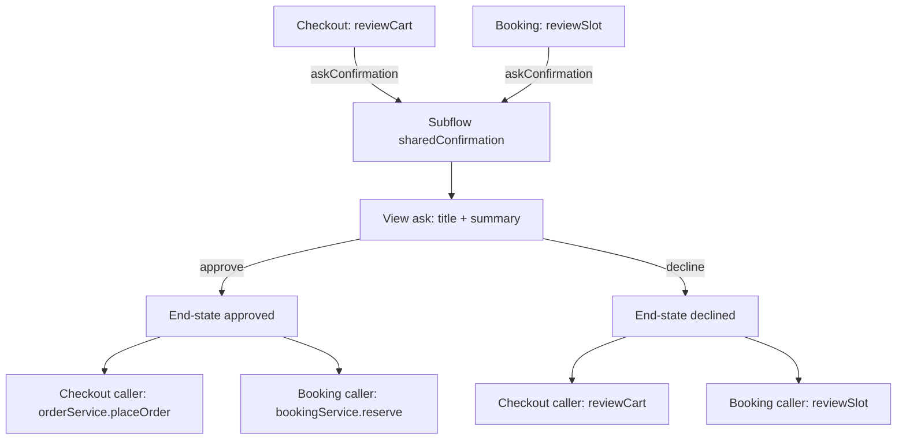

# Tái sử dụng một subflow xác nhận ở nhiều hành trình

## 1. Bài toán thực hành tổng hợp

Trong **Spring Web Flow (SWF)**, chúng ta có thể mô hình hóa một hành trình web nhiều bước bằng `view-state`, `action-state`, `event` và `transition` thay vì viết rải rác logic điều hướng trong nhiều controller. Khi một ứng dụng có nhiều quy trình, một số bước tương tác có thể lặp lại. Ví dụ:

- Khách hàng **đặt hàng**: kiểm tra giỏ hàng → hỏi xác nhận → tạo đơn hàng.
- Khách hàng **đặt lịch**: chọn khung giờ → hỏi xác nhận → tạo lịch hẹn.
- Nhân viên **gửi yêu cầu phê duyệt**: rà soát nội dung → hỏi xác nhận → gửi yêu cầu.

Cả ba đều cần màn hình “Bạn có chắc muốn tiếp tục không?”, nhưng phần nghiệp vụ sau khi đồng ý rất khác nhau. Sao chép nguyên `view-state` xác nhận vào từng flow khiến giao diện, cách xử lý nút và quy tắc điều hướng dễ bị lệch khi cập nhật.

**Mục tiêu bài này:** tạo **một subflow xác nhận** có giao diện và hợp đồng input/outcome ổn định, rồi gọi lại từ **hai root flow độc lập** là `checkout` và `booking`. Mỗi root flow tự thực hiện service nghiệp vụ sau khi subflow trả về kết quả `approved`.

Khi hoàn thành, bạn cần:

1. Phân biệt **subflow tái sử dụng** và **root flow điều phối nghiệp vụ**.
2. Khai báo input cho subflow, truyền dữ liệu từ hai caller, trả outcome qua `end-state`.
3. Xử lý hai hướng **đồng ý** và **quay lại** ở từng caller mà không trộn dữ liệu.
4. Render form xác nhận và gửi event về **continuation URL** đúng execution.
5. Kiểm thử hai luồng, validation, session, lỗi service và yêu cầu xác nhận bị gửi lặp.

Các ví dụ dùng cú pháp XML Spring Web Flow truyền thống và Spring MVC/JSP để minh họa. Tên bean, địa chỉ view, cấu hình security và phiên bản thư viện cần điều chỉnh cho dự án thật. Bài tập tập trung vào thiết kế flow; không coi các đoạn cấu hình rời rạc là ứng dụng đã triển khai hoàn chỉnh.

## 2. Tại sao dùng subflow thay vì copy một view-state?

Giả sử mỗi root flow tự có state `confirm`:

```text
checkout: reviewCart -> confirm -> orderComplete
booking:  reviewSlot -> confirm -> bookingComplete
```

Ban đầu cả hai màn hình giống nhau. Nhưng sau đó nhóm thiết kế cần sửa thông điệp, cách hiện chi tiết, nút “Không, quay lại” và quy tắc xử lý sự kiện. Nếu sao chép, mỗi lần cập nhật phải chỉnh nhiều flow và nhiều view.

**Subflow** là một **flow definition có thể được gọi từ flow khác** qua `<subflow-state>`. Nó có giao diện input/output rõ ràng, có các state và transition của riêng nó, rồi trả về caller bằng **outcome** từ `end-state`.

| Thiết kế | Lợi thế | Hạn chế |
| --- | --- | --- |
| Copy state xác nhận ở từng flow | Dễ làm ban đầu; mỗi nơi tự chỉnh | Trùng logic, khó bảo trì và kiểm thử đồng nhất |
| Chỉ dùng chung một JSP | Tái sử dụng giao diện | Event, state và nhánh điều hướng vẫn phải lặp lại |
| **Subflow xác nhận dùng chung** | Tái sử dụng cả bước tương tác và hợp đồng outcome | Phải thiết kế input/output và scope cẩn thận |
| Service chung xử lý toàn bộ nghiệp vụ | Có thể giảm một số mã | Dễ trộn logic đặt hàng, đặt lịch và quyền truy cập |

**Ranh giới thiết kế đề xuất:** subflow chỉ nhận nội dung để hỏi và trả **quyết định của người dùng**. Root flow mới quyết định hành động nghiệp vụ sau khi được xác nhận. Không đưa `orderService.placeOrder(...)` hay `bookingService.reserve(...)` vào subflow dùng chung.

## 3. Thiết kế hợp đồng trước khi viết XML

Một subflow dùng lại tốt cần trả lời ba câu hỏi: **caller gửi gì, subflow xử lý gì, caller nhận kết quả nào?**

### 3.1. Input

Ta thiết kế flow dùng chung có ID `sharedConfirmation` với hai input:

| Input | Ý nghĩa | Checkout truyền | Booking truyền |
| --- | --- | --- | --- |
| `title` | Câu hỏi/hành động cần xác nhận | “Xác nhận đặt hàng?” | “Xác nhận đặt lịch?” |
| `summary` | Tóm tắt thông tin để người dùng kiểm tra | Mô tả giỏ hàng đã được chuẩn bị | Mô tả khung giờ đã chọn |

Hai giá trị này dùng **để hiển thị**, không phải nguồn dữ liệu đáng tin để ghi giao dịch. Nếu `summary` đến từ dữ liệu người dùng hoặc từ service, view cần HTML-escape. Ở bước ghi, root service phải truy vấn/kiểm tra lại bản ghi thực tế thay vì tin rằng chuỗi summary chứa thông tin chính xác.

### 3.2. Event bên trong subflow

Subflow nhận hai event HTTP thông dụng:

- `approve`: người dùng đồng ý; đi đến end-state `approved`.
- `decline`: người dùng không đồng ý; đi đến end-state `declined`.

Tên event có thể khác tên outcome. Chẳng hạn event `approve` là thao tác người dùng gửi, còn `approved` là **kết quả** mà subflow trả về caller. Đặt hai nhóm tên rõ ràng giúp người đọc không nhầm input với output.

### 3.3. Outcome trả về caller

Subflow có hai end-state:

```text
approved  -> caller thực hiện thao tác nghiệp vụ đã được kiểm tra
declined  -> caller quay về màn hình xem lại/chỉnh sửa
```

Trong Spring Web Flow, **ID của end-state ở subflow là event outcome** để `<transition on="...">` trên `<subflow-state>` của caller xử lý. Với trường hợp chỉ cần hai nhánh, không nhất thiết khai báo thêm biến kết quả boolean. Nếu cần trả dữ liệu cụ thể, có thể khai báo `<output>` ở end-state; bài này không cần dữ liệu output bổ sung.

### 3.4. Những gì *không* truyền vào subflow

Không cho subflow nhận `serviceClass`, tên phương thức cần gọi, URL đích tùy ý hoặc biểu thức EL do client cung cấp để “thực thi sau khi xác nhận”. Thiết kế ấy khiến flow dùng chung thành một bộ thực thi nghiệp vụ tùy ý, khó kiểm soát quyền và khó kiểm thử.

Hãy để **flow cha giữ business ID và chọn service cụ thể**. Subflow chỉ trả `approved` hoặc `declined`; caller sử dụng outcome theo transition được khai báo sẵn.

## 4. Sơ đồ hai hành trình gọi chung một subflow



Sơ đồ cho thấy **cùng definition** `sharedConfirmation` được gọi bởi hai nơi khác nhau, nhưng mỗi lần gọi thuộc **root execution/conversation của caller tương ứng**. Người đặt hàng và người đặt lịch không chia sẻ một form hay một biến scope toàn cục chỉ vì cùng dùng một subflow.

**Điểm thực thi quan trọng:** khi root gọi `<subflow-state>`, subflow tham gia vào execution của hành trình đó. Nó không yêu cầu mở một HTTP session mới, và không được hiểu mỗi lần gọi subflow sẽ tạo một root execution độc lập.

## 5. Xây dựng subflow dùng chung

Giả sử flow definition dùng chung được đăng ký với ID `sharedConfirmation`. File `shared-confirmation-flow.xml`:

```xml
<?xml version="1.0" encoding="UTF-8"?>
<flow xmlns="http://www.springframework.org/schema/webflow"
      xmlns:xsi="http://www.w3.org/2001/XMLSchema-instance"
      xsi:schemaLocation="
        http://www.springframework.org/schema/webflow
        http://www.springframework.org/schema/webflow/spring-webflow.xsd">

    <!-- Input được caller truyền vào khi gọi subflow. -->
    <input name="title" required="true" />
    <input name="summary" required="true" />

    <!-- Không ghi đơn hàng/đặt lịch ở đây. -->
    <view-state id="ask"
                view="shared/confirmation">
        <transition on="approve"
                    to="approved"
                    bind="false"
                    validate="false" />

        <transition on="decline"
                    to="declined"
                    bind="false"
                    validate="false" />
    </view-state>

    <!-- End-state ID trở thành outcome cho subflow-state ở caller. -->
    <end-state id="approved" />
    <end-state id="declined" />
</flow>
```

### 5.1. Giải thích các dòng chính

1. `<input name="title" .../>` và `<input name="summary" .../>` định nghĩa **hợp đồng dữ liệu đầu vào** mà caller phải truyền. Với cấu hình Web Flow hỗ trợ input required, thiếu input cần được phát hiện sớm.
2. `view="shared/confirmation"` là tên view do view resolver tích hợp xử lý. Đường dẫn JSP vật lý có thể khác tùy cấu hình; tên view không tự quyết định security hay mapping HTTP.
3. Hai `<transition>` nhận event `approve` và `decline` từ form.
4. `bind="false" validate="false"` thể hiện bước chỉ hỏi quyết định, **không bind một form model nghiệp vụ**. Đây không phải biện pháp vô hiệu hóa authorization hay CSRF.
5. Hai `end-state` kết thúc **subflow** và gửi outcome về caller. Không có lệnh gọi service ghi dữ liệu tại đây.

Các input của subflow được dùng trong flow context của lần gọi hiện tại, không phải biến singleton chia sẻ giữa các root flow. Đối với ứng dụng thực, có thể bổ sung validation cho kiểu/kích thước thông điệp hoặc thay chuỗi tùy ý bằng `messageKey` và dữ liệu để nội địa hóa.

### 5.2. Vì sao không chọn `confirm` làm luôn ID của state đích?

Trong Web Flow:

```xml
<transition on="approve" to="approved" />
```

`approve` là **tên event** do view gửi. `approved` là **ID của end-state** và trở thành outcome mà caller xử lý. Hai giá trị không cần trùng nhau. Điều quan trọng là **đúng hợp đồng**: nếu caller lắng nghe `on="confirmed"` nhưng subflow chỉ có end-state `approved`, đường xử lý sẽ không khớp.

### 5.3. Đây chưa phải quyết định nghiệp vụ đáng tin

Một client có thể tự gửi tham số `_eventId=approve` mà không bấm nút. Vì vậy, outcome `approved` chỉ chứng tỏ execution đi qua nhánh Web Flow tương ứng; service ở caller vẫn phải kiểm tra quyền, tình trạng đối tượng, dữ liệu hợp lệ và chống gửi lặp.

## 6. Caller thứ nhất: checkout

Root flow `checkout` có một màn hình xem lại đơn hàng và một `subflow-state` gọi `sharedConfirmation`. Khi nhận `approved`, **caller** mới gọi `orderService.placeOrder(...)`.

```xml
<?xml version="1.0" encoding="UTF-8"?>
<flow xmlns="http://www.springframework.org/schema/webflow"
      xmlns:xsi="http://www.w3.org/2001/XMLSchema-instance"
      xsi:schemaLocation="
        http://www.springframework.org/schema/webflow
        http://www.springframework.org/schema/webflow/spring-webflow.xsd">

    <on-start>
        <set name="flowScope.cartId"
             value="requestParameters.cartId" />
        <evaluate
            expression="cartService.describeForCheckout(flowScope.cartId)"
            result="flowScope.cartSummary" />
    </on-start>

    <view-state id="reviewCart" view="checkout/review">
        <transition on="askConfirmation"
                    to="confirmOrder" />
    </view-state>

    <subflow-state id="confirmOrder"
                   subflow="sharedConfirmation">
        <input name="title"
               value="'Xác nhận đặt hàng?'" />
        <input name="summary"
               value="flowScope.cartSummary" />

        <transition on="approved" to="completed">
            <evaluate
                expression="orderService.placeOrder(flowScope.cartId)"
                result="flowScope.orderId" />
        </transition>

        <transition on="declined"
                    to="reviewCart" />
    </subflow-state>

    <end-state id="completed"
               view="externalRedirect:contextRelative:/checkout/success" />
</flow>
```

Ví dụ giả định flow registry đã có ID `checkout`, bean `cartService`/`orderService`, view `checkout/review` và route `/checkout/success`. Để xây thành ứng dụng thực, cần thêm xử lý đầu vào không hợp lệ, trạng thái lỗi service, xác thực, CSRF, view lỗi và lưu kết quả theo business ID. Không coi `cartId` từ query string là đáng tin; service phải kiểm tra giỏ hàng thuộc người dùng hiện tại.

### 6.1. Các bước xảy ra khi người dùng xác nhận đơn

1. Request khởi chạy `checkout`. Flow lấy `cartId`, chuẩn bị `cartSummary` cho trang xem lại.
2. Trên `reviewCart`, người dùng phát event `askConfirmation`.
3. Caller vào `confirmOrder`, truyền `title` và `summary` tới `sharedConfirmation`.
4. Subflow hiển thị view `ask` và chờ event.
5. Người dùng phát event `approve`; subflow đi tới `approved` rồi trả outcome **approved** cho caller.
6. Transition `on="approved"` của caller chạy `orderService.placeOrder(...)`, sau đó tới `completed`.
7. Caller redirect sang trang kết quả nghiệp vụ.

Nếu người dùng phát `decline` ở bước 5, caller nhận outcome `declined` và trở về `reviewCart`; **không gọi** `orderService.placeOrder(...)`.

### 6.2. Side effect thuộc caller, không thuộc shared subflow

Đây là nguyên tắc quan trọng nhất trong bài:

```text
sharedConfirmation:
  Hiển thị câu hỏi -> nhận quyết định -> trả approved/declined

checkout:
  Nhận approved -> kiểm tra dữ liệu/quyền -> đặt hàng

booking:
  Nhận approved -> kiểm tra dữ liệu/quyền -> đặt lịch
```

Không để subflow hỏi người dùng rồi tự đọc `cartId`, `slotId` hoặc gọi service tùy điều kiện. Làm vậy khiến subflow biết quá nhiều về caller, phá ranh giới tái sử dụng và làm kiểm thử khó xác định nơi tạo side effect.

## 7. Caller thứ hai: booking

Root flow đặt lịch dùng lại **cùng ID subflow và cùng tên input/outcome** nhưng có logic nghiệp vụ khác:

```xml
<?xml version="1.0" encoding="UTF-8"?>
<flow xmlns="http://www.springframework.org/schema/webflow"
      xmlns:xsi="http://www.w3.org/2001/XMLSchema-instance"
      xsi:schemaLocation="
        http://www.springframework.org/schema/webflow
        http://www.springframework.org/schema/webflow/spring-webflow.xsd">

    <on-start>
        <set name="flowScope.slotId"
             value="requestParameters.slotId" />
        <evaluate
            expression="bookingService.describeSlot(flowScope.slotId)"
            result="flowScope.slotSummary" />
    </on-start>

    <view-state id="reviewSlot" view="booking/review">
        <transition on="askConfirmation"
                    to="confirmBooking" />
    </view-state>

    <subflow-state id="confirmBooking"
                   subflow="sharedConfirmation">
        <input name="title"
               value="'Xác nhận đặt lịch?'" />
        <input name="summary"
               value="flowScope.slotSummary" />

        <transition on="approved" to="booked">
            <evaluate
                expression="bookingService.reserve(flowScope.slotId)"
                result="flowScope.bookingId" />
        </transition>

        <transition on="declined"
                    to="reviewSlot" />
    </subflow-state>

    <end-state id="booked"
               view="externalRedirect:contextRelative:/booking/success" />
</flow>
```

So sánh hai caller:

| Điểm chung | Checkout | Booking |
| --- | --- | --- |
| Subflow được gọi | `sharedConfirmation` | `sharedConfirmation` |
| Input `title` | “Xác nhận đặt hàng?” | “Xác nhận đặt lịch?” |
| Input `summary` | `flowScope.cartSummary` | `flowScope.slotSummary` |
| Outcome đồng ý | `approved` | `approved` |
| Service sau đồng ý | `orderService.placeOrder(cartId)` | `bookingService.reserve(slotId)` |
| Outcome từ chối | `declined` | `declined` |
| State khi từ chối | `reviewCart` | `reviewSlot` |

Hai root flow **không cần biết** subflow đang có mấy view-state hoặc dùng JSP nào để xác nhận. Chúng chỉ phụ thuộc vào hợp đồng input/outcome được thiết kế. Khi UI xác nhận đổi nút từ “Đồng ý” thành “Tiến hành”, ta có thể sửa nhãn ở view chung mà không phải sửa hai root flow, miễn event ID vẫn là `approve`.

## 8. Đăng ký ba flow trong cùng registry

Để `<subflow-state subflow="sharedConfirmation">` hoạt động, ID subflow phải được registry nhận diện. Ví dụ XML namespace tích hợp với Spring MVC/Web Flow:

```xml
<webflow:flow-registry id="flowRegistry">
    <webflow:flow-location
        id="sharedConfirmation"
        path="/WEB-INF/flows/shared-confirmation-flow.xml" />

    <webflow:flow-location
        id="checkout"
        path="/WEB-INF/flows/checkout-flow.xml" />

    <webflow:flow-location
        id="booking"
        path="/WEB-INF/flows/booking-flow.xml" />
</webflow:flow-registry>

<webflow:flow-executor id="flowExecutor"
                       flow-registry="flowRegistry" />
```

Ở ứng dụng XML truyền thống còn cần `FlowHandlerMapping`, `FlowHandlerAdapter` và view resolver phù hợp. Những thành phần ấy phải được khai báo theo phiên bản Spring MVC/SWF và namespace của dự án.

**Lưu ý về bảo mật route:** registry có thể biết flow `sharedConfirmation`, nhưng không nên mặc định chỉ vì nó là subflow thì người dùng **không thể** thử truy cập trực tiếp bằng URL. Hãy thiết kế routing/FlowHandler và kiểm soát truy cập thích hợp; đồng thời khai báo input cần thiết để tránh flow bị khởi chạy mà thiếu ngữ cảnh.

### 8.1. Lỗi thường thấy khi đăng ký subflow

Nếu caller viết:

```xml
<subflow-state id="confirmOrder" subflow="confirmCommon">
```

nhưng registry chỉ có flow ID `sharedConfirmation`, framework không thể tự tìm definition tên khác. Cần thống nhất:

```text
Flow registry ID: sharedConfirmation
Caller subflow:   sharedConfirmation
Input contract:   title, summary
Outcomes:         approved, declined
```

Tên file vật lý và flow ID có thể khác, nhưng cấu hình phải ánh xạ đúng. Đừng suy luận ID chỉ từ tên file nếu registry khai báo tường minh.

## 9. Viết JSP xác nhận dùng chung

Trong tích hợp Web Flow + Spring MVC + JSP, view của subflow có thể nhận các input `title` và `summary` trong model/scope của flow, tùy cấu hình view resolver. Đoạn JSP minh họa:

```jsp
<%@ taglib prefix="c" uri="http://java.sun.com/jsp/jstl/core" %>

<section aria-labelledby="confirmation-title">
    <h1 id="confirmation-title">
        <c:out value="${title}" />
    </h1>

    <p>
        <c:out value="${summary}" />
    </p>

    <form method="post" action="${flowExecutionUrl}">
        <!-- Bổ sung CSRF token nếu ứng dụng bật Spring Security. -->
        <button type="submit"
                name="_eventId_decline"
                value="decline">
            Không, quay lại
        </button>

        <button type="submit"
                name="_eventId_approve"
                value="approve">
            Đồng ý
        </button>
    </form>
</section>
```

Trong ví dụ này:

- `c:out` escape nội dung khi xuất vào phần tử HTML, tránh hiển thị HTML không đáng tin dưới dạng markup.
- `flowExecutionUrl` là **URL tiếp tục execution** do Web Flow cung cấp trong ngữ cảnh view phù hợp. Không dùng start URL `/checkout` hay `/booking` ở form này.
- Tên nút `_eventId_approve` và `_eventId_decline` phát event vào **state `ask` của subflow**.
- Subflow trả outcome; JSP không quyết định gọi service nào hay chuyển tới URL kết thúc nào.

Tùy cách tích hợp view, biến input có thể cần được expose tường minh dưới tên thuộc model hoặc truy cập qua scope thích hợp. Nếu `title` hay `summary` không xuất hiện trong JSP, hãy kiểm tra input đã vào flow scope chưa và cấu hình view resolver, thay vì tự sao chép dữ liệu sang HTTP session dùng chung.

### 9.1. Cũng có thể dùng `_eventId` theo giá trị

Thay vì hậu tố tên nút:

```html
<button type="submit" name="_eventId" value="decline">
    Không, quay lại
</button>
<button type="submit" name="_eventId" value="approve">
    Đồng ý
</button>
```

Trong các tích hợp HTTP Web Flow hỗ trợ quy ước này, framework lấy event ID từ `value`. Hai cách gửi event đều hợp lệ khi được cấu hình tương ứng, nhưng **không nên trộn** nhiều dấu hiệu event trái ngược trong cùng request.

### 9.2. Kiểm tra quyền truy cập và CSRF

CSRF token cần được đưa vào form bằng cơ chế thích hợp của Spring Security và view engine. Một form có các nút chính xác nhưng thiếu CSRF token có thể nhận 403 trước khi request đến Web Flow.

Thông điệp trong `summary` cũng không được dùng thay cho authorization. Khi người dùng đồng ý đặt hàng, service vẫn phải kiểm tra rằng `cartId` thực sự thuộc người dùng và giá/tồn kho chưa thay đổi; khi đồng ý đặt lịch, service phải kiểm tra slot còn hợp lệ và chưa bị đặt bởi người khác.

## 10. Scope, execution và input/output khi gọi subflow

Subflow là một phần của hành trình nhiều bước. Các scope giúp tránh nhầm dữ liệu:

| Scope | Cách dùng trong ví dụ | Rủi ro khi hiểu sai |
| --- | --- | --- |
| `requestScope` | Dữ liệu tạm của một request/event | Không giữ được qua nhiều bước nếu chỉ ở request |
| `viewScope` | Dữ liệu phục vụ view-state đang hiển thị | Rời view-state có thể làm mất dữ liệu |
| `flowScope` của caller | `cartId`/`slotId` và tóm tắt cho từng root flow | Không tự động trở thành `flowScope` của subflow |
| `flowScope` của subflow | `title`, `summary` được khai báo qua input | Không phải biến dùng chung giữa checkout và booking |
| `conversationScope` | Ngữ cảnh chung của root flow và các subflow thuộc cùng conversation | Không phải HTTP session scope toàn cục giữa mọi root flow |
| HTTP session | Có thể chứa nhiều execution của một trình duyệt | Form dùng chung ở session có thể bị nhiều tab ghi đè |

Một khai báo như:

```xml
<input name="summary" value="flowScope.cartSummary" />
```

nằm bên trong `<subflow-state>` của caller sẽ **đọc dữ liệu từ caller** và chuyển nó sang input tương ứng của subflow. Trong subflow, `summary` thuộc ngữ cảnh của lần gọi ấy.

### 10.1. Khi nào cần `<output>`?

Ở thiết kế hiện tại, chỉ cần outcome `approved` hoặc `declined`, vì root flow đã có `cartId`/`slotId` và quyết định đúng service. Nếu subflow còn cho phép người dùng chọn một phương án, chẳng hạn lý do không tiếp tục, ta có thể trả thêm dữ liệu bằng `<output>` trên end-state:

```xml
<!-- Phần mở rộng minh họa: nếu subflow có declineReason hợp lệ. -->
<end-state id="declined">
    <output name="declineReason"
            value="flowScope.declineReason" />
</end-state>
```

Caller nhận output theo cơ chế input/output của subflow (ví dụ sử dụng attribute của outcome event khi xử lý transition). Chỉ thêm output nếu caller thật sự cần; không biến một câu hỏi xác nhận đơn giản thành object graph lớn.

### 10.2. Hợp đồng giúp tránh phụ thuộc ngầm

Thiết kế xấu:

```text
Subflow sharedConfirmation đọc trực tiếp:
  conversationScope.cartId
  conversationScope.bookingSlot
  sessionScope.currentUserOrder

Rồi tự suy ra caller là checkout hay booking.
```

Thiết kế tốt:

```text
Caller truyền title + summary.
Subflow trả approved / declined.
Caller tự xử lý business ID và service của mình.
```

Thiết kế tốt dễ kiểm thử độc lập và giảm nguy cơ subflow bị phụ thuộc vào những biến không có ở hành trình khác.

## 11. Chú ý khi xử lý lỗi và thao tác nghiệp vụ

### 11.1. Confirm không đồng nghĩa chắc chắn được phép ghi dữ liệu

Event `approve` là tín hiệu từ client; một người dùng có thể tự gửi POST có `_eventId=approve`. Flow chỉ là lớp điều hướng. **Authorization và kiểm tra nghiệp vụ phải nằm trong service** được caller gọi.

Ví dụ `orderService.placeOrder(cartId)` cần:

- Xác định giỏ hàng thuộc người dùng đang đăng nhập.
- Đọc lại giá, tồn kho, trạng thái thanh toán và các điều kiện hiện hành.
- Ghi một giao dịch hợp lệ trong transaction phù hợp.
- Trả kết quả có business ID để người dùng truy cập về sau.

Tương tự `bookingService.reserve(slotId)` cần xác minh khung giờ chưa bị giữ bởi một giao dịch cạnh tranh và áp dụng ràng buộc chống đặt trùng.

### 11.2. Giải quyết request lặp

Một form xác nhận có thể bị gửi hai lần do double-click, retry mạng hoặc hai tab nhân bản cùng continuation URL. Dù repository có cơ chế quản lý execution, **không dùng nó làm biện pháp duy nhất chống lặp ghi database**.

Các biện pháp nghiệp vụ thường gặp:

1. Idempotency key gắn với thao tác dự kiến, lưu và kiểm tra tại service.
2. Unique constraint hoặc trạng thái chuyển một lần trong database.
3. Transaction/locking thích hợp khi hai request tranh chấp cùng một slot/order.
4. Trả cùng kết quả nghiệp vụ cho retry hợp lệ thay vì tạo bản ghi mới.

Subflow dùng chung không nên chứa cơ chế chống trùng riêng cho đơn hàng hoặc lịch hẹn; **mỗi service** quyết định invariant phù hợp.

### 11.3. Service ném exception thì sao?

Trong XML caller, `<evaluate>` của transition `approved` có thể ném exception nếu service thất bại. Đừng mặc định exception sẽ tự đổi thành outcome `declined`, vì `declined` có nghĩa **người dùng từ chối**, không phải service lỗi.

Cần phân biệt:

| Tình huống | Ý nghĩa | Hướng xử lý |
| --- | --- | --- |
| `declined` | Người dùng không đồng ý | Quay về màn hình trước, chưa ghi nghiệp vụ |
| `approved`, service thành công | Được xác nhận và lưu thành công | Điều hướng tới trang kết quả |
| `approved`, service lỗi validation nghiệp vụ | Người dùng đồng ý nhưng dữ liệu đã thay đổi/không hợp lệ | Hiển thị thông báo và cho chọn lại hoặc sửa |
| `approved`, lỗi hạ tầng | DB/API bị lỗi hoặc timeout | Xử lý exception, retry an toàn và khôi phục theo chính sách |

Có thể thiết kế action-state/error state, exception handler hoặc cơ chế xử lý kết quả service rõ ràng ở caller. Đừng dùng nhãn “Không đồng ý” để che giấu lỗi hệ thống.

### 11.4. Khi nào không nên dùng subflow?

Nếu hai bước chỉ giống màu sắc/nút bấm nhưng có semantics rất khác (một bước yêu cầu ký điện tử, một bước yêu cầu xác minh OTP hoặc phê duyệt nhiều cấp), **không nên ép chung vào subflow hai nút đơn giản**. Khi nghiệp vụ có thêm form binding, validation, xác thực danh tính hay deadline, hợp đồng và state machine cần được thiết kế riêng hoặc trừu tượng hóa ở đúng mức.

## 12. Kiểm thử subflow độc lập

Trước khi kiểm thử hai caller, nên kiểm tra hợp đồng của `sharedConfirmation`:

| Ca thử | Input | Event | Kỳ vọng |
| --- | --- | --- | --- |
| Hiển thị xác nhận | `title` và `summary` hợp lệ | Chưa có | Vào view-state `ask`, hiển thị đúng dữ liệu |
| Đồng ý | Hai input hợp lệ | `approve` | Kết thúc subflow với outcome `approved` |
| Từ chối | Hai input hợp lệ | `decline` | Kết thúc subflow với outcome `declined` |
| Thiếu input bắt buộc | Thiếu `title` hoặc `summary` | — | Lỗi đầu vào được phát hiện theo cấu hình input |
| Event không hợp lệ | Input hợp lệ | `unknown` | Không chuyển tới `approved` trái phép |
| Dữ liệu có HTML | `summary` chứa chuỗi `<script>` (minh họa) | Chưa có | View escape; không thực thi mã HTML/JS |
| Nhiều lần launch | Dữ liệu từ hai caller khác nhau | Hai event độc lập | Không trộn dữ liệu giữa hai execution |

### 12.1. Pseudocode kiểm thử flow-level

```text
launchFlow("sharedConfirmation", {
    title: "Xác nhận đặt hàng?",
    summary: "2 sản phẩm, giao tại Hà Nội"
})
assertCurrentState("ask")
assertRenderedTitle("Xác nhận đặt hàng?")

signalEvent("approve")
assertFlowEndedWith("approved")

launchFlow("sharedConfirmation", {
    title: "Xác nhận đặt lịch?",
    summary: "Ngày 15/12, 09:00"
})
signalEvent("decline")
assertFlowEndedWith("declined")
```

Đây là **pseudocode mô tả mục tiêu test**, không phải API có thể chạy nguyên văn. Với phiên bản Spring Web Flow phù hợp, có thể dùng test support cho flow execution và mock external context, nhưng cần điều chỉnh tên lớp/method theo thư viện thực tế.

## 13. Kiểm thử tích hợp hai caller

Kiểm thử subflow riêng **chưa chứng minh caller gọi đúng service**. Cần thêm các kịch bản từ start URL của checkout và booking, duy trì **HTTP session và execution key** qua nhiều request, quan sát kết quả.

### 13.1. Ma trận kiểm thử caller

| Kịch bản | Checkout | Booking |
| --- | --- | --- |
| Bắt đầu flow | Nhận `cartId` hợp lệ | Nhận `slotId` hợp lệ |
| Vào subflow | Truyền title/summary của giỏ hàng | Truyền title/summary của lịch hẹn |
| Người dùng từ chối | Trở về `reviewCart` | Trở về `reviewSlot` |
| Sau từ chối | `orderService.placeOrder` **không được gọi** | `bookingService.reserve` **không được gọi** |
| Người dùng đồng ý | Gọi `orderService.placeOrder` theo hợp đồng | Gọi `bookingService.reserve` theo hợp đồng |
| Kết quả | Tạo một `orderId` | Tạo một `bookingId` |
| Service báo lỗi | Hiển thị/khôi phục checkout theo thiết kế | Hiển thị/khôi phục booking theo thiết kế |
| Gửi lặp | Không tạo hai đơn ngoài ý muốn | Không giữ chỗ hai lần ngoài ý muốn |

### 13.2. Chuỗi request của một test HTTP

```text
1. GET /checkout?cartId=...
   -> start root flow, giữ session/cookie.

2. Lấy continuation URL từ view reviewCart.
   POST URL đó + _eventId=askConfirmation.

3. Lấy continuation URL từ view shared/confirmation.
   Kiểm tra title/summary phù hợp với cart.

4a. POST URL đó + _eventId=decline.
    -> reviewCart; orderService chưa được gọi.

4b. Ở một execution/test độc lập, POST URL đó + _eventId=approve.
    -> checkout completed; gọi orderService đúng một lần.
```

Lặp lại cho `/booking?slotId=...` và xác minh service đặt lịch. **Không hardcode** key như `e1s1`; continuation URL thực tế có thể thay đổi khi flow tạm dừng, tùy repository và redirect policy.

Nếu dùng `MockMvc`, tái sử dụng `MockHttpSession` xuyên các request. Với browser/Playwright, duy trì cookie jar trong cùng BrowserContext. Khi có Spring Security, test cần xử lý CSRF và đăng nhập đúng; nếu request bị chặn trước khi vào flow, đó không phải lỗi subflow.

### 13.3. Kiểm tra tách biệt dữ liệu giữa các flow

Trong một HTTP session, thử:

1. Mở hai **start URL** riêng của `checkout` và `booking`.
2. Đưa checkout tới confirmation với câu hỏi về đơn hàng.
3. Đưa booking tới confirmation với câu hỏi về lịch hẹn.
4. Quay lại checkout: nội dung vẫn phải là đơn hàng, không bị thay bởi booking.
5. Từ chối booking và đồng ý checkout: chỉ service đơn hàng chạy.

Nếu kết quả bị trộn, hãy kiểm tra việc vô tình lưu `title`/`summary` vào HTTP session attribute chung, bean singleton có mutable state hoặc dùng cùng **execution key** do nhân bản tab. Dữ liệu subflow nên thuộc từng execution/conversation, không dùng cache biến toàn cục.

## 14. Những lỗi dễ gặp và hướng chẩn đoán

| Hiện tượng | Nguyên nhân khả dĩ | Bước kiểm tra |
| --- | --- | --- |
| Caller không vào được xác nhận | ID trong `subflow="..."` không khớp registry | Kiểm tra flow ID và đường dẫn definition |
| View xác nhận rỗng title/summary | Caller thiếu `<input>`, tên input khác, view không expose scope đúng | Kiểm tra hợp đồng input và model của view |
| Bấm Đồng ý nhưng không đến caller | Subflow end-state `approved` không khớp `on` của caller | So khớp chính xác outcome event |
| Bấm Từ chối vẫn tạo đơn | Side effect đặt ở subflow hoặc trước khi nhận outcome | Di chuyển thao tác ghi vào nhánh approved của caller |
| Bấm nút nhưng flow khởi chạy lại | Form action trỏ start URL, thiếu execution key | Dùng `flowExecutionUrl` của view-state hiện hành |
| Event không được nhận | Tên nút không khớp `_eventId_approve` / `_eventId_decline` | Kiểm tra HTTP form payload |
| Submit bị 403 | CSRF token hoặc auth context không hợp lệ | Kiểm tra Spring Security filter và form |
| Service chạy hai lần | Double click, retry hoặc execution/snapshot cũ | Bổ sung idempotency/ràng buộc database |
| Checkout và booking lẫn thông điệp | Biến mutable toàn cục hoặc HTTP session dùng chung | Đưa input về scope riêng của mỗi subflow call |
| Đã xác nhận nhưng service thất bại | Không có nhánh xử lý exception hoặc lỗi nghiệp vụ | Thiết kế state phục hồi riêng ở caller |
| Browser Back làm hiện xác nhận cũ | Snapshot/history và URL cũ còn được dùng | Kiểm tra retention, event back và dữ liệu nghiệp vụ |
| Subflow được mở trực tiếp ngoài dự kiến | Routing/authorization chưa giới hạn entry point | Kiểm tra mapping, security và required inputs |

### 14.1. Quy trình debug theo tầng

Khi có lỗi, kiểm tra theo thứ tự:

```text
1. Root route và flow ID có đúng không?
2. Caller có tới subflow-state không?
3. Registry có tìm được sharedConfirmation không?
4. title/summary có được truyền qua input không?
5. View có render đúng câu hỏi và continuation URL không?
6. Request POST có event approve/decline và session/key hợp lệ không?
7. Subflow tới end-state approved/declined nào?
8. Caller có transition on outcome tương ứng không?
9. Service của đúng caller có chạy, validate và trả kết quả không?
```

Tránh ghi nguyên cookie phiên, execution key, dữ liệu khách hàng hoặc thông tin thanh toán vào log. Dùng correlation ID và thông tin state/event không nhạy cảm để kiểm tra.

## 15. Bài tập mở rộng

### Bài 1 — Thêm caller thứ ba

Tạo flow `submitApplication` để người dùng xem lại hồ sơ rồi xác nhận gửi. Dùng lại `sharedConfirmation`:

```xml
<subflow-state id="confirmSubmit"
               subflow="sharedConfirmation">
    <input name="title"
           value="'Xác nhận gửi hồ sơ?'" />
    <input name="summary"
           value="flowScope.applicationSummary" />

    <transition on="approved" to="submitted">
        <evaluate
            expression="applicationService.submit(flowScope.draftId)"
            result="flowScope.applicationId" />
    </transition>

    <transition on="declined"
                to="reviewApplication" />
</subflow-state>
```

**Câu hỏi:** có cần sửa subflow dùng chung không? **Đáp án:** không, nếu caller thứ ba chỉ cần input `title`/`summary` và hai outcome `approved`/`declined`. Cần đăng ký root flow `submitApplication`, chuẩn bị dữ liệu và service ở caller.

### Bài 2 — Sai outcome

Subflow có:

```xml
<end-state id="approved" />
```

Caller lại viết:

```xml
<transition on="confirm" to="completed" />
```

**Câu hỏi:** vì sao đường đi không khớp? **Đáp án:** event mà caller nhận từ subflow được xác định bởi `end-state` ID `approved`, không phải event `approve` mà nút bên trong subflow gửi và cũng không phải nhãn “confirm” do lập trình viên tự đặt. Cần `on="approved"` ở caller.

### Bài 3 — Nơi đặt lệnh ghi database

Một lập trình viên đề xuất truyền `operation="placeOrder"` vào subflow rồi để subflow tự chọn `orderService` hoặc `bookingService`.

**Yêu cầu:** giải thích tại sao đây là mở rộng không tốt cho subflow xác nhận đơn giản. **Định hướng:** tăng coupling, làm subflow phụ thuộc nghiệp vụ, khó phân quyền và kiểm thử; client có thể tìm cách tác động tên operation nếu thiết kế sơ hở. Giữ service ở caller và chỉ trả outcome.

### Bài 4 — Back/Refresh và dữ liệu cũ

Người dùng mở trang xác nhận, để lâu; trong thời gian ấy slot đặt lịch đã có người khác đặt. Sau đó họ bấm Đồng ý.

**Câu hỏi:** snapshot và summary cũ có bảo đảm đặt lịch thành công không? **Đáp án:** không. `bookingService.reserve(...)` phải kiểm tra slot còn trống ngay khi xử lý, sử dụng transaction/ràng buộc thích hợp. Nếu thất bại, caller phải trả lỗi nghiệp vụ và hướng người dùng chọn slot khác.

### Bài 5 — Thiết kế test chống lặp

Trong checkout, hai POST event `approve` được gửi gần đồng thời từ hai tab có cùng continuation URL.

**Yêu cầu:** xác nhận không có hai đơn cùng được tạo từ một yêu cầu đặt hàng. **Gợi ý:** kiểm thử service idempotency/unique constraint dưới race condition, đồng thời xác minh repository xử lý concurrency theo chính sách. Không lấy việc subflow `end-state` được gọi một lần trong một test đơn lẻ làm bằng chứng chống lặp.

## 16. Tiêu chí hoàn thành bài thực hành

Có thể xem bài thực hành đạt yêu cầu khi:

- [ ] Registry nhận diện ba flow `sharedConfirmation`, `checkout`, `booking`.
- [ ] Subflow nhận input `title` và `summary` với tên/kiểu được thống nhất.
- [ ] View xác nhận hiện đúng nội dung và escape dữ liệu người dùng.
- [ ] Form dùng continuation URL hợp lệ và gửi event `approve` hoặc `decline`.
- [ ] End-state `approved`/`declined` ánh xạ đúng về transition ở cả hai caller.
- [ ] Nhánh `declined` không gọi service đặt hàng hoặc đặt lịch.
- [ ] Nhánh `approved` chỉ gọi **service tương ứng với caller**.
- [ ] Service kiểm tra quyền, điều kiện nghiệp vụ và chống duplicate request.
- [ ] Kiểm thử session/key, hai root flow cùng session, lỗi validation và service lỗi.
- [ ] Dữ liệu cần tồn tại sau khi flow end được lưu bằng business ID, không phụ thuộc continuation URL.

## 17. Ghi nhớ

- **Subflow** là một flow definition có thể tái sử dụng qua `<subflow-state>`, không chỉ là một JSP dùng chung.
- Hợp đồng rõ ràng gồm **input `title`/`summary`** và **outcome `approved`/`declined`**. Caller không cần biết state nội bộ của subflow.
- **ID của end-state** trong subflow quyết định event outcome mà caller nhận. Event gửi bởi nút bên trong subflow là một khái niệm riêng.
- Logic tạo đơn, đặt lịch và kiểm tra quyền **thuộc root flow/service của từng caller**, không nằm trong shared confirmation subflow.
- Mỗi lần gọi subflow tham gia vào **execution của hành trình đang chạy**; scope dữ liệu cần được thiết kế để nhiều tab/flow không trộn lẫn.
- Kiểm thử không chỉ nút Đồng ý/Từ chối mà cả **continuation URL, session, event, lỗi nghiệp vụ, retry và idempotency**.
- **Tái sử dụng tốt là tái sử dụng đúng phần tương đồng**, trong khi vẫn giữ ranh giới giữa điều hướng và nghiệp vụ riêng của từng hành trình.
