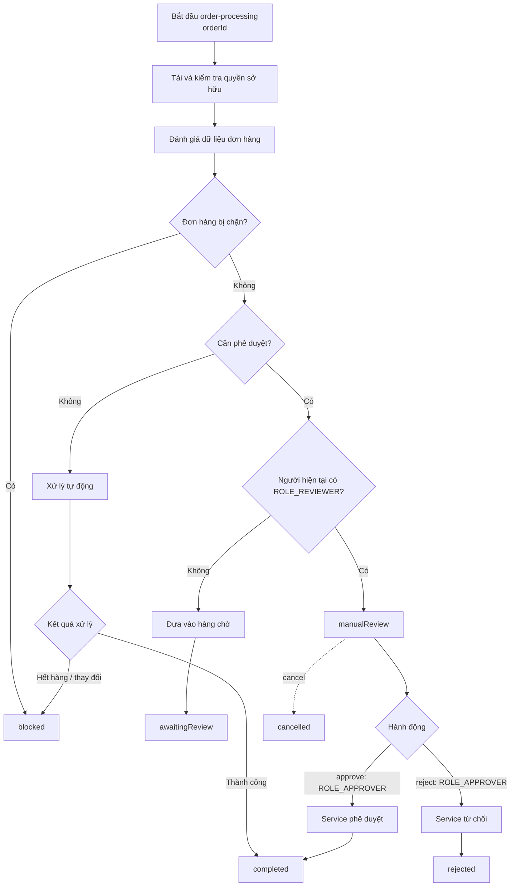

# Rẽ nhánh hành trình theo dữ liệu và quyền truy cập

Một quy trình xử lý đơn hàng có thể bắt đầu giống nhau với mọi người: người dùng mở đơn hàng, xem thông tin và gửi yêu cầu xử lý. Nhưng đường đi tiếp theo phụ thuộc vào **dữ liệu nghiệp vụ** và **quyền của người đang đăng nhập**. Đơn hàng hợp lệ, giá trị nhỏ có thể đi thẳng tới bước thực hiện; đơn hàng giá trị cao cần quản lý phê duyệt; đơn hàng đã bị khóa phải dừng lại. Ngay cả khi dữ liệu yêu cầu phê duyệt, một người dùng không có quyền phê duyệt cũng không được vào màn hình đó.

Spring Web Flow cung cấp các state và transition để mô hình hóa hành trình này. Ta dùng `<decision-state>` để rẽ nhánh theo dữ liệu, `<secured>` cùng `SecurityFlowExecutionListener` để bảo vệ flow/state/transition, và service để kiểm tra quyền trên tài nguyên thực tế. Bài thực hành tích hợp các thành phần đó thành một flow xử lý đơn hàng có thể kiểm thử.

## 1. Mục tiêu thực hành

Sau bài này, bạn có thể:

1. Mô hình hóa một hành trình nhiều bước có các nhánh theo trạng thái và thuộc tính của dữ liệu.
2. Dùng `<decision-state>` để chọn state tiếp theo theo điều kiện.
3. Kết hợp dữ liệu đơn hàng với authority của người dùng để chọn nhánh phù hợp.
4. Bảo vệ toàn flow, một state và một transition bằng `<secured>`.
5. Đăng ký `SecurityFlowExecutionListener` với đúng `FlowExecutor`.
6. Phân biệt quyết định điều hướng với quyết định authorization và kiểm tra ownership tại service.
7. Xử lý nhánh chờ phê duyệt, bị từ chối, hoàn tất và hủy.
8. Viết test bao phủ cả ma trận dữ liệu và quyền truy cập, thay vì chỉ test một đường thành công.

## 2. Bài toán: xử lý đơn hàng theo dữ liệu và vai trò

Hệ thống có một flow `order-processing`. Người dùng mở đơn hàng và chọn gửi xử lý. Quy trình cần xét các điều kiện:

- Đơn hàng có hợp lệ và còn được xử lý không?
- Đơn hàng có bị khóa, đã hủy hoặc đã hoàn tất không?
- Giá trị đơn hàng có vượt ngưỡng cần phê duyệt không?
- Người đang đăng nhập có authority `ROLE_REVIEWER` không?
- Người đó có authority `ROLE_APPROVER` để thực hiện thao tác phê duyệt không?

Ta xác định hành vi mong muốn:

| Dữ liệu đơn hàng | Quyền hiện tại | Hành trình |
| --- | --- | --- |
| Đơn hàng bị khóa/không hợp lệ | Bất kỳ người đã vào flow | Kết thúc nhánh `blocked` |
| Hợp lệ, không cần phê duyệt | `ROLE_USER` | Xử lý tự động |
| Cần phê duyệt | Có `ROLE_REVIEWER` | Vào màn hình `manualReview` |
| Cần phê duyệt | Không có `ROLE_REVIEWER` | Đưa vào hàng chờ, kết thúc `awaitingReview` |
| Đang ở màn hình phê duyệt | Có `ROLE_REVIEWER` nhưng thiếu `ROLE_APPROVER` | Xem được màn hình, không được gửi event phê duyệt |
| Đang ở màn hình phê duyệt | Có cả quyền phù hợp | Có thể thực hiện quyết định; service vẫn kiểm tra lại |

Flow không lấy role từ request parameter hay hidden input. Quyền được xác định từ `Authentication` hiện tại của Spring Security. Dữ liệu đơn hàng được đọc từ service sau khi kiểm tra quyền truy cập tài nguyên.

## 3. Thiết kế các nhánh trước khi viết XML

Ta chia hành trình thành các bước:

1. Nhận `orderId` khi bắt đầu flow.
2. Tải đơn hàng thuộc phạm vi người dùng hiện tại.
3. Đánh giá trạng thái và chính sách xử lý đơn hàng.
4. Nếu đơn hàng không hợp lệ, kết thúc nhánh bị chặn.
5. Nếu cần phê duyệt, kiểm tra người hiện tại có quyền vào màn hình review không.
6. Nếu có quyền, cho vào màn hình review; nếu không, chuyển đơn vào hàng chờ phê duyệt.
7. Nếu không cần phê duyệt, xử lý tự động.
8. Tại màn hình review, chỉ người có quyền phê duyệt mới thực hiện được transition tương ứng.

Sơ đồ tổng quát:



Quyết định dựa trên **dữ liệu** và quyết định dựa trên **quyền** được đặt thành hai bước riêng. Điều này giúp ta biết một đơn hàng cần phê duyệt vì lý do nghiệp vụ, còn người hiện tại có đủ quyền thực hiện phê duyệt hay không là câu hỏi khác.

## 4. Chuẩn bị model và kết quả đánh giá

Flow chỉ cần một số dữ liệu đủ để điều hướng và hiển thị. Không nên lưu toàn bộ entity JPA hoặc các đối tượng hạ tầng vào flow scope.

### 4.1. DTO đơn hàng

```java
package com.example.orders.flow;

import java.io.Serializable;
import java.math.BigDecimal;

public class OrderSummary implements Serializable {
    private Long id;
    private String reference;
    private BigDecimal total;
    private String status;
    private boolean locked;

    public Long getId() { return id; }
    public String getReference() { return reference; }
    public BigDecimal getTotal() { return total; }
    public String getStatus() { return status; }
    public boolean isLocked() { return locked; }
}
```

Đây là DTO chỉ đọc dùng cho flow. Service chịu trách nhiệm tải dữ liệu và xác minh người dùng có thể xem đơn hàng đó. Trong ứng dụng thật, constructor/factory có thể được dùng để tạo DTO bất biến.

### 4.2. Kết quả đánh giá route

```java
package com.example.orders.flow;

import java.io.Serializable;

public class OrderRoutingDecision implements Serializable {
    private final boolean blocked;
    private final boolean requiresManualReview;
    private final String reasonCode;

    public OrderRoutingDecision(
            boolean blocked,
            boolean requiresManualReview,
            String reasonCode) {
        this.blocked = blocked;
        this.requiresManualReview = requiresManualReview;
        this.reasonCode = reasonCode;
    }

    public boolean isBlocked() {
        return blocked;
    }

    public boolean isRequiresManualReview() {
        return requiresManualReview;
    }

    public String getReasonCode() {
        return reasonCode;
    }
}
```

Trong ví dụ, service đã quyết định dựa trên quy tắc nghiệp vụ: trạng thái, tổng tiền, loại đơn hàng và các cờ kiểm soát. Flow đọc kết quả này để điều hướng. Flow không tự tính tổng tiền từ input của trình duyệt.

## 5. Service thực hiện kiểm tra nghiệp vụ và quyền trên tài nguyên

Một flow-level role không chứng minh người dùng có quyền trên mọi đơn hàng. Service phải kiểm tra ownership hoặc phạm vi quản lý trước khi trả dữ liệu:

```java
package com.example.orders;

import com.example.orders.flow.OrderSummary;
import org.springframework.security.access.prepost.PreAuthorize;
import org.springframework.stereotype.Service;

@Service
public class OrderQueryService {

    @PreAuthorize("@orderAuthorization.canRead(authentication, #orderId)")
    public OrderSummary loadForCurrentUser(Long orderId) {
        // Truy vấn theo orderId, xác minh tenant/owner và trạng thái.
        return loadSummary(orderId);
    }
}
```

`orderAuthorization.canRead` là bean do ứng dụng triển khai. Ví dụ minh họa dùng method security của Spring Security; cần bật `@EnableMethodSecurity` trong cấu hình phù hợp. Nếu người dùng có `ROLE_USER` nhưng đơn hàng thuộc người khác, service vẫn từ chối.

### 5.1. Dịch vụ đánh giá dữ liệu

```java
@org.springframework.stereotype.Service
public class OrderRoutingService {

    public OrderRoutingDecision assess(OrderSummary order) {
        if (order.isLocked()
                || !"PENDING".equals(order.getStatus())) {
            return new OrderRoutingDecision(
                    true, false, "ORDER_NOT_PROCESSABLE");
        }

        boolean highValue =
                order.getTotal().compareTo(new java.math.BigDecimal("50000000")) > 0;

        boolean specialCategory =
                order.getReference().startsWith("CORP-");

        boolean requiresReview = highValue || specialCategory;

        return new OrderRoutingDecision(
                false, requiresReview, null);
    }
}
```

Ngưỡng tiền trong ví dụ chỉ minh họa. Trong hệ thống thật, quy tắc cần đến từ cấu hình nghiệp vụ hoặc policy service. `OrderRoutingService` không quyết định người hiện tại có được phê duyệt hay không; nó chỉ trả lời **đơn hàng có cần bước review không**.

## 6. Kiểm tra authority của người hiện tại

Để chọn nhánh dành cho reviewer, flow cần biết người hiện tại có quyền vào màn hình review hay không. Có thể ủy quyền việc kiểm tra này cho một bean nhỏ đọc `SecurityContext`:

```java
package com.example.orders.security;

import org.springframework.security.core.Authentication;
import org.springframework.security.core.context.SecurityContextHolder;
import org.springframework.stereotype.Component;

@Component("orderFlowAccess")
public class OrderFlowAccess {

    public boolean currentUserCanReview() {
        Authentication authentication =
                SecurityContextHolder.getContext().getAuthentication();

        if (authentication == null || !authentication.isAuthenticated()) {
            return false;
        }

        return authentication.getAuthorities().stream()
                .anyMatch(authority ->
                        "ROLE_REVIEWER".equals(authority.getAuthority()));
    }
}
```

Đây là **điều kiện để chọn nhánh hiển thị**. Nó không phải lớp bảo vệ cuối cùng. Ngay cả khi phương thức trả về `true`, `<secured>` tại state vẫn phải kiểm tra quyền khi vào state; service phê duyệt cũng cần kiểm tra lại ở thời điểm thao tác.

Trong dự án thực tế, có thể thay bean này bằng một policy service/`AuthorizationManager` dùng chung với Spring Security. Tránh sao chép nhiều cách diễn giải authority khác nhau trong flow và service.

## 7. Cấu hình bảo vệ trong Spring Web Flow

### 7.1. Đăng ký SecurityFlowExecutionListener

Trong Spring XML, listener phải được gắn vào executor mà Spring MVC thực sự sử dụng:

```xml
<webflow:flow-executor id="flowExecutor"
                       flow-registry="flowRegistry">
    <webflow:flow-execution-listeners>
        <webflow:listener ref="securityFlowExecutionListener" />
    </webflow:flow-execution-listeners>
</webflow:flow-executor>

<bean id="securityFlowExecutionListener"
      class="org.springframework.webflow.security.SecurityFlowExecutionListener" />
```

Nếu ứng dụng có nhiều executor, phải gắn listener vào đúng executor. Chỉ khai báo `<secured>` trong flow XML mà không đăng ký listener sẽ không thực thi được chính sách flow security như mong muốn.

### 7.2. Cấu hình theo phiên bản

Spring Web Flow 3.0.1 trở lên hỗ trợ `AuthorizationManager` thông qua `SecurityFlowExecutionListener.setAuthorizationManagerInitializer(...)`; các API `AccessDecisionManager` cũ đã deprecated for removal. Ứng dụng dùng Spring Security 6/7 cần chọn đúng bộ dependency tương thích và không sao chép cấu hình legacy từ Web Flow 2.x mà không kiểm tra Javadoc. Với manager tùy biến, phải bảo đảm cách xử lý authority và `match="any/all"` đúng như test mong đợi.

### 7.3. Bảo vệ endpoint HTTP

Flow security không thay thế filter chain. Một cấu hình HTTP tối giản theo Spring Security 6:

```java
@Bean
SecurityFilterChain applicationSecurity(HttpSecurity http)
        throws Exception {
    return http
        .authorizeHttpRequests(authorize -> authorize
            .requestMatchers("/flows/orders/**").authenticated()
            .anyRequest().permitAll()
        )
        .build();
}
```

Đường dẫn là ví dụ; hãy dùng mapping thật của `FlowHandlerMapping`. Giữ CSRF protection cho các request thay đổi dữ liệu và tích hợp token với form view theo cấu hình ứng dụng.

## 8. Flow XML hoàn chỉnh

Flow sau phối hợp dữ liệu, authority và service. Các bean `orderQueryService`, `orderRoutingService`, `orderFlowAccess` và `orderCommandService` cần được đăng ký trong Spring context.

```xml
<flow xmlns="http://www.springframework.org/schema/webflow"
      xmlns:xsi="http://www.w3.org/2001/XMLSchema-instance"
      xsi:schemaLocation="http://www.springframework.org/schema/webflow
                          https://www.springframework.org/schema/webflow/spring-webflow.xsd">

    <!-- Chỉ người dùng đã có quyền cơ bản mới bắt đầu flow. -->
    <secured attributes="ROLE_USER" />

    <input name="orderId" type="long" required="true" />

    <on-start>
        <!-- Service kiểm tra người dùng được phép đọc đúng đơn hàng. -->
        <evaluate expression="orderQueryService.loadForCurrentUser(orderId)"
                  result="flowScope.order" />
        <evaluate expression="orderRoutingService.assess(order)"
                  result="flowScope.routing" />
    </on-start>

    <decision-state id="checkBlocked">
        <if test="routing.blocked"
            then="blocked"
            else="checkManualReview" />
    </decision-state>

    <decision-state id="checkManualReview">
        <if test="routing.requiresManualReview"
            then="checkReviewerAccess"
            else="processAutomatically" />
    </decision-state>

    <decision-state id="checkReviewerAccess">
        <if test="orderFlowAccess.currentUserCanReview()"
            then="manualReview"
            else="queueForReview" />
    </decision-state>

    <action-state id="processAutomatically">
        <evaluate expression="orderCommandService.fulfillAutomatically(order.id)" />
        <transition on="success" to="completed" />
        <transition on="outOfStock" to="blocked" />
        <transition on="notProcessable" to="blocked" />
    </action-state>

    <view-state id="manualReview" view="orders/manualReview">
        <secured attributes="ROLE_REVIEWER" />

        <transition on="approve" to="approveOrder">
            <secured attributes="ROLE_APPROVER" />
        </transition>
        <transition on="reject" to="rejectOrder">
            <secured attributes="ROLE_APPROVER" />
        </transition>
        <transition on="back" to="reviewSummary" />
    </view-state>

    <view-state id="reviewSummary" view="orders/reviewSummary">
        <transition on="returnToReview" to="manualReview" />
    </view-state>

    <action-state id="approveOrder">
        <evaluate expression="orderCommandService.approve(order.id)" />
        <transition on="success" to="completed" />
        <transition on="notAllowed" to="blocked" />
        <transition on="staleOrder" to="blocked" />
    </action-state>

    <action-state id="rejectOrder">
        <evaluate expression="orderCommandService.reject(order.id)" />
        <transition on="success" to="rejected" />
        <transition on="notAllowed" to="blocked" />
        <transition on="staleOrder" to="blocked" />
    </action-state>

    <action-state id="queueForReview">
        <evaluate expression="orderCommandService.enqueueReview(order.id)" />
        <transition on="success" to="awaitingReview" />
        <transition on="notAllowed" to="blocked" />
    </action-state>

    <end-state id="completed">
        <output name="orderId" value="flowScope.order.id" />
    </end-state>

    <end-state id="awaitingReview">
        <output name="orderId" value="flowScope.order.id" />
    </end-state>

    <end-state id="rejected">
        <output name="orderId" value="flowScope.order.id" />
    </end-state>

    <end-state id="blocked">
        <output name="reasonCode" value="flowScope.routing.reasonCode" />
    </end-state>

    <global-transitions>
        <transition on="cancel" to="cancelled" />
    </global-transitions>

    <end-state id="cancelled">
        <output name="orderId" value="flowScope.order.id" />
    </end-state>
</flow>
```

Đây là ví dụ tích hợp để học cách tổ chức flow; các view và bean phải được ứng dụng cung cấp. Trong triển khai thật, hãy thống nhất các outcome mà service có thể trả về, xử lý exception nghiệp vụ và bảo đảm các state/transition được bảo vệ đúng phiên bản Web Flow.

### 8.1. Vì sao có ba decision-state?

Mỗi decision-state trả lời một câu hỏi duy nhất:

1. `checkBlocked`: dữ liệu có cho phép tiếp tục không?
2. `checkManualReview`: đơn hàng có cần người phê duyệt không?
3. `checkReviewerAccess`: người hiện tại có được vào nhánh review không?

Tách như vậy làm cho thứ tự quyết định dễ đọc và dễ test. Nếu gộp mọi điều kiện thành một biểu thức dài, rất khó biết nhánh nào gây ra kết quả sai.

### 8.2. Vì sao kiểm tra role hai lần?

`checkReviewerAccess` chỉ giúp chọn nhánh phù hợp và hiển thị UX hợp lý. `<secured attributes="ROLE_REVIEWER"/>` tại state `manualReview` vẫn là kiểm tra bắt buộc khi vào state. `ROLE_APPROVER` tại transition lại bảo vệ hành động phê duyệt/từ chối. Service cuối cùng phải kiểm tra quyền trên đúng đơn hàng và trạng thái hiện tại.

Ba lớp có nhiệm vụ khác nhau:

| Lớp | Câu hỏi |
| --- | --- |
| Decision-state | Nên điều hướng người dùng tới nhánh nào? |
| `<secured>` | Người dùng có được vào state/thực hiện transition không? |
| Service authorization | Người dùng có quyền thay đổi đúng tài nguyên này ngay lúc này không? |

## 9. Tách quyền xem và quyền thực hiện hành động

Trong ví dụ, người có `ROLE_REVIEWER` có thể xem màn hình review, nhưng cần thêm `ROLE_APPROVER` để gửi event `approve` hoặc `reject`. Điều này cho phép một nhóm kiểm tra hồ sơ và một nhóm khác có thẩm quyền ra quyết định cuối cùng.

Nếu một người cần cả hai authority, họ phải có cả `ROLE_REVIEWER` ở state và `ROLE_APPROVER` ở transition. Nếu policy muốn chỉ cần một trong hai role, hãy dùng `match="any"` hoặc một manager có logic rõ ràng và test tương ứng.

Không nên ẩn nút Approve rồi xem đó là biện pháp bảo vệ. Người dùng có thể gửi request trực tiếp với `_eventId_approve`. Security listener phải kiểm tra transition và service phải kiểm tra lại.

## 10. Xử lý khi dữ liệu thay đổi trong lúc flow đang chạy

Flow có thể được mở trong vài phút. Trong thời gian đó, một quản lý khác có thể phê duyệt đơn hàng, đơn hàng có thể bị hủy hoặc tồn kho thay đổi. Kết quả `routing` đã tính ở `on-start` có thể không còn đúng khi người dùng nhấn Approve.

Do đó, service command cần tải và kiểm tra trạng thái mới nhất trong transaction:

```java
@org.springframework.stereotype.Service
public class OrderCommandService {

    @org.springframework.security.access.prepost.PreAuthorize("hasAuthority('ROLE_APPROVER')")
    @org.springframework.transaction.annotation.Transactional
    public String approve(Long orderId) {
        Order order = orderRepository.findByIdForUpdate(orderId)
                .orElseThrow(OrderNotFoundException::new);

        if (!authorization.canApprove(
                org.springframework.security.core.context.SecurityContextHolder
                        .getContext().getAuthentication(), order)) {
            return "notAllowed";
        }

        if (!order.isPendingReview()) {
            return "staleOrder";
        }

        order.approve();
        return "success";
    }
}
```

Đoạn code là khung minh họa; cách lấy authentication, lock và mapping exception phụ thuộc ứng dụng. Ý chính là **không tin quyết định đã tính trước đó**. Dữ liệu và quyền phải được xác nhận lại tại thời điểm thực hiện lệnh.

Nếu action bị gửi lặp do người dùng refresh hoặc mạng timeout, service cần idempotency hoặc kiểm tra trạng thái để không phê duyệt hai lần. Flow điều hướng không tự bảo đảm transaction hay chống lặp.

## 11. Xử lý nhánh không đủ quyền

Trong flow mẫu, người có quyền cơ bản nhưng không có `ROLE_REVIEWER` được đưa vào `queueForReview`. Có hai lựa chọn thiết kế:

**Lựa chọn A — Đưa vào hàng chờ:** service ghi yêu cầu review, flow kết thúc `awaitingReview`. Đây là lựa chọn phù hợp khi người dùng có quyền gửi yêu cầu nhưng không có quyền tự phê duyệt.

**Lựa chọn B — Từ chối truy cập:** nếu chính việc xem hoặc khởi chạy hành trình review là không được phép, không điều hướng tới màn hình review. Để security listener từ chối state/transition theo rule. Không biến mọi từ chối thành một outcome nghiệp vụ “đã gửi yêu cầu”.

Chọn theo policy thật. Thiếu role phê duyệt không nhất thiết đồng nghĩa người dùng không được tạo yêu cầu; nhưng thiếu quyền xem tài nguyên thì không được tiết lộ dữ liệu đơn hàng.

## 12. Tổ chức message cho từng nhánh

Các nhánh có thể cần thông báo khác nhau:

| Outcome/state | Message gợi ý |
| --- | --- |
| `completed` | Đơn hàng đã được xử lý |
| `awaitingReview` | Yêu cầu đang chờ người có thẩm quyền phê duyệt |
| `rejected` | Đơn hàng bị từ chối theo chính sách |
| `blocked` | Đơn hàng hiện không thể tiếp tục; liên hệ bộ phận hỗ trợ |
| `cancelled` | Hành trình đã được hủy |

Message hiển thị nên dùng message code và MessageSource để hỗ trợ đa ngôn ngữ. Không hiển thị chi tiết nội bộ như role name, điều kiện fraud hoặc exception stack trace cho người dùng thông thường.

Ví dụ, service có thể trả `reasonCode` đã chuẩn hóa; view dùng code đó để chọn message. Không đưa nguyên văn exception từ database hoặc hệ thống thanh toán ra giao diện.

## 13. Kiểm thử tích hợp theo ma trận dữ liệu và quyền

Chỉ test một đơn hàng giá trị thấp với user role cơ bản sẽ bỏ sót hầu hết nhánh. Cần kiểm tra kết hợp **trạng thái dữ liệu**, **ngưỡng nghiệp vụ**, **authority** và **quyền sở hữu**.

### 13.1. Ma trận đường đi

| Dữ liệu | Authorities | Kết quả kỳ vọng |
| --- | --- | --- |
| Pending, giá trị thấp, không khóa | `ROLE_USER` | `completed` qua xử lý tự động |
| Pending, giá trị cao | `ROLE_USER` | `awaitingReview` |
| Pending, giá trị cao | `ROLE_USER` + `ROLE_REVIEWER` | `manualReview` |
| Pending, giá trị cao | `ROLE_USER` + `ROLE_REVIEWER` + `ROLE_APPROVER` | Có thể vào review và phê duyệt |
| Pending, giá trị cao | `ROLE_USER` + `ROLE_REVIEWER` (thiếu approver) | Vào review; transition approve bị từ chối |
| Locked | `ROLE_USER` | `blocked` |
| Đã hoàn tất | `ROLE_USER` | `blocked` hoặc nhánh trạng thái tương ứng |
| Pending, giá trị thấp | `ROLE_REVIEWER` nhưng không có `ROLE_USER` | Bị chặn ở flow-level security |
| Pending, giá trị cao, đơn hàng thuộc người khác | `ROLE_USER` + reviewer | Service từ chối tải tài nguyên |
| Pending lúc mở flow, đã được xử lý trước khi approve | Reviewer + approver | Service từ chối stale action |

### 13.2. Test flow bằng AbstractXmlFlowExecutionTests

Spring Web Flow có bộ hỗ trợ như `AbstractXmlFlowExecutionTests` và `MockExternalContext`. Có thể bắt đầu flow với input map, phát event và kiểm tra state/outcome. Ví dụ khung:

```java
public class OrderProcessingFlowTests
        extends AbstractXmlFlowExecutionTests {

    @Override
    protected String getResourceLocation() {
        return "classpath:flows/order-processing.xml";
    }

    public void testHighValueOrderWithoutReviewerIsQueued() {
        // Fixture: orderRoutingService trả requiresManualReview=true.
        // SecurityContext có ROLE_USER nhưng không có ROLE_REVIEWER.
        MutableAttributeMap input = new LocalAttributeMap();
        input.put("orderId", 42L);

        startFlow(input, new MockExternalContext());

        assertFlowExecutionEnded();
        assertFlowExecutionOutcomeEquals("awaitingReview");
    }
}
```

Đây là khung minh họa; test hoàn chỉnh cần mock service, cấu hình SecurityContext và gắn listener vào executor. Nếu test flow trực tiếp không dựng Spring Security filter chain, vẫn phải thiết lập đúng authentication cho `SecurityFlowExecutionListener` và bean access policy.

### 13.3. Test HTTP và method security

Ở lớp MVC/integration:

- Dùng Spring Security Test để tạo principal/authority khác nhau.
- Gửi request tới flow URL với execution key hợp lệ.
- Xác minh user không có quyền nhận phản hồi từ chối theo filter/flow security.
- Gửi event `_eventId_approve` trực tiếp, không dựa vào nút đã ẩn.
- Kiểm tra service không trả dữ liệu hoặc cập nhật đơn hàng ngoài phạm vi người dùng.

Không nên chỉ assert status code; một flow có thể trả redirect hoặc trang lỗi tùy cấu hình. Kiểm tra cả state/outcome, dữ liệu service và side effect database.

## 14. Các lỗi thường gặp khi kết hợp dữ liệu và quyền

| Triệu chứng | Nguyên nhân | Cách khắc phục |
| --- | --- | --- |
| Đơn hàng giá trị cao đi vào xử lý tự động | Decision condition sai hoặc service tính tổng tiền từ dữ liệu client | Đánh giá bằng dữ liệu server và test ngưỡng |
| User không có reviewer vẫn thấy màn hình review | Thiếu check quyền ở decision hoặc listener không được đăng ký | Kiểm tra access policy và executor |
| Nút Approve bị ẩn nhưng request vẫn phê duyệt | Chỉ bảo vệ UI, không bảo vệ transition/service | Thêm `<secured>` và method/domain authorization |
| User có ROLE_REVIEWER nhưng không xem được flow | Thiếu ROLE_USER ở flow-level hoặc authority mismatch | Kiểm tra toàn bộ rule và authorities |
| Quyền đúng nhưng thao tác vẫn bị từ chối | Order không thuộc user hoặc đã đổi trạng thái | Kiểm tra service authorization và dữ liệu mới |
| Đơn hàng được phê duyệt hai lần | Không idempotent hoặc thiếu kiểm tra trạng thái trong transaction | Thêm idempotency/optimistic locking |
| Nhánh manual review không có ai xử lý | Thiết kế hàng chờ chưa có quy trình vận hành | Định nghĩa owner, SLA và trạng thái queue |
| Role branch khác với secured state | Access policy và security manager diễn giải quyền không đồng nhất | Dùng policy chung và test integration |
| Security XML không có hiệu lực | Quên SecurityFlowExecutionListener | Kiểm tra đúng FlowExecutor |
| Test flow pass nhưng HTTP truy cập được trái phép | Chỉ test execution, chưa test filter chain/HTTP | Bổ sung MVC integration tests |

## 15. Bài tập mở rộng

Hãy mở rộng `order-processing` để hỗ trợ thêm hai loại đơn hàng:

1. Đơn hàng quốc tế cần kiểm tra tuân thủ.
2. Đơn hàng có dấu hiệu rủi ro cần chuyển sang nhóm fraud review.

Yêu cầu:

- Thêm một kết quả đánh giá dữ liệu có `requiresComplianceReview` và `requiresFraudReview`.
- Định nghĩa thứ tự ưu tiên giữa blocked, fraud, compliance và manual approval.
- Chỉ `ROLE_COMPLIANCE_REVIEWER` được vào state tuân thủ.
- Chỉ `ROLE_FRAUD_ANALYST` được vào state fraud.
- Transition quyết định cuối cùng yêu cầu authority riêng `ROLE_FINAL_APPROVER`.
- Nếu user không có role chuyên trách, yêu cầu được đưa vào đúng queue và flow kết thúc outcome tương ứng.
- Service kiểm tra quyền tài nguyên và trạng thái mới nhất trước mỗi quyết định.
- Viết test cho trường hợp một đơn hàng đồng thời có nhiều cờ review để bảo đảm thứ tự ưu tiên nhất quán.

**Câu hỏi tự kiểm tra:**

- Nếu một đơn hàng vừa có cờ fraud vừa cần compliance review, nhánh nào phải chạy trước và ai quyết định?
- Vì sao role reviewer không đủ để chứng minh người đó được xem mọi đơn hàng?
- Nếu user mất ROLE_APPROVER trong lúc đang mở màn hình, điều gì bảo vệ transition approve?
- Nếu service từ chối do order đã được xử lý, nên trả outcome nghiệp vụ nào thay vì chạy lại lệnh?

## 16. Checklist hoàn thiện bài thực hành

- [ ] Input flow chỉ nhận ID cần thiết; service tải tài nguyên theo quyền người dùng.
- [ ] Decision-state chia nhỏ các câu hỏi nghiệp vụ, không chứa biểu thức điều kiện quá dài.
- [ ] Thứ tự nhánh được xác định rõ: blocked trước, rồi manual review, sau đó tự động.
- [ ] Quyền reviewer được đọc từ SecurityContext/policy server-side, không từ request.
- [ ] SecurityFlowExecutionListener được gắn với đúng FlowExecutor.
- [ ] Flow-level, state-level và transition-level security được đặt đúng phạm vi.
- [ ] Service kiểm tra ownership, trạng thái và quyền lại khi thực hiện side effect.
- [ ] Retry/approve/reject có transaction và chống xử lý trùng phù hợp.
- [ ] Có nhánh chờ review cho người dùng không có quyền phê duyệt nhưng vẫn được phép gửi yêu cầu.
- [ ] Test kết hợp dữ liệu, authority, ownership và trạng thái thay đổi.

## 17. Ghi nhớ

- Dữ liệu quyết định **quy trình nào cần chạy**; quyền quyết định **ai được đi vào hoặc thực hiện bước đó**.
- `<decision-state>` thích hợp cho các điều kiện rẽ nhánh rõ ràng; tách nhiều quyết định thành nhiều state giúp dễ đọc và kiểm thử.
- `<secured>` tại flow/state/transition cần `SecurityFlowExecutionListener` được đăng ký với đúng executor.
- Quyền ở flow chỉ là một phần của bảo vệ. Service vẫn phải kiểm tra người dùng có quyền trên tài nguyên cụ thể và trạng thái hiện tại.
- Nhánh hiển thị dựa trên role không thay thế authorization; transition nhạy cảm phải được bảo vệ cả khi người dùng tự gửi event.
- Không tin giá trị từ client cho tổng tiền, trạng thái hoặc role. Tính toán và quyết định từ dữ liệu server.
- Flow có thể kéo dài, nên đánh giá dữ liệu lúc bắt đầu không đủ cho thao tác cuối; kiểm tra lại trong service và transaction.
- Kiểm thử toàn bộ ma trận dữ liệu/quyền, bao gồm người không có role, tài nguyên không thuộc user và dữ liệu đã thay đổi.

### Tài liệu tham khảo

- [Spring Web Flow 3.0.x Reference Guide — Decision States](https://docs.spring.io/spring-webflow/docs/3.0.x/reference/#_decision_states)
- [Spring Web Flow 3.0.x Reference Guide — Securing Flows](https://docs.spring.io/spring-webflow/docs/3.0.x/reference/#_securing_flows)
- [Spring Web Flow 3.0.1 Javadoc — SecurityFlowExecutionListener](https://docs.spring.io/spring-webflow/docs/3.0.1/api/org/springframework/webflow/security/SecurityFlowExecutionListener.html)
- [Spring Web Flow 3.0.1 Javadoc — SecurityRule](https://docs.spring.io/spring-webflow/docs/3.0.1/api/org/springframework/webflow/security/SecurityRule.html)
- [Spring Security Reference — Method Security](https://docs.spring.io/spring-security/reference/servlet/authorization/method-security.html)
- [Spring Security Reference — Authorize HTTP Requests](https://docs.spring.io/spring-security/reference/servlet/authorization/authorize-http-requests.html)
