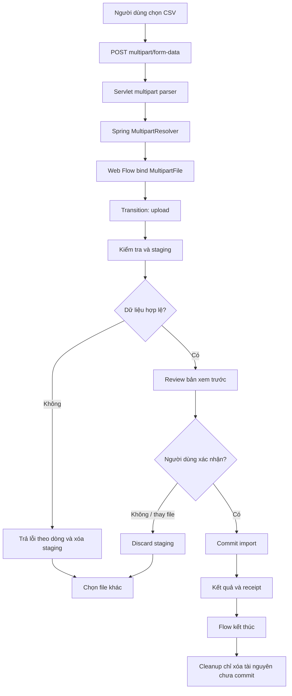
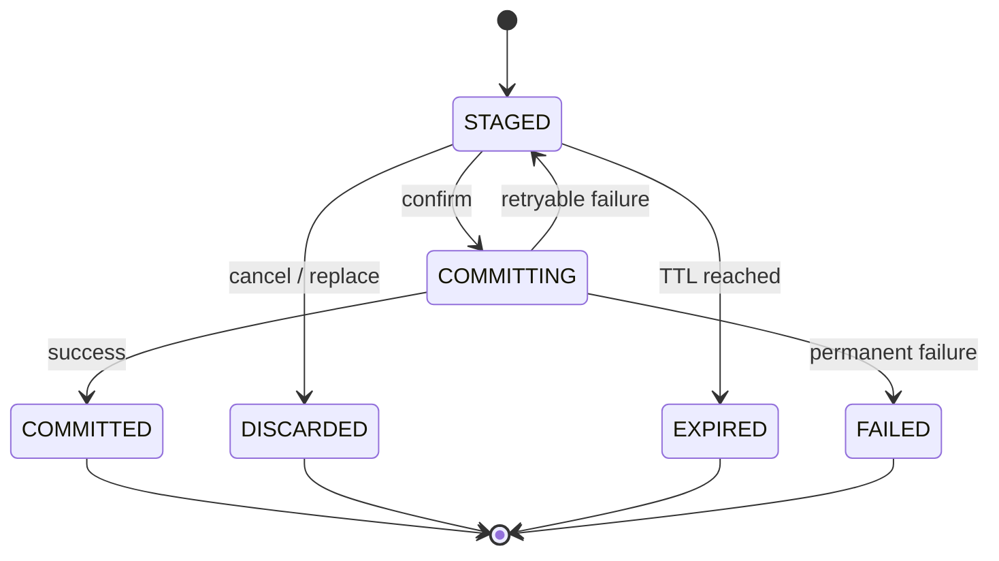

# Tải tệp với kiểm tra dữ liệu và dọn tài nguyên trong Spring Web Flow

## 1. Bài toán thực tế: một lần upload là cả một quy trình

Một chức năng tải tệp trong ứng dụng doanh nghiệp thường không dừng ở việc nhận một file và ghi nó xuống ổ đĩa. Người dùng có thể tải bảng CSV danh sách nhân viên, bảng giá hoặc dữ liệu sản phẩm. Ứng dụng cần kiểm tra kích thước, định dạng, cấu trúc và từng dòng dữ liệu; hiển thị lỗi để người dùng sửa; cho phép xác nhận trước khi nhập dữ liệu chính thức; đồng thời dọn tệp tạm nếu người dùng hủy, phiên flow hết hạn hoặc máy chủ gặp lỗi.

Spring Web Flow (SWF) phù hợp để điều phối quy trình nhiều bước này. Flow có thể đưa người dùng qua các state:

1. Chọn tệp và gửi lên.
2. Kiểm tra định dạng, nội dung và dữ liệu từng dòng.
3. Xem trước kết quả và các lỗi.
4. Xác nhận nhập dữ liệu hoặc chọn tệp khác.
5. Hiển thị kết quả hoàn tất.

Spring MVC nhận multipart request và cung cấp đối tượng MultipartFile. Web Flow bind đối tượng này vào model của view-state rồi cho phép transition action xử lý nó. Sau khi request hiện tại kết thúc, multipart file tạm do Servlet/Spring quản lý không còn là tài nguyên để flow giữ qua nhiều request. Vì vậy flow cần giữ một mã tham chiếu đến tệp đã được staging, cùng metadata và kết quả kiểm tra, thay vì giữ MultipartFile trong flowScope.

Bài thực hành dùng tình huống nhập danh sách nhân viên từ CSV. Mỗi dòng có mã nhân viên, email và phòng ban. Hệ thống chỉ nhận CSV UTF-8, giới hạn dung lượng và số dòng, kiểm tra header, dữ liệu bắt buộc, email, mã trùng và quyền nhập dữ liệu. File được ghi vào vùng quarantine bên ngoài web root; chỉ sau khi người dùng xác nhận, ứng dụng mới chuyển dữ liệu sang quy trình import chính thức.

Sau bài này, bạn có thể:

1. Cấu hình Servlet multipart parsing và Spring MVC MultipartResolver cho flow.
2. Bind MultipartFile vào model của view-state và xử lý file trong transition action.
3. Giải thích vì sao MultipartFile cần có vòng đời request và vì sao field trong model nên là transient.
4. Tách kiểm tra kích thước, loại file, cấu trúc CSV và quy tắc nghiệp vụ.
5. Staging file bằng tên do server tạo, giữ metadata nhỏ trong flowScope và xác nhận quyền sở hữu khi tiếp tục flow.
6. Thiết kế cleanup khi người dùng thay file, hủy flow, flow kết thúc, session hết hạn hoặc máy chủ khởi động lại.
7. Xử lý việc chuyển file từ vùng tạm sang vùng lưu trữ chính thức có tính idempotent và có thể phục hồi.
8. Kiểm thử upload thành công, lỗi dữ liệu, upload quá lớn, hủy, hết hạn và lỗi lưu trữ.

## 2. Kiến trúc xử lý upload trong Spring Web Flow

### 2.1. Phân chia trách nhiệm

Một triển khai dễ bảo trì thường có bốn lớp trách nhiệm:

| Thành phần | Trách nhiệm |
|---|---|
| Servlet container | Phân tích multipart request, áp giới hạn ở tầng HTTP và quản lý file tạm của multipart parser. |
| Spring MVC MultipartResolver | Chuyển multipart request thành MultipartHttpServletRequest và cung cấp MultipartFile cho data binding. |
| Spring Web Flow | Quản lý view-state, model binding, event, transition, review/confirm/cancel và vòng đời flow. |
| Upload/import service | Kiểm tra nội dung, staging, quyền sở hữu, commit import và cleanup tài nguyên do ứng dụng tạo. |

Không để flow XML tự xử lý byte stream, đường dẫn file hoặc SQL. Flow điều phối hành trình; service thực hiện thao tác với file và nghiệp vụ.

### 2.2. Luồng end-to-end



Trong một HTTP request, Servlet container và MultipartResolver tạo đối tượng MultipartFile. Web Flow bind file vào model, transition action gọi service để sao chép nội dung sang vùng staging do ứng dụng quản lý và kiểm tra dữ liệu. Khi flow chuyển sang request tiếp theo, model chỉ cần giữ mã staging và báo cáo kiểm tra. MultipartFile đã hoàn thành vai trò của nó trong request upload.

### 2.3. Hai loại tệp tạm khác nhau

Cần phân biệt:

- **Multipart temporary file:** tệp trung gian do Servlet container hoặc multipart parser tạo trong lúc đọc request. Vòng đời và cleanup do tầng multipart quản lý.
- **Application staging file:** bản sao do ứng dụng chủ động lưu vào quarantine để người dùng có thể xem trước, xác nhận hoặc hủy trong những request tiếp theo.

Không lưu đường dẫn nội bộ của multipart parser vào flowScope. Hãy sao chép nội dung sang vùng staging có định danh riêng, rồi lưu một UploadId/UploadDraft trong flow.

## 3. Cấu hình multipart cho Spring MVC

### 3.1. Đăng ký StandardServletMultipartResolver

Với tích hợp Spring MVC, Spring Web Flow sử dụng MultipartResolver của Spring MVC. Một cấu hình dựa trên Servlet multipart API có thể khai báo bean có tên chính xác là multipartResolver trong DispatcherServlet application context:

```xml
<bean id="multipartResolver"
      class="org.springframework.web.multipart.support.StandardServletMultipartResolver" />
```

DispatcherServlet tự tìm bean theo tên multipartResolver. Resolver này dùng cơ chế multipart của Servlet container; nó không tự định nghĩa mọi giới hạn kích thước. Các giới hạn và thư mục tạm được cấu hình ở servlet registration.

Nếu ứng dụng đang dùng Commons FileUpload resolver hoặc một resolver khác, hãy giữ cấu hình phù hợp với dependency và container hiện tại. Không đăng ký đồng thời nhiều MultipartResolver cho cùng DispatcherServlet.

### 3.2. Khai báo multipart-config trong web.xml

Với Servlet multipart parsing, servlet nhận request phải được bật multipart configuration. Ví dụ sau giới hạn file 5 MiB, tổng request 6 MiB và yêu cầu container ghi file tạm ra đĩa ngay:

```xml
<servlet>
    <servlet-name>Spring MVC Dispatcher Servlet</servlet-name>
    <servlet-class>
        org.springframework.web.servlet.DispatcherServlet
    </servlet-class>
    <load-on-startup>1</load-on-startup>

    <multipart-config>
        <location>/var/app/multipart-tmp</location>
        <max-file-size>5242880</max-file-size>
        <max-request-size>6291456</max-request-size>
        <file-size-threshold>0</file-size-threshold>
    </multipart-config>
</servlet>
```

Các giá trị là ví dụ; chọn theo nghiệp vụ, tài nguyên máy chủ, reverse proxy và giới hạn của nền tảng triển khai. Thư mục location phải tồn tại, có quyền ghi phù hợp và không được phục vụ như web content. Giới hạn request nên lớn hơn giới hạn file một khoảng vừa đủ cho boundary và các form field, nhưng vẫn phải có trần.

Nếu dùng Java servlet registration, thiết lập MultipartConfigElement trong lúc đăng ký DispatcherServlet:

```java
@Override
protected void customizeRegistration(
        ServletRegistration.Dynamic registration) {

    MultipartConfigElement multipartConfig =
            new MultipartConfigElement(
                    "/var/app/multipart-tmp",
                    5L * 1024 * 1024,
                    6L * 1024 * 1024,
                    0);

    registration.setMultipartConfig(multipartConfig);
}
```

Không đặt giới hạn ở một tầng duy nhất. Reverse proxy/load balancer, Servlet container, Spring service và bộ đọc CSV cần có giới hạn tương ứng. Nếu proxy từ chối trước khi request tới ứng dụng, flow không thể hiển thị lỗi binding thông thường; cần cấu hình error response phù hợp ở tầng HTTP.

### 3.3. Phân biệt giới hạn HTTP và giới hạn nghiệp vụ

| Giới hạn | Tầng phù hợp | Ví dụ |
|---|---|---|
| Kích thước một part | Servlet multipart-config | 5 MiB. |
| Tổng multipart request | Servlet multipart-config | 6 MiB. |
| Request body tối đa | Reverse proxy/gateway | Phù hợp giới hạn ứng dụng và hạ tầng. |
| Số dòng CSV | Import service | 10.000 dòng dữ liệu. |
| Số lỗi hiển thị | CSV validator | Tối đa 100 lỗi đầu tiên. |
| Thời gian giữ file chờ xác nhận | Staging repository/cleanup job | 30 phút hoặc theo chính sách. |
| Tổng dung lượng staging mỗi user/tenant | Quota service | Theo dung lượng và số upload đang chờ. |

Khi vượt giới hạn Servlet, container có thể từ chối hoặc ném exception trước khi Web Flow nhận được MultipartFile. Khi vượt giới hạn nghiệp vụ sau khi binding, service có thể trả thông báo để flow render lại màn hình.

## 4. Tạo form upload và model của flow

### 4.1. HTML form phải gửi multipart/form-data

Form cần khai báo enctype và input file có name khớp với property của model:

```jsp
<form:form modelAttribute="uploadForm"
           method="post"
           enctype="multipart/form-data">

    <label for="file">Chọn bảng CSV</label>
    <input id="file"
           type="file"
           name="file"
           accept=".csv,text/csv" />

    <button type="submit" name="_eventId_upload">
        Tải lên và kiểm tra
    </button>

    <button type="submit" name="_eventId_cancel">
        Hủy
    </button>
</form:form>
```

accept chỉ giúp trình duyệt lọc lựa chọn ban đầu; nó không phải cơ chế bảo mật. Người dùng có thể sửa request thủ công, vì vậy server vẫn phải kiểm tra extension, nội dung và dữ liệu.

Nếu ứng dụng bật Spring Security CSRF protection, form phải gửi CSRF token theo cách tích hợp của view technology. Không tắt CSRF chỉ để multipart form hoạt động; kiểm tra thứ tự filter và cấu hình multipart parsing của ứng dụng.

### 4.2. Model chỉ giữ MultipartFile trong request hiện tại

Ví dụ model:

```java
package com.example.imports.flow;

import java.io.Serializable;

import org.springframework.web.multipart.MultipartFile;

public class UploadForm implements Serializable {

    private static final long serialVersionUID = 1L;

    private transient MultipartFile file;

    public MultipartFile getFile() {
        return file;
    }

    public void setFile(MultipartFile file) {
        this.file = file;
    }
}
```

MultipartFile được đánh dấu transient vì nó đại diện nội dung upload của request hiện tại. Flow execution có thể được lưu hoặc snapshot giữa các request; không đưa multipart wrapper hay stream vào dữ liệu cần serialize. Transition action phải đọc và xử lý file ngay trong request upload.

Sau khi staging hoàn tất, flow giữ một DTO nhỏ:

```java
public record UploadDraft(
        String uploadId,
        boolean accepted,
        long size,
        int rowCount,
        String detectedType,
        List<String> errors,
        Instant expiresAt
) implements Serializable {
}
```

DTO này không chứa MultipartFile, InputStream, File handle, đường dẫn tạm của Servlet container hay entity ORM đang mở. uploadId là mã ngẫu nhiên do server tạo; service vẫn phải xác minh owner, tenant, trạng thái và thời hạn mỗi lần sử dụng mã này.

### 4.3. Vì sao không lưu MultipartFile trong flowScope?

Flow execution có thể tồn tại qua nhiều request. MultipartFile thường chỉ hợp lệ trong thời gian request multipart được xử lý; stream có thể đã đóng và file tạm có thể đã bị resolver/container xóa sau khi request kết thúc.

Nếu giữ MultipartFile trong flowScope:

- Execution serialization có thể thất bại hoặc bỏ mất nội dung do field transient.
- Request tiếp theo có thể đọc một temporary file đã bị xóa.
- Snapshot/restore flow không thể khôi phục stream.
- Session có thể giữ tham chiếu đến dữ liệu lớn hoặc resource không còn hiệu lực.

Hãy dùng MultipartFile để sao chép nội dung sang staging; sau đó giữ UploadDraft chứa ID, trạng thái, kích thước, số dòng, báo cáo validation và thời hạn.

## 5. Định nghĩa flow điều phối upload

### 5.1. Các state và transition

Flow ví dụ có các state:

| State | Vai trò |
|---|---|
| uploadFile | Hiển thị form chọn CSV. |
| routeUpload | Quyết định đưa người dùng tới review hay thông báo lỗi. |
| uploadRejected | Hiển thị lỗi validation và cho phép chọn lại. |
| reviewUpload | Hiển thị số dòng hợp lệ, lỗi và bản xem trước. |
| imported | Kết thúc thành công và trả import receipt. |
| cancelled | Kết thúc do người dùng hủy. |

Một flow XML minh họa:

```xml
<flow xmlns="http://www.springframework.org/schema/webflow"
      start-state="uploadFile">

    <var name="uploadForm"
         class="com.example.imports.flow.UploadForm" />

    <view-state id="uploadFile"
                view="imports/upload"
                model="uploadForm">
        <binder>
            <binding property="file" />
        </binder>

        <transition on="upload" to="routeUpload">
            <evaluate
                expression="uploadWorkflow.stageAndValidate(
                    uploadForm.file, currentUser.name)"
                result="flowScope.uploadDraft" />
        </transition>

        <transition on="cancel" to="cancelled" bind="false" />
    </view-state>

    <decision-state id="routeUpload">
        <if test="uploadDraft.accepted"
            then="reviewUpload"
            else="uploadRejected" />
    </decision-state>

    <view-state id="uploadRejected"
                view="imports/upload-rejected">
        <transition on="chooseAnother" to="uploadFile" />
        <transition on="cancel" to="cancelled" />
    </view-state>

    <view-state id="reviewUpload"
                view="imports/review-upload">
        <transition on="confirm" to="imported">
            <evaluate
                expression="uploadWorkflow.commit(
                    uploadDraft.uploadId, currentUser.name)"
                result="flowScope.importReceipt" />
        </transition>

        <transition on="replace" to="uploadFile">
            <evaluate
                expression="uploadWorkflow.discard(
                    uploadDraft.uploadId, currentUser.name)" />
            <set name="flowScope.uploadDraft" value="null" />
        </transition>

        <transition on="cancel" to="cancelled" />
    </view-state>

    <end-state id="imported">
        <output name="importId"
                value="flowScope.importReceipt.importId" />
    </end-state>

    <end-state id="cancelled" />

    <on-end>
        <evaluate
            expression="uploadWorkflow.discardIfUncommitted(
                flowScope.uploadDraft, currentUser.name)" />
    </on-end>
</flow>
```

Ví dụ tập trung vào ranh giới trách nhiệm. Tên bean, view ID, principal accessor và event phải khớp ứng dụng. Có thể thay currentUser.name bằng một service lấy principal đã xác thực. Không nhận ownerId hoặc tenantId từ hidden input của form.

### 5.2. Điều gì xảy ra khi transition upload chạy?

1. Web Flow nhận event upload từ form.
2. Binder gán MultipartFile vào uploadForm.file.
3. Transition action gọi uploadWorkflow.stageAndValidate.
4. Service kiểm tra file, tạo staging object và kiểm tra nội dung CSV.
5. Service trả UploadDraft chỉ chứa metadata và lỗi đã chuẩn hóa.
6. Flow lưu UploadDraft vào flowScope.
7. Decision state đưa người dùng tới reviewUpload hoặc uploadRejected.
8. Request kết thúc; MultipartFile của request không còn được dùng.

Không chuyển MultipartFile sang request tiếp theo, không gán nó vào conversationScope và không truyền stream cho background task.

### 5.3. Hủy phải bỏ qua binding

Transition cancel được khai báo bind="false". Điều này hữu ích khi người dùng hủy form: binder không cần cố bind hoặc kiểm tra file bắt buộc trước khi xử lý event cancel.

Nếu binder/model có thêm field bắt buộc, kiểm tra hành vi cancel trong integration test. Một nút Hủy không nên thất bại chỉ vì người dùng chưa chọn file.

## 6. Kiểm tra tệp trước khi phân tích dữ liệu

### 6.1. Kiểm tra rỗng và kích thước

Bước đầu tiên của service:

```java
private static final long MAX_UPLOAD_BYTES = 5L * 1024 * 1024;

private void validateBasic(MultipartFile file) {
    if (file == null || file.isEmpty()) {
        throw new UploadValidationException("Bạn chưa chọn tệp.");
    }

    if (file.getSize() > MAX_UPLOAD_BYTES) {
        throw new UploadValidationException(
                "Tệp vượt quá giới hạn 5 MiB.");
    }
}
```

Giới hạn service vẫn cần dù Servlet đã có max-file-size. Nó bảo vệ cả khi service được gọi từ một entry point khác, và làm rõ giới hạn nghiệp vụ. Khi copy stream, đếm số byte thực tế; không chỉ dựa vào file.getSize() vì dữ liệu có thể đến từ implementation khác hoặc bị thay đổi giữa các lớp.

### 6.2. Extension và tên file

Với import CSV, chỉ cho phép extension .csv sau khi chuẩn hóa tên:

- Lấy basename, không dùng chuỗi đường dẫn do client gửi.
- Chuyển extension về lowercase theo Locale.ROOT.
- Chỉ chấp nhận .csv.
- Từ chối tên quá dài, ký tự điều khiển và tên không phù hợp chính sách.
- Không dùng originalFilename làm đường dẫn lưu trữ.
- Tên file lưu trên server do server tạo, ví dụ UUID.

Tên gốc chỉ nên dùng làm thông tin hiển thị đã escape hoặc lưu audit nếu nghiệp vụ cần. Không ghép nó vào đường dẫn bằng resolve(originalFilename).

### 6.3. Content-Type không đáng tin

MultipartFile.getContentType() lấy MIME type do client gửi. Giá trị đó có thể sai hoặc giả mạo. Không chấp nhận file chỉ vì header báo text/csv; cũng không từ chối chỉ dựa vào header nếu browser gửi application/octet-stream cho một CSV hợp lệ.

Với CSV, kiểm tra nội dung bằng cách giải mã UTF-8 theo chính sách, phân tích cú pháp CSV và kiểm tra header/schema. Với PDF hoặc ảnh, cần thêm bộ phát hiện định dạng dựa trên nội dung/magic bytes hoặc thư viện chuyên dụng. Signature check là một lớp phòng vệ, không phải bằng chứng duy nhất rằng file an toàn.

### 6.4. Giới hạn parser và tài nguyên

Tệp nhỏ vẫn có thể tạo dữ liệu xử lý lớn hoặc khiến parser tiêu tốn CPU/memory. Đặt giới hạn cho:

- Số dòng tối đa.
- Độ dài mỗi trường và tổng độ dài một dòng.
- Số lỗi trả về giao diện.
- Số cột được phép.
- Thời gian phân tích.
- Số upload đang staging theo user/tenant.
- Kích thước giải nén nếu nghiệp vụ nhận archive.

Nếu nhận ZIP, cần kiểm tra tổng dung lượng sau giải nén, số entry, độ sâu thư mục và tỷ lệ nén; tránh giải nén không giới hạn. Bài này chỉ nhận CSV nên không cần mở archive.

Với loại file cần parser phức tạp hoặc có thể chứa active content, cân nhắc quét malware trong sandbox và dùng Content Disarm and Reconstruction (CDR) khi phù hợp với định dạng. Giới hạn CPU, memory và thời gian cho parser/scanner; cập nhật thư viện đọc file thường xuyên. Không gửi tài liệu nội bộ hoặc dữ liệu cá nhân đến dịch vụ quét công khai nếu chưa có đánh giá về rò rỉ dữ liệu và chính sách của tổ chức.

## 7. Kiểm tra cấu trúc và dữ liệu CSV

### 7.1. Định nghĩa schema được chấp nhận

Ví dụ CSV có header:

```csv
employeeCode,email,department
E-1001,an.nguyen@example.com,Engineering
E-1002,binh.tran@example.com,Finance
E-1003,chi.le@example.com,Operations
```

Quy tắc dữ liệu:

- Header phải có đúng ba cột: employeeCode, email, department.
- Không chấp nhận cột không được khai báo nếu nghiệp vụ không hỗ trợ mở rộng schema.
- employeeCode bắt buộc, đúng pattern và duy nhất trong file.
- email bắt buộc, đúng định dạng nghiệp vụ.
- department phải thuộc danh sách phòng ban đang hoạt động.
- Giới hạn số dòng, độ dài trường và ký tự điều khiển.
- Không ghi dữ liệu vào bảng chính trong lúc preview.

Nếu hệ thống cần cho phép cột tùy chọn, định nghĩa rõ cột nào optional và default value. Không để parser âm thầm bỏ qua cột sai tên hoặc ánh xạ nhầm cột.

### 7.2. Dùng CSV parser thay vì split dấu phẩy

CSV cho phép dấu phẩy nằm trong trường có quote, quote escape và newline trong một số định dạng. Không dùng String.split(",") để parse dữ liệu thực tế.

Có thể dùng Apache Commons CSV hoặc một thư viện CSV được dự án phê duyệt. Ví dụ khái niệm với Apache Commons CSV:

```java
try (Reader reader = Files.newBufferedReader(
        stagedPath, StandardCharsets.UTF_8);
     CSVParser parser = CSVFormat.RFC4180
        .builder()
        .setHeader()
        .setSkipHeaderRecord(true)
        .setTrim(true)
        .build()
        .parse(reader)) {

    for (CSVRecord row : parser) {
        // Kiểm tra cột, trường và quy tắc nghiệp vụ.
    }
}
```

Cấu hình CSVFormat cụ thể phụ thuộc phiên bản thư viện. Cần xác định rõ xử lý BOM UTF-8, dòng trống, header trùng, quote không đóng và số cột không đồng nhất. Nếu thư viện ném lỗi parse, chuyển thành validation issue có số dòng nếu có thể; không trả stack trace cho người dùng.

### 7.3. Kiểm tra từng dòng và giới hạn lỗi

Một validator có thể trả báo cáo:

```java
public record RowIssue(
        long rowNumber,
        String field,
        String code,
        String safeMessage
) implements Serializable {
}

public record CsvValidationReport(
        boolean valid,
        long rowCount,
        int acceptedRows,
        List<RowIssue> issues
) implements Serializable {
}
```

Ví dụ xử lý:

```java
Set<String> employeeCodes = new HashSet<>();
List<RowIssue> issues = new ArrayList<>();
long rowNumber = 1;

for (CSVRecord row : parser) {
    rowNumber++;

    if (issues.size() >= MAX_VISIBLE_ERRORS) {
        break;
    }

    String code = row.get("employeeCode");
    String email = row.get("email");
    String department = row.get("department");

    if (!hasText(code)) {
        addIssue(issues, rowNumber, "employeeCode",
                "required", "Thiếu mã nhân viên.");
        continue;
    }

    if (!EMPLOYEE_CODE_PATTERN.matcher(code).matches()) {
        addIssue(issues, rowNumber, "employeeCode",
                "invalid", "Mã nhân viên không đúng định dạng.");
    }

    if (!employeeCodes.add(code)) {
        addIssue(issues, rowNumber, "employeeCode",
                "duplicate", "Mã nhân viên bị lặp trong tệp.");
    }

    if (!emailValidator.isValid(email)) {
        addIssue(issues, rowNumber, "email",
                "invalid", "Email không hợp lệ.");
    }

    if (!departmentService.isActiveDepartment(department)) {
        addIssue(issues, rowNumber, "department",
                "unknown", "Phòng ban không tồn tại hoặc đã ngừng hoạt động.");
    }
}
```

Đoạn code minh họa cách tổ chức vòng lặp, cần bổ sung kiểm tra header, số cột, độ dài và exception handling. Giới hạn MAX_VISIBLE_ERRORS để tránh trả hàng trăm nghìn lỗi làm cạn memory hoặc khiến view quá nặng. Báo rõ còn lỗi khác nếu đã dừng sớm.

### 7.4. Phân biệt lỗi cú pháp, lỗi dữ liệu và lỗi nghiệp vụ

| Loại lỗi | Ví dụ | Kết quả |
|---|---|---|
| File không đọc được | Encoding sai hoặc CSV quote không hợp lệ | Từ chối file, yêu cầu tải lại. |
| Schema sai | Thiếu cột employeeCode | Báo lỗi header, không nhập dữ liệu. |
| Lỗi trường | Email không hợp lệ | Ghi lỗi theo dòng/cột. |
| Lỗi trùng trong file | Hai dòng cùng employeeCode | Báo dòng trùng, không commit. |
| Lỗi dữ liệu hệ thống | Department không còn hoạt động | Báo lỗi nghiệp vụ. |
| Lỗi quyền | User không có quyền import vào tenant | Từ chối ở service authorization. |
| Lỗi hạ tầng | Không ghi được staging storage | Báo lỗi tạm thời, cleanup phần đã tạo. |

Conversion/validation trong flow không thay thế kiểm tra dữ liệu ở service. Khi xác nhận import, service cần kiểm tra lại các điều kiện có thể thay đổi trong lúc người dùng xem trước.

## 8. Staging file an toàn và tạo UploadDraft

### 8.1. Không dùng tên gốc làm tên lưu trữ

Một service có thể tạo ID ngẫu nhiên và ghi vào thư mục quarantine:

```java
public UploadDraft stageAndValidate(
        MultipartFile multipart,
        String authenticatedUserId) {

    validateBasic(multipart);
    validateCsvExtension(multipart.getOriginalFilename());

    String uploadId = UUID.randomUUID().toString();
    Path stagedPath = quarantineRoot.resolve(uploadId + ".part");

    boolean registered = false;
    try {
        copyWithLimit(multipart.getInputStream(),
                stagedPath, MAX_UPLOAD_BYTES);

        CsvValidationReport report = csvValidator.validate(stagedPath);

        if (!report.valid()) {
            return UploadDraft.rejected(report.issues());
        }

        stagingRepository.register(
                uploadId,
                authenticatedUserId,
                stagedPath,
                Files.size(stagedPath),
                report.rowCount(),
                Instant.now().plus(STAGING_TTL));

        registered = true;
        return UploadDraft.accepted(
                uploadId,
                Files.size(stagedPath),
                report.rowCount(),
                report.issues(),
                Instant.now().plus(STAGING_TTL));

    } catch (IOException ex) {
        throw new UploadStorageException("Không thể lưu tệp tạm.", ex);
    } finally {
        if (!registered) {
            deleteQuietly(stagedPath);
        }
    }
}
```

Đây là pseudocode có chủ đích: các hàm copyWithLimit, validateCsvExtension và deleteQuietly cần được triển khai theo chính sách lưu trữ của ứng dụng. Nếu validation không hợp lệ, registered vẫn false nên file tạm bị xóa trong finally. Nếu đăng ký staging thành công, repository quản lý object cho đến khi commit/discard/expire.

Nếu stagingRepository.register ghi metadata DB và thất bại sau khi file đã được ghi, finally vẫn xóa file. Nếu backend lưu trữ là object store, thay Path bằng object key và cung cấp thao tác abort/delete tương ứng.

### 8.2. Copy stream với giới hạn byte thực tế

Không gọi getBytes() cho file lớn nếu không cần vì nó đưa toàn bộ nội dung vào heap. Dùng stream và đếm byte:

```java
private void copyWithLimit(
        InputStream input,
        Path destination,
        long maxBytes) throws IOException {

    long copied = 0;
    byte[] buffer = new byte[8192];

    try (InputStream in = input;
         OutputStream out = Files.newOutputStream(
                 destination,
                 StandardOpenOption.CREATE_NEW,
                 StandardOpenOption.WRITE)) {

        int count;
        while ((count = in.read(buffer)) != -1) {
            copied += count;
            if (copied > maxBytes) {
                throw new UploadValidationException(
                        "Tệp vượt quá giới hạn cho phép.");
            }
            out.write(buffer, 0, count);
        }
    } catch (IOException | RuntimeException ex) {
        try {
            Files.deleteIfExists(destination);
        } catch (IOException cleanupFailure) {
            ex.addSuppressed(cleanupFailure);
        }
        throw ex;
    }
}
```

Nếu dùng code production, phân biệt checked exception và runtime exception trong chữ ký, đồng thời bảo đảm cleanup không che mất exception gốc. Files.createDirectories(quarantineRoot) nên được thực hiện trong lúc khởi tạo storage service; root cần có quyền truy cập tối thiểu và không nằm trong web root.

### 8.3. Kiểm tra path và quyền

Quarantine root là cấu hình tin cậy của server, không phải giá trị từ request. Tên file được tạo từ UUID. Nếu có thao tác resolve key, kiểm tra normalized path vẫn nằm bên dưới root:

```java
Path normalizedRoot = quarantineRoot.toAbsolutePath().normalize();
Path target = normalizedRoot.resolve(uploadId + ".part").normalize();

if (!target.startsWith(normalizedRoot)) {
    throw new SecurityException("Invalid staging key");
}
```

Tuy nhiên, không dùng path do client gửi để thực hiện kiểm tra này. Tốt nhất storage API chỉ nhận UploadId hợp lệ và tự ánh xạ ID sang object key/path nội bộ.

### 8.4. Metadata staging cần lưu

Một bản ghi staging có thể gồm:

| Field | Mục đích |
|---|---|
| uploadId | UUID do server tạo. |
| ownerId / tenantId | Chủ sở hữu và phạm vi dữ liệu. |
| storageKey | Vị trí nội bộ trong quarantine. |
| status | STAGED, COMMITTING, COMMITTED, DISCARDED hoặc EXPIRED. |
| size | Kích thước byte thực tế. |
| sha256 | Hash để kiểm tra toàn vẹn và chống xử lý nhầm nội dung. |
| detectedType | Loại nội dung được parser xác định. |
| rowCount | Số dòng đã phân tích. |
| validationSummary | Tóm tắt lỗi hoặc kết quả. |
| createdAt / expiresAt | Thời điểm tạo và hết hạn. |
| committedImportId | ID của import chính thức sau khi commit. |

FlowScope chỉ cần giữ uploadId và dữ liệu preview cần hiển thị. Khi người dùng bấm Confirm, service phải tải bản ghi staging từ repository và xác minh lại ownerId/tenantId, status, expiresAt và hash.

## 9. Preview và xác nhận import

### 9.1. Hiển thị preview

Màn hình review nên hiển thị:

- Tên file gốc đã được làm sạch để hiển thị.
- Kích thước và số dòng đã đọc.
- Số dòng hợp lệ và số dòng lỗi.
- Một số dòng mẫu.
- Bảng lỗi theo số dòng và tên cột.
- Thời điểm hết hạn của bản staging.
- Nút Xác nhận, Chọn tệp khác và Hủy.

Không render HTML từ nội dung CSV. Mọi giá trị do người dùng tải lên phải được escape. Không để công thức spreadsheet trong dữ liệu preview tự động chạy; nếu sau này xuất lỗi ra CSV/Excel, cần chống CSV formula injection cho các giá trị bắt đầu bằng =, +, - hoặc @ theo ngữ cảnh công cụ.

### 9.2. Revalidate khi xác nhận

Kết quả preview không phải cam kết rằng dữ liệu vẫn hợp lệ ở thời điểm confirm. Trong thời gian người dùng xem trước:

- Một nhân viên có thể đã được tạo bởi người khác.
- Phòng ban có thể bị khóa.
- Quyền import có thể bị thu hồi.
- File staging có thể hết hạn.
- Dữ liệu có thể bị thay đổi nếu storage không đảm bảo toàn vẹn.

Khi confirm, service nên kiểm tra lại quyền, trạng thái staging, expiry, hash và các ràng buộc nghiệp vụ cần thiết. Nếu dữ liệu đã lỗi thời, trả kết quả conflict/validation mới và yêu cầu người dùng tải lại hoặc xem lại.

### 9.3. Commit phải idempotent

Người dùng có thể double-click nút xác nhận hoặc browser gửi lại request sau timeout. Dùng uploadId làm khóa idempotency hoặc tạo import command ID. Nếu cùng một uploadId đã COMMITTED, trả lại receipt cũ thay vì nhập lần thứ hai.

Một mô hình trạng thái:



Chuyển trạng thái phải có điều kiện cập nhật nguyên tử, ví dụ chỉ chuyển STAGED sang COMMITTING khi owner, tenant và expiry hợp lệ. Không dựa vào một boolean trong flowScope để bảo đảm không import trùng; nhiều tab hoặc nhiều execution có thể cùng tham chiếu uploadId.

### 9.4. File system và database không có chung transaction

Nếu file được lưu trên filesystem/object storage còn dữ liệu import nằm trong database, một transaction database không thể tự rollback thao tác move/copy file. Thiết kế cần tính đến lỗi ở giữa hai thao tác.

Một cách tiếp cận:

1. Claim staging record bằng chuyển trạng thái STAGED → COMMITTING.
2. Tạo import record ở trạng thái PENDING/PROCESSING với idempotency key.
3. Promote file sang vùng permanent bằng key do server tạo.
4. Cập nhật import record và staging record thành COMMITTED trong transaction.
5. Nếu có lỗi, ghi trạng thái retryable/permanent và để reconciliation job xử lý object mồ côi hoặc record đang COMMITTING quá lâu.

Với hệ thống lớn, có thể dùng outbox/job để tách file promotion và import processing. Đừng giả định Files.move và database commit là một transaction nguyên tử. Nếu storage hỗ trợ atomic rename, nó chỉ giúp thao tác storage trong cùng filesystem; vẫn cần xử lý lỗi giữa storage và database.

## 10. Dọn tài nguyên theo nhiều lớp

### 10.1. Dọn khi người dùng chọn file khác

Transition replace từ review về uploadFile nên gọi discard trước khi xóa UploadDraft khỏi flowScope. Service chỉ xóa record/file đang STAGED thuộc đúng user/tenant. Nếu object đã COMMITTED, discard phải từ chối hoặc trả no-op theo contract; tuyệt đối không xóa file chính thức.

### 10.2. Dọn khi người dùng hủy flow

Flow on-end có thể gọi discardIfUncommitted. Đây là cleanup best-effort cho trường hợp flow kết thúc bình thường. Service cần idempotent: gọi hai lần không gây lỗi và không xóa dữ liệu đã commit.

Nếu flow hủy từ uploadFile trước khi có uploadDraft, method phải chấp nhận null. Nếu uploadDraft đã bị discard khi người dùng chọn file khác, on-end gọi lại cũng phải an toàn.

### 10.3. Dọn khi session hết hạn hoặc người dùng đóng trình duyệt

Không thể dựa hoàn toàn vào on-end. Người dùng có thể đóng tab, mất mạng, session timeout hoặc máy chủ dừng đột ngột. Những tình huống này có thể không chạy cleanup hook của flow.

Staging repository cần expiresAt và một job định kỳ tìm các bản ghi STAGED đã hết hạn. Job chỉ xóa object có trạng thái phù hợp và phải kiểm tra lại trạng thái trước khi xóa để tránh race với commit đang chạy.

Ví dụ truy vấn khái niệm:

```sql
SELECT upload_id, storage_key
FROM staged_upload
WHERE status = 'STAGED'
  AND expires_at < CURRENT_TIMESTAMP;
```

Job phải claim từng record bằng update có điều kiện hoặc lock, chuyển sang EXPIRED rồi mới xóa object. Nếu xóa file thành công nhưng cập nhật DB thất bại, lần chạy sau cần nhận diện object đã không còn và hoàn tất trạng thái một cách idempotent.

### 10.4. Dọn file dở dang

Khi copy stream hoặc parser thất bại, xóa file .part trong finally. Nếu process crash trước finally, cleanup job cần quét file tạm quá hạn theo naming convention và đối chiếu staging metadata trước khi xóa.

Không xóa mọi file trong thư mục quarantine theo tuổi đơn thuần nếu commit đang chạy hoặc file chưa được đăng ký xong. Dùng trạng thái và timestamp; đặt TTL đủ dài cho upload đang hoạt động, và có cơ chế lease/heartbeat nếu thao tác kéo dài.

### 10.5. Multipart temporary file do container quản lý

Sau khi MultipartResolver hoàn tất request, tài nguyên multipart tạm được quản lý bởi resolver/container. Ứng dụng không nên cố tìm file nội bộ hoặc xóa file tạm đó bằng đường dẫn suy đoán. Ứng dụng chỉ quản lý bản staging mà chính nó đã tạo.

Nếu upload service chạy async, hãy chuyển nội dung sang storage do ứng dụng quản lý trước khi request kết thúc. Không gửi MultipartFile hoặc InputStream sang thread nền.

## 11. Xử lý lỗi và phục hồi

| Lỗi | Nơi phát hiện | Cách xử lý |
|---|---|---|
| Chưa chọn file | Binder/service | Hiển thị lỗi required tại form. |
| File quá lớn | Servlet container hoặc service | Trả lỗi giới hạn rõ ràng; không tiếp tục parse. |
| Extension không được phép | Upload service | Từ chối trước khi staging lâu dài. |
| Nội dung không phải CSV | CSV detector/parser | Xóa staging và yêu cầu tải lại. |
| Header sai | CSV validator | Trả lỗi schema, không tạo import. |
| Dữ liệu dòng sai | CSV validator | Trả lỗi theo dòng/cột, giới hạn số lỗi. |
| Storage hết dung lượng | Storage service | Dọn file dở dang và trả lỗi tạm thời. |
| User không có quyền | Authorization service | Từ chối và không tiết lộ dữ liệu tenant khác. |
| Upload hết hạn | Staging service | Đánh dấu EXPIRED, yêu cầu upload lại. |
| Double confirm | Import service | Trả receipt cũ theo idempotency key. |
| Lỗi khi promote file | Commit workflow | Giữ trạng thái COMMITTING/retryable và reconciliation. |
| Flow kết thúc bất thường | Cleanup job | Tìm staging record quá hạn và xóa có kiểm soát. |

### 11.1. Không hiển thị exception nội bộ

Người dùng cần biết file nào hoặc dòng nào sai. Họ không cần thấy stack trace, SQL, absolute path, tên bucket hoặc thông tin cấu hình. Log server nên có uploadId, importId, flow ID, state ID, error code và correlation ID; tránh log nội dung file hoặc dữ liệu cá nhân nguyên vẹn.

### 11.2. Phân loại lỗi có thể retry

Lỗi validation của nội dung thường không retry được nếu người dùng không thay file. Lỗi storage tạm thời hoặc dịch vụ antivirus không khả dụng có thể retry. Lỗi authorization không nên tự retry. Dùng error code riêng để flow/view quyết định thông báo và hành động tiếp theo.

Không tự động retry commit không idempotent. Nếu service không thể xác định lần commit trước đã hoàn tất hay chưa, cần tra import record bằng idempotency key trước khi thử lại.

## 12. Nhánh tích hợp JSF

Phần ví dụ form binding ở các mục trên dùng Spring MVC view. Nếu flow dùng JSF, cần phân biệt cách parse multipart:

- JSF component library thường tự quản lý việc phân tích multipart request.
- Trong trường hợp đó, không dùng Spring MVC MultipartResolver để parse cùng request.
- Cấu hình Servlet multipart support cho DispatcherServlet theo yêu cầu của JSF component library và container.
- Dùng component upload của thư viện JSF đang triển khai, chẳng hạn PrimeFaces, và làm theo hướng dẫn đúng phiên bản của thư viện.
- Component listener/action chuyển file đến service staging; vẫn giữ nguyên nguyên tắc không lưu stream hoặc multipart wrapper qua request.
- Không trộn filter/parser của component library với một parser khác nếu tài liệu thư viện không yêu cầu.

Với PrimeFaces/RichFaces hoặc component provider khác, API event, chế độ upload tạm thời và cách nhận file phụ thuộc phiên bản. Hãy kiểm tra tài liệu của component library. Các lớp staging, CSV validation, authorization, commit và cleanup ở service layer vẫn có thể tái sử dụng.

## 13. Kiểm thử upload và vòng đời tài nguyên

### 13.1. Unit test validator

Dùng dữ liệu CSV nhỏ để kiểm tra:

- Header đúng và sai.
- File rỗng.
- Encoding/BOM.
- Quote không hợp lệ.
- Số cột không đúng.
- Thiếu employeeCode/email/department.
- Email sai.
- Mã nhân viên trùng.
- Department không tồn tại.
- Dòng vượt độ dài.
- Số dòng vượt giới hạn.
- Số lỗi vượt giới hạn hiển thị.

### 13.2. Unit test staging service

Spring cung cấp MockMultipartFile trong test support. Có thể dùng nó để kiểm tra service mà không cần browser:

```java
MockMultipartFile file = new MockMultipartFile(
        "file",
        "employees.csv",
        "text/csv",
        """
        employeeCode,email,department
        E-1001,an@example.com,Engineering
        """.getBytes(StandardCharsets.UTF_8));

UploadDraft draft = uploadWorkflow.stageAndValidate(file, userId);

assertTrue(draft.accepted());
assertEquals(1, draft.rowCount());
assertNotNull(draft.uploadId());
```

Các test quan trọng khác:

- Tệp rỗng không tạo staging record.
- File sai extension không ghi dữ liệu.
- CSV lỗi bị xóa file staging.
- Copy vượt giới hạn xóa file .part.
- Lỗi ghi metadata không để lại file orphan.
- User khác không thể đọc/discard/commit uploadId.
- discard được gọi nhiều lần vẫn an toàn.
- discard không xóa file COMMITTED.
- UploadDraft chỉ chứa dữ liệu serializable.
- Hash sau staging khớp nội dung nhận được.

### 13.3. Integration test với Spring MVC và Web Flow

Một integration test qua DispatcherServlet/FlowHandlerAdapter nên xác minh:

1. MultipartResolver được tìm thấy trong DispatcherServlet context.
2. Servlet registration có multipart-config.
3. Multipart POST đi vào đúng flow execution.
4. File field được bind vào UploadForm.
5. Transition upload gọi service đúng một lần theo request.
6. Request tiếp theo chỉ cần UploadDraft metadata, không cần MultipartFile.
7. Validation lỗi đưa người dùng về state uploadRejected.
8. Xác nhận tạo import receipt.
9. Double confirm không tạo import trùng.
10. Hủy flow gọi cleanup cho staging chưa commit.
11. Flow timeout được cleanup job xử lý.
12. Request vượt giới hạn bị xử lý ở tầng container/proxy và có response phù hợp.

MockMvc có multipart builder để tạo multipart request. Ví dụ khái niệm:

```java
MockMultipartFile file = new MockMultipartFile(
        "file",
        "employees.csv",
        "text/csv",
        csvBytes);

mockMvc.perform(multipart("/booking/upload")
        .file(file)
        .param("_eventId_upload", ""))
    .andExpect(status().is3xxRedirection());
```

URL, redirect và event parameter thực tế phụ thuộc FlowUrlHandler, view mapping và cấu hình ứng dụng. Test cần xác minh state/flow outcome hoặc nội dung view tương ứng, không chỉ kiểm tra status code.

### 13.4. Ma trận kiểm thử

| ID | Kịch bản | Kết quả cần chứng minh |
|---|---|---|
| UP01 | Upload CSV hợp lệ | File được staging và preview có đúng số dòng. |
| UP02 | Không chọn file | Form hiển thị lỗi required. |
| UP03 | File rỗng | Không tạo staging record. |
| UP04 | File lớn hơn giới hạn Servlet | Container từ chối request theo cấu hình. |
| UP05 | File vượt giới hạn service | Service từ chối và cleanup file dở dang. |
| UP06 | Đổi tên .exe thành .csv | Nội dung parser từ chối. |
| UP07 | CSV thiếu header | Hiển thị lỗi schema. |
| UP08 | CSV có email sai | Báo đúng dòng và cột. |
| UP09 | Mã nhân viên trùng | Báo duplicate, không commit. |
| UP10 | Gửi uploadId của user khác | Authorization từ chối. |
| UP11 | Bấm chọn file khác | Staging cũ bị discard trước khi flow quay lại. |
| UP12 | Bấm Hủy khi chưa chọn file | Transition cancel không yêu cầu bind file. |
| UP13 | Bấm Hủy ở màn review | Staging được discard. |
| UP14 | Confirm hai lần | Trả receipt cũ, không import trùng. |
| UP15 | Session hết hạn | Cleanup job xóa staging hết TTL. |
| UP16 | Storage lỗi giữa lúc copy | Không để lại file .part không được quản lý. |
| UP17 | Lỗi giữa promote và DB commit | Reconciliation xử lý trạng thái dang dở. |
| UP18 | Flow kết thúc sau commit | Cleanup không xóa file chính thức. |
| UP19 | Request có CSRF token thiếu/sai | Security layer từ chối. |
| UP20 | JSF component upload | JSF parser xử lý theo thư viện, không có hai multipart parser xung đột. |

### 13.5. Kiểm thử cleanup theo thời gian

Không cần chờ TTL thật trong unit test. Inject Clock vào service/job để điều khiển thời gian:

```java
public class StagingExpiryService {

    private final Clock clock;
    private final StagingRepository repository;
    private final UploadStorage storage;

    public void cleanupExpired() {
        Instant now = clock.instant();

        for (StagedUpload item : repository.findExpired(now)) {
            if (repository.markExpiredIfStaged(item.uploadId(), now)) {
                storage.deleteIfExists(item.storageKey());
            }
        }
    }
}
```

Test với Clock cố định: tạo record hết hạn, chạy cleanup, xác minh status EXPIRED và object bị xóa. Tạo record chưa hết hạn hoặc COMMITTING/COMMITTED rồi xác minh job không xóa. Test thêm trường hợp storage object đã mất để cleanup vẫn hoàn tất trạng thái.

## 14. Lỗi thường gặp và cách chẩn đoán

| Triệu chứng | Nguyên nhân | Cách kiểm tra |
|---|---|---|
| Request đến flow nhưng MultipartFile null | Thiếu multipartResolver hoặc bean nằm sai ApplicationContext | Kiểm tra DispatcherServlet context và tên bean multipartResolver. |
| Container báo request không phải multipart-config | Servlet chưa bật multipart parsing | Kiểm tra multipart-config hoặc MultipartConfigElement trên đúng servlet. |
| File có trong request nhưng model không nhận | Input name không khớp property hoặc binder không cho phép property | So sánh name=file với UploadForm.file và binder. |
| File mất ở request tiếp theo | MultipartFile chỉ sống trong request, field transient | Chỉ giữ UploadDraft/uploadId trong flowScope. |
| Flow snapshot lỗi serialization | Model giữ InputStream, File handle hoặc MultipartFile không transient | Kiểm tra object graph của flowScope. |
| Hủy form vẫn báo thiếu file | Transition cancel vẫn chạy binding/validation | Khai báo bind=false cho cancel. |
| File sai MIME vẫn được nhận | Tin Content-Type do client gửi | Kiểm tra nội dung bằng parser/type detector. |
| File bị ghi đè | Dùng originalFilename làm storage key | Dùng UUID và thao tác CREATE_NEW/conditional put. |
| Tệp tạm còn sau khi đóng browser | Chỉ cleanup trong on-end | Dùng expiry timestamp và cleanup job. |
| File chính thức bị xóa khi cleanup | Cleanup không kiểm tra trạng thái | Chỉ xóa STAGED/EXPIRED, không xóa COMMITTED. |
| Double click tạo import trùng | Commit không idempotent | Khóa theo uploadId/idempotency key và kiểm tra trạng thái. |
| Bộ nhớ tăng mạnh khi upload | Dùng getBytes hoặc parse toàn bộ CSV vào List | Stream nội dung, giới hạn byte/dòng/lỗi. |
| CSV parser sai dữ liệu có dấu phẩy | Dùng split(",") | Dùng parser CSV chuẩn và cấu hình quote/encoding. |
| Preview hiển thị HTML lạ | Render nội dung file không escape | Escape mọi giá trị upload trước khi render. |
| JSF upload bị parse lỗi | Dùng Spring MultipartResolver cùng JSF multipart parser | Theo hướng dẫn component library, chỉ dùng parser phù hợp. |
| Staging job xóa file đang commit | Cleanup không lock/claim trạng thái | Conditional state transition hoặc lease/lock. |

Khi điều tra, ghi uploadId, importId, flow ID, state ID, status staging và error code. Không log nội dung file, CSRF token, cookie, đường dẫn nội bộ nhạy cảm hoặc toàn bộ dữ liệu nhân viên.

## 15. Bài tập thực hành tổng hợp

### Bối cảnh

Ứng dụng HR có flow import nhân viên từ CSV. Người dùng chọn file, xem trước kết quả và xác nhận import. Flow chạy trên Spring MVC và Spring Web Flow; file được lưu staging ngoài web root.

### Yêu cầu

1. Cấu hình StandardServletMultipartResolver trong DispatcherServlet context.
2. Bật multipart-config với giới hạn file và request.
3. Tạo UploadForm có MultipartFile transient.
4. Tạo view-state uploadFile với model và binder chỉ bind property file.
5. Tạo form multipart/form-data có event upload và cancel.
6. Tạo UploadWorkflowService để kiểm tra file rỗng, dung lượng và extension.
7. Tạo storage staging dùng UUID, không dùng tên gốc làm đường dẫn.
8. Viết CSV validator kiểm tra UTF-8, header, số cột, mã nhân viên, email và phòng ban.
9. Giới hạn số dòng và số lỗi trả về preview.
10. Lưu UploadDraft serializable vào flowScope; không lưu MultipartFile.
11. Tạo decision-state để phân luồng hợp lệ/không hợp lệ.
12. Tạo review state cho phép confirm, replace và cancel.
13. Tạo commit service idempotent, kiểm tra owner/tenant và trạng thái STAGED.
14. Tạo cleanup on-end cho flow kết thúc bình thường.
15. Tạo cleanup job cho staging hết hạn và file .part mồ côi.
16. Viết test cho CSV hợp lệ, header sai, dòng lỗi, upload quá lớn, user khác tenant, double confirm và session timeout.
17. Mô phỏng lỗi sau khi promote file nhưng trước khi cập nhật DB; thiết kế reconciliation.
18. Nếu ứng dụng dùng JSF, thay form MVC bằng upload component phù hợp và mô tả vì sao không dùng chung Spring MultipartResolver.

### Câu hỏi tự đánh giá

- MultipartResolver được phát hiện ở Spring context nào?
- Vì sao Servlet multipart-config vẫn cần khi dùng StandardServletMultipartResolver?
- MultipartFile có thể được giữ trong flowScope qua nhiều request không?
- Vì sao field MultipartFile trong UploadForm thường được đánh dấu transient?
- Vì sao cần sao chép nội dung sang application staging?
- Content-Type và originalFilename có thể tin cậy không?
- Vì sao kiểm tra extension không đủ để xác định nội dung file?
- CSV cần kiểm tra những quy tắc cấu trúc và dữ liệu nào?
- Khi nào nên trả lỗi theo dòng và khi nào nên từ chối toàn bộ file?
- Vì sao preview không phải cam kết dữ liệu vẫn hợp lệ lúc confirm?
- Làm thế nào để confirm hai lần không tạo import trùng?
- Vì sao database transaction không thể tự rollback file move?
- Cleanup on-end có đủ khi người dùng đóng browser không?
- Làm sao để cleanup job không xóa file đang COMMITTING?
- Tích hợp JSF thay đổi cách parse multipart như thế nào?

Một lời giải đạt yêu cầu phải chứng minh được ba ranh giới: **MultipartFile chỉ tồn tại trong request upload; UploadDraft đại diện trạng thái staging trong flow; file chỉ trở thành dữ liệu chính thức sau bước commit có kiểm tra quyền và idempotency.**

## 16. Checklist trước khi phát hành chức năng upload

| Hạng mục | Bằng chứng mong đợi |
|---|---|
| Servlet multipart parsing | MultipartConfigElement hoặc multipart-config được bật trên đúng servlet |
| Spring MultipartResolver | Bean multipartResolver nằm trong DispatcherServlet context |
| Request limits | Có max-file-size, max-request-size và giới hạn ở gateway |
| Form encoding | enctype multipart/form-data và input name khớp model |
| Binding | Binder chỉ cho phép property file cần thiết |
| MultipartFile lifecycle | Field transient, chỉ xử lý trong request upload |
| Staging | Tên lưu trữ do server tạo, file nằm ngoài web root |
| File validation | Extension allowlist, content inspection, parser validation |
| Data validation | Schema, row count, field length, duplicate và business rules |
| Quota | Giới hạn số file và dung lượng staging theo user/tenant |
| Authorization | Kiểm tra principal/tenant ở mọi thao tác upload/review/commit/download |
| CSRF | Multipart POST được bảo vệ theo security policy |
| Preview | Escape dữ liệu và giới hạn số dòng/lỗi |
| Commit | Idempotency key và state transition nguyên tử |
| Storage consistency | Có retry/reconciliation cho lỗi giữa storage và DB |
| Cleanup | on-end, cancel, replace, TTL job và xử lý file mồ côi |
| Logging | Chỉ log ID/trạng thái/error code, không log nội dung file |
| Tests | Unit, integration, timeout, concurrency và cleanup tests |
| JSF integration | Dùng parser của JSF component library theo phiên bản, không xung đột MultipartResolver |

## 17. Ghi nhớ và tài liệu tham khảo

Spring Web Flow xử lý upload multipart bằng cách kết hợp Spring MVC MultipartResolver với form binding. Form phải gửi multipart/form-data; MultipartFile được bind vào model của view-state và có thể được dùng trong transition action của request đó. Không giữ MultipartFile qua các lần gọi flow. Hãy đánh dấu field transient, sao chép nội dung vào staging storage do ứng dụng quản lý và giữ UploadDraft metadata trong flowScope.

Một quy trình an toàn kiểm tra kích thước ở nhiều tầng, chỉ chấp nhận loại file phục vụ nghiệp vụ, không tin Content-Type hoặc tên file từ client, phân tích cấu trúc và dữ liệu bằng parser phù hợp, giới hạn số dòng/lỗi, và lưu file ngoài web root bằng tên ngẫu nhiên. Người dùng chỉ xác nhận import sau khi xem preview. Commit cần kiểm tra lại quyền và trạng thái, có idempotency key, còn cleanup phải bao phủ cả cancel/on-end lẫn TTL job để xử lý browser đóng, session hết hạn và process crash.

Với JSF, component library thường tự parse multipart request; không dùng chung Spring MVC MultipartResolver cho cùng luồng upload nếu thư viện yêu cầu JSF kiểm soát parsing. Phần kiểm tra dữ liệu, staging, authorization, commit và cleanup vẫn nên nằm trong service layer dùng chung.

### Tài liệu tham khảo chính thức

1. [Spring Web Flow 3.0.2 Reference Guide — Handling File Uploads](https://docs.spring.io/spring-webflow/docs/3.0.x/reference/) — multipart upload qua Spring MVC MultipartResolver, form binding MultipartFile và xử lý trong transition action.
2. [Spring Web Flow 3.0.2 Reference Guide — Handling File Uploads with JSF](https://docs.spring.io/spring-webflow/docs/3.0.x/reference/) — lưu ý về JSF component upload và việc JSF tự quản lý multipart parsing.
3. [Spring Framework Reference — Multipart Resolver](https://docs.spring.io/spring/reference/7.1/web/webmvc/mvc-servlet/multipart.html) — StandardServletMultipartResolver, bean name multipartResolver và cấu hình Servlet multipart.
4. [Jakarta Servlet — MultipartConfig](https://jakarta.ee/specifications/platform/10/apidocs/jakarta/servlet/annotation/multipartconfig) — location, maxFileSize, maxRequestSize và fileSizeThreshold.
5. [OWASP File Upload Cheat Sheet](https://cheatsheetseries.owasp.org/cheatsheets/File_Upload_Cheat_Sheet.html) — allowlist, kiểm tra nội dung, tên file ngẫu nhiên, giới hạn kích thước, lưu ngoài web root, antivirus/CDR và CSRF.
