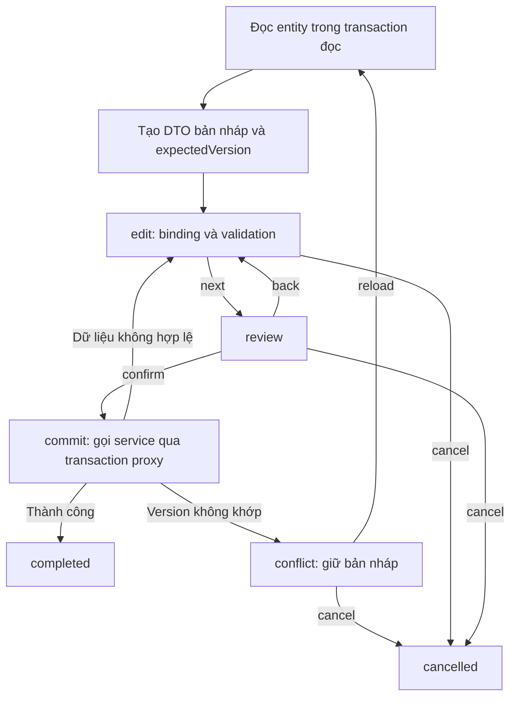

# Flow có commit cuối cùng và tình huống xung đột cập nhật

Một hành trình chỉnh sửa nhiều bước thường có yêu cầu: người dùng được nhập, xem lại và quay lại sửa, nhưng dữ liệu chính thức chỉ thay đổi khi họ xác nhận cuối cùng. Nếu trong lúc đó một người hoặc một tab khác đã cập nhật cùng bản ghi, hệ thống phải phát hiện xung đột thay vì âm thầm ghi đè.

Bài thuộc chương **Thực hành tổng hợp** của module **SPRING_WEB_FLOW**. Bài kết hợp state, event, transition, form binding, validation, scope, transaction và kiểm thử trong một flow cập nhật địa chỉ giao hàng.

Các ví dụ lấy **Spring Web Flow 3.0.1, Spring Framework 6 và Jakarta Persistence** làm mốc API. Mã là phần lõi của bài thực hành để ghép vào một ứng dụng đã cấu hình MVC/Web Flow, JPA và validation; nó không tự cung cấp toàn bộ datasource, entity manager factory, template và cơ chế đăng nhập.

## 1. Đề bài và các điều kiện phải giữ

Người dùng chỉnh sửa một địa chỉ thuộc tài khoản của mình qua ba bước:

1. Đọc địa chỉ hiện tại và tạo bản nháp.
2. Chỉnh sửa, validation rồi xem lại.
3. Xác nhận để lưu trong một transaction ngắn.

Trong lúc người dùng đang xem lại, một execution khác có thể cập nhật cùng địa chỉ.

| Điều kiện | Kết quả cần đạt |
| --- | --- |
| Nhập hoặc quay lại xem trước | Chỉ thay đổi DTO trong flow; chưa cập nhật bảng địa chỉ |
| Hủy trước xác nhận | Không ghi các thay đổi của bản nháp |
| Xác nhận dữ liệu còn hợp lệ và đúng version | Lưu atomically và kết thúc bằng outcome thành công |
| Xác nhận bản nháp đã cũ | Báo xung đột, giữ nội dung người dùng vừa nhập |
| Người dùng chọn tải lại | Đọc bản mới và thay bản nháp sau khi người dùng đồng ý bỏ nội dung chưa lưu |
| Bản ghi bị xóa hoặc không còn được phép sửa | Không ghi; hiển thị kết quả không khả dụng phù hợp |

“Chỉ commit cuối cùng” ở đây nói về dữ liệu địa chỉ chính thức. Nếu ứng dụng còn ghi audit, draft bền vững hoặc thống kê ở bước khác, phải nêu riêng hợp đồng cho những dữ liệu đó.

Không giữ database transaction hay khóa hàng trong suốt thời gian người dùng đọc và nhập form. Khoảng chờ vài phút của một hành trình web không phải thời lượng thích hợp cho một transaction ghi liên tục.

## 2. Chọn mô hình persistence nhất quán

Web Flow hỗ trợ flow-managed persistence, đồng thời cho phép để service layer quản lý persistence. Trong bài này, chọn **DTO trong flow scope và service transaction ngắn** để vị trí commit và nhánh phục hồi dễ quan sát. [Spring Web Flow: Flow Managed Persistence](https://docs.spring.io/spring-webflow/docs/3.0.x/reference/)



Phân chia trách nhiệm:

| Thành phần | Trách nhiệm |
| --- | --- |
| Flow | Điều hướng, giữ bản nháp, chọn nhánh thành công/xung đột |
| DTO | Các trường có thể sửa và version nền được giữ phía server |
| Action bean | Chuyển kết quả service thành event và message của flow |
| Transactional service | Kiểm tra quyền, validate lại, đối chiếu version và cập nhật |
| JPA/database | Phát hiện cuộc đua cập nhật thực sự khi flush/commit |

Giả định môi trường cho ví dụ:

- Có transaction management hoạt động với JPA và các service là bean được proxy.
- Không bao toàn bộ request hoặc toàn bộ flow bằng một transaction ngoài.
- Không dùng flow-managed persistence trong flow này; persistence context của ví dụ gắn với transaction service.
- Tắt Open EntityManager in View cho cấu hình thực hành này để việc đọc lại sau lỗi dùng context mới theo transaction mới.
- Có Jakarta Bean Validation provider và bean `jakarta.validation.Validator`; MVC/Web Flow cũng được nối validator phù hợp.

Các giả định này làm rõ vì sao lời gọi service trả về bình thường cho action có thể được coi là transaction đã hoàn tất. Nếu service chỉ tham gia một transaction ngoài còn chưa commit, kết luận đó không còn đúng.

## 3. Entity có version và DTO giữ version nền

### 3.1. Entity dùng optimistic locking

```java
package example.address;

import jakarta.persistence.Column;
import jakarta.persistence.Entity;
import jakarta.persistence.Id;
import jakarta.persistence.Table;
import jakarta.persistence.Version;

@Entity
@Table(name = "delivery_address")
public class DeliveryAddress {
    @Id
    private Long id;

    @Version
    private Long version;

    @Column(name = "owner_username", nullable = false)
    private String ownerUsername;

    @Column(nullable = false, length = 100)
    private String recipient;

    @Column(nullable = false, length = 200)
    private String street;

    @Column(nullable = false, length = 100)
    private String city;

    protected DeliveryAddress() {
    }

    public Long getId() { return id; }
    public Long getVersion() { return version; }
    public String getOwnerUsername() { return ownerUsername; }
    public String getRecipient() { return recipient; }
    public String getStreet() { return street; }
    public String getCity() { return city; }

    public void changeTo(String recipient, String street, String city) {
        this.recipient = recipient;
        this.street = street;
        this.city = city;
    }
}
```

`@Version` chỉ ra thuộc tính được persistence provider dùng để kiểm soát cập nhật lạc quan. Không tự viết setter để lấy version từ request rồi gán vào entity. [Jakarta Persistence: Version](https://jakarta.ee/specifications/webprofile/10/apidocs/jakarta/persistence/Version.html)

Mã entity tập trung vào cập nhật; bản ghi ban đầu có thể được tạo bằng fixture hoặc chức năng tạo địa chỉ riêng của ứng dụng.

### 3.2. DTO không phải managed entity

```java
package example.address;

import java.io.Serializable;
import jakarta.validation.constraints.NotBlank;
import jakarta.validation.constraints.Size;

public class AddressDraft implements Serializable {
    private static final long serialVersionUID = 1L;

    private final Long addressId;
    private final Long expectedVersion;

    @NotBlank(message = "Vui lòng nhập người nhận")
    @Size(max = 100, message = "Người nhận tối đa 100 ký tự")
    private String recipient;

    @NotBlank(message = "Vui lòng nhập đường và số nhà")
    @Size(max = 200, message = "Đường và số nhà tối đa 200 ký tự")
    private String street;

    @NotBlank(message = "Vui lòng nhập thành phố")
    @Size(max = 100, message = "Thành phố tối đa 100 ký tự")
    private String city;

    public AddressDraft(Long addressId, Long expectedVersion,
            String recipient, String street, String city) {
        this.addressId = addressId;
        this.expectedVersion = expectedVersion;
        this.recipient = recipient;
        this.street = street;
        this.city = city;
    }

    public Long getAddressId() { return addressId; }
    public Long getExpectedVersion() { return expectedVersion; }
    public String getRecipient() { return recipient; }
    public void setRecipient(String value) { recipient = value; }
    public String getStreet() { return street; }
    public void setStreet(String value) { street = value; }
    public String getCity() { return city; }
    public void setCity(String value) { city = value; }
}
```

`addressId` và `expectedVersion` được tạo từ dữ liệu server, không có setter cho binder. Chỉ ba trường nội dung được chỉnh sửa. DTO được service tạo trực tiếp nên không cần constructor không tham số như trường hợp flow khai báo `<var>` để tự khởi tạo.

Đặt DTO trong `flowScope.draft` giúp giữ dữ liệu qua các bước của cùng flow. Không giữ entity managed hoặc `EntityManager` trong một field của action singleton. Nếu mở rộng có subflow, nên thống nhất việc subflow trả dữ liệu cho bản nháp và chưa tự commit bản ghi chính thức.

## 4. Tại sao cần cả expectedVersion lẫn @Version?

Giả sử hai execution đều đọc địa chỉ ở version 7:

| Thời điểm | Execution A | Execution B | Database |
| --- | --- | --- | --- |
| T0 | Đọc version 7 | Đọc version 7 | version 7 |
| T1 | Sửa thành phố | Sửa đường | Chưa đổi |
| T2 | Xác nhận thành công | Đang xem lại | version 8, nội dung của A |
| T3 | Đã hoàn tất | Xác nhận với expectedVersion 7 | Phải giữ nội dung A và báo xung đột cho B |

Nếu service của B tải entity mới nhất ở version 8 rồi copy toàn bộ DTO cũ vào nó, `@Version` của entity mới tải không tự biết người dùng B đã bắt đầu từ version 7. B có thể ghi đè dữ liệu A nếu không so sánh version nền của bản nháp.

Vì vậy cần hai lớp kiểm tra:

1. **So sánh expectedVersion:** phát hiện bản nháp đã cũ trước lúc service bắt đầu cập nhật.
2. **Kiểm tra của JPA khi ghi:** phát hiện execution khác cập nhật sau khi service đã đọc nhưng trước lúc flush/commit.

SQL dưới đây chỉ minh họa ý nghĩa, không phải câu lệnh tự viết cho entity:

```sql
UPDATE delivery_address
SET recipient = ?, street = ?, city = ?, version = 8
WHERE id = ? AND version = 7;
```

Nếu không còn hàng khớp version cũ, provider phát hiện optimistic locking failure. Không chỉ kiểm tra `expectedVersion` bằng một câu `if` rồi bỏ `@Version`, vì khoảng thời gian giữa đọc và ghi vẫn có thể có cuộc đua.

## 5. Service: commit ngắn, kiểm tra quyền và flush

Trước hết định nghĩa lỗi khi địa chỉ không còn khả dụng với người gọi:

```java
package example.address;

public class AddressUnavailableException extends RuntimeException {
    public AddressUnavailableException() {
        super("Không thể truy cập địa chỉ để cập nhật");
    }
}
```

Service nạp DTO ở đầu flow và ghi chỉ tại bước commit:

```java
package example.address;

import java.util.Objects;
import jakarta.persistence.EntityManager;
import jakarta.persistence.PersistenceContext;
import jakarta.validation.ConstraintViolationException;
import jakarta.validation.Validator;
import org.springframework.dao.OptimisticLockingFailureException;
import org.springframework.stereotype.Service;
import org.springframework.transaction.annotation.Transactional;

@Service
public class AddressService {
    @PersistenceContext
    private EntityManager entityManager;

    private final Validator validator;

    public AddressService(Validator validator) {
        this.validator = validator;
    }

    @Transactional(readOnly = true)
    public AddressDraft loadDraft(String username, Long addressId) {
        DeliveryAddress address = findOwned(username, addressId);
        return new AddressDraft(address.getId(), address.getVersion(),
                address.getRecipient(), address.getStreet(), address.getCity());
    }

    @Transactional
    public Long commitDraft(String username, AddressDraft draft) {
        DeliveryAddress address = findOwned(username, draft.getAddressId());

        var violations = validator.validate(draft);
        if (!violations.isEmpty()) {
            throw new ConstraintViolationException(violations);
        }

        if (!Objects.equals(address.getVersion(), draft.getExpectedVersion())) {
            throw new OptimisticLockingFailureException(
                    "Bản nháp được tạo từ phiên bản không còn hiện hành");
        }

        address.changeTo(draft.getRecipient(), draft.getStreet(), draft.getCity());
        entityManager.flush();
        return address.getVersion();
    }

    private DeliveryAddress findOwned(String username, Long addressId) {
        DeliveryAddress address = entityManager.find(DeliveryAddress.class, addressId);
        if (address == null || !Objects.equals(username, address.getOwnerUsername())) {
            throw new AddressUnavailableException();
        }
        return address;
    }
}
```

Những điểm cần hiểu:

- Quyền truy cập được kiểm tra lại ngay lúc commit, không chỉ ở đầu flow.
- DTO được validate lại trong service; không tin rằng mọi lời gọi đều đã đi qua form validator.
- Entity được tải trong transaction hiện tại và chỉ copy các trường được phép sửa.
- Version nền được so sánh trước khi copy; `@Version` vẫn bảo vệ khoảng đua sau phép so sánh.
- `flush()` đẩy thay đổi xuống persistence provider/database để lỗi xuất hiện sớm hơn, nhưng **flush không phải commit**.

Không cần gọi `persist()` cho entity đã được tải và đang managed trong transaction. Không gọi `merge()` một DTO hoặc một entity do request tạo ra rồi cho rằng điều đó thay thế kiểm tra quyền và whitelist trường.

`OptimisticLockingFailureException` là exception của Spring biểu diễn lỗi optimistic locking; ví dụ cũng dùng nó cho trường hợp version nền không khớp đã được kiểm tra tường minh. [Spring API](https://docs.spring.io/spring-framework/docs/6.0.23/javadoc-api/org/springframework/dao/OptimisticLockingFailureException.html)

### Bắt lỗi bên ngoài transaction proxy

Một optimistic locking exception có thể xuất hiện khi thao tác persistence, flush hoặc commit và làm transaction phải rollback. [Jakarta Persistence: OptimisticLockException](https://jakarta.ee/specifications/webprofile/10/apidocs/jakarta/persistence/OptimisticLockException.html)

Do đó, action gọi `AddressService` qua Spring proxy và bắt lỗi ở phía ngoài. Khi proxy trả về bình thường, với giả định không có transaction ngoài ở mục 2, transaction ghi đã hoàn tất. Sau đó action mới trả event thành công.

Không đặt `try/catch` bên trong cùng transaction rồi chuyển sang ghi tiếp như chưa có lỗi. Một transaction đã bị đánh dấu rollback-only có thể kết thúc bằng `UnexpectedRollbackException`; trả một chuỗi `success` trong thân method không làm transaction trở lại hợp lệ. [Spring: Transaction propagation](https://docs.spring.io/spring-framework/reference/data-access/transaction/declarative/tx-propagation.html)

Service và action phải là hai bean riêng. Gọi nội bộ một method `@Transactional` qua `this` trong cùng bean không mặc nhiên đi qua transaction proxy. [Spring: Using @Transactional](https://docs.spring.io/spring-framework/reference/data-access/transaction/declarative/annotations.html)

## 6. Action chuyển kết quả transaction thành event của flow

```java
package example.address;

import java.security.Principal;
import jakarta.persistence.OptimisticLockException;
import jakarta.validation.ConstraintViolationException;
import org.springframework.binding.message.MessageBuilder;
import org.springframework.dao.OptimisticLockingFailureException;
import org.springframework.stereotype.Component;
import org.springframework.webflow.execution.RequestContext;

@Component("addressFlowActions")
public class AddressFlowActions {
    private final AddressService addressService;

    public AddressFlowActions(AddressService addressService) {
        this.addressService = addressService;
    }

    public AddressDraft loadDraft(RequestContext context) {
        Long addressId = (Long) context.getFlowScope().getRequired("addressId");
        return addressService.loadDraft(username(context), addressId);
    }

    public String commit(RequestContext context) {
        AddressDraft draft = (AddressDraft) context.getFlowScope().getRequired("draft");
        context.getFlowScope().remove("committedVersion");
        try {
            Long committedVersion = addressService.commitDraft(username(context), draft);
            context.getFlowScope().put("committedVersion", committedVersion);
            return "success";
        } catch (OptimisticLockingFailureException | OptimisticLockException ex) {
            context.getMessageContext().addMessage(new MessageBuilder().error()
                    .defaultText("Địa chỉ đã thay đổi. Bản nháp của bạn chưa được lưu.")
                    .build());
            return "conflict";
        } catch (ConstraintViolationException ex) {
            ex.getConstraintViolations().forEach(violation ->
                    context.getMessageContext().addMessage(new MessageBuilder().error()
                            .source(violation.getPropertyPath().toString())
                            .defaultText(violation.getMessage()).build()));
            return "invalid";
        }
    }

    private String username(RequestContext context) {
        Principal principal = context.getExternalContext().getCurrentUser();
        if (principal == null) {
            throw new AddressUnavailableException();
        }
        return principal.getName();
    }
}
```

Action không được gắn `@Transactional` trong mô hình này. Người dùng phải đăng nhập qua security của ứng dụng; tên chủ sở hữu lấy từ principal phía server, không lấy từ một field `username` trên form.

Nhánh bắt lỗi xử lý hai dạng optimistic locking phổ biến: exception đã được Spring dịch và exception JPA trực tiếp. Cần kiểm tra lớp exception thực tế với transaction manager/provider của dự án, đặc biệt khi có wrapper hoặc transaction phân tán. Không biến mọi `RuntimeException` thành xung đột dữ liệu.

Lỗi mất kết nối, timeout hoặc lỗi commit không rõ kết quả cần quy trình xử lý riêng. Chúng không chứng minh rằng database chắc chắn chưa ghi, nên không được tự động chạy lại việc xác nhận.

`committedVersion` chỉ được đặt sau khi service proxy trả về. Bản nháp cũ vẫn giữ `expectedVersion` ban đầu; không sửa nó thành version mới trong nhánh lỗi để lách kiểm tra.

## 7. Định nghĩa flow đầy đủ cho nhánh thành công và xung đột

```xml
<?xml version="1.0" encoding="UTF-8"?>
<flow xmlns="http://www.springframework.org/schema/webflow"
      xmlns:xsi="http://www.w3.org/2001/XMLSchema-instance"
      xsi:schemaLocation="http://www.springframework.org/schema/webflow
        https://www.springframework.org/schema/webflow/spring-webflow.xsd"
      start-state="load">

    <input name="addressId" type="long" value="flowScope.addressId" required="true"/>

    <action-state id="load">
        <evaluate expression="addressFlowActions.loadDraft(flowRequestContext)"
                  result="flowScope.draft"/>
        <transition on="success" to="edit"/>
        <transition on-exception="example.address.AddressUnavailableException"
                    to="unavailable"/>
    </action-state>

    <view-state id="edit" view="edit" model="draft">
        <binder>
            <binding property="recipient" required="true"/>
            <binding property="street" required="true"/>
            <binding property="city" required="true"/>
        </binder>
        <transition on="next" to="review"/>
        <transition on="cancel" to="cancelled" bind="false"/>
    </view-state>

    <view-state id="review" view="review" model="draft">
        <transition on="back" to="edit" bind="false"/>
        <transition on="confirm" to="commit" bind="false"/>
        <transition on="cancel" to="cancelled" bind="false"/>
    </view-state>

    <action-state id="commit">
        <evaluate expression="addressFlowActions.commit(flowRequestContext)"/>
        <transition on="success" to="completed"/>
        <transition on="conflict" to="conflict"/>
        <transition on="invalid" to="edit"/>
        <transition on-exception="example.address.AddressUnavailableException"
                    to="unavailable"/>
    </action-state>

    <view-state id="conflict" view="conflict">
        <transition on="reload" to="reloadLatest" bind="false"/>
        <transition on="cancel" to="cancelled" bind="false"/>
    </view-state>

    <action-state id="reloadLatest">
        <evaluate expression="addressFlowActions.loadDraft(flowRequestContext)"
                  result="flowScope.draft"/>
        <transition on="success" to="edit"/>
        <transition on-exception="example.address.AddressUnavailableException"
                    to="unavailable"/>
    </action-state>

    <end-state id="completed" view="done">
        <output name="addressId" value="flowScope.draft.addressId"/>
        <output name="version" value="flowScope.committedVersion"/>
    </end-state>
    <end-state id="cancelled" view="cancelled"/>
    <end-state id="unavailable" view="unavailable"/>
</flow>
```

Các tên view được giải theo cấu hình `ViewFactoryCreator`/resolver của ứng dụng. Với chiến lược JSP tương đối, có thể đặt `edit.jsp`, `review.jsp`, `conflict.jsp`, `done.jsp`, `cancelled.jsp` và `unavailable.jsp` cạnh file flow.

Chuỗi `success`, `conflict`, `invalid` trả từ action được ánh xạ thành event để chọn transition. `loadDraft` trả một object DTO và kết quả được gán vào `flowScope.draft`; với cơ chế action result mặc định, đường hoàn tất thông thường dùng event `success`. [Web Flow: Action outcome event mappings](https://docs.spring.io/spring-webflow/docs/current/reference/)

Những chi tiết chủ chốt:

- Không có lời gọi ghi ở `edit`, `review`, `on-render` hoặc `on-exit` của trang.
- `confirm` không nhận lại các field nội dung từ trang review; service sử dụng DTO đã được giữ trong flow và validate lại.
- Binder chỉ mở ba trường chỉnh sửa, không mở id, owner hoặc version nền.
- Bấm Back hoặc Cancel không bị một form chưa hoàn chỉnh chặn do binding của chính transition đó.
- Xung đột đưa tới một view-state riêng và execution vẫn hoạt động, không đi tới end-state thành công.
- Reload đọc từ service trong transaction mới sau transaction thất bại; không tiếp tục dùng persistence context ghi đã lỗi.

### Không nhầm với commit end-state của flow-managed persistence

Nếu chọn mô hình flow-managed persistence khác, Web Flow có thể tạo persistence context theo flow, phối hợp với `JpaFlowExecutionListener` và commit khi đến end-state được đánh dấu:

```xml
<!-- Biến thể kiến trúc khác, không chèn vào flow DTO ở trên. -->
<persistence-context/>

<!-- Các state chỉnh sửa managed entity được định nghĩa ở giữa. -->
<end-state id="saved" commit="true"/>
<end-state id="cancelled"/>
```

Để biến thể đó hoạt động, phải đăng ký listener cùng entity manager factory và transaction manager; chỉ thêm `commit="true"` vào một end-state không tự biến service bất kỳ thành transaction cuối flow. Schema nêu rõ cờ này có tác dụng với flow là persistence context. [Schema Web Flow 3.0.1](https://raw.githubusercontent.com/spring-projects/spring-webflow/v3.0.1/spring-webflow/src/main/resources/org/springframework/webflow/engine/model/builder/xml/spring-webflow.xsd)

`JpaFlowExecutionListener` quản lý việc gắn/tháo context và quyết định commit cuối phiên flow phù hợp. Tránh gọi read-write service làm flush sớm ở các bước giữa nếu mục tiêu là chưa công bố thay đổi. Khi subflow dùng lại context của cha, quyết định commit cuối cùng còn phụ thuộc vòng đời cha. [Mã nguồn JpaFlowExecutionListener](https://raw.githubusercontent.com/spring-projects/spring-webflow/v3.0.1/spring-webflow/src/main/java/org/springframework/webflow/persistence/JpaFlowExecutionListener.java)

Biến thể flow-managed cũng cần optimistic locking và chiến lược phục hồi sau rollback. Không giả định rằng một context đã lỗi có thể tiếp tục được dùng để ghi chỉ bằng cách quay lại view-state. Bài thực hành chính dùng DTO để tránh trộn hai cơ chế sở hữu persistence context.

## 8. Giao diện xác nhận và phục hồi xung đột

### Trang review chỉ phát quyết định

Phần chính của một `review.jsp` có thể dùng Spring form tags, hiển thị giá trị đã escape rồi phát event:

```jsp
<%@ page contentType="text/html; charset=UTF-8" %>
<%@ taglib prefix="form" uri="http://www.springframework.org/tags/form" %>
<%@ taglib prefix="spring" uri="http://www.springframework.org/tags" %>

<h1>Xem lại địa chỉ</h1>
<p>Người nhận:
    <spring:message text="${draft.recipient}" htmlEscape="true"/>
</p>
<p>Đường và số nhà:
    <spring:message text="${draft.street}" htmlEscape="true"/>
</p>
<p>Thành phố:
    <spring:message text="${draft.city}" htmlEscape="true"/>
</p>

<form:form modelAttribute="draft" method="post" action="${flowExecutionUrl}">
    <button type="submit" name="_eventId" value="back">Quay lại</button>
    <button type="submit" name="_eventId" value="confirm">Xác nhận lưu</button>
    <button type="submit" name="_eventId" value="cancel">Hủy</button>
</form:form>
```

Trang không gửi hidden input cho `expectedVersion` hoặc `ownerUsername`. Các giá trị tin cậy đã nằm trong dữ liệu phía server. Tắt binding ở transition confirm cũng giúp tránh một request xác nhận sửa ngược những trường trên DTO qua form.

Trang edit sử dụng `modelAttribute="draft"` với các `path="recipient"`, `path="street"`, `path="city"`, hiển thị lỗi trường tương ứng. Với security/CSRF đang bật, giữ tích hợp token của form theo cấu hình ứng dụng; không vô hiệu hóa bảo vệ chỉ để test dễ chạy.

### Trang conflict phải nói rõ điều gì chưa được lưu

Giao diện nên có heading và thông điệp như:

> Địa chỉ đã được cập nhật ở nơi khác. Nội dung bạn vừa nhập chưa được lưu. Bạn có thể giữ trang này để đối chiếu, hoặc tải bản hiện tại và nhập lại thay đổi.

Hiển thị lại các giá trị trong `draft` dưới dạng đã escape để người dùng không mất dấu nội dung họ muốn sửa. Hai lựa chọn tối thiểu:

```jsp
<form:form modelAttribute="draft" method="post" action="${flowExecutionUrl}">
    <p>Tải lại sẽ bỏ bản nháp chưa lưu và mở địa chỉ hiện tại.</p>
    <button type="submit" name="_eventId" value="reload">
        Bỏ bản nháp và tải lại
    </button>
    <button type="submit" name="_eventId" value="cancel">Hủy cập nhật</button>
</form:form>
```

Đây là fragment dùng cùng các khai báo taglib như trang review. Phần template đầy đủ cần render nội dung draft và các message do ứng dụng cung cấp.

Không tự động tải lại ngay khi đi vào state conflict rồi thay mất draft. Trong flow ở mục 7, chỉ event `reload` mới đọc và thay bản nháp, sau quyết định tường minh của người dùng.

### Nếu muốn cho đối chiếu và hợp nhất

Có thể giữ ba phiên bản dữ liệu:

| Dữ liệu | Ý nghĩa |
| --- | --- |
| Base | Bản đã đọc trước khi chỉnh sửa |
| Mine | Bản nháp người dùng vừa sửa |
| Current | Bản hiện tại được đọc sau khi phát hiện xung đột |

Hợp nhất ba chiều giúp phân biệt một trường chỉ người dùng sửa với trường đã bị cả hai bên sửa. Ví dụ, nếu A đổi thành phố và B đổi đường, có thể đề xuất ghép hai thay đổi sau khi kiểm tra quy tắc nghiệp vụ.

Nhưng không tự copy toàn bộ Mine lên Current rồi coi là giải quyết xung đột. Các trường có thể phụ thuộc nhau; một địa chỉ gồm đường và thành phố không nhất thiết hợp lệ khi ghép tự động.

Nếu xây dựng một DTO hợp nhất, version nền của nó phải tương ứng Current đã được người dùng xem xét. Sau khi người dùng xác nhận lại, service vẫn kiểm tra version và validation như lần trước vì Current có thể tiếp tục thay đổi.

## 9. Kiểm thử từ dữ liệu chưa commit đến xung đột thật

Cần kiểm tra ba tầng độc lập:

1. **Flow:** event đúng dẫn tới state đúng, giữ draft và không báo thành công sai.
2. **Service/database:** transaction và optimistic locking bảo vệ dữ liệu thật.
3. **Trình duyệt:** form phát event, dữ liệu còn hiển thị và người dùng phục hồi được.

Không dùng một action mock trả chuỗi `conflict` để kết luận JPA đã phát hiện cập nhật đồng thời. Nó chỉ kiểm tra nhánh điều hướng.

### 9.1. Fixture dữ liệu và test bản nháp cũ

Trong database dành riêng cho test, có thể seed một bản ghi:

```sql
INSERT INTO delivery_address
    (id, version, owner_username, recipient, street, city)
VALUES
    (501, 7, 'learner', 'Người nhận ban đầu', '1 Đường Cũ', 'Hà Nội');
```

Ví dụ test method dưới đây dành cho lớp kiểm thử tích hợp đã nạp cấu hình JPA/Spring và inject bean `AddressService addressService`. Dùng static assertions của JUnit Jupiter. Không bao test bằng một transaction ngoài làm cả hai lần gọi service tham gia chung transaction; nếu bộ test mặc định transactional, vô hiệu hóa outer transaction cho kịch bản này.

```java
@Test
void staleDraftMustNotOverwriteCommittedAddress() {
    AddressDraft draftA = addressService.loadDraft("learner", 501L);
    AddressDraft draftB = addressService.loadDraft("learner", 501L);
    assertEquals(draftA.getExpectedVersion(), draftB.getExpectedVersion());

    draftA.setCity("Đà Nẵng");
    Long versionAfterA = addressService.commitDraft("learner", draftA);

    draftB.setStreet("99 Đường Mới");
    assertThrows(OptimisticLockingFailureException.class,
            () -> addressService.commitDraft("learner", draftB));

    AddressDraft current = addressService.loadDraft("learner", 501L);
    assertEquals("Đà Nẵng", current.getCity());
    assertEquals("1 Đường Cũ", current.getStreet());
    assertEquals(versionAfterA, current.getExpectedVersion());
    assertNotEquals(draftB.getExpectedVersion(), current.getExpectedVersion());
}
```

Test này có hai bản nháp độc lập cùng version và các transaction service riêng. Nó kiểm tra điều kiện “bản nháp đã cũ trước khi bắt đầu ghi”, không cần hai thread chạy cùng lúc.

### 9.2. Kiểm tra khoảng đua giữa đọc và flush

Test trước chưa chứng minh `@Version` bảo vệ được khoảng đua sau phép `if`. Cần thêm kiểm tra với hai transaction và hai persistence context độc lập:

1. Cả hai cùng đọc một version của bản ghi.
2. Dùng barrier/latch trong hạ tầng test để biết cả hai đã đọc xong.
3. Cho một transaction cập nhật và commit.
4. Cho transaction còn lại thử ghi entity đã đọc từ version trước.
5. Xác nhận dữ liệu đã commit không bị ghi đè và lỗi cập nhật lạc quan được nhận diện theo provider/transaction manager đang sử dụng.

Dùng giới hạn thời gian cho barrier và kiểm tra trên database/isolation tương ứng môi trường triển khai. Không thêm một `sleep` ngẫu nhiên rồi hy vọng hai request va nhau. Với kịch bản race ở service đầy đủ, có thể dùng công cụ điều phối của test tại điểm truy cập persistence; không biến điểm đồng bộ kiểm thử thành endpoint dành cho production.

Nếu có bulk update, native SQL hoặc ứng dụng khác cùng ghi bảng địa chỉ, cần bảo đảm các đường đó tham gia giao thức version tương ứng. `@Version` trên entity không tự buộc mọi câu SQL bên ngoài ORM tuân thủ hợp đồng này.

### 9.3. Kiểm tra flow bằng action/service giả lập

Các expectation quan trọng:

| Kịch bản | State/outcome | Assertion dữ liệu |
| --- | --- | --- |
| load thành công | edit | Draft chứa id và expectedVersion đã đọc |
| Nhập sai rồi next | edit | Có lỗi; chưa gọi commit service |
| next rồi back | edit | Draft còn giá trị đã nhập; chưa ghi database |
| confirm thành công | completed | Có output version từ lời gọi service đã hoàn tất |
| confirm gặp optimistic conflict | conflict | Draft còn nguyên giá trị người dùng; execution chưa kết thúc |
| confirm gặp lỗi validation service | edit | Có lỗi trường; không báo thành công |
| conflict rồi cancel | cancelled | Không thử ghi lại draft |
| conflict rồi reload | edit | Draft mới mang version mới; chỉ thay sau event reload |
| Bản ghi bị xóa hoặc mất quyền | unavailable | Không lưu và không lộ nội dung không được phép xem |

Đặc biệt, kiểm tra rằng view-state conflict không tự gọi lại `commit`. Nếu dùng mock view factory, không coi test đó là bằng chứng của MVC binding/validation; cần kiểm thử đúng tầng cho phần form.

### 9.4. Kịch bản trình duyệt với hai tab

Dùng hai tab mở **hai execution mới** để chỉnh cùng `addressId`:

1. Tab A và B đều mở địa chỉ 501, sau đó sửa thành hai nội dung khác nhau.
2. Đưa cả hai tới review.
3. A xác nhận và đọc lại bản ghi đã lưu.
4. B xác nhận, phải thấy conflict cùng bản nháp của B.
5. Đọc lại địa chỉ bằng chức năng truy vấn độc lập để chắc chắn B chưa ghi đè A.
6. B chọn tải lại, sửa từ bản mới, xem lại và xác nhận lần nữa.

Hai tab sao chép cùng execution URL có thể dùng chung một hành trình, không phải hai bản nháp độc lập. Khóa execution của Web Flow có thể tuần tự hóa request trên cùng execution nhưng không thay thế optimistic locking giữa hai execution khác nhau hoặc hai người dùng.

## 10. Những lỗi thiết kế thường làm mất tính “commit cuối”

| Cách làm | Vì sao có vấn đề |
| --- | --- |
| Gọi service ghi trong mỗi bước next | Hủy sau đó không còn có nghĩa bỏ toàn bộ thay đổi địa chỉ |
| Lưu trực tiếp entity managed trong model mà không rõ context | Dirty checking/flush có thể xảy ra ngoài điểm người dùng nghĩ là lưu |
| Chỉ dùng @Version sau khi đã nạp bản mới nhất rồi copy DTO cũ | Không đối chiếu version người dùng đã bắt đầu sửa |
| Chỉ so sánh version bằng if, không có bảo vệ khi ghi | Có khoảng đua giữa đọc và update |
| Lấy expectedVersion từ hidden field rồi tin tuyệt đối | Client có thể thay đổi metadata điều khiển cập nhật |
| Catch optimistic exception rồi ghi tiếp trong transaction lỗi | Transaction/context có thể không còn dùng được cho việc ghi |
| Tự tăng expectedVersion sau conflict và retry | Biến phát hiện xung đột thành ghi đè không được xem xét |
| Catch mọi exception và trả success | UI báo đã lưu dù transaction thất bại hoặc chưa rõ kết quả |
| Retry confirm sau timeout mà không đối soát | Có thể thực hiện lặp tác dụng phụ |
| Hủy subflow sau khi subflow đã tự commit | Cha không thể giả định cancel sẽ hoàn tác phần đã ghi |

Bài thực hành chọn cập nhật một hàng có version nên giới hạn bảo vệ khá rõ. Nếu thay đổi nhiều entity hoặc có bất biến như tổng số chỗ còn lại, phải bổ sung ràng buộc và chiến lược transaction/locking cho toàn bộ bất biến đó. Version của một entity không tự ngăn mọi dạng write skew giữa các hàng độc lập.

## 11. Phân biệt optimistic conflict với gửi xác nhận lặp

Optimistic locking trả lời “tôi đang sửa dựa trên bản nào?”. Idempotency trả lời “yêu cầu nghiệp vụ này đã được thực hiện chưa?”. Hai vấn đề liên quan nhưng không thay thế nhau.

Trong ví dụ, gửi lại draft có expectedVersion cũ sau một lần lưu thành công thường dẫn tới conflict. Kết quả đó không nhất thiết cho người dùng biết lần xác nhận trước đã thành công hay chưa.

Nếu cần hỗ trợ submit lặp một cách rõ ràng, thiết kế thêm mã yêu cầu nghiệp vụ và kết quả được lưu bền vững:

- Mã yêu cầu phải gắn với chủ thể có quyền và nội dung thao tác phù hợp.
- Database cần ràng buộc/cơ chế xử lý đồng thời để một mã không tạo nhiều kết quả.
- Việc ghi thay đổi cùng receipt/kết quả phải có tính nguyên tử phù hợp.
- Một request lặp hợp lệ đọc lại kết quả đã có; không coi mọi payload cùng mã là cùng một yêu cầu.

Đó là phần mở rộng chưa được triển khai bởi mã lõi của bài này. Không dùng một `boolean submitted` trong flow scope hoặc vô hiệu hóa nút trên browser như cơ chế duy nhất để bảo đảm không ghi lặp.

Tương tự, gọi email, thanh toán hoặc dịch vụ bên ngoài không tự nằm trong transaction database địa phương. Nếu cần phát thông báo sau khi lưu, có thể thiết kế outbox và cơ chế xử lý lặp ở biên; hủy flow không tự hoàn tác một email đã gửi hay một giao dịch ở hệ thống khác.

## 12. Tiêu chí hoàn thành bài thực hành

Bài thực hành đạt yêu cầu khi có thể trình diễn và chứng minh được:

1. Đi từ edit sang review rồi back nhiều lần nhưng dữ liệu địa chỉ chính thức chưa đổi.
2. Hủy từ edit hoặc review không ghi nội dung đang chỉnh.
3. Một lần confirm hợp lệ tạo kết quả đọc lại được và chỉ báo thành công sau transaction service hoàn tất.
4. Hai draft cùng version không thể âm thầm ghi đè kết quả của nhau.
5. Nhánh conflict giữ nội dung người dùng, không tự đổi version hoặc tự retry.
6. Người dùng có thể bỏ draft và tải lại, hoặc hủy một cách rõ ràng.
7. Quyền và validation vẫn được kiểm tra tại commit, dù trước đó flow đã cho xem review.
8. Bộ test phân biệt điều hướng, persistence thật và tương tác browser.

Có thể mở rộng bài bằng subflow sửa một phần địa chỉ hoặc màn hình đối chiếu Base/Mine/Current. Dù mở rộng theo hướng nào, giữ rõ một điểm quyết định ghi dữ liệu, một giao thức version nhất quán và một nhánh phục hồi có ý nghĩa khi dữ liệu nền đã thay đổi.