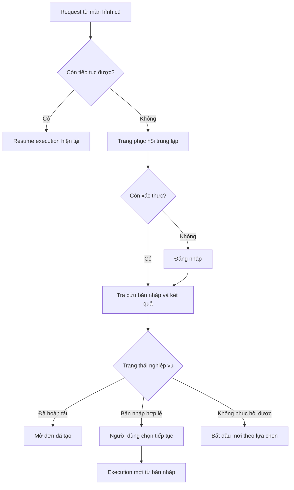

# Phục hồi trải nghiệm sau khi phiên hoặc execution hết hạn

Trong một hành trình đặt hàng nhiều bước, người dùng có thể để màn hình mở quá lâu, đăng nhập lại, quay lại tab cũ hoặc gửi form sau khi execution đã kết thúc. Một trang lỗi kỹ thuật làm họ mất phương hướng; tự khởi chạy lại flow và gửi lại lệnh xác nhận có thể tạo kết quả nghiệp vụ ngoài ý muốn.

Bài thực hành thuộc chương **Thực hành tổng hợp** của module **SPRING_WEB_FLOW**. Bạn sẽ thiết kế một đường phục hồi xuyên qua Spring MVC, flow handler, xác thực, CSRF, bản nháp bền vững và kiểm thử. Kết quả cần đạt là người dùng biết dữ liệu nào còn, chọn được bước tiếp theo và không vô tình thực hiện lại thao tác cuối.

## 1. Đề bài và hợp đồng trải nghiệm

Xây dựng hành trình checkout gồm:

```text
edit → review → submit → completed
  └──────── cancel ─────→ cancelled
```

Ứng dụng có tài khoản người dùng và lưu bản nháp ngoài HTTP session. Khi không tiếp tục được execution cũ, sản phẩm chọn hợp đồng sau:

| Tình trạng | Kết quả người dùng nhận được |
| --- | --- |
| Execution mất nhưng vẫn đăng nhập | Trang thông báo không thể tiếp tục hành trình hiện tại; có lối mở bản nháp |
| Session/xác thực không còn | Đường phục hồi dẫn tới đăng nhập rồi danh sách bản nháp hoặc kết quả thuộc tài khoản |
| Bản nháp còn hiệu lực | Người dùng chủ động mở một execution mới từ dữ liệu đã lưu |
| Đơn đã tạo từ bản nháp | Chuyển tới kết quả đã có; không yêu cầu tạo lại đơn |
| Không có bản nháp đã lưu | Giải thích giới hạn phục hồi và cho bắt đầu hành trình mới |
| Lỗi kho dữ liệu hoặc deserialize chưa xác định | Xử lý như lỗi kỹ thuật, giữ mã tương quan để điều tra |

Trong bài, “execution hết hạn” là cách gọi ở mức trải nghiệm cho một execution không còn dùng được. Nguyên nhân thực tế có thể là session hết hạn, execution bị loại khỏi repository hoặc snapshot lịch sử bị mất; chúng không nhất thiết dùng chung một bộ đếm thời gian riêng.

### Tiêu chí chấp nhận chính

1. Request từ trang cũ không làm người dùng nhận stack trace.
2. Đường phục hồi không phát lại POST xác nhận cũ.
3. Dữ liệu đã lưu được phân biệt với dữ liệu mới chỉ nằm trên màn hình.
4. Đăng nhập lại không mặc định quay về URL chứa execution key đã mất.
5. Một yêu cầu tạo đơn đã hoàn tất không tạo thêm đơn khi người dùng phục hồi hoặc gửi lại.
6. Quyền đọc bản nháp và đơn hàng được kiểm tra theo người dùng hiện tại.

Đây là hợp đồng của bài thực hành, không phải hành vi tự động đầy đủ do Spring Web Flow cung cấp.

## 2. Tách phiên, execution, bản nháp và kết quả nghiệp vụ

| Thành phần | Vòng đời | Vai trò khi phục hồi |
| --- | --- | --- |
| HTTP session | Theo cơ chế session/xác thực đang triển khai | Có thể mất cùng dữ liệu hội thoại lưu trong session |
| Flow execution | Một lần chạy hành trình | Nếu đã mất, không suy ra có thể dựng lại chỉ từ key |
| Snapshot | Một điểm trạng thái được lưu cho execution | Có thể bị loại dù execution hiện hành vẫn còn |
| Bản nháp | Theo chính sách lưu bền vững của ứng dụng | Nguồn dữ liệu để khởi chạy execution mới |
| Đơn hàng/lệnh nghiệp vụ | Theo hợp đồng nghiệp vụ | Nguồn xác nhận tác dụng phụ đã xảy ra hay chưa |

[NoSuchFlowExecutionException](https://docs.spring.io/spring-webflow/docs/current/api/org/springframework/webflow/execution/repository/NoSuchFlowExecutionException.html) biểu thị không tìm thấy execution. [SnapshotNotFoundException](https://docs.spring.io/spring-webflow/docs/current/api/org/springframework/webflow/execution/repository/snapshot/SnapshotNotFoundException.html) biểu thị không tìm thấy snapshot. Đừng đổi cả hai thành một kết luận chắc chắn rằng người dùng vừa hết thời gian đăng nhập.

Quan hệ phục hồi mong muốn:



Execution mới có key mới và được khởi tạo qua input hợp lệ. Nó không phải snapshot cũ được làm sống lại bằng cách thay key trong URL.

## 3. Chuẩn bị dữ liệu bền vững cho bài tập

Thiết kế một bản nháp có các trường tối thiểu:

```text
CheckoutDraft
    draftId
    ownerId
    status: EDITABLE | SUBMITTED | EXPIRED
    version
    recipientName
    deliveryAddress
    submitRequestId
    orderId khi đã tạo đơn
    savedAt
    expiresAt theo chính sách ứng dụng
```

Các trạng thái và tên trường trên là mô hình minh họa của ứng dụng.

`submitRequestId` là định danh ổn định của yêu cầu nghiệp vụ đang được xác nhận. Khi mở execution mới để tiếp tục **cùng yêu cầu đó**, service dùng lại định danh phù hợp đã lưu ở server; không tự tạo mã chống lặp mới trong mỗi lần bấm Confirm hoặc trong mỗi callback resume.

Nếu người dùng thay đổi nội dung đến mức tạo một yêu cầu nghiệp vụ khác, quy tắc cấp định danh mới phải được thiết kế rõ. Không dùng cùng một khóa cho các payload khác nhau rồi âm thầm trả về kết quả cũ.

### Điểm lưu bản nháp

Trong bài này, người dùng gửi dữ liệu hợp lệ từ `edit` sang `review` thì bản nháp được lưu. Dữ liệu gõ sau lần lưu gần nhất chưa chắc tồn tại ở server.

Thông báo phù hợp:

> Bạn có thể tiếp tục từ lần lưu gần nhất. Nội dung chưa lưu có thể cần nhập lại.

Không hứa khôi phục toàn bộ form nếu hệ thống chỉ lưu ở một số checkpoint. Nếu muốn autosave, cần hợp đồng riêng về xác nhận lưu, version, lỗi lưu và thời điểm hiển thị “Đã lưu”.

Bản nháp không nên chứa request/context, connection hay dữ liệu thanh toán nhạy cảm không cần thiết cho mục tiêu phục hồi. Giữ dữ liệu đủ để tiếp tục tác vụ theo yêu cầu sản phẩm.

## 4. Thiết kế các đường đi HTTP

Chọn các route minh họa:

| Route | Trách nhiệm |
| --- | --- |
| `/checkout?draftId=...` | Khởi chạy flow với input bản nháp, kiểm tra quyền ở server |
| `/journey-unavailable` | Trang phục hồi chung, không phụ thuộc execution cũ |
| `/account/drafts` | Danh sách bản nháp/kết quả thuộc tài khoản đã xác thực |
| `POST /account/drafts/{id}/resume` | Kiểm tra lại trạng thái và chọn đường tiếp tục |
| `/orders/{orderId}` | Hiển thị kết quả đã có, kiểm tra quyền đọc |

Trang phục hồi không cần giữ nguyên execution key trong query string. Nó cũng không cần biết chắc bản nháp nào thuộc người đang xem nếu session đã mất.

Một flash attribute lưu trong session cũ không phải nguồn duy nhất đáng tin cho thông báo sau timeout. Trang chung nên render được ngay cả khi không nhận được message từ phiên trước.

### Nội dung trang phục hồi

Ví dụ nội dung theo hợp đồng bài tập:

```text
Không thể tiếp tục hành trình này

Trang bạn đang mở không còn liên kết tới một hành trình có thể tiếp tục.
Bạn có thể mở các bản nháp và kết quả đã lưu của mình.
Nội dung chưa lưu có thể cần nhập lại.

[Xem bản nháp và kết quả]
[Bắt đầu đơn mới]
```

Nút đầu dẫn đến vùng tài khoản được bảo vệ. Nếu người dùng cần đăng nhập, đích sau đăng nhập là vùng tra cứu hợp lệ này, không phải POST xác nhận hoặc URL execution cũ.

Không đưa các loại exception, thuật ngữ snapshot hoặc chi tiết repository vào nội dung chính của màn hình. Mã tương quan có thể hiển thị khi hỗ trợ cần đối chiếu sự cố.

## 5. Tích hợp lỗi truy cập execution ở flow handler

[FlowHandlerAdapter API](https://docs.spring.io/spring-webflow/docs/current/api/org/springframework/webflow/mvc/servlet/FlowHandlerAdapter.html) có xử lý mặc định liên quan việc khởi chạy lại khi gặp `NoSuchFlowExecutionException`. Trong bài này, cần một đường phục hồi có lựa chọn rõ ràng, nên handler chuyển người dùng đến trang chung.

Ví dụ handler với Jakarta Servlet:

```java
package example.checkout;

import java.util.Collections;
import java.util.IdentityHashMap;
import java.util.Set;

import jakarta.servlet.http.HttpServletRequest;
import jakarta.servlet.http.HttpServletResponse;

import org.springframework.webflow.core.FlowException;
import org.springframework.webflow.execution.FlowExecutionOutcome;
import org.springframework.webflow.execution.repository.NoSuchFlowExecutionException;
import org.springframework.webflow.execution.repository.snapshot.SnapshotNotFoundException;
import org.springframework.webflow.mvc.servlet.AbstractFlowHandler;

public final class CheckoutFlowHandler extends AbstractFlowHandler {

    @Override
    public String getFlowId() {
        return "checkout";
    }

    @Override
    public String handleException(FlowException exception,
                                  HttpServletRequest request,
                                  HttpServletResponse response) {
        if (isUnavailableExecution(exception)) {
            return "contextRelative:/journey-unavailable";
        }
        return null;
    }

    @Override
    public String handleExecutionOutcome(FlowExecutionOutcome outcome,
                                         HttpServletRequest request,
                                         HttpServletResponse response) {
        if ("completed".equals(outcome.getId())) {
            Long orderId = outcome.getOutput().getRequired("orderId", Long.class);
            return "contextRelative:/orders/" + orderId;
        }
        if ("cancelled".equals(outcome.getId())) {
            return "contextRelative:/account/drafts";
        }
        throw new IllegalStateException("Unsupported checkout outcome");
    }

    private boolean isUnavailableExecution(Throwable failure) {
        Set<Throwable> visited = Collections.newSetFromMap(
                new IdentityHashMap<Throwable, Boolean>());
        for (Throwable current = failure;
             current != null && visited.add(current);
             current = current.getCause()) {
            if (current instanceof NoSuchFlowExecutionException
                    || current instanceof SnapshotNotFoundException) {
                return true;
            }
        }
        return false;
    }
}
```

Các điểm cần hiểu:

- Có duyệt chuỗi cause để nhận diện lỗi snapshot nếu nó được bọc bên trong lỗi phục hồi.
- Không mặc định mọi `FlowExecutionRestorationFailureException` là hết hạn; lỗi deserialize hoặc kho lưu trữ cần đường điều tra kỹ thuật.
- Handler không gọi service tạo đơn, không đọc lại POST cũ để chạy tiếp và không chuyển event xác nhận sang execution mới.
- Nhánh outcome thành công đi tới kết quả bền vững; controller trang đơn hàng còn phải xác minh quyền truy cập.
- `return null` nhường xử lý cho adapter/cơ chế lỗi tiếp theo; không có nghĩa mọi lỗi còn lại đã được giải quyết.

Đăng ký handler theo flow ID phù hợp với mapping của ứng dụng, ví dụ cấu hình `FlowHandlerMapping` sử dụng bean tên `checkout`:

```xml
<bean name="checkout" class="example.checkout.CheckoutFlowHandler" />
```

Còn cần flow registry, executor, handler mapping/adapter và view resolver hoạt động trong MVC. [AbstractFlowHandler API](https://docs.spring.io/spring-webflow/docs/current/api/org/springframework/webflow/mvc/servlet/AbstractFlowHandler.html) là điểm đối chiếu các phương thức tùy biến.

Handler trên không bắt lỗi ở mọi tầng. Nếu security filter từ chối request trước khi gọi flow adapter, cần chính sách tương ứng ở tầng security.

## 6. Xử lý session mất, xác thực và CSRF

Có hai đường đi cần kiểm thử riêng:

```text
Request tới được flow adapter → lỗi truy cập execution → flow handler.
Request bị security filter chặn → entry point/denied handler của security.
```

Tài liệu [Spring Security — CSRF và Session Timeouts](https://docs.spring.io/spring-security/reference/7.0/servlet/exploits/csrf.html) giải thích trường hợp token gắn với session không còn hợp lệ và khả năng tùy biến xử lý lỗi CSRF. Vì vậy, chỉ thêm `handleException` của Web Flow chưa bao phủ POST từ form cũ sau timeout.

Trong bài tập, cấu hình security phải đáp ứng hợp đồng:

- Không xác thực: dẫn người dùng qua đường đăng nhập được thiết kế cho phục hồi.
- CSRF không được xác minh: chặn thao tác ghi; cung cấp phản hồi để người dùng mở lại một trang hợp lệ.
- Không đủ quyền: giữ chính sách từ chối quyền tương ứng, không gắn nhãn tất cả là “hết phiên”.

Một lỗi CSRF không chứng minh session chắc chắn hết hạn. Thông báo trung lập như “Không thể xác minh yêu cầu từ trang đang mở” phù hợp hơn nếu chỉ có bằng chứng về token không hợp lệ.

### Không replay lệnh xác nhận sau đăng nhập

Kiểm tra request cache, success handler hoặc mã frontend có đang lưu và tự gửi lại thao tác cũ không. Đích sau đăng nhập trong kịch bản phục hồi là một GET đã chọn, ví dụ `/account/drafts`, để người dùng quyết định bước tiếp theo.

Nếu ứng dụng có nhiều đường đăng nhập, cần áp dụng quy tắc này cho luồng phục hồi và kiểm tra các đường khác theo hợp đồng riêng. Đừng vô tình làm mọi request trong hệ thống quay về bản nháp.

Với Ajax, response phục hồi phải được frontend hiểu rõ. Một HTTP client tự theo redirect tới trang login không đồng nghĩa toàn bộ cửa sổ trình duyệt đã chuyển trang; cần tránh chèn HTML login vào vùng form rồi tiếp tục gửi dữ liệu bằng key cũ.

## 7. Tải trang phục hồi bằng MVC độc lập với flow

Controller tối thiểu:

```java
package example.checkout;

import org.springframework.stereotype.Controller;
import org.springframework.web.bind.annotation.GetMapping;

@Controller
public final class JourneyRecoveryController {

    @GetMapping("/journey-unavailable")
    public String unavailable() {
        return "recovery/journey-unavailable";
    }
}
```

View `recovery/journey-unavailable` là tài nguyên của ứng dụng, cần được view resolver cấu hình. Trang này không gọi `getFlowScope()` hoặc cố đọc active flow session vì execution cũ có thể không tồn tại.

Cấu hình quyền truy cập của trang thông báo chung phải cho phép người dùng đi đến đường phục hồi theo hợp đồng, đồng thời không để lộ dữ liệu tài khoản trước xác thực. Bản nháp và đơn hàng chỉ được nạp qua các route có kiểm tra quyền.

Nếu trang đích cũng bắt buộc một session cũ không còn tồn tại, người dùng có thể rơi vào vòng redirect. Test phải đi theo chuỗi điều hướng cho tới màn hình thực sự dùng được.

## 8. Quyết định tiếp tục dựa trên dữ liệu server

Sau khi người dùng mở danh sách và chọn một bản nháp, endpoint resume phải tải lại dữ liệu theo tài khoản hiện tại. Không chỉ tin `draftId`, `orderId`, `status` hoặc `ownerId` từ form.

Giả mã của service ứng dụng:

```text
assessResume(currentUser, draftId):
    tải bản nháp trong phạm vi quyền của currentUser
    nếu không được truy cập:
        trả chính sách không tìm thấy/không có quyền của ứng dụng
    nếu đã có kết quả hoàn tất:
        trả SHOW_EXISTING_ORDER(orderId)
    nếu lệnh đang xử lý và chưa có kết quả cuối:
        trả SHOW_PROCESSING_STATUS
    nếu bản nháp hết hiệu lực:
        trả SHOW_EXPIRED_DRAFT
    nếu còn chỉnh sửa được:
        trả START_NEW_EXECUTION(draftId, currentVersion)
```

`SHOW_PROCESSING_STATUS` cần được bổ sung nếu nghiệp vụ xử lý bất đồng bộ hoặc có trạng thái kết quả chưa rõ. Không đưa người dùng về Confirm chỉ vì response trước bị mất.

Từ quyết định service, lớp MVC chuyển đến đích nội bộ phù hợp. Dữ liệu quyết định không phải một URL bất kỳ do client gửi lên.

### Kiểm tra lại tại lúc khởi chạy

Giữa lúc xem danh sách và lúc khởi chạy flow, tab khác có thể đã tạo đơn hoặc sửa bản nháp. Service dùng ở `on-start` của flow cũng phải kiểm tra lại quyền và trạng thái.

Nếu trạng thái đổi trong khoảng đó, trả kết quả/đường điều hướng theo quy tắc nghiệp vụ tương ứng. Không coi kiểm tra một lần ở controller là bằng chứng mọi thao tác sau đều hợp lệ.

## 9. Khởi chạy execution mới từ bản nháp

Đoạn XML minh họa đường chính sau khi service xác định bản nháp còn chỉnh sửa được:

```xml
<flow xmlns="http://www.springframework.org/schema/webflow"
      xmlns:xsi="http://www.w3.org/2001/XMLSchema-instance"
      xsi:schemaLocation="http://www.springframework.org/schema/webflow
                          https://www.springframework.org/schema/webflow/spring-webflow.xsd"
      start-state="edit">

    <input name="draftId" type="string" required="true" />

    <on-start>
        <evaluate expression="draftService.openForCurrentUser(draftId)"
                  result="flowScope.checkoutForm" />
    </on-start>

    <view-state id="edit" model="checkoutForm">
        <binder>
            <binding property="recipientName" />
            <binding property="deliveryAddress" />
        </binder>
        <transition on="next" to="review">
            <evaluate expression="draftService.saveForCurrentUser(checkoutForm)"
                      result="flowScope.checkoutForm" />
        </transition>
        <transition on="cancel" to="cancelled"
                    bind="false" validate="false" />
    </view-state>

    <view-state id="review" model="checkoutForm">
        <transition on="revise" to="edit"
                    bind="false" validate="false" />
        <transition on="confirm" to="submit" bind="false" />
    </view-state>

    <action-state id="submit">
        <evaluate expression="checkoutService.placeOrderForCurrentUser(checkoutForm.draftId, checkoutForm.draftVersion)"
                  result="flowScope.orderId" />
        <transition on="success" to="completed" />
    </action-state>

    <end-state id="completed">
        <output name="orderId" value="flowScope.orderId" />
    </end-state>

    <end-state id="cancelled" />
</flow>
```

Đây là ví dụ definition, chưa phải ứng dụng hoàn chỉnh. Cần cung cấp view, form, validator, hai service, cấu hình MVC và xử lý các kết quả lỗi/nghiệp vụ. Hợp đồng service trong ví dụ:

| Phương thức | Trách nhiệm bắt buộc |
| --- | --- |
| `openForCurrentUser(draftId)` | Xác minh người dùng hiện tại, quyền và trạng thái; trả form từ dữ liệu lưu |
| `saveForCurrentUser(form)` | Kiểm tra lại quyền/version, lưu dữ liệu hợp lệ và trả form có version mới |
| `placeOrderForCurrentUser(draftId, draftVersion)` | Dùng dữ liệu và khóa yêu cầu phía server; trả `Long orderId` theo quy tắc chống lặp |

Việc lấy người dùng hiện tại trong service phải có implementation cụ thể, chẳng hạn qua cơ chế xác thực của ứng dụng; đây không phải tên API có sẵn của Spring Web Flow.

Whitelist binding ở `edit` giữ cho các thuộc tính như `draftId`, version và khóa yêu cầu không trở thành field tùy ý do client bind đè. Tuy vậy, kiểm tra quyền và tính nhất quán ở tầng service vẫn bắt buộc.

Các cơ chế input, scope, binding và output được mô tả trong [Spring Web Flow Reference Guide](https://docs.spring.io/spring-webflow/docs/current/reference/index.html). Trong bài, bản nháp là nguồn khởi tạo; scope giữ trạng thái của execution mới qua các bước tiếp theo.

### Không tự nhảy tới trạng thái cuối

Sau phục hồi, người dùng cần nhìn lại dữ liệu và thông tin có thể đã thay đổi như giá, tồn kho hoặc điều kiện giao hàng. Bản nháp giúp giảm nhập lại, không mặc định bảo lưu mọi điều kiện nghiệp vụ từ lúc session cũ còn hoạt động.

Nếu sản phẩm muốn tiếp tục ở bước khác `edit`, cần một quy tắc khởi tạo được kiểm thử. Đừng nhận `stateId=submit` từ URL rồi bỏ qua các kiểm tra trước đó.

## 10. Xử lý trường hợp đơn đã tạo nhưng response bị mất

Đây là tình huống quan trọng nhất của bài thực hành:

```text
Client gửi confirm.
Server tạo đơn và ghi nhận kết quả.
Response bị mất hoặc trạng thái điều hướng không được lưu thành công.
Người dùng quay lại form cũ và gặp lỗi execution.
```

Một đường phục hồi đúng không nói “chưa tạo được đơn” chỉ vì flow không khôi phục được.

Quy tắc minh họa cho service tạo đơn:

| Trạng thái server | Hành vi |
| --- | --- |
| Yêu cầu này đã có kết quả hợp lệ | Trả cùng `orderId` sau khi xác minh quyền và danh tính yêu cầu |
| Bản nháp còn hợp lệ, version khớp, chưa xử lý | Thực hiện theo transaction và ghi nhận kết quả chống lặp |
| Version hoặc payload mâu thuẫn | Từ chối theo lỗi xung đột, yêu cầu tải lại dữ liệu |
| Kết quả thanh toán bên ngoài chưa rõ | Đối soát/hiển thị đang xử lý theo thiết kế, không tự charge lại |

Ràng buộc duy nhất hoặc cơ chế idempotency cần đặt ở đơn vị nghiệp vụ tương ứng. Một biến `alreadySubmitted` trong singleton, một attribute trong session hoặc việc vô hiệu hóa nút Confirm không đủ cho trường hợp nhiều tab, restart và session mất.

Bản ghi bản nháp và bản ghi kết quả cần được cập nhật nhất quán theo chiến lược lưu trữ của ứng dụng. Nếu liên quan dịch vụ bên ngoài, xác định riêng cách ghi nhận đang xử lý, đối soát và hoàn tất; không giả định transaction database tự bao trùm mọi lời gọi mạng.

## 11. Mô phỏng mất phiên và mất execution riêng biệt

Chuẩn bị dữ liệu test theo mã riêng:

```text
Người dùng U1 sở hữu D1: bản nháp EDITABLE đã lưu.
U1 sở hữu D2: bản nháp SUBMITTED có orderId.
Người dùng U2 sở hữu D3.
D4 hết hiệu lực theo chính sách bản nháp.
```

### Kịch bản A: session không còn hợp lệ

1. U1 đăng nhập, mở D1 và đến `review`.
2. Xác nhận dữ liệu đã được lưu bền vững.
3. Hạ tầng test invalidate đúng session ở server.
4. Giữ nguyên trang cũ, bấm Confirm.
5. Đi theo phản hồi thực tế của security/flow tới đường phục hồi.
6. Đăng nhập nếu cần, mở danh sách bản nháp.
7. Chọn D1 và khởi chạy một execution mới.
8. Kiểm tra dữ liệu từ lần lưu và xác nhận chưa tạo đơn trước khi người dùng xác nhận lại.

Invalidate có kiểm soát kiểm tra hậu quả phiên mất hiệu lực. Nếu yêu cầu kiểm tra idle timeout thật, thêm ca để container/kho session tự hết hạn; không coi hai mục tiêu là một.

### Kịch bản B: execution mất nhưng vẫn đăng nhập

1. U1 mở D1 trong một flow.
2. Hạ tầng test làm execution tương ứng không còn, giữ xác thực hợp lệ.
3. Gửi từ trang cũ.
4. Kiểm tra tới trang phục hồi mà không ép đăng nhập lại ngoài hợp đồng.
5. Mở D1 bằng execution mới và đối chiếu dữ liệu đã lưu.

Tác động repository chỉ thực hiện qua fixture hoặc công cụ test phù hợp. Không sửa chuỗi key tùy tiện rồi coi đó là đã tái hiện execution hết hạn.

### Kịch bản C: snapshot cũ mất

Tạo điểm lịch sử bị loại hoặc vô hiệu hóa theo cấu hình fixture, rồi gửi request từ trang tương ứng. Kiểm tra cùng trải nghiệm phục hồi đã chọn, đồng thời xác nhận telemetry phân biệt mất snapshot với mất session.

### Kịch bản D: kết quả đã tồn tại

Cho service tạo đơn thành công rồi mô phỏng mất response. Khi người dùng đi vào đường phục hồi, mở kết quả của D2 hoặc truy vấn theo yêu cầu đã ghi nhận; xác nhận cùng một đơn và không có lệnh thanh toán mới.

## 12. Bộ kiểm thử từ unit đến trình duyệt

| Tầng | Điều cần kiểm tra |
| --- | --- |
| Unit của handler | Nhận diện NoSuchFlowExecution/snapshot cause, không nhận nhầm lỗi kỹ thuật khác |
| Unit/service | Quyền, status bản nháp, version và quyết định tiếp tục/kết quả đã có |
| Test flow | Input tải đúng form, binding/validation, outcome/output cuối |
| Tích hợp MVC và security | Filter, handler, trang phục hồi, redirect sau login và CSRF |
| Trình duyệt | Form cũ, Back/Refresh, tab mới và người dùng thực sự đến được màn hình dùng được |
| Nghiệp vụ/dữ liệu | Không có kết quả trùng, dữ liệu và quyền vẫn đúng sau phục hồi |

Giả mã một test phục hồi thành công:

```text
given D1 thuộc U1, saved recipient = "An Nguyễn"
and U1 đang review D1 trong execution E1
when session của U1 bị invalidate
and U1 gửi confirm từ form cũ
then giao diện đi vào đường phục hồi đã chọn
and số đơn mới cho yêu cầu của D1 vẫn bằng 0

when U1 đăng nhập và chọn tiếp tục D1
then khởi chạy execution E2 độc lập với E1
and form có recipient = "An Nguyễn" từ dữ liệu đã lưu
and chưa chạy hành động submit

when U1 review rồi xác nhận theo luồng hợp lệ mới
then outcome của E2 là completed
and output chứa orderId đúng
and số đơn cho yêu cầu này bằng 1
```

Giả mã trên cần được triển khai bằng công cụ test của dự án. Không cố chứng minh E1 khác E2 chỉ bằng việc phần snapshot trong key khác nhau; lấy bằng chứng qua hạ tầng quan sát execution hoặc cách khởi chạy mới thực tế.

### Các ca từ chối không được bỏ qua

- U1 nhập ID của D3 thuộc U2: không đọc được dữ liệu bản nháp đó.
- D1 được tab khác cập nhật: version cũ không ghi đè thay đổi mới.
- D4 đã hết hạn: không tự biến thành một bản nháp còn hiệu lực.
- Lỗi deserialize không phải mất snapshot: giữ đường xử lý kỹ thuật.
- Kho bản nháp tạm thời lỗi: không tự tạo đơn từ dữ liệu không xác minh được.
- Token CSRF cũ: thao tác ghi vẫn bị chặn, người dùng có đường mở trang mới.

Các ví dụ trong bài chưa được chạy trên repository của bạn. Khi thực hiện bài tập, dùng test runner, Servlet namespace và phiên bản Spring phù hợp với cấu hình thật.

## 13. Back, Refresh và nhiều tab sau phục hồi

Một đường phục hồi đạt yêu cầu phải tiếp tục đúng sau khi người dùng thao tác ngoài thứ tự thông thường.

| Thao tác | Kỳ vọng theo hợp đồng bài tập |
| --- | --- |
| Refresh trang phục hồi | Trang tiếp tục render được, không cần execution cũ |
| Back từ trang phục hồi về form cũ rồi gửi | Xử lý có kiểm soát, không replay nghiệp vụ |
| Mở link phục hồi trong tab mới | Có thể tới danh sách hợp lệ sau xác thực |
| Hai tab cùng mở D1 | Có quy tắc version/chống lặp ở service, không dựa vào số tab |
| Một tab đã tạo đơn, tab khác chọn resume | Nhận kết quả đã có hoặc xung đột theo hợp đồng cụ thể |
| Logout rồi đăng nhập bằng tài khoản khác | Không tự khôi phục bản nháp của tài khoản trước |

Khi có nhiều execution của cùng bản nháp, flow scope giúp tách model điều hướng nhưng không tự điều phối cập nhật cùng dữ liệu bền vững. Version hoặc cơ chế tương đương phải được xử lý ở tầng lưu bản nháp.

Đóng tab không phải tín hiệu đáng tin để kết thúc mọi tài nguyên server. Vòng đời execution, session và bản nháp cần chính sách thu hồi riêng.

## 14. Quan sát chất lượng phục hồi

Ghi nhận các sự kiện theo quy ước ứng dụng, chẳng hạn:

```text
flow_unavailable_detected
recovery_page_shown
recovery_login_completed
draft_resume_requested
new_execution_started_from_draft
existing_order_shown
recovery_failed
```

Đây là tên sự kiện minh họa, không phải các callback có sẵn của framework.

Mỗi sự kiện nên có mã tương quan và nhóm nguyên nhân khi đã xác định được. Tránh dùng key/session ID nguyên vẹn làm nhãn metric hoặc đưa toàn bộ form vào log.

Các tỷ lệ cần theo dõi gồm số người vào trang phục hồi rồi hoàn tất tác vụ, tỷ lệ phục hồi thất bại theo nguyên nhân và số kết quả nghiệp vụ trùng bị ngăn chặn. Không coi giảm exception bằng cách restart im lặng là thành công nếu người dùng vẫn mất dữ liệu.

Hiển thị thời điểm lưu bản nháp gần nhất giúp người dùng hiểu mình đang tiếp tục từ đâu. Thời điểm đó phải lấy từ lần lưu đã được xác nhận, không chỉ từ thời điểm trang render hoặc lần gõ gần nhất.

## 15. Lộ trình thực hiện bài tập

### Bước 1: định nghĩa hợp đồng

Viết bảng kết quả cho mất session, mất execution, snapshot cũ, bản nháp hết hạn và kết quả đã có. Chốt đích sau đăng nhập và lời hứa về dữ liệu được phục hồi.

### Bước 2: thiết kế service bản nháp

Cài đặt quyền truy cập, lưu version, checkpoint và quyết định resume. Xác định khóa yêu cầu nghiệp vụ, cách tìm kết quả cũ và xử lý trạng thái đang thực hiện.

### Bước 3: xây trang phục hồi độc lập

Trang render được khi không có active flow và không có dữ liệu từ session cũ. Các lối đi tiếp sử dụng dữ liệu do server kiểm tra.

### Bước 4: nối các ranh giới lỗi

Đăng ký flow handler; cấu hình đường xác thực/CSRF cho trường hợp form cũ. Kiểm tra có request nào bị xử lý trước handler và frontend Ajax hiểu phản hồi như thế nào.

### Bước 5: khởi chạy mới từ dữ liệu đã lưu

Flow nhận input bản nháp, tải và kiểm tra lại dữ liệu ở server. Người dùng review điều kiện hiện hành trước khi xác nhận.

### Bước 6: hoàn tất bộ hồi quy

Chạy các kịch bản A–D cùng Back, Refresh, nhiều tab và tài khoản khác. Kiểm tra màn hình, state/outcome/output và dữ liệu nghiệp vụ ở đúng tầng.

Khi triển khai trong ứng dụng thật, tiêu chí hoàn thành phải có bằng chứng từ các test liên quan, bao gồm hành vi người dùng và kết quả nghiệp vụ.

## 16. Tiêu chí đánh giá bài làm

| Tiêu chí | Bằng chứng đạt |
| --- | --- |
| Trải nghiệm rõ ràng | Người dùng biết hành trình cũ không tiếp tục được và có lối đi tiếp |
| Ranh giới đúng | Trang phục hồi không cần active execution/session cũ |
| Dữ liệu đúng | Chỉ phục hồi từ checkpoint được lưu và quyền hiện tại |
| Không replay | Đăng nhập/phục hồi không tự gửi lại lệnh confirm cũ |
| Chống lặp nghiệp vụ | Kết quả đã tồn tại được nhận diện; không tạo thêm tác dụng phụ |
| Tích hợp đầy đủ | Security, MVC, flow handler và Ajax được kiểm tra đúng đường chạy |
| Đồng thời | Version và nhiều tab không làm mất cập nhật hoặc tráo dữ liệu |
| Điều tra được | Giữ phân biệt mất trạng thái với lỗi kỹ thuật |

## 17. Câu hỏi tự kiểm tra

**Vì sao trang phục hồi không nên đọc flow scope?**

Vì execution hoặc active flow session có thể không còn. Trang phục hồi cần tồn tại độc lập với trạng thái đã mất.

**Đăng nhập lại có làm execution cũ xuất hiện trở lại không?**

Không mặc định. Bài tập khởi chạy execution mới từ bản nháp bền vững sau khi kiểm tra quyền và trạng thái.

**Tại sao cần kiểm tra kết quả nghiệp vụ trước khi cho xác nhận lại?**

Vì request trước có thể đã tạo đơn hoặc thanh toán dù client không nhận được response và flow không tiếp tục được.

**Có thể kết luận session hết hạn từ mọi lỗi CSRF không?**

Không. CSRF không xác minh được và session hết hạn là những tín hiệu có thể liên quan nhưng không đồng nhất.

**Form cũ còn trên màn hình có chứng minh dữ liệu đã được lưu không?**

Không. Cần phân biệt dữ liệu local trên trang với checkpoint đã được server xác nhận lưu.

## 18. Tài liệu đối chiếu

- [FlowHandlerAdapter](https://docs.spring.io/spring-webflow/docs/current/api/org/springframework/webflow/mvc/servlet/FlowHandlerAdapter.html): xử lý flow và lỗi truy cập ở ranh giới MVC.
- [AbstractFlowHandler](https://docs.spring.io/spring-webflow/docs/current/api/org/springframework/webflow/mvc/servlet/AbstractFlowHandler.html): tùy biến exception và outcome.
- [NoSuchFlowExecutionException](https://docs.spring.io/spring-webflow/docs/current/api/org/springframework/webflow/execution/repository/NoSuchFlowExecutionException.html): execution không được tìm thấy.
- [SnapshotNotFoundException](https://docs.spring.io/spring-webflow/docs/current/api/org/springframework/webflow/execution/repository/snapshot/SnapshotNotFoundException.html): snapshot không còn.
- [Spring Security — CSRF](https://docs.spring.io/spring-security/reference/7.0/servlet/exploits/csrf.html): xử lý CSRF và tình huống session timeout.
- [Spring Web Flow Reference Guide](https://docs.spring.io/spring-webflow/docs/current/reference/index.html): input/output, scope, binding, validation và tích hợp MVC.

Các liên kết `current` có thể thay đổi theo bản phát hành. Cấu trúc service, route và dữ liệu trong bài là thiết kế minh họa; khi triển khai cần đối chiếu phiên bản dependency, hợp đồng security và cấu hình repository thực tế.