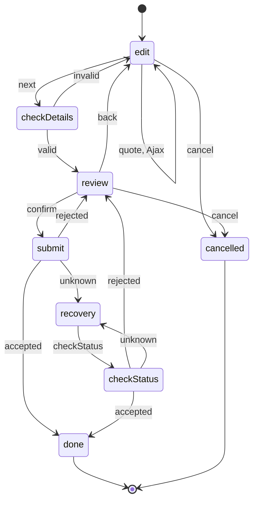

# Hành trình có Ajax hoặc Faces theo công nghệ đã chọn

Một hành trình nhiều bước thường cần tương tác nhanh ngay trong một màn hình: đổi số lượng để xem tổng tiền dự kiến, chọn cách giao hàng hoặc kiểm tra một phần dữ liệu trước khi đi tiếp. Nếu mỗi tương tác đều tự điều hướng bằng JavaScript hoặc gọi một controller không dùng chung model, trạng thái trình duyệt và trạng thái flow dễ lệch nhau.

Trong chương **Thực hành tổng hợp** của module **SPRING_WEB_FLOW**, bài này chọn **Jakarta Faces với Facelets và Ajax chuẩn `f:ajax`**. Web Flow quản lý hành trình; Faces quản lý component, chuyển đổi và validation của trường; Ajax chỉ xử lý và render phần cần thiết. Cách chọn này thực hành state, event, transition, scope, tích hợp Spring MVC, kiểm thử và phục hồi trong một kịch bản thống nhất.

## 1. Mục tiêu và lựa chọn công nghệ

Ta xây dựng hành trình đặt hàng rút gọn:

1. Nhập người nhận, số lượng và cách giao hàng.
2. Bấm “Cập nhật dự kiến” để đổi vùng tổng tiền bằng Ajax, vẫn ở cùng màn hình.
3. Bấm “Xem lại” để kiểm tra toàn bộ dữ liệu và chuyển state.
4. Xác nhận, quay lại sửa hoặc hủy.
5. Nếu chưa xác định được kết quả gửi đơn, chuyển đến màn hình đối chiếu.

Bài chọn Faces thay cho việc tự viết `fetch()` và giao thức cập nhật DOM. Không cần đồng thời cài thêm một thư viện Ajax khác hoặc cấu hình MVC fragment rendering của một công nghệ view khác.

### Nền tảng giả định

Ví dụ dùng cú pháp Jakarta Faces 4.1 và nhánh Spring Web Flow 4.0, với Spring Framework, Servlet container và Java đáp ứng baseline tương ứng. Tài liệu Web Flow 4.0 yêu cầu Faces 4.1 trở lên; xem [Spring Web Flow Reference Guide](https://docs.spring.io/spring-webflow/docs/current/reference/index.html).

Ứng dụng cần có:

- `spring-webflow` và `spring-faces` tương thích cùng dòng phát hành.
- Một implementation Jakarta Faces phù hợp, không chỉ JAR API.
- Cấu hình Spring MVC/Web Flow/Faces đã hoạt động.
- Bean `checkoutActions` và các view được minh họa trong bài.
- Gateway nghiệp vụ có hợp đồng gửi đơn và tra kết quả theo khóa yêu cầu.

Các đoạn mã là thành phần của bài thực hành, không phải một ứng dụng triển khai độc lập đã bao gồm POM, datasource, đăng nhập và dịch vụ thanh toán. Tên lớp gateway, DTO kết quả và exception được xác định là kiểu của ứng dụng khi xuất hiện.

Nếu dự án đang ở nền `javax.faces`, phải dùng tài liệu và dependency đúng thế hệ; không ghép các import `javax` với implementation Jakarta mới chỉ để chạy các đoạn Facelets này.

## 2. Đặt ranh giới trách nhiệm

| Thành phần | Trách nhiệm |
| --- | --- |
| Facelets | Khai báo trường nhập, thông báo, nút và vùng cập nhật |
| Faces lifecycle | Decode request, chuyển đổi, kiểm tra trường, cập nhật model và gọi action |
| `f:ajax` | Chọn component được xử lý và vùng được render lại |
| Web Flow | Xử lý event, quyết định state và quản lý vòng đời dữ liệu |
| `checkoutActions` | Validation toàn model, tính dự kiến và gọi gateway |
| Gateway/dịch vụ | Kiểm tra nghiệp vụ cuối cùng, transaction và chống tác dụng phụ trùng |

Hai điều khiển dễ nhầm:

- `execute` trả lời: component nào tham gia quá trình xử lý request này?
- `render` trả lời: component nào được tạo lại markup và cập nhật trên trình duyệt?

Render một trường không làm nó được execute. Ngược lại, một giá trị đã cập nhật ở server có thể chưa hiện trên trình duyệt nếu vùng tương ứng không được render.

Cú pháp và các từ khóa như `@this`, `@form`, `@all`, `@none` được mô tả trong [Jakarta Faces: f:ajax](https://jakarta.ee/specifications/faces/4.1/vdldoc/f/ajax).

## 3. Mô hình hóa hành trình trước khi viết giao diện



Event `quote` là tương tác nội trang. Nó không đổi sang view-state khác và không tạo đơn. `next` mới là ý định đi tiếp; `confirm` mới là ý định gửi đơn.

Nhánh `recovery` không cung cấp nút gửi lại trực tiếp khi kết quả còn chưa rõ. Cần đối chiếu yêu cầu đã gửi trước khi quyết định hành động tiếp theo.

### Chọn scope

| Dữ liệu | Nơi giữ | Lý do |
| --- | --- | --- |
| `draft` | `flowScope` qua flow variable | Dùng xuyên màn hình nhập, xem lại và phục hồi |
| `quote` | `viewScope` của `edit` | Dữ liệu hiển thị dự kiến, có thể tính lại |
| Message | `MessageContext`/Faces messages | Phản hồi của request và bước hiển thị tương ứng |
| `requestKey` | Trong draft | Giữ cùng định danh khi đối chiếu một yêu cầu |
| Bản nháp dài hạn | Kho nghiệp vụ riêng nếu có | Không phụ thuộc việc session/execution còn tồn tại |

View scope của Web Flow không nên bị đồng nhất với mọi biến thể `@ViewScoped` của Faces/CDI. Trong bài, vòng đời dữ liệu hiển thị được gắn rõ với view-state của Web Flow.

## 4. Cấu hình tích hợp cần kiểm tra

Các mảnh cấu hình XML sau thuộc application context đã khai báo namespace Spring tương ứng:

```xml
<faces:flow-builder-services id="flowBuilderServices" />

<webflow:flow-registry id="flowRegistry"
                       flow-builder-services="flowBuilderServices">
    <webflow:flow-location id="checkout"
            path="/WEB-INF/flows/checkout/checkout-flow.xml" />
</webflow:flow-registry>

<bean id="facesContextListener"
      class="org.springframework.faces.webflow.FlowFacesContextLifecycleListener" />

<webflow:flow-executor id="flowExecutor" flow-registry="flowRegistry">
    <webflow:flow-execution-listeners>
        <webflow:listener ref="facesContextListener" />
    </webflow:flow-execution-listeners>
</webflow:flow-executor>

<bean class="org.springframework.webflow.mvc.servlet.FlowHandlerMapping">
    <property name="flowRegistry" ref="flowRegistry" />
    <property name="order" value="0" />
</bean>

<bean class="org.springframework.faces.webflow.JsfFlowHandlerAdapter">
    <property name="flowExecutor" ref="flowExecutor" />
</bean>

<faces:resources />
```

`JsfFlowHandlerAdapter` là adapter cho tích hợp Faces, với cơ chế xử lý Ajax phù hợp Faces; xem [API JsfFlowHandlerAdapter](https://docs.spring.io/spring-webflow/docs/current/api/org/springframework/faces/webflow/JsfFlowHandlerAdapter.html). Không đăng ký thêm một adapter Web Flow thông thường cùng trách nhiệm mà chưa xác định rõ thứ tự và phạm vi sử dụng.

`FlowFacesContextLifecycleListener` tạo và giải phóng FacesContext theo request flow; xem [API listener](https://docs.spring.io/spring-webflow/docs/current/api/org/springframework/faces/webflow/FlowFacesContextLifecycleListener.html).

Còn phải bảo đảm `DispatcherServlet`, bootstrap của Faces implementation, mapping tài nguyên, Facelets và EL resolver được cấu hình đúng. Với cách tích hợp được tài liệu Web Flow mô tả, FacesServlet vẫn cần được khai báo để Faces khởi tạo, còn request flow được đưa qua DispatcherServlet. Đoạn context trên không thay thế phần servlet/bootstrap đó.

Nếu chọn cấu hình Java, dùng cơ sở [AbstractFacesFlowConfiguration](https://docs.spring.io/spring-webflow/docs/current/api/org/springframework/faces/config/AbstractFacesFlowConfiguration.html) theo cấu hình của dự án; không đồng thời sao chép cả bộ XML lẫn Java làm trùng bean.

## 5. Khai báo model của hành trình

DTO dưới là JavaBean được Faces cập nhật qua setter. Nó không giữ request, response, FacesContext hay entity đang gắn persistence context.

```java
package com.example.checkout;

import java.io.Serial;
import java.io.Serializable;
import java.util.UUID;

public final class CheckoutDraft implements Serializable {
    @Serial
    private static final long serialVersionUID = 1L;

    private String recipient;
    private Integer quantity = 1;
    private String delivery = "STANDARD";
    private final String requestKey = UUID.randomUUID().toString();
    private String confirmedOrderId;

    public String getRecipient() { return recipient; }
    public void setRecipient(String value) { recipient = value; }
    public Integer getQuantity() { return quantity; }
    public void setQuantity(Integer value) { quantity = value; }
    public String getDelivery() { return delivery; }
    public void setDelivery(String value) { delivery = value; }
    public String getRequestKey() { return requestKey; }
    public String getConfirmedOrderId() { return confirmedOrderId; }
    public void setConfirmedOrderId(String value) { confirmedOrderId = value; }
}
```

`requestKey` được tạo một lần trong execution cho ý định gửi đơn. Việc có UUID không tự cung cấp idempotency: gateway phải thực thi hợp đồng chống trùng, và dữ liệu của yêu cầu đã gửi phải được xác định rõ.

Nếu người dùng sửa nội dung sau khi một yêu cầu bị từ chối xác định, ứng dụng phải quy định đó là cùng ý định được phép cập nhật hay một ý định mới cần khóa mới. Không đổi nội dung dưới một khóa đã được dịch vụ ghi nhận mà không có hợp đồng tương ứng.

## 6. Định nghĩa flow

```xml
<?xml version="1.0" encoding="UTF-8"?>
<flow xmlns="http://www.springframework.org/schema/webflow"
      xmlns:xsi="http://www.w3.org/2001/XMLSchema-instance"
      xsi:schemaLocation="http://www.springframework.org/schema/webflow
          https://www.springframework.org/schema/webflow/spring-webflow.xsd">

    <var name="draft" class="com.example.checkout.CheckoutDraft" />

    <view-state id="edit" view="edit.xhtml">
        <on-entry>
            <set name="viewScope.quote" value="'Chưa tính tổng dự kiến.'" />
        </on-entry>
        <transition on="quote">
            <evaluate expression="checkoutActions.quote(flowScope.draft)"
                      result="viewScope.quote" />
        </transition>
        <transition on="next" to="checkDetails" />
        <transition on="cancel" to="cancelled" bind="false" />
    </view-state>

    <action-state id="checkDetails">
        <evaluate expression="checkoutActions.validate(flowScope.draft, messageContext)" />
        <transition on="valid" to="review" />
        <transition on="invalid" to="edit" />
    </action-state>

    <view-state id="review" view="review.xhtml">
        <transition on="back" to="edit" bind="false" />
        <transition on="confirm" to="submit" />
        <transition on="cancel" to="cancelled" bind="false" />
    </view-state>

    <action-state id="submit">
        <evaluate expression="checkoutActions.submit(flowScope.draft, messageContext)" />
        <transition on="accepted" to="done" />
        <transition on="rejected" to="review" />
        <transition on="unknown" to="recovery" />
    </action-state>

    <view-state id="recovery" view="recovery.xhtml">
        <transition on="checkStatus" to="checkStatus" bind="false" />
    </view-state>

    <action-state id="checkStatus">
        <evaluate expression="checkoutActions.checkStatus(flowScope.draft, messageContext)" />
        <transition on="accepted" to="done" />
        <transition on="rejected" to="review" />
        <transition on="unknown" to="recovery" />
    </action-state>

    <end-state id="done" view="done.xhtml">
        <output name="orderId" value="flowScope.draft.confirmedOrderId" />
    </end-state>
    <end-state id="cancelled" />
</flow>
```

Không có `to` ở transition `quote`, nên đây là xử lý nội trang thay vì chuyển sang màn hình khác. Vùng render của tương tác này sẽ do `f:ajax` ở view chỉ định.

Bài không đặt `model="draft"` và binder MVC lên view-state để tránh trộn hai đường cập nhật form. Các component Faces cập nhật bean qua EL; action `validate` kiểm tra toàn bộ model sau đó. Việc bỏ binder MVC không có nghĩa bỏ validation ở server.

Khi quay từ `review` về `edit`, draft còn trong flow scope, còn quote được đặt lại theo vòng đời view và có thể tính lại. Tổng dự kiến không được dùng như một mức giá đã chốt cho thao tác tạo đơn.

## 7. Màn hình nhập: Ajax chỉ xử lý phần cần thiết

Tệp `edit.xhtml` minh họa:

```xhtml
<!DOCTYPE html>
<html xmlns="http://www.w3.org/1999/xhtml"
      xmlns:h="jakarta.faces.html"
      xmlns:f="jakarta.faces.core">
<h:head>
    <title>Nhập đơn hàng</title>
</h:head>
<h:body>
    <h1>Nhập đơn hàng</h1>
    <h:form id="editForm">
        <div role="alert" aria-live="polite">
            <h:panelGroup id="messages" layout="block">
                <h:messages showDetail="true" />
            </h:panelGroup>
        </div>

        <h:outputLabel for="recipient" value="Người nhận" />
        <h:inputText id="recipient"
                     value="#{flowScope.draft.recipient}"
                     required="true"
                     requiredMessage="Hãy nhập người nhận." />

        <h:outputLabel for="quantity" value="Số lượng" />
        <h:inputText id="quantity"
                     value="#{flowScope.draft.quantity}"
                     required="true"
                     requiredMessage="Hãy nhập số lượng."
                     converterMessage="Số lượng phải là số nguyên."
                     validatorMessage="Số lượng phải từ 1 đến 20.">
            <f:validateLongRange minimum="1" maximum="20" />
        </h:inputText>

        <h:outputLabel for="delivery" value="Cách giao hàng" />
        <h:selectOneMenu id="delivery"
                         value="#{flowScope.draft.delivery}"
                         required="true">
            <f:selectItem itemValue="STANDARD" itemLabel="Tiêu chuẩn" />
            <f:selectItem itemValue="EXPRESS" itemLabel="Nhanh" />
        </h:selectOneMenu>

        <h:commandButton id="quoteButton"
                         value="Cập nhật dự kiến" action="quote">
            <f:ajax execute="@this quantity delivery"
                    render="summary messages" />
        </h:commandButton>

        <div role="status" aria-live="polite">
            <h:panelGroup id="summary" layout="block">
                <h:outputText value="#{viewScope.quote}" escape="true" />
            </h:panelGroup>
        </div>

        <h:commandButton id="nextButton" value="Xem lại" action="next" />
        <h:commandButton id="cancelButton" value="Hủy" action="cancel"
                         immediate="true" />
    </h:form>
</h:body>
</html>
```

Namespace `jakarta.faces.html` là URI của thư viện tag Faces hiện đại; tham khảo [Jakarta Faces HTML Tag Library](https://jakarta.ee/specifications/faces/4.1/vdldoc/h/tld-summary). Namespace Java package, Facelets tag và XML schema Web Flow là ba khái niệm khác nhau.

### Vì sao không execute cả form khi tính dự kiến?

Tổng dự kiến chỉ cần số lượng và cách giao hàng. Trường người nhận có thể còn trống mà người dùng vẫn muốn xem ước tính. `execute="@this quantity delivery"` đưa nút nguồn và hai component liên quan vào xử lý; trường người nhận chưa phải điều kiện của thao tác này.

Nếu chỉ `execute="@this"`, server có thể dùng quantity/delivery cũ vì các giá trị mới chưa được cập nhật vào model. Nếu dùng `execute="@form"`, trường người nhận bắt buộc có thể làm thao tác tính dự kiến bị chặn ngoài ý định giao diện.

`render="summary messages"` cập nhật hai vùng trong cùng naming container của form. Bao `h:messages` trong một panel có ID ổn định giúp vùng thông báo vẫn có điểm cập nhật ngay cả khi trước đó chưa có message.

Khi đưa component vào template, bảng hoặc component tạo naming container mới, phải kiểm tra client ID thực tế. Không coi ID ngắn trong Facelets luôn trùng với ID DOM; ví dụ có thể được render thành `editForm:summary`.

### Số lượng sai định dạng thì sao?

Nếu người dùng nhập `abc`, bước conversion của component quantity không thể cập nhật thuộc tính `Integer` hợp lệ. Request Ajax cần hiện message và giữ giá trị nhập để sửa; action `quote` không được coi là đã chạy thành công với giá trị mới.

Không tự đọc `draft.quantity` rồi ghi đè DOM để “sửa” giá trị người dùng ngay khi conversion lỗi. Lúc này giá trị hợp lệ cũ trong bean và giá trị nhập bị từ chối trong component là hai dữ liệu khác nhau.

### Hủy khác với đi tiếp

Nút `cancel` dùng `immediate="true"` để action của command có thể được xử lý sớm, tránh bị các trường chưa hợp lệ chặn ý định rời flow. Điều này cũng có nghĩa dữ liệu chưa qua cập nhật model không được bảo đảm lưu lại.

`bind="false"` trong XML không thay thế `immediate` của Faces: hai thuộc tính thuộc hai cơ chế khác nhau. Không dùng `immediate` cho nút “Xem lại” hoặc “Xác nhận” chỉ để vượt lỗi validation. Hợp đồng của command component được mô tả tại [Jakarta Faces: h:commandButton](https://jakarta.ee/specifications/faces/4.1/vdldoc/h/commandButton.html).

## 8. Action cho tính dự kiến và kiểm tra model

```java
package com.example.checkout;

import java.math.BigDecimal;
import java.util.Set;

import org.springframework.binding.message.MessageBuilder;
import org.springframework.binding.message.MessageContext;

public final class CheckoutChecks {
    private static final Set<String> DELIVERIES = Set.of("STANDARD", "EXPRESS");

    public String quote(CheckoutDraft draft) {
        if (!validQuantity(draft.getQuantity())
                || !validDelivery(draft.getDelivery())) {
            return "Chưa đủ dữ liệu để tính dự kiến.";
        }
        BigDecimal items = new BigDecimal("10000")
                .multiply(BigDecimal.valueOf(draft.getQuantity()));
        BigDecimal shipping = "EXPRESS".equals(draft.getDelivery())
                ? new BigDecimal("30000") : new BigDecimal("15000");
        return "Tổng dự kiến: " + items.add(shipping).toPlainString() + " VND";
    }

    public String validate(CheckoutDraft draft, MessageContext messages) {
        boolean recipientOk = draft.getRecipient() != null
                && !draft.getRecipient().isBlank();
        if (!recipientOk || !validQuantity(draft.getQuantity())
                || !validDelivery(draft.getDelivery())) {
            messages.addMessage(new MessageBuilder().error()
                    .code("checkout.details.invalid")
                    .defaultText("Hãy kiểm tra người nhận, số lượng và cách giao hàng.")
                    .build());
            return "invalid";
        }
        return "valid";
    }

    private boolean validQuantity(Integer quantity) {
        return quantity != null && quantity >= 1 && quantity <= 20;
    }

    private boolean validDelivery(String delivery) {
        return delivery != null && DELIVERIES.contains(delivery);
    }
}
```

`CheckoutChecks` là phần logic có thể được bean `checkoutActions` ủy quyền. Giá 10.000 VND mỗi đơn vị và phí giao hàng trong ví dụ chỉ là dữ liệu thực hành cố định. Dịch vụ thật phải xác minh lại giá và điều kiện nghiệp vụ khi gửi đơn.

Không rải phép tính này vừa trong JavaScript, vừa trong controller và vừa trong action khác nhau. Giao diện có thể đưa ra gợi ý nhanh, nhưng server cần một hợp đồng tính toán và validation thống nhất.

Message thêm vào `MessageContext` cần được tích hợp Faces đưa vào phần render thông báo. Kiểm tra thực tế `h:messages` hiển thị lỗi model, bên cạnh lỗi conversion/validator của Faces; việc action đã gọi `addMessage()` chưa tự chứng minh giao diện cập nhật đúng.

## 9. Màn hình xem lại và xác nhận

Phần body của `review.xhtml` có thể là:

```xhtml
<h:form id="reviewForm">
    <h:messages showDetail="true" />
    <h2>Xem lại đơn</h2>
    <p>Người nhận: <h:outputText value="#{flowScope.draft.recipient}" /></p>
    <p>Số lượng: <h:outputText value="#{flowScope.draft.quantity}" /></p>
    <p>Giao hàng: <h:outputText value="#{flowScope.draft.delivery}" /></p>

    <h:commandButton value="Quay lại sửa" action="back" />
    <h:commandButton value="Xác nhận" action="confirm" />
    <h:commandButton value="Hủy" action="cancel" immediate="true" />
</h:form>
```

Trang đầy đủ dùng cùng namespace và `h:head`/`h:body` như màn hình nhập. Nút `next`, `back`, `confirm` ở bài này dùng postback thông thường; Ajax chỉ áp dụng cho `quote` cùng view. Lựa chọn này giúp dễ quan sát ranh giới giữa cập nhật một vùng và điều hướng hành trình.

Chuỗi `action="confirm"` được tích hợp Web Flow xử lý như event. Không thêm navigation rule Faces riêng để cũng đưa `confirm` sang một trang khác; một ý định điều hướng cần một nơi chịu trách nhiệm.

### Hợp đồng tối thiểu của bean checkoutActions

```java
public String quote(CheckoutDraft draft);
public String validate(CheckoutDraft draft, MessageContext messages);
public String submit(CheckoutDraft draft, MessageContext messages);
public String checkStatus(CheckoutDraft draft, MessageContext messages);
```

Hai phương thức đầu có thể ủy quyền cho `CheckoutChecks`. Hai phương thức sau cần adapter nghiệp vụ với quy ước:

| Kết quả | Điều kiện | Việc action cần làm |
| --- | --- | --- |
| `accepted` | Dịch vụ xác nhận đã chấp nhận đơn | Gán `confirmedOrderId` từ kết quả đáng tin cậy |
| `rejected` | Kết quả từ chối đã xác định, yêu cầu không còn xử lý để tạo đơn | Thêm message giải thích, cho phép bước tiếp theo theo chính sách |
| `unknown` | Chưa xác định được kết quả hoặc chưa tra cứu được | Giữ request key, thêm message và chuyển phục hồi |

`submit` phải kiểm tra lại điều kiện nghiệp vụ cần thiết ở server, không chỉ tin một lần validation trước đó hoặc tổng dự kiến của Ajax. Khi gọi gateway, nên tạo payload xác định cho ý định hiện tại thay vì để DTO có thể bị sửa làm thay nội dung yêu cầu đang xử lý.

Các lỗi đã phân loại như timeout sau gửi có thể được ánh xạ sang `unknown`. Không bắt mọi exception rồi coi đều là `rejected`: timeout không chứng minh đơn chưa được tạo, còn lỗi lập trình cần đường xử lý và log phù hợp.

## 10. Phục hồi khi chưa biết kết quả

Trong `recovery.xhtml`, hiển thị thông báo và chỉ cung cấp thao tác đối chiếu:

```xhtml
<h:form id="recoveryForm">
    <h:messages showDetail="true" />
    <h2>Đang xác minh kết quả</h2>
    <p>Chưa xác định được kết quả gửi đơn. Hãy kiểm tra trạng thái trước khi gửi lại.</p>
    <h:commandButton value="Kiểm tra trạng thái" action="checkStatus" />
</h:form>
```

Nếu gateway trả “không tìm thấy” từ một kho đọc có độ trễ, chưa chắc có thể kết luận `rejected`. Hợp đồng tra cứu phải phân biệt chưa thấy dữ liệu với việc yêu cầu chắc chắn không còn được thực hiện.

`done.xhtml` hiển thị mã đơn đã xác nhận, chẳng hạn:

```xhtml
<h2>Đơn đã được tiếp nhận</h2>
<p>Mã đơn: <h:outputText value="#{flowScope.draft.confirmedOrderId}" /></p>
```

Đoạn này được dùng làm end-state view render trong lượt hoàn tất của flow, không phải một trang độc lập có thể mở lại tùy ý. Nếu cần trang kết quả có URL bền vững, truyền định danh qua output/redirect đã thiết kế và nạp lại dữ liệu bằng dịch vụ có kiểm tra quyền.

Nếu session hoặc execution không còn khôi phục được, trang Faces trong flow đó không thể tự giải quyết bằng transition nội bộ. Ứng dụng cần đường xử lý ngoài execution để thông báo hết phiên, mở bản nháp đã lưu hoặc hướng dẫn bắt đầu lại. Ajax không tự kéo dài hay lưu bền vững toàn bộ hành trình.

## 11. Quan sát request và partial response

Khi bấm “Cập nhật dự kiến”, dùng công cụ mạng của trình duyệt để đối chiếu:

1. Request vẫn thuộc đúng execution/session hiện tại.
2. Request mang metadata partial processing của Faces và các giá trị quantity/delivery cần thiết.
3. Response được xử lý bằng giao thức partial response của Faces, thay vì bị nhầm thành JSON hoặc HTML toàn trang.
4. Các component summary/messages được cập nhật và thông tin trạng thái của Faces được duy trì bởi tích hợp/client Faces.
5. Recipient chưa nhập không làm chặn thao tác chỉ tính dự kiến.
6. Không có yêu cầu tạo đơn hoặc thay đổi nghiệp vụ không mong đợi.

Không hardcode mọi tên tham số từ một bài JSF `javax` cũ vào runtime Jakarta. Dùng request do component và JavaScript của implementation Faces tạo ra, rồi phân tích metadata đúng phiên bản.

Cũng không dùng `fetch(...).then(r => r.text())` rồi gán thẳng partial response Faces vào `innerHTML`. Partial response có cấu trúc và trách nhiệm cập nhật riêng; client Faces phải xử lý đúng giao thức đó.

### Các lỗi thường gặp

| Triệu chứng | Nguyên nhân cần kiểm tra |
| --- | --- |
| Tổng tiền dùng giá trị cũ | `execute` thiếu trường cần cập nhật |
| Server đã đổi giá trị nhưng giao diện không đổi | `render` thiếu vùng đích hoặc client ID sai |
| Không thấy thông báo | Vùng messages chưa được render hoặc không có phần tử đích ổn định |
| Bấm tính dự kiến bị lỗi người nhận bắt buộc | Execute quá rộng so với tác vụ |
| Hủy bị chặn bởi dữ liệu sai | Command lifecycle và `immediate` chưa phù hợp |
| Request Ajax nhận response không đúng giao thức | Sai adapter, resource handling hoặc lớp auth/error trả response ngoài hợp đồng |
| Lần đầu chạy, lần sau mất trạng thái | Form/ViewState/execution URL hoặc session không được giữ đúng |
| Quay lại làm mất draft | Model bị khởi tạo lại hoặc đặt sai scope |
| Có đơn trùng | Thiếu idempotency ở server; vô hiệu hóa nút chưa đủ |

Thêm chỉ báo đang xử lý và phản hồi lỗi kết nối khi hoàn thiện UX. Chỉ báo đó không được biến thành thông báo “thất bại chắc chắn” nếu request tạo đơn đã được gửi mà response bị mất.

## 12. Kiểm thử ở đúng tầng

### Kiểm thử logic và flow

Có thể kiểm tra độc lập:

- Công thức dự kiến với số lượng và cách giao hàng khác nhau.
- Validation toàn draft và message tương ứng.
- Event `quote` giữ state `edit`, cập nhật view scope và không gọi gửi đơn.
- `next` đi tới `review` khi hợp lệ, quay lại `edit` khi không hợp lệ.
- `back` giữ draft; `cancel` kết thúc đúng outcome.
- `accepted`, `rejected`, `unknown` đi đúng nhánh.
- Đối chiếu kết quả giữ cùng request key và không tự gửi lại.

Test flow với mock view không thực thi đầy đủ cây component và lifecycle Faces. Gán `draft.quantity = 2` trong fixture không chứng minh chuỗi nhập được chuyển thành số; phát event `quote` trực tiếp cũng không chứng minh `execute` đã bao gồm quantity.

### Kiểm thử tích hợp hoặc trình duyệt

| Ca | Kết quả cần quan sát |
| --- | --- |
| Recipient trống, quantity hợp lệ, bấm dự kiến | Chỉ tổng và messages cập nhật; còn ở edit |
| Nhập `abc` rồi bấm dự kiến | Lỗi conversion hiện ra; giữ giá trị nhập để sửa |
| Quantity bằng 0 | Validator chặn; không tính dự kiến như một input hợp lệ |
| Sửa quantity nhưng request chỉ execute nút | Test phát hiện server đang dùng giá trị cũ |
| Bấm Xem lại khi thiếu recipient | Không chuyển review; có thông báo |
| Quay lại sửa rồi xem lại | Review thể hiện giá trị mới |
| Hủy khi trường đang sai định dạng | Kết thúc theo hợp đồng, không tạo đơn |
| Gửi đơn rồi timeout | Recovery hiện ra; không có lần gửi lại tự động |
| Session hết hiệu lực trước Ajax request | Có thông báo/đường phục hồi dễ hiểu, không âm thầm dùng execution mới như cũ |
| Bấm xác nhận lặp hoặc refresh | Tác dụng phụ không trùng theo hợp đồng idempotency |

Dữ liệu và session của các ca cần độc lập. Với HTTP thật, request phía server có thể commit ngoài transaction của test, nên cleanup phải theo đúng ranh giới lưu trữ thực tế.

## 13. Phần mở rộng sau khi hành trình cơ bản hoạt động

Có thể tách bước nhập địa chỉ thành subflow. Flow cha truyền input cần thiết, subflow trả địa chỉ đã chọn và flow cha cập nhật draft của nó. Tránh để hai model cha/con vô tình cùng thay đổi một object mutable mà không có hợp đồng rõ ràng.

Nếu muốn chuyển cả bước `next` sang Ajax, cần kiểm tra điều hướng giữa view, partial redirect, thông báo và state token do tích hợp Faces tạo. Không chỉ thêm `<f:ajax render="summary" />` vào nút rồi coi một vùng của view cũ đủ đại diện cho view mới.

Nếu chọn nhánh Spring MVC với thư viện Ajax khác thay cho Faces, vẫn giữ cùng các state/event và hợp đồng nghiệp vụ, nhưng phải thiết kế riêng form binding, nhận diện Ajax, partial rendering và xử lý redirect của adapter/client. Không sao chép ID component hay giao thức Faces sang client đó.

## 14. Tiêu chí hoàn thành bài thực hành

Hành trình đạt yêu cầu khi có thể chứng minh rằng cập nhật Ajax và điều hướng flow sử dụng cùng model, mỗi thao tác chỉ xử lý dữ liệu cần thiết, validation sai không gây tác dụng phụ và các bước quay lại/hủy/phục hồi có kết quả rõ ràng.

Cụ thể, người dùng có thể tính dự kiến khi chưa điền xong toàn bộ form, sửa lỗi conversion ngay tại màn hình, xem lại dữ liệu đã cập nhật, xác nhận một lần có kiểm soát và đối chiếu khi kết quả chưa rõ. Web Flow giữ quyền điều phối; Faces giữ quyền xử lý component; tầng dịch vụ chịu trách nhiệm cho sự thật nghiệp vụ và tính idempotent của tác vụ cuối cùng.