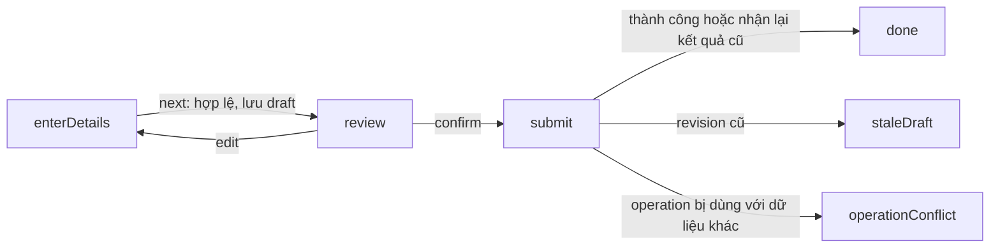

# Hoàn thiện kiểm thử cho nhiều tab và xác nhận gửi lặp

## 1. Mục tiêu thực hành

Một flow chạy đúng khi chỉ có một tab chưa chắc giữ đúng dữ liệu khi người dùng mở thêm tab. Một nút xác nhận bị vô hiệu hóa sau click cũng chưa chứng minh hệ thống không tạo hai hồ sơ khi request bị gửi lại, người dùng dùng trang cũ hoặc phản hồi bị mất sau khi server đã commit.

Trong **SPRING_WEB_FLOW**, bài thực hành này kết hợp scope, execution key, snapshot, form binding, validation, transition, tích hợp MVC và quy tắc ghi dữ liệu để kiểm tra một hành trình gửi hồ sơ nhiều bước.

Sau khi hoàn thành, bạn cần chứng minh được hai điều độc lập:

1. Dữ liệu và điều hướng của các hành trình không bị lẫn giữa tab hoặc giữa người dùng.
2. Cùng một thao tác gửi hồ sơ không tạo trùng kết quả nghiệp vụ khi được xác nhận lại.

Ví dụ API dùng Spring Web Flow 3.0.0 làm mốc. Ví dụ trình duyệt dùng Playwright Test với TypeScript; SQL minh họa dành cho PostgreSQL 17. Các tên service, bảng và test ID do bài thực hành định nghĩa, không phải thành phần có sẵn của Web Flow. Bài cung cấp đặc tả và mã để áp dụng trong dự án thử nghiệm; không có bộ kiểm thử ứng dụng thật được chạy trong quá trình soạn bài.

## 2. Phân biệt các tình huống nhiều tab

| Tình huống | Session | Execution | Draft nghiệp vụ | Rủi ro chính |
|---|---|---|---|---|
| Hai tab mở hai flow mới | Chung | Khác | Khác | Form hoặc điều hướng bị dùng chung sai scope |
| Hai tab mở cùng execution URL | Chung | Cùng cuộc hội thoại, có thể ở snapshot khác | Cùng | Event từ trang cũ, dữ liệu cũ hoặc execution đã kết thúc |
| Hai flow cùng mở một draft | Chung hoặc khác | Khác | Cùng | Ghi đè revision hoặc gửi cùng draft hai lần |
| Hai người dùng | Khác | Khác | Theo quyền truy cập | Lộ hoặc sửa dữ liệu không thuộc mình |
| Một tab gửi lại request | Chung | Cũ hoặc đã hết hiệu lực | Cùng | Tác vụ nghiệp vụ lặp |

Không tạo hai browser context rồi coi đó là hai tab dùng chung session. Với Playwright, nhiều `Page` trong cùng `BrowserContext` mô phỏng các tab cùng ngữ cảnh trình duyệt; các context khác nhau dùng để cô lập phiên người dùng. Xem [Playwright: Pages](https://playwright.dev/docs/pages) và [BrowserContext](https://playwright.dev/docs/api/class-browsercontext).

Cũng không lấy việc draft ID giống nhau làm bằng chứng hai tab đang dùng cùng execution. Một ứng dụng có thể cho phép hai execution khác nhau cùng nạp một draft đã lưu; khi đó phải kiểm tra cả quyền, revision và quy tắc cập nhật ở tầng nghiệp vụ.

## 3. Đề bài và hợp đồng chấp nhận

### 3.1. Hành trình gửi hồ sơ



Model của một hành trình gồm:

| Thuộc tính | Vai trò |
|---|---|
| `draftId` | Định danh hồ sơ nháp |
| `title`, `contactEmail` | Dữ liệu người dùng nhập |
| `revision` | Phiên bản dữ liệu mà người dùng đã xem lại |
| `operationId` | Định danh ổn định của thao tác xác nhận đã chuẩn bị |
| `submissionId` | Mã kết quả sau khi gửi thành công |

`operationId` được tạo hoặc cấp phát ở server theo vòng đời thao tác và giữ ổn định khi thử lại cùng lệnh. Nếu người dùng chỉnh sửa nội dung làm thay đổi revision, ứng dụng phải xác định lại lệnh xác nhận phù hợp; không tái sử dụng cùng key cho một payload khác mà vẫn coi là retry tương đương.

### 3.2. Những điều bắt buộc phải đúng

- Hai flow mới trong cùng session có draft độc lập, sửa tab A không đổi model của tab B.
- Validation sai không được gọi dịch vụ xác nhận gửi.
- Mỗi draft của ví dụ chỉ có tối đa một kết quả gửi cuối cùng.
- Cùng owner, operation ID và nội dung tương đương trả lại kết quả đã tạo nếu dịch vụ nhận được retry.
- Cùng operation ID nhưng nội dung khác bị từ chối theo hợp đồng, không âm thầm ghi đè.
- Revision cũ không được dùng để gửi một nội dung khác với nội dung người dùng vừa xem lại.
- Request mang key của execution đã kết thúc được xử lý rõ ràng; không âm thầm mở hồ sơ mới như thể đã xác nhận lại.
- Mất phản hồi sau commit không khiến lần thử lại tạo thêm hồ sơ hoặc thêm ý định gửi thông báo.

Các quy tắc trên là hợp đồng bài thực hành. Nếu sản phẩm cho phép gửi lại một draft nhiều lần với những lần nộp độc lập, cần định nghĩa “lần gửi” rõ ràng rồi đổi ràng buộc và test tương ứng.

## 4. Ba lớp bảo vệ có trách nhiệm khác nhau

| Lớp | Ví dụ | Bảo vệ được | Chưa bảo đảm |
|---|---|---|---|
| Giao diện | Disable nút, hiển thị đang xử lý | Giảm thao tác vô tình | Request phát lại, tab khác, mất phản hồi |
| Web Flow/repository | Key, snapshot, khóa execution, kết thúc flow | Điều phối và vòng đời execution | Mọi lệnh nghiệp vụ từ execution khác hoặc node khác |
| Dịch vụ/database | Revision, khóa nghiệp vụ, transaction và uniqueness | Quy tắc ghi dữ liệu dưới cạnh tranh | Tự động hiển thị kết quả phục hồi đúng cho người dùng |

`DefaultFlowExecutionRepository` có cơ chế vô hiệu hóa execution và snapshot khi hoàn tất. Đây là lớp bảo vệ quan trọng của vòng đời flow; xem [Javadoc DefaultFlowExecutionRepository](https://docs.spring.io/spring-webflow/docs/3.0.0/api/org/springframework/webflow/execution/repository/impl/DefaultFlowExecutionRepository.html).

Tuy nhiên, tác vụ có thể đã commit trước khi response hoàn tất hoặc trước khi trạng thái kết thúc được lưu xong. Hai execution khác nhau cũng có thể cùng gọi service. Vì vậy, test không được dừng ở kết luận “flow đã end nên chắc chắn không trùng”.

Tương tự, `JdkConcurrentConversationLock` dựa trên `ReentrantLock`; khóa trong một JVM không mặc nhiên điều phối hai bản sao execution trên hai JVM. Xem [Javadoc JdkConcurrentConversationLock](https://docs.spring.io/spring-webflow/docs/3.0.0/api/org/springframework/webflow/conversation/impl/JdkConcurrentConversationLock.html).

## 5. Chuẩn bị flow và model đúng phạm vi

### 5.1. Không dùng session làm chỗ giữ form hiện hành chung

Một lỗi phổ biến:

```text
session.currentDraft = draft của tab vừa mở gần nhất
```

Khi tab A submit, action đọc `session.currentDraft` nên có thể gửi draft của tab B. Cách tổ chức đúng cho bài là mỗi execution giữ model của nó trong flow scope và service kiểm tra draft bền vững theo danh tính hiện tại.

Conversation scope chỉ được dùng khi thật sự cần chia sẻ dữ liệu giữa root flow và subflow của cùng hành trình. Nó không phải biến chung cho mọi tab trong session. Các vòng đời scope được mô tả trong [Spring Web Flow: Variable Scopes](https://docs.spring.io/spring-webflow/docs/3.0.x/reference/).

### 5.2. Phần flow minh họa

Đoạn dưới là phần trích trong một flow đã có view factory, service và lớp model tương thích. `draftService.openDraft()` lấy danh tính từ ngữ cảnh xác thực và tạo draft riêng cho execution mới. `saveForReview()` lưu dữ liệu đã hợp lệ và chuẩn bị revision/operation ID của lệnh xác nhận.

```xml
<on-start>
    <evaluate expression="draftService.openDraft()"
              result="flowScope.draft"/>
</on-start>

<view-state id="enterDetails" model="draft">
    <binder>
        <binding property="title"/>
        <binding property="contactEmail"/>
    </binder>
    <transition on="next" to="review">
        <evaluate expression="draftService.saveForReview(draft)"
                  result="flowScope.draft"/>
    </transition>
</view-state>

<view-state id="review">
    <transition on="edit" to="enterDetails"/>
    <transition on="confirm" to="submit"/>
</view-state>

<action-state id="submit">
    <evaluate expression="submissionService.confirm(
                draft.draftId, draft.revision, draft.operationId)"
              result="flowScope.receipt"/>
    <transition on="success" to="done"/>
    <transition on-exception="example.StaleDraftException" to="staleDraft"/>
    <transition on-exception="example.OperationConflictException"
                to="operationConflict"/>
</action-state>

<view-state id="staleDraft"/>
<view-state id="operationConflict"/>

<end-state id="done">
    <output name="submissionId" value="receipt.submissionId"/>
</end-state>
```

Các tên exception là kiểu do ứng dụng thử nghiệm định nghĩa. Nhánh phục hồi cần có nội dung và thao tác tiếp theo phù hợp; đoạn trích chưa cung cấp toàn bộ UI hay mọi trường hợp lỗi kỹ thuật.

Form binding chỉ cho phép trường người dùng được sửa. Không bind tự do `ownerId`, trạng thái gửi hoặc metadata xác nhận từ request. Service vẫn phải kiểm tra quyền sở hữu, revision và lệnh chuẩn bị ở server, kể cả khi các giá trị đó đang nằm trong flow scope.

Cần cấu hình validation của model/validator để `next` chỉ tiếp tục khi title và email hợp lệ. Có model trong XML chưa tự sinh toàn bộ các quy tắc validation của bài.

### 5.3. Form phải gửi tới execution của chính nó

Với view MVC, form cần dùng URL tiếp tục flow do tích hợp cung cấp, thường thông qua `flowExecutionUrl`, và phát event theo quy ước đang dùng. Không đặt mọi form về một URL khởi tạo flow chung rồi dựa vào `currentDraft` trong session để đoán tab nào gửi.

Với Faces, giữ cơ chế postback, ViewState và client ID của runtime. Không thay request Faces bằng một form `_eventId` tự chế rồi coi đã kiểm tra cả Faces lifecycle.

## 6. Hợp đồng xác nhận ở tầng dữ liệu

### 6.1. Hai loại uniqueness

Một lược đồ PostgreSQL minh họa cho kết quả gửi:

```sql
CREATE TABLE application_submission (
    submission_id uuid PRIMARY KEY,
    owner_id uuid NOT NULL,
    draft_id uuid NOT NULL,
    operation_id uuid NOT NULL,
    source_revision bigint NOT NULL,
    payload_hash varchar(64) NOT NULL,
    created_at timestamptz NOT NULL DEFAULT CURRENT_TIMESTAMP,
    CONSTRAINT uq_submission_operation UNIQUE (owner_id, operation_id),
    CONSTRAINT uq_submission_draft UNIQUE (owner_id, draft_id)
);
```

Đây là phần schema tối thiểu để minh họa ràng buộc, chưa bao gồm bảng draft, foreign key, audit hoặc toàn bộ trạng thái nghiệp vụ.

Hai ràng buộc giải quyết hai vấn đề khác nhau:

- `owner_id + operation_id` nhận diện việc gửi lại cùng một lệnh trong phạm vi người dùng.
- `owner_id + draft_id` bảo vệ quy tắc một draft chỉ được gửi cuối cùng một lần, kể cả khi có lệnh khác.

Unique constraint là ràng buộc do database thực thi; xem [PostgreSQL 17: Constraints](https://www.postgresql.org/docs/17/ddl-constraints.html). Không thay nó bằng quy trình “SELECT chưa thấy thì INSERT” không có bảo vệ cạnh tranh.

### 6.2. Quy trình transaction tham khảo

Mã giả sau mô tả hợp đồng, không phải một implementation JDBC/JPA hoàn chỉnh:

```text
confirm(authenticatedUser, draftId, expectedRevision, operationId):
    bắt đầu transaction
    xác định owner từ authenticatedUser
    khóa draft thuộc owner bằng cơ chế phù hợp
    nếu không tồn tại hoặc không có quyền: từ chối

    tìm kết quả đã lưu của operationId trong phạm vi owner
    nếu có:
        đối chiếu draft, source revision và payload fingerprint
        nếu tương đương: trả receipt cũ
        nếu khác: từ chối xung đột operation

    nếu draft đã gửi:
        xử lý theo chính sách kết quả đã có/xung đột
        không tạo kết quả mới

    nếu draft.revision khác expectedRevision: từ chối stale draft
    kiểm tra operationId là lệnh đã chuẩn bị cho revision này
    chạy validation và kiểm tra quyền hiện tại
    tạo submission và cập nhật draft thành submitted
    ghi ý định thông báo/outbox nếu có
    commit
    trả receipt
```

Với PostgreSQL, khóa dòng như `SELECT ... FOR UPDATE` có thể là một phần của thiết kế; cần kiểm thử transaction và isolation thực tế. Xem [PostgreSQL 17: Explicit Locking](https://www.postgresql.org/docs/17/explicit-locking.html).

Fingerprint phải do server tính từ dữ liệu được chuẩn hóa và những thành phần quan trọng của lệnh. Không nhận một hash từ client rồi coi như bằng chứng nội dung giống nhau. Khi đối chiếu retry, dùng fingerprint của lệnh đã chuẩn bị/kết quả đã lưu; không băm lại tùy ý một draft đã thay đổi rồi nhầm là cùng lệnh.

Các lỗi uniqueness còn có thể xuất hiện dưới cạnh tranh; service cần ánh xạ đúng trường hợp để tìm kết quả tương đương hoặc trả xung đột. Không bắt mọi lỗi database rồi báo thành công. Với stack có transaction bị đánh dấu rollback sau lỗi, xử lý đọc lại phải tuân theo ranh giới transaction phù hợp.

### 6.3. Thông báo và hệ thống ngoài

Một submission không trùng chưa bảo đảm email hoặc message không trùng. Nếu dùng outbox, kiểm tra số ý định nghiệp vụ được ghi cho submission. Một outbox record vẫn có thể được giao nhiều lần; consumer hoặc nhà cung cấp ngoài cần cơ chế xử lý lặp phù hợp.

Phân biệt “một ý định gửi thông báo” với “chỉ có đúng một lần gọi qua mạng”. Không tuyên bố xử lý đúng một lần ở mọi hệ thống ngoài chỉ vì bảng submission có unique constraint.

## 7. Lập ma trận kiểm thử

| Mã | Kịch bản | Assertion chính |
|---|---|---|
| MT-01 | Hai tab khởi tạo hai execution | Draft và nội dung riêng biệt |
| MT-02 | Hai tab cùng execution, cùng draft | Không đổi nhầm draft; trang cũ được xử lý đúng |
| MT-03 | Hai execution cùng draft, revision khác | Revision cũ bị từ chối, không ghi đè |
| DS-01 | Click hai lần trên cùng nút | Quan sát request thực tế và không có kết quả trùng |
| DS-02 | Tab cũ confirm sau khi tab kia đã hoàn tất | Không mở mới âm thầm, không ghi thêm |
| DS-03 | Hai lệnh confirm đồng thời ở service | Một submission, kết quả theo hợp đồng |
| DS-04 | Commit xong nhưng mất phản hồi | Retry nhận lại kết quả hoặc đường tra cứu an toàn |
| DS-05 | Cùng operation ID, nội dung khác | Từ chối xung đột, không đổi kết quả cũ |
| DS-06 | Operation khác nhưng cùng draft đã gửi | Không tạo submission thứ hai |
| SEC-01 | Người dùng khác dùng draft/key không thuộc mình | Không đọc hoặc gửi trái quyền |
| VAL-01 | Dữ liệu chưa hợp lệ | Không gọi service confirm, không có submission |
| HIST-01 | Back/snapshot cũ sau sửa dữ liệu | Không bỏ qua kiểm tra revision hoặc validation |
| LIMIT-01 | Mở vượt giới hạn execution | Xử lý hết hiệu lực đúng, không chuyển sang draft khác |

Giới hạn execution/snapshot có thể khiến tab cũ mất khả năng tiếp tục. Test phải phân biệt trường hợp bị loại theo chính sách với lỗi dữ liệu bị lẫn. Không mở số tab vượt giới hạn đã cấu hình rồi kết luận ngay rằng scope bị sai.

## 8. Kiểm thử trình duyệt cho hai flow độc lập

### 8.1. Hợp đồng fixture giao diện

Ứng dụng thử nghiệm cần có:

- `/spring/application` là điểm bắt đầu một execution mới khi không có key.
- Form với label `Tiêu đề`, `Email liên hệ`, nút `Xem lại` và `Sửa`.
- Heading `Xem lại hồ sơ` ở bước review.
- Marker `data-testid="draft-reference"` cho mã draft người dùng đang làm việc.
- Marker `review-title` và `review-email` cho nội dung xem lại.

Test ID chỉ là thuộc tính phục vụ định vị; không cần hiển thị execution key hoặc thông tin nội bộ trên màn hình sản phẩm. Nếu ứng dụng cần đăng nhập, fixture đăng nhập phải hoàn tất trước các thao tác bên dưới.

### 8.2. Ví dụ Playwright

```ts
import { test, expect, type Page } from '@playwright/test';

async function fillAndReview(page: Page, title: string, email: string) {
  await page.getByLabel('Tiêu đề', { exact: true }).fill(title);
  await page.getByLabel('Email liên hệ', { exact: true }).fill(email);
  await page.getByRole('button', { name: 'Xem lại', exact: true }).click();
  await expect(page.getByRole('heading', {
    name: 'Xem lại hồ sơ', exact: true,
  })).toBeVisible();
}

test('two tabs keep separate drafts in one browser context',
  async ({ context }) => {
    const tabA = await context.newPage();
    const tabB = await context.newPage();

    // Mở A trước để session đã được thiết lập rồi mới mở B.
    await tabA.goto('/spring/application');
    const draftA = (await tabA.getByTestId('draft-reference').innerText()).trim();
    expect(draftA).not.toBe('');

    await tabB.goto('/spring/application');
    const draftB = (await tabB.getByTestId('draft-reference').innerText()).trim();
    expect(draftB).not.toBe('');
    expect(draftB).not.toBe(draftA);

    await fillAndReview(tabA, 'Hồ sơ A', 'a@example.test');
    await fillAndReview(tabB, 'Hồ sơ B', 'b@example.test');

    await expect(tabA.getByTestId('review-title')).toHaveText('Hồ sơ A');
    await expect(tabA.getByTestId('review-email')).toHaveText('a@example.test');
    await expect(tabB.getByTestId('review-title')).toHaveText('Hồ sơ B');
    await expect(tabB.getByTestId('review-email')).toHaveText('b@example.test');

    await tabA.getByRole('button', { name: 'Sửa', exact: true }).click();
    await fillAndReview(tabA, 'Hồ sơ A đã sửa', 'a@example.test');

    await expect(tabB.getByTestId('review-title')).toHaveText('Hồ sơ B');
    await expect(tabB.getByTestId('draft-reference')).toHaveText(draftB);
  });
```

`baseURL`, đăng nhập, dữ liệu riêng cho mỗi lần chạy và cleanup là phần cấu hình của bộ test. Test không dùng hai context vì mục tiêu ở đây là dữ liệu của hai execution trong cùng phiên không bị trộn.

Việc mở A trước B còn tránh một tình huống khác: hai request đầu cùng chạy trước khi cookie phiên được thiết lập có thể tạo hai session khác nhau, làm phép thử vô tình mất điều kiện “cùng session”.

Assertion DOM cần được bổ sung bằng kiểm tra model hoặc dữ liệu bền vững khi mục tiêu bao gồm lưu draft. Một tab đang giữ HTML cũ đúng nội dung chưa chứng minh dữ liệu server chưa bị ghi đè.

## 9. Tab cũ xác nhận sau khi execution đã kết thúc

### 9.1. Chuẩn bị khác với mở flow mới

Để mô phỏng cùng execution trong cấu hình MVC mẫu:

1. Mở tab A, nhập dữ liệu và tới review.
2. Lấy URL tiếp tục execution mà trình duyệt đang dùng.
3. Mở tab B bằng URL đó trong cùng browser context.
4. Xác nhận cả hai đang xem cùng draft và cùng nội dung đã chuẩn bị.
5. Cho A confirm thành công.
6. Cho B gửi lại từ trang cũ và kiểm tra kết quả đã quy định.

Việc GET cùng URL có thể tạo checkpoint hoặc render lại theo cơ chế repository. Hai tab không bắt buộc giữ cùng chuỗi key mãi mãi; cần xác nhận cùng cuộc hội thoại/draft bằng phép quan sát phù hợp.

### 9.2. Đặc tả cho ứng dụng thử nghiệm

```text
Given:
  A và B đang giữ trang review của cùng hành trình gửi draft D.
When:
  A confirm và nhận receipt R.
Then:
  D có một submission, receipt là R.
When:
  B gửi event confirm từ trang đã mở trước đó.
Then:
  B nhận kết quả "Hành trình này đã kết thúc" theo handler đã cấu hình.
  Không tự tạo một draft mới để coi như gửi lại thành công.
  Database vẫn có một submission của D.
  Không thêm ý định thông báo mới.
```

Đây là chính sách UI do bài chọn, không phải thông điệp mặc định của Web Flow. Nếu sản phẩm có đường tra cứu lại receipt đã được kiểm tra quyền, có thể hiển thị R cho tab B; khi đó test phải kiểm tra đúng receipt và quyền sở hữu.

Không bắt mọi exception của B rồi cho test đạt. Timeout do trang treo, 500 ngoài dự kiến và thông báo execution đã kết thúc là các kết quả khác nhau.

### 9.3. Quan sát dữ liệu bằng adapter kiểm thử

Bộ test nên có một adapter đọc database/audit, được giới hạn trong môi trường test, với các khả năng như:

```text
countSubmissions(owner, draftId)
findSubmission(owner, draftId)
countNotificationIntents(submissionId)
countRootStarts(testRunId)
```

Các hàm trên là hợp đồng hỗ trợ do dự án cần triển khai, không phải endpoint sẵn có của framework. Không tạo một API production công khai chỉ để đếm submission từ test.

Assertion `countRootStarts` giúp phát hiện lỗi fallback tự mở execution mới sau khi key cũ hết hiệu lực, ngay cả khi database vẫn chưa có submission thứ hai.

## 10. Kiểm thử cạnh tranh thật tại service

### 10.1. Vì sao click hai lần chưa đủ?

`dblclick()` có thể chỉ làm server nhận một request vì nút bị disable hoặc thư viện đã chặn lần sau. Hai click được phát gần nhau cũng có thể bị flow lock xếp tuần tự trước khi tới service.

Do đó, cần một test integration ở service để hai transaction có thể tới điểm cạnh tranh cần kiểm tra, ngoài bài test trình duyệt về hành vi người dùng.

### 10.2. Mã giả cho bộ kiểm thử có barrier

```text
Given:
  Database có draft D của user U, revision V.
  Operation O đã được chuẩn bị cho D và V.
  Chưa có submission của D hoặc O.

Arrange:
  Tạo hai worker, mỗi worker có transaction độc lập.
  Cả hai đều gọi service confirm(U, D, V, O).
  Test hook cho cả hai dừng ngay trước khi lấy khóa draft.
  Chờ đủ hai worker với timeout hữu hạn.

Act:
  Mở barrier cho cả hai tiếp tục.
  Chờ cả hai hoàn thành hoặc trả lỗi theo hợp đồng.

Assert:
  Có một submission của D.
  Có một kết quả cho O.
  Hai lời gọi tương đương nhận cùng submissionId theo hợp đồng service.
  Chỉ có một ý định thông báo cho submission đó.
  Draft đã ở trạng thái submitted và revision đúng.
```

Đặt barrier trước khi lấy khóa, không đặt một barrier cần hai worker cùng vượt qua sau khi worker thứ nhất đã giữ khóa độc quyền. Cách đặt sai có thể tự tạo deadlock trong test.

Dùng database cùng loại và isolation đại diện cho triển khai. Không để một transaction bao ngoài của test giữ dữ liệu chưa commit rồi mong các worker ở connection khác nhìn thấy nó. Setup dữ liệu, transaction của từng worker và cleanup cần được tách rõ.

Nếu hợp đồng service chọn trả xung đột cho request thứ hai thay vì receipt cũ, assertion phải phản ánh lựa chọn đó. Trong bài, retry cùng lệnh tương đương được yêu cầu nhận lại cùng receipt; các xung đột nội dung hoặc revision mới được từ chối.

### 10.3. Các biến thể bắt buộc

- Cùng D, V, O và cùng fingerprint: nhận lại cùng kết quả.
- Cùng O nhưng draft hoặc fingerprint khác: từ chối xung đột, không đổi kết quả cũ.
- Operation mới nhưng D đã gửi: không tạo submission thứ hai.
- V cũ so với draft hiện tại: từ chối stale, không dùng model cũ để ghi đè.
- User khác dùng D/O: không tiết lộ receipt hoặc gửi hồ sơ trái quyền.

Không dùng số lần gọi phương thức `confirm()` làm assertion chính cho chống trùng. Dưới retry, phương thức có thể được gọi nhiều lần một cách hợp lệ; điều phải giữ là một kết quả nghiệp vụ và những tác dụng phụ được phép.

## 11. Kiểm thử mất phản hồi sau commit

Lỗi trước khi database ghi và lỗi sau commit là hai kịch bản khác nhau:

```text
Trường hợp A:
  service lỗi trước commit → chưa có submission → retry thực hiện thao tác mới.

Trường hợp B:
  commit thành công → phản hồi mất → client không biết kết quả
  → retry hoặc tra cứu phải tìm lại submission đã có.
```

Phép thử B cần một điểm tiêm lỗi sau commit hoặc một cơ chế cắt phản hồi khi đã có bằng chứng transaction hoàn tất. Ngắt request trước khi server nhận được nó không đại diện cho “commit xong nhưng mất phản hồi”.

Sau lỗi, xác nhận database đã có receipt R, sau đó thử lại cùng operation ID qua service hoặc đường phục hồi được ứng dụng cung cấp. Nếu execution cũ đã kết thúc, request HTTP cũ có thể bị repository từ chối trước khi service chạy; vì thế cần kiểm tra cả đường xử lý key cũ lẫn hợp đồng idempotency của service.

Không sinh operation ID mới cho mỗi lần retry. Nếu client không còn key hợp lệ, ứng dụng cần đường kiểm tra kết quả theo draft/lệnh đã được xác thực, thay vì bảo người dùng gửi một hồ sơ mới để đoán thao tác trước có thành công hay chưa.

## 12. Back, sửa form và snapshot cũ

Một kịch bản quan trọng:

```text
A xem lại draft D ở revision 7.
B sửa cùng draft D và lưu revision 8.
A confirm từ trang revision 7.
```

Theo hợp đồng bài, A phải nhận thông báo dữ liệu đã thay đổi và đường nạp lại nội dung phù hợp. Không tự động gửi revision 8 khi người dùng chỉ xem lại revision 7; cũng không ghi revision 7 đè lên revision 8.

Tương tự, browser back có thể đưa người dùng về một snapshot cũ của flow. Snapshot tái hiện trạng thái điều phối ở một thời điểm, không hoàn tác database hoặc tác vụ ngoài đã commit sau đó.

Cần kiểm tra những snapshot đại diện thay vì chỉ URL mới nhất. Nếu lịch sử bị giới hạn và snapshot đã bị loại, kết quả phải là đường hết hiệu lực/khôi phục theo chính sách, không chuyển sang một draft khác đang nằm trong session.

## 13. Validation và các giới hạn không được nhầm

### 13.1. Validation trước xác nhận

Thêm test gửi title rỗng hoặc email không hợp lệ:

- Người dùng ở lại bước nhập với lỗi có nghĩa.
- Không vào bước review hợp lệ.
- Service confirm chưa được gọi.
- Không có submission hoặc ý định thông báo.

Vẫn cần validation ở service cho request cũ, dữ liệu thay đổi hoặc lời gọi ngoài đường UI. Validation tại form giúp trải nghiệm người dùng, không thay thế invariant khi commit.

### 13.2. CSRF và operation ID

CSRF token và operation ID có mục đích khác nhau. CSRF bảo vệ nguồn gốc request theo cơ chế xác thực; operation ID nhận diện lệnh nghiệp vụ và retry. Không sử dụng một cơ chế như bằng chứng rằng cơ chế kia đã được thực hiện.

Khi kiểm thử replay, giữ request hợp lệ về quyền và CSRF nếu mục tiêu là chống trùng nghiệp vụ. Một request bị filter chặn trước service chưa chứng minh service chịu được gửi lặp.

### 13.3. Nhiều execution và giới hạn repository

Giữ số flow trong kịch bản cô lập nhỏ hơn giới hạn nếu đang kiểm tra scope. Viết một kịch bản khác cố ý vượt giới hạn để kiểm tra phản hồi của tab bị loại. Hai mục tiêu này không nên gộp thành một test khó xác định nguyên nhân thất bại.

Với cụm nhiều node, bổ sung test hai node cùng xác nhận nếu kiến trúc cho phép request tới cả hai. Bài test một JVM không chứng minh cơ chế khóa phân tán hoặc session replication đã đúng.

## 14. Cách làm bộ kiểm thử ổn định và dễ đọc

### 14.1. Chờ theo kết quả

Dùng assertion chờ heading, receipt, thông báo hoặc dữ liệu đã commit thay vì sleep cố định. Khi cần kiểm tra Ajax, chờ đúng request của nút tương ứng và kiểm tra DOM sau response. Với background outbox, chờ điều kiện có timeout và đối chiếu loại kết quả đang đo.

`Promise.all()` chỉ phát nhiều công việc từ test gần nhau; nó không tự tạo một điểm cạnh tranh xác định ở server. Khi mục tiêu là race condition, cần barrier hoặc test hook ở vị trí đã được thiết kế.

### 14.2. Cô lập và cleanup

Mỗi test có mã chạy, draft, operation và dữ liệu riêng. Hai tab trong cùng test cố ý dùng chung browser context; hai test độc lập không nên chia sẻ session hoặc cờ lỗi static.

Cleanup phải dựa trên dữ liệu của test và đợi worker kết thúc. Không xóa toàn bộ bảng hoặc session store đang dùng chung để làm test sau xanh. Khi lỗi xảy ra, lưu trace và bằng chứng trước khi thu dọn fixture.

### 14.3. Bằng chứng cần có khi thất bại

| Bằng chứng | Giúp phân biệt |
|---|---|
| URL/action và event của từng tab | Nhầm execution hay khởi tạo flow mới |
| Flow/state và mã tương quan | Event đi sai nhánh hay lỗi render |
| Draft ID, revision, operation ID đã được bảo vệ | Nhầm draft, stale hay retry cùng lệnh |
| Receipt và số bản ghi bền vững | Gửi trùng thật hay chỉ hiển thị lặp |
| Số ý định outbox và kết quả consumer | Trùng ghi nghiệp vụ hay trùng giao message |
| Loại lỗi/response ở tab cũ | Hết execution theo chính sách hay lỗi ngoài dự kiến |

Không dùng raw execution key, cookie hoặc dữ liệu form nhạy cảm làm nhãn metrics. Trong log và artifact chia sẻ, giữ những thông tin cần chẩn đoán với mức che phù hợp.

## 15. Trình tự hoàn thiện bài thực hành

1. Chốt hợp đồng về một draft được gửi bao nhiêu lần, khi nào operation ID được tạo lại và revision nào được xác nhận.
2. Kiểm tra scope và form action để mỗi execution thao tác đúng model của nó.
3. Bổ sung validation và các nhánh stale/conflict có thông báo rõ.
4. Đặt ràng buộc, transaction và cách nhận lại receipt ở tầng service/database.
5. Viết test hai tab dùng execution riêng trong cùng phiên.
6. Viết test tab cũ gửi lại sau khi execution đã kết thúc.
7. Viết test service cạnh tranh bằng hai transaction và điểm đồng bộ xác định.
8. Tiêm lỗi sau commit để kiểm tra retry hoặc tra cứu kết quả.
9. Bổ sung snapshot cũ, user khác và giới hạn execution.
10. Chạy kiểm thử HTTP/trình duyệt phù hợp công nghệ thực tế; ghi rõ phần Faces, Ajax hoặc nhiều node chưa được bao phủ.

Tiêu chí chấp nhận cuối cùng:

- Có đủ tình huống khác execution, cùng execution và cùng draft.
- Hai tab cùng phiên không bị hiểu nhầm thành hai phiên độc lập.
- Kết quả được đối chiếu với dữ liệu đã commit, không chỉ số click hoặc HTTP 200.
- Cùng lệnh tương đương nhận lại receipt theo hợp đồng; lệnh xung đột bị từ chối.
- Một draft không phát sinh hai submission hoặc hai ý định nghiệp vụ ngoài dự kiến.
- Request từ trang cũ không tự khởi tạo công việc mới âm thầm.
- Revision, quyền và validation vẫn được thực thi tại điểm ghi dữ liệu.
- Test race có đồng bộ, timeout và transaction độc lập rõ ràng.
- Trường hợp mất phản hồi được phân biệt với lỗi trước commit.
- Báo cáo mô tả đúng phạm vi đã chứng minh ở UI, flow, service, database và hạ tầng.

Một hành trình nhiều bước được kiểm thử đầy đủ khi người dùng có thể mở nhiều tab, quay lại trang cũ và thử lại sau lỗi mà hệ thống vẫn gắn đúng dữ liệu với đúng công việc. Spring Web Flow giữ cấu trúc điều phối; các hợp đồng và kiểm thử ở ranh giới ghi dữ liệu bảo đảm việc xác nhận không biến thành những tác vụ nghiệp vụ bị lặp.