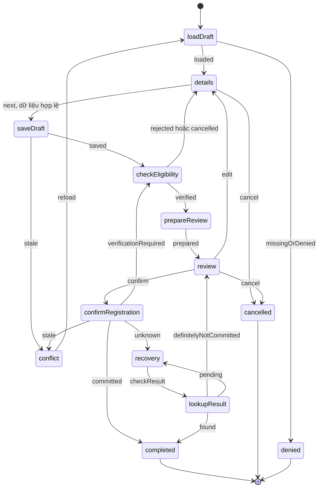
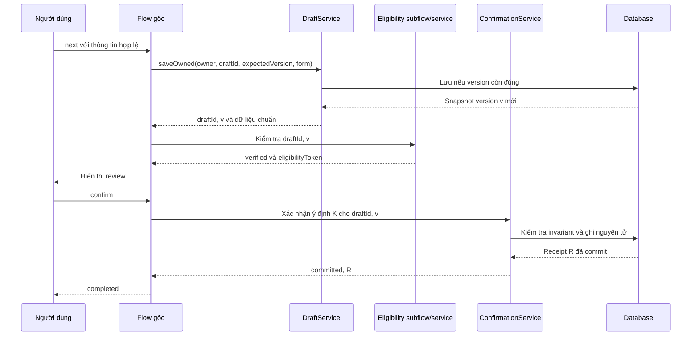

# Đánh giá thiết kế bằng sơ đồ, hợp đồng dữ liệu và bằng chứng kiểm thử

Một thiết kế Spring Web Flow không được chứng minh chỉ bằng XML hợp lệ, một sơ đồ đẹp hoặc một bộ test toàn màu xanh. Cần chỉ ra rằng hành trình đáp ứng yêu cầu nghiệp vụ, dữ liệu đi qua các bước theo hợp đồng rõ ràng và kiểm thử thực sự quan sát được những điều thiết kế tuyên bố.

Trong chương **Thực hành tổng hợp** của module **SPRING_WEB_FLOW**, bài học này dùng một hành trình đăng ký chương trình học để đánh giá thiết kế qua ba loại tài liệu: sơ đồ điều phối, hợp đồng dữ liệu và bằng chứng kiểm thử. Các phần phải liên kết với nhau: mỗi invariant có nơi được thực thi, mỗi transition có điều kiện xác định và mỗi kết luận quan trọng có bằng chứng phù hợp.

Ví dụ là một thiết kế tham chiếu cho bài thực hành, không phải báo cáo đã chạy một ứng dụng cụ thể. Các mã yêu cầu, test và biểu mẫu bên dưới dùng để tổ chức việc đánh giá.

## 1. Bắt đầu bằng invariant, không bắt đầu bằng số lượng state

### Bối cảnh bài thực hành

Người dùng đã đăng nhập mở một bản nháp đăng ký, chỉnh thông tin, kiểm tra điều kiện tham gia qua subflow, xem lại và xác nhận. Người dùng có thể quay lại sửa, hủy trước xác nhận hoặc tiếp tục từ bản nháp nếu execution không còn.

Bản nháp được lưu bền vững; execution là trạng thái điều phối tạm thời. Một bản nháp chỉ được tạo một đăng ký hoàn tất theo quy tắc của bài tập.

Các yêu cầu được đánh số để truy vết:

| Mã | Invariant cần bảo vệ | Ví dụ vi phạm |
| --- | --- | --- |
| R1 | Chỉ chủ sở hữu hợp lệ được đọc và xác nhận bản nháp | Đổi `draftId` trên URL để mở bản nháp của người khác |
| R2 | Dữ liệu sai không đi tiếp tới kiểm tra điều kiện hoặc xác nhận | Email sai nhưng vẫn tới review |
| R3 | Kết quả kiểm tra điều kiện gắn với đúng phiên bản dữ liệu | Sửa bản nháp nhưng dùng lại token của phiên bản cũ |
| R4 | Subflow trả outcome và output theo hợp đồng | Outcome bị từ chối nhưng parent vẫn sang review |
| R5 | Xác nhận lặp cùng ý định không tạo đăng ký thứ hai | Double-click tạo hai bản ghi |
| R6 | Chỉ báo hoàn tất khi đã có kết quả nghiệp vụ xác định | Timeout chưa rõ commit nhưng trang báo thành công |
| R7 | Quay lại, hủy và hết execution có hành vi rõ ràng | Cancel cố bind dữ liệu lỗi rồi không thoát được |
| R8 | Phiên và dữ liệu của các hành trình không bị dùng lẫn | Hai tab đọc nhầm form hoặc kết quả xác nhận |

Các invariant này thuộc thiết kế ứng dụng, không phải mọi dòng đều là hành vi Web Flow tự cung cấp. Người đánh giá cần xác định framework làm phần nào và service, database hoặc lớp tích hợp phải làm phần nào.

Một yêu cầu như “dùng `flowScope` đúng” còn quá chung. Hãy chuyển thành điều quan sát được: dữ liệu cần qua nhiều state vẫn còn khi quay lại, subflow không vô tình sửa form của cha và hai execution không dùng chung một mutable bean không phù hợp.

## 2. Dùng sơ đồ trạng thái để đánh giá khả năng đi và về

Sơ đồ cần dùng tên state và event có thể đối chiếu với cấu hình thật. Mỗi nút phải cho biết nó là bước tương tác, thao tác service, subflow hay điểm kết thúc.



Phân loại các state trong thiết kế tham chiếu:

| State | Vai trò |
| --- | --- |
| `loadDraft`, `saveDraft` | Action đọc/lưu bản nháp có kiểm tra quyền và phiên bản |
| `details`, `review` | View-state nhận tương tác |
| `checkEligibility` | Subflow kiểm tra điều kiện của bản nháp đã lưu |
| `prepareReview` | Action kiểm tra output và chuẩn bị ý định xác nhận trước review |
| `confirmRegistration`, `lookupResult` | Action gọi service xác nhận hoặc tra kết quả |
| `conflict`, `recovery` | View-state cung cấp lựa chọn phục hồi có kiểm soát |
| `completed`, `cancelled`, `denied` | End-state với ý nghĩa khác nhau |

Sơ đồ trên tập trung vào các nhánh nghiệp vụ và nhánh chưa biết kết quả xác nhận. Lỗi hạ tầng khi load/save/kiểm tra điều kiện vẫn cần chính sách riêng ở phần 8; không xem nhánh bị lược khỏi hình là nhánh được phép bỏ qua.

Khi đánh giá, kiểm tra:

- Mọi state chính có thể đi tới từ start state không?
- Có đường thoát hợp lý khỏi view-state phục hồi không?
- Event từ người dùng có bị nhầm với outcome của action hoặc subflow không?
- Một vòng quay lại có làm mất dữ liệu hoặc tạo tác dụng phụ ngoài ý định không?
- Có đường nào tới `completed` mà không qua kết quả xác nhận hoặc tra cứu thành công không?

Trong mô hình Web Flow, định nghĩa flow có một start state và các state mang hành vi khác nhau. Sơ đồ nên phản ánh cấu trúc đó thay vì chỉ liệt kê các trang. Xem [API FlowDefinition](https://docs.spring.io/spring-webflow/docs/current/api/org/springframework/webflow/definition/FlowDefinition.html).

## 3. Bổ sung bảng transition để hình vẽ trở thành hợp đồng

Nhãn `next` hoặc `success` không đủ để giải thích điều kiện và dữ liệu. Bảng transition làm rõ phần hình vẽ khó biểu diễn.

| Mã | Nguồn và tín hiệu | Điều kiện/hành động | Đích | Yêu cầu |
| --- | --- | --- | --- | --- |
| T01 | Khởi chạy với `draftId` | Service kiểm tra quyền đọc | `details` hoặc `denied` | R1 |
| T02 | `details/next` | Bind field được phép, conversion và validation thành công | `saveDraft` | R2 |
| T03 | `details/next` với dữ liệu sai | Hiển thị lỗi, không gọi bước lưu/kiểm tra điều kiện | Vẫn `details` | R2 |
| T04 | `saveDraft/saved` | Nhận snapshot và version mới; vô hiệu kết quả kiểm tra cũ | `checkEligibility` | R3 |
| T05 | `checkEligibility/verified` | Output token đúng bản nháp và version; chuẩn bị ý định xác nhận | `review` | R3, R4 |
| T06 | `checkEligibility/rejected` hoặc `cancelled` | Không giữ token hợp lệ từ lần trước | `details` | R4 |
| T07 | `review/edit` | Xóa trạng thái xác nhận tạm không còn hợp lệ | `details` | R3, R7 |
| T08 | `review/confirm` | Không bind lại dữ liệu tùy ý từ review; service kiểm tra invariant | `confirmRegistration` | R1, R3, R5 |
| T09 | `confirmRegistration/committed` | Có receipt hợp lệ | `completed` | R5, R6 |
| T10 | Kết quả `stale` | Không ghi đè thay đổi của tab khác | `conflict` | R3, R8 |
| T11 | Kết quả `verificationRequired` | Cần kiểm tra lại điều kiện cho dữ liệu hiện tại | `checkEligibility` | R3 |
| T12 | Kết quả `unknown` | Giữ định danh ý định để tra cứu, không tự gửi lại vô điều kiện | `recovery` | R5, R6 |
| T13 | `lookupResult/found` | Tra được receipt thuộc đúng chủ thể và ý định | `completed` | R1, R6 |
| T14 | `lookupResult/definitelyNotCommitted` | Service xác nhận có thể thử lại; vẫn dùng cùng ý định thích hợp | `review` | R5, R6 |
| T15 | Cancel trước xác nhận | Bỏ binding/validation không cần thiết; không tạo đăng ký | `cancelled` | R7 |

T03 thường là kết quả xử lý view/binding/validation ở lại state, không nhất thiết là một `<transition>` có nhãn riêng trong XML. Mã T dùng để truy vết hành vi, không buộc mỗi hàng tương ứng một phần tử XML.

T14 cần được hiểu chặt chẽ: một lần lookup không thấy hàng chưa luôn chứng minh thao tác trước đó không thể commit muộn. Nếu kết quả còn pending hoặc chưa đối soát được, tiếp tục `recovery` thay vì kết luận thất bại và sinh yêu cầu mới.

## 4. Dùng sơ đồ tương tác để kiểm tra quyền sở hữu công việc

Sơ đồ trạng thái mô tả điều phối. Sơ đồ tương tác cho biết ai kiểm tra dữ liệu, ai commit và khi nào có thể báo hoàn tất.



Trong thiết kế này, form được lưu thành bản nháp có version **trước khi** kiểm tra điều kiện. Vì vậy, token và thao tác confirm cùng tham chiếu dữ liệu chuẩn đã lưu. Nếu kiểm tra một object form đang thay đổi trong bộ nhớ nhưng confirm lại đọc một bản nháp khác ở database, hợp đồng dữ liệu chưa khép kín.

Các câu hỏi đánh giá quan trọng:

- Chủ thể được lấy từ phiên xác thực phía server hay từ một hidden input?
- Quyền đọc và quyền xác nhận có được kiểm tra tại service không?
- Review đang hiển thị snapshot nào, có cùng version với command confirm không?
- Receipt chỉ được trả sau commit, hay service còn tham gia transaction bên ngoài chưa hoàn tất?
- Nếu response mất sau commit, định danh nào giúp tra lại kết quả?

Action của Web Flow đóng vai trò cầu nối gọi lớp service và trả event logic để flow quyết định đường đi. Không đưa việc chọn view vào service hoặc buộc controller tự nối các bước của hành trình. Xem [API Action](https://docs.spring.io/spring-webflow/docs/current/api/org/springframework/webflow/execution/Action.html).

## 5. Viết hợp đồng dữ liệu đủ để phát hiện sai scope và sai nguồn tin

Mỗi trường quan trọng cần có kiểu, nguồn, chủ sở hữu, vòng đời, người được sửa và quy tắc khi dữ liệu thay đổi.

| Dữ liệu | Nguồn và quyền sửa | Nơi giữ đề xuất | Điều phải kiểm chứng |
| --- | --- | --- | --- |
| `draftId` | Input ngoài cung cấp định danh, service xác minh quyền | `flowScope` và bản nháp bền vững | Biết ID không đồng nghĩa có quyền |
| `owner` | Ngữ cảnh xác thực phía server | Lấy khi gọi service | Không bind từ form |
| `form.displayName`, `form.email` | Người dùng sửa tại details | `flowScope.form` | Chỉ field được cho phép mới được bind |
| `draftVersion` | Snapshot do service trả về | `flowScope` | Không lấy version có thẩm quyền từ hidden field |
| `eligibilityToken` | Service kiểm tra điều kiện phát hành | `flowScope` | Gắn owner, draft, version và hiệu lực; không bind từ trình duyệt |
| `submissionId` | Server gắn với ý định xác nhận cụ thể | Có thể tìm lại bền vững | Giữ nguyên qua retry của cùng ý định |
| `receiptId` | Service/database xác nhận kết quả | Output của flow và dữ liệu bền vững | Chỉ có khi kết quả xác định, có thể kiểm tra quyền khi tra lại |
| Lỗi binding/validation | Hệ thống xử lý request | Theo cơ chế message/view của framework | Không giả làm dữ liệu nghiệp vụ đã lưu |
| Danh sách gợi ý của màn hình | Service tra cứu | `viewScope` nếu chỉ cần trong view | Có thể tái tạo, không giữ quá vòng đời cần thiết |

`RequestContext` cung cấp các scope và thông tin execution/event trong request Web Flow. Khi đánh giá, đối chiếu mỗi lần đọc/ghi với vòng đời scope thay vì chỉ nhìn tên biến. Xem [API RequestContext](https://docs.spring.io/spring-webflow/docs/current/api/org/springframework/webflow/execution/RequestContext.html).

### Những quy tắc cần nói rõ bằng văn bản

1. Form mutable của flow gốc không được tự động dùng như flow scope của subflow; truyền dữ liệu cần thiết bằng input/output có chủ đích.
2. Một object truyền qua input có thể vẫn là cùng tham chiếu mutable nếu implementation không tạo bản sao. Hợp đồng tách biệt không được suy ra chỉ từ việc có hai scope.
3. `conversationScope` phù hợp với dữ liệu cần chia sẻ trong cùng tương tác cha/con, nhưng không thay thế hợp đồng kiểu và không phải nơi mặc định cho mọi dữ liệu.
4. Execution/session có thể hết hạn; dữ liệu cần phục hồi phải có nguồn bền vững ngoài các scope tạm.
5. Không giữ service, servlet request hoặc object graph lớn không cần thiết trong form có thể được snapshot.

Nếu sửa form rồi lưu thành version mới, token kiểm tra điều kiện cũ không được tiếp tục dùng. Ý định xác nhận của phiên bản cũ cũng không được âm thầm đổi payload dưới cùng `submissionId`. Có thể tạo ý định mới phía server cho revision mới; ràng buộc “một đăng ký cho một bản nháp” vẫn bảo vệ ở tầng nghiệp vụ.

## 6. Đánh giá subflow bằng input, outcome và output cụ thể

Đối với subflow `eligibility`, hợp đồng tối thiểu của bài tập là:

| Thành phần | Hợp đồng |
| --- | --- |
| Input `draftId` | Chuỗi bắt buộc, định danh bản nháp |
| Input `draftVersion` | Số nguyên phiên bản dữ liệu đã lưu |
| Ngữ cảnh chủ thể | Xác minh qua server; không tin actor ID từ request |
| Outcome `verified` | Có token gắn đúng bản nháp/version và chủ thể |
| Outcome `rejected` | Không có token hợp lệ; parent không được tới review |
| Outcome `cancelled` | Chỉ hủy bước kiểm tra; parent trở về details theo thiết kế |
| Lỗi hạ tầng | Không được đổi thành `verified` hoặc kết quả từ chối nghiệp vụ giả |

Trích đoạn XML minh họa điểm nối ở flow gốc:

```xml
<subflow-state id="checkEligibility" subflow="eligibility">
    <input name="draftId" value="flowScope.draftId"/>
    <input name="draftVersion" value="flowScope.draftVersion"/>
    <output name="eligibilityToken" value="flowScope.eligibilityToken"/>

    <transition on="verified" to="prepareReview"/>
    <transition on="rejected" to="details"/>
    <transition on="cancelled" to="details"/>
</subflow-state>
```

State `prepareReview` trong sơ đồ kiểm tra output theo hợp đồng, chuẩn bị ý định xác nhận rồi mới vào view `review`. Outcome `verified` nhưng thiếu token hợp lệ là lỗi hợp đồng cần xử lý, không được tự coi là đã chuẩn bị review thành công. Khi thay đổi các bước này trong implementation, cập nhật sơ đồ và bảng transition tương ứng.

Tại flow con, khai báo input và output theo outcome, ví dụ các trích đoạn:

```xml
<input name="draftId" type="java.lang.String" required="true"/>
<input name="draftVersion" type="java.lang.Long" required="true"/>

<!-- Các state của subflow thực hiện kiểm tra và đặt token khi hợp lệ. -->

<end-state id="verified">
    <output name="eligibilityToken" value="flowScope.eligibilityToken"/>
</end-state>

<end-state id="rejected"/>
<end-state id="cancelled"/>
```

Đây là trích đoạn hợp đồng, không phải file flow hoàn chỉnh. Cần vô hiệu token cũ trước lần kiểm tra mới và trên các đường edit/rejected/cancelled thích hợp. Output bị thiếu không có nghĩa một giá trị cũ ở parent tự động bị xóa.

Ở mức runtime, một flow kết thúc có outcome ID và output riêng. Test cần kiểm tra cả hai nếu output quyết định bước tiếp theo, thay vì chỉ kiểm tra end-state đã được gọi. Xem [API FlowExecutionOutcome](https://docs.spring.io/spring-webflow/docs/current/api/org/springframework/webflow/execution/FlowExecutionOutcome.html).

## 7. Kiểm tra binding và validation tại đúng ranh giới

Trích đoạn MVC view-state minh họa field được phép:

```xml
<view-state id="details" model="form">
    <binder>
        <binding property="displayName"/>
        <binding property="email"/>
    </binder>

    <transition on="next" to="saveDraft"/>
    <transition on="cancel" to="cancelled" bind="false" validate="false"/>
</view-state>

<view-state id="review" model="form">
    <transition on="edit" to="details" bind="false" validate="false">
        <set name="flowScope.eligibilityToken" value="null"/>
        <set name="flowScope.submissionId" value="null"/>
    </transition>
    <transition on="confirm" to="confirmRegistration"
                bind="false" validate="false"/>
    <transition on="cancel" to="cancelled" bind="false" validate="false"/>
</view-state>
```

Binder tường minh giới hạn các property được bind ở view. Web Flow hỗ trợ validation model và tắt binding/validation theo transition khi phù hợp. Xem phần [Binding và Validation trong hướng dẫn Web Flow](https://docs.spring.io/spring-webflow/docs/current/reference/).

`validate="false"` ở review chỉ hợp lý khi review không nhận chỉnh sửa và dữ liệu đã được kiểm tra, lưu đúng ở bước trước. Nó không cho phép bỏ kiểm tra quyền, version, điều kiện tham gia hoặc idempotency tại service confirm.

Các phép thử cần phân biệt:

- Chuỗi không chuyển được sang kiểu đích: lỗi conversion.
- Giá trị đúng kiểu nhưng vi phạm quy tắc form: lỗi validation.
- Giá trị form hợp lệ nhưng dữ liệu đã đổi ở tab khác: xung đột version.
- Dữ liệu hiện tại không đủ điều kiện nghiệp vụ: kết quả service kiểm tra điều kiện.
- Thêm field `ownerId`, `draftVersion` hoặc `eligibilityToken` vào request: không được thay dữ liệu có thẩm quyền phía server.

Một test Cancel nên bắt đầu với dữ liệu form không hợp lệ để chứng minh đường thoát thật sự không bị validation chặn. Một test confirm phải xác nhận service được gọi với dữ liệu chuẩn đã lưu, không phải các hidden field do client tự sửa.

## 8. Xác định hợp đồng service, tác dụng phụ và lỗi chưa biết kết quả

Ví dụ hợp đồng Java ở mức thiết kế ứng dụng:

```java
public record ConfirmationCommand(
        String draftId,
        long expectedVersion,
        String submissionId,
        String eligibilityToken) {}

public enum ConfirmationStatus {
    COMMITTED,
    STALE_DRAFT,
    VERIFICATION_REQUIRED,
    UNKNOWN
}

public record ConfirmationResult(
        ConfirmationStatus status,
        String receiptId) {}
```

Các kiểu trên mô tả giao thức của ví dụ, không phải lớp có sẵn trong Spring Web Flow. Chúng chưa tự cưỡng chế invariant; implementation nên dùng factory hoặc kiểu kết quả chặt hơn để ngăn các tổ hợp không hợp lệ.

| Kết quả | Dữ liệu bắt buộc | Hành vi của flow |
| --- | --- | --- |
| `COMMITTED` | Receipt thuộc đúng chủ thể/ý định | Tới completed hoặc trả kết quả đã có |
| `STALE_DRAFT` | Thông tin lỗi đủ để tải lại phù hợp | Tới conflict, không ghi đè dữ liệu mới |
| `VERIFICATION_REQUIRED` | Lý do kiểm tra lại có thể hiển thị | Chạy lại bước kiểm tra điều kiện |
| `UNKNOWN` | Định danh ý định để đối soát | Tới recovery, không báo thành công/thất bại nghiệp vụ giả |

Service confirm cần làm rõ:

1. Chủ thể được xác thực và có quyền với bản nháp.
2. Với ý định đã hoàn tất hợp lệ, trả lại receipt cũ theo hợp đồng replay.
3. Với ý định mới, kiểm tra version, trạng thái bản nháp và token điều kiện còn đúng.
4. Ghi dữ liệu với transaction và ràng buộc duy nhất đủ bảo vệ nhiều request/instance.
5. Không tạo đăng ký thứ hai cho cùng bản nháp nếu quy tắc bài tập chỉ cho phép một.
6. Khi cùng key được dùng cho payload/version khác, báo xung đột theo hợp đồng.

Replay của kết quả đã commit cần được xét khác với một yêu cầu mới có token hết hạn. Nếu luôn kiểm tra version/token trước khi tìm receipt cũ, lần retry sau thành công có thể bị từ chối dù kết quả đã tồn tại. Vẫn phải kiểm tra quyền truy cập receipt ở mọi đường.

### Phân biệt lỗi theo giai đoạn

| Giai đoạn | Điều đã biết | Chính sách cần thiết |
| --- | --- | --- |
| Load bản nháp thất bại do hạ tầng | Chưa đủ dữ liệu để chỉnh | Cho thử tải lại hoặc thoát, không giả thành bản nháp rỗng |
| Lưu bản nháp rollback | Bản sửa chưa được commit | Giữ dữ liệu nhập phù hợp, giải thích và cho thử lại |
| Kiểm tra điều kiện không truy cập được | Chưa có kết luận hợp lệ | Giữ nhánh lỗi kỹ thuật riêng, không coi là verified |
| Confirm thất bại chắc chắn trước commit | Chưa tạo đăng ký | Thử lại theo hợp đồng với cùng ý định nếu còn hợp lệ |
| Không biết confirm đã commit chưa | Kết quả chưa xác định | Tra cứu/đối soát, không sinh ý định mới vô điều kiện |
| Mất execution sau commit | Flow tạm mất nhưng nghiệp vụ có thể đã xong | Tra kết quả bằng định danh bền vững và quyền sở hữu |

Repository Web Flow quản lý lưu, phục hồi và khóa execution. Hợp đồng đó không chứng minh transaction nghiệp vụ chỉ commit một lần; cần bằng chứng riêng ở service/database. Xem [API FlowExecutionRepository](https://docs.spring.io/spring-webflow/docs/current/api/org/springframework/webflow/execution/repository/FlowExecutionRepository.html).

## 9. Chọn đúng tầng kiểm thử cho từng tuyên bố

| Tầng | Chứng minh tốt điều gì? | Chưa chứng minh được điều gì? |
| --- | --- | --- |
| Unit test validator/action | Quy tắc cục bộ, ánh xạ kết quả thành event | Registry, request thật hoặc commit database |
| Flow execution test với stub | State, transition, subflow contract và scope theo kịch bản | MVC mapping, filter, snapshot thực tế hoặc JavaScript |
| MVC/Web Flow integration test | Request, event, binding, validation, session và adapter được nối đúng | Giao diện động trên browser nếu chưa chạy client thật |
| Service/database integration test | Constraint, transaction, version và idempotency | Màn hình hoặc browser gửi đúng request |
| Browser test | Nút bấm, DOM, Ajax và hành trình người dùng | Mọi lịch cạnh tranh hoặc mọi invariant service |

`AbstractXmlFlowExecutionTests` hỗ trợ dựng flow từ XML và đăng ký các phụ thuộc cần thiết. Nếu flow có inheritance, cần nạp model cha tương ứng; test chỉ nạp flow con không đại diện đủ định nghĩa. Xem [API AbstractXmlFlowExecutionTests](https://docs.spring.io/spring-webflow/docs/current/api/org/springframework/webflow/test/execution/AbstractXmlFlowExecutionTests.html).

`AbstractFlowExecutionTests` cung cấp các thao tác start/resume, đặt state và assertion về state/outcome. Khi đánh giá bằng chứng khởi tạo, ưu tiên đường start thật; việc ép state có thể bỏ qua chính action hoặc input mapping cần kiểm tra. Xem [API AbstractFlowExecutionTests](https://docs.spring.io/spring-webflow/docs/current/api/org/springframework/webflow/test/execution/AbstractFlowExecutionTests.html).

Đối với tầng MVC, `MockMvc` gọi qua DispatcherServlet với Servlet API giả lập. Context test vẫn phải chứa runtime Web Flow cần thiết, thay vì chỉ khởi tạo một controller rồi giả định đã kiểm tra toàn bộ hành trình. Xem [tổng quan MockMvc](https://docs.spring.io/spring-framework/reference/testing/mockmvc/overview.html).

### Danh mục bằng chứng tối thiểu cho bài tập

| Test | Tình huống | Assertion quan trọng | Yêu cầu |
| --- | --- | --- | --- |
| E01 | Mở bản nháp của chủ thể khác | Không lộ dữ liệu, không gọi confirm, không ghi đăng ký | R1 |
| E02 | Next với email sai | Còn details, có lỗi trường, không chạy save/eligibility | R2 |
| E03 | Subflow verified | Input đúng draft/version; output token được parent nhận; tới review | R3, R4 |
| E04 | Subflow rejected hoặc cancelled sau lần verified trước | Không dùng token cũ, quay đúng state, không confirm | R3, R4 |
| E05 | Review edit rồi lưu sửa đổi | Version mới, token cũ bị loại, phải kiểm tra lại | R3, R7 |
| E06 | Confirm lặp tuần tự | Cùng receipt; một đăng ký sau commit | R5 |
| E07 | Hai confirm đồng thời | Thu kết quả cả hai; không có đăng ký trùng | R5, R8 |
| E08 | Mất phản hồi sau commit | Lookup/retry nhận đúng receipt đã tồn tại | R5, R6 |
| E09 | Cancel với form sai | Kết thúc cancelled, không bị validation chặn, không ghi đăng ký | R7 |
| E10 | Hai tab cùng sửa version cũ | Bản mới không bị ghi đè; tab sau nhận conflict | R3, R8 |
| E11 | Session/execution hết hạn | Phản hồi đúng chính sách; bản nháp/kết quả vẫn tra được khi có quyền | R6, R7 |
| E12 | Request sửa field nội bộ | Owner/version/token phía server không bị request thay thế | R1, R3 |

Đây là danh mục cần hiện thực, chưa phải danh sách test đã PASS. Trong hồ sơ thật, mỗi test phải dẫn tới tên test và kết quả chạy cụ thể.

## 10. Bằng chứng kiểm thử phải có đầu vào, assertion và nguồn gốc

Một bằng chứng đủ để người khác đánh giá cần tối thiểu:

- Phiên bản mã nguồn và cấu hình đã chạy.
- Fixture và điều kiện ban đầu.
- Đường gọi đi qua những tầng nào, tầng nào được stub/mock.
- Chuỗi event/request hoặc lịch cạnh tranh đã dùng.
- Assertion kiểm tra state, dữ liệu hoặc kết quả bền vững nào.
- Kết quả chạy và artifact có thể truy lại.
- Giới hạn của kết luận.

### 10.1. Ví dụ đặc tả test E05 trước khi hiện thực

```gherkin
Given bản nháp D thuộc người dùng U ở version 7
And lần kiểm tra điều kiện cho D/version 7 đã trả token T7
And flow đang ở review
When người dùng chọn edit
And sửa email rồi lưu thành version 8
Then token T7 không được dùng cho lần xác nhận version 8
And subflow được gọi với D/version 8
And service confirm chưa được gọi trước kết quả verified mới
```

Đặc tả này làm rõ dữ liệu và ranh giới cần quan sát. Nó chưa phải bằng chứng thực thi. Nếu test chỉ tự gán `draftVersion=8` rồi assert một biến bằng `null`, nó chưa kiểm tra đường edit, lưu bản nháp hoặc mapping subflow thật.

### 10.2. Ví dụ hồ sơ bằng chứng chưa chạy

```yaml
evidenceId: E05
requirementIds: [R3, R7]
transitionIds: [T04, T05, T07]
testName: editRequiresVerificationForSavedRevision
level: FLOW_EXECUTION_WITH_SERVICE_STUBS
sourceRevision: TO_BE_RECORDED
fixture: owned-draft-version-7
controlledDependencies:
  - draftService
  - eligibilityService
assertions:
  - savedVersionIs8
  - previousTokenIsNotUsed
  - subflowReceivesVersion8
  - confirmationIsNotCalledBeforeNewVerification
executionStatus: NOT_RUN
resultArtifact: null
limitations:
  - doesNotProveDatabaseCommit
  - doesNotProveBrowserBinding
```

Đây là biểu mẫu hồ sơ của bài thực hành, không phải cấu hình Web Flow hoặc kết quả được tạo sẵn. Chỉ đổi `NOT_RUN` thành trạng thái thành công sau một lần chạy thật có thể truy lại.

### 10.3. Với dữ liệu bền vững, phải kiểm tra đúng ranh giới transaction

Một assertion `verify(save, times(1))` chỉ đếm lời gọi mock. Một assertion đọc entity còn trong persistence context cũng chưa chắc đã buộc SQL và constraint chạy.

Khi tuyên bố không ghi lặp sau commit, test phải thực hiện transaction thích hợp rồi truy vấn kết quả đã commit. Với ORM, cần flush khi mục tiêu đòi hỏi kiểm tra SQL/constraint; flush không đồng nghĩa commit. Transaction test của Spring thường rollback mặc định và gắn với thread hiện tại, nên worker thread không tự tham gia transaction test bên ngoài. Xem [transaction trong Spring TestContext](https://docs.spring.io/spring-framework/reference/testing/testcontext-framework/tx.html).

Với E07, lấy kết quả hoặc exception của mọi worker trước khi kết luận. Nếu chỉ thấy một hàng nhưng worker thứ hai lỗi ngoài hợp đồng, test chưa đạt yêu cầu. Một barrier ở đầu lời gọi giúp tạo cạnh tranh nhưng chưa chứng minh mọi lịch liên node; ghi giới hạn đó trong bằng chứng.

## 11. Đánh giá tính nhất quán và ghi nhận phát hiện có thể sửa

### 11.1. Đối chiếu theo chuỗi truy vết

```text
R3: token phải đúng phiên bản
  -> sơ đồ: edit quay lại details, save trước eligibility
  -> dữ liệu: token gắn draftId/version; version do service cấp
  -> cấu hình: edit xóa token, parent map input/output rõ ràng
  -> service: confirm kiểm tra token và version thực tế
  -> E03/E04/E05/E10/E12: kiểm tra đường hợp lệ và đường phá invariant
  -> artifact kết quả: chỉ bổ sung sau khi chạy thật
```

Nếu một mắt xích không tồn tại, ghi rõ phần còn thiếu. Ví dụ, có service kiểm tra version nhưng sơ đồ không có đường conflict thì thiết kế điều phối chưa hoàn chỉnh. Ngược lại, có state conflict nhưng service không phát hiện stale data thì hình vẽ chưa được hiện thực.

Một tỷ lệ bao phủ có ích cho bài tập:

```text
Bao phủ yêu cầu có bằng chứng
  = số yêu cầu có test phù hợp đã PASS và artifact truy lại được
    / tổng số yêu cầu cần nghiệm thu
```

Đừng tính một test stub làm bằng chứng commit thật hoặc dùng cùng một happy path để đánh dấu mọi yêu cầu. Transition coverage có thể bổ sung việc đánh giá, nhưng không thay thế kiểm tra dữ liệu, quyền và tác dụng phụ.

### 11.2. Mẫu ghi phát hiện

Một phát hiện nên có trigger, hành vi sai, invariant bị ảnh hưởng, bằng chứng và hướng sửa có thể kiểm chứng.

Ví dụ:

> Khi người dùng chọn edit sau một lần verified rồi lưu thành version mới, parent vẫn giữ token của version cũ. Điều này vi phạm R3 nếu confirm không đối chiếu token với version hiện tại. Bổ sung việc loại token trên đường edit/lưu revision và kiểm tra tại service; dùng E05 cùng E12 để chứng minh.

Tránh chỉ ghi “scope sai” hoặc “cần thêm test”. Những nhận xét đó không nói rõ điều kiện gây lỗi và kết quả nào chứng minh bản sửa.

### 11.3. Thang điểm tham khảo

| Hạng mục | Trọng số |
| --- | --- |
| Sơ đồ và bảng transition nhất quán, có đường đi và phục hồi | 20 |
| Hợp đồng dữ liệu, quyền sở hữu, version và vòng đời rõ ràng | 20 |
| Binding, validation và scope phù hợp | 15 |
| Subflow/service có input, output, outcome và invariant cụ thể | 15 |
| Bằng chứng kiểm thử đúng tầng, có thể chạy lại và truy vết | 20 |
| Chính sách phiên, lỗi chưa biết kết quả và vận hành | 10 |

Với mỗi hạng mục, chấm mức 0–3:

- **0:** chưa có hoặc mâu thuẫn nghiêm trọng.
- **1:** đã mô tả nhưng thiếu hiện thực hoặc bằng chứng phù hợp.
- **2:** có hiện thực và bằng chứng cho phần chính, còn giới hạn được ghi rõ.
- **3:** nhất quán, có bằng chứng cho nhánh hợp lệ và nhánh lỗi quan trọng, có thể tái chạy.

Điểm quy đổi của một hạng mục bằng `trọng số × mức / 3`. Đây là rubric tham khảo cho bài học, không phải tiêu chuẩn của Spring.

Không dùng tổng điểm để bù cho một invariant cốt lõi chưa được đáp ứng. Nếu còn đường đọc bản nháp của người khác, xác nhận lặp tạo hai đăng ký hoặc báo completed khi kết quả chưa biết, phải xử lý hoặc thu hẹp phạm vi tuyên bố trước khi coi thiết kế đạt yêu cầu.

## 12. Bài thực hành đánh giá và sản phẩm bàn giao

### Đề bài

Đánh giá một thiết kế flow đăng ký có các thiếu sót ban đầu:

```text
- Sơ đồ chỉ có details -> review -> done.
- Review cho bind mọi property của form.
- Subflow trả verified nhưng chưa mô tả output.
- Token được giữ lại khi người dùng quay về sửa dữ liệu.
- Confirm sinh submissionId mới mỗi lần gọi.
- Bộ test ép current state sang review rồi chỉ kiểm tra outcome completed.
- Khi request timeout, controller tự gửi lại confirm.
```

Đây là dữ kiện giả định của bài tập. Không suy ra một ứng dụng thật có các lỗi đó chỉ vì dùng cùng tên state hoặc pattern.

### Các bước thực hiện

1. Viết các invariant tương ứng R1–R8 và đánh dấu phần chưa có thông tin.
2. Mở rộng sơ đồ để có lưu bản nháp, subflow, xung đột phiên bản và phục hồi kết quả chưa xác định.
3. Viết bảng transition và danh mục field có nguồn, scope, quyền sửa và version.
4. Chốt contract của subflow, service confirm và đường tra kết quả.
5. Giới hạn binding, xác định validation và hành vi Cancel/Edit.
6. Lập ma trận E01–E12 hoặc bộ test tương đương, chỉ rõ tầng thật và tầng giả lập.
7. Chạy kiểm thử trong dự án thực hành, gắn kết quả với đúng revision và fixture.
8. Ghi phát hiện còn tồn tại, sửa phần thuộc phạm vi rồi cập nhật sơ đồ/contract/evidence đồng bộ.

### Hồ sơ cần bàn giao

| Tài liệu | Nội dung bắt buộc |
| --- | --- |
| Sơ đồ | State, event/outcome, subflow, ranh giới service và đường phục hồi |
| Bảng transition | Điều kiện, hành động, dữ liệu bị đổi và state đích |
| Hợp đồng dữ liệu | Input/output, kiểu, scope, quyền sở hữu, version, mutability và lifetime |
| Ma trận truy vết | Yêu cầu → thiết kế/cấu hình → test → kết quả |
| Bằng chứng chạy | Tên test, revision, fixture, tầng tham gia, kết quả và artifact |
| Báo cáo đánh giá | Phát hiện cụ thể, mức ảnh hưởng, hướng sửa và giới hạn còn lại |

Một thiết kế có thể được đánh giá tốt ngay cả khi chưa hỗ trợ mọi tình huống triển khai, miễn là phạm vi được nêu đúng và không tuyên bố vượt bằng chứng. Ví dụ, “chống ghi lặp đã được kiểm tra với hai transaction độc lập trên database mục tiêu” cụ thể hơn “đã xử lý mọi double-click trên mọi node”.

Thiết kế đạt mục tiêu khi người đánh giá lần theo được từ yêu cầu đến state/transition, từ state đến dữ liệu có thẩm quyền và từ dữ liệu đến assertion có kết quả thật. Ba loại tài liệu cùng mô tả một hành trình sẽ giúp phát hiện lỗi điều phối, sai hợp đồng và khoảng trống kiểm thử trước khi chúng trở thành sự cố khó phục hồi.
