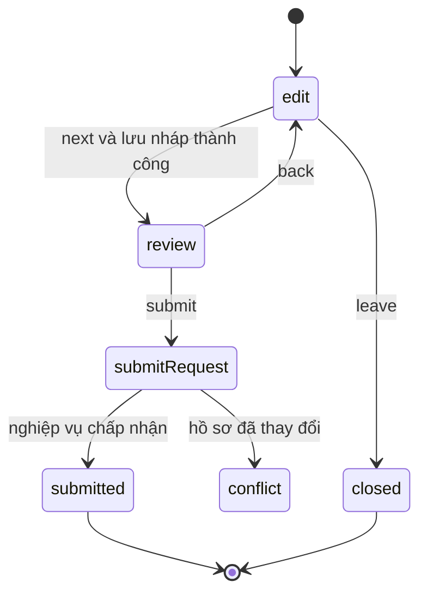
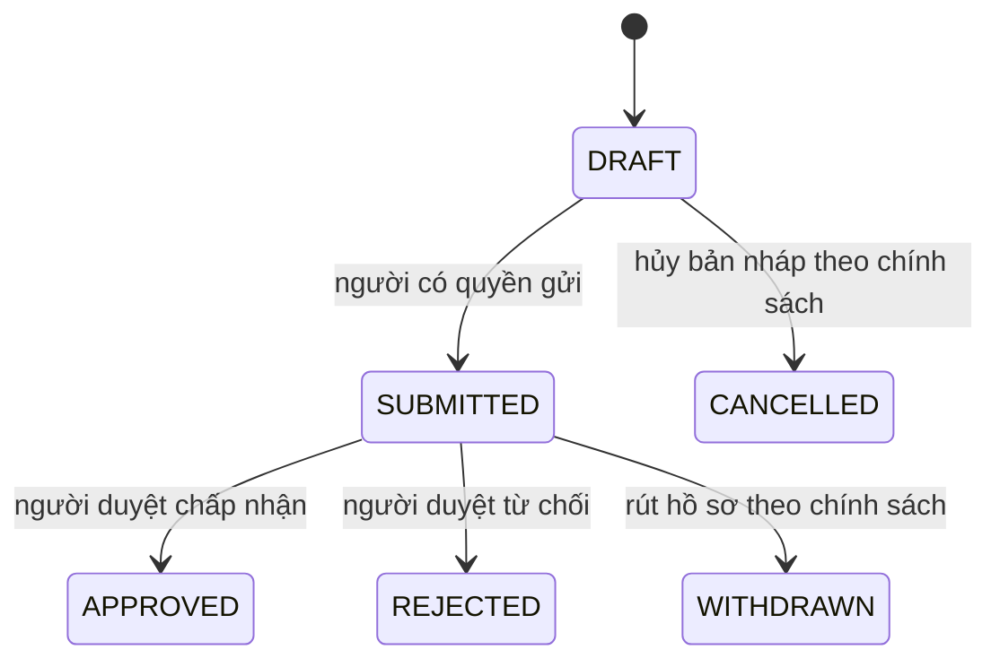

# Xác định ranh giới giữa flow tương tác và quy trình nghiệp vụ lưu bền

## 1. Một hành trình web có thể chỉ là một phần của nghiệp vụ

Người dùng tạo đề nghị mua hàng, nhập lý do và số tiền, xem lại rồi gửi phê duyệt. Hôm sau quản lý mở hồ sơ để duyệt. Nếu chưa xử lý sau hai ngày, hệ thống nhắc việc. Toàn bộ quá trình có thể kéo dài dù người tạo đã đóng trình duyệt hoặc phiên đăng nhập hết hạn.

Spring Web Flow phù hợp để tổ chức các bước nhập, kiểm tra hợp lệ, quay lại sửa và xác nhận trong từng lượt tương tác. Trạng thái hồ sơ đang chờ ai, đã được gửi khi nào, có được duyệt hay không và cần nhắc việc lúc nào phải có đời sống nghiệp vụ riêng.

Bài này thuộc chương **Thực hành tổng hợp** của module **SPRING_WEB_FLOW**. Mục tiêu là phân chia trách nhiệm, thiết kế điểm bàn giao dữ liệu và kiểm chứng rằng một quy trình vẫn tiếp tục đúng khi flow tương tác đã kết thúc hoặc bị mất.

Các ví dụ Java dùng JDK 17 và namespace Bean Validation `jakarta.validation`. Khi giải thích API nội bộ, bài tham chiếu Spring Web Flow **3.0.1**. Các trạng thái đề nghị mua hàng là mô hình của ứng dụng, không phải trạng thái dựng sẵn của Web Flow.

## 2. Phân biệt hai state machine

### 2.1. Trạng thái tương tác trả lời: người dùng đang làm bước nào?



Những state như `edit` hoặc `review` chủ yếu phục vụ trải nghiệm web. Chúng có thể giữ dữ liệu chưa lưu, lỗi binding, tab đang chọn hoặc lựa chọn tạm thời.

### 2.2. Trạng thái nghiệp vụ trả lời: hồ sơ đã có hiệu lực gì?



Mô hình này cần tồn tại trong kho dữ liệu nghiệp vụ cùng định danh, version, người thao tác và thông tin liên quan. Việc người tạo đóng trang review không tự đưa hồ sơ sang CANCELLED. Kết thúc flow ở `submitted` cũng không có nghĩa quản lý đã phê duyệt.

Không cần tạo một business status tương ứng với mọi view-state. Ngược lại, cùng trạng thái SUBMITTED có thể được hiển thị qua trang danh sách, trang chi tiết, API hoặc flow duyệt của người quản lý.

| Câu hỏi | Nơi sở hữu câu trả lời |
| --- | --- |
| Người dùng đang sửa hay xem lại form? | Flow tương tác |
| Field nào vừa bind lỗi? | Lớp form/binding và thông báo của lượt tương tác |
| Đề nghị đã được gửi hay chưa? | Dữ liệu nghiệp vụ lưu bền |
| Ai được phép duyệt và với hạn mức nào? | Chính sách nghiệp vụ và phân quyền phía máy chủ |
| Sau hai ngày cần nhắc ai? | Dữ liệu deadline và bộ xử lý chạy độc lập |
| Khi hết phiên, người dùng mở lại hồ sơ nào? | Định danh nghiệp vụ và truy vấn có kiểm tra quyền |

## 3. “Lưu trạng thái flow” không đồng nghĩa “lưu quy trình nghiệp vụ”

Flow execution là một lần chạy của flow definition, có thể tạm dừng để chờ tương tác và được resume ở request sau. Đây là hợp đồng được thể hiện trong [FlowExecution API 3.0.1](https://raw.githubusercontent.com/spring-projects/spring-webflow/v3.0.1/spring-webflow/src/main/java/org/springframework/webflow/execution/FlowExecution.java).

Repository có thể lưu snapshot execution để hỗ trợ các request của hành trình. Nhưng việc có một snapshot không tự cung cấp:

- Hồ sơ có định danh để người khác xử lý sau khi phiên người tạo kết thúc.
- Audit theo các thay đổi nghiệp vụ đã commit.
- Timer hoặc nhắc việc hoạt động khi không có trình duyệt mở.
- Kiểm soát đồng thời giữa nhiều tài khoản và nhiều kênh truy cập.
- Retry, tiếp nhận lại hoặc đối soát tác động sau lỗi tiến trình.
- Hợp đồng đọc dữ liệu lâu dài qua các lần nâng cấp ứng dụng.

Theo [FlowExecutionContext API](https://docs.spring.io/spring-webflow/docs/3.0.1/api/org/springframework/webflow/execution/FlowExecutionContext.html), execution mô tả một cuộc hội thoại với client; request context điều khiển một execution trong ngữ cảnh request tương ứng. Đó là ranh giới khác với một hồ sơ cần được quản lý qua nhiều ngày và nhiều người tham gia.

Không phải mọi ứng dụng đều cần một workflow engine chuyên dụng. Với quy trình đơn giản, bảng hồ sơ, service kiểm soát transition và worker xử lý nhắc việc có thể đủ. Dù dùng công cụ nào, dữ liệu và cơ chế tiếp tục nghiệp vụ phải tách khỏi việc giữ sống một phiên web.

## 4. Quy tắc phân chia trách nhiệm

Một câu hỏi thực tế: **nếu xóa toàn bộ flow execution của người dùng này, thông tin nào hệ thống vẫn phải biết để thực hiện đúng cam kết?** Thông tin đó thường cần một nguồn lưu nghiệp vụ độc lập.

| Trách nhiệm | Flow tương tác | Service và dữ liệu nghiệp vụ | Worker/bộ điều phối bền vững |
| --- | --- | --- | --- |
| Điền form qua nhiều bước | Chủ trì | Cấp dữ liệu tham chiếu khi cần | Không cần tham gia |
| Binding và thông báo lỗi trường | Chủ trì | Kiểm tra lại quy tắc nghiệp vụ khi nhận lệnh | Không phụ thuộc lỗi UI |
| Lưu bản nháp để mở lại | Gọi lệnh theo ý định người dùng | Lưu draft, owner, version và quyền | Dọn nháp hết hạn nếu có |
| Gửi phê duyệt | Thu thập xác nhận rồi gọi service | Kiểm tra và commit transition | Nhận việc sau commit nếu cần |
| Duyệt bởi người khác | Một flow hoặc UI riêng | Kiểm tra quyền, trạng thái và version | Điều phối bước sau nếu có |
| Nhắc việc sau hai ngày | Hiển thị thông tin | Lưu deadline/chính sách | Phát hiện đến hạn và thực hiện |
| Rời trang hoặc hết phiên | Kết thúc/mất ngữ cảnh tương tác | Không tự đổi trạng thái hồ sơ | Tiếp tục theo trạng thái đã lưu |
| Rút hồ sơ đã gửi | Gửi một command rõ ràng | Quyết định có được rút và lưu kết quả | Dừng/đổi việc tiếp theo theo hợp đồng |

Service phải bảo vệ quy tắc ngay cả khi lệnh đến từ REST API, công cụ quản trị hoặc tác vụ nền. Không để việc “đã đi qua review” trở thành bằng chứng duy nhất rằng một hồ sơ hợp lệ để gửi.

## 5. Thiết kế dữ liệu và định danh ở điểm bàn giao

### 5.1. Tách định danh flow khỏi định danh hồ sơ

Ứng dụng có thể cần các ID khác nhau:

| Định danh | Ý nghĩa |
| --- | --- |
| Flow execution key | Tiếp tục một lần tương tác đang được repository quản lý |
| `purchaseRequestId` | Hồ sơ mua hàng dùng xuyên phiên và xuyên kênh |
| `version` | Phiên bản dữ liệu để phát hiện cập nhật cạnh tranh |
| `submissionKey` | Nhận diện việc gửi lại cùng một ý định |
| Event/publication ID | Theo dõi thông điệp hoặc lần công bố cần xử lý |
| Correlation ID | Liên hệ log/tracing của các thao tác liên quan |

Không dùng execution key làm ID hồ sơ hay làm bằng chứng quyền truy cập. Người dùng mở lại hồ sơ bằng business ID, hệ thống xác thực quyền rồi bắt đầu một flow mới với dữ liệu hiện tại.

### 5.2. Bản form không phải nguồn trạng thái cuối cùng

Một model form có thể giữ ID, version đã đọc và các field được phép sửa. Model nên là dữ liệu nhỏ, có thể serialize khi repository yêu cầu; không giữ entity đang gắn persistence context, service bean, request hoặc transaction.

Ví dụ rút gọn, mỗi kiểu public đặt trong file riêng khi triển khai:

```java
package example.procurement;

import java.io.Serializable;
import java.math.BigDecimal;
import jakarta.validation.constraints.DecimalMin;
import jakarta.validation.constraints.NotBlank;
import jakarta.validation.constraints.NotNull;

public class PurchaseForm implements Serializable {
    private static final long serialVersionUID = 1L;

    private Long requestId;
    private long version;

    @NotBlank
    private String purpose;

    @NotNull
    @DecimalMin("1")
    private BigDecimal amount;

    public Long getRequestId() { return requestId; }
    public long getVersion() { return version; }
    public String getPurpose() { return purpose; }
    public void setPurpose(String purpose) { this.purpose = purpose; }
    public BigDecimal getAmount() { return amount; }
    public void setAmount(BigDecimal amount) { this.amount = amount; }

    public void replaceWith(DraftView draft) {
        requestId = draft.requestId();
        version = draft.version();
        purpose = draft.purpose();
        amount = draft.amount();
    }
}
```

```java
package example.procurement;

import java.io.Serializable;
import java.math.BigDecimal;

public record DraftView(Long requestId, long version,
                        String purpose, BigDecimal amount)
        implements Serializable {
}
```

```java
package example.procurement;

import java.io.Serializable;
import java.time.Instant;

public record SubmitReceipt(Long requestId, long submittedVersion,
                            Instant submittedAt) implements Serializable {
}
```

Ví dụ giả định đơn vị tiền tệ được ứng dụng xác định cố định cho hồ sơ; nếu có nhiều loại tiền phải bổ sung và kiểm tra currency theo chính sách. Không dùng riêng `BigDecimal` để suy ra đơn vị tiền.

ID và version được nạp từ service; binder chỉ cho phép purpose/amount. Dù vậy, service vẫn kiểm tra ID, quyền, version và nội dung vì form phía web không phải ranh giới tin cậy duy nhất.

### 5.3. Chỉ lưu dữ liệu đã có cam kết

Người dùng đang gõ một field trong flow scope chưa có nghĩa bản nháp bền vững đã được cập nhật. Giao diện cần phân biệt “đang sửa”, “đã lưu nháp” và “đã gửi”.

Khi lưu nháp thành công, service trả version mới và form cập nhật version đó. Khi gửi thành công, receipt chứng minh thao tác gửi đã được tiếp nhận/commit theo hợp đồng; receipt không phải quyết định phê duyệt.

## 6. Hợp đồng service không phụ thuộc Web Flow

```java
package example.procurement;

import java.math.BigDecimal;

public interface PurchaseApplication {
    DraftView loadEditable(Long requestId, String actorId);

    DraftView saveDraft(Long requestId, long expectedVersion,
                        String purpose, BigDecimal amount, String actorId);

    SubmitReceipt submit(Long requestId, long expectedVersion,
                         String submissionKey, String actorId);
}
```

Các method này không nhận `RequestContext`, flow scope hoặc execution key. Người gọi có thể là action của Web Flow hay một adapter khác. Kiểu lỗi như không có quyền, version cũ hoặc trạng thái không cho phép gửi cần có hợp đồng riêng của ứng dụng.

`submit` trong thiết kế này gửi đúng bản nháp đã được lưu và đang được người dùng xem lại. Nó không lấy toàn bộ entity hoặc một `status` do browser gửi để ghi đè DB.

### Một transaction gửi hồ sơ cần làm gì?

Ở mức hợp đồng, thao tác gửi có thể gồm:

1. Xác định người thao tác từ ngữ cảnh đã xác thực, kiểm tra quyền với hồ sơ.
2. Kiểm tra receipt của cùng ý định gửi nếu đang xử lý request lặp; kiểm tra payload/phạm vi khóa tương ứng.
3. Đọc dữ liệu hiện tại và kiểm tra version, trạng thái DRAFT, hạn mức và các quy tắc bắt buộc.
4. Chuyển DRAFT sang SUBMITTED bằng thao tác bảo vệ đồng thời.
5. Lưu người gửi, thời điểm gửi, dữ liệu cần chốt và audit nghiệp vụ.
6. Lưu receipt chống trùng và outbox/publication nếu bước sau được xử lý độc lập.
7. Commit rồi trả kết quả cho adapter web.

Với cập nhật có điều kiện, một câu SQL minh họa phần bảo vệ trạng thái/version là:

```sql
UPDATE purchase_request
SET status = 'SUBMITTED',
    submitted_by = :actorId,
    submitted_at = :submittedAt,
    version = version + 1
WHERE id = :requestId
  AND status = 'DRAFT'
  AND version = :expectedVersion;
```

Phải kiểm tra số row bị ảnh hưởng. Câu SQL không thay thế các bước phân quyền, kiểm tra hạn mức, receipt và audit; tất cả phần cần nguyên tử phải nằm trong transaction đã thiết kế. Nếu có tenant, điều kiện truy cập và dữ liệu tenant cũng phải được áp dụng đúng.

Spring quản lý transaction ở service khi được cấu hình đúng. Hành vi proxy và điều kiện áp dụng `@Transactional` được mô tả trong [Using @Transactional](https://docs.spring.io/spring-framework/reference/data-access/transaction/declarative/annotations.html). Không chỉ gắn annotation lên một object tự tạo rồi mặc định đã có transaction.

## 7. Tích hợp service vào flow tương tác ngắn

### 7.1. Action chuyển lỗi nghiệp vụ thành kết quả tương tác

Ví dụ dưới giả định ứng dụng định nghĩa `StaleDraftException` và `SubmissionRejectedException`, cùng bean `PurchaseApplication`. Các exception là kiểu ứng dụng cần triển khai, không phải API của Web Flow.

```java
package example.procurement;

import org.springframework.binding.message.MessageBuilder;
import org.springframework.binding.message.MessageContext;
import org.springframework.webflow.execution.RequestContext;

public final class PurchaseActions {
    private final PurchaseApplication application;

    public PurchaseActions(PurchaseApplication application) {
        this.application = application;
    }

    public PurchaseForm load(Long requestId, String actorId) {
        PurchaseForm form = new PurchaseForm();
        form.replaceWith(application.loadEditable(requestId, actorId));
        return form;
    }

    public boolean saveDraft(PurchaseForm form, String actorId,
                             MessageContext messages) {
        try {
            DraftView saved = application.saveDraft(
                    form.getRequestId(), form.getVersion(),
                    form.getPurpose(), form.getAmount(), actorId);
            form.replaceWith(saved);
            return true;
        } catch (StaleDraftException ex) {
            messages.addMessage(new MessageBuilder().error()
                    .code("purchase.draft.changed")
                    .defaultText("Hồ sơ đã thay đổi; hãy đối chiếu trước khi lưu lại")
                    .build());
            return false;
        }
    }

    public String submit(PurchaseForm form, String actorId,
                         RequestContext context) {
        String key = (String) context.getFlowScope().get("submissionKey");
        try {
            SubmitReceipt receipt = application.submit(
                    form.getRequestId(), form.getVersion(), key, actorId);
            context.getFlowScope().put("receipt", receipt);
            return "submitted";
        } catch (StaleDraftException ex) {
            return "conflict";
        } catch (SubmissionRejectedException ex) {
            return "rejected";
        }
    }
}
```

`saveDraft` trả `false` để transition của view không rời bước nhập khi có xung đột. Trong action-state gửi, chuỗi kết quả được ánh xạ sang event và chọn nhánh tiếp theo. Không bắt mọi exception rồi báo “đã gửi”; lỗi hạ tầng cần đường xử lý phù hợp và có thể để lại kết quả giao dịch chưa biết với phía client.

### 7.2. Flow kết thúc khi phần việc tương tác đã bàn giao

Giả định ứng dụng đã cấu hình Spring MVC, đăng nhập, flow registry, view factory, conversion và validator. Form dùng namespace Jakarta nên provider validation phải tương thích. `currentUser.name` trong ví dụ phải tương ứng định danh actor ổn định của ứng dụng; hệ thống nhiều tenant cần xác định tenant phía máy chủ.

```xml
<flow xmlns="http://www.springframework.org/schema/webflow"
      xmlns:xsi="http://www.w3.org/2001/XMLSchema-instance"
      xsi:schemaLocation="
        http://www.springframework.org/schema/webflow
        https://www.springframework.org/schema/webflow/spring-webflow.xsd">

    <input name="requestId" type="long" required="true"/>

    <on-start>
        <evaluate expression="purchaseActions.load(requestId, currentUser.name)"
                  result="flowScope.form"/>
        <set name="flowScope.submissionKey"
             value="T(java.util.UUID).randomUUID().toString()"/>
    </on-start>

    <view-state id="edit" model="form">
        <binder>
            <binding property="purpose"/>
            <binding property="amount"/>
        </binder>
        <transition on="next" to="review">
            <evaluate expression="purchaseActions.saveDraft(
                        form, currentUser.name, messageContext)"/>
        </transition>
        <transition on="leave" to="closed"
                    bind="false" validate="false"/>
    </view-state>

    <view-state id="review">
        <transition on="back" to="edit"
                    bind="false" validate="false"/>
        <transition on="submit" to="submitRequest"
                    bind="false" validate="false"/>
    </view-state>

    <action-state id="submitRequest">
        <evaluate expression="purchaseActions.submit(
                    form, currentUser.name, flowRequestContext)"/>
        <transition on="submitted" to="submitted"/>
        <transition on="conflict" to="conflict"/>
        <transition on="rejected" to="cannotSubmit"/>
    </action-state>

    <view-state id="conflict">
        <transition on="leave" to="closed"/>
    </view-state>

    <view-state id="cannotSubmit">
        <transition on="leave" to="closed"/>
    </view-state>

    <end-state id="submitted" view="submission-receipt"/>
    <end-state id="closed"/>
</flow>
```

Đây là phần flow của bài thực hành; các template và wiring ứng dụng chưa được triển khai trong đoạn XML. `submission-receipt` chỉ xác nhận đã gửi hồ sơ; ứng dụng có trang tra cứu hồ sơ theo business ID để xem tiến trình tiếp theo.

Việc tắt binding/validation ở review nhằm ngăn request đó ghi lại field form. Service `submit` vẫn kiểm tra bản nháp hiện tại đã lưu và version. Không suy luận `validate="false"` là cho phép bỏ quy tắc nghiệp vụ.

Rời flow bằng `leave` không lưu các ký tự mới đang gõ kể từ lần lưu thành công gần nhất, vì transition này bỏ qua binding. Nếu sản phẩm cần “Lưu rồi thoát”, phải có event/lệnh riêng với thông báo rõ, không đổi ý nghĩa của nút đóng một cách ngầm định.

Form bị xung đột được giữ để người dùng đối chiếu; không tự tải bản DB mới đè lên phần đang sửa. Có thể bổ sung thao tác mở bản hiện tại hoặc quy trình merge riêng tùy sản phẩm.

## 8. Transaction và khóa dừng ở đâu?

### 8.1. Không giữ transaction trong lúc người dùng suy nghĩ

Các thao tác load, save draft, submit và approve có transaction ngắn theo yêu cầu của chúng. Không giữ một DB transaction mở từ edit tới review rồi chờ người quản lý vào ngày hôm sau.

Transaction bảo vệ tính nguyên tử trong một phạm vi thực thi và tài nguyên nhất định. Nó không tự trở thành một giao dịch nghiệp vụ kéo dài qua nhiều request. Spring phân biệt phạm vi transaction logic/vật lý và quy tắc tham gia transaction trong [Transaction Propagation](https://docs.spring.io/spring-framework/reference/data-access/transaction/declarative/tx-propagation.html).

Một quy trình nhiều ngày thường gồm nhiều lần commit, mỗi lần có quy tắc trạng thái và version. Nếu cần hoàn tác tác động đã commit trước đó, đó là một lệnh nghiệp vụ hoặc thao tác bù mới, không phải bấm Back để rollback toàn bộ lịch sử.

### 8.2. Khóa flow không bảo vệ mọi người thao tác trên cùng hồ sơ

Trong `FlowExecutorImpl` 3.0.1, đường resume dùng khóa repository khi đọc, resume và lưu/xóa execution. Xem [FlowExecutorImpl](https://raw.githubusercontent.com/spring-projects/spring-webflow/v3.0.1/spring-webflow/src/main/java/org/springframework/webflow/executor/FlowExecutorImpl.java).

Khóa đó phục vụ cơ chế thực thi flow của repository đang dùng. Không nên dùng nó làm cơ chế duy nhất bảo vệ `purchaseRequestId`, vì cùng hồ sơ còn có thể được mở trong một execution khác, tài khoản khác hoặc API khác.

Ví dụ hai tab cùng đọc version 7:

```text
Tab A: saveDraft(expectedVersion=7) → commit version 8
Tab B: saveDraft(expectedVersion=7) → xung đột, không ghi đè version 8
```

Tương tự, nếu review hiển thị version 8 nhưng quản trị viên đã sửa hồ sơ thành version 9, lệnh submit version 8 cần kiểm tra lại. State `review` không chứng minh dữ liệu vẫn mới nhất.

### 8.3. Lưu được nghiệp vụ nhưng lỗi phản hồi vẫn có thể xảy ra

Một tình huống quan trọng:

```text
DB commit SUBMITTED và receipt thành công
→ lưu snapshot hoặc kết nối HTTP gặp lỗi
→ trình duyệt không nhận biên nhận
```

Phía client không biết kết quả không có nghĩa DB đã rollback. Dịch vụ phải hỗ trợ tra cứu/gửi lại an toàn; giao diện có thể mở trang trạng thái hồ sơ để xác định điều đã xảy ra.

Không gắn việc tạo audit hoặc gửi công việc tiếp theo chỉ vào sự kiện “flow ended” rồi cho rằng nó nguyên tử với transaction submit. Flow listener phù hợp để quan sát tương tác; bằng chứng nghiệp vụ phải đi cùng nguồn lưu của chính nghiệp vụ đó.

## 9. Chống gửi trùng ở tầng có thể tạo tác động

`submissionKey` ở flow ví dụ giúp nhận diện việc gửi lại trong cùng hành trình. Nó chưa đủ cho mọi tình huống:

- Sau hết phiên, flow mới có thể tạo key mới.
- Người dùng có thể mở hai flow cho cùng hồ sơ.
- API khác có thể gửi cùng ý định ngoài flow.
- Hai request có thể tới trước khi một trong số chúng nhận được receipt.

Do đó, service cần cả hợp đồng idempotency và bảo vệ trạng thái/version. Với hồ sơ chỉ được gửi một lần trong mô hình đơn giản của bài, chuyển DRAFT → SUBMITTED phải được bảo vệ tại DB; key mới không cho phép gửi thêm một lần từ SUBMITTED.

Một chính sách có thể là:

| Tình huống | Hành vi mong đợi |
| --- | --- |
| Cùng actor, cùng operation key và cùng nội dung ý định | Trả receipt đã lưu sau khi kiểm tra quyền hiện tại |
| Cùng key nhưng request ID/version hoặc payload khác | Từ chối dùng lại key sai ý nghĩa |
| Key mới nhưng hồ sơ đã SUBMITTED | Không tạo transition/outbox thứ hai; trả trạng thái/receipt phù hợp hoặc lỗi đã gửi |
| Hồ sơ version cũ trong khi còn DRAFT | Báo xung đột, không tự gửi một nội dung chưa được người dùng xem lại |
| Tài khoản khác có cùng chuỗi key | Không truy xuất receipt của tài khoản khác |

Phạm vi key nên gồm actor/tenant và loại thao tác theo hợp đồng, cùng ràng buộc duy nhất hoặc cơ chế đồng bộ tương ứng. Payload cần được so sánh theo ý nghĩa đã định nghĩa; chỉ có unique key mà không xét nội dung có thể trả nhầm kết quả.

Nếu sản phẩm cho phép sửa rồi gửi lại sau REJECTED, cần thêm revision hoặc lần gửi nghiệp vụ riêng. Không mở lại transition DRAFT → SUBMITTED một cách mơ hồ khiến receipt và audit của lần gửi trước bị ghi đè.

Không tuyên bố mọi side effect “đúng một lần” chỉ vì có UUID. Với dịch vụ ngoài, cần khóa chống trùng và quy tắc đối soát tương ứng tại ranh giới đó.

## 10. Bước nghiệp vụ tiếp theo chạy độc lập với phiên web

### 10.1. Giao việc sau commit mà không làm mất việc

Sau submit, hệ thống có thể cần tạo công việc duyệt và gửi thông báo. Nếu commit DB xong rồi mới gửi thông điệp, process có thể chết ở giữa. Nếu gửi trước commit, bên nhận có thể đọc một hồ sơ chưa commit hoặc đã rollback.

Một phương án là lưu bản ghi outbox/publication cùng transaction với SUBMITTED và audit. Dispatcher đọc bản ghi đó, công bố công việc và ghi nhận kết quả theo cơ chế đã chọn. Vì việc giao lại có thể xảy ra, bên xử lý phải kiểm tra event ID/trạng thái để tránh tạo task duyệt hoặc thông báo nghiệp vụ trùng ngoài chính sách.

`@TransactionalEventListener` cho phép gắn xử lý với phase transaction, mặc định sau commit, nhưng listener trong bộ nhớ không tự cung cấp khả năng phát lại sau crash. Xem [Transaction-bound Events](https://docs.spring.io/spring-framework/reference/data-access/transaction/event.html).

Một ví dụ cơ chế có lưu theo dõi việc công bố là Event Publication Registry trong Spring Modulith; tài liệu mô tả việc ghi và xử lý lại các publication chưa hoàn tất. Đây là một lựa chọn tích hợp cần đánh giá theo phiên bản/hạ tầng của ứng dụng, không phải yêu cầu để dùng Web Flow. Tham khảo [Working with Application Events](https://docs.spring.io/spring-modulith/reference/events.html).

### 10.2. Người duyệt có một lượt tương tác riêng

Quản lý mở công việc duyệt bằng business ID. Ứng dụng kiểm tra vai trò, phạm vi tổ chức, trạng thái SUBMITTED và version hiện tại rồi cấp một form duyệt.

```text
Flow của người tạo:
edit → review → submit → kết thúc

Nguồn trạng thái nghiệp vụ:
DRAFT → SUBMITTED → chờ quyết định có lưu bền

Flow của người duyệt ở thời điểm khác:
load task → xem hồ sơ → quyết định → kết thúc

Service:
approve/reject với actor, version và quy tắc hiện tại
```

Không truyền execution key của người tạo cho quản lý để họ resume cùng phiên đó. Hai người có quyền, dữ liệu tương tác và vòng đời đăng nhập khác nhau; hồ sơ là điểm liên kết giữa hai lượt làm việc.

Một `subflow-state` cũng không tự tạo một task duyệt bền vững cho tài khoản khác. Subflow hữu ích để tái sử dụng các bước trong một cuộc tương tác, chẳng hạn chọn trung tâm chi phí hoặc bổ sung thông tin nhà cung cấp. Khi cần bàn giao cho người khác xử lý sau, hãy tạo công việc nghiệp vụ có định danh và quyền riêng.

### 10.3. Nhắc việc và deadline phải có thời gian đã lưu

Thời điểm cần nhắc có thể được tính từ `submittedAt` hoặc một `dueAt` đã chốt theo chính sách. Worker định kỳ hoặc workflow engine phát hiện công việc đến hạn, kiểm tra trạng thái hiện tại rồi gửi nhắc.

Không dùng timer JavaScript của trang waiting để quyết định hồ sơ đã quá hạn. Không dùng thời gian session timeout như deadline nghiệp vụ. Người duyệt có thể đã xử lý ở thiết bị khác; worker phải kiểm tra lại trạng thái trước khi tạo nhắc hoặc chuyển quá hạn.

Thời điểm nghiệp vụ và chính sách time zone phải rõ ràng. Nếu có retry, lưu lần thử và thời điểm thử lại phù hợp; đừng trông chờ một thread ngủ trong tiến trình web giữ được lịch qua restart.

## 11. Khi nào dữ liệu và service là đủ, khi nào cần bộ điều phối?

| Dấu hiệu của quy trình | Hướng thiết kế thường phù hợp |
| --- | --- |
| Một người nhập nhiều bước rồi gửi một thao tác ngắn | Web Flow cho tương tác; service/DB cho tác động đã commit |
| Bản nháp cần mở lại qua nhiều phiên | Lưu draft nghiệp vụ và khởi tạo lại flow từ draft |
| Một bước duyệt, một deadline đơn giản | Bảng trạng thái/task và worker có thể đủ nếu hợp đồng rõ |
| Nhiều vai trò, nhánh song song, nhiều deadline và tác vụ bù | Cân nhắc bộ điều phối/workflow engine có cơ chế lưu và vận hành phù hợp |
| Tác vụ máy dài, cần retry hoặc checkpoint | Job/batch hoặc cơ chế thực thi bền vững theo tính chất công việc |
| Chỉ chuyển màn và hiển thị lỗi form | Không cần biến mọi view-state thành một trạng thái nghiệp vụ |

Không đánh giá chỉ bằng số lượng màn hình. Hai màn hình có thể tham gia một quy trình kéo dài cả tháng; mười màn hình vẫn có thể thuộc một lần nhập liệu ngắn.

Nếu dùng workflow engine, cần xác định nó sở hữu phần nào: lịch điều phối, công việc người dùng, retry, timer hoặc audit thực thi. Các bất biến nghiệp vụ như hạn mức, quyền duyệt và tính nhất quán của hồ sơ vẫn cần được bảo vệ tại ranh giới thích hợp. Không để hai nơi cùng tự do sửa trạng thái mà không có hợp đồng đồng bộ.

Có thể cùng tồn tại trạng thái domain và trạng thái bộ điều phối. Phải xác định nguồn nào quyết định kết quả nghiệp vụ và cơ chế đối soát khi cập nhật giữa các hệ thống bị gián đoạn; không coi chúng tự động là một transaction chung.

## 12. Phục hồi, rời flow và rút hồ sơ là các thao tác khác nhau

| Sự kiện | Ảnh hưởng tương tác | Ảnh hưởng nghiệp vụ cần thiết kế |
| --- | --- | --- |
| Back ở review | Trở về edit, giữ model phù hợp | Không tự hoàn tác lần save draft trước |
| Leave khi đang nhập | Kết thúc lượt tương tác | Nháp đã lưu còn tồn tại; dữ liệu chưa lưu có thể mất |
| Session hết hạn | Không tiếp tục execution cũ | Mở lại qua business ID nếu còn quyền |
| Người dùng bấm gửi lại sau lỗi mạng | Có thể là cùng ý định submit | Tra cứu/áp dụng idempotency; không tạo thêm lần gửi |
| Rút hồ sơ đã SUBMITTED | Một thao tác xác nhận riêng | Command WITHDRAW có quy tắc, audit và tác động liên quan |
| Quản lý từ chối | Kết thúc lượt duyệt | REJECTED được lưu theo version và quyền |
| Phê duyệt đã có tác động xuống hệ thống ngoài | UI có thể chỉ hiển thị kết quả | Hủy/bù nếu được phép phải là quy trình nghiệp vụ riêng |

Ở đường mở lại hồ sơ, truy vấn trạng thái trước khi chọn UI. Nếu hồ sơ đã SUBMITTED, không dùng `loadEditable` để lén đưa nó trở lại màn nhập rồi ghi đè. Có thể mở trang chi tiết chỉ đọc hoặc flow thích hợp với hành động hiện được phép.

Nếu flow snapshot cũ không còn tương thích sau nâng cấp, bản nháp nghiệp vụ có schema/version được quản lý là cơ sở để khôi phục công việc. Không mặc định mọi giá trị từng ở flow scope đều đã được lưu bền vững.

Đối với file đính kèm, việc người dùng upload thành công vào một file tạm của request chưa đủ. Cần đưa file tới kho có vòng đời phù hợp và lưu attachment ID/metadata vào hồ sơ khi nhận cam kết giữ file. Flow chỉ giữ tham chiếu và trạng thái hiển thị cần thiết.

## 13. Kiểm thử để chứng minh ranh giới

### 13.1. Các tầng kiểm thử có câu hỏi riêng

| Tầng | Điều cần chứng minh |
| --- | --- |
| Flow execution | Next/Back/Leave, action result, lỗi tương tác và receipt/outcome |
| MVC/binding | Chỉ nhận field được phép, conversion/validation và principal đúng |
| Application/domain service | Quyền, trạng thái, version, idempotency và tác động ghi |
| Persistence/outbox | Hồ sơ, audit, receipt và publication commit/rollback đúng hợp đồng |
| Worker/bộ điều phối | Nhận lại việc, timer, retry và đối soát sau crash |
| End-to-end | Người tạo gửi, phiên kết thúc, người khác xử lý, người tạo xem lại kết quả |

Chỉ assert state `submitted` trong flow test không chứng minh DB đã SUBMITTED. Ngược lại, chỉ kiểm tra row DB không phát hiện form bị bind thêm `ownerId` hoặc màn review trình bày sai số tiền.

### 13.2. Bộ tình huống bắt buộc của bài thực hành

| Case | Thao tác | Kết quả mong đợi |
| --- | --- | --- |
| B01 | Sửa form hợp lệ và Next | Nháp được lưu; form nhận version mới rồi vào review |
| B02 | Next với dữ liệu sai | Ở lại edit; không gọi lệnh submit |
| B03 | Back từ review | Giữ dữ liệu đã lưu; chưa có transition nghiệp vụ gửi |
| B04 | Leave trước submit | Flow kết thúc; không tự đổi nháp thành CANCELLED |
| B05 | Submit hợp lệ | DB SUBMITTED, có receipt/audit/publication theo hợp đồng; flow kết thúc |
| B06 | Submit từ hai tab | Không có hai transition gửi hoặc task duyệt trùng |
| B07 | Gửi lại cùng key sau mất response | Tìm đúng kết quả đã commit hoặc xử lý lại an toàn |
| B08 | Flow mới key mới mở hồ sơ đã gửi | Không tạo lần gửi thứ hai chỉ vì key khác |
| B09 | Lưu nháp version cũ | Báo xung đột; không ghi đè thay đổi mới |
| B10 | Hết session sau khi lưu nháp | Flow mới tải đúng dữ liệu nghiệp vụ còn được phép xem |
| B11 | Xóa execution sau submit | Người duyệt vẫn tìm và xử lý được hồ sơ |
| B12 | Worker chết sau commit trước phát thông báo | Công việc được nhận lại/đối soát, không mất nghĩa vụ xử lý |
| B13 | Người duyệt không đủ quyền | Không thay đổi trạng thái dù có URL hoặc ID đúng |
| B14 | Hai người duyệt đồng thời | Một quyết định hợp lệ được chốt theo chính sách/version |
| B15 | Nhắc việc tới khi hồ sơ đã duyệt | Không tạo hành động quá hạn sai trạng thái |
| B16 | Lỗi snapshot/HTTP sau commit submit | Không báo rollback giả; có đường tra cứu receipt/trạng thái |

Để kiểm tra transaction và chống trùng, dùng DB/kho receipt thật của cấu hình test. Một mock luôn trả cùng receipt có thể giúp test điều hướng nhưng không chứng minh unique constraint hoặc kiểm soát cạnh tranh hoạt động.

### 13.3. Phép thử đặc biệt: bỏ phiên web nhưng giữ nghiệp vụ

Thực hiện trên môi trường thực hành cô lập:

1. Người tạo lưu nháp và ghi lại business ID.
2. Kết thúc phiên/loại execution theo cơ chế test rồi đăng nhập lại.
3. Mở hồ sơ bằng ID, kiểm tra dữ liệu đã cam kết lưu; phần chưa lưu không được giả định còn nguyên.
4. Gửi hồ sơ thành công rồi loại execution của người tạo lần nữa.
5. Người quản lý đăng nhập bằng tài khoản khác và duyệt qua service/flow dành cho mình.
6. Worker xử lý việc tới hạn hoặc publication theo chính sách mà không phụ thuộc trang của người tạo.
7. Người tạo mở lại trang chi tiết và thấy trạng thái hiện tại cùng lịch sử phù hợp.

Đây là hướng dẫn kiểm chứng, không phải tuyên bố các thao tác đã được chạy khi biên soạn bài. Nếu bước 5 chỉ hoạt động khi còn nguyên session của người tạo, cần xem lại nơi đang giữ trạng thái và quyền sở hữu việc xử lý.

## 14. Sản phẩm bàn giao của bài thực hành

Người học nên hoàn thiện các phần sau trong ứng dụng thực hành:

1. Hai sơ đồ riêng cho flow tương tác và trạng thái nghiệp vụ, có các điểm bàn giao rõ ràng.
2. Một bảng dữ liệu phân biệt field tạm thời, draft đã lưu, dữ liệu chốt khi submit và audit.
3. Các command/service có hợp đồng actor, version, idempotency và kết quả.
4. Flow nhập và flow duyệt độc lập, cùng truy cập hồ sơ qua business ID có kiểm tra quyền.
5. Cơ chế tiếp tục việc sau commit và sau lỗi tiến trình, phù hợp quy mô của quy trình.
6. Bộ test chứng minh hành trình, dữ liệu và việc xử lý không mất khi phiên web kết thúc.

Tiêu chí đánh giá quan trọng nhất là có thể giải thích rõ điều gì đã được cam kết tại mỗi lần trả kết quả: người dùng mới nhập, đã lưu nháp, đã gửi hay đã được duyệt. Khi các trạng thái này có nguồn sở hữu rõ ràng, Web Flow có thể tập trung vào tương tác nhiều bước, còn quy trình nghiệp vụ được vận hành và phục hồi theo vòng đời thực của nó.
