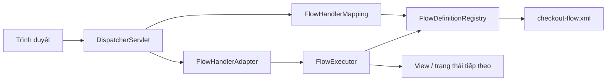
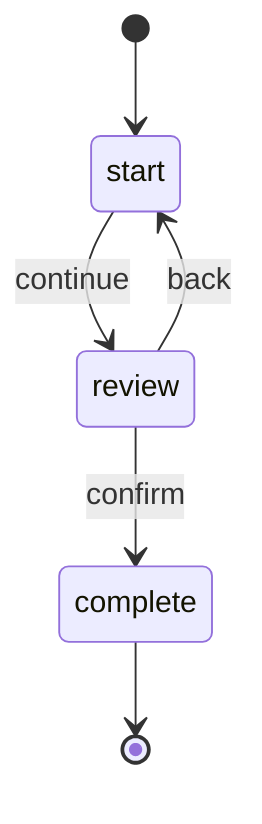

# Các bean tối thiểu để ứng dụng xử lý được flow

Trong ứng dụng Spring MVC, một hành trình nhiều bước như đăng ký tài khoản, đặt hàng hoặc duyệt hồ sơ thường có nhiều màn hình, sự kiện và nhánh điều hướng. **Spring Web Flow** quản lý hành trình này bằng *flow definition* (định nghĩa luồng), *state* (trạng thái), *event* (sự kiện), *transition* (chuyển trạng thái) và, khi cần, *subflow* (luồng con). Để HTTP request đi được từ `DispatcherServlet` đến một flow, ứng dụng phải đăng ký các thành phần liên kết Web Flow với Spring MVC.

Bài này tập trung vào **các bean tối thiểu để một flow được tìm thấy và thực thi**; sau đó bổ sung cấu hình view JSP để có thể quan sát hành trình hai bước chạy từ đầu đến cuối. Ví dụ sử dụng phong cách cấu hình XML của **Spring Web Flow 2.x và Spring MVC**. Khi đưa vào dự án, cần chọn bộ phiên bản Spring Framework, Spring Web Flow và Servlet API tương thích; không mặc định dùng nguyên cấu hình của dòng `javax.servlet` cho dự án sử dụng `jakarta.servlet`.

## 1. Bốn thành phần cốt lõi

| Bean hoặc kiểu | Trách nhiệm | Quan hệ |
| --- | --- | --- |
| `FlowDefinitionRegistry` (`flowRegistry`) | Tìm, nạp và đăng ký các định nghĩa flow theo ID; ví dụ `checkout`. | Được `FlowExecutor` và `FlowHandlerMapping` sử dụng. |
| `FlowExecutor` (`flowExecutor`) | Khởi tạo, tiếp tục và kết thúc một flow execution; nhận event, áp dụng transition và quản lý vòng đời execution. | Lấy định nghĩa từ `flowRegistry`. |
| `FlowHandlerMapping` | Giúp `DispatcherServlet` nhận ra URL tương ứng với flow đã đăng ký. | Trỏ đến `flowRegistry`. |
| `FlowHandlerAdapter` | Chuyển request MVC thành thao tác với Web Flow, rồi trả kết quả trình bày về MVC. | Trỏ đến `flowExecutor`. |

Hai thành phần đầu là **lõi thực thi flow**; hai thành phần sau là **cầu nối HTTP/MVC**. Một flow XML tồn tại trên đĩa chưa đủ: nếu thiếu mapping, MVC không tìm được flow theo URL; nếu thiếu adapter, MVC không biết cách chạy handler đó.

Có thể nhìn quan hệ bean như sau:



`FlowDefinitionRegistry` lưu **định nghĩa** của các flow, còn `FlowExecutor` xử lý từng **lần chạy** của flow. Nhiều người dùng có thể thực thi cùng một định nghĩa `checkout`, nhưng mỗi execution có trạng thái và khóa riêng.

## 2. Cấu hình bean đầy đủ cho một flow dùng JSP

Giả sử ứng dụng đã đăng ký `DispatcherServlet` với servlet mapping phù hợp (chẳng hạn `/`), và file sau được nạp vào **WebApplicationContext của DispatcherServlet**. Đây là điều kiện cần để MVC nhìn thấy `FlowHandlerMapping` và `FlowHandlerAdapter`.

**`/WEB-INF/spring/flow-servlet.xml`:**

```xml
<?xml version="1.0" encoding="UTF-8"?>
<beans xmlns="http://www.springframework.org/schema/beans"
       xmlns:xsi="http://www.w3.org/2001/XMLSchema-instance"
       xmlns:webflow="http://www.springframework.org/schema/webflow-config"
       xsi:schemaLocation="
         http://www.springframework.org/schema/beans
         http://www.springframework.org/schema/beans/spring-beans.xsd
         http://www.springframework.org/schema/webflow-config
         http://www.springframework.org/schema/webflow-config/spring-webflow-config-2.0.xsd">

    <!-- Hạ tầng hiển thị JSP của Spring MVC. -->
    <bean id="jspViewResolver"
          class="org.springframework.web.servlet.view.InternalResourceViewResolver">
        <property name="prefix" value="/WEB-INF/views/"/>
        <property name="suffix" value=".jsp"/>
    </bean>

    <!-- Kết nối việc tạo view của Web Flow với ViewResolver MVC. -->
    <bean id="mvcViewFactoryCreator"
          class="org.springframework.webflow.mvc.builder.MvcViewFactoryCreator">
        <property name="viewResolvers">
            <list>
                <ref bean="jspViewResolver"/>
            </list>
        </property>
    </bean>

    <webflow:flow-builder-services
            id="flowBuilderServices"
            view-factory-creator="mvcViewFactoryCreator"/>

    <!-- 1. Đăng ký flow ID = checkout từ một file XML. -->
    <webflow:flow-registry id="flowRegistry"
                           base-path="/WEB-INF/flows"
                           flow-builder-services="flowBuilderServices">
        <webflow:flow-location
                id="checkout"
                path="checkout/checkout-flow.xml"/>
    </webflow:flow-registry>

    <!-- 2. Bộ máy chạy flow, sử dụng registry phía trên. -->
    <webflow:flow-executor id="flowExecutor"
                           flow-registry="flowRegistry"/>

    <!-- 3. Cho DispatcherServlet ánh xạ URL /checkout tới flow. -->
    <bean id="flowHandlerMapping"
          class="org.springframework.webflow.mvc.servlet.FlowHandlerMapping">
        <property name="flowRegistry" ref="flowRegistry"/>
        <property name="order" value="0"/>
    </bean>

    <!-- 4. Cho DispatcherServlet thực thi FlowHandler. -->
    <bean id="flowHandlerAdapter"
          class="org.springframework.webflow.mvc.servlet.FlowHandlerAdapter">
        <property name="flowExecutor" ref="flowExecutor"/>
    </bean>
</beans>
```

Trong ví dụ này có **bốn thành phần Web Flow cốt lõi** và **ba bean hỗ trợ view**: `jspViewResolver`, `mvcViewFactoryCreator`, `flowBuilderServices`. Ba bean hỗ trợ giúp các view có tên logic như `checkout/start` sử dụng đúng cấu hình render JSP của Spring MVC. Nếu dự án đã có `ViewResolver`, hãy tái sử dụng bean hiện hữu thay vì đăng ký thêm một resolver trùng chức năng. `FlowBuilderServices` là nơi mở rộng thêm cơ chế tạo view, conversion/binding và cấu hình khác khi phát triển sâu hơn.

Thuộc tính `order` quyết định ưu tiên khi có nhiều `HandlerMapping`. Nếu cùng một đường dẫn vừa được đăng ký bởi `@RequestMapping` vừa là ID flow, phải giải quyết xung đột URL và thứ tự mapping một cách rõ ràng.

### Thư mục tương ứng

```text
WEB-INF/
├── spring/
│   └── flow-servlet.xml
├── flows/
│   └── checkout/
│       └── checkout-flow.xml
└── views/
    └── checkout/
        ├── start.jsp
        ├── review.jsp
        └── complete.jsp
```

Đường dẫn `/WEB-INF/flows` là `base-path` của registry, còn `checkout/checkout-flow.xml` là đường dẫn của định nghĩa flow tính từ thư mục đó. ID `checkout` là tên được dùng để mở flow qua URL, độc lập với tên file.

## 3. Định nghĩa flow nhỏ nhất có ý nghĩa

**`/WEB-INF/flows/checkout/checkout-flow.xml`:**

```xml
<?xml version="1.0" encoding="UTF-8"?>
<flow xmlns="http://www.springframework.org/schema/webflow"
      xmlns:xsi="http://www.w3.org/2001/XMLSchema-instance"
      xsi:schemaLocation="
        http://www.springframework.org/schema/webflow
        http://www.springframework.org/schema/webflow/spring-webflow-2.0.xsd">

    <!-- Flow bắt đầu tại state đầu tiên. -->
    <view-state id="start" view="checkout/start">
        <transition on="continue" to="review"/>
    </view-state>

    <view-state id="review" view="checkout/review">
        <transition on="back" to="start"/>
        <transition on="confirm" to="complete"/>
    </view-state>

    <end-state id="complete" view="checkout/complete"/>
</flow>
```

- `start`, `review` là *view-state*: engine tạm dừng và chờ người dùng phát sinh event từ trang HTML.
- `continue`, `back`, `confirm` là **tên event**, không phải tên endpoint controller.
- Mỗi `transition` chỉ rõ state đích; `complete` là *end-state*, kết thúc execution đang chạy.

Nếu hành trình phát triển thành nhiều nhánh, có thể thêm action state, decision state hoặc subflow state; các thành phần HTTP/MVC ở mục 1 vẫn giữ nguyên.

### JSP phát event tới execution hiện tại

**`/WEB-INF/views/checkout/start.jsp`:**

```jsp
<h1>Bước 1: Bắt đầu</h1>
<form method="post" action="${flowExecutionUrl}">
    <button type="submit" name="_eventId_continue">Tiếp tục</button>
</form>
```

**`/WEB-INF/views/checkout/review.jsp`:**

```jsp
<h1>Bước 2: Xem lại</h1>
<form method="post" action="${flowExecutionUrl}">
    <button type="submit" name="_eventId_back">Quay lại</button>
    <button type="submit" name="_eventId_confirm">Xác nhận</button>
</form>
```

**`/WEB-INF/views/checkout/complete.jsp`:**

```jsp
<h1>Hoàn tất</h1>
<p>Flow đã kết thúc.</p>
```

Web Flow cung cấp biến `flowExecutionUrl` để form POST về **execution đang hoạt động**. Các nút có tên `_eventId_continue`, `_eventId_back` và `_eventId_confirm` làm phát sinh event tương ứng với transition trong XML. Trong tích hợp Spring Security, form POST cũng cần tuân thủ cơ chế CSRF của ứng dụng.

Ví dụ cố ý chưa truyền dữ liệu form để thấy rõ vai trò của bean và event. Với biểu mẫu thực tế, khai báo model của flow (chẳng hạn qua `<var>` và `model` của `view-state`), thiết lập binding/validation rồi mới xử lý nghiệp vụ. Không nhét logic điều hướng nhiều bước vào từng controller.

## 4. Điều gì xảy ra với một request?

Giả sử context path là `/shop` và `DispatcherServlet` xử lý đường dẫn `/`:

1. Người dùng mở `GET /shop/checkout`. `DispatcherServlet` tra các `HandlerMapping`; `FlowHandlerMapping` nhận ra flow có ID `checkout`.
2. `FlowHandlerAdapter` giao yêu cầu cho `FlowExecutor`. Executor dùng `flowRegistry` để lấy định nghĩa, tạo execution và vào state `start`.
3. View `checkout/start` được resolve đến `/WEB-INF/views/checkout/start.jsp`; Web Flow tạo URL gắn với execution để dùng cho lần gửi form tiếp theo.
4. Người dùng bấm **Tiếp tục**. Form gửi POST về `flowExecutionUrl` cùng event `continue`. Executor phục hồi execution rồi chuyển `start → review`.
5. Tại `review`, **Quay lại** phát event `back` để về `start`; **Xác nhận** phát event `confirm` để tới `complete` và kết thúc flow.



Phân biệt hai loại định danh: **flow ID** (`checkout`) để bắt đầu một loại hành trình, và **flow execution key** (được Web Flow đưa vào URL execution) để tìm đúng lần chạy đang dở. URL mở flow lần đầu và URL tiếp tục flow không nên bị coi là luôn giống nhau.

## 5. Các bean nào là bắt buộc, bean nào chỉ cần khi mở rộng?

| Nhu cầu | Thành phần |
| --- | --- |
| Nạp một hoặc nhiều file flow XML | `flowRegistry` |
| Khởi chạy và tiếp tục flow | `flowExecutor` |
| Truy cập flow qua `DispatcherServlet` | `FlowHandlerMapping` và `FlowHandlerAdapter` |
| Dùng JSP/thư viện ViewResolver của Spring MVC như ví dụ | `InternalResourceViewResolver`, `MvcViewFactoryCreator`, `flowBuilderServices` |
| Form binding và validation theo model | Model của flow, cơ chế binding/validator phù hợp; cấu hình thêm theo nhu cầu |
| Gọi service nghiệp vụ trong flow | Bean service thông thường của Spring, được flow tham chiếu qua expression |
| Tái sử dụng một hành trình con | Flow con được đăng ký trong registry và `subflow-state` trong flow gọi |

Không cần tạo một `@Controller` riêng cho từng `view-state`. Controller MVC vẫn có thể phục vụ các endpoint ngoài flow; các bước bên trong flow do Web Flow điều phối. Ngược lại, bốn thành phần ở bảng đầu **không tự tạo giao diện hoặc logic nghiệp vụ**: registry vẫn phải tìm thấy ít nhất một định nghĩa flow hợp lệ.

### Scope và lưu trạng thái

Bean Spring cấu hình trên thường là singleton và có thể phục vụ nhiều phiên truy cập. Dữ liệu của một người đang đi qua form nên sống trong phạm vi execution phù hợp, ví dụ `flowScope` hay `viewScope`, thay vì lưu vào field có thể thay đổi trên singleton service. Web Flow gắn execution với cơ chế quản lý phiên và khóa execution; vì vậy timeout phiên, quay lại bằng URL cũ hoặc hai tab trình duyệt có thể ảnh hưởng đến khả năng khôi phục flow. Cần thiết kế thông báo lỗi/hướng bắt đầu lại hành trình khi execution đã hết hạn.

## 6. Kiểm tra nhanh và xử lý lỗi thường gặp

Sau khi nạp application context, kiểm tra lần lượt:

1. Context khởi động không có lỗi nạp namespace, class hay file flow; bean `flowRegistry` chứa ID `checkout`.
2. `GET /checkout` (thêm context path nếu có) trả trang `start`, không phải 404.
3. Bấm `continue` đến `review`; bấm `back` quay lại; bấm `confirm` đến trang hoàn tất.
4. Kiểm tra URL/action của form có giữ execution hiện tại; mở phiên mới và thử trường hợp session hết hạn để xác nhận cách xử lý.

| Hiện tượng | Kiểm tra đầu tiên |
| --- | --- |
| `GET /checkout` trả 404 | `DispatcherServlet` có quản lý URL đó không? `FlowHandlerMapping` có nằm trong MVC context không? Registry có ID `checkout` không? |
| Lỗi không tìm thấy định nghĩa flow | Kiểm tra `base-path`, `flow-location path`, ID và khả năng đọc file `checkout-flow.xml`. |
| Có handler nhưng request không chạy được | Kiểm tra bean `FlowHandlerAdapter`, tham chiếu `flowExecutor` và sự tương thích của thư viện. |
| Báo không tìm thấy JSP hoặc render view sai | Kiểm tra `view="checkout/start"`, `ViewResolver`, `MvcViewFactoryCreator` và file thực tế trong `/WEB-INF/views/`. |
| Event không chuyển state | Đối chiếu tên `_eventId_*` trong form với thuộc tính `on` của `transition` tại state hiện tại. |
| Tiếp tục flow cũ thất bại | Kiểm tra execution key, session timeout, luồng đã kết thúc hoặc trang cũ được mở lại. |

**Nguyên tắc triển khai:** trước tiên đảm bảo đủ chuỗi **registry → executor → mapping/adapter → view**, sau đó mới bổ sung model binding, validation, service nghiệp vụ, scope và subflow. Nhờ vậy, khi một màn hình không chuyển bước, có thể xác định lỗi nằm ở cấu hình MVC, lúc khôi phục execution hay tại chính transition của flow.
