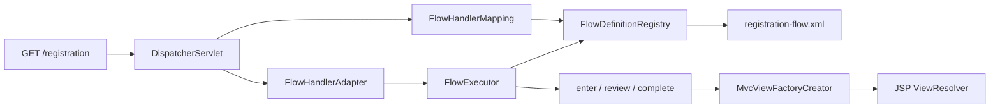

# AbstractFlowConfiguration và các phương thức @Bean cần khai báo

Trong **Spring Web Flow**, việc đăng ký một file flow XML chưa đủ để trình duyệt thực thi hành trình nhiều bước. Ứng dụng còn cần một registry chứa định nghĩa flow, một executor điều khiển từng lần chạy và cơ chế tích hợp với `DispatcherServlet` của Spring MVC. Với cấu hình Java, lớp `AbstractFlowConfiguration` cung cấp các phương thức hỗ trợ xây dựng những thành phần đó.

Bài học thuộc chương **Cấu hình hệ thống** này hướng dẫn tự khai báo các bean bằng `@Configuration` và `@Bean`, từ đó tạo nền tảng cho state, event, transition, subflow, form binding, validation, quản lý scope/phiên và khôi phục flow khi lỗi. Ví dụ sử dụng Spring MVC với JSP để người học nhìn được toàn bộ đường đi từ HTTP request tới flow; những ứng dụng dùng Thymeleaf hoặc công nghệ view khác có thể thay `ViewResolver` tương ứng.

> **Phạm vi phiên bản:** `AbstractFlowConfiguration` và các builder được giới thiệu từ Spring Web Flow 2.4 và tiếp tục có trong dòng 3.x. Cần chọn phiên bản Spring Web Flow phù hợp với Spring Framework, Servlet API (`javax.*` hoặc `jakarta.*`) và Java của dự án. Các snippet tập trung vào API cấu hình Web Flow; không tự động biến ứng dụng MVC thành Spring Boot.

## 1. AbstractFlowConfiguration thực sự cung cấp những gì?

Lớp `org.springframework.webflow.config.AbstractFlowConfiguration` là một lớp cơ sở cho cấu hình Java. Nó triển khai `ApplicationContextAware` và cho lớp con gọi các phương thức `protected` sau:

| Phương thức thừa kế | Kiểu builder trả về | Dùng để tạo |
| --- | --- | --- |
| `getFlowDefinitionRegistryBuilder()` | `FlowDefinitionRegistryBuilder` | Registry chứa các định nghĩa flow với dịch vụ mặc định |
| `getFlowDefinitionRegistryBuilder(flowBuilderServices)` | `FlowDefinitionRegistryBuilder` | Registry dùng bộ dịch vụ build flow tùy chỉnh |
| `getFlowExecutorBuilder(flowRegistry)` | `FlowExecutorBuilder` | Bộ máy khởi chạy, tiếp tục và kết thúc flow |
| `getFlowBuilderServicesBuilder()` | `FlowBuilderServicesBuilder` | Bộ dịch vụ dựng flow, tích hợp view, binding, validation và chuyển đổi |

**Điểm dễ nhầm:** `AbstractFlowConfiguration` **không tự khai báo các bean** `flowRegistry`, `flowExecutor` hoặc `flowBuilderServices`. Các phương thức trên trả về *builder*; lớp con phải gọi `build()` trong các phương thức có `@Bean` thì Spring mới có bean tương ứng. Chỉ viết `extends AbstractFlowConfiguration` chưa khiến URL flow hoạt động.

```java
@Configuration
public class WebFlowConfig extends AbstractFlowConfiguration {

    @Bean
    public FlowDefinitionRegistry flowRegistry() {
        return getFlowDefinitionRegistryBuilder()
                .addFlowLocation("/WEB-INF/flows/registration/registration-flow.xml",
                                 "registration")
                .build();
    }

    @Bean
    public FlowExecutor flowExecutor(FlowDefinitionRegistry flowRegistry) {
        return getFlowExecutorBuilder(flowRegistry).build();
    }
}
```

Đây là **lõi Web Flow tối thiểu**: một định nghĩa được đăng ký dưới ID `registration` và một executor để thực thi. Tuy nhiên, muốn gọi `GET /registration` qua Spring MVC, phải bổ sung `FlowHandlerMapping` và `FlowHandlerAdapter`. Muốn tái sử dụng resolver JSP của MVC, nên khai báo `MvcViewFactoryCreator` và `FlowBuilderServices` rồi truyền chúng cho registry.

## 2. Ví dụ cấu hình Java đầy đủ cho Spring MVC

Giả sử dự án chạy một ứng dụng Servlet có Spring MVC `DispatcherServlet`. Cấu trúc thư mục minh họa:

```text
src/main/
├── java/com/example/config/
│   ├── WebMvcConfig.java
│   ├── WebFlowConfig.java
│   └── WebAppInitializer.java
└── webapp/WEB-INF/
    ├── flows/
    │   └── registration/
    │       └── registration-flow.xml
    └── views/
        └── registration/
            ├── enter.jsp
            ├── review.jsp
            └── complete.jsp
```

### 2.1. Cấu hình WebFlowConfig

Đặt lớp này trong `com.example.config`, và **nạp nó vào WebApplicationContext của DispatcherServlet**. Phương pháp tiêm phụ thuộc qua tham số `@Bean` giúp xác định rõ các quan hệ giữa bean và tránh gọi nhầm một instance khác.

```java
package com.example.config;

import java.util.Collections;

import org.springframework.beans.factory.annotation.Qualifier;
import org.springframework.context.annotation.Bean;
import org.springframework.context.annotation.Configuration;
import org.springframework.web.servlet.ViewResolver;
import org.springframework.web.servlet.view.InternalResourceViewResolver;
import org.springframework.webflow.config.AbstractFlowConfiguration;
import org.springframework.webflow.definition.registry.FlowDefinitionRegistry;
import org.springframework.webflow.engine.builder.support.FlowBuilderServices;
import org.springframework.webflow.executor.FlowExecutor;
import org.springframework.webflow.mvc.builder.MvcViewFactoryCreator;
import org.springframework.webflow.mvc.servlet.FlowHandlerAdapter;
import org.springframework.webflow.mvc.servlet.FlowHandlerMapping;

@Configuration
public class WebFlowConfig extends AbstractFlowConfiguration {

    // Spring MVC chuyển tên view "registration/enter"
    // thành "/WEB-INF/views/registration/enter.jsp".
    @Bean
    public ViewResolver jspViewResolver() {
        InternalResourceViewResolver resolver = new InternalResourceViewResolver();
        resolver.setPrefix("/WEB-INF/views/");
        resolver.setSuffix(".jsp");
        return resolver;
    }

    // Cho Web Flow sử dụng ViewResolver của Spring MVC.
    @Bean
    public MvcViewFactoryCreator mvcViewFactoryCreator(
            @Qualifier("jspViewResolver") ViewResolver jspResolver) {
        MvcViewFactoryCreator creator = new MvcViewFactoryCreator();
        creator.setViewResolvers(Collections.singletonList(jspResolver));
        return creator;
    }

    // Các dịch vụ được dùng khi dựng định nghĩa flow.
    @Bean
    public FlowBuilderServices flowBuilderServices(
            MvcViewFactoryCreator mvcViewFactoryCreator) {
        return getFlowBuilderServicesBuilder()
                .setViewFactoryCreator(mvcViewFactoryCreator)
                .build();
    }

    // Đăng ký file flow với ID rõ ràng.
    @Bean
    public FlowDefinitionRegistry flowRegistry(
            FlowBuilderServices flowBuilderServices) {
        return getFlowDefinitionRegistryBuilder(flowBuilderServices)
                .addFlowLocation(
                        "/WEB-INF/flows/registration/registration-flow.xml",
                        "registration")
                .build();
    }

    // Điều khiển vòng đời các flow execution.
    @Bean
    public FlowExecutor flowExecutor(FlowDefinitionRegistry flowRegistry) {
        return getFlowExecutorBuilder(flowRegistry).build();
    }

    // Ánh xạ đường dẫn HTTP tới ID flow trong registry.
    @Bean
    public FlowHandlerMapping flowHandlerMapping(
            FlowDefinitionRegistry flowRegistry) {
        FlowHandlerMapping mapping = new FlowHandlerMapping();
        mapping.setFlowRegistry(flowRegistry);
        mapping.setOrder(0);
        return mapping;
    }

    // Cầu nối cho DispatcherServlet chạy FlowExecutor.
    @Bean
    public FlowHandlerAdapter flowHandlerAdapter(FlowExecutor flowExecutor) {
        FlowHandlerAdapter adapter = new FlowHandlerAdapter();
        adapter.setFlowExecutor(flowExecutor);
        return adapter;
    }
}
```

Các tên `flowRegistry` và `flowExecutor` ở đây xuất phát từ tên phương thức `@Bean`. Có thể dùng tên khác, miễn là dependency được nối đúng. `@Qualifier("jspViewResolver")` làm rõ bean cần dùng khi ứng dụng có nhiều `ViewResolver`.

| `@Bean` | Cần cho | Điều gì xảy ra nếu thiếu? |
| --- | --- | --- |
| `flowRegistry` | Lưu định nghĩa `registration` và các subflow khác | Executor không có flow definition để tìm theo ID |
| `flowExecutor` | Chạy các state, event, transition | MVC không thể khởi chạy hoặc tiếp tục execution |
| `flowHandlerMapping` | Nhận dạng URL flow trong Spring MVC | `GET /registration` có thể rơi vào 404 hoặc handler khác |
| `flowHandlerAdapter` | Điều phối request từ MVC sang executor | Handler đã tìm thấy nhưng không có adapter xử lý |
| `jspViewResolver` | Resolve JSP theo tên logic | View có thể không được tìm thấy đúng vị trí |
| `mvcViewFactoryCreator` | Cầu nối view của Web Flow với MVC | Không tái sử dụng được resolver JSP đã định nghĩa |
| `flowBuilderServices` | Gắn view factory và các dịch vụ build flow vào registry | Registry phải dùng bộ dịch vụ mặc định, không có cấu hình view tùy chỉnh ở trên |

Các thành phần `jspViewResolver`, `mvcViewFactoryCreator` và `flowBuilderServices` là phần **mở rộng minh họa cho JSP**; cấu hình tối thiểu của Web Flow engine là registry/executor, cộng mapping/adapter khi nhận request qua MVC. Nếu ứng dụng đã có resolver MVC, sử dụng bean hiện hữu thay vì tạo bản trùng.

### 2.2. Đảm bảo DispatcherServlet nạp được cấu hình

Trong một ứng dụng Servlet truyền thống dùng Java initializer, có thể khai báo:

```java
package com.example.config;

import org.springframework.web.servlet.support.AbstractAnnotationConfigDispatcherServletInitializer;

public class WebAppInitializer
        extends AbstractAnnotationConfigDispatcherServletInitializer {

    @Override
    protected Class<?>[] getRootConfigClasses() {
        return null; // Cấu hình service/application riêng nếu cần.
    }

    @Override
    protected Class<?>[] getServletConfigClasses() {
        return new Class<?>[] { WebMvcConfig.class, WebFlowConfig.class };
    }

    @Override
    protected String[] getServletMappings() {
        return new String[] { "/" };
    }
}
```

Ví dụ `WebMvcConfig` tối giản:

```java
package com.example.config;

import org.springframework.context.annotation.Configuration;
import org.springframework.web.servlet.config.annotation.EnableWebMvc;

@Configuration
@EnableWebMvc
public class WebMvcConfig {
    // Bổ sung interceptors, formatters hoặc resource handlers nếu cần.
}
```

Nếu dự án đã có `DispatcherServlet` hoặc sử dụng Spring Boot, chỉ cần bảo đảm `WebFlowConfig` được quét hoặc `@Import` vào **đúng Spring MVC application context**. Không tạo thêm `DispatcherServlet` chỉ để dùng Web Flow. Một số ứng dụng dùng context cha/con; `FlowHandlerMapping` và `FlowHandlerAdapter` phải nhìn thấy được từ context của DispatcherServlet xử lý URL đó.

## 3. Flow mẫu để xác nhận wiring

**`/WEB-INF/flows/registration/registration-flow.xml`**:

```xml
<?xml version="1.0" encoding="UTF-8"?>
<flow xmlns="http://www.springframework.org/schema/webflow"
      xmlns:xsi="http://www.w3.org/2001/XMLSchema-instance"
      xsi:schemaLocation="
        http://www.springframework.org/schema/webflow
        https://www.springframework.org/schema/webflow/spring-webflow-2.0.xsd">

    <view-state id="enter" view="registration/enter">
        <transition on="continue" to="review"/>
    </view-state>

    <view-state id="review" view="registration/review">
        <transition on="back" to="enter"/>
        <transition on="finish" to="complete"/>
    </view-state>

    <end-state id="complete" view="registration/complete"/>
</flow>
```

Flow bắt đầu ở `enter`; nút **Tiếp tục** phát event `continue`, chuyển sang `review`; từ đây người dùng có thể quay lại hoặc kết thúc. Trong ví dụ này chưa binding dữ liệu để tách bạch bài toán cấu hình bean với nghiệp vụ.

**`/WEB-INF/views/registration/enter.jsp`**:

```jsp
<h1>Đăng ký - bước nhập</h1>
<form method="post" action="${flowExecutionUrl}">
    <button type="submit" name="_eventId_continue">Tiếp tục</button>
</form>
```

**`/WEB-INF/views/registration/review.jsp`**:

```jsp
<h1>Đăng ký - bước xác nhận</h1>
<form method="post" action="${flowExecutionUrl}">
    <button type="submit" name="_eventId_back">Quay lại</button>
    <button type="submit" name="_eventId_finish">Hoàn tất</button>
</form>
```

**`/WEB-INF/views/registration/complete.jsp`**:

```jsp
<h1>Đăng ký hoàn tất</h1>
```

Biến `flowExecutionUrl` do Web Flow đưa vào view giúp request quay lại **đúng execution hiện tại**. Tên nút bắt đầu bằng `_eventId_` cho biết event cần phát; ví dụ `_eventId_finish` tương ứng với `on="finish"` trong XML. Ở ứng dụng có Spring Security, mọi form POST cần mang CSRF token theo cấu hình bảo mật thực tế.

### Từ HTTP request đến flow execution



Mở `GET /registration` (cộng context path nếu ứng dụng có) để khởi chạy flow. `FlowHandlerMapping` tìm ID `registration`; `FlowHandlerAdapter` gọi `FlowExecutor`; executor lấy định nghĩa từ registry, tạo execution và render view `registration/enter`. Khi người dùng gửi event, adapter tiếp tục execution tương ứng, engine áp dụng transition và hiển thị state đích.

Đừng nhầm **flow ID** (`registration`, định danh loại hành trình) với **flow execution key** (định danh một lần chạy cụ thể, đi kèm URL/phiên của người dùng). Nhiều phiên có thể cùng chạy định nghĩa `registration` nhưng lưu các trạng thái đang thực hiện khác nhau.

## 4. Mở rộng các @Bean cho ứng dụng thực tế

Một hành trình nhiều bước thường phát triển thêm điều kiện rẽ nhánh, binding/validation và subflow. Không cần chuyển toàn bộ logic điều hướng vào controller; cấu hình các dịch vụ dùng chung ở Java và khai báo state/transition tại flow.

### 4.1. Form binding và validation

`FlowBuilderServices` hỗ trợ cấu hình dịch vụ chuyển đổi kiểu, parser biểu thức, validator và view factory. Ví dụ trong builder có các phương thức:

| Mở rộng | Mục đích |
| --- | --- |
| `setViewFactoryCreator(mvcViewFactoryCreator)` | Dùng resolver/view của Spring MVC |
| `setConversionService(customConversionService)` | Xử lý dữ liệu kiểu ngày, tiền tệ, enum hoặc kiểu miền nghiệp vụ |
| `setValidator(customValidator)` | Thay validator chung nếu ứng dụng có yêu cầu riêng |
| `setValidationHintResolver(customHintResolver)` | Tùy biến cách xác định nhóm validation cho từng thao tác |
| `setDevelopmentMode(true)` | Tự nhận thay đổi định nghĩa flow trong môi trường phát triển |

Khi thêm validator, đưa `Validator` hoặc conversion service thực sự của dự án vào tham số `@Bean` rồi truyền cho builder trước `build()`. Đối với model form, flow có thể khai báo biến thuộc `flowScope` và gắn với `view-state model="..."`; khi có event chuyển bước, binding và validation được thực hiện theo cấu hình. Validation chỉ nên kiểm tra dữ liệu; thao tác ghi dữ liệu nghiệp vụ thường nằm ở service bean được gọi bởi action thích hợp.

Không bật `setDevelopmentMode(true)` mặc định trong môi trường production; tính năng này dành cho giai đoạn phát triển khi cần nhận thay đổi flow XML.

### 4.2. FlowExecutor và phạm vi phiên

`FlowExecutor` chịu trách nhiệm khởi chạy/khôi phục execution; hệ thống Web Flow quản lý trạng thái execution qua repository, conversation và session thích hợp. Nếu người dùng đóng trang, quay lại sau khi session hết hạn hoặc dùng một execution key cũ, request tiếp tục có thể không khôi phục được như dự tính.

Một số tùy chọn executor nâng cao nằm ở `FlowExecutorBuilder`, ví dụ đăng ký `FlowExecutionListener` để quan sát vòng đời hoặc tinh chỉnh chính sách lưu execution/snapshot. Các tùy chọn này không phải bean bắt buộc của ví dụ đầu tiên. Khi muốn ghi log hay tích hợp persistence, cần cấu hình dựa trên yêu cầu nghiệp vụ và kiểm tra hành vi nhiều tab/Back/Refresh.

Tránh giữ dữ liệu biểu mẫu đang thay đổi trong field của singleton `@Bean`. Những dữ liệu thuộc một hành trình nên đặt vào scope phù hợp của Web Flow như `flowScope`; dữ liệu chỉ thuộc màn hình có thể dùng `viewScope`, còn dữ liệu kéo dài toàn phiên thì cân nhắc `sessionScope` cùng giới hạn thời gian và khả năng xung đột.

### 4.3. Đăng ký nhiều flow và subflow

Nếu quy trình đăng ký gọi luồng xác minh thông tin như một subflow, **định nghĩa subflow cũng phải được registry tìm thấy**:

```java
@Bean
public FlowDefinitionRegistry flowRegistry(
        FlowBuilderServices flowBuilderServices) {
    return getFlowDefinitionRegistryBuilder(flowBuilderServices)
            .addFlowLocation(
                    "/WEB-INF/flows/registration/registration-flow.xml",
                    "registration")
            .addFlowLocation(
                    "/WEB-INF/flows/verification/verification-flow.xml",
                    "verification")
            .build();
}
```

Định nghĩa flow cha có thể dùng `<subflow-state subflow="verification">` và khai báo chuyển tiếp từ kết quả luồng con. `flowRegistry` là nơi định vị flow; lời gọi subflow, đầu vào/đầu ra và các transition vẫn được định nghĩa trong XML của hành trình.

### 4.4. Thứ tự HandlerMapping

Giá trị `mapping.setOrder(0)` của `FlowHandlerMapping` ảnh hưởng thứ tự tìm handler trong Spring MVC. Nếu `@RequestMapping("/registration")` của controller cũng dùng đường dẫn này, hai cơ chế có thể tranh cùng URL. Chọn đường dẫn duy nhất cho flow và kiểm tra ưu tiên mapping; không dựa vào một thứ tự mặc định không được kiểm chứng.

## 5. Tự kiểm tra cấu hình và tìm nguyên nhân lỗi

Sau khi ứng dụng khởi động, kiểm tra theo chiều phụ thuộc:

1. **Context:** `WebFlowConfig` được nạp trong vùng nhìn thấy của `DispatcherServlet`; các bean của nó tạo thành công.
2. **Registry:** `flowRegistry` tải được file `/WEB-INF/flows/registration/registration-flow.xml` với ID `registration`.
3. **Executor:** bean `flowExecutor` tham chiếu đúng registry và không có lỗi khởi tạo.
4. **MVC:** `FlowHandlerMapping` và `FlowHandlerAdapter` có mặt, đường dẫn `/registration` thuộc servlet mapping.
5. **View:** resolver trả về đúng JSP trong `/WEB-INF/views/registration/`; cả ba view đều tồn tại.
6. **Hành trình:** event `continue → review`, `back → enter` và `finish → complete` hoạt động; thử mở tab mới và khôi phục từ URL cũ.

| Triệu chứng | Nguồn lỗi cần kiểm tra |
| --- | --- |
| `NoSuchBeanDefinitionException` cho registry/executor | Thiếu `@Bean`, chưa nạp `WebFlowConfig` hoặc bean ngoài phạm vi context |
| Registry không tìm ra flow | Đường dẫn file, tên file, vị trí deploy trong WAR, ID gán qua `addFlowLocation` |
| `GET /registration` trả 404 | `DispatcherServlet` chưa nhận URL, thiếu `FlowHandlerMapping` hoặc flow ID không khớp |
| MVC không tìm được adapter xử lý handler | Thiếu `FlowHandlerAdapter` hoặc bean nằm trong context khác |
| Không hiển thị được JSP | Sai tên view, `jspViewResolver`, `MvcViewFactoryCreator` hoặc đường dẫn file JSP |
| Bấm nút vẫn ở state cũ | Sai event `_eventId_*`, không có transition tương ứng, form không POST về `flowExecutionUrl` |
| Không tiếp tục được phiên trước | Flow execution key cũ, session timeout, flow đã kết thúc, vấn đề repository hoặc chính sách snapshot |
| Có nhiều handler cho cùng URL | Xung đột controller và flow hoặc thứ tự `HandlerMapping` chưa đúng |

**Thử nghiệm phân lớp:** trước tiên xác nhận registry nạp được definition; tiếp đến kiểm tra `DispatcherServlet` có chọn đúng handler/adapter; cuối cùng mới phân tích event, model binding, validation, trạng thái phiên và exception recovery. Thứ tự này giúp tránh sửa flow XML khi lỗi thực chất là một bean chưa được nạp.

## 6. Ghi nhớ và tài liệu tra cứu

`AbstractFlowConfiguration` là **bộ công cụ tạo cấu hình**, không phải một cấu hình hoàn chỉnh tự kích hoạt. Với Java config, hai `@Bean` cơ bản là `FlowDefinitionRegistry` và `FlowExecutor`; khi tích hợp HTTP qua Spring MVC cần thêm `FlowHandlerMapping` và `FlowHandlerAdapter`. `FlowBuilderServices` cùng `MvcViewFactoryCreator` giúp tùy biến view, binding, validation và tích hợp trình bày. Sau khi các bean được nối đúng, hành trình nhiều bước có thể tiếp tục phát triển thành flow nhiều state, transition và subflow mà không phải phân tán điều hướng sang các controller độc lập.

Nguồn tham khảo chính thức:

- [Spring Web Flow Reference Guide – System Setup](https://docs.spring.io/spring-webflow/docs/3.0.x/reference/#system-setup) – cấu hình Java, registry, executor và dịch vụ build flow.
- [Spring Web Flow Reference Guide – Spring MVC Integration](https://docs.spring.io/spring-webflow/docs/3.0.x/reference/#spring-mvc-integration) – cơ chế mapping, adapter và xử lý view.
- [JavaDoc AbstractFlowConfiguration](https://docs.spring.io/spring-webflow/docs/3.0.x/api/org/springframework/webflow/config/AbstractFlowConfiguration.html) – các phương thức builder của lớp cơ sở.
