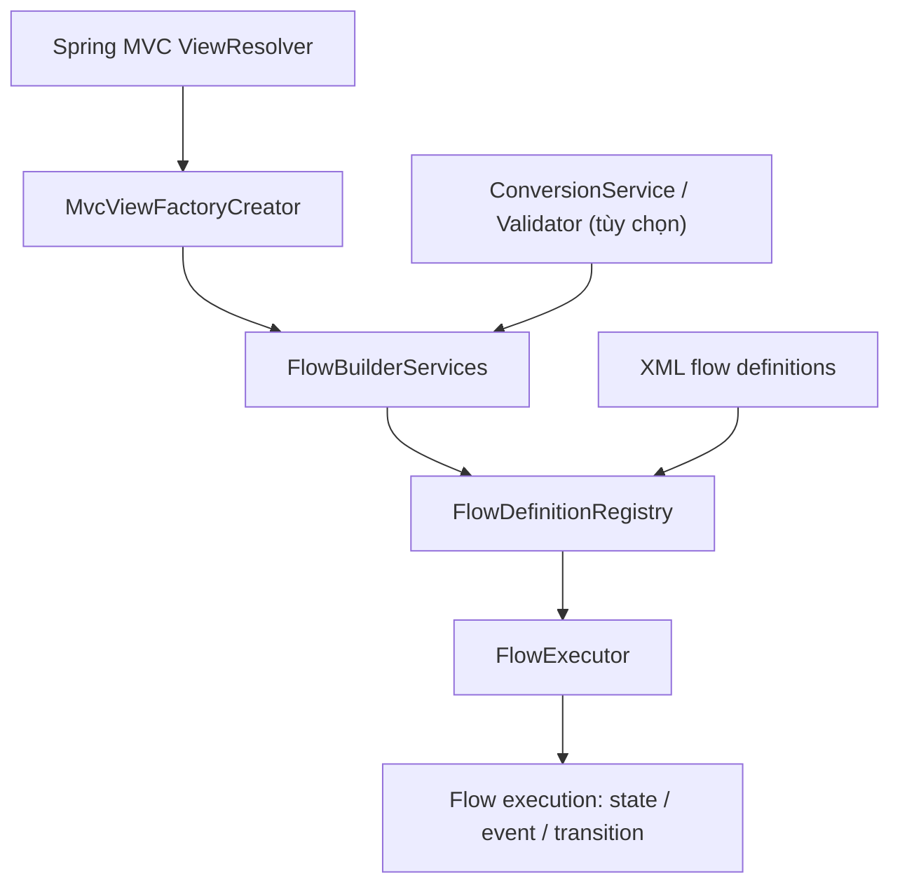
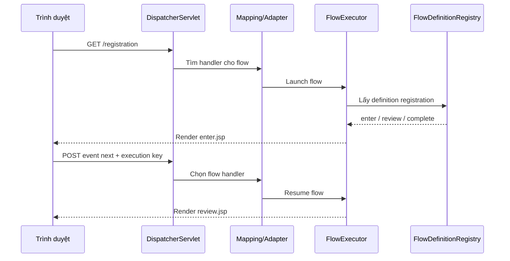

# Tạo FlowBuilderServices bằng Java configuration

## 1. Vì sao Spring Web Flow cần FlowBuilderServices?

Trong ứng dụng **Spring Web Flow**, một quy trình như đăng ký tài khoản, đặt hàng hay phê duyệt hồ sơ có thể trải qua nhiều màn hình. Mỗi màn hình là một `view-state`; người dùng tạo `event` để kích hoạt `transition` sang state tiếp theo, quay lại hoặc gọi một `subflow`. Khi một file định nghĩa flow được nạp, Web Flow phải biết cách diễn giải biểu thức, dựng view, chuyển đổi dữ liệu form và áp dụng validation.

**`FlowBuilderServices`** (kiểu `org.springframework.webflow.engine.builder.support.FlowBuilderServices`) tập hợp những dịch vụ hỗ trợ **xây dựng định nghĩa flow**. Trong cấu hình Java, ta thường tạo bean này thông qua `getFlowBuilderServicesBuilder()` được thừa kế từ `AbstractFlowConfiguration`, sau đó truyền nó vào builder của `FlowDefinitionRegistry`.

Đây là mối quan hệ nền tảng:



`FlowBuilderServices` **không phải** `FlowExecutor`:

| Thành phần | Công việc chính | Xuất hiện ở bước nào? |
| --- | --- | --- |
| `FlowBuilderServices` | Cung cấp dịch vụ cho quá trình biên dịch/xây dựng định nghĩa flow, như tạo view và conversion | Khi registry dựng hoặc nạp các flow |
| `FlowDefinitionRegistry` | Lưu và tra cứu các `FlowDefinition` theo ID | Khi nạp và tìm flow |
| `FlowExecutor` | Khởi tạo, phục hồi, tiếp tục và kết thúc một execution | Khi người dùng tương tác với flow |
| `FlowHandlerMapping` | Ánh xạ URL trong Spring MVC đến flow đã đăng ký | Khi MVC tiếp nhận request |
| `FlowHandlerAdapter` | Chuyển request của MVC sang hành động trên `FlowExecutor` | Khi MVC xử lý request flow |

Điểm quan trọng là **đăng ký bean `FlowBuilderServices` chưa đủ để flow được sử dụng**. Registry phải được tạo bằng `getFlowDefinitionRegistryBuilder(flowBuilderServices)`, và để hoạt động qua HTTP, MVC còn cần mapping và adapter.

## 2. Cách tạo bean FlowBuilderServices cơ bản

`AbstractFlowConfiguration` (trong package `org.springframework.webflow.config`) cung cấp các builder phục vụ cấu hình Java. Ví dụ đơn giản nhất:

```java
import org.springframework.context.annotation.Bean;
import org.springframework.context.annotation.Configuration;
import org.springframework.webflow.config.AbstractFlowConfiguration;
import org.springframework.webflow.engine.builder.support.FlowBuilderServices;

@Configuration
public class WebFlowConfig extends AbstractFlowConfiguration {

    @Bean
    public FlowBuilderServices flowBuilderServices() {
        return getFlowBuilderServicesBuilder().build();
    }
}
```

Gọi `build()` mới tạo ra đối tượng được Spring đăng ký dưới tên `flowBuilderServices`. Phiên bản trên sử dụng các giá trị mặc định của builder. Nó phù hợp để hiểu cơ chế tạo bean, nhưng với Spring MVC dùng JSP/Thymeleaf, ứng dụng thường cần chỉ ra **view factory** để Web Flow dùng chung `ViewResolver` của MVC.

Hai mức cấu hình thường gặp:

| Trường hợp | Cấu hình |
| --- | --- |
| Dùng mặc định để thử khởi tạo dịch vụ | `getFlowBuilderServicesBuilder().build()` |
| Dùng view resolver của Spring MVC | `getFlowBuilderServicesBuilder().setViewFactoryCreator(mvcViewFactoryCreator).build()` |

Phương thức `setDevelopmentMode(true)` có thể được thêm khi phát triển để hỗ trợ nhận thay đổi định nghĩa flow; **không mặc định bật trong production**. Đối với chuyển đổi kiểu và validation đặc thù, cấu hình thêm những dịch vụ được hỗ trợ bởi phiên bản Spring Web Flow đang sử dụng.

## 3. Ví dụ Java configuration hoàn chỉnh với Spring MVC và JSP

Giả sử ứng dụng có trang nhập thông tin và xác nhận đăng ký ở địa chỉ `/registration`. Mục tiêu là cấu hình các bean sau:

1. `jspViewResolver`: xác định đường dẫn của JSP.
2. `mvcViewFactoryCreator`: cung cấp view của Spring MVC cho Web Flow.
3. `flowBuilderServices`: dùng view factory ở bước 2.
4. `flowRegistry`: nạp file XML định nghĩa flow bằng các builder services.
5. `flowExecutor`: thực thi các flow trong registry.
6. `flowHandlerMapping` và `flowHandlerAdapter`: tích hợp flow với `DispatcherServlet`.

### 3.1. File WebFlowConfig.java

Ví dụ sử dụng API của dòng Spring Web Flow hỗ trợ `AbstractFlowConfiguration`. Các dependency Spring Framework, Spring Web Flow và Servlet API phải chọn **phiên bản tương thích với nhau**; nếu dùng Spring Web Flow 2.x trong ứng dụng `javax.servlet`, không sao chép các dependency đó nguyên vẹn sang stack `jakarta.servlet`.

```java
package com.example.config;

import java.util.Collections;

import org.springframework.beans.factory.annotation.Qualifier;
import org.springframework.context.annotation.Bean;
import org.springframework.context.annotation.Configuration;
import org.springframework.web.servlet.ViewResolver;
import org.springframework.web.servlet.view.InternalResourceViewResolver;
import org.springframework.webflow.config.AbstractFlowConfiguration;
import org.springframework.webflow.definition.registry.FlowDefinitionRegistry;
import org.springframework.webflow.engine.builder.support.FlowBuilderServices;
import org.springframework.webflow.executor.FlowExecutor;
import org.springframework.webflow.mvc.builder.MvcViewFactoryCreator;
import org.springframework.webflow.mvc.servlet.FlowHandlerAdapter;
import org.springframework.webflow.mvc.servlet.FlowHandlerMapping;

@Configuration
public class WebFlowConfig extends AbstractFlowConfiguration {

    // Chọn vị trí các trang JSP mà flow sử dụng.
    @Bean
    public ViewResolver jspViewResolver() {
        InternalResourceViewResolver resolver =
                new InternalResourceViewResolver();
        resolver.setPrefix("/WEB-INF/views/");
        resolver.setSuffix(".jsp");
        return resolver;
    }

    // Cho Web Flow tạo view thông qua resolver của Spring MVC.
    @Bean
    public MvcViewFactoryCreator mvcViewFactoryCreator(
            @Qualifier("jspViewResolver") ViewResolver jspViewResolver) {
        MvcViewFactoryCreator creator = new MvcViewFactoryCreator();
        creator.setViewResolvers(
                Collections.singletonList(jspViewResolver));
        return creator;
    }

    // Bean trọng tâm của bài học.
    @Bean
    public FlowBuilderServices flowBuilderServices(
            MvcViewFactoryCreator mvcViewFactoryCreator) {
        return getFlowBuilderServicesBuilder()
                .setViewFactoryCreator(mvcViewFactoryCreator)
                .build();
    }

    // Đăng ký file flow và sử dụng đúng services đã tạo.
    @Bean
    public FlowDefinitionRegistry flowRegistry(
            FlowBuilderServices flowBuilderServices) {
        return getFlowDefinitionRegistryBuilder(flowBuilderServices)
                .addFlowLocation(
                        "/WEB-INF/flows/registration/registration-flow.xml",
                        "registration")
                .build();
    }

    // Điều khiển vòng đời các flow execution.
    @Bean
    public FlowExecutor flowExecutor(FlowDefinitionRegistry flowRegistry) {
        return getFlowExecutorBuilder(flowRegistry).build();
    }

    // Spring MVC nhận dạng URL /registration là một flow.
    @Bean
    public FlowHandlerMapping flowHandlerMapping(
            FlowDefinitionRegistry flowRegistry) {
        FlowHandlerMapping mapping = new FlowHandlerMapping();
        mapping.setFlowRegistry(flowRegistry);
        mapping.setOrder(0);
        return mapping;
    }

    // Spring MVC chuyển request tới FlowExecutor.
    @Bean
    public FlowHandlerAdapter flowHandlerAdapter(FlowExecutor flowExecutor) {
        FlowHandlerAdapter adapter = new FlowHandlerAdapter();
        adapter.setFlowExecutor(flowExecutor);
        return adapter;
    }
}
```

**Hai dòng then chốt cần hiểu:**

```java
// 1. Builder services biết cách tạo view.
return getFlowBuilderServicesBuilder()
        .setViewFactoryCreator(mvcViewFactoryCreator)
        .build();

// 2. Registry sử dụng chính builder services ấy khi nạp XML.
return getFlowDefinitionRegistryBuilder(flowBuilderServices)
        .addFlowLocation("/WEB-INF/flows/registration/registration-flow.xml",
                         "registration")
        .build();
```

Nếu vô tình đổi dòng thứ hai thành `getFlowDefinitionRegistryBuilder()`, registry sẽ dùng bộ services mặc định thay vì `flowBuilderServices` đã tùy chỉnh. Kết quả là bean vẫn tồn tại trong context, nhưng cấu hình JSP custom có thể không được sử dụng như mong muốn.

### 3.2. DispatcherServlet phải nhìn thấy các bean Web Flow

Nếu là ứng dụng Spring MVC cấu hình Java bằng `AbstractAnnotationConfigDispatcherServletInitializer`, có thể nạp `WebFlowConfig` cùng cấu hình MVC:

```java
package com.example.config;

import org.springframework.web.servlet.support.AbstractAnnotationConfigDispatcherServletInitializer;

public class WebAppInitializer
        extends AbstractAnnotationConfigDispatcherServletInitializer {

    @Override
    protected Class<?>[] getRootConfigClasses() {
        return null;
    }

    @Override
    protected Class<?>[] getServletConfigClasses() {
        return new Class<?>[] { WebMvcConfig.class, WebFlowConfig.class };
    }

    @Override
    protected String[] getServletMappings() {
        return new String[] { "/" };
    }
}
```

```java
package com.example.config;

import org.springframework.context.annotation.Configuration;
import org.springframework.web.servlet.config.annotation.EnableWebMvc;

@Configuration
@EnableWebMvc
public class WebMvcConfig {
}
```

Nếu ứng dụng đã được cấu hình Spring Boot hoặc đã có `DispatcherServlet`, hãy sử dụng cơ chế component scan/`@Import` phù hợp với context hiện có. Điều kiện thực tế là `FlowHandlerMapping` và `FlowHandlerAdapter` phải nằm trong phạm vi mà `DispatcherServlet` xử lý URL có thể truy cập.

### 3.3. Cấu trúc file tài nguyên

```text
src/main/
├── java/com/example/config/
│   ├── WebAppInitializer.java
│   ├── WebMvcConfig.java
│   └── WebFlowConfig.java
└── webapp/WEB-INF/
    ├── flows/
    │   └── registration/
    │       └── registration-flow.xml
    └── views/
        └── registration/
            ├── enter.jsp
            ├── review.jsp
            └── complete.jsp
```

## 4. Một flow nhỏ để kiểm tra FlowBuilderServices

**`/WEB-INF/flows/registration/registration-flow.xml`**:

```xml
<?xml version="1.0" encoding="UTF-8"?>
<flow xmlns="http://www.springframework.org/schema/webflow"
      xmlns:xsi="http://www.w3.org/2001/XMLSchema-instance"
      xsi:schemaLocation="
          http://www.springframework.org/schema/webflow
          http://www.springframework.org/schema/webflow/spring-webflow-2.0.xsd">

    <view-state id="enter" view="registration/enter">
        <transition on="next" to="review"/>
    </view-state>

    <view-state id="review" view="registration/review">
        <transition on="back" to="enter"/>
        <transition on="confirm" to="complete"/>
    </view-state>

    <end-state id="complete" view="registration/complete"/>
</flow>
```

Với `InternalResourceViewResolver` ở mục 3, tên view `registration/enter` được ánh xạ tới `/WEB-INF/views/registration/enter.jsp`. Đây là kết quả trực tiếp của liên kết `ViewResolver → MvcViewFactoryCreator → FlowBuilderServices → flowRegistry`.

**`enter.jsp`**:

```jsp
<h1>Nhập thông tin</h1>
<form action="${flowExecutionUrl}" method="post">
    <button type="submit" name="_eventId_next">Tiếp tục</button>
</form>
```

**`review.jsp`**:

```jsp
<h1>Xác nhận</h1>
<form action="${flowExecutionUrl}" method="post">
    <button type="submit" name="_eventId_back">Quay lại</button>
    <button type="submit" name="_eventId_confirm">Hoàn tất</button>
</form>
```

**`complete.jsp`**:

```jsp
<h1>Đã hoàn thành quy trình đăng ký</h1>
```

`flowExecutionUrl` là URL tiếp tục **execution hiện tại** do Web Flow cung cấp cho view. Một nút tên `_eventId_next` phát event `next` để kích hoạt transition tương ứng; `_eventId_confirm` phát event `confirm`. Trong hệ thống có bảo vệ CSRF, form POST phải kèm CSRF token theo Spring Security đang dùng.

Quá trình xử lý:



Sơ đồ giúp phân biệt rõ trách nhiệm: builder services tham gia **chuẩn bị định nghĩa** và thiết lập view factory; khi người dùng phát event, **FlowExecutor** tiếp tục thực thi flow dựa trên definition đã được registry quản lý.

## 5. Tùy chỉnh FlowBuilderServices khi ứng dụng lớn dần

### 5.1. ViewFactoryCreator và nhiều ViewResolver

`MvcViewFactoryCreator` nhận danh sách `ViewResolver` của Spring MVC. Nếu ứng dụng đã có bean giải quyết JSP hoặc Thymeleaf, sử dụng resolver đó, tránh tạo hai resolver cạnh tranh. Thứ tự resolver và khả năng giải quyết view quan trọng khi dùng nhiều công nghệ giao diện.

```java
@Bean
public MvcViewFactoryCreator mvcViewFactoryCreator(
        @Qualifier("jspViewResolver") ViewResolver jspResolver) {
    MvcViewFactoryCreator creator = new MvcViewFactoryCreator();
    creator.setViewResolvers(Collections.singletonList(jspResolver));
    return creator;
}
```

Nếu template engine cung cấp `ViewResolver` riêng của Spring MVC, ví dụ Thymeleaf, có thể đưa resolver tương ứng vào `MvcViewFactoryCreator`. Cần giữ nhất quán đường dẫn tên view trong XML với cấu hình resolver thực tế.

### 5.2. ConversionService cho form binding

Form HTML gửi dữ liệu chủ yếu dưới dạng chuỗi. Khi form gắn với đối tượng model có `LocalDate`, `BigDecimal` hoặc một kiểu giá trị nghiệp vụ, Web Flow cần conversion service để chuyển dữ liệu phù hợp với kiểu thuộc tính.

Một số dòng Spring Web Flow sử dụng conversion service của **Spring Binding** (ví dụ `org.springframework.binding.convert.service.DefaultConversionService`); không mặc định thay thế nó bằng `org.springframework.core.convert.ConversionService` vì hai API có thể khác nhau. Nên kiểm tra chữ ký `setConversionService(...)` và package trong phiên bản đang dùng.

Ý tưởng cấu hình:

```java
// Trong @Bean flowBuilderServices(...), khi đã có một conversion service
// tương thích với Spring Web Flow:
return getFlowBuilderServicesBuilder()
        .setViewFactoryCreator(mvcViewFactoryCreator)
        .setConversionService(webFlowConversionService)
        .build();
```

Ví dụ này minh họa **điểm gắn mở rộng**, trong đó `webFlowConversionService` do dự án tự tạo và đăng ký bằng bean tương thích; nó không phải tên bean có sẵn của framework. Thực tế cần đăng ký các converter/formatter phù hợp với kiểu dữ liệu và kiểm thử dữ liệu không hợp lệ.

### 5.3. Validation: tách cấu hình engine và quy tắc nghiệp vụ

Đối tượng dùng làm form model có thể được khai báo trong XML flow:

```xml
<var name="registrationForm" class="com.example.flow.RegistrationForm"/>

<view-state id="enter"
            view="registration/enter"
            model="registrationForm">
    <transition on="next" to="review"/>
</view-state>
```

Ví dụ trên là **đoạn trích** đặt bên trong phần tử `<flow>`, không phải file XML độc lập. Lúc này, các input được binding vào `registrationForm` theo cơ chế view state; validation của model/transition cần được thiết kế theo quy tắc từng bước. Có thể cấu hình validator tương thích ở tầng services hoặc khai báo cơ chế validation cho model theo API phiên bản đang sử dụng. Không nên đặt nghiệp vụ ghi đơn hàng, tạo tài khoản hoặc cập nhật database trực tiếp trong validator.

| Trách nhiệm | Nơi phù hợp |
| --- | --- |
| Chuyển chuỗi form thành dữ liệu có kiểu | Conversion service |
| Kiểm tra định dạng, trường bắt buộc, quan hệ giữa trường | Validator và quy tắc validation của flow |
| Quyết định đi sang state nào | Transition/decision state |
| Gọi logic nghiệp vụ hoặc lưu dữ liệu | Spring service được flow/action gọi |
| Lưu dữ liệu trong một hành trình | `flowScope` / model của flow |

Chỉ thêm bean validator hay converter khi có tình huống sử dụng rõ ràng; cấu hình cơ bản không đòi hỏi tất cả phần mở rộng này.

### 5.4. Development mode và môi trường chạy

Khi đang phát triển flow XML, có thể sử dụng:

```java
@Bean
public FlowBuilderServices flowBuilderServices(
        MvcViewFactoryCreator mvcViewFactoryCreator) {
    return getFlowBuilderServicesBuilder()
            .setViewFactoryCreator(mvcViewFactoryCreator)
            .setDevelopmentMode(true)
            .build();
}
```

Development mode dành cho phát triển; trên production cần cấu hình phù hợp để tránh chi phí hoặc hành vi không mong muốn do nạp lại định nghĩa flow. Nếu điều khiển bằng profile, chỉ bật giá trị tương ứng trong profile phát triển của dự án.

### 5.5. Scope, session và khôi phục execution

`FlowBuilderServices` không quản lý các execution đang chạy thay cho `FlowExecutor`. Dữ liệu trong `flowScope` hoặc `viewScope` được Web Flow quản lý theo vòng đời phù hợp; session hết hạn, execution key không còn hợp lệ hoặc flow đã kết thúc đều có thể khiến request cũ không tiếp tục được. Các chính sách lưu execution, listener, repository và xử lý lỗi điều chỉnh ở phần hạ tầng executor/ứng dụng, không xử lý bằng cách đăng ký một builder services mới cho mỗi người dùng.

**Không lưu form đang thay đổi trong field của singleton `@Configuration` hoặc singleton service.** Mỗi người dùng cần trạng thái thuộc execution của chính họ.

## 6. Những lỗi cấu hình dễ gặp

| Triệu chứng | Nguyên nhân có thể | Hướng kiểm tra |
| --- | --- | --- |
| Bean `FlowBuilderServices` có mặt nhưng view vẫn dùng cấu hình mặc định | Registry được tạo bằng builder không truyền services tùy chỉnh | Kiểm tra `getFlowDefinitionRegistryBuilder(flowBuilderServices)` |
| `GET /registration` trả 404 | Mapping không tồn tại trong MVC context, ID khác hoặc servlet mapping không khớp | Kiểm tra `FlowHandlerMapping`, `DispatcherServlet`, flow ID |
| Lỗi không tìm thấy JSP | Tên view và resolver không khớp | So sánh `view="registration/enter"` với prefix/suffix của resolver |
| Lỗi nạp file XML flow | Registry trỏ sai đường dẫn, nội dung flow không hợp lệ | Kiểm tra `addFlowLocation(...)` và file trong WAR |
| Nhấn nút không đi tiếp | Event không khớp transition hoặc action POST sai execution | Kiểm tra `_eventId_*`, `on="..."` và `flowExecutionUrl` |
| Chuyển đổi kiểu form thất bại | Converter chưa được đăng ký hoặc dùng sai loại conversion service | Kiểm tra kiểu field, converter và chữ ký API phù hợp |
| Validation không chạy như kỳ vọng | Chưa khai báo model hoặc cơ chế validation không phù hợp state | Kiểm tra `model`, đối tượng form và validator |
| Có nhiều ViewResolver hoặc HandlerMapping tranh cùng URL/view | Cấu hình trùng, thứ tự mapping/resolver không rõ | Xem bean thực tế, URL của controller và thứ tự `order` |
| Quay lại sau thời gian dài không phục hồi được | Session/flow execution đã hết hạn hoặc key cũ | Xử lý lỗi khôi phục, hướng người dùng mở lại flow |

### Kiểm tra theo thứ tự

1. **Khởi động context:** xác nhận `WebFlowConfig` và các `@Bean` khởi tạo thành công.
2. **Kiểm tra dependency:** `flowBuilderServices` chứa đúng view factory; `flowRegistry` đã được tạo với bean đó.
3. **Nạp flow:** registry có định nghĩa `registration` và đọc được file XML.
4. **Định tuyến MVC:** `GET /registration` đi tới `FlowHandlerMapping`/`FlowHandlerAdapter`.
5. **Render view:** JSP `enter.jsp` xuất hiện; thử event `next`, `back` và `confirm`.
6. **Trường hợp biên:** gửi dữ liệu form sai định dạng, hết phiên, mở hai tab và dùng URL execution cũ để kiểm tra cách phục hồi.

## 7. Bài tập vận dụng

Bạn có một flow `checkout` với hai màn hình `shipping` và `review`. Dự án đã có bean `thymeleafViewResolver`. Hãy tự thiết kế cấu hình Java:

- Sử dụng bean `thymeleafViewResolver` có sẵn trong `MvcViewFactoryCreator`.
- Tạo `flowBuilderServices` bằng `getFlowBuilderServicesBuilder()` và truyền view factory vào builder.
- Đăng ký `/WEB-INF/flows/checkout/checkout-flow.xml` dưới ID `checkout` thông qua `getFlowDefinitionRegistryBuilder(flowBuilderServices)`.
- Tạo `flowExecutor`, `FlowHandlerMapping` và `FlowHandlerAdapter` để truy cập `GET /checkout`.
- Kiểm tra sự kiện `next`, `back` và tình huống session hết hạn.

**Tiêu chí hoàn thành:** ứng dụng mở đúng màn hình ban đầu, sự kiện chuyển state theo XML, view được dựng bằng resolver đang dùng của MVC và mỗi trình duyệt có execution riêng. Nếu `GET /checkout` trả 404, kiểm tra mapping/registry trước; nếu chỉ lỗi render, kiểm tra view factory/resolver trước.

## 8. Ghi nhớ

- `FlowBuilderServices` là **dịch vụ phục vụ xây dựng flow definition**, thường được tạo bằng một phương thức `@Bean` trong lớp kế thừa `AbstractFlowConfiguration`.
- Để tái sử dụng view của Spring MVC, nối `MvcViewFactoryCreator` vào `getFlowBuilderServicesBuilder().setViewFactoryCreator(...)`.
- Sau đó **phải truyền chính services ấy vào** `getFlowDefinitionRegistryBuilder(flowBuilderServices)` trước khi đăng ký XML flow.
- `FlowExecutor` chạy state/event/transition; `FlowHandlerMapping` và `FlowHandlerAdapter` giúp `DispatcherServlet` nhận và thực thi request.
- Khi hành trình có form, bổ sung conversion, validation và scope đúng nhu cầu. Khi có lỗi khôi phục phiên, xem phần runtime/execution thay vì chỉ chỉnh builder.

Các bước này tạo một nền cấu hình rõ ràng để phát triển hành trình web nhiều bước, kết hợp form binding, validation và subflow mà không phải dàn trải logic điều hướng trong nhiều controller Spring MVC.
