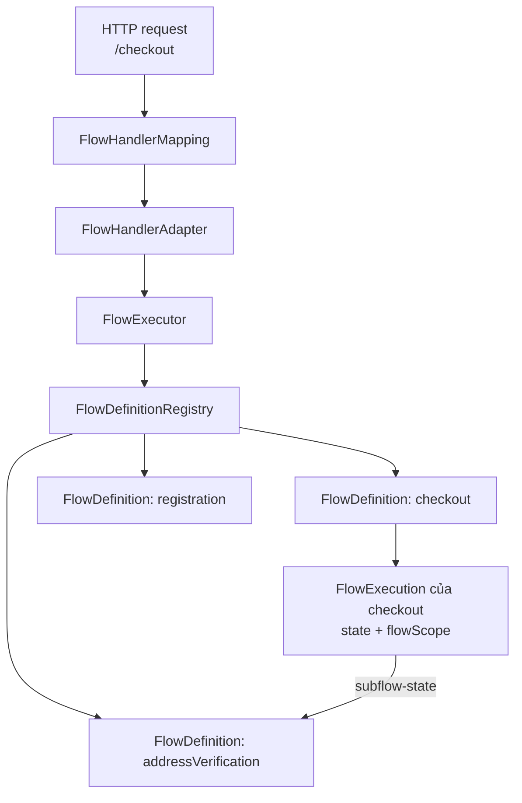
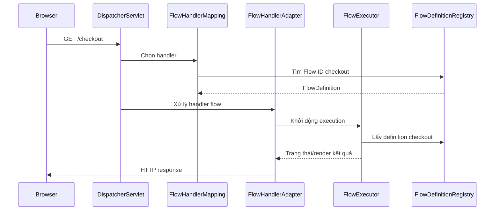

# Đăng ký FlowDefinitionRegistry và thư mục gốc

Khi xây dựng ứng dụng **Spring Web Flow**, việc viết một tệp XML chứa các `view-state`, `action-state`, `transition` và `subflow-state` mới chỉ là bước định nghĩa hành trình. Để ứng dụng thực sự có thể **khởi động một flow từ URL**, tiếp tục flow qua nhiều request, hoặc **gọi flow con từ flow cha**, Spring Web Flow phải tìm được định nghĩa tương ứng. Thành phần chịu trách nhiệm quản lý những định nghĩa này là **`FlowDefinitionRegistry`**.

Trong chương **Cấu hình hệ thống**, chủ đề này tập trung vào cách **đăng ký flow registry và thiết lập thư mục gốc** bằng `base-path`; đồng thời làm rõ sự khác biệt giữa *định danh flow*, *đường dẫn tệp XML*, *đường dẫn URL* và *tên view*. Hiểu đúng những ranh giới đó sẽ giúp tránh lỗi “flow không tồn tại” dù XML đang nằm trên ổ đĩa, lỗi gọi subflow, hoặc sự khác biệt khi chuyển từ môi trường phát triển sang triển khai thật.

## 1. FlowDefinitionRegistry có vai trò gì?

`FlowDefinitionRegistry` là **kho đăng ký các định nghĩa flow** mà Spring Web Flow có thể tra cứu theo ID. Mỗi định nghĩa mô tả một hành trình có những state, event, transition, biến và quy tắc tương tác riêng.

Ví dụ, một ứng dụng bán hàng có ba flow:

- `checkout`: nhập đơn hàng, xác nhận và hoàn tất.
- `addressVerification`: xác minh địa chỉ, có thể dùng lại từ nhiều flow cha.
- `registration`: đăng ký tài khoản nhiều bước.

`FlowExecutor` sử dụng registry để lấy `FlowDefinition` khi khởi động flow theo ID. Khi execution đi vào `subflow-state`, hạ tầng cũng cần phân giải tham chiếu đến định nghĩa flow con.



Đặc biệt, **registry chứa định nghĩa, không phải dữ liệu của từng người dùng**. `FlowExecution` mới là một lần chạy cụ thể có active state, dữ liệu trong `flowScope` và khả năng được lưu/khôi phục theo cấu hình `FlowExecutionRepository`.

| Khái niệm | Trách nhiệm | Ví dụ |
| --- | --- | --- |
| `FlowDefinitionRegistry` | Đăng ký và tra cứu các định nghĩa flow | Tìm flow có ID `checkout` |
| `FlowDefinition` | Bản thiết kế state/event/transition | XML mô tả quy trình checkout |
| `FlowExecutor` | Khởi động, tiếp tục và điều khiển execution | Xử lý event `next`, `back` |
| `FlowExecutionRepository` | Lưu, tìm lại và quản lý execution tùy cấu hình | Phục hồi flow qua request/session |
| `FlowHandlerMapping` | Liên kết request MVC với handler cho flow đã đăng ký | Nhận URL bắt đầu flow |
| `FlowHandlerAdapter` | Giao tiếp giữa MVC handler và executor | Launch/resume theo request HTTP |

Không nên nhầm **đăng ký flow** với **lưu session**. Đổi `base-path` giúp engine tìm tệp định nghĩa; nó không sửa thời gian sống session, số execution được giữ hay chiến lược lưu snapshot.

## 2. Bốn loại tên/đường dẫn dễ nhầm lẫn

Giả sử dự án có tệp:

```text
src/main/webapp/WEB-INF/flows/checkout/checkout-flow.xml
```

Với registry đăng ký ID `checkout`, các giá trị liên quan có thể là:

| Giá trị | Ví dụ | Mục đích |
| --- | --- | --- |
| **Resource path** | `/WEB-INF/flows/checkout/checkout-flow.xml` | Vị trí XML trong tài nguyên ứng dụng web |
| **Registry base path** | `/WEB-INF/flows` | Thư mục gốc dùng để phân giải các resource flow tương đối |
| **Flow ID** | `checkout` | Khóa để tra cứu định nghĩa trong registry |
| **Flow URL** | `/checkout` trong một cấu hình Spring MVC thông dụng | Điểm vào HTTP được handler mapping nhận diện |
| **View name** | `checkout/form` | Tên view được view resolver chuyển thành template |

Mối quan hệ giữa chúng không phải phép nối chuỗi tùy ý. `FlowHandlerMapping` và cấu hình ứng dụng quyết định URL nào được hiểu là flow ID. `ViewResolver` quyết định một `view="checkout/form"` tương ứng tệp JSP hay Thymeleaf nào. `FlowDefinitionRegistry` chỉ chịu trách nhiệm tra cứu **định nghĩa flow** theo ID và resource đã đăng ký.

**Đường dẫn `/WEB-INF/flows/...` không phải URL công khai để trình duyệt mở thẳng XML.** Trong ứng dụng servlet thông thường, tài nguyên dưới `WEB-INF` không được phục vụ trực tiếp từ browser; engine đọc nó như resource nội bộ.

## 3. Cấu trúc thư mục gốc nên tổ chức ra sao?

Một cấu trúc phổ biến cho ứng dụng web đóng gói WAR:

```text
src/
└── main/
    └── webapp/
        └── WEB-INF/
            ├── flows/
            │   ├── checkout/
            │   │   └── checkout-flow.xml
            │   ├── address-verification/
            │   │   └── verify-flow.xml
            │   └── registration/
            │       └── registration-flow.xml
            └── views/
                ├── checkout/
                │   ├── form.jsp
                │   └── review.jsp
                └── address/
                    └── confirm.jsp
```

Trong ví dụ:

- **Thư mục flow:** `/WEB-INF/flows`, nơi chứa các định nghĩa XML.
- **Thư mục view:** `/WEB-INF/views`, nơi chứa các mẫu hiển thị; đây không phải nơi `FlowDefinitionRegistry` tự tìm định nghĩa.
- **Tên tệp:** có thể dùng `checkout-flow.xml` hay `verify-flow.xml`. Khi đăng ký tường minh, tên tệp **không bắt buộc** trùng flow ID.
- **Folder con:** giúp phân nhóm flow; không mặc định biến thành một phần của ID nếu bạn đã đặt `id` tường minh.

Thư mục này là **resource base path trong ứng dụng**, không phải “ổ đĩa gốc” của máy chạy. Khi triển khai, đường dẫn trong `base-path` phải phân giải được từ resource loader thích hợp; không nên ghép nó với đường dẫn tuyệt đối trên máy lập trình viên.

### Vì sao nên gom các flow vào cùng thư mục?

Khi các định nghĩa có một vị trí rõ ràng, việc đăng ký, đánh giá quyền truy cập, kiểm thử và rà soát thay đổi dễ dàng hơn. Có thể nhìn thấy ngay những flow con thuộc hành trình nào và tách bạch XML điều hướng khỏi các tệp JSP, JavaScript hay cấu hình service.

Tuy nhiên **một base path không bắt buộc nghĩa là mọi flow phải ở đúng một thư mục vật lý duy nhất**. Spring Web Flow có thể được cấu hình để đăng ký các resource theo những đường dẫn cụ thể hoặc pattern phù hợp. Điều quan trọng là toàn bộ resource cần thiết thực sự được đăng ký vào registry mà `FlowExecutor` đang sử dụng.

## 4. Đăng ký FlowDefinitionRegistry bằng XML

Trong các ứng dụng dùng cấu hình XML của **Spring Web Flow 2.x**, namespace `webflow-config` cung cấp phần tử `<webflow:flow-registry>`. Ví dụ cấu hình tường minh:

```xml
<?xml version="1.0" encoding="UTF-8"?>
<beans xmlns="http://www.springframework.org/schema/beans"
       xmlns:xsi="http://www.w3.org/2001/XMLSchema-instance"
       xmlns:webflow="http://www.springframework.org/schema/webflow-config"
       xsi:schemaLocation="
           http://www.springframework.org/schema/beans
           http://www.springframework.org/schema/beans/spring-beans.xsd
           http://www.springframework.org/schema/webflow-config
           http://www.springframework.org/schema/webflow-config/spring-webflow-config.xsd">

    <webflow:flow-registry id="flowRegistry"
                           base-path="/WEB-INF/flows">
        <webflow:flow-location
            id="checkout"
            path="checkout/checkout-flow.xml" />

        <webflow:flow-location
            id="addressVerification"
            path="address-verification/verify-flow.xml" />

        <webflow:flow-location
            id="registration"
            path="registration/registration-flow.xml" />
    </webflow:flow-registry>

    <webflow:flow-executor id="flowExecutor"
                           flow-registry="flowRegistry" />
</beans>
```

Trong ví dụ:

1. `id="flowRegistry"` đặt tên **Spring bean** cho registry.
2. `base-path="/WEB-INF/flows"` chỉ định **gốc chung** để phân giải `path` tương đối.
3. `<webflow:flow-location>` đăng ký từng định nghĩa từ resource XML.
4. `id="checkout"` đặt **ID của flow** trong registry, khác với tên bean registry.
5. `flow-registry="flowRegistry"` của executor kết nối execution engine tới registry đã đăng ký.

Đối với ba flow trên, các đường dẫn resource thực tế được xác định theo gốc:

```text
base-path: /WEB-INF/flows

checkout:
  checkout/checkout-flow.xml
  → /WEB-INF/flows/checkout/checkout-flow.xml

addressVerification:
  address-verification/verify-flow.xml
  → /WEB-INF/flows/address-verification/verify-flow.xml

registration:
  registration/registration-flow.xml
  → /WEB-INF/flows/registration/registration-flow.xml
```

**Lưu ý về phiên bản:** ví dụ theo kiểu cấu hình XML phổ biến trong Spring Web Flow 2.x. Khả năng tương thích với Spring Framework, Spring MVC, namespace và các thư viện Jakarta/Javax phụ thuộc bộ phiên bản dự án đang dùng. Không nên trộn một ví dụ cấu hình từ nhiều thế hệ Spring khác nhau mà không kiểm tra dependency.

## 5. `base-path` thực chất làm gì?

Thuộc tính `base-path` của registry giúp **rút gọn và thống nhất việc khai báo resource**. Thay vì lặp lại toàn bộ đường dẫn của mỗi file, ta chỉ khai báo phần tương đối:

```xml
<webflow:flow-registry id="flowRegistry"
                       base-path="/WEB-INF/flows">
    <webflow:flow-location
        id="checkout"
        path="checkout/checkout-flow.xml" />
</webflow:flow-registry>
```

So sánh với cách chỉ định trực tiếp resource trong cấu hình không dùng chung base path:

```xml
<webflow:flow-registry id="flowRegistry">
    <webflow:flow-location
        id="checkout"
        path="/WEB-INF/flows/checkout/checkout-flow.xml" />
</webflow:flow-registry>
```

Hai cấu hình này diễn đạt cùng mục đích trong một ứng dụng web mà resource loader có thể tìm thấy tệp tại `/WEB-INF/flows/checkout/checkout-flow.xml`.

### Những hiểu nhầm nên tránh

- **Không phải biến môi trường của hệ điều hành:** `base-path` ở đây là cấu hình resource của Web Flow, không phải `PATH`, thư mục làm việc của Java process hay URL base của API.
- **Không phải đường dẫn URL của người dùng:** `/WEB-INF/flows` không được dùng làm tiền tố URL để kích hoạt flow.
- **Không tự quyết định flow ID:** `base-path` chọn nơi tìm file, còn `id` trong đăng ký tường minh xác định cách tra cứu flow.
- **Không phải base path của ViewResolver:** JSP có thể nằm ở `/WEB-INF/views` và được giải quyết qua prefix/suffix riêng.
- **Không thể tự sửa một resource không được đóng gói:** nếu XML chưa được đưa vào WAR hoặc không nằm trong resource path của môi trường chạy, chỉ đổi `base-path` không tạo ra file đó.

Nếu deploy dạng executable JAR hoặc đưa XML vào classpath thay vì webapp, cần cấu hình resource tương ứng với **kiểu đóng gói** đó. Đừng sao chép `/WEB-INF/flows` sang ứng dụng không có servlet webapp resources rồi mặc định nó sẽ hoạt động.

## 6. Đăng ký tường minh với `flow-location`

`<webflow:flow-location>` phù hợp khi muốn **định danh ổn định, được đặt theo hợp đồng**:

```xml
<webflow:flow-location id="checkout"
                       path="checkout/checkout-flow.xml" />
```

Ưu điểm:

- Biết chính xác ID mà `FlowExecutor` dùng để khởi động.
- Flow cha có thể tham chiếu `subflow="addressVerification"` mà không phụ thuộc cách tên tệp được suy diễn.
- Dễ tìm nguyên nhân khi registry thiếu resource hoặc có thay đổi cấu trúc folder.
- Dễ bảo trì những flow công khai hoặc những flow đóng vai trò API điều hướng cho module khác.

Ví dụ khi đổi tên tệp `checkout-flow.xml` thành `order-checkout.xml`, có thể giữ nguyên `id="checkout"`, chỉ chỉnh `path` của đăng ký. Các caller sử dụng ID `checkout` không cần đổi theo tên file, miễn hợp đồng flow vẫn tương thích.

### ID flow khác với ID state và tên bean

```text
Bean registry:        flowRegistry
Bean executor:        flowExecutor
Flow ID:              checkout
State ID của checkout: enterDetails
Flow con ID:          addressVerification
State gọi flow con:   verifyAddress
View name:            checkout/details
```

Các ID này nằm ở các lớp trách nhiệm khác nhau. `FlowExecutor` tra cứu flow bằng **Flow ID**; transition `to="enterDetails"` tìm **state bên trong flow hiện tại**; `<subflow-state subflow="addressVerification">` cần phân giải **định nghĩa flow con**. Vì thế không nên dùng `enterDetails` thay cho `checkout` ở URL hoặc `verifyAddress` thay cho `addressVerification` trong registry.

## 7. Đăng ký theo pattern với `flow-location-pattern`

Khi module chứa nhiều flow có quy tắc đặt tên thống nhất, đăng ký từng file có thể dài. Namespace Web Flow cho phép dùng `<webflow:flow-location-pattern>` để tìm các resource phù hợp một pattern.

Ví dụ:

```xml
<webflow:flow-registry id="flowRegistry"
                       base-path="/WEB-INF/flows">
    <webflow:flow-location-pattern
        value="/**/*-flow.xml" />
</webflow:flow-registry>
```

Ý tưởng: tất cả resource khớp pattern `*-flow.xml` dưới thư mục gốc sẽ được xem xét đăng ký. Trong ví dụ folder:

```text
/WEB-INF/flows/checkout/checkout-flow.xml
/WEB-INF/flows/address-verification/verify-flow.xml
/WEB-INF/flows/registration/registration-flow.xml
```

**Điểm cần kiểm tra kỹ:** **ID được sinh từ đường dẫn theo quy tắc của Web Flow**, không được mặc nhiên coi ID bằng chính tên tệp, tên folder hay tên mong muốn của nhóm phát triển. Với các pattern và cách tổ chức resource khác nhau, ID cuối cùng có thể khác dự đoán. Sau khi cấu hình, hãy đọc danh sách flow ID thực tế từ registry và xác nhận `checkout`, `addressVerification`, `registration` có hay không; điều chỉnh quy ước folder hoặc dùng khai báo tường minh nếu cần ID ổn định.

### Khi nào dùng pattern, khi nào khai báo riêng?

| Nhu cầu | `flow-location` tường minh | `flow-location-pattern` |
| --- | --- | --- |
| Số lượng flow ít, ID cần rõ ràng | Rất phù hợp | Có thể quá gián tiếp |
| Muốn di chuyển/đổi tên tệp mà giữ ID | Dễ kiểm soát | Cần kiểm tra tác động đến quy tắc suy ID |
| Nhiều flow theo convention đồng nhất | Dài nếu khai báo từng file | Thuận tiện |
| Kiểm tra flow nào được public/đăng ký | Liệt kê rõ | Cần kiểm soát pattern để không nhận file ngoài ý định |
| Chẩn đoán trùng ID | Dễ thấy trong cấu hình | Cần kiểm tra kết quả suy ID |
| Test subflow lookup | Dễ khẳng định ID | Bắt buộc khẳng định ID do registry tạo |

Khi kết hợp pattern với những khai báo riêng trong một registry, cần bảo đảm chúng không vô tình đăng ký **cùng ID** hoặc **một file nhiều lần** với hợp đồng không rõ. Không dùng pattern quá rộng bao gồm thư mục lưu XML mẫu, bản nháp hay resource không định nghĩa flow.

## 8. Tương tác với FlowExecutor và Spring MVC

Đăng ký `FlowDefinitionRegistry` chưa đủ để request HTTP đi vào flow. Trong ứng dụng tích hợp Spring MVC, cần thiết lập các thành phần kết nối:

```xml
<!-- Các bean này nằm trong WebApplicationContext
     mà DispatcherServlet thực sự sử dụng. -->

<bean class="org.springframework.webflow.mvc.servlet.FlowHandlerMapping">
    <property name="flowRegistry" ref="flowRegistry" />
    <property name="order" value="0" />
</bean>

<bean class="org.springframework.webflow.mvc.servlet.FlowHandlerAdapter">
    <property name="flowExecutor" ref="flowExecutor" />
</bean>
```

Một luồng xử lý HTTP điển hình:



Ví dụ URL `/checkout` chỉ áp dụng khi handler mapping của ứng dụng thực sự ánh xạ đường dẫn đó đến Flow ID `checkout`. Nếu cùng một URL cũng được `@Controller` nhận, thứ tự ưu tiên của các `HandlerMapping` có thể làm request đi tới handler khác.

**Mối liên hệ bắt buộc:** mapping tham chiếu đúng registry; adapter tham chiếu đúng executor; executor dùng đúng registry. Một ứng dụng có thể có nhiều bean cùng kiểu hoặc nhiều application context, nên cần kiểm tra xem `DispatcherServlet` đang thấy **bộ bean nào**.

### ViewResolver có liên quan thế nào?

Sau khi engine tìm và chạy flow, một `view-state` như:

```xml
<view-state id="enterDetails" view="checkout/details" />
```

cần được giải quyết thành một view thật. Việc này thuộc hạ tầng tạo view/`ViewResolver` (thường thông qua `MvcViewFactoryCreator` trong cấu hình tích hợp MVC), **không thuộc `FlowDefinitionRegistry`**.

Một registry hoạt động hoàn hảo vẫn có thể dẫn tới lỗi render nếu view name sai hoặc JSP/Thymeleaf template không tồn tại. Vì vậy kiểm thử “tìm được flow” và “render được view” phải là hai assertion khác nhau.

## 9. Flow cha gọi flow con: tại sao registry ID rất quan trọng?

Giả sử `checkout` có state:

```xml
<subflow-state id="verifyAddress" subflow="addressVerification">
    <input name="address"
           value="flowScope.checkoutForm.shippingAddress" />
    <transition on="verified" to="reviewOrder" />
    <transition on="rejected" to="editAddress" />
</subflow-state>
```

Ở đây:

1. `verifyAddress` là ID state trong flow cha.
2. `subflow="addressVerification"` tham chiếu **Flow ID của flow con**.
3. Registry phải biết một định nghĩa với ID tương ứng, chẳng hạn:

```xml
<webflow:flow-location id="addressVerification"
                       path="address-verification/verify-flow.xml" />
```

4. Input `address` được ánh xạ từ scope của flow cha sang hợp đồng input của flow con.
5. Khi flow con kết thúc với end-state/outcome `verified` hoặc `rejected`, flow cha thực hiện transition tương ứng.

Đăng ký thiếu flow con sẽ làm lời gọi không thể giải quyết, dù XML `checkout` và transition `to="verifyAddress"` hoàn toàn hợp lệ. Nếu dùng pattern, ID thực tế phải trùng với tham chiếu theo quy tắc phân giải được cấu hình; không suy rằng vì file `verify-flow.xml` tồn tại thì `subflow="addressVerification"` chắc chắn chạy.

### Khai báo input trong flow con

```xml
<input name="address"
       type="java.lang.String"
       required="true" />
```

Registry làm nhiệm vụ tìm **định nghĩa flow con**, còn việc kiểm tra input `address` nằm ở giai đoạn khởi động và mapping input của flow con. Không sửa `base-path` để xử lý lỗi thiếu/sai input: hai loại lỗi nằm ở hai ranh giới hoàn toàn khác nhau.

## 10. FlowBuilderServices và các thành phần hỗ trợ

Trong các cấu hình mở rộng, registry có thể được chỉ định dùng một tập `flow-builder-services` để xây dựng flow:

```xml
<webflow:flow-builder-services id="flowBuilderServices" />

<webflow:flow-registry id="flowRegistry"
                       base-path="/WEB-INF/flows"
                       flow-builder-services="flowBuilderServices">
    <webflow:flow-location id="checkout"
                           path="checkout/checkout-flow.xml" />
</webflow:flow-registry>
```

`flow-builder-services` là một điểm tập trung cấu hình các dịch vụ phục vụ việc dựng flow, như đánh giá biểu thức, conversion/binding và cơ chế tạo view theo các khả năng được phiên bản Web Flow hỗ trợ.

Chẳng hạn khi tích hợp với MVC, dự án có thể dùng `MvcViewFactoryCreator` và các `ViewResolver` dành cho JSP/Thymeleaf, hoặc tùy chỉnh conversion service cho form. Các cấu hình này **không đổi nghĩa của `base-path`**; chúng ảnh hưởng việc flow vận hành sau khi definition được build.

Do API và namespace giữa các phiên bản Spring có khác biệt, chỉ nên bổ sung các tham số cụ thể sau khi xác nhận loại bean, thuộc tính và dependency mà phiên bản dự án hỗ trợ. Một `ConversionService` của Spring Core/MVC không mặc nhiên có cùng interface với conversion service dùng trong Spring Binding của các phiên bản Web Flow.

## 11. Kiểm thử FlowDefinitionRegistry ngay từ lúc khởi tạo

Vì đăng ký registry là **cấu hình nền tảng**, nên kiểm thử nên chạy sớm khi khởi tạo Spring context, trước khi thực hiện nhiều test điều hướng hay HTTP.

### 11.1. Khẳng định các ID được đăng ký

Ví dụ JUnit 5 với Spring TestContext, minh họa tra cứu qua giao diện `FlowDefinitionRegistry`:

```java
import static org.junit.jupiter.api.Assertions.*;

import org.junit.jupiter.api.Test;
import org.junit.jupiter.api.extension.ExtendWith;
import org.springframework.beans.factory.annotation.Autowired;
import org.springframework.test.context.ContextConfiguration;
import org.springframework.test.context.junit.jupiter.SpringExtension;
import org.springframework.webflow.definition.FlowDefinition;
import org.springframework.webflow.definition.registry.FlowDefinitionRegistry;

@ExtendWith(SpringExtension.class)
@ContextConfiguration(locations = "classpath:/spring/webflow-config.xml")
class FlowRegistryIntegrationTest {

    @Autowired
    private FlowDefinitionRegistry flowRegistry;

    @Test
    void requiredFlowsCanBeResolved() {
        FlowDefinition checkout =
            flowRegistry.getFlowDefinition("checkout");
        FlowDefinition address =
            flowRegistry.getFlowDefinition("addressVerification");

        assertNotNull(checkout);
        assertNotNull(address);
        assertEquals("checkout", checkout.getId());
        assertEquals("addressVerification", address.getId());
    }
}
```

Đây là ví dụ cho **ứng dụng có đúng Spring Test context và resource mẫu**. Cần điều chỉnh đường dẫn `classpath:/spring/webflow-config.xml`, thành phần application context và dependencies tương ứng với dự án. Trong một dự án dùng `/WEB-INF/flows`, test context đơn thuần không có ServletContext có thể không phân giải tài nguyên tương tự runtime web; khi đó hãy dùng test web context phù hợp hoặc bố trí resource test có cùng kiểu phân giải.

### 11.2. Kiểm tra danh sách flow ID khi dùng pattern

Nếu registry dùng `flow-location-pattern`, nên kiểm tra danh sách ID thực tế trước khi giả định chúng:

```java
String[] registeredIds = flowRegistry.getFlowDefinitionIds();

assertTrue(java.util.Arrays.asList(registeredIds)
    .contains("checkout"));
assertTrue(java.util.Arrays.asList(registeredIds)
    .contains("addressVerification"));
```

Đồng thời, có thể khẳng định không xuất hiện những ID không mong muốn như flow thử nghiệm hoặc bản nháp. Nếu API registry của phiên bản đang sử dụng khác ví dụ, hãy đối chiếu interface thực tế thay vì suy luận tên phương thức.

### 11.3. Kiểm tra khởi động và gọi subflow

Tra cứu definition thành công mới xác nhận registry; tiếp theo, kiểm thử flow execution nên:

1. Khởi động flow `checkout` theo ID.
2. Gửi event đến `verifyAddress`.
3. Xác nhận engine gọi đúng `addressVerification` và input được truyền.
4. Giả lập flow con kết thúc với `verified` và `rejected`.
5. Kiểm tra flow cha chuyển đến đúng `reviewOrder` hoặc `editAddress`.

Bài kiểm thử này phát hiện được những lỗi mà test `getFlowDefinition("checkout")` không phát hiện, như tham chiếu sai tên subflow, input bắt buộc bị thiếu hoặc outcome không có transition.

## 12. Những lỗi thường gặp về thư mục gốc và đăng ký

| Triệu chứng | Nguyên nhân có thể | Cách kiểm tra |
| --- | --- | --- |
| Registry bean tạo thất bại | XML cấu hình, namespace hoặc resource path không đúng | Kiểm tra schema, base path và file thật trong artifact |
| Tệp flow có trên máy phát triển nhưng runtime không tìm thấy | Tệp chưa được đóng gói vào WAR/JAR hoặc resource loader khác | Xem cấu trúc artifact sau build và resource location |
| `getFlowDefinition("checkout")` không tìm thấy | ID đăng ký khác `checkout` hoặc flow chưa được đăng ký | Kiểm tra `flow-location` và danh sách ID thực tế |
| Cấu hình pattern nhận thiếu flow | Pattern không khớp tên/vị trí resource | Thử pattern với cấu trúc folder thực tế, xác nhận ID |
| Pattern nhận cả flow không mong muốn | Pattern quá rộng | Thu hẹp thư mục/pattern, kiểm soát danh sách ID |
| Hai resource tạo ID trùng | Cấu hình trùng `id` hoặc quy tắc suy ID tạo xung đột | Đổi ID/đường dẫn hoặc khai báo tường minh |
| `GET /checkout` vào controller thông thường | Handler mapping khác chiếm URL | Kiểm tra `FlowHandlerMapping` và thứ tự `order` |
| `GET /checkout` không khởi động flow | Adapter/executor/registry liên kết sai | Kiểm tra bean trong WebApplicationContext |
| Flow cha chạy nhưng gọi subflow thất bại | ID của `subflow` không có trong registry | Tra cứu ID flow con độc lập |
| State đúng nhưng view không render | View resolver hoặc template thiếu | Kiểm tra `MvcViewFactoryCreator`, view name và resource |
| Chỉ lỗi sau khi triển khai | Đường dẫn tuyệt đối, packaging, phân biệt chữ hoa/thường hoặc servlet context khác | Kiểm tra resource theo đúng môi trường chạy |

### Trình tự chẩn đoán nhanh

```text
1. Spring context có tạo được bean flowRegistry?
2. Registry đang có những Flow ID nào?
3. ID cần tìm có ánh xạ tới resource XML thật không?
4. FlowExecutor có dùng đúng registry đó không?
5. FlowHandlerMapping/Adapter có hiện diện ở DispatcherServlet context?
6. Nếu gọi subflow: registry có định nghĩa flow con và input hợp lệ?
7. Nếu flow chạy nhưng trang lỗi: ViewResolver và template có hoạt động?
```

Đừng bắt đầu bằng việc chỉnh controller hoặc expression nghiệp vụ khi `FlowDefinitionRegistry` còn chưa có flow ID mong đợi. Ngược lại, khi `getFlowDefinition(...)` thành công nhưng `view-state` lỗi render, thay `base-path` thường không giải quyết đúng vấn đề.

## 13. Lưu ý vận hành, bảo mật và khả năng triển khai

**Đóng gói tài nguyên:** Flow XML cần có mặt trong artifact mà runtime truy cập được. Với WAR, `/WEB-INF/flows` là vị trí thuận tiện. Với JAR hoặc tài nguyên trên classpath, lựa chọn resource path phải phù hợp cơ chế đóng gói. Nên kiểm tra ở môi trường chạy gần production, không chỉ ở IDE.

**Phân quyền truy cập:** Registry cho phép định nghĩa được tra cứu; nó **không tự xác thực người dùng hoặc quyết định ai được phép chạy flow**. Kiểm soát URL, quyền vào flow/state và quyền thao tác dữ liệu cần được cấu hình trong Spring Security và ở service/flow theo nhu cầu.

**Hạn chế đăng ký nhầm:** `flow-location-pattern` không nên quét cả những XML ví dụ, bản nháp hoặc flow không được phép truy cập từ ứng dụng. Một flow được registry biết đến không đồng nghĩa nó nhất thiết được phơi bày ở URL, nhưng việc đăng ký rộng không có chủ đích vẫn làm cấu hình khó kiểm soát.

**Không lưu dữ liệu nhạy cảm trong định nghĩa:** XML chủ yếu chứa cấu trúc flow, expression và tên bean. Mật khẩu API, khóa bí mật hoặc thông tin riêng của người dùng không nên được hard-code ở resource flow. Dữ liệu runtime nên có vòng đời scope rõ ràng và được bảo vệ bởi chính sách session/repository thích hợp.

**Khả năng mở rộng:** Nhiều request có thể dùng chung `FlowDefinition`, nhưng mỗi hành trình người dùng có `FlowExecution` riêng. Tránh thiết kế action bean giữ trạng thái của một người dùng trong field mutable của singleton; dữ liệu theo người dùng nên được đặt vào flow model/scope hoặc tầng lưu trữ phù hợp.

## 14. Bài thực hành: đăng ký và kiểm chứng một registry

Tạo một ứng dụng nhỏ có ba XML:

```text
/WEB-INF/flows/
  checkout/checkout-flow.xml
  address-verification/verify-flow.xml
  registration/registration-flow.xml
```

Thực hiện các bước:

1. Đăng ký `flowRegistry` với `base-path="/WEB-INF/flows"` và ba `flow-location` có ID `checkout`, `addressVerification` và `registration`.
2. Tạo `flowExecutor` tham chiếu đúng `flowRegistry`.
3. Với Spring MVC, khai báo `FlowHandlerMapping` và `FlowHandlerAdapter` dùng đúng registry/executor.
4. Viết integration test assert cả ba ID được registry tra cứu thành công.
5. Cho flow `checkout` gọi `addressVerification` bằng `subflow-state`; test đường `verified` và `rejected`.
6. Đổi tên tệp `verify-flow.xml`, giữ nguyên ID `addressVerification`, cập nhật `path` và xác nhận caller vẫn dùng cùng ID.
7. Thử chuyển sang `flow-location-pattern`; ghi lại các ID thực tế được sinh và kiểm tra sự tương thích với tên trong `subflow`.
8. Cố tình tạo một resource path sai để quan sát lỗi khi build registry; khôi phục cấu hình và xác nhận test qua lại.
9. Thử khởi động `checkout` qua HTTP và phân biệt lỗi mapping với lỗi view resolution.
10. Đóng gói ứng dụng rồi kiểm tra các XML thực sự nằm trong artifact và có thể được resource loader tìm thấy.

Kết quả đạt yêu cầu khi **registry có đúng các flow ID cần thiết**, các định nghĩa XML được tìm thấy trong thư mục gốc, `FlowExecutor` khởi động được flow và flow cha gọi flow con qua ID ổn định. Việc kiểm thử được cả đường đi thành công lẫn lỗi cấu hình sẽ giúp hệ thống dễ bảo trì khi số lượng flow tăng lên.

Trong Spring Web Flow, `FlowDefinitionRegistry` là cầu nối giữa **resource định nghĩa** và **định danh flow được engine sử dụng**. Thuộc tính `base-path` xác định gốc tìm resource; `flow-location` hoặc `flow-location-pattern` quyết định cách đăng ký định nghĩa; `FlowExecutor` và các thành phần Spring MVC tiếp tục đưa những định nghĩa đó vào hành trình web thật. Khi cấu hình rõ ID, đường dẫn, registry và resource packaging, các flow và subflow có thể được tái sử dụng, kiểm thử và triển khai một cách nhất quán.
