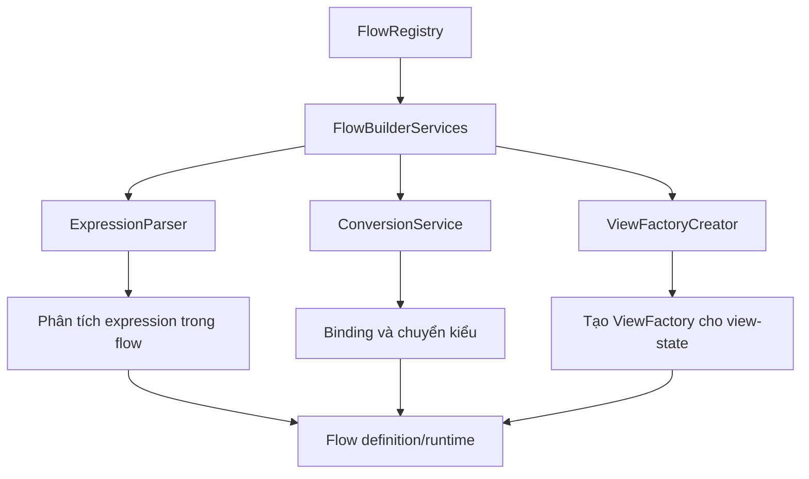
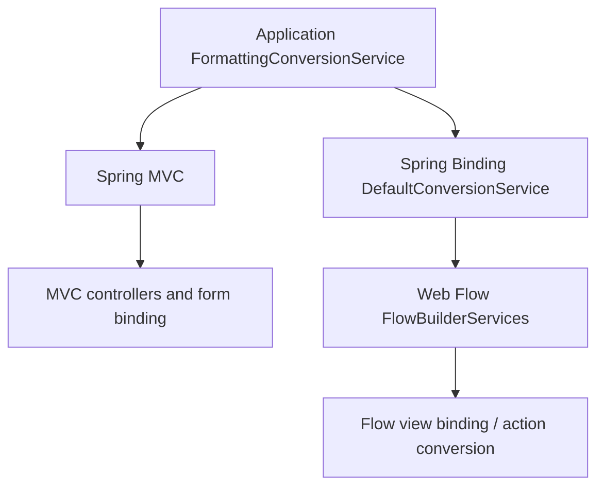

# Cấu hình ViewFactoryCreator, ExpressionParser và ConversionService

## 1. Ba dịch vụ định hình cách Web Flow được xây dựng và chạy

Spring Web Flow (SWF) mô hình hóa hành trình web nhiều bước bằng state, event, transition và subflow. Để một flow hoạt động trong ứng dụng thật, engine cần biết cách diễn giải biểu thức, chuyển đổi dữ liệu và tạo view phù hợp với công nghệ giao diện.

Trong chương Cấu hình hệ thống của module SPRING_WEB_FLOW, ba dịch vụ này kết nối mô hình state/event/transition/subflow với form binding, validation, tích hợp Spring MVC, kiểm thử và phục hồi hành trình.

Ba thành phần cấu hình quan trọng là:

- **`ViewFactoryCreator`:** tạo `ViewFactory` phù hợp để render view-state bằng Spring MVC hoặc JSF.
- **`ExpressionParser`:** phân tích chuỗi biểu thức trong flow definition thành đối tượng có thể đánh giá.
- **`ConversionService`:** chuyển giá trị từ kiểu này sang kiểu khác, đặc biệt khi bind request parameters vào model, gọi action và định dạng dữ liệu trong view.

Các dịch vụ này được gom vào **`FlowBuilderServices`**. Flow registry dùng bộ builder services đó để xây dựng flow definitions. Khi cấu hình, cần gắn đúng bộ dịch vụ vào đúng registry mà ứng dụng đang sử dụng.

Một flow có thể chứa biểu thức gọi service, một view-state bind ngày tháng từ form và một view JSP. Ba thành phần phối hợp như sau:



Nếu chỉ thay một service, không cần tự xây lại toàn bộ Web Flow. Hãy tùy chỉnh đúng service đang có yêu cầu riêng và giữ các mặc định phù hợp của môi trường.

## 2. FlowBuilderServices và vị trí cấu hình

`FlowBuilderServices` là đối tượng chứa những dịch vụ mà flow builder cần trong lúc xây dựng flow. Theo API Web Flow 2.5.1, nó cung cấp các getter cho `ConversionService`, `ExpressionParser`, `ViewFactoryCreator`, `Validator` và `ValidationHintResolver`.

Flow registry nhận bộ dịch vụ qua thuộc tính `flow-builder-services` trong XML hoặc qua builder trong Java configuration.

```text
ApplicationContext
  ├─ ConversionService
  ├─ ExpressionParser
  ├─ ViewFactoryCreator
  ├─ FlowBuilderServices
  │    ├─ FlowRegistry
  │    └─ Flow definitions
  └─ FlowExecutor
```

Khi không khai báo `flow-builder-services`, Web Flow dùng các service mặc định của môi trường. Khi khai báo phần tử này, chỉ cần tham chiếu các service muốn tùy chỉnh; những thuộc tính không nêu vẫn dùng implementation mặc định.

Điều đó cho phép cấu hình từng phần. Ví dụ, ứng dụng chỉ cần một converter riêng cho mã tiền tệ có thể thay `ConversionService` mà không phải tự viết `ExpressionParser` hay `ViewFactoryCreator`.

## 3. ViewFactoryCreator chịu trách nhiệm gì?

`ViewFactoryCreator` là SPI (Service Provider Interface) tạo `ViewFactory`. Flow builder không cần biết chi tiết cách một công nghệ giao diện cụ thể render view; nó yêu cầu creator tạo factory từ view ID, expression parser, conversion service, binder configuration, validator và validation hint resolver.

Các implementation phổ biến:

| Implementation | Môi trường | Vai trò |
|---|---|---|
| `MvcViewFactoryCreator` | Spring MVC | Tạo view factory cho JSP, Velocity, FreeMarker và các Spring MVC `ViewResolver` |
| `JsfViewFactoryCreator` | Spring Faces / JSF | Tạo view factory dành cho JSF |

`ViewFactoryCreator` không phải `ViewResolver`. Creator tạo factory cho view-state; `ViewResolver` là thành phần Spring MVC tìm đối tượng `View` từ một view name. `MvcViewFactoryCreator` có thể dùng một chuỗi view resolver có sẵn của ứng dụng hoặc cơ chế phân giải tài nguyên tương đối với thư mục flow.

### 3.1. Cách phân giải view theo convention

Với MVC creator, nếu view-state không khai báo thuộc tính `view`, Web Flow có thể suy ra view ID theo convention từ state ID. Mặc định suffix là `.jsp`.

Ví dụ flow:

```xml
<view-state id="enterDetails" />
<view-state id="review" />
```

Nếu dùng cơ chế tài nguyên tương đối của flow, các view có thể được tổ chức cạnh flow definition:

```text
/WEB-INF/flows/booking/
  booking.xml
  enterDetails.jsp
  review.jsp
```

Có thể chỉ rõ view ID nếu tên file hoặc view resolver của ứng dụng yêu cầu:

```xml
<view-state id="review"
            view="booking/review" />
```

View ID là đầu vào để creator tạo factory; việc tìm file template cuối cùng còn phụ thuộc resolver và cấu hình MVC.

### 3.2. Các tùy chọn thường dùng của MvcViewFactoryCreator

`MvcViewFactoryCreator` cung cấp một số thuộc tính cấu hình đáng chú ý:

| Thuộc tính | Mặc định / ý nghĩa |
|---|---|
| `defaultViewSuffix` | `.jsp`; suffix áp dụng cho tài nguyên view theo convention |
| `viewResolvers` | Chuỗi Spring MVC `ViewResolver` được gọi theo thứ tự |
| `eventIdParameterName` | `_eventId`; tên request parameter dùng để nhận event từ view |
| `fieldMarkerPrefix` | `_`; prefix đánh dấu field có thể rỗng, hữu ích cho checkbox |
| `messageCodesResolver` | Mặc định `WebFlowMessageCodesResolver`; có thể dùng resolver khác để đồng bộ mã lỗi |
| `useSpringBeanBinding` | `false`; bật binding bằng Spring `BeanWrapper` khi cần tương thích với cách binding Spring MVC 2.x |

Không cần thay các giá trị mặc định nếu chúng đã phù hợp với form và view resolver của ứng dụng. Ví dụ, chỉ đổi `eventIdParameterName` khi các view hoặc hạ tầng tích hợp của ứng dụng dùng tên parameter khác `_eventId`.

### 3.3. Cấu hình MVC creator bằng XML

Ví dụ dùng JSP và một `InternalResourceViewResolver`:

```xml
<bean id="viewResolver"
      class="org.springframework.web.servlet.view.InternalResourceViewResolver">
    <property name="prefix" value="/WEB-INF/views/" />
    <property name="suffix" value=".jsp" />
</bean>

<bean id="mvcViewFactoryCreator"
      class="org.springframework.webflow.mvc.builder.MvcViewFactoryCreator">
    <property name="viewResolvers">
        <list>
            <ref bean="viewResolver" />
        </list>
    </property>
    <property name="defaultViewSuffix" value=".jsp" />
    <property name="eventIdParameterName" value="_eventId" />
</bean>
```

`viewResolvers` được xử lý theo thứ tự trong danh sách. Nếu ứng dụng có nhiều resolver, hãy đặt resolver cụ thể trước resolver tổng quát và xác minh view ID không bị resolver khác bắt nhầm.

### 3.4. Khi ứng dụng dùng JSF

Với JSF, dùng creator dành cho Spring Faces thay vì cấu hình MVC creator. Ví dụ API là `org.springframework.faces.webflow.JsfViewFactoryCreator`. Parser SpEL trong môi trường JSF có thể dùng `FacesSpringELExpressionParser` để bổ sung property accessor dành riêng cho JSF.

Không ghép `JsfViewFactoryCreator` vào ứng dụng chỉ có JSP, hoặc `MvcViewFactoryCreator` vào flow được thiết kế để render JSF. Hãy để view factory, expression parser và view lifecycle cùng thuộc một stack tích hợp.

## 4. ExpressionParser làm gì trong flow definition?

`ExpressionParser` thuộc abstraction của Spring Binding. Nó nhận chuỗi biểu thức và `ParserContext`, sau đó trả về `Expression` có thể đánh giá trong context runtime.

Ví dụ trong flow definition:

```xml
<action-state id="loadBooking">
    <evaluate expression="bookingService.find(orderId)"
              result="flowScope.booking" />
    <transition on="success" to="review" />
</action-state>
```

Ở đây parser phân tích biểu thức `bookingService.find(orderId)`. Khi flow chạy, expression được đánh giá trong ngữ cảnh Web Flow, nơi các biến như `orderId`, `flowScope` và bean `bookingService` có thể được truy cập theo cấu hình.

Parser **không quyết định transition nào được chọn**. Nó chỉ phân tích và đánh giá biểu thức ở điểm mà flow engine yêu cầu. Việc nhận event, tìm transition, vào state và gọi action vẫn do engine điều phối.

### 4.1. Parser mặc định và tính nhất quán giữa môi trường

Tài liệu Web Flow 2.5.1 mô tả parser mặc định sử dụng Unified EL nếu implementation có trên classpath; nếu không, nó sử dụng Spring EL (SpEL). Vì vậy, dependency trong container hoặc dependency bắc cầu có thể khiến hai môi trường chọn parser khác nhau.

Ví dụ:

- Máy phát triển không có Unified EL implementation nên dùng SpEL.
- Máy chủ production có JBoss EL hoặc implementation Unified EL khác nên parser mặc định thay đổi.
- Cùng một flow XML có thể được diễn giải khác nhau dù file không đổi.

Nếu cần hành vi ổn định, hãy khai báo `ExpressionParser` tường minh.

### 4.2. Cấu hình SpEL dành cho Web Flow

Dùng `WebFlowSpringELExpressionParser` thay vì chỉ tạo một `SpelExpressionParser` thuần. Web Flow parser kế thừa adapter SpEL và đăng ký property accessor dành riêng cho Web Flow.

```java
import org.springframework.binding.expression.ExpressionParser;
import org.springframework.expression.spel.standard.SpelExpressionParser;
import org.springframework.webflow.expression.spel.WebFlowSpringELExpressionParser;

@Bean
public ExpressionParser expressionParser() {
    return new WebFlowSpringELExpressionParser(
            new SpelExpressionParser()
    );
}
```

Parser này cho phép biểu thức truy cập các biến và thuộc tính Web Flow theo cơ chế mà framework cung cấp. Một parser SpEL thuần không tự biết cách phân giải `flowScope`, `currentEvent` hay các biến đặc biệt khác của Web Flow.

Nếu ứng dụng vẫn cần Unified EL vì lý do tương thích, có thể cấu hình `WebFlowELExpressionParser` với một Unified EL `ExpressionFactory` phù hợp. Hãy khóa implementation và version rõ ràng, không phụ thuộc việc thư viện tình cờ xuất hiện trên classpath.

## 5. ConversionService dùng ở những đâu?

`ConversionService` chuyển dữ liệu từ một kiểu nguồn sang kiểu đích. Trong Web Flow, chuyển đổi xuất hiện ở nhiều điểm:

1. **Request parameter → model property:** form gửi chuỗi `"2026-12-01"`, model cần `LocalDate` hoặc kiểu ngày tương ứng.
2. **Action argument:** giá trị flow hoặc request được chuyển sang kiểu tham số method mà action/service yêu cầu.
3. **Flow input/output mapping:** giá trị truyền vào flow hoặc trả từ subflow có thể cần chuyển kiểu.
4. **Binding và hiển thị:** dữ liệu model được định dạng để view hiển thị, và chuỗi người dùng nhập được parse về kiểu domain.
5. **Alias kiểu:** Web Flow có thể nhận các alias như `long` trong khai báo input.

Các kiểu phổ biến như số, primitive, enum và ngày có hỗ trợ mặc định ở mức phù hợp với version và cấu hình. Kiểu domain riêng như `Money`, `OrderNumber`, mã vùng hoặc khoảng ngày thường cần converter/formatter do ứng dụng đăng ký.

### 5.1. Converter và Formatter khác nhau

| Thành phần | Mục đích | Ví dụ |
|---|---|---|
| `Converter<S,T>` | Chuyển object nguồn sang object đích | `String → OrderNumber` |
| `Formatter<T>` | Parse chuỗi thành object và in object thành chuỗi theo locale | `Money ↔ "1.250.000 ₫"` |

Trong ứng dụng web, `Formatter` thường phù hợp với field cần biểu diễn theo locale. Một converter có thể dùng cho chuyển đổi object-to-object không gắn với giao diện; formatter tập trung vào hai chiều String/object.

### 5.2. Ví dụ Formatter cho Money

Ví dụ domain tối giản:

```java
import java.math.BigDecimal;

public final class Money {
    private final BigDecimal amount;

    public Money(BigDecimal amount) {
        this.amount = amount;
    }

    public BigDecimal getAmount() {
        return amount;
    }
}
```

Formatter dùng locale để parse và in số tiền:

```java
import java.math.BigDecimal;
import java.text.DecimalFormat;
import java.text.NumberFormat;
import java.text.ParseException;
import java.util.Locale;
import org.springframework.format.Formatter;

public final class MoneyFormatter implements Formatter<Money> {

    @Override
    public Money parse(String text, Locale locale) throws ParseException {
        NumberFormat format = NumberFormat.getNumberInstance(locale);
        if (format instanceof DecimalFormat) {
            ((DecimalFormat) format).setParseBigDecimal(true);
        }
        Number parsed = format.parse(text.trim());
        BigDecimal amount = parsed instanceof BigDecimal
                ? (BigDecimal) parsed
                : new BigDecimal(parsed.toString());
        return new Money(amount);
    }

    @Override
    public String print(Money money, Locale locale) {
        NumberFormat format = NumberFormat.getNumberInstance(locale);
        return format.format(money.getAmount());
    }
}
```

Đây là ví dụ tối giản để minh họa locale-aware formatting. Ứng dụng tài chính thực tế cần quy định rõ currency, scale, rounding mode, ký hiệu tiền tệ và cách xử lý input có currency khác nhau; không nên dùng một formatter số tổng quát để quyết định các quy tắc kế toán.

## 6. Kết hợp ConversionService của Spring MVC và Web Flow

Từ Web Flow 2.1, phần lớn nhu cầu chuyển đổi sử dụng hệ thống type conversion và formatting của Spring. Lợi ích là ứng dụng có thể chia sẻ cùng formatter giữa Spring MVC và Web Flow, thay vì duy trì hai bộ quy tắc khác nhau.

Tuy nhiên, **ConversionService mặc định của Spring MVC và Web Flow không tự động là cùng một instance**. Nếu ứng dụng đăng ký formatter riêng, cần kết nối rõ ràng để hai môi trường dùng chung logic.

Mô hình:



### 6.1. Tạo FormattingConversionService dùng chung

Có thể tạo một `DefaultFormattingConversionService`, đăng ký formatter của ứng dụng và dùng nó cho MVC:

```java
import org.springframework.format.support.DefaultFormattingConversionService;
import org.springframework.format.support.FormattingConversionService;
import org.springframework.format.datetime.standard.DateTimeFormatterRegistrar;
import java.time.format.DateTimeFormatter;

@Bean
public FormattingConversionService applicationConversionService() {
    DefaultFormattingConversionService service =
            new DefaultFormattingConversionService();

    service.addFormatter(new MoneyFormatter());
    DateTimeFormatterRegistrar dates = new DateTimeFormatterRegistrar();
    dates.setDateFormatter(DateTimeFormatter.ofPattern("dd/MM/yyyy"));
    dates.registerFormatters(service);
    return service;
}
```

Trong XML, `<mvc:annotation-driven>` có thể tham chiếu service này qua thuộc tính `conversion-service`:

```xml
<mvc:annotation-driven
        conversion-service="applicationConversionService" />
```

### 6.2. Bọc service dùng chung cho Web Flow

`FlowBuilderServices` dùng abstraction `org.springframework.binding.convert.ConversionService`. Để dùng Spring core `ConversionService` chung, Web Flow cung cấp `org.springframework.binding.convert.service.DefaultConversionService` làm adapter:

```java
import org.springframework.binding.convert.ConversionService;
import org.springframework.binding.convert.service.DefaultConversionService;

@Bean
public ConversionService flowConversionService() {
    return new DefaultConversionService(
            applicationConversionService()
    );
}
```

Wrapper này cho phép Web Flow dùng delegate Spring conversion service. Cấu hình tương ứng trong XML:

```xml
<bean id="applicationConversionService"
      class="org.springframework.format.support.DefaultFormattingConversionService" />

<bean id="flowConversionService"
      class="org.springframework.binding.convert.service.DefaultConversionService">
    <constructor-arg ref="applicationConversionService" />
</bean>

<mvc:annotation-driven
        conversion-service="applicationConversionService" />
```

Ví dụ XML trên minh họa service mặc định. Nếu cần custom formatter trong XML, hãy đăng ký chúng vào `FormattingConversionServiceFactoryBean` hoặc một factory bean tương ứng; không giả định chỉ khai báo bean formatter là Spring tự động đăng ký formatter vào conversion service.

### 6.3. Lưu ý khi nâng cấp converter cũ

Các ứng dụng cũ có thể dùng `org.springframework.binding.convert.converters.Converter` và `DefaultConversionService` của Spring Binding. Từ Web Flow 2.1, các converter này có thể được adapter vào Spring type conversion trong các trường hợp tương thích.

Một ngoại lệ là **named converter** được khai báo trực tiếp trong `<binding converter="...">`. Cơ chế named converter cũ không tham gia Spring 3 type conversion như converter/formatter thông thường và đã bị deprecated. Với code mới, ưu tiên `Converter`, `GenericConverter` hoặc `Formatter` của Spring.

## 7. Cấu hình cả ba dịch vụ bằng XML

Ví dụ dưới đây kết hợp:

- `MvcViewFactoryCreator` để render JSP và dùng Spring MVC view resolver.
- `WebFlowSpringELExpressionParser` để dùng SpEL có property accessor Web Flow.
- `DefaultConversionService` làm adapter cho formatter/converter chung của ứng dụng.

```xml
<?xml version="1.0" encoding="UTF-8"?>
<beans xmlns="http://www.springframework.org/schema/beans"
       xmlns:xsi="http://www.w3.org/2001/XMLSchema-instance"
       xmlns:mvc="http://www.springframework.org/schema/mvc"
       xmlns:webflow="http://www.springframework.org/schema/webflow-config"
       xsi:schemaLocation="
           http://www.springframework.org/schema/beans
           http://www.springframework.org/schema/beans/spring-beans.xsd
           http://www.springframework.org/schema/mvc
           http://www.springframework.org/schema/mvc/spring-mvc.xsd
           http://www.springframework.org/schema/webflow-config
           http://www.springframework.org/schema/webflow-config/spring-webflow-config.xsd">

    <mvc:annotation-driven
            conversion-service="applicationConversionService" />

    <bean id="applicationConversionService"
          class="org.springframework.format.support.DefaultFormattingConversionService" />

    <bean id="flowConversionService"
          class="org.springframework.binding.convert.service.DefaultConversionService">
        <constructor-arg ref="applicationConversionService" />
    </bean>

    <bean id="expressionParser"
          class="org.springframework.webflow.expression.spel.WebFlowSpringELExpressionParser">
        <constructor-arg>
            <bean class="org.springframework.expression.spel.standard.SpelExpressionParser" />
        </constructor-arg>
    </bean>

    <bean id="viewResolver"
          class="org.springframework.web.servlet.view.InternalResourceViewResolver">
        <property name="prefix" value="/WEB-INF/views/" />
        <property name="suffix" value=".jsp" />
    </bean>

    <bean id="viewFactoryCreator"
          class="org.springframework.webflow.mvc.builder.MvcViewFactoryCreator">
        <property name="viewResolvers">
            <list>
                <ref bean="viewResolver" />
            </list>
        </property>
        <property name="defaultViewSuffix" value=".jsp" />
    </bean>

    <webflow:flow-builder-services
            id="flowBuilderServices"
            conversion-service="flowConversionService"
            expression-parser="expressionParser"
            view-factory-creator="viewFactoryCreator" />

    <webflow:flow-registry
            id="flowRegistry"
            flow-builder-services="flowBuilderServices">
        <webflow:flow-location
                path="/WEB-INF/flows/booking/booking.xml" />
    </webflow:flow-registry>

    <webflow:flow-executor
            id="flowExecutor"
            flow-registry="flowRegistry" />
</beans>
```

Đây là cấu hình minh họa cho ứng dụng MVC dùng JSP. Trong ứng dụng thực tế, các namespace/schema URL, view resolver, component scan, controller và handler mapping phải khớp version Spring đang dùng. Nếu không cần custom cả ba dịch vụ, hãy bỏ các thuộc tính tương ứng và dùng mặc định của Web Flow.

## 8. Cấu hình cả ba dịch vụ bằng Java

Với Java configuration, kế thừa `AbstractFlowConfiguration` để dùng các builder của Web Flow:

```java
import org.springframework.context.annotation.Bean;
import org.springframework.context.annotation.Configuration;
import org.springframework.binding.convert.ConversionService;
import org.springframework.binding.convert.service.DefaultConversionService;
import org.springframework.binding.expression.ExpressionParser;
import org.springframework.format.support.DefaultFormattingConversionService;
import org.springframework.format.support.FormattingConversionService;
import org.springframework.expression.spel.standard.SpelExpressionParser;
import org.springframework.format.datetime.standard.DateTimeFormatterRegistrar;
import java.time.format.DateTimeFormatter;
import org.springframework.webflow.config.AbstractFlowConfiguration;
import org.springframework.webflow.engine.builder.support.FlowBuilderServices;
import org.springframework.webflow.engine.builder.ViewFactoryCreator;
import org.springframework.webflow.expression.spel.WebFlowSpringELExpressionParser;
import org.springframework.webflow.mvc.builder.MvcViewFactoryCreator;
import org.springframework.webflow.definition.registry.FlowDefinitionRegistry;
import org.springframework.webflow.executor.FlowExecutor;

@Configuration
public class WebFlowConfig extends AbstractFlowConfiguration {

    @Bean
    public FormattingConversionService applicationConversionService() {
        DefaultFormattingConversionService service =
                new DefaultFormattingConversionService();
        service.addFormatter(new MoneyFormatter());
        DateTimeFormatterRegistrar dates = new DateTimeFormatterRegistrar();
        dates.setDateFormatter(DateTimeFormatter.ofPattern("dd/MM/yyyy"));
        dates.registerFormatters(service);
        return service;
    }

    @Bean
    public ConversionService flowConversionService() {
        return new DefaultConversionService(
                applicationConversionService()
        );
    }

    @Bean
    public ExpressionParser expressionParser() {
        return new WebFlowSpringELExpressionParser(
                new SpelExpressionParser()
        );
    }

    @Bean
    public ViewFactoryCreator viewFactoryCreator() {
        MvcViewFactoryCreator creator = new MvcViewFactoryCreator();
        creator.setDefaultViewSuffix(".jsp");
        return creator;
    }

    @Bean
    public FlowBuilderServices flowBuilderServices() {
        return getFlowBuilderServicesBuilder()
                .setConversionService(flowConversionService())
                .setExpressionParser(expressionParser())
                .setViewFactoryCreator(viewFactoryCreator())
                .build();
    }

    @Bean
    public FlowDefinitionRegistry flowRegistry() {
        return getFlowDefinitionRegistryBuilder(flowBuilderServices())
                .addFlowLocation("/WEB-INF/flows/booking/booking.xml")
                .build();
    }

    @Bean
    public FlowExecutor flowExecutor() {
        return getFlowExecutorBuilder(flowRegistry()).build();
    }
}
```

Đoạn code trên minh họa cách nối ba dịch vụ với một registry. Trong Java configuration, `WebMvcConfigurer#addFormatters` có thể đăng ký cùng các formatter vào conversion registry của MVC. Nếu muốn MVC dùng đúng bean `applicationConversionService` đã tạo ở trên, hãy cấu hình MVC để tham chiếu bean đó (tương đương thuộc tính `conversion-service` trong XML). Chỉ triển khai `addFormatters` không tự động khiến MVC dùng cùng instance bean này.

Lưu ý import theo Web Flow 2.5.x: `FlowBuilderServices` nằm trong package `org.springframework.webflow.engine.builder.support`; `FlowDefinitionRegistry` nằm trong package `org.springframework.webflow.definition.registry`; `FlowExecutor` nằm trong package `org.springframework.webflow.executor`. Khi đưa ví dụ vào dự án, dùng đúng package API của version đang khai báo.

## 9. Khi nào nên thay từng dịch vụ?

| Triệu chứng / yêu cầu | Dịch vụ nên xem xét | Hướng xử lý |
|---|---|---|
| Flow đang dùng JSP nhưng cần JSF | `ViewFactoryCreator` | Chuyển sang creator dành cho JSF và cấu hình Spring Faces |
| View ID không resolve được | `ViewFactoryCreator` | Kiểm tra convention, suffix, view resolver và view path |
| Form nhận ngày tháng nhưng parse lỗi | `ConversionService` | Đăng ký formatter ngày theo locale và dùng chung cho MVC/Web Flow |
| Action nhận sai kiểu tham số | `ConversionService` | Kiểm tra source/target type, converter và overload |
| Biểu thức chạy khác giữa dev và production | `ExpressionParser` | Cấu hình parser rõ ràng và đồng nhất dependency |
| Không truy cập được `flowScope` trong SpEL | `ExpressionParser` | Dùng `WebFlowSpringELExpressionParser`, không dùng parser SpEL thuần |
| Mã lỗi binding khác Spring MVC | `ViewFactoryCreator` | Kiểm tra `MessageCodesResolver` của MVC creator |
| Checkbox bỏ chọn nhưng model vẫn true | `ViewFactoryCreator` | Kiểm tra field-marker prefix và markup có gửi marker hay không |

Không thay cả ba dịch vụ chỉ để xử lý một lỗi converter. Hãy xác định lỗi xảy ra ở giai đoạn nào: tìm view, parse expression hay chuyển đổi giá trị.

## 10. Ví dụ end-to-end: nhập ngày và số tiền trong booking flow

Giả sử flow booking có model:

```java
public class BookingForm {
    private LocalDate checkinDate;
    private Money deposit;

    public LocalDate getCheckinDate() {
        return checkinDate;
    }

    public void setCheckinDate(LocalDate checkinDate) {
        this.checkinDate = checkinDate;
    }

    public Money getDeposit() {
        return deposit;
    }

    public void setDeposit(Money deposit) {
        this.deposit = deposit;
    }
}
```

Flow XML:

```xml
<flow xmlns="http://www.springframework.org/schema/webflow"
      xmlns:xsi="http://www.w3.org/2001/XMLSchema-instance"
      xsi:schemaLocation="
          http://www.springframework.org/schema/webflow
          http://www.springframework.org/schema/webflow/spring-webflow.xsd"
      start-state="enterDetails">

    <var name="booking" class="com.example.booking.BookingForm" />

    <view-state id="enterDetails" model="booking">
        <binder>
            <binding property="checkinDate" required="true" />
            <binding property="deposit" required="true" />
        </binder>
        <transition on="next" to="review" />
    </view-state>

    <view-state id="review">
        <transition on="back" to="enterDetails" />
        <transition on="confirm" to="completed" />
    </view-state>

    <end-state id="completed" />
</flow>
```

Khi view gửi các giá trị chuỗi:

```text
checkinDate = "01/12/2026"
deposit = "1.250.000"
_eventId = "next"
```

- `MvcViewFactoryCreator` tạo MVC view factory để render form và nhận event parameter.
- `ExpressionParser` đánh giá biểu thức trong flow, ví dụ expression của action hoặc view ID nếu có.
- `ConversionService` parse chuỗi ngày và số tiền thành `LocalDate` và `Money` theo formatter đã đăng ký.
- Binder chỉ bind các property được cho phép trong `<binder>` nếu cấu hình view-state giới hạn field như ví dụ.

Flow chuyển sang `review` sau khi binding thành công. Nếu parse lỗi, Web Flow giữ lỗi binding và render lại view để người dùng sửa. Một lần chuyển state thành công không thay thế validation nghiệp vụ; trước khi xác nhận booking, service vẫn phải kiểm tra ngày hợp lệ, giá trị tiền và quyền thực hiện.

Lưu ý ví dụ ngày `01/12/2026` phụ thuộc locale và pattern của formatter. Nếu người dùng ở locale khác, cùng chuỗi có thể được hiểu theo cách khác. Hãy chọn format giao diện rõ ràng, ví dụ `dd/MM/yyyy` hoặc ISO `yyyy-MM-dd`, rồi kiểm thử theo locale được hỗ trợ.

## 11. Những lỗi thường gặp khi cấu hình

**Lỗi 1 — Flow registry không dùng builder services đã khai báo.** Bean `flowBuilderServices` tồn tại nhưng `flow-registry` không tham chiếu nó. Hãy kiểm tra thuộc tính `flow-builder-services` hoặc Java builder có nhận đúng object.

**Lỗi 2 — SpEL không truy cập được biến Web Flow.** Ứng dụng cấu hình `SpelExpressionParser` thuần. Dùng `WebFlowSpringELExpressionParser` để có property accessor đặc thù.

**Lỗi 3 — Parser thay đổi giữa các môi trường.** Unified EL implementation chỉ có ở một môi trường. Khai báo parser rõ ràng và khóa dependency.

**Lỗi 4 — View-state báo không tìm thấy view.** Kiểm tra `defaultViewSuffix`, view ID, `viewResolvers`, prefix/suffix và vị trí tài nguyên tương đối flow.

**Lỗi 5 — Form binding chuyển kiểu thất bại.** Kiểm tra converter/formatter đã được đăng ký vào đúng ConversionService mà flow registry sử dụng; việc đăng ký vào MVC riêng không tự động bảo đảm Web Flow dùng cùng instance.

**Lỗi 6 — Ngày tháng hiển thị đúng nhưng submit lỗi.** `Printer` và `Parser` trong Formatter phải thống nhất; kiểm thử cả chiều object-to-string và string-to-object.

**Lỗi 7 — Named converter cũ không hoạt động như mong đợi.** Cơ chế `converter="customConverter"` trong binder là tương thích legacy và đã deprecated; ưu tiên Spring Formatter/Converter.

**Lỗi 8 — Checkbox không được reset khi bỏ chọn.** Kiểm tra field-marker parameter và `fieldMarkerPrefix` mặc định `_`; nếu custom prefix, view phải gửi marker tương ứng.

**Lỗi 9 — Mã lỗi binding khác MVC.** `MvcViewFactoryCreator` mặc định dùng `WebFlowMessageCodesResolver`. Nếu cần nhất quán với controller, cấu hình `DefaultMessageCodesResolver` hoặc resolver phù hợp.

**Lỗi 10 — Dùng JSF creator trong ứng dụng MVC.** Chọn ViewFactoryCreator theo công nghệ render thật sự và cấu hình parser/context đi kèm.

## 12. Kiểm thử ba dịch vụ

Kiểm thử nên bao phủ cả lúc flow được xây dựng và lúc execution chạy.

| Nhóm | Ca kiểm thử | Kết quả mong đợi |
|---|---|---|
| Registry | Khởi động context và nạp flow | Flow definition được xây bằng builder services đúng |
| ViewFactoryCreator | Render view-state | View resolver trả đúng view/template |
| View convention | Không khai báo thuộc tính `view` | View ID được suy ra theo state ID và suffix |
| Event parameter | Gửi form với `_eventId=next` | Flow nhận đúng event ID |
| ExpressionParser | Đánh giá expression có `flowScope` | Biến Web Flow được phân giải |
| ExpressionParser | Bean method trong `<evaluate>` | Đúng bean và kết quả |
| ConversionService | Parse số, enum và ngày | Kiểu đích chính xác |
| Custom Formatter | Parse và print `Money` | Hai chiều đúng theo locale |
| Shared conversion | Gửi cùng field qua MVC và Web Flow | Cùng quy tắc format/parse |
| Binding allowlist | View-state khai báo binder | Chỉ các property dự định được bind |
| Validation | Gửi dữ liệu sai định dạng | Lỗi binding được hiển thị và state không đi tiếp |
| Legacy converter | Binder còn named converter | Xác minh tương thích hoặc đã chuyển sang formatter |

Một test tích hợp nên khởi chạy `FlowExecutor`, gửi event qua `MockExternalContext` hoặc Web Flow test support và kiểm tra state/model sau binding. Test riêng `MoneyFormatter` không chứng minh registry đã dùng đúng conversion service.

## 13. Lộ trình cấu hình an toàn

Khi bổ sung hoặc thay đổi các dịch vụ này, thực hiện theo thứ tự:

1. **Xác định view technology:** Spring MVC/JSP, MVC với template engine, hay JSF.
2. **Kiểm tra FlowRegistry:** xác định registry nào nạp flow và đang dùng `FlowBuilderServices` nào.
3. **Chọn ViewFactoryCreator:** chỉ thay khi cần resolver hoặc view integration khác.
4. **Chọn ExpressionParser:** cấu hình tường minh nếu cần tính nhất quán giữa môi trường hoặc cú pháp đặc biệt.
5. **Chọn ConversionService:** đăng ký converter/formatter và quyết định có chia sẻ với MVC hay không.
6. **Nối vào builder services:** đảm bảo registry thực sự sử dụng các bean vừa cấu hình.
7. **Kiểm thử flow runtime:** render view, gửi event, bind dữ liệu, kiểm tra lỗi và xác nhận state tiếp theo.
8. **Theo dõi sau deploy:** log lỗi view resolution, expression evaluation và type conversion riêng biệt để chẩn đoán đúng lớp.

Không nên đổi parser, view resolver và formatter cùng một lần nếu không cần. Thay từng dịch vụ giúp xác định rõ thay đổi nào gây ra khác biệt hành vi.

## 14. Ghi nhớ

`FlowBuilderServices` là điểm tập trung ba dịch vụ khi xây dựng flow definitions. `ViewFactoryCreator` tạo view factory phù hợp với Spring MVC hoặc JSF; `ExpressionParser` phân tích và đánh giá biểu thức; `ConversionService` xử lý chuyển đổi và định dạng dữ liệu trong binding, action và flow mapping.

Cấu hình đúng cần đảm bảo FlowRegistry tham chiếu đúng builder services, parser có property accessor của Web Flow, creator phù hợp với view technology và conversion service có các formatter/converter mà model cần. Khi ứng dụng có cả Spring MVC và Web Flow, hãy kết nối rõ conversion service chung nếu muốn cùng cách parse/print dữ liệu.

### Tài liệu tham khảo

- [Spring Web Flow 2.5.1 — System Setup, Custom FlowBuilder Services](https://docs.spring.io/spring-webflow/docs/2.5.1.RELEASE/reference/html/system-setup.html) — cấu hình `FlowBuilderServices`, registry và ba dịch vụ.
- [Spring Web Flow 2.5.1 — ViewFactoryCreator API](https://docs.spring.io/spring-webflow/docs/2.5.x/api/org/springframework/webflow/engine/builder/ViewFactoryCreator.html) — SPI tạo `ViewFactory`.
- [Spring Web Flow 2.5.1 — MvcViewFactoryCreator API](https://docs.spring.io/spring-webflow/docs/2.5.1.RELEASE/api/org/springframework/webflow/mvc/builder/MvcViewFactoryCreator.html) — view resolver, suffix, event parameter, field marker và binding.
- [Spring Web Flow 2.5.1 — WebFlowSpringELExpressionParser API](https://docs.spring.io/spring-webflow/docs/2.5.1.RELEASE/api/org/springframework/webflow/expression/spel/WebFlowSpringELExpressionParser.html) — SpEL parser với property accessor Web Flow.
- [Spring Web Flow 2.5.1 — Performing Type Conversion](https://docs.spring.io/spring-webflow/docs/2.5.1.RELEASE/reference/htmlsingle/#_performing_type_conversion) — converter, formatter và tích hợp conversion service với Spring MVC.
- [Spring Web Flow 2.5.1 — ConversionService API](https://docs.spring.io/spring-webflow/docs/2.5.1.RELEASE/api/org/springframework/binding/convert/ConversionService.html) — hợp đồng chuyển đổi của Spring Binding.
