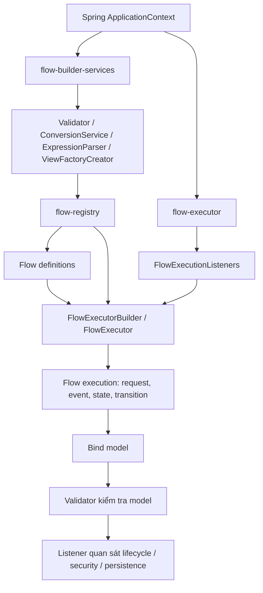

# Cấu hình validator và các listener cần thiết trong Spring Web Flow

Trong **Spring Web Flow** (`SPRING_WEB_FLOW`), một flow cần hai nhóm thành phần hỗ trợ để chạy ổn định trong ứng dụng thực tế:

- **Validator** kiểm tra model sau khi dữ liệu form được bind, trước khi flow đi tiếp qua transition.
- **Flow execution listener** quan sát hoặc tham gia vào các mốc trong vòng đời flow execution, chẳng hạn kiểm tra quyền, quản lý persistence context, khởi tạo FacesContext hoặc ghi nhận lịch sử.

Hai nhóm này được cấu hình ở hai nơi khác nhau. Validator gắn với **flow-builder-services** mà flow registry dùng khi dựng định nghĩa flow. Listener gắn với **flow-executor**, nơi tạo hoặc khôi phục một flow execution. Hiểu đúng ranh giới này giúp tránh tình trạng đã khai báo bean nhưng Web Flow không gọi nó.

Bài thuộc chương **Cấu hình hệ thống** hướng dẫn cấu hình validator theo Bean Validation và theo quy ước Web Flow, đăng ký listener trong XML và Java, chọn listener theo nhu cầu ứng dụng, và kiểm thử việc tích hợp. Ví dụ dùng Spring Web Flow 2.5.x; các API cấu hình tương ứng cũng có trong dòng 3.0.x. Hãy giữ phiên bản Spring Framework, Web Flow, Bean Validation provider và các thư viện tích hợp đồng bộ.

## 1. Phân biệt validator, flow-builder-services và flow execution listener

Một flow thường đi qua các bước: nhận request, bind dữ liệu vào model, kiểm tra dữ liệu, xử lý event, chuyển state và render view. Validator và listener can thiệp ở các thời điểm khác nhau.

| Thành phần | Được cấu hình ở đâu? | Trách nhiệm | Ví dụ |
| --- | --- | --- | --- |
| `FlowBuilderServices` | `flow-builder-services` | Cung cấp dịch vụ dùng khi dựng flow definition | Validator, conversion service, expression parser, view factory creator |
| `Validator` | Thuộc tính `validator` của flow-builder-services hoặc quy ước validator bean | Kiểm tra model sau binding | `LocalValidatorFactoryBean`, `BookingValidator` |
| `FlowExecutionListener` | `flow-execution-listeners` trong flow-executor | Quan sát hoặc tham gia vòng đời flow execution | Security, JPA, Hibernate, Faces, audit |
| `FlowRegistry` | `flow-registry` | Đăng ký và dựng các flow definition | Ánh xạ file XML thành flow ID |
| `FlowExecutor` | `flow-executor` | Khởi tạo, tiếp tục và kết thúc flow execution | Dùng registry cùng listener đã đăng ký |

Có thể hình dung mối quan hệ:



`flow-builder-services` là cấu hình **build-time** của flow definition. `flow-execution-listeners` là cấu hình **runtime** cho các lần thực thi flow. Một validator bean không tự trở thành listener; một listener cũng không thay thế validation của model.

## 2. Cấu hình flow-builder-services cho flow registry

Khi không khai báo `flow-builder-services`, Web Flow dùng các implementation mặc định. Khi muốn cấu hình validator, conversion service hoặc view factory riêng, hãy tạo builder services và gắn nó vào registry.

Ví dụ XML tối thiểu:

```xml
<webflow:flow-registry id="flowRegistry"
                       flow-builder-services="flowBuilderServices">
    <webflow:flow-location
            path="/WEB-INF/flows/booking/booking.xml" />
</webflow:flow-registry>

<webflow:flow-builder-services id="flowBuilderServices" />
```

Trong ví dụ này, registry dùng bộ dịch vụ có ID `flowBuilderServices` để dựng flow. Nếu bỏ thuộc tính `flow-builder-services`, registry dùng dịch vụ mặc định của framework.

Các dịch vụ có thể cấu hình trong flow-builder-services gồm:

- `validator`: validator của Spring dùng để kiểm tra model sau binding.
- `validation-hint-resolver`: chuyển validation hints trong flow thành các validation groups.
- `conversion-service`: chuyển đổi giá trị giữa các kiểu dữ liệu.
- `expression-parser`: phân tích các biểu thức EL trong flow.
- `view-factory-creator`: tạo view factory phù hợp với công nghệ render.

Chỉ cấu hình những thành phần ứng dụng thật sự cần thay đổi. Với JSP/Spring MVC thông thường, view factory mặc định có thể đã phù hợp; với JSF, hãy dùng cấu hình Spring Faces tương ứng thay vì tự thay view factory theo ví dụ MVC.

## 3. Đăng ký Bean Validation bằng LocalValidatorFactoryBean

Spring Web Flow hỗ trợ Bean Validation (JSR-303/JSR-380 tùy phiên bản provider) thông qua validator của Spring Framework. Cách phổ biến là khai báo `LocalValidatorFactoryBean` rồi tham chiếu bean đó trong thuộc tính `validator`.

Cấu hình XML:

```xml
<webflow:flow-registry id="flowRegistry"
                       flow-builder-services="flowBuilderServices">
    <webflow:flow-location
            path="/WEB-INF/flows/booking/booking.xml" />
</webflow:flow-registry>

<webflow:flow-builder-services id="flowBuilderServices"
                               validator="flowValidator" />

<bean id="flowValidator"
      class="org.springframework.validation.beanvalidation.LocalValidatorFactoryBean" />
```

Khi được cấu hình, validator này được áp dụng cho các model của view-state sau khi Web Flow thực hiện data binding. Model có thể dùng annotation:

```java
import jakarta.validation.constraints.Email;
import jakarta.validation.constraints.NotBlank;
import jakarta.validation.constraints.Positive;

public class BookingForm {

    @NotBlank
    private String guestName;

    @NotBlank
    @Email
    private String email;

    @Positive
    private Integer guestCount;

    // Getter và setter
}
```

Ví dụ trên minh họa namespace Jakarta Validation. Với tổ hợp Spring Web Flow 2.5.x/Spring Framework 5 và provider thế hệ cũ, import annotation thường thuộc `javax.validation.constraints`. Với tổ hợp Spring Web Flow 3.0.x/Spring Framework 6, dùng API Jakarta tương ứng. Không trộn hai namespace trong cùng một ứng dụng.

Để annotation được thực thi, ứng dụng phải có Bean Validation API và implementation provider tương thích trên classpath. Nếu thiếu provider hoặc phiên bản không tương thích, validator có thể không khởi tạo được khi application context khởi động.

## 4. Validation groups cho từng bước của flow

Một form nhiều bước thường không cần kiểm tra mọi trường ở mọi màn hình. Ví dụ:

- Bước thông tin khách kiểm tra tên và email.
- Bước địa chỉ kiểm tra tỉnh/thành phố và mã bưu chính.
- Bước xác nhận kiểm tra toàn bộ điều kiện cần thiết trước khi tạo booking.

Bean Validation groups cho phép chọn tập constraint cần áp dụng ở mỗi view-state hoặc transition.

Khai báo group trong Java:

```java
import jakarta.validation.constraints.Email;
import jakarta.validation.constraints.NotBlank;

public class BookingForm {

    // BeanValidationHintResolver có thể phân giải các group lồng trong model.
    public interface GuestDetailsChecks {
    }

    public interface AddressChecks {
    }

    @NotBlank(groups = GuestDetailsChecks.class)
    private String guestName;

    @Email(groups = GuestDetailsChecks.class)
    private String email;

    @NotBlank(groups = AddressChecks.class)
    private String city;

    @NotBlank(groups = AddressChecks.class)
    private String postalCode;

    // Getter và setter
}
```

Cấu hình hints trong flow:

```xml
<view-state id="enterGuestDetails"
            model="booking"
            validation-hints="'GuestDetailsChecks'">
    <transition on="continue" to="enterAddress" />
</view-state>

<view-state id="enterAddress"
            model="booking"
            validation-hints="'AddressChecks'">
    <transition on="continue" to="reviewBooking" />
</view-state>
```

`validation-hints` là expression. Trong ví dụ, chuỗi group được đặt trong dấu nháy bên trong expression. `BeanValidationHintResolver` mặc định cố gắng phân giải tên group thành class validation tương ứng; có thể dùng tên class đầy đủ nếu cần. Khi dự án có quy ước group riêng, có thể cung cấp implementation `ValidationHintResolver` tùy chỉnh qua flow-builder-services.

Đừng dùng validation group như một cơ chế phân quyền. Group chỉ chọn tập constraint cần chạy; quyền sửa hoặc xác nhận dữ liệu vẫn phải được kiểm tra ở tầng security/service.

## 5. Validator theo quy ước trên model

Ngoài Bean Validation, Web Flow có thể tự gọi method validation theo quy ước tên dựa trên ID của view-state.

Nếu view-state có ID `enterBookingDetails`, model có thể khai báo method:

```java
import org.springframework.binding.message.MessageBuilder;
import org.springframework.binding.validation.ValidationContext;

public class BookingForm {

    private String guestName;
    private String email;

    public void validateEnterBookingDetails(
            ValidationContext context) {

        if (guestName == null || guestName.trim().isEmpty()) {
            context.getMessageContext().addMessage(
                    new MessageBuilder()
                            .error()
                            .source("guestName")
                            .defaultText("Vui lòng nhập tên khách.")
                            .build());
        }

        if (email == null || !email.contains("@")) {
            context.getMessageContext().addMessage(
                    new MessageBuilder()
                            .error()
                            .source("email")
                            .defaultText("Vui lòng nhập email hợp lệ.")
                            .build());
        }
    }

    // Getter và setter
}
```

Flow:

```xml
<var name="booking"
     class="com.example.booking.BookingForm" />

<view-state id="enterBookingDetails"
            view="booking/details"
            model="booking">
    <transition on="continue" to="reviewBooking" />
</view-state>
```

Web Flow tự tìm và gọi `validateEnterBookingDetails(ValidationContext)` trong vòng đời postback của view-state khi validation được bật. Quy ước này phù hợp với quy tắc đơn giản, gắn chặt với một model và một màn hình.

Nếu model được chỉnh sửa qua nhiều view-state, có thể khai báo một method riêng cho từng state. Tuy nhiên, tránh để model phải phụ thuộc repository hoặc service phức tạp chỉ để thực hiện validation.

## 6. Tách validator thành Spring bean theo quy ước model

Khi validation cần truy cập service hoặc được dùng lại ở nhiều flow, hãy đặt logic trong validator bean riêng. Web Flow tìm bean theo quy ước tên **tên model + Validator**.

Ví dụ model trong flow là `booking` thì bean cần có tên `bookingValidator`:

```java
import org.springframework.stereotype.Component;
import org.springframework.binding.message.MessageBuilder;
import org.springframework.binding.validation.ValidationContext;

@Component("bookingValidator")
public class BookingValidator {

    private final BookingPolicyService bookingPolicyService;

    public BookingValidator(BookingPolicyService bookingPolicyService) {
        this.bookingPolicyService = bookingPolicyService;
    }

    public void validateEnterBookingDetails(
            BookingForm booking,
            ValidationContext context) {

        if (!bookingPolicyService.isGuestCountAllowed(
                booking.getGuestCount())) {
            context.getMessageContext().addMessage(
                    new MessageBuilder()
                            .error()
                            .source("guestCount")
                            .defaultText("Số khách vượt sức chứa phòng.")
                            .build());
        }
    }

    public void validate(BookingForm booking,
                         ValidationContext context) {
        // Quy tắc chung cho mọi view-state dùng model booking.
    }
}
```

Các quy tắc phân giải:

- Model expression `booking` tương ứng bean `bookingValidator`.
- ID state `enterBookingDetails` tương ứng method `validateEnterBookingDetails`.
- Method state-specific được gọi trước method mặc định `validate` nếu cả hai được khai báo.
- Method mặc định được gọi mỗi lần model đó được validation, trừ khi transition đã tắt validation.
- Validator phải là Spring bean để Web Flow có thể phân giải theo quy ước.

Đừng nhầm quy ước này với thuộc tính `validator` của flow-builder-services. Bean `bookingValidator` là validator được phát hiện theo tên model và method; bean `flowValidator` trong `flow-builder-services` là validator Spring được cấu hình chung cho model sau binding. Hai cơ chế có thể cùng được áp dụng, vì vậy hãy tránh lặp một quy tắc ở cả hai nơi.

Hai hợp đồng validator cũng khác nhau:

| Cơ chế | Kiểu/API | Chữ ký thường gặp |
| --- | --- | --- |
| `flow-builder-services validator` | `org.springframework.validation.Validator` của Spring Framework | `validate(Object target, Errors errors)` |
| Validation theo convention | Method trên model hoặc bean `${model}Validator` | `validate${state}(Model, ValidationContext)` |

`ValidationContext` thuộc Spring Binding và cung cấp `MessageContext`, event cùng principal của lần validation. `Errors` thuộc Spring Framework và được dùng bởi các Spring Validator hiện có. Không truyền một context thay cho context còn lại; nếu cần tái sử dụng validator cũ, hãy dùng chữ ký `Errors` mà Web Flow hỗ trợ hoặc một adapter phù hợp.

## 7. ValidationContext và MessageContext

Các method validation theo quy ước nhận `ValidationContext`. Context cung cấp thông tin về lần validation hiện tại:

- `getMessageContext()` để thêm lỗi hoặc thông báo.
- `getUserEvent()` để biết event nào đã kích hoạt validation.
- `getUserPrincipal()` để biết danh tính người dùng hiện tại.
- `getUserValue(property)` để đọc giá trị người dùng nhập cho một property đã bind.

Ví dụ ghi lỗi gắn với field:

```java
context.getMessageContext().addMessage(
        new MessageBuilder()
                .error()
                .source("email")
                .defaultText("Email không hợp lệ.")
                .build());
```

Lỗi gắn với `source("email")` giúp view hiển thị thông báo gần trường email. Có thể thêm message toàn cục bằng cách không chỉ định source.

Dùng `getUserPrincipal()` để lấy danh tính, sau đó gọi service authorization để kiểm tra quyền thực tế. Principal không tự chứng minh người dùng sở hữu booking, và dữ liệu do trình duyệt gửi không thể thay thế kiểm tra quyền ở backend.

## 8. Kiểm soát thời điểm binding và validation

Binding, validation và transition có quan hệ với nhau nhưng là các bước riêng.

Ví dụ:

```xml
<view-state id="editBooking"
            view="booking/edit"
            model="booking">
    <binder>
        <binding property="guestName" required="true" />
        <binding property="email" required="true" />
        <binding property="guestCount" />
    </binder>

    <transition on="continue"
                to="reviewBooking"
                bind="true"
                validate="true" />

    <transition on="back"
                to="previousStep"
                validate="false" />

    <transition on="cancel"
                to="bookingCancelled"
                bind="false" />
</view-state>
```

| Cấu hình | Binding | Model validation | Tình huống |
| --- | --- | --- | --- |
| Mặc định | Có | Có | Submit bình thường |
| `validate="false"` | Có | Bỏ qua | Quay lại khi form chưa hoàn chỉnh |
| `bind="false"` | Bỏ qua | Bỏ qua | Hủy form hoặc thoát màn hình |
| `bind="true" validate="true"` | Có | Có | Ghi rõ hợp đồng của transition |

Lỗi conversion và required binding được phát hiện ở bước binding. Validator nghiệp vụ được gọi sau binding theo vòng đời view-state khi validation được bật. Không mong validator xử lý một giá trị chưa bind được thành kiểu Java.

Đừng tắt validation cho event xác nhận chỉ để người dùng đi tiếp. Nếu có một nhánh như lưu bản nháp cho phép dữ liệu chưa hoàn chỉnh, hãy định nghĩa rõ các điều kiện tối thiểu mà service lưu draft phải kiểm tra.

## 9. Đăng ký listener trong flow-executor

`FlowExecutionListener` là interface dành cho thành phần muốn quan sát hoặc phản hồi vòng đời của flow execution. Các listener được đăng ký trong `flow-executor`, không phải trong `flow-builder-services`.

Ví dụ XML:

```xml
<webflow:flow-executor id="flowExecutor"
                       flow-registry="flowRegistry">
    <webflow:flow-execution-listeners>
        <webflow:listener ref="securityFlowExecutionListener" />
        <webflow:listener ref="bookingAuditListener" />
    </webflow:flow-execution-listeners>
</webflow:flow-executor>

<bean id="securityFlowExecutionListener"
      class="org.springframework.webflow.security.SecurityFlowExecutionListener" />
```

Một flow executor có thể nhận nhiều listener. Framework sẽ gắn chúng với flow execution khi execution được tạo hoặc được khôi phục từ repository. Vì vậy, hãy đăng ký listener khi cấu hình executor, không đợi flow đang chạy rồi mới thêm listener.

Có thể giới hạn listener chỉ theo dõi một số flow ID:

```xml
<webflow:flow-execution-listeners>
    <webflow:listener ref="securityFlowExecutionListener"
                      criteria="booking,checkout" />
    <webflow:listener ref="bookingAuditListener"
                      criteria="booking" />
</webflow:flow-execution-listeners>
```

Cách lọc này hữu ích khi một listener chỉ áp dụng cho flow có bảo mật hoặc nghiệp vụ riêng. Giá trị `criteria` là danh sách flow ID được phân tách bằng dấu phẩy.

## 10. Các callback chính của FlowExecutionListener

Listener có thể quan sát nhiều mốc trong vòng đời:

| Callback | Thời điểm | Công việc phù hợp |
| --- | --- | --- |
| `sessionCreating` | Trước khi tạo flow session | Từ chối khởi tạo nếu điều kiện cấp flow không đạt |
| `sessionStarting` | Session đã được tạo, trước khi bắt đầu | Chuẩn bị input/attribute cho flow |
| `sessionStarted` | Sau khi state bắt đầu đã được vào | Ghi nhận flow bắt đầu |
| `requestSubmitted` | Client gửi request để tiếp tục flow | Theo dõi lần gửi request |
| `eventSignaled` | Event được phát trước khi transition chạy | Ghi nhận event điều hướng |
| `transitionExecuting` | Transition đã khớp, trước khi thực hiện | Theo dõi transition sắp chạy |
| `stateEntering` | Trước khi vào state mới | Kiểm tra điều kiện vào state; có thể veto |
| `stateEntered` | Sau khi đã chuyển vào state | Ghi nhận state mới |
| `viewRendering` / `viewRendered` | Trước/sau khi render view | Theo dõi thời gian hoặc lỗi render |
| `exceptionThrown` | Khi flow ném exception, trước exception handler | Ghi nhận sự cố |
| `paused` / `resuming` | Khi execution tạm dừng và tiếp tục | Theo dõi vòng đời giữa các request |
| `sessionEnding` / `sessionEnded` | Trước/sau khi session kết thúc | Ghi nhận outcome và output |

Các callback nhận `RequestContext` để truy cập thông tin của lần xử lý hiện tại. Một listener có thể chỉ override những callback nó cần; các method mặc định còn lại không cần triển khai.

Listener là điểm mở rộng cho xử lý xuyên suốt flow như audit, security hoặc quản lý tài nguyên. Đặt nghiệp vụ cốt lõi vào action/service của flow để thứ tự và kết quả của nghiệp vụ được thể hiện rõ trong flow definition.

## 11. SecurityFlowExecutionListener: bảo vệ flow theo Spring Security

Chỉ khai báo `<secured>` trong flow là chưa đủ để thực thi các quy tắc bảo mật. Ứng dụng cần đồng thời:

1. Cấu hình Spring Security để xác thực và cung cấp quyền.
2. Đặt `<secured>` ở flow, state hoặc transition cần bảo vệ.
3. Đăng ký `SecurityFlowExecutionListener` vào flow executor.

Ví dụ flow:

```xml
<flow xmlns="http://www.springframework.org/schema/webflow"
      xmlns:xsi="http://www.w3.org/2001/XMLSchema-instance"
      xsi:schemaLocation="
          http://www.springframework.org/schema/webflow
          https://www.springframework.org/schema/webflow/spring-webflow.xsd">

    <view-state id="reviewBooking" view="booking/review">
        <secured attributes="ROLE_USER" />
        <transition on="confirm" to="bookingConfirmed">
            <secured attributes="ROLE_BOOKING_MANAGER" />
        </transition>
    </view-state>

    <end-state id="bookingConfirmed" />
</flow>
```

Listener:

```xml
<bean id="securityFlowExecutionListener"
      class="org.springframework.webflow.security.SecurityFlowExecutionListener" />
```

Nếu người dùng không có quyền, listener có thể làm phát sinh `AccessDeniedException`. Hãy để exception đi lên Spring Security để framework xử lý việc từ chối hoặc yêu cầu xác thực; không bắt và nuốt exception này trong một listener audit chung.

`SecurityFlowExecutionListener` bổ sung bảo vệ tại flow level. Nó không thay thế filter chain, URL authorization hoặc kiểm tra quyền trong service khi truy cập dữ liệu nhạy cảm.

## 12. JpaFlowExecutionListener và HibernateFlowExecutionListener

Nếu ứng dụng dùng **flow-managed persistence context**, listener phù hợp sẽ quản lý persistence context theo vòng đời flow. Web Flow cung cấp:

- `JpaFlowExecutionListener` cho JPA.
- `HibernateFlowExecutionListener` cho Hibernate.

Với JPA, cấu hình listener:

```xml
<webflow:flow-executor id="flowExecutor"
                       flow-registry="flowRegistry">
    <webflow:flow-execution-listeners>
        <webflow:listener ref="jpaFlowExecutionListener" />
    </webflow:flow-execution-listeners>
</webflow:flow-executor>

<bean id="jpaFlowExecutionListener"
      class="org.springframework.webflow.persistence.JpaFlowExecutionListener">
    <constructor-arg ref="entityManagerFactory" />
    <constructor-arg ref="transactionManager" />
</bean>
```

Flow phải khai báo persistence context:

```xml
<flow xmlns="http://www.springframework.org/schema/webflow"
      xmlns:xsi="http://www.w3.org/2001/XMLSchema-instance"
      xsi:schemaLocation="
          http://www.springframework.org/schema/webflow
          https://www.springframework.org/schema/webflow/spring-webflow.xsd">

    <persistence-context />

    <view-state id="editBooking" view="booking/edit" />
    <end-state id="bookingConfirmed" commit="true" />
</flow>
```

Listener tạo và quản lý `EntityManager` cho flow; khi end-state có `commit="true"`, thay đổi được commit theo cơ chế flow-managed persistence. Với Hibernate, dùng listener Hibernate tương ứng.

Chỉ dùng mô hình này khi ứng dụng muốn giữ persistence context trong suốt flow. Nếu service layer đã quản lý transaction và làm việc với detached object theo cách thông thường, không cần thêm listener persistence chỉ vì ứng dụng có JPA hoặc Hibernate.

Flow-managed persistence cũng không thay thế transaction boundary và chính sách optimistic locking. Hãy kiểm thử cả kết thúc thành công, hủy flow, exception và session timeout để bảo đảm dữ liệu được commit/rollback theo đúng thiết kế.

## 13. FlowFacesContextLifecycleListener cho ứng dụng JSF

Khi tích hợp Spring Web Flow với JSF, listener `FlowFacesContextLifecycleListener` quản lý một `FacesContext` trong thời gian xử lý một request Web Flow.

Khai báo bean:

```xml
<bean id="facesContextListener"
      class="org.springframework.faces.webflow.FlowFacesContextLifecycleListener" />
```

Đăng ký vào executor:

```xml
<webflow:flow-executor id="flowExecutor"
                       flow-registry="flowRegistry">
    <webflow:flow-execution-listeners>
        <webflow:listener ref="facesContextListener" />
    </webflow:flow-execution-listeners>
</webflow:flow-executor>
```

Listener này dành cho môi trường JSF. Nó không cần thiết với ứng dụng chỉ dùng Spring MVC/JSP hoặc Thymeleaf. Mỗi request Web Flow có vòng đời FacesContext riêng; listener không giữ một FacesContext xuyên suốt toàn bộ flow nhiều request.

Trong ứng dụng JSF, còn cần flow builder services và view factory tương ứng với Faces. Chỉ thêm listener không hoàn tất toàn bộ cấu hình JSF.

## 14. Viết listener riêng để audit event và exception

Khi cần ghi lịch sử điều hướng hoặc theo dõi lỗi, có thể implement `FlowExecutionListener`. Từ Spring Web Flow 2.5 trở lên, interface cung cấp các method mặc định nên class chỉ cần override callback quan tâm.

Ví dụ:

```java
package com.example.booking.audit;

import org.springframework.webflow.execution.Event;
import org.springframework.webflow.execution.FlowExecutionException;
import org.springframework.webflow.execution.FlowExecutionListener;
import org.springframework.webflow.execution.RequestContext;

public class BookingAuditListener implements FlowExecutionListener {

    private final AuditService auditService;

    public BookingAuditListener(AuditService auditService) {
        this.auditService = auditService;
    }

    @Override
    public void eventSignaled(RequestContext context, Event event) {
        auditService.recordEvent(event.getId());
    }

    @Override
    public void exceptionThrown(
            RequestContext context,
            FlowExecutionException exception) {
        auditService.recordFlowException(
                exception.getClass().getSimpleName());
    }
}
```

Đăng ký listener:

```xml
<bean id="bookingAuditListener"
      class="com.example.booking.audit.BookingAuditListener">
    <constructor-arg ref="auditService" />
</bean>

<webflow:flow-execution-listeners>
    <webflow:listener ref="bookingAuditListener"
                      criteria="booking" />
</webflow:flow-execution-listeners>
```

Callback `exceptionThrown` được gọi trước khi exception handler của flow xử lý exception. Vì vậy, listener có thể ghi nhận sự cố dù flow sau đó được chuyển tới state phục hồi.

Trong ứng dụng thật, audit cần ghi correlation ID, flow ID, event/state và danh tính theo chính sách logging của hệ thống. Không ghi mật khẩu, token, dữ liệu form nhạy cảm hoặc toàn bộ object model vào log.

Listener bean thường được dùng chung bởi nhiều flow execution. Hãy giữ listener stateless hoặc bảo đảm thread-safe; không lưu `RequestContext`, event hiện tại hay dữ liệu riêng của một request vào instance field.

## 15. Java configuration: kết nối validator, registry và listener

Nếu ứng dụng dùng Java configuration, có thể khai báo builder services và executor trong một class kế thừa `AbstractFlowConfiguration`.

Ví dụ:

```java
package com.example.booking.config;

import com.example.booking.audit.AuditService;
import com.example.booking.audit.BookingAuditListener;
import org.springframework.context.annotation.Bean;
import org.springframework.context.annotation.Configuration;
import org.springframework.validation.beanvalidation.LocalValidatorFactoryBean;

import org.springframework.webflow.config.AbstractFlowConfiguration;
import org.springframework.webflow.engine.builder.support.FlowBuilderServices;
import org.springframework.webflow.definition.registry.FlowDefinitionRegistry;
import org.springframework.webflow.executor.FlowExecutor;
import org.springframework.webflow.security.SecurityFlowExecutionListener;

@Configuration
public class WebFlowConfiguration extends AbstractFlowConfiguration {

    @Bean
    public LocalValidatorFactoryBean flowValidator() {
        return new LocalValidatorFactoryBean();
    }

    @Bean
    public FlowBuilderServices flowBuilderServices() {
        return getFlowBuilderServicesBuilder()
                .setValidator(flowValidator())
                .build();
    }

    @Bean
    public FlowDefinitionRegistry flowRegistry() {
        return getFlowDefinitionRegistryBuilder(flowBuilderServices())
                .addFlowLocation("/WEB-INF/flows/booking/booking.xml")
                .build();
    }

    @Bean
    public SecurityFlowExecutionListener securityFlowExecutionListener() {
        return new SecurityFlowExecutionListener();
    }

    @Bean
    public BookingAuditListener bookingAuditListener(
            AuditService auditService) {
        return new BookingAuditListener(auditService);
    }

    @Bean
    public FlowExecutor flowExecutor(
            SecurityFlowExecutionListener securityListener,
            BookingAuditListener auditListener) {
        return getFlowExecutorBuilder(flowRegistry())
                .addFlowExecutionListener(securityListener)
                .addFlowExecutionListener(auditListener)
                .build();
    }
}
```

Đây là ví dụ cấu trúc để thể hiện hai điểm đăng ký:

- `setValidator(...)` đặt Spring Validator vào flow-builder-services.
- `addFlowExecutionListener(...)` gắn listener vào flow executor.

Trong ứng dụng thực tế, dùng constructor injection cho các dependency của configuration class hoặc tham chiếu bean theo cơ chế dependency injection của dự án. Đảm bảo `AuditService` và các bean cần thiết đã được khai báo. Nếu muốn lọc listener theo flow ID, dùng overload `addFlowExecutionListener(listener, "booking")` khi API của phiên bản đang dùng hỗ trợ.

## 16. Chọn listener theo nhu cầu, không đăng ký tất cả một cách máy móc

| Nhu cầu | Thành phần cần cấu hình | Ghi chú |
| --- | --- | --- |
| Kiểm tra annotation trên model | `LocalValidatorFactoryBean` qua flow-builder-services | Cần Bean Validation provider |
| Validation theo từng view-state | Method `validate${state}` hoặc `${model}Validator` | Web Flow tự gọi theo convention |
| Phân quyền trong flow | `SecurityFlowExecutionListener` và `secured` | Đồng thời cấu hình Spring Security |
| Quản lý JPA persistence trong flow | `JpaFlowExecutionListener` và `persistence-context` | Chỉ dùng cho flow-managed persistence |
| Quản lý Hibernate session trong flow | `HibernateFlowExecutionListener` | Chọn khi dùng Hibernate flow-managed persistence |
| Tích hợp JSF | `FlowFacesContextLifecycleListener` | Cần cấu hình Spring Faces đầy đủ |
| Audit, theo dõi event và exception | Listener riêng triển khai `FlowExecutionListener` | Giữ stateless và không log dữ liệu nhạy cảm |
| Chuyển đổi kiểu dữ liệu riêng | Conversion service trong flow-builder-services | Không phải listener |
| Dùng view technology riêng | View factory creator trong flow-builder-services | Không phải listener |

Không có một danh sách listener bắt buộc giống nhau cho mọi ứng dụng. Chọn listener theo kiến trúc persistence, security và view technology thực tế. Một ứng dụng MVC dùng service-layer transaction có thể chỉ cần security listener và audit listener; ứng dụng JSF hoặc flow-managed JPA sẽ có thêm listener chuyên biệt.

## 17. Các lỗi cấu hình thường gặp

| Triệu chứng | Nguyên nhân thường gặp | Cách kiểm tra |
| --- | --- | --- |
| Bean Validation annotation không chạy | Chưa cấu hình `validator` trong flow-builder-services hoặc thiếu provider | Kiểm tra bean `LocalValidatorFactoryBean` và dependency |
| Validator convention không được gọi | Tên bean không theo `${model}Validator` hoặc method sai tên state | So tên model, bean ID và view-state ID |
| Lỗi validation bị lặp | Bean Validation và convention cùng kiểm tra một quy tắc | Rà constraint và method validator |
| Validation group không được áp dụng | Hint expression sai hoặc resolver không tìm được group | Kiểm tra `validation-hints` và class group |
| Listener không được gọi | Listener chưa được gắn vào đúng flow executor | Kiểm tra `flow-execution-listeners` |
| Security rule không có tác dụng | Có `secured` nhưng thiếu SecurityFlowExecutionListener hoặc Spring Security | Kiểm tra đủ ba thành phần security |
| JPA listener không tạo persistence context | Flow thiếu `<persistence-context/>` hoặc bean thiếu factory/transaction manager | Kiểm tra flow XML và constructor arguments |
| JSF báo thiếu FacesContext | Chưa đăng ký FlowFacesContextLifecycleListener vào executor | Kiểm tra listener và JSF integration |
| Listener audit ghi dữ liệu trùng | Cùng listener được đăng ký nhiều lần hoặc callback bị ghi ở nhiều điểm | Rà cấu hình executor và callback |
| Flow lỗi khi listener truy cập dependency | Listener bean không được khởi tạo trong application context | Kiểm tra component scan, constructor injection và bean lifecycle |
| Dữ liệu request bị rò giữa các flow | Listener singleton giữ state trong instance field | Chuyển dữ liệu request sang biến local hoặc context hiện tại |
| Flow bị chậm khi submit | Listener thực hiện I/O đồng bộ hoặc gọi service lâu | Đo thời gian từng callback, đưa tác vụ phụ trợ sang cơ chế phù hợp |

Khi debug, ghi nhận flow ID, state ID, event, callback, validator được chọn và message lỗi. Tránh bật log quá chi tiết trong production nếu log có thể chứa dữ liệu cá nhân.

## 18. Kiểm thử validator và listener

Nên kiểm thử ở cả cấp validator và cấp flow execution.

### Unit test validator

Kiểm tra:

- Model hợp lệ không sinh lỗi.
- Model không hợp lệ sinh lỗi đúng field.
- Validation group chọn đúng constraint.
- Method state-specific và method mặc định không lặp cùng một quy tắc.
- Validator không giữ model hoặc context của request trong instance field.

### Integration test validator

Khởi chạy flow với view-state có model, đăng ký validator trong application context và gửi event postback. Xác nhận Web Flow thực sự gọi validator và giữ flow ở view-state khi có lỗi.

### Integration test listener

| Kịch bản | Kết quả cần xác nhận |
| --- | --- |
| Khởi chạy flow | Callback session-start được gọi |
| Gửi event tiếp tục | Listener nhận event ID đúng |
| Chuyển state | Callback state transition được gọi |
| Flow ném exception | Callback exception được gọi trước exception handler |
| Kết thúc flow | Callback session-ending/session-ended được gọi |
| Listener có criteria | Chỉ flow ID phù hợp mới được theo dõi |
| Security user đủ quyền | Flow vào state được bảo vệ |
| Security user thiếu quyền | Access bị từ chối và được Spring Security xử lý |
| JPA flow-managed persistence | Context được tạo và commit theo end-state policy |
| JSF request | FacesContext được quản lý trong request Web Flow |

Dùng flow test framework để kiểm tra state và outcome, đồng thời dùng test web integration khi cần xác nhận Spring Security filter chain, servlet hoặc JSF runtime. Unit test cho listener chỉ chứng minh callback ghi nhận đúng; nó không chứng minh listener đã được đăng ký trong executor.

## 19. Bài thực hành: vì sao validation chạy nhưng security listener không hoạt động?

Một ứng dụng có cấu hình:

```xml
<webflow:flow-registry id="flowRegistry"
                       flow-builder-services="flowBuilderServices">
    <webflow:flow-location path="/WEB-INF/flows/booking/booking.xml" />
</webflow:flow-registry>

<webflow:flow-builder-services id="flowBuilderServices"
                               validator="flowValidator" />

<bean id="flowValidator"
      class="org.springframework.validation.beanvalidation.LocalValidatorFactoryBean" />

<webflow:flow-executor id="flowExecutor"
                       flow-registry="flowRegistry" />
```

Flow:

```xml
<flow xmlns="http://www.springframework.org/schema/webflow"
      xmlns:xsi="http://www.w3.org/2001/XMLSchema-instance"
      xsi:schemaLocation="
          http://www.springframework.org/schema/webflow
          https://www.springframework.org/schema/webflow/spring-webflow.xsd">

    <view-state id="reviewBooking" view="booking/review">
        <secured attributes="ROLE_BOOKING_MANAGER" />
    </view-state>
</flow>
```

Bean Validator đã chạy khi người dùng submit form, nhưng người dùng không có quyền vẫn vào được flow state được bảo vệ.

**Câu hỏi:**

1. Validator được gắn ở tầng cấu hình nào?
2. Vì sao Bean Validation vẫn hoạt động?
3. Listener nào còn thiếu trong flow executor?
4. Chỉ thêm listener có đủ bảo vệ URL của ứng dụng không?
5. Cần viết integration test nào để chứng minh security rule thực sự được áp dụng?

**Gợi ý lời giải:**

- `flowValidator` được cấu hình trong `flow-builder-services` và được registry dùng khi dựng flow.
- Bean Validation chạy sau binding vì `LocalValidatorFactoryBean` đã được đăng ký đúng.
- Flow executor thiếu `SecurityFlowExecutionListener` trong `flow-execution-listeners`.
- Cần cấu hình Spring Security filter chain và authorization rules ở tầng web; listener thực thi các rule `secured` bên trong flow.
- Test với user có và không có authority `ROLE_BOOKING_MANAGER`, xác nhận người có quyền vào state và người thiếu quyền bị từ chối qua Spring Security.

**Điểm cần nhớ:** Validator thuộc **flow-builder-services** và được gọi trong vòng đời binding/validation của view-state. Listener thuộc **flow-executor** và quan sát hoặc tham gia vòng đời flow execution. Hãy cấu hình validator theo Bean Validation hoặc convention phù hợp; đăng ký listener theo nhu cầu security, persistence, Faces và audit. Kiểm thử cả hai nhóm ở cấp flow execution sẽ giúp cấu hình hệ thống rõ ràng và dễ vận hành hơn.

## Tài liệu tham khảo chính thức

- [Spring Web Flow 2.5.1 Reference Guide — Rendering Views, Validation](https://docs.spring.io/spring-webflow/docs/2.5.1.RELEASE/reference/html/views.html)
- [Spring Web Flow 2.5.1 Reference Guide — System Setup](https://docs.spring.io/spring-webflow/docs/2.5.1.RELEASE/reference/html/system-setup.html)
- [Spring Web Flow 2.5.1 Reference Guide — Securing Flows](https://docs.spring.io/spring-webflow/docs/2.5.1.RELEASE/reference/html/security.html)
- [FlowExecutionListener API — Spring Web Flow 2.5.1](https://docs.spring.io/spring-webflow/docs/2.5.1.RELEASE/api/org/springframework/webflow/execution/FlowExecutionListener.html)
- [FlowBuilderServicesBuilder API — Spring Web Flow 2.5.1](https://docs.spring.io/spring-webflow/docs/2.5.1.RELEASE/api/org/springframework/webflow/config/FlowBuilderServicesBuilder.html)
- [FlowBuilderServicesBuilder API — Spring Web Flow 3.0.1](https://docs.spring.io/spring-webflow/docs/3.0.1/api/org/springframework/webflow/config/FlowBuilderServicesBuilder.html)
- [JpaFlowExecutionListener API — Spring Web Flow 2.5.1](https://docs.spring.io/spring-webflow/docs/2.5.1.RELEASE/api/org/springframework/webflow/persistence/JpaFlowExecutionListener.html)
- [SecurityFlowExecutionListener API — Spring Web Flow 3.0.1](https://docs.spring.io/spring-webflow/docs/3.0.1/api/org/springframework/webflow/security/SecurityFlowExecutionListener.html)

Đối chiếu tài liệu và API đúng phiên bản đang dùng, đặc biệt với Bean Validation namespace, Spring Security và persistence listener.
