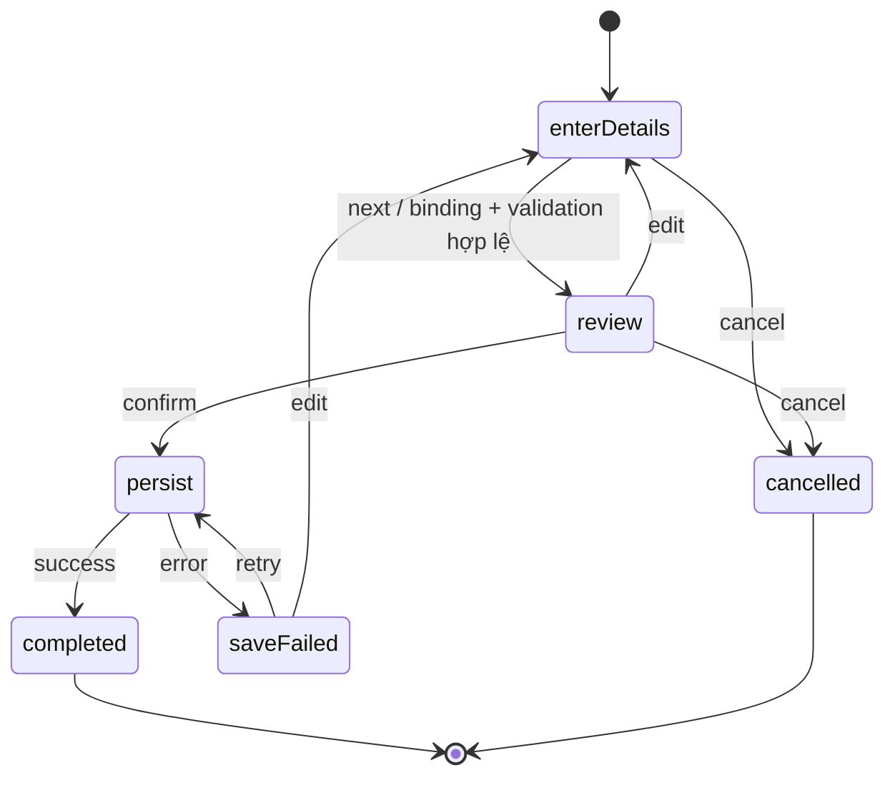

# Thiết kế một hành trình nhập thông tin – xem lại – xác nhận

Trong một ứng dụng web, người dùng thường cần hoàn thành một công việc qua nhiều màn hình: nhập dữ liệu, kiểm tra thông tin đã nhập rồi xác nhận để hệ thống lưu kết quả. Nếu mỗi màn hình do một controller tự điều hướng bằng URL, session và cờ trạng thái, các nhánh «quay lại», «hủy», «thử lại khi lỗi» rất dễ bị phân tán. **Spring Web Flow** cho phép mô tả toàn bộ hành trình như một *flow*: tập hợp các trạng thái (*state*) và sự kiện (*event*) dẫn đến các chuyển tiếp (*transition*) được xác định trước.

Bài này xây dựng một flow đặt chỗ tham gia workshop với ba bước chính:

1. **Nhập thông tin:** họ tên, email và số lượng chỗ; kiểm tra dữ liệu trước khi đi tiếp.
2. **Xem lại:** hiển thị dữ liệu đã nhập, cho phép quay lại sửa mà không mất dữ liệu.
3. **Xác nhận:** gọi nghiệp vụ lưu đặt chỗ một lần rồi thông báo thành công, hoặc cung cấp đường thử lại khi có lỗi có thể phục hồi.

Ví dụ dùng định nghĩa flow bằng XML, JavaBean cho dữ liệu và JSP với Spring Form Tags để minh họa cơ chế cốt lõi. Cách tổ chức view, cấu hình tích hợp và namespace validation cần phù hợp với phiên bản Spring MVC/Spring Web Flow đang dùng trong dự án.

## 1. Biến hành trình thành mô hình trạng thái

Trong Spring Web Flow, người dùng không quyết định trang tiếp theo bằng cách tự gửi một URL tùy ý. Họ phát ra sự kiện, ví dụ `next`, `edit`, `confirm` hoặc `cancel`. Flow engine tìm transition hợp lệ tại trạng thái hiện tại rồi mới chuyển sang trạng thái mới.



| State | Kiểu | Trách nhiệm |
| --- | --- | --- |
| `enterDetails` | `view-state` | Hiển thị form, bind dữ liệu, kiểm tra dữ liệu trước sự kiện `next`. |
| `review` | `view-state` | Hiển thị bản nháp; cho phép sửa, hủy hoặc xác nhận. |
| `persist` | `action-state` | Gọi thao tác nghiệp vụ lưu đặt chỗ. |
| `saveFailed` | `view-state` | Thông báo lỗi có thể phục hồi; cho thử lại hoặc sửa thông tin. |
| `completed`, `cancelled` | `end-state` | Kết thúc một execution của flow. |

Các khái niệm cần phân biệt:

- **State** nói hệ thống đang ở đâu: chờ nhập, chờ xác nhận hay đang thực hiện nghiệp vụ.
- **Event** nói điều gì đã xảy ra: nhấn «Xem lại», «Sửa» hay «Xác nhận».
- **Transition** nói một event hợp lệ dẫn đến state nào, có cần bind/validate hay thực hiện action trước khi chuyển tiếp.
- **Flow execution** là một lần người dùng chạy flow; hai người dùng cùng đi qua định nghĩa flow nhưng sở hữu dữ liệu thực thi riêng.

Quyết định nghiệp vụ quan trọng là **chưa lưu đặt chỗ tại bước xem lại**. Chỉ event `confirm` mới được phép dẫn tới action lưu. Nút «Quay lại» không tạo bản ghi, còn việc hiển thị thông tin đã nhập không có tác dụng phụ.

## 2. Chuẩn bị dữ liệu cần mang qua các bước

Tạo một JavaBean mutable, có constructor không tham số và getter/setter, để Spring bind các trường của form. Bản nháp chỉ chứa dữ liệu cần thiết cho hành trình; khóa xác nhận `requestId` do server tạo, không được bind từ trình duyệt.

```java
package com.example.booking;

import java.io.Serializable;
import java.util.UUID;
import jakarta.validation.constraints.Email;
import jakarta.validation.constraints.Max;
import jakarta.validation.constraints.Min;
import jakarta.validation.constraints.NotBlank;

public class BookingDraft implements Serializable {
    private static final long serialVersionUID = 1L;

    @NotBlank
    private String fullName;

    @NotBlank
    @Email
    private String email;

    @Min(1)
    @Max(5)
    private int seats = 1;

    private final String requestId = UUID.randomUUID().toString();

    public String getFullName() { return fullName; }
    public void setFullName(String fullName) { this.fullName = fullName; }

    public String getEmail() { return email; }
    public void setEmail(String email) { this.email = email; }

    public int getSeats() { return seats; }
    public void setSeats(int seats) { this.seats = seats; }

    public String getRequestId() { return requestId; }
}
```

Ở hệ thống dùng Spring/Bean Validation đời cũ, các annotation tương ứng có thể thuộc namespace `javax.validation` thay vì `jakarta.validation`. Phải chọn bộ thư viện tương thích với phiên bản framework thực tế.

`@NotBlank`, `@Email`, `@Min` và `@Max` thể hiện ràng buộc đầu vào. Khi cơ chế Bean Validation của flow được cấu hình đúng, event chuyển bước có thể sử dụng các ràng buộc này. Ngoài ra vẫn phải kiểm tra quy tắc nghiệp vụ tại service, ví dụ workshop còn đủ chỗ và email có được phép đăng ký hay không; dữ liệu hợp lệ về mặt form chưa đồng nghĩa giao dịch chắc chắn thành công.

Trong ví dụ, bean `booking` được tạo khi flow khởi chạy và đặt trong **flow scope**. Nó tồn tại xuyên suốt các màn hình của *một* flow execution, nên người dùng quay từ `review` về `enterDetails` vẫn thấy dữ liệu đã nhập. Không nên dùng biến session toàn cục để thay thế vì các tab hoặc hai lần chạy flow khác nhau có thể ghi đè lẫn nhau.

## 3. Định nghĩa flow bằng XML

Giả sử file nằm tại `/WEB-INF/flows/booking/booking-flow.xml` và được đăng ký với flow ID `booking`:

```xml
<?xml version="1.0" encoding="UTF-8"?>
<flow xmlns="http://www.springframework.org/schema/webflow"
      xmlns:xsi="http://www.w3.org/2001/XMLSchema-instance"
      xsi:schemaLocation="
          http://www.springframework.org/schema/webflow
          http://www.springframework.org/schema/webflow/spring-webflow.xsd">

    <var name="booking" class="com.example.booking.BookingDraft"/>

    <!-- Bước 1: nhập thông tin -->
    <view-state id="enterDetails"
                view="booking/details"
                model="booking">
        <binder>
            <binding property="fullName"/>
            <binding property="email"/>
            <binding property="seats"/>
        </binder>

        <transition on="next"
                    to="review"
                    bind="true"
                    validate="true"/>

        <transition on="cancel"
                    to="cancelled"
                    bind="false"
                    validate="false"/>
    </view-state>

    <!-- Bước 2: xem lại; chưa lưu dữ liệu -->
    <view-state id="review" view="booking/review">
        <transition on="edit" to="enterDetails"/>
        <transition on="confirm" to="persist"/>
        <transition on="cancel" to="cancelled"/>
    </view-state>

    <!-- Bước 3: chỉ lưu khi nhận event confirm -->
    <action-state id="persist">
        <evaluate expression="bookingAction.submit(booking)"/>
        <transition on="success" to="completed"/>
        <transition on="error" to="saveFailed"/>
    </action-state>

    <view-state id="saveFailed" view="booking/saveFailed">
        <transition on="retry" to="persist"/>
        <transition on="edit" to="enterDetails"/>
    </view-state>

    <end-state id="completed" view="booking/completed"/>
    <end-state id="cancelled" view="booking/cancelled"/>
</flow>
```

Giải thích các điểm chủ chốt:

1. `<var name="booking" .../>` khởi tạo đối tượng bản nháp khi bắt đầu flow, và flow có thể sử dụng nó trong các state sau.
2. `model="booking"` liên kết view nhập liệu với JavaBean. Flow xử lý việc bind các tham số form vào model theo quy tắc của view-state.
3. `<binder>` giới hạn các thuộc tính cho phép bind từ request. `requestId` không có trong danh sách nên không bị form ghi đè.
4. `next` thực hiện binding và validation trước khi chuyển sang `review`. Nếu có lỗi bind/validation, người dùng ở lại form và nhìn thấy thông báo phù hợp; cấu hình validator phải có hiệu lực trong ứng dụng.
5. `cancel` bỏ qua bind/validation, vì người dùng cần được hủy kể cả khi đang nhập dữ liệu sai.
6. `review` không khai báo `model` vì chỉ hiển thị bản nháp. Nút `edit` quay lại cùng bean `booking`, tránh tạo object mới hoặc làm mất thông tin.
7. `persist` là action-state: action trả về event `success` hoặc `error` để chọn nhánh tiếp theo. Một exception không được xử lý **không tự động** đồng nghĩa event `error`; phần action phải chuyển lỗi phục hồi thành event thích hợp.

Định nghĩa trên là một flow nhỏ có điểm bắt đầu mặc định là state đầu tiên `enterDetails`. Với flow lớn hơn, có thể khai báo start-state rõ ràng, tách subflow hoặc tách thao tác khởi tạo dữ liệu ra `on-start`.

## 4. Kết nối form HTML với event và flow execution

Khi render view, Spring Web Flow cung cấp URL của execution hiện tại, thường được tham chiếu trong view bằng `flowExecutionUrl`. Form nên POST đến URL này và đặt tên nút submit theo quy ước `_eventId_<event>`.

Ví dụ rút gọn của `/WEB-INF/views/booking/details.jsp`:

```jsp
<%@ taglib prefix="form" uri="http://www.springframework.org/tags/form" %>
<%@ taglib prefix="c" uri="http://java.sun.com/jsp/jstl/core" %>

<h1>Đăng ký tham gia workshop</h1>

<form:form modelAttribute="booking"
           action="${flowExecutionUrl}" method="post">
    <div>
        <label for="fullName">Họ và tên</label>
        <form:input id="fullName" path="fullName"/>
        <form:errors path="fullName" cssClass="error"/>
    </div>
    <div>
        <label for="email">Email</label>
        <form:input id="email" path="email"/>
        <form:errors path="email" cssClass="error"/>
    </div>
    <div>
        <label for="seats">Số lượng chỗ (1–5)</label>
        <form:input id="seats" path="seats" type="number"/>
        <form:errors path="seats" cssClass="error"/>
    </div>

    <button type="submit" name="_eventId_next">Xem lại</button>
    <button type="submit" name="_eventId_cancel">Hủy</button>
</form:form>
```

Lưu ý: nếu dùng CSRF protection của Spring Security, form POST cần có CSRF token theo cấu hình ứng dụng; Spring Form Tags có thể tích hợp với cơ chế này khi cấu hình tương ứng được bật.

Ở `/WEB-INF/views/booking/review.jsp`, **không dùng input để cho trình duyệt gửi lại toàn bộ dữ liệu dưới dạng giá trị ẩn rồi tin đó là bản chính**. Hiển thị bản nháp từ flow scope và chỉ gửi event điều hướng:

```jsp
<%@ taglib prefix="c" uri="http://java.sun.com/jsp/jstl/core" %>

<h1>Kiểm tra thông tin</h1>
<dl>
    <dt>Họ và tên</dt>
    <dd><c:out value="${booking.fullName}"/></dd>
    <dt>Email</dt>
    <dd><c:out value="${booking.email}"/></dd>
    <dt>Số chỗ</dt>
    <dd><c:out value="${booking.seats}"/></dd>
</dl>

<form action="${flowExecutionUrl}" method="post">
    <button type="submit" name="_eventId_edit">Quay lại sửa</button>
    <button type="submit" name="_eventId_confirm">Xác nhận</button>
    <button type="submit" name="_eventId_cancel">Hủy</button>
</form>
```

`<c:out>` escape nội dung động để hạn chế lỗi hiển thị và cross-site scripting. Không dùng link GET cho hành động xác nhận có tác dụng ghi dữ liệu. Ở trang lỗi `saveFailed`, có thể cung cấp hai nút POST `_eventId_retry` và `_eventId_edit` theo đúng transition đã định nghĩa.

Đường đi của một request thường là: **trình duyệt → Spring MVC/Web Flow handler → flow execution hiện tại → nhận event → bind/validate → transition → render view kế tiếp**. Flow execution key giúp engine xác định người dùng đang tương tác với lần chạy nào của flow. Không tự tạo URL chứa khóa thực thi bằng cách nối chuỗi khi view đã có `flowExecutionUrl`.

## 5. Tách lưu dữ liệu thành action nghiệp vụ

Một action hợp lệ có thể trả về `Event` cho flow engine. Lớp action chỉ điều phối kết quả của service, còn quy tắc giữ chỗ, transaction và chống ghi trùng thuộc tầng nghiệp vụ:

```java
package com.example.booking;

import org.springframework.stereotype.Component;
import org.springframework.webflow.execution.Event;

@Component("bookingAction")
public class BookingAction {
    private final BookingService bookingService;

    public BookingAction(BookingService bookingService) {
        this.bookingService = bookingService;
    }

    public Event submit(BookingDraft draft) {
        try {
            bookingService.createOnce(
                draft.getRequestId(),
                draft.getFullName(),
                draft.getEmail(),
                draft.getSeats()
            );
            return new Event(this, "success");
        } catch (TemporaryBookingException ex) {
            return new Event(this, "error");
        }
    }
}
```

`BookingService` và `TemporaryBookingException` là các thành phần nghiệp vụ của ứng dụng, được minh họa bằng tên để giữ bài học tập trung vào flow. `createOnce(...)` cần được hiện thực với **khóa idempotency** `requestId` và ràng buộc duy nhất trong cơ sở dữ liệu hoặc cơ chế tương đương. Nhờ đó, người dùng bấm lại «Xác nhận», trình duyệt retry request hoặc flow thử lại sau lỗi mạng cũng không tạo hai đơn đặt chỗ cho cùng một yêu cầu.

Chỉ bắt lỗi mà nghiệp vụ biết cách phục hồi. Lỗi cấu hình, lỗi lập trình hoặc dữ liệu không hợp lệ mang tính nghiêm trọng cần được ghi log và xử lý theo chính sách lỗi chung, thay vì luôn bị chuyển thành thông báo «thử lại» mơ hồ. Không đưa stack trace hoặc thông tin nội bộ vào view.

Một biến thể khác là đặt bước kiểm tra tồn chỗ ngay trước `persist` rồi chuyển sang state «đã hết chỗ» khi điều kiện nghiệp vụ không còn đúng. Không dựa vào kết quả kiểm tra cũ từ lúc nhập form: tình trạng chỗ trống có thể thay đổi trong thời gian người dùng xem lại.

## 6. Tích hợp flow với Spring MVC

Spring MVC xử lý việc nhận HTTP request và render view; Spring Web Flow bổ sung cơ chế điều khiển hành trình. Các thành phần thường cần phối hợp là:

| Thành phần | Vai trò |
| --- | --- |
| `FlowDefinitionRegistry` | Đăng ký và tra cứu định nghĩa flow, ví dụ flow ID `booking`. |
| `FlowExecutor` | Tạo, tiếp tục và kết thúc các flow execution. |
| `FlowHandlerMapping` | Nhận diện request thuộc flow đã đăng ký. |
| `FlowHandlerAdapter` | Đưa request do mapping nhận diện vào `FlowExecutor`. |
| View resolver | Ánh xạ tên view như `booking/details` thành JSP hoặc công nghệ view được cấu hình. |

Một skeleton cấu hình Java theo phong cách API cấu hình của Spring Web Flow:

```java
@Configuration
public class WebFlowConfig extends AbstractFlowConfiguration {

    @Bean
    public FlowDefinitionRegistry flowRegistry() {
        return getFlowDefinitionRegistryBuilder()
            .addFlowLocation(
                "/WEB-INF/flows/booking/booking-flow.xml",
                "booking"
            )
            .build();
    }

    @Bean
    public FlowExecutor flowExecutor() {
        return getFlowExecutorBuilder(flowRegistry()).build();
    }

    @Bean
    public FlowHandlerMapping flowHandlerMapping() {
        FlowHandlerMapping mapping = new FlowHandlerMapping();
        mapping.setFlowRegistry(flowRegistry());
        mapping.setOrder(-1);
        return mapping;
    }

    @Bean
    public FlowHandlerAdapter flowHandlerAdapter() {
        FlowHandlerAdapter adapter = new FlowHandlerAdapter();
        adapter.setFlowExecutor(flowExecutor());
        return adapter;
    }
}
```

Các import và cách đăng ký bean phụ thuộc cấu hình Spring của dự án. Cần có dependency Spring Web Flow tương thích và view resolver nhận diện `booking/details`, `booking/review`, `booking/saveFailed`, `booking/completed`, `booking/cancelled`. Skeleton trên chỉ mô tả mối nối các thành phần; trong dự án thật còn cần kiểm tra tích hợp với auto-configuration, security filter và cách Spring MVC đăng ký các handler.

Với mapping mặc định phù hợp, truy cập flow ID `booking` sẽ khởi động hành trình. Sau đó các form gửi event qua URL execution, để Web Flow quyết định state tiếp theo. Không cần viết một controller method cho mỗi nút «Tiếp tục» hay «Quay lại» của hành trình này.

## 7. Scope, binding, validation và xử lý tình huống khó

### Chọn đúng scope cho dữ liệu

| Scope | Phạm vi thích hợp |
| --- | --- |
| `requestScope` | Dữ liệu chỉ cần cho request hiện tại. |
| `flashScope` | Thông báo ngắn hoặc dữ liệu chuyển tiếp ở một lần điều hướng. |
| `viewScope` | Trạng thái phụ chỉ cần trong một view-state cụ thể. |
| `flowScope` | Bản nháp `booking` cần được giữ trong toàn bộ flow. |
| `conversationScope` | Dữ liệu dùng chung trong một conversation chứa nhiều flow/subflow, khi có nhu cầu thật sự. |

Ví dụ trên dùng biến flow `booking` vì yêu cầu giữ thông tin qua `enterDetails`, `review`, `persist`. Tránh đưa cả entity JPA đang managed, object lớn hoặc dữ liệu bí mật vào session chỉ vì tiện truy cập. Nếu cần giữ lâu, lưu bản nháp có định danh ở tầng dữ liệu và để flow giữ khóa tham chiếu.

### Khi người dùng nhập sai

Giả sử người dùng điền email `abc` và nhấn `next`. Binding có thể hoàn tất về kiểu dữ liệu, nhưng Bean Validation phát hiện email không hợp lệ. Flow cần hiển thị lỗi gắn với `email` ngay tại màn nhập, không chuyển sang trang xem lại. Nếu người dùng nhập `seats=abc` thì binding số nguyên thất bại; lỗi kiểu dữ liệu cũng phải được trả về form.

Thuộc tính `validate="true"` xác định transition có chạy cơ chế validation. Để các annotation Bean Validation phát huy tác dụng, phải bảo đảm validator/validation framework được tích hợp đúng. Với quy tắc phức tạp (ví dụ kiểm tra email theo danh sách hạn chế), có thể dùng validator chuyên biệt của Web Flow hoặc action nghiệp vụ trước khi chuyển state.

### Khi người dùng quay lại hoặc hủy

Nhấn `edit` chuyển từ `review` về `enterDetails` nhưng giữ nguyên bản nháp. Nhấn `cancel` kết thúc flow mà không đi qua `persist`. Tại màn nhập, transition `cancel` phải có `bind="false" validate="false"` để một form nhập dở hoặc dữ liệu lỗi vẫn hủy được.

### Khi lưu thất bại hoặc người dùng gửi lặp

Nếu service báo lỗi tạm thời, action phát event `error` và chuyển sang `saveFailed`. Bản nháp còn trong flow nên người dùng có thể `retry` hoặc `edit`. Nếu service đã commit thành công nhưng HTTP response bị mất, lần retry vẫn phải trả về kết quả của yêu cầu cũ qua `requestId`; flow state **không thay thế** idempotency và transaction ở tầng dữ liệu.

Khi flow đã kết thúc hoặc execution key hết hạn, một tab cũ có thể không khôi phục được execution. Ứng dụng nên có trang báo phiên làm việc đã hết hạn, cho phép khởi động flow mới và cân nhắc lưu bản nháp bền vững nếu quy trình quan trọng. Dùng navigation back của trình duyệt cũng có thể đưa người dùng tới một view cũ; vì vậy trạng thái tại server và tính hợp lệ của event phải là nguồn quyết định cuối cùng.

### Khi cần điều hướng sau bước cuối

`end-state` ở ví dụ render view hoàn tất để người học nhìn rõ flow. Với nghiệp vụ thật, nên cân nhắc hiển thị URL xác nhận ổn định (chẳng hạn `/bookings/{id}/result`) sau khi commit, để người dùng có thể refresh hoặc mở lại mà không phụ thuộc execution đã đóng. Trang kết quả chỉ đọc bằng ID được phân quyền, không thực hiện lệnh lưu thêm lần nữa.

## 8. Kiểm thử một hành trình theo state và event

Một bài test Web Flow cần kiểm tra **state thực tế**, **dữ liệu còn hay mất** và **service có được gọi hay không**. Có thể dùng bộ công cụ kiểm thử flow của Spring Web Flow và mock service để chủ động phát event theo từng bước.

| Kịch bản | Chuỗi event/dữ liệu | Kết quả cần xác minh |
| --- | --- | --- |
| Thành công | Nhập hợp lệ → `next` → `confirm` | `enterDetails → review → persist → completed`; lưu đúng một lần. |
| Dữ liệu thiếu | Thiếu họ tên → `next` | Ở lại `enterDetails`; hiện lỗi; chưa gọi service. |
| Sai kiểu dữ liệu | `seats=abc` → `next` | Báo lỗi binding; chưa đến `review`. |
| Quay lại sửa | Nhập hợp lệ → `next` → `edit` | Trở lại `enterDetails`, các trường vẫn có giá trị cũ. |
| Hủy từ form lỗi | Nhập lỗi → `cancel` | Kết thúc ở `cancelled` mà không cần validate hay lưu. |
| Lỗi lưu tạm thời | `confirm` → service trả lỗi → `retry` | Đến `saveFailed`, giữ bản nháp, thử lại với cùng `requestId`. |
| Gửi xác nhận lặp | Hai lần gửi cùng khóa | Chỉ tạo một bản ghi nghiệp vụ. |
| Execution hết hạn | Gửi event với khóa cũ | Không vô tình khởi tạo giao dịch khác; có đường bắt đầu lại rõ ràng. |

Một bài kiểm thử luồng hạnh phúc có thể được mô tả bằng các assertion độc lập với giao diện:

```text
startFlow("booking")
  -> assertCurrentState("enterDetails")

setForm(fullName="An", email="an@example.com", seats=2)
signalEvent("next")
  -> assertCurrentState("review")
  -> assertServiceNotCalled("createOnce")

signalEvent("edit")
  -> assertCurrentState("enterDetails")
  -> assertFormValuesPreserved()

signalEvent("next")
signalEvent("confirm")
  -> assertCurrentState("completed")
  -> assertServiceCalledExactlyOnce("createOnce")
```

Đây là mã giả thể hiện tiêu chí kiểm thử, không phải API test có thể copy để chạy trực tiếp. Khi triển khai test, ngoài kiểm tra state cần assert context/scope và số lần gọi service. Kiểm thử transaction/idempotency ở tầng service là phần riêng, rất cần thiết ngay cả khi test flow đã qua.

## 9. Các lỗi thiết kế thường gặp

- **Lưu dữ liệu ngay ở transition `next`:** người dùng vừa mở trang xem lại đã tạo giao dịch, khiến nút «Hủy» và «Sửa» có ý nghĩa sai.
- **Truyền dữ liệu bằng nhiều hidden field ở trang review:** dễ nhận giá trị giả mạo và tạo hai nguồn dữ liệu; nên dùng bản nháp do flow quản lý.
- **Đặt bản nháp vào session chung theo tên cố định:** hai flow hoặc hai tab có thể đè lên nhau; nên dùng scope của flow execution.
- **Bắt mọi exception rồi phát `success` hoặc `error` vô điều kiện:** che mất lỗi nghiêm trọng và gây kết quả khó chẩn đoán.
- **Dùng view để gọi lệnh lưu:** refresh/render lặp sẽ gây side effect; việc ghi thuộc action-state/service.
- **Chỉ trông chờ flow chống double submit:** xác nhận có thể bị gửi lặp do mạng, retry hoặc nhiều thiết bị; cần idempotency ở storage.
- **Cho phép bind mọi property:** một request độc hại có thể ghi các trường không được phép như `requestId` hoặc trạng thái duyệt; khai báo binding whitelist và kiểm tra quyền ở service.

## 10. Bài thực hành tự mở rộng

Từ flow hiện có, thử bổ sung state `selectWorkshop` trước `enterDetails` và yêu cầu số chỗ khả dụng được kiểm tra lại tại `persist`. Sau đó thêm màn `changeSelection` khi workshop hết chỗ, dẫn người dùng quay về chọn workshop khác nhưng giữ họ tên/email đã nhập. Cân nhắc tách luồng chọn workshop thành **subflow** nếu nhiều hành trình đặt chỗ đều dùng chung bước này.

Tiêu chí hoàn thành: người dùng nhập → xem lại → sửa → xác nhận trong cùng một flow execution; lỗi input được hiển thị tại form; hủy không ghi dữ liệu; lỗi nghiệp vụ có đường phục hồi; và mọi lần retry cùng request ID không làm tạo bản ghi trùng. Khi đáp ứng được các tiêu chí đó, sơ đồ state/event/transition đã trở thành đặc tả điều hướng có thể kiểm thử, thay vì chuỗi điều kiện rời rạc ở nhiều controller.
