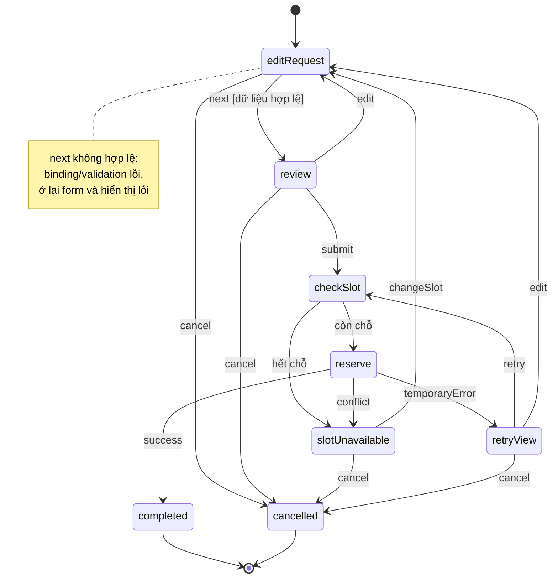

# Sơ đồ trạng thái trước khi viết định nghĩa Spring Web Flow

Ở chương **Flow đầu tiên**, mục tiêu của bài này là thiết kế một hành trình web nhiều bước bằng **sơ đồ trạng thái** trước khi viết XML hoặc cấu hình Spring Web Flow. Làm rõ state, event và transition ngay từ đầu giúp ứng dụng xử lý nhất quán việc nhập dữ liệu, quay lại chỉnh sửa, xác nhận, hủy, hết phiên và phục hồi sau lỗi. Đây là cách sử dụng Spring Web Flow để tập trung logic điều hướng tại một nơi, thay vì để mỗi controller quyết định một phần đường đi.

**Kết quả mong đợi:** từ mô tả nghiệp vụ bằng lời, người học lập được sơ đồ có tên state rõ ràng, liệt kê được event và transition hợp lệ, chỉ ra thời điểm binding/validation và thao tác có tác dụng ghi dữ liệu, rồi chuyển sơ đồ thành khung định nghĩa flow có thể kiểm thử.

## 1. Vì sao phải vẽ sơ đồ trước?

Giả sử hệ thống cho khách hàng **đổi lịch hẹn dịch vụ**. Người dùng chọn khung giờ mới, xem lại thông tin, xác nhận đổi lịch và nhận kết quả. Khung giờ có thể vừa bị người khác đặt, dữ liệu nhập có thể sai, hoặc thao tác ghi dữ liệu có thể lỗi tạm thời.

Nếu lập trình ngay từ các URL như `/appointment/edit`, `/appointment/preview` và `/appointment/save`, người phát triển dễ bỏ sót những câu hỏi nghiệp vụ:

- Người dùng từ màn xem lại có được quay về sửa lựa chọn không?
- Nhấn «Hủy» khi form chưa hợp lệ có phải qua validation không?
- Dữ liệu xem lại lấy từ đâu để tránh bị chỉnh sửa trái phép trên trình duyệt?
- Hết chỗ tại thời điểm kiểm tra thì quay lại bước nào?
- Lỗi ghi dữ liệu khác với lỗi validation như thế nào?
- Refresh hay gửi lại yêu cầu xác nhận có thể tạo thay đổi hai lần không?
- Khi một flow execution hết hạn, người dùng có được tiếp tục từ URL cũ không?

Sơ đồ trạng thái buộc nhóm thiết kế trả lời các câu hỏi này trước khi cấu hình controller hoặc view. Sơ đồ đồng thời là đầu vào để viết các kịch bản test đường đi và rà soát các nhánh chưa có điểm kết thúc.

## 2. Tách state, event, transition, guard và action

| Khái niệm | Câu hỏi cần trả lời | Ví dụ trong đổi lịch |
| --- | --- | --- |
| **State** | Flow đang chờ người dùng hoặc hệ thống làm gì? | `editRequest`, `review`, `checkSlot`, `reserve`, `completed` |
| **Event** | Điều gì vừa xảy ra để flow tiếp tục? | `next`, `edit`, `submit`, `cancel`, `retry` |
| **Transition** | Event hoặc kết quả đánh giá dẫn đến state nào? | Từ `review`, event `submit` dẫn đến `checkSlot` |
| **Guard / condition** | Điều kiện nào phải đúng để đi theo một nhánh? | Khung giờ được chọn vẫn còn trống |
| **Action** | Flow cần gọi nghiệp vụ hoặc xử lý gì? | Giữ chỗ và cập nhật lịch hẹn trong transaction |
| **Scope** | Dữ liệu tồn tại trong bao lâu? | Bản nháp trong `flowScope` đến khi flow kết thúc |

Một **state** biểu diễn thời điểm điều khiển trong hành trình; nó không nhất thiết là một trang HTML. Trong Spring Web Flow, các loại state thường gặp là:

- `view-state`: chờ tương tác của người dùng hoặc hiển thị một màn hình.
- `action-state`: chạy logic ứng dụng rồi phát event kết quả để chuyển tiếp.
- `decision-state`: chọn nhánh dựa trên biểu thức điều kiện, không cần người dùng nhấn nút.
- `subflow-state`: gọi một flow con rồi xử lý kết quả trả về.
- `end-state`: đóng một flow execution với một kết quả được định nghĩa.

**Chú ý:** trạng thái của flow («đang xem lại», «đang ghi dữ liệu») khác trạng thái bản ghi nghiệp vụ («lịch hẹn đã được đổi», «yêu cầu bị từ chối»). Không nên dùng số lượng URL hoặc số lượng bảng cơ sở dữ liệu để suy ra số state.

Ví dụ, `checkSlot` và `reserve` là hai state riêng mặc dù chúng không có trang giao diện. Ngược lại, một view có thể hiển thị nhiều trường và thông báo lỗi mà không cần tạo state mới cho từng trường.

## 3. Chuyển yêu cầu nghiệp vụ thành tập state

Trước khi vẽ mũi tên, ghi lại ba nhóm thông tin.

### 3.1. Điểm bắt đầu và điểm kết thúc

**Bắt đầu:** người dùng đã đăng nhập, có quyền thay đổi lịch hẹn hiện tại, mở hành trình đổi lịch. Flow tạo một bản nháp yêu cầu đổi lịch.

**Kết thúc thành công:** lịch hẹn được cập nhật một lần và hệ thống cung cấp trang kết quả.

**Kết thúc do hủy:** không thay đổi lịch hẹn, giải phóng dữ liệu tạm của flow.

Hai điểm kết thúc này là các kết quả khác nhau, dù cả hai đều đóng flow. Nếu nghiệp vụ cần giữ vết yêu cầu bị hủy, thao tác ghi audit phải được thiết kế riêng và không được ngầm thay đổi lịch hẹn.

### 3.2. State có giao diện

| ID state | Mục đích | Sự kiện người dùng có thể phát |
| --- | --- | --- |
| `editRequest` | Chọn khung giờ mới, nhập lý do | `next`, `cancel` |
| `review` | Đọc lại nội dung trước khi xác nhận | `edit`, `submit`, `cancel` |
| `slotUnavailable` | Thông báo khung giờ không còn trống | `changeSlot`, `cancel` |
| `retryView` | Giải thích lỗi tạm thời khi lưu | `retry`, `edit`, `cancel` |

Đặt tên state bằng ý nghĩa nghiệp vụ hoặc hành động, ví dụ `review` hoặc `slotUnavailable`. Tên như `page2` và `step3` dễ gây nhầm khi bổ sung bước mới.

### 3.3. State không có giao diện

| ID state | Loại | Công việc |
| --- | --- | --- |
| `checkSlot` | `decision-state` | Kiểm tra khung giờ còn khả dụng tại lúc xác nhận |
| `reserve` | `action-state` | Gọi service cập nhật lịch hẹn và trả về event kết quả |
| `completed` | `end-state` | Kết thúc thành công |
| `cancelled` | `end-state` | Kết thúc do người dùng hủy |

Ở bước phác thảo, chưa cần chọn cú pháp XML hay tên phương thức Java cụ thể. Hãy thống nhất ý nghĩa state và ai chịu trách nhiệm cho mỗi kết quả.

## 4. Vẽ sơ đồ trạng thái đầy đủ

Sơ đồ Mermaid dưới đây mô tả một flow đủ nhánh thành công, quay lại sửa, hủy và lỗi có thể phục hồi:



Đọc sơ đồ từ trái sang phải theo một kịch bản:

1. Bắt đầu tại `editRequest` và hiển thị form.
2. Khi phát `next`, form được binding và validation. Nếu không hợp lệ, flow ở lại `editRequest` để hiển thị lỗi.
3. Khi hợp lệ, chuyển sang `review`; ở đây chưa có cập nhật lịch hẹn.
4. `submit` chuyển sang `checkSlot` để đánh giá tình trạng khung giờ.
5. Nếu còn chỗ, flow đến `reserve` để gọi service ghi dữ liệu. Nếu hết chỗ, flow đến `slotUnavailable`.
6. Kết quả action `success` dẫn đến `completed`. `conflict` dẫn đến `slotUnavailable`; `temporaryError` dẫn đến `retryView`.
7. Từ màn lỗi, người dùng có thể chọn phương án phục hồi phù hợp; các event `cancel` đi đến `cancelled`.

**Phân biệt lỗi validation với transition:** chú thích «`next` không hợp lệ» trên sơ đồ biểu đạt hành vi *ở lại form* khi binding/validation thất bại. Nó không buộc phải là một transition `editRequest → editRequest` trong XML. Spring Web Flow có thể giữ nguyên view-state khi phát hiện lỗi validation.

## 5. Lập bảng chuyển tiếp trước khi viết XML

Sơ đồ giúp quan sát tổng thể; bảng chuyển tiếp làm rõ chi tiết từng điều kiện và tác dụng phụ, tránh nhầm một mũi tên với một thao tác nghiệp vụ.

| Từ state | Event / kết quả | Điều kiện / xử lý | Đến state |
| --- | --- | --- | --- |
| `editRequest` | `next` | Bind và validate bản nháp thành công | `review` |
| `editRequest` | `next` | Bind/validation lỗi; hiển thị lỗi | Giữ `editRequest` |
| `editRequest` | `cancel` | Bỏ qua bind/validation | `cancelled` |
| `review` | `edit` | Giữ nguyên bản nháp | `editRequest` |
| `review` | `submit` | Bắt đầu quy trình xác nhận | `checkSlot` |
| `review` | `cancel` | Không lưu lịch hẹn | `cancelled` |
| `checkSlot` | biểu thức đúng | Giờ còn khả dụng tại thời điểm kiểm tra | `reserve` |
| `checkSlot` | biểu thức sai | Giờ không còn khả dụng | `slotUnavailable` |
| `reserve` | `success` | Service ghi dữ liệu thành công | `completed` |
| `reserve` | `conflict` | Service phát hiện tranh chấp/giờ đã hết | `slotUnavailable` |
| `reserve` | `temporaryError` | Lỗi phục hồi được | `retryView` |
| `slotUnavailable` | `changeSlot` | Giữ dữ liệu khác trong bản nháp | `editRequest` |
| `retryView` | `retry` | Kiểm tra lại khả dụng trước khi ghi | `checkSlot` |
| `retryView` | `edit` | Quay về sửa lựa chọn | `editRequest` |
| `slotUnavailable` / `retryView` | `cancel` | Dừng flow | `cancelled` |

Bảng này giúp đưa ra những quyết định quan trọng:

- Mọi đường ghi dữ liệu đều phải qua `reserve`.
- `review` chỉ hiển thị thông tin và phát event; không ghi cơ sở dữ liệu.
- Sau lỗi tạm thời, `retry` quay về `checkSlot` vì khả dụng của khung giờ có thể đã thay đổi.
- Mỗi state có tập event riêng. Ví dụ `completed` không chấp nhận `submit` thêm lần nữa.
- Nhánh `conflict` vẫn cần thiết dù đã có `checkSlot`: giữa lần kiểm tra và lần ghi, người khác có thể chiếm chỗ.

**Một quy tắc để kiểm sơ đồ:** với mỗi mũi tên, hãy xác nhận điểm xuất phát, trigger hoặc guard, đích đến và hành vi quan sát được. Với state không phải kết thúc, hãy chắc rằng tồn tại ít nhất một đường hợp lệ dẫn tới một end-state hoặc có chính sách timeout/khôi phục rõ ràng.

## 6. Định nghĩa các bất biến trước khi gán logic

*Bất biến* (invariant) là điều phải đúng với mọi đường đi mà flow cho phép. Tạo danh sách bất biến giúp reviewer phát hiện lỗi ngay cả khi sơ đồ có vẻ hợp lý.

| Bất biến | Ý nghĩa kiểm thử |
| --- | --- |
| Chỉ `reserve` được đổi lịch hẹn | Không phát sinh thay đổi khi `next`, `edit`, `cancel` hoặc render view |
| Bản nháp còn khi quay lại | Người dùng sửa giờ không phải nhập lại các trường khác |
| `review` chỉ hiển thị dữ liệu hợp lệ | Không thể đi đến xem lại bằng `next` sai dữ liệu |
| Server kiểm tra quyền sửa lịch hẹn | Không tin ID hoặc thông tin phân quyền do form gửi |
| Kiểm tra giờ trống trong transaction ghi | Hai yêu cầu cạnh tranh không cùng giữ một suất |
| Cùng một yêu cầu xác nhận chỉ được xử lý một lần | Retry mạng hoặc refresh không tạo cập nhật trùng |
| Kết thúc flow là kết thúc quyền tiếp tục execution đó | Event gửi bằng execution key cũ không tạo lần lưu khác |

Bất biến cuối liên quan đến cơ chế **flow execution**. Mỗi lần chạy flow có context riêng, thường được xác định qua execution key do Web Flow quản lý. Một execution hết hạn hoặc đã hoàn tất không nên được coi là lời mời tự động tạo giao dịch mới.

### Kiểm tra điều kiện là chưa đủ để tránh race condition

Bước `checkSlot` tốt cho trải nghiệm người dùng, nhưng kết quả có thể lỗi thời trong vài mili giây. Service ở `reserve` vẫn phải kiểm tra và cập nhật dưới một transaction hoặc cơ chế đồng bộ phù hợp. Khi có tranh chấp, trả về kết quả `conflict` để flow hiển thị `slotUnavailable`.

Nếu thao tác commit thành công nhưng response bị mất, event `retry` có thể dẫn người dùng tới một lần gọi service nữa. Dùng khóa yêu cầu do server tạo và quy tắc idempotency trong tầng lưu trữ để bảo đảm một yêu cầu logic không bị xử lý lặp.

## 7. Xác định dữ liệu nào thuộc scope nào

Đừng chờ đến lúc viết Java mới quyết định nơi giữ dữ liệu. Mỗi state cần biết dữ liệu nào được đọc, viết và giữ qua transition.

| Dữ liệu | Vị trí gợi ý | Lý do |
| --- | --- | --- |
| `RescheduleDraft`: khung giờ, lý do, ID yêu cầu do server tạo | `flowScope` | Dùng xuyên các state của cùng một execution |
| Lỗi bind/validation của form | Cơ chế message/binding cho view-state | Chỉ phục vụ render lỗi tại bước nhập |
| Thông báo lỗi tạm thời chi tiết ngắn hạn | `flashScope` hoặc model dành riêng cho view | Không cần tồn tại suốt toàn bộ flow |
| Thông tin người dùng đã xác thực | Security context của ứng dụng | Không lấy từ trường ẩn do trình duyệt gửi |
| Lịch hẹn đã xác nhận | Database/service | Phải bền vững ngoài vòng đời flow |

Flow scope phù hợp với bản nháp vì người dùng có thể từ `review` quay về `editRequest` mà vẫn thấy lựa chọn cũ. **Không đặt bản nháp chung vào một thuộc tính session có tên cố định**, vì hai tab hoặc hai flow execution khác nhau có thể ghi đè nhau.

Nếu dữ liệu cần tồn tại lâu hơn vòng đời flow, ví dụ người dùng rời trang rồi quay lại ngày hôm sau, hãy lưu một bản nháp bền vững có định danh trong cơ sở dữ liệu. Flow chỉ giữ khóa tham chiếu và nạp lại dữ liệu theo quyền của người dùng khi cần. Với subflow, cân nhắc có thực sự cần `conversationScope` hay chỉ cần truyền input/output rõ ràng.

## 8. Chuyển sơ đồ thành khung định nghĩa flow

Sau khi đã chốt tên state, event, guard và đường lỗi, có thể chuyển gần như trực tiếp sang XML Spring Web Flow. Ví dụ dưới đây là **khung định nghĩa minh họa**, giả định các class Java, bean service/action, view resolver và validation đã được cấu hình trong ứng dụng. Đây không phải một ứng dụng chạy độc lập.

```xml
<?xml version="1.0" encoding="UTF-8"?>
<flow xmlns="http://www.springframework.org/schema/webflow"
      xmlns:xsi="http://www.w3.org/2001/XMLSchema-instance"
      xsi:schemaLocation="
        http://www.springframework.org/schema/webflow
        http://www.springframework.org/schema/webflow/spring-webflow.xsd">

    <!-- Bản nháp riêng cho flow execution hiện tại -->
    <var name="reschedule" class="com.example.flow.RescheduleDraft"/>

    <!-- State đầu tiên: nhập dữ liệu -->
    <view-state id="editRequest"
                view="reschedule/edit"
                model="reschedule">
        <binder>
            <binding property="slotId"/>
            <binding property="reason"/>
        </binder>

        <transition on="next" to="review"
                    bind="true" validate="true"/>

        <transition on="cancel" to="cancelled"
                    bind="false" validate="false"/>
    </view-state>

    <!-- View chỉ xem lại: chưa có thao tác ghi -->
    <view-state id="review" view="reschedule/review">
        <transition on="edit" to="editRequest"/>
        <transition on="submit" to="checkSlot"/>
        <transition on="cancel" to="cancelled"/>
    </view-state>

    <!-- Guard: chọn nhánh theo tình trạng khung giờ -->
    <decision-state id="checkSlot">
        <if test="slotService.isAvailable(reschedule.slotId)"
            then="reserve"
            else="slotUnavailable"/>
    </decision-state>

    <!-- Service thực hiện ghi và trả event kết quả -->
    <action-state id="reserve">
        <evaluate expression="rescheduleAction.reserve(reschedule)"/>
        <transition on="success" to="completed"/>
        <transition on="conflict" to="slotUnavailable"/>
        <transition on="temporaryError" to="retryView"/>
    </action-state>

    <view-state id="slotUnavailable"
                view="reschedule/slotUnavailable">
        <transition on="changeSlot" to="editRequest"/>
        <transition on="cancel" to="cancelled"/>
    </view-state>

    <view-state id="retryView" view="reschedule/retry">
        <transition on="retry" to="checkSlot"/>
        <transition on="edit" to="editRequest"/>
        <transition on="cancel" to="cancelled"/>
    </view-state>

    <end-state id="completed" view="reschedule/completed"/>
    <end-state id="cancelled" view="reschedule/cancelled"/>
</flow>
```

### Những phần có thể đối chiếu trực tiếp với sơ đồ

1. Mỗi ô state xuất hiện thành một phần tử `view-state`, `decision-state`, `action-state` hoặc `end-state` với ID tương ứng.
2. Mũi tên gắn event trên view trở thành `<transition on="..." to="..."/>`.
3. Hai nhánh điều kiện của `checkSlot` trở thành `<if test="..." then="..." else="..."/>` trong decision-state.
4. Các kết quả nghiệp vụ từ `reserve` trở thành event `success`, `conflict` và `temporaryError`. Action Java phải thật sự phát các event đó.
5. Sơ đồ chỉ đặt việc lưu tại `reserve`; XML cũng chỉ gọi phương thức ghi trong `action-state` đó.
6. Transition `cancel` của màn nhập khai báo `bind="false" validate="false"` để người dùng có thể hủy dù form có dữ liệu không hợp lệ.

### Các giả định cần có khi tích hợp thật

- `RescheduleDraft` là JavaBean có getter/setter cho `slotId`, `reason`; khóa idempotency và ID lịch hẹn cần được lấy hoặc tạo ở phía server, không bind tùy tiện từ request.
- `slotService` và `rescheduleAction` là bean có thể được flow expression truy cập. Các tên method và class trong XML là ví dụ, không thuộc API có sẵn của Spring Web Flow.
- `rescheduleAction.reserve(...)` trả về event đúng tên; những lỗi hạ tầng không thuộc nhóm phục hồi cần theo đường xử lý exception chung của ứng dụng.
- Lớp validation phải được đăng ký phù hợp để transition `next` có thể chặn dữ liệu sai; `validate="true"` không thể tự thay cho việc cung cấp validator hợp lệ.
- Các view `reschedule/edit`, `reschedule/review`, `reschedule/slotUnavailable`, `reschedule/retry` và view kết thúc phải được resolve bởi cấu hình Spring MVC.
- Service cập nhật phải xác thực quyền sửa lịch hẹn, kiểm tra giờ trống trong giao dịch và thực hiện idempotency. Biểu thức `isAvailable(...)` trong decision-state chỉ là kiểm tra sớm phục vụ điều hướng.

Nếu cần tích hợp vào Spring MVC, định nghĩa flow được đăng ký trong `FlowDefinitionRegistry` và thực thi bởi `FlowExecutor`; `FlowHandlerMapping` và `FlowHandlerAdapter` định tuyến các request liên quan. Trình duyệt phát event qua URL của flow execution (thường được cung cấp cho view bằng `flowExecutionUrl`). Tên nút submit như `_eventId_next` hoặc `_eventId_submit` biểu diễn đúng event trên sơ đồ.

## 9. Đọc sơ đồ bằng các đường đi kiểm thử

Để tránh test chỉ kiểm tra trang đầu và trang cuối, hãy xem **mỗi transition quan trọng** là một ứng viên kiểm thử. Bảng dưới dùng cùng ID state và event trong sơ đồ:

| Tình huống | Đường đi / hành động | Kỳ vọng |
| --- | --- | --- |
| Thành công | `editRequest → review → checkSlot → reserve → completed` | Cập nhật đúng một lịch hẹn |
| Nhập sai | `editRequest` + `next` với `slotId` rỗng/sai | Ở lại form, hiển thị lỗi, service không được gọi |
| Quay lại | `editRequest → review → editRequest` | Bản nháp giữ lại khung giờ/lý do cũ |
| Hủy khi form sai | `editRequest` + `cancel` | `cancelled`; không ghi, không bắt validation |
| Hủy ở màn xem lại | `review` + `cancel` | `cancelled`; không ghi |
| Khung giờ vừa hết | `review → checkSlot → slotUnavailable` | Cho chọn giờ mới, không ghi |
| Xung đột khi commit | `checkSlot → reserve` trả `conflict` | `slotUnavailable`; không tạo lịch hẹn lỗi |
| Lỗi tạm thời | `reserve` trả `temporaryError` | `retryView`; giữ bản nháp |
| Thử lại sau lỗi | `retryView → checkSlot → reserve` | Kiểm tra lại giờ trống, dùng cùng khóa idempotency |
| Bấm event không hợp lệ | Từ `review` gửi `_eventId_next` | Không tự ý chuyển state hoặc thực hiện lưu |
| Flow hết hạn | Gửi event bằng execution key đã hết hạn | Xử lý hết phiên theo chính sách; không tạo giao dịch mới |

Có thể viết mã giả để thiết kế test trước khi chọn framework test:

```text
startFlow("reschedule")
  -> currentState == "editRequest"

submitEvent("next", slotId="SLOT_A", reason="Đổi lịch")
  -> currentState == "review"
  -> reserveAction.called == false

submitEvent("edit")
  -> currentState == "editRequest"
  -> draft.slotId == "SLOT_A"

submitEvent("next")
submitEvent("submit")
  -> decision checkSlot == available
  -> reserveAction returns "success"
  -> currentState == "completed"
  -> bookingStore.updatedExactlyOnce == true
```

Mã giả trên dùng để diễn tả tiêu chí; khi triển khai có thể dùng hỗ trợ kiểm thử flow của Spring Web Flow, mock các service và assert state hiện tại, scope, event và số lần gọi action. Với tranh chấp dữ liệu, cần thêm kiểm thử tích hợp transaction/idempotency ở tầng service vì mock flow không chứng minh được an toàn đồng thời.

### Đọc sơ đồ để tìm nhánh thiếu

Một kỹ thuật thực dụng là bắt đầu ở mỗi state chưa kết thúc và thử đặt câu hỏi «Nếu hành động này thất bại thì sao?». Ví dụ:

- `checkSlot`: nếu service kiểm tra trạng thái gặp lỗi hệ thống thì flow có cơ chế xử lý exception thích hợp chưa?
- `reserve`: nếu ghi đã thành công nhưng response bị mất thì retry xử lý thế nào?
- `retryView`: nếu người dùng bỏ trang nhiều giờ rồi quay lại thì execution còn tồn tại không?
- `slotUnavailable`: nếu khách muốn hủy thì có đường đi trực tiếp đến `cancelled` không?

Không cần vẽ mọi lỗi hạ tầng thành một state riêng. Có thể xử lý lỗi ngoài đường nghiệp vụ ở tầng exception handler hoặc trang lỗi chung, miễn là không nhầm một exception chưa được xử lý với event `temporaryError` hay `conflict`.

## 10. Khi nào nên tách subflow?

Sơ đồ ban đầu nên đủ nhỏ để có thể hiểu toàn bộ một lần. Chỉ tách **subflow** khi một phần hành trình có ý nghĩa nghiệp vụ độc lập, có input/output rõ ràng hoặc được tái sử dụng.

Ví dụ, nhiều luồng «đặt lịch mới», «đổi lịch hẹn», «đăng ký tư vấn» cùng cần bước chọn khung giờ. Có thể mô hình hóa chức năng này thành `chooseSlot` subflow:

```mermaid
flowchart LR
    A["Flow đổi lịch"] --> B["Subflow chọn giờ"]
    B --> C{"Kết quả"}
    C -->|selected(slotId)| D["Xem lại yêu cầu"]
    C -->|cancelled| E["Quay lại flow cha"]
```

Khi thiết kế subflow, phải quyết định dữ liệu truyền **vào** (ví dụ danh sách dịch vụ và ngày mong muốn), dữ liệu trả **ra** (ví dụ `slotId`) và kết quả hủy. Flow cha quản lý ý nghĩa của các event đầu ra. Không nên đặt biến tùy tiện vào session để flow cha và flow con «tự nhìn thấy» dữ liệu của nhau.

Với bài đổi lịch đơn giản, toàn bộ quá trình có thể nằm trong một flow. Đặt một subflow chỉ để thay tên một màn hình sẽ làm tăng cấu hình và phức tạp hóa việc kiểm thử.

## 11. Những lỗi thường xuất hiện khi bỏ qua bước thiết kế

**Nhầm URL với state.** Một state có thể gọi action hoặc ra quyết định mà không hiển thị trang; một URL có thể tham gia nhiều phần của cơ chế flow execution. Suy sơ đồ từ URL hiện có thường bỏ sót action-state và decision-state.

**Đặt side effect trong view hoặc nút «Xem lại».** Render lại trang hoặc quay về sửa có thể tạo thay đổi không mong muốn. Hãy xác định một state có chủ đích ghi dữ liệu và buộc mọi nhánh xác nhận đi qua nó.

**Quên nhánh lỗi.** Vẽ chỉ `nhập → xem lại → xong` khiến hệ thống thiếu lối quay lại, hủy và xử lý cạnh tranh dữ liệu. Khi diagram có error event, cần chỉ rõ state xử lý.

**Dùng cùng một event ở mọi state mà không kiểm soát.** Event `submit` chỉ nên có ý nghĩa được định nghĩa từ state phù hợp. Người dùng không được vượt qua bước review bằng cách gửi một tham số event bất kỳ.

**Dùng guard như biện pháp bảo vệ duy nhất.** Một lần kiểm tra «còn chỗ» trước khi ghi không bảo đảm tính nhất quán khi có nhiều request đồng thời. Tầng service cần xác thực quyền và transaction phù hợp.

**Lạm dụng session scope.** Dữ liệu của một execution nên có phạm vi tương ứng; session cố định khiến các tab hoặc yêu cầu song song dễ ảnh hưởng nhau.

**Thiếu tiêu chí đóng flow.** Flow tồn tại mãi hoặc end-state không có đường đến làm khó khôi phục, cleanup và xử lý phiên hết hạn.

## 12. Bài thực hành: từ mô tả lời nói đến sơ đồ

Hãy thử thiết kế flow **yêu cầu hoàn tiền** với các yêu cầu sau:

1. Người dùng nhập mã đơn và lý do.
2. Hệ thống kiểm tra dữ liệu form, sau đó cho người dùng xem lại.
3. Khi xác nhận, hệ thống quyết định đơn có đủ điều kiện hoàn tiền hay không.
4. Nếu đủ điều kiện, ghi nhận yêu cầu; nếu không, hiển thị lý do và cho quay lại sửa.
5. Khi lưu thất bại tạm thời, cho thử lại mà không tạo yêu cầu trùng.
6. Người dùng có thể hủy từ màn nhập và màn xem lại.

Đầu ra cần có: một sơ đồ Mermaid, bảng transition chứa event/guard, danh sách bất biến, lựa chọn scope cho bản nháp, và ít nhất sáu kịch bản test bao gồm cả đường lỗi.

Trước khi chuyển sang XML, đối chiếu sơ đồ với các câu hỏi kiểm tra:

- Có state bắt đầu và tất cả kết quả kết thúc rõ ràng chưa?
- Mỗi event có transition hợp lệ từ state phát ra nó chưa?
- Đã phân biệt validation của form, guard nghiệp vụ và action ghi dữ liệu chưa?
- Có một vị trí cụ thể chịu trách nhiệm cho side effect chưa?
- Người dùng có thể quay lại, hủy và phục hồi sau lỗi có thể xử lý chưa?
- Scope được chọn có giữ đúng dữ liệu khi đi qua các bước, kể cả nhiều tab không?
- Các nhánh retry/concurrency có cơ chế idempotency và transaction tương ứng chưa?
- Mỗi nhánh quan trọng có thể viết thành test mà không cần suy luận lại nghiệp vụ chưa?

Khi trả lời được các câu hỏi này, sơ đồ đã đủ chính xác để chuyển thành flow definition Spring Web Flow. Việc viết XML khi đó trở thành bước hiện thực một thiết kế đã được thống nhất, thay vì vừa lập trình vừa tự phát quyết định người dùng được phép đi đâu.
