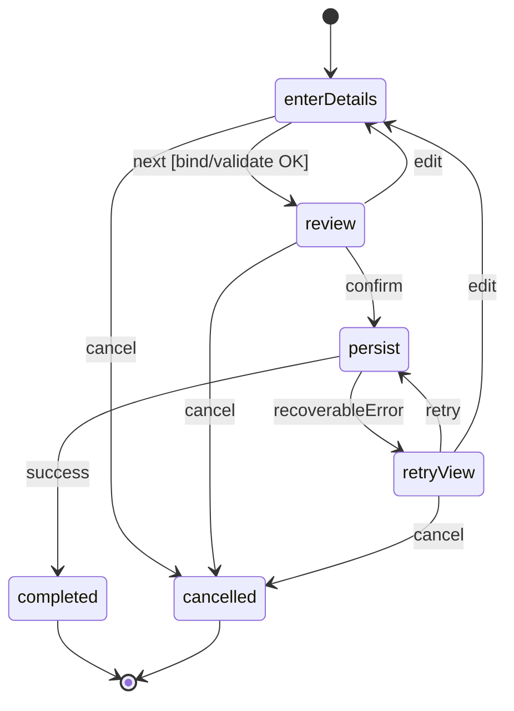

# Cấu trúc tài liệu XML và schema Web Flow

Trong chương **Flow đầu tiên**, sau khi xác định hành trình người dùng bằng sơ đồ trạng thái, bước tiếp theo là chuyển sơ đồ thành một **flow definition** mà Spring Web Flow có thể đọc và thực thi. Với cách cấu hình XML, mỗi flow được mô tả trong một tài liệu có phần tử gốc `<flow>`, các state, event và transition; còn **XML Schema (XSD)** quy định những phần tử và thuộc tính nào được phép xuất hiện, cũng như cách lồng ghép chúng.

Bài này tập trung vào cách đọc, tổ chức và viết file XML của **Spring Web Flow**. Người học sẽ tạo được một định nghĩa flow tối thiểu, hiểu namespace và `xsi:schemaLocation`, xác định đúng vị trí `view-state`, `action-state`, `decision-state`, `subflow-state`, `end-state`, và biết phân biệt lỗi cấu trúc XML với lỗi điều hướng hoặc nghiệp vụ khi chạy.

Một flow hoàn chỉnh còn phải phối hợp với Spring MVC, binding, validation, scope, phiên làm việc và cơ chế phục hồi sau lỗi. XML là bản mô tả điều hướng ở trung tâm, còn view, action và service triển khai những phần việc cụ thể.

## 1. Flow definition nằm ở đâu trong ứng dụng?

Một ứng dụng có thể có nhiều flow, chẳng hạn đăng ký workshop, đổi lịch hẹn và yêu cầu hoàn tiền. Mỗi flow có **flow ID** và một định nghĩa riêng. Khi HTTP request được ánh xạ tới flow ID, `FlowExecutor` khởi tạo hoặc tiếp tục một lần thực thi của flow đó.

Một bố cục thường dùng trong ứng dụng Spring MVC với JSP:

```text
src/main/webapp/
├── WEB-INF/
│   ├── flows/
│   │   └── registration/
│   │       └── registration-flow.xml
│   └── views/
│       └── registration/
│           ├── details.jsp
│           ├── review.jsp
│           ├── retry.jsp
│           ├── completed.jsp
│           └── cancelled.jsp
```

Đường dẫn và tên file trên là **quy ước tổ chức** cho ví dụ, không phải yêu cầu cứng của XSD. Ứng dụng có thể đăng ký flow definition từ vị trí khác qua `FlowDefinitionRegistry`. File XML chứa định nghĩa trạng thái và chuyển tiếp; JSP chứa giao diện; bean Java triển khai action và nghiệp vụ.

Đừng nhầm:

- **Flow definition**: bản thiết kế có thể tái sử dụng, ví dụ `registration-flow.xml`.
- **Flow execution**: một lần người dùng đi qua bản thiết kế, có context và khóa thực thi riêng.
- **Flow ID**: tên logic dùng để tra cứu định nghĩa, ví dụ `registration`.
- **State ID**: định danh duy nhất của một trạng thái bên trong flow, ví dụ `review`.
- **View name**: tên giao diện mà view resolver giải quyết, ví dụ `registration/review`.

Một flow có thể được thực thi nhiều lần và nhiều người dùng có thể ở các state khác nhau của cùng định nghĩa XML.

## 2. Khung XML tối thiểu và vai trò của schema

Một tài liệu XML Spring Web Flow có thể bắt đầu như sau:

```xml
<?xml version="1.0" encoding="UTF-8"?>
<flow xmlns="http://www.springframework.org/schema/webflow"
      xmlns:xsi="http://www.w3.org/2001/XMLSchema-instance"
      xsi:schemaLocation="
        http://www.springframework.org/schema/webflow
        http://www.springframework.org/schema/webflow/spring-webflow.xsd"
      start-state="enterDetails">

    <view-state id="enterDetails" view="registration/details">
        <transition on="cancel" to="cancelled"/>
    </view-state>

    <end-state id="cancelled" view="registration/cancelled"/>
</flow>
```

Giải thích từng thành phần:

| Thành phần | Ý nghĩa |
| --- | --- |
| `<?xml version="1.0" encoding="UTF-8"?>` | Khai báo phiên bản XML và cách mã hóa ký tự. |
| `<flow> ... </flow>` | Phần tử gốc chứa định nghĩa của một flow. |
| `xmlns="http://www.springframework.org/schema/webflow"` | Namespace mặc định: các phần tử không có tiền tố như `view-state` thuộc bộ từ vựng của Spring Web Flow. |
| `xmlns:xsi="http://www.w3.org/2001/XMLSchema-instance"` | Khai báo tiền tố chuẩn để sử dụng thuộc tính liên quan XML Schema. |
| `xsi:schemaLocation="namespace-uri schema-url"` | Gắn namespace Spring Web Flow với địa chỉ XSD tương ứng. |
| `start-state="enterDetails"` | Chỉ rõ state bắt đầu. Có thể không khai báo nếu dựa vào quy tắc state bắt đầu mặc định của flow. |
| `id="enterDetails"` | Tên state phải được tham chiếu nhất quán trong cùng flow. |
| `on="cancel"` và `to="cancelled"` | Từ event `cancel`, chuyển sang state `cancelled`. |

Cặp giá trị trong `xsi:schemaLocation` được viết theo thứ tự **namespace URI rồi tới URL của XSD**, cách nhau bằng khoảng trắng. Thuộc tính này có thể chứa nhiều cặp nếu tài liệu dùng nhiều namespace. Chuỗi `http://www.springframework.org/schema/webflow` là **định danh namespace**, không có nghĩa mọi request phải gửi đến URL đó.

Trong ứng dụng đã cài thư viện Spring phù hợp, cơ chế XML resolver/catalog thường có thể phân giải schema tới tài nguyên đóng gói trong JAR. Vì vậy không nên giả định rằng cứ mở được URL XSD trên Internet thì ứng dụng chắc chắn load được flow, hoặc ngược lại. Điều quan trọng là version thư viện, namespace và schema phải tương thích.

**Hai tầng kiểm tra khác nhau:** trình phân tích XML kiểm tra dấu ngoặc, đóng/mở tag, escape ký tự; XSD kiểm tra hình dạng và thuộc tính tài liệu. Engine Spring Web Flow tiếp tục kiểm tra hoặc xử lý các vấn đề ngữ nghĩa như bean expression, state đích, event, binding, validation và điều kiện nghiệp vụ. XSD hợp lệ chưa bảo đảm flow hoạt động đúng.

## 3. Một flow ba bước: nhập, xem lại, xác nhận

Xét hành trình **đăng ký tham gia workshop**: người dùng nhập họ tên và email, xem lại rồi xác nhận. Định nghĩa dưới đây minh họa cấu trúc XML chính, gồm cả hủy và phục hồi khi lưu lỗi.

```xml
<?xml version="1.0" encoding="UTF-8"?>
<flow xmlns="http://www.springframework.org/schema/webflow"
      xmlns:xsi="http://www.w3.org/2001/XMLSchema-instance"
      xsi:schemaLocation="
        http://www.springframework.org/schema/webflow
        http://www.springframework.org/schema/webflow/spring-webflow.xsd"
      start-state="enterDetails">

    <!-- JavaBean giữ dữ liệu bản nháp của một flow execution -->
    <var name="registration"
         class="com.example.registration.RegistrationDraft"/>

    <!-- Bước 1: binding form và kiểm tra dữ liệu -->
    <view-state id="enterDetails"
                view="registration/details"
                model="registration">
        <binder>
            <binding property="fullName"/>
            <binding property="email"/>
        </binder>

        <transition on="next"
                    to="review"
                    bind="true"
                    validate="true"/>

        <transition on="cancel"
                    to="cancelled"
                    bind="false"
                    validate="false"/>
    </view-state>

    <!-- Bước 2: chỉ xem lại, chưa ghi dữ liệu -->
    <view-state id="review" view="registration/review">
        <transition on="edit" to="enterDetails"/>
        <transition on="confirm" to="persist"/>
        <transition on="cancel" to="cancelled"/>
    </view-state>

    <!-- Bước 3: thực thi action ghi dữ liệu -->
    <action-state id="persist">
        <evaluate expression="registrationAction.submit(registration)"/>
        <transition on="success" to="completed"/>
        <transition on="recoverableError" to="retryView"/>
    </action-state>

    <!-- Lỗi tạm thời có đường phục hồi -->
    <view-state id="retryView" view="registration/retry">
        <transition on="retry" to="persist"/>
        <transition on="edit" to="enterDetails"/>
        <transition on="cancel" to="cancelled"/>
    </view-state>

    <!-- Các kết quả kết thúc flow -->
    <end-state id="completed" view="registration/completed"/>
    <end-state id="cancelled" view="registration/cancelled"/>
</flow>
```

Ở đây, `RegistrationDraft` là JavaBean của ứng dụng; `registrationAction` là Spring bean có phương thức `submit(...)` trả kết quả mà flow hiểu thành event `success` hoặc `recoverableError`. Các class và view được đặt tên cho ví dụ, **không phải class dựng sẵn của Spring Web Flow**.

Sơ đồ điều hướng tương ứng:



Một vài đặc điểm của XML cần nhận diện ngay:

1. `<var>` khai báo đối tượng bản nháp có vòng đời phù hợp với flow; nó không đại diện cho một bảng dữ liệu hay một controller.
2. `<view-state model="registration">` xác định model được bind khi xử lý form ở state nhập liệu.
3. `<binder>` liệt kê các trường client được phép gửi vào model; không cấp quyền ghi tùy tiện mọi thuộc tính của bean.
4. `<transition on="next">` chỉ chuyển sang `review` khi binding/validation theo cấu hình có thể hoàn thành. Khi có lỗi form, view hiện tại được giữ để hiển thị lỗi.
5. `<transition on="cancel" bind="false" validate="false">` cho phép hủy ngay cả khi dữ liệu nhập chưa hợp lệ.
6. `<action-state>` dùng cho logic hệ thống có thể trả về event và chọn nhánh kế tiếp; view `review` không gọi lưu dữ liệu.
7. `<end-state>` đóng execution với một kết quả cụ thể. Gửi event vào một execution đã kết thúc phải được xử lý theo cơ chế hết hạn/không còn hiệu lực của ứng dụng.

XML định nghĩa được **đường đi**, còn việc chống ghi trùng khi người dùng retry phải được thực hiện ở service/database bằng khóa yêu cầu/idempotency. State engine không thay thế transaction.

## 4. Cây cấu trúc và quy tắc lồng phần tử

Khi đọc một flow lớn, nên nhìn tài liệu như **cây phần tử** thay vì danh sách URL:

```text
flow
├── var / input (khai báo dữ liệu và đầu vào, tùy tình huống)
├── on-start (hành động khi khởi chạy, nếu có)
├── view-state
│   ├── binder (các property được bind)
│   ├── on-entry / on-render / on-exit (theo nhu cầu)
│   └── transition (sự kiện người dùng)
├── action-state
│   ├── evaluate (lệnh chạy khi vào state)
│   └── transition (event kết quả action)
├── decision-state
│   └── if (điều kiện then/else)
├── subflow-state
│   ├── input (dữ liệu truyền tới flow con)
│   └── transition (kết quả từ flow con)
└── end-state
    └── output (giá trị trả về khi flow kết thúc, nếu cần)
```

Đây là **bản đồ khái niệm**, không phải đặc tả thứ tự phần tử đầy đủ của XSD. Với từng phần tử, phải tuân thủ các vị trí con và thứ tự được schema của phiên bản đang dùng cho phép. Chẳng hạn, `<transition>` có ý nghĩa bên trong một state hoặc điểm gắn hành vi hỗ trợ transition; đặt transition tùy tiện ở mọi vị trí trong file sẽ không tạo ra sự kiện hợp lệ.

Không phải flow nào cũng cần đủ mọi loại state. Flow đơn giản chỉ có `view-state` và `end-state`; flow nhiều bước có thể thêm `action-state`, `decision-state` hay `subflow-state`.

## 5. Các loại state và thuộc tính cốt lõi

| Loại state | Dùng khi nào? | Các thành phần hay gặp |
| --- | --- | --- |
| `view-state` | Hiển thị màn hình, chờ người dùng gửi event | `id`, `view`, `model`, `binder`, `transition` |
| `action-state` | Thực thi service/action, phân nhánh theo kết quả | `id`, `evaluate` hoặc action tương ứng, `transition` |
| `decision-state` | Rẽ nhánh dựa trên điều kiện không cần người dùng | `id`, `if test="..." then="..." else="..."` |
| `subflow-state` | Gọi một flow con và chờ kết quả | `id`, `subflow`, `input`, `transition` |
| `end-state` | Kết thúc execution hoặc trả kết quả cho flow cha | `id`, `view` tùy tình huống, `output` |

### View-state: trạng thái có giao diện

```xml
<view-state id="editProfile"
            view="account/edit"
            model="profile">
    <binder>
        <binding property="displayName"/>
        <binding property="phoneNumber"/>
    </binder>
    <transition on="save" to="review"
                bind="true" validate="true"/>
    <transition on="cancel" to="cancelled"
                bind="false" validate="false"/>
</view-state>
```

`id` là tên state; `view` là tên logic của template cần render; `model` là tên object để binding. Trong nhiều dự án, tên view được resolve thông qua `ViewResolver` của Spring MVC. Tên `account/edit` không có nghĩa cần tạo URL HTTP tương ứng.

Để giữ event và state nhất quán, form nên POST về URL flow execution do Web Flow cung cấp, ví dụ dùng tên nút `_eventId_save` hoặc tham số `_eventId=save` theo quy ước của Web Flow. **Không gửi một request GET có side effect để kích hoạt lưu bản ghi.**

### Action-state: kết quả của lệnh trở thành event

```xml
<action-state id="submitApplication">
    <evaluate expression="applicationAction.submit(application)"/>
    <transition on="success" to="completed"/>
    <transition on="validationRejected" to="editApplication"/>
    <transition on="temporaryFailure" to="retryView"/>
</action-state>
```

Phương thức action cần tạo kết quả phù hợp với cơ chế event của Web Flow, chẳng hạn trả về `org.springframework.webflow.execution.Event` có ID `success`. Không nên suy luận rằng một exception bất kỳ tự động trở thành event `temporaryFailure`. Action/service phải bắt và phân loại đúng các lỗi có thể phục hồi; exception không xử lý sẽ theo cơ chế xử lý lỗi của ứng dụng.

### Decision-state: kiểm tra điều kiện để chọn nhánh

```xml
<decision-state id="checkEligibility">
    <if test="eligibilityService.isAllowed(application)"
        then="submitApplication"
        else="notEligible"/>
</decision-state>
```

Đây là một nhánh điều kiện, không phải bước người dùng nhấn nút. Biểu thức `test` được đánh giá trong context của flow và phải cho kết quả boolean có ý nghĩa. Nếu điều kiện kiểm tra dữ liệu biến động (tồn kho, số chỗ, quyền truy cập), service ghi dữ liệu vẫn phải xác thực lần nữa ở ranh giới transaction.

### End-state: kết thúc có chủ đích

```xml
<end-state id="completed" view="application/completed"/>
<end-state id="cancelled" view="application/cancelled"/>
```

Hai state kết thúc có thể render hai trang khác nhau hoặc trả hai kết quả khác nhau cho flow cha. Đừng dùng `completed` cho cả thành công và hủy: nó làm các caller khó phân biệt kết quả.

## 6. Event và transition trong XML

Một transition phổ biến có hai thuộc tính trung tâm:

```xml
<transition on="confirm" to="persist"/>
```

- `on`: tên event cần nhận ở state hiện tại.
- `to`: ID state đích trong cùng flow.

Cần hiểu sự khác nhau giữa **event do người dùng gửi** và **event do action trả về**. Ví dụ `_eventId_confirm` có thể phát từ nút submit của `review`, còn `success` phát từ `registrationAction.submit(...)` sau khi xử lý nghiệp vụ. Đừng yêu cầu form tự gửi `success` thay cho kết quả thực tế của service.

Một số transition có thể mang hành vi trước khi chuyển state. Chẳng hạn trong view-state có model:

```xml
<transition on="next"
            to="review"
            bind="true"
            validate="true"/>

<transition on="cancel"
            to="cancelled"
            bind="false"
            validate="false"/>
```

Không áp dụng một cách máy móc thuộc tính `bind`, `validate` cho mọi loại state. Chúng liên quan cụ thể đến quá trình xử lý form/view; với action-state, điều quan trọng là event trả về và nhánh transition.

Nếu định nghĩa `on="confirm"` chỉ tại `review`, thì gửi event `confirm` khi đang ở `enterDetails` không phải cách hợp lệ để bỏ qua bước nhập thông tin. Flow engine kiểm tra event theo **state hiện tại**, giúp bảo vệ tính nhất quán điều hướng. Dù vậy, logic nghiệp vụ vẫn phải tự kiểm tra phân quyền và các ràng buộc dữ liệu; không lấy sự tồn tại của transition làm kiểm tra quyền truy cập.

## 7. Khai báo dữ liệu, scope và flow input/output

Một flow thường cần dữ liệu sống qua nhiều màn hình. XML có thể khai báo một bean của flow bằng `<var>`:

```xml
<var name="registration"
     class="com.example.registration.RegistrationDraft"/>
```

Object này thường được quản lý trong `flowScope` của execution. Từ flow và các view, có thể tham chiếu qua tên `registration` hoặc cách truy cập tường minh như `flowScope.registration` tùy context biểu thức.

Các scope được dùng nhiều:

| Scope | Vòng đời | Phù hợp |
| --- | --- | --- |
| `requestScope` | Một request xử lý flow | Giá trị trung gian ngắn hạn |
| `flashScope` | Dữ liệu ngắn hạn phục vụ chuyển tiếp/render | Thông điệp vừa phát sinh |
| `viewScope` | Trong một view-state cụ thể | Lựa chọn hiển thị của cùng màn hình |
| `flowScope` | Suốt một flow execution | Bản nháp giữ qua nhập/xem lại/quay lại |
| `conversationScope` | Context hội thoại chứa các flow liên quan | Dữ liệu dùng chung khi có thiết kế rõ ràng |

**Flow scope khác session scope.** Nếu lưu bản nháp vào một thuộc tính session chung có tên cố định, hai tab cùng mở flow có thể ghi đè dữ liệu lẫn nhau. Flow execution cho phép giữ bản nháp theo từng lần chạy; khi cần lưu lâu hơn vòng đời execution, service nên lưu bản nháp vào database rồi trả về khóa tham chiếu.

### Dữ liệu đi vào flow

Một flow có thể nhận input khi được gọi trực tiếp hoặc từ flow cha:

```xml
<input name="campaignId" required="false"/>
```

Input mapping và nơi dữ liệu xuất hiện cần được kiểm tra theo cấu hình flow. Không dùng `campaignId` do request gửi tới để bỏ qua xác thực, và không tin rằng việc khai báo `required="true"` là một bước phân quyền.

### Dữ liệu trả ra khi flow kết thúc

Khi một flow hoạt động như subflow, end-state có thể trả output về flow cha:

```xml
<end-state id="selected">
    <output name="selectedSlotId" value="flowScope.selectedSlotId"/>
</end-state>
```

Tên output biểu thị hợp đồng dữ liệu; caller cần biết đang chờ giá trị nào. Tránh truyền trực tiếp một object lớn hoặc dữ liệu bảo mật khi chỉ cần ID.

## 8. Lifecycle: chạy hành động tại thời điểm phù hợp

Ngoài transition, Web Flow có các hook lifecycle cho một số thời điểm quan trọng. Chúng giúp tách logic khởi tạo/chuẩn bị dữ liệu khỏi event điều hướng.

### Khi flow bắt đầu: `on-start`

```xml
<on-start>
    <evaluate expression="registrationInitializer.prepare(registration)"/>
</on-start>
```

Hook này có thể khởi tạo dữ liệu mặc định hoặc lấy các lựa chọn hiển thị. Không đặt thao tác ghi giao dịch cuối cùng vào `on-start` nếu mục đích chỉ là mở màn hình: người dùng có thể bắt đầu flow rồi hủy.

### Khi vào state: `on-entry`

```xml
<view-state id="review" view="registration/review">
    <on-entry>
        <evaluate expression="feeService.estimate(registration)"
                  result="flowScope.estimatedFee"/>
    </on-entry>

    <transition on="edit" to="enterDetails"/>
    <transition on="confirm" to="persist"/>
</view-state>
```

`on-entry` có thể chạy mỗi lần flow đi vào state `review`. Vì người dùng có thể quay lại và vào lại, action dùng ở đây nên an toàn khi gọi lặp; ví dụ tính giá dự kiến là thao tác đọc/tính toán, còn xác nhận thanh toán phải có state và service riêng.

### Khi render hoặc khi rời state

`on-render` giúp chuẩn bị dữ liệu hiển thị ở view-state khi render; `on-exit` hỗ trợ hành động dọn dẹp hay kết thúc trách nhiệm của state khi rời state. Cần chọn hook dựa trên **thời điểm thực tế** và khả năng được gọi lại, tránh đặt side effect không idempotent trong hook render. Không phải mọi hook đều áp dụng cho mọi state hoặc được dùng tùy vị trí; phải xem XSD tương ứng của project.

## 9. Subflow-state và hợp đồng giữa hai flow

Khi một đoạn hành trình có ý nghĩa độc lập và dùng lại được, có thể khai báo `subflow-state` để gọi một định nghĩa flow khác. Ví dụ flow đăng ký gọi flow xác minh email trước bước review:

```xml
<subflow-state id="verifyEmail" subflow="emailVerification">
    <input name="email" value="registration.email"/>
    <transition on="verified" to="review"/>
    <transition on="cancelled" to="enterDetails"/>
</subflow-state>
```

Flow con `emailVerification` phải được đăng ký trong registry và thiết kế để nhận input `email`, sau đó kết thúc bằng outcome tương ứng. Đây là **đoạn XML minh họa**: để chèn vào flow chính cần thêm state và sửa transition trước đó sao cho hành trình đi qua `verifyEmail`.

Một hợp đồng tốt cần nêu:

- **Input:** flow cha truyền gì vào flow con, có bắt buộc không, có kiểm tra dữ liệu không?
- **Outcome:** flow con có những kết quả kết thúc nào, ví dụ `verified`, `cancelled`, `expired`?
- **Output:** flow con có trả dữ liệu không, flow cha đọc và xử lý như thế nào?
- **Scope:** dữ liệu nào thuộc flow con, dữ liệu nào thuộc flow cha hoặc conversation?

Không nên mặc định rằng mọi biến `flowScope` của cha đều trở thành dữ liệu công khai của con. Truyền input/output có chủ đích giúp giữ các flow độc lập và giảm phụ thuộc vào session chung.

## 10. Schema kiểm tra được gì và không kiểm tra được gì?

XSD rất hữu ích nhưng không phải bộ kiểm thử toàn bộ hành trình. Có thể phân chia theo từng tầng:

| Tầng | Loại vấn đề | Ví dụ |
| --- | --- | --- |
| XML well-formedness | Sai cú pháp XML | Thiếu `</view-state>`, dùng `&` chưa escape |
| XML Schema (XSD) | Sai phần tử/thuộc tính/vị trí theo schema | Viết nhầm `<viewstate>` thay `<view-state>` |
| Flow definition và biểu thức | Tham chiếu sai ID, flow, bean hoặc expression | `to="revieww"`, bean `registrationAction` chưa đăng ký |
| Binding/validation | Dữ liệu form không bind được hoặc không hợp lệ | Email sai định dạng; tên property không khớp bean |
| Nghiệp vụ và transaction | Điều kiện thực tế, concurrency, retry | Số chỗ đã hết, lưu lặp sau timeout |
| Bảo mật và phiên | Quyền truy cập, CSRF, execution hết hạn | Gửi event cũ sau khi flow đóng |

Ví dụ, một trình kiểm tra schema có thể chấp nhận thuộc tính `to="missingState"` về mặt kiểu chuỗi. Nhưng điều đó không chứng minh state `missingState` tồn tại. Tương tự, biểu thức `registrationAction.submit(registration)` hợp lệ về mặt XML không bảo đảm Spring đã đăng ký bean hoặc phương thức đó trả đúng event mong đợi.

Dấu `&` trong XML attribute phải được viết `&amp;`; ký tự nhỏ hơn phải escape phù hợp khi đứng trong nội dung/thuộc tính. Ví dụ trong một biểu thức phức tạp, cần đảm bảo cả **XML escaping** lẫn **cú pháp biểu thức** đều hợp lệ.

## 11. Đăng ký flow definition với Spring MVC

Định nghĩa XML không tự xuất hiện thành một endpoint nếu ứng dụng chưa đăng ký flow và kết nối cơ chế xử lý request. Các thành phần thường có:

| Thành phần | Công việc |
| --- | --- |
| `FlowDefinitionRegistry` | Quản lý tập flow definition được đăng ký |
| `FlowExecutor` | Bắt đầu, tiếp tục và kết thúc execution |
| `FlowHandlerMapping` | Ánh xạ URL/request tới flow trong registry |
| `FlowHandlerAdapter` | Cầu nối request của Spring MVC tới `FlowExecutor` |
| `ViewResolver` | Giải quyết tên view thành template/JSP tương ứng |

Ví dụ khung Java config thường gặp trong dự án đã cài và tích hợp Spring Web Flow:

```java
@Configuration
public class WebFlowConfig extends AbstractFlowConfiguration {

    @Bean
    public FlowDefinitionRegistry flowRegistry() {
        return getFlowDefinitionRegistryBuilder()
            .addFlowLocation(
                "/WEB-INF/flows/registration/registration-flow.xml",
                "registration"
            )
            .build();
    }

    @Bean
    public FlowExecutor flowExecutor() {
        return getFlowExecutorBuilder(flowRegistry()).build();
    }

    @Bean
    public FlowHandlerMapping flowHandlerMapping() {
        FlowHandlerMapping mapping = new FlowHandlerMapping();
        mapping.setFlowRegistry(flowRegistry());
        mapping.setOrder(-1);
        return mapping;
    }

    @Bean
    public FlowHandlerAdapter flowHandlerAdapter() {
        FlowHandlerAdapter adapter = new FlowHandlerAdapter();
        adapter.setFlowExecutor(flowExecutor());
        return adapter;
    }
}
```

Đây là **khung minh họa**, chưa gồm các import, security, cấu hình view resolver và các bean nghiệp vụ. API cấu hình, package và mức tương thích với Spring MVC/Jakarta Servlet phụ thuộc phiên bản Spring Web Flow thực tế. Không lấy riêng đoạn code này làm cam kết rằng mọi phiên bản Spring Boot đều chạy trực tiếp.

Khi đăng ký với ID `registration`, ứng dụng có thể có đường truy cập bắt đầu flow tương ứng theo mapping đã cấu hình. Các bước sau gửi event tới **URL flow execution** do engine cung cấp, không cần tạo controller method mới cho từng state.

## 12. Cách tìm và sửa các lỗi XML thường gặp

### Lỗi 1: Namespace sai hoặc thiếu schema

Ví dụ sai:

```xml
<flow xmlns="http://example.com/my-own-namespace">
    <view-state id="edit" view="registration/details"/>
</flow>
```

Cú pháp XML có thể hoàn toàn hợp lệ nhưng trình xử lý Spring Web Flow sẽ không nhận được phần tử thuộc namespace đúng. Hãy dùng namespace Spring Web Flow và cặp `xsi:schemaLocation` phù hợp với thư viện.

### Lỗi 2: Nhầm tên state và tên view

```xml
<view-state id="review" view="registration/review"/>
<transition on="next" to="registration/review"/>
```

`to` cần tham chiếu **state ID**, không tham chiếu tên template `registration/review`. Nếu transition được đặt trong state thích hợp thì đích nên là `review`. Ví dụ trên cũng cho thấy `<transition>` đứng ngoài state cần được xem lại theo XSD, thay vì chỉ sửa chuỗi `to`.

### Lỗi 3: Event không khớp tên

```xml
<transition on="confirm" to="persist"/>
```

Nếu form gửi `_eventId_submit` trong khi state chỉ có transition `confirm`, flow không thể lấy đó làm xác nhận hợp lệ. Hãy thống nhất event giữa XML và tên nút ở view.

### Lỗi 4: Nhầm validation form với kiểm tra nghiệp vụ

Một form có email đúng định dạng không đồng nghĩa người dùng có quyền đăng ký, suất còn trống hoặc lịch hẹn còn hiệu lực. XSD không thể chứng minh các điều này. Validation xử lý dữ liệu đầu vào; service kiểm tra quyền, transaction và ràng buộc nghiệp vụ tại thời điểm ghi.

### Lỗi 5: Gọi ghi dữ liệu trong hook hiển thị

`on-render` hoặc `on-entry` của màn review có thể xảy ra nhiều lần. Nếu hook gọi lệnh tạo đơn, refresh hay quay lại sẽ tạo side effect không mong muốn. Đặt lệnh ghi trong action-state được kích hoạt từ event xác nhận, đồng thời bảo vệ chống gọi lặp tại service.

### Lỗi 6: Giữ toàn bộ hành trình trong session chung

Nếu viết controller tự lấy `session.setAttribute("draft", ...)` và dùng một khóa cố định, hai tab có thể làm lẫn bản nháp. Trong flow XML, hãy khai báo `<var>`/`flowScope` phù hợp; chỉ đưa dữ liệu thực sự cần chia sẻ ra các scope rộng hơn.

### Lỗi 7: Không có nhánh phục hồi hợp lệ

Nếu action trả event `recoverableError` nhưng XML chỉ khai báo transition `success`, người dùng không có đường đi rõ ràng khi lỗi tạm thời xuất hiện. Bảng event/transition phải phản ánh đủ các kết quả action dự kiến.

## 13. Kiểm thử định nghĩa XML theo từng lớp

Một quy trình kiểm thử có thể chia thành ba lớp:

**Lớp 1 — Cú pháp và schema:** XML có parse được, namespace và các phần tử hợp lệ không? Khi ứng dụng load registry, định nghĩa có đăng ký được với ID mong đợi không?

**Lớp 2 — Hành trình state/event:** bắt đầu có đúng state, sự kiện có chuyển đúng nơi, form sai có bị giữ lại, hủy có bỏ qua validation và retry có giữ bản nháp không?

**Lớp 3 — Hệ thống thực:** bean/action có được gọi đúng lần, transaction và idempotency có tránh lưu trùng, security có bảo vệ request, flow execution hết hạn có kết thúc an toàn không?

Bảng kịch bản cụ thể cho flow `registration`:

| Kịch bản | Tác động | Kỳ vọng |
| --- | --- | --- |
| Khởi động | Bắt đầu flow `registration` | State hiện tại là `enterDetails` |
| Nhập hợp lệ | Gửi `next` với fullName/email đúng | Đến `review` |
| Nhập lỗi | Gửi `next` với email sai | Ở lại `enterDetails` và hiển thị lỗi |
| Hủy form lỗi | Gửi `cancel` dù email sai | Đến `cancelled` mà chưa gọi action lưu |
| Quay lại sửa | `review` phát `edit` | Về `enterDetails`, bản nháp còn |
| Xác nhận thành công | `review` phát `confirm`, action trả `success` | Đến `completed`, lưu một yêu cầu |
| Lưu lỗi tạm thời | Action trả `recoverableError` | Đến `retryView`, giữ bản nháp |
| Thử lại | `retryView` phát `retry` | Action được gọi lại với cùng khóa yêu cầu nghiệp vụ |
| Event sai state | Gửi `confirm` từ `enterDetails` | Không được vượt bước kiểm tra dữ liệu |
| Execution hết hạn | Gửi request bằng khóa cũ | Xử lý theo chính sách hết hạn, không lưu thêm |

Mã giả cho một đường kiểm thử:

```text
startFlow("registration")
  -> assertCurrentState("enterDetails")

submitEvent("next", fullName="An", email="an@example.com")
  -> assertCurrentState("review")
  -> assertNoPersistAction()

submitEvent("edit")
  -> assertCurrentState("enterDetails")
  -> assertDraftPreserved()

submitEvent("next")
submitEvent("confirm")
  -> assertCurrentState("completed")
  -> assertPersistedExactlyOnce()
```

Đây là mã giả thể hiện mục tiêu kiểm tra, không phải API thật của framework test. Khi triển khai có thể dùng công cụ test flow của Spring Web Flow kết hợp mock service, rồi viết kiểm thử tích hợp riêng cho ràng buộc database.

## 14. Bài thực hành: đọc và mở rộng flow XML

Từ định nghĩa đăng ký workshop ở mục 3, hãy thực hiện:

1. Thêm trường `seats` (số chỗ) vào `RegistrationDraft` và whitelist binding tương ứng.
2. Bổ sung Bean Validation cho `fullName`, `email` và `seats`; kiểm tra rằng dữ liệu sai không đến `review`.
3. Tạo `decision-state` `checkAvailability` trước `persist` để hiển thị `soldOut` nếu chưa đủ chỗ.
4. Định nghĩa thêm event `edit` và `cancel` từ state `soldOut`, bảo toàn dữ liệu đã nhập.
5. Điều chỉnh service lưu để kiểm tra lại số chỗ tại transaction, xử lý conflict và dùng khóa idempotency cho retry.
6. Vẽ lại sơ đồ Mermaid để so sánh state/transition thực tế với XML sau khi mở rộng.
7. Viết test cho: hợp lệ, email sai, hủy khi nhập sai, quay lại sửa, hết chỗ, conflict khi lưu, lỗi tạm thời và gửi lặp.

Khi review bài làm, hãy tự kiểm tra: **(a)** có đúng một root `<flow>` với namespace/schema phù hợp; **(b)** mọi state ID và transition đích khớp nhau; **(c)** các event form và event action được phân biệt; **(d)** lifecycle hook không gây ghi lặp; **(e)** flow scope giữ đúng dữ liệu cho toàn hành trình; **(f)** mọi nhánh lỗi quan trọng có đường xử lý; **(g)** tính đúng đắn của transaction và bảo mật được kiểm tra ngoài XSD.

Nắm rõ cấu trúc tài liệu XML và schema giúp bạn đọc một flow như một bản đồ điều hướng có thể kiểm chứng. Từ đó, việc thay đổi màn hình, bổ sung state hoặc tách subflow trở thành sửa một đặc tả rõ ràng, trong khi binding, validation, scope, Spring MVC và phục hồi lỗi vẫn được kiểm soát theo trách nhiệm riêng của từng thành phần.
