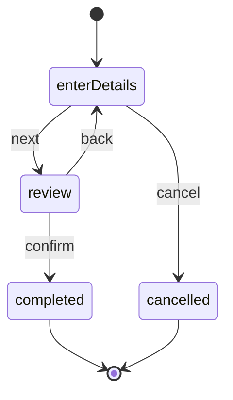

# Khai báo flow, định danh state và state bắt đầu

## 1. Từ một hành trình web đến định nghĩa flow

**Spring Web Flow** mô hình hóa các quy trình web nhiều bước như đăng ký tài khoản, đặt hàng hoặc cập nhật hồ sơ bằng một *flow definition* (định nghĩa luồng). Định nghĩa đó gồm các **state** (trạng thái), **event** (sự kiện do người dùng hoặc hệ thống phát ra) và **transition** (quy tắc chuyển trạng thái). Khi cần, flow còn có thể gọi **subflow** để tái sử dụng một hành trình con. Cách tổ chức này tập trung logic điều hướng vào định nghĩa flow thay vì phân tán nhiều nhánh `if/else` trong các Spring MVC controller.

Ví dụ đăng ký dịch vụ có hành trình:

1. Người dùng ở màn hình `enterDetails` để nhập thông tin.
2. Bấm **Tiếp tục** để sang `review`, hoặc **Hủy** để kết thúc sớm.
3. Ở `review`, người dùng có thể quay lại sửa hoặc bấm **Xác nhận** để hoàn tất.



Sơ đồ có bốn **state** (`enterDetails`, `review`, `completed`, `cancelled`); ký hiệu `[*]` là điểm bắt đầu/kết thúc trên sơ đồ, không phải một state được khai báo trong XML. Bốn event trên các mũi tên (`next`, `cancel`, `back`, `confirm`) xác định cách người dùng di chuyển. Ở các bước sau, ứng dụng có thể thêm form binding, validation, scope, lưu phiên, điều kiện rẽ nhánh và xử lý lỗi mà vẫn giữ nguyên nguyên tắc khai báo state.

## 2. Tệp XML tối thiểu của một flow

Trong Spring Web Flow, một flow thường được khai báo bằng **một file XML** có phần tử gốc `<flow>`. Ví dụ đặt tại `/WEB-INF/flows/signup/signup-flow.xml`:

```xml
<?xml version="1.0" encoding="UTF-8"?>
<flow xmlns="http://www.springframework.org/schema/webflow"
      xmlns:xsi="http://www.w3.org/2001/XMLSchema-instance"
      xsi:schemaLocation="
        http://www.springframework.org/schema/webflow
        http://www.springframework.org/schema/webflow/spring-webflow-2.0.xsd">

    <view-state id="enterDetails" view="signup/enter-details">
        <transition on="next" to="review"/>
        <transition on="cancel" to="cancelled"/>
    </view-state>

    <view-state id="review" view="signup/review">
        <transition on="back" to="enterDetails"/>
        <transition on="confirm" to="completed"/>
    </view-state>

    <end-state id="completed" view="signup/completed"/>
    <end-state id="cancelled"/>
</flow>
```

Ví dụ trên mô tả **đầy đủ luồng điều hướng tối thiểu**, với các thành phần:

| Thành phần XML | Vai trò trong ví dụ | Ý nghĩa |
| --- | --- | --- |
| `<flow>` | Phần tử gốc | Chứa các state, transition và cấu hình khác của một flow definition |
| `<view-state id="enterDetails" ...>` | Màn hình đầu tiên | Flow dừng ở đây để render view và chờ event |
| `view="signup/enter-details"` | Tên view logic | Được view resolver của ứng dụng chuyển thành trang thực tế |
| `<transition on="next" to="review"/>` | Đường đi khi bấm Tiếp tục | Khi ở `enterDetails` và nhận event `next`, chuyển sang state `review` |
| `<end-state id="completed" .../>` | Nhánh kết thúc thành công | Execution kết thúc, có thể render view hoàn tất |
| `<end-state id="cancelled"/>` | Nhánh hủy | Execution kết thúc mà không khai báo view hoàn tất |

Với cấu hình đơn giản này, Web Flow không yêu cầu bạn viết một `@Controller` cho riêng từng `view-state`. Spring MVC chịu trách nhiệm nhận HTTP request, còn Web Flow chọn state và transition.

**Giới hạn của ví dụ:** XML mô tả định nghĩa flow, nhưng để mở được URL trong trình duyệt, ứng dụng còn phải đăng ký flow với `FlowDefinitionRegistry`, `FlowExecutor` và các bean nối vào `DispatcherServlet`. Các phần đó được giới thiệu ở mục 6.

## 3. ID của state: tên, phạm vi và quy tắc đặt

Thuộc tính `id` của một state là **tên duy nhất của state trong cùng flow definition**. Web Flow dùng ID để tham chiếu state đích trong `transition` và để runtime xác định state hiện tại.

```xml
<view-state id="enterDetails" view="signup/enter-details">
    <transition on="next" to="review"/>
</view-state>

<view-state id="review" view="signup/review">
    <transition on="back" to="enterDetails"/>
</view-state>
```

Trong snippet này, `enterDetails` và `review` là **state ID**; `next` và `back` là **event ID**. Không thể suy ra state đích chỉ từ tên event: chính thuộc tính `to` của `transition` mới chỉ rõ state đích.

### 3.1. Quy tắc đặt tên thực tế

- **Không lặp ID giữa các state trong cùng flow**, kể cả khác loại state. Không thể có đồng thời một `view-state id="review"` và một `action-state id="review"` ở cùng flow.
- Chọn tên thể hiện **trạng thái hoặc vai trò** (`enterDetails`, `review`, `completed`), tránh tên chung chung như `step1` khi quy trình có thể thay đổi.
- Giữ cách viết nhất quán, ví dụ `camelCase`; tên rõ nghĩa sẽ giúp đọc transition, viết test và tìm lỗi thuận lợi.
- Khi đổi ID, cập nhật mọi `to="..."`, `start-state="..."` và assertion trong test có tham chiếu ID cũ.
- Hai flow khác nhau có thể dùng state ID giống nhau, vì ID của state nằm trong phạm vi **từng flow**. Chẳng hạn `signup` và `checkout` đều có thể có state `review`.

Ví dụ **sai** vì trùng ID:

```xml
<!-- Sai: hai state cùng id="review" trong một flow. -->
<view-state id="review" view="signup/review"/>
<end-state id="review"/>
```

Ví dụ **sai** vì transition trỏ đến ID không tồn tại:

```xml
<!-- Sai nếu flow không định nghĩa state id="confirmation". -->
<view-state id="enterDetails" view="signup/enter-details">
    <transition on="next" to="confirmation"/>
</view-state>
```

Các lỗi như ID trùng hoặc tham chiếu đích sai cần được phát hiện khi xây dựng định nghĩa flow hoặc khi đi theo đường chuyển tương ứng. Không nên coi tên tệp JSP, tên controller hay tên event là ID thay thế cho state đích.

### 3.2. Phân biệt các loại định danh

| Loại ID | Ví dụ | Dùng để làm gì? |
| --- | --- | --- |
| **Flow ID** | `signup` | Định danh một flow definition trong `FlowDefinitionRegistry`; thường được dùng để mở URL flow |
| **State ID** | `enterDetails` | Định danh một state trong flow |
| **Event ID** | `next` | Xác định sự kiện để chọn `transition on="next"` tại state hiện tại |
| **Flow execution key** | Giá trị do runtime sinh, được đưa vào execution URL | Nhận diện một lần chạy cụ thể để tiếp tục đúng hành trình |
| **View name** | `signup/enter-details` | Tên logic để tạo giao diện, có thể khác state ID |

Ví dụ mở `GET /signup` là **khởi chạy flow có ID `signup`**; khi người dùng bấm nút, event `next` làm execution chuyển từ state `enterDetails` sang `review`. URL tiếp tục flow chứa thông tin execution, nên không thể thay bằng đường dẫn `/signup/review` nếu ứng dụng chưa cấu hình route HTTP riêng.

## 4. State bắt đầu: ngầm định và tường minh

Một flow execution cần biết **state đầu tiên** sẽ được kích hoạt khi flow khởi chạy.

### 4.1. Mặc định là state được khai báo đầu tiên

Trong Spring Web Flow, nếu không cấu hình rõ `start-state`, **state đầu tiên được định nghĩa trong flow** là điểm bắt đầu mặc định. Vì `enterDetails` xuất hiện trước `review` và các end-state trong XML ở mục 2, mỗi execution mới bắt đầu tại `enterDetails`.

```xml
<flow xmlns="http://www.springframework.org/schema/webflow">
    <!-- State đầu tiên: mặc định là start state. -->
    <view-state id="enterDetails" view="signup/enter-details">
        <transition on="next" to="review"/>
    </view-state>

    <view-state id="review" view="signup/review"/>
    <end-state id="completed"/>
</flow>
```

Hãy cẩn thận khi **sắp xếp lại thứ tự state**: trong một flow không có `start-state`, việc chuyển một state lên đầu có thể thay đổi màn hình khởi đầu. Cũng vì lý do đó, khi flow có nhiều state hoặc thường xuyên refactor, nên cân nhắc khai báo điểm bắt đầu tường minh.

### 4.2. Chỉ định tường minh bằng start-state

Thêm thuộc tính `start-state` trên phần tử gốc `<flow>` để lựa chọn ID khởi đầu, bất kể vị trí của state trong file:

```xml
<flow xmlns="http://www.springframework.org/schema/webflow"
      start-state="enterDetails">

    <!-- State review được khai báo trước nhưng không phải state bắt đầu. -->
    <view-state id="review" view="signup/review">
        <transition on="back" to="enterDetails"/>
        <transition on="confirm" to="completed"/>
    </view-state>

    <view-state id="enterDetails" view="signup/enter-details">
        <transition on="next" to="review"/>
    </view-state>

    <end-state id="completed"/>
</flow>
```

Khi `GET /signup` khởi chạy một execution mới, Web Flow bắt đầu tại `enterDetails` dù state `review` nằm trước trong tài liệu. Giá trị của `start-state` phải **trùng chính xác** với ID của một state được định nghĩa trong flow; đó là một **state ID**, không phải tên JSP hoặc event.

### 4.3. Start state có bắt buộc là view-state?

Không. Điểm bắt đầu là một **state trong flow**, có thể là `view-state`, `action-state` hoặc `decision-state` tùy hành trình. Ví dụ, flow có thể bắt đầu bằng một action nạp dữ liệu rồi mới vào màn hình đầu tiên. Trong bài nhập môn, chọn `view-state` làm start state giúp dễ quan sát và kiểm tra; khi cần xử lý khởi tạo, có thể dùng `<on-start>` ở mức flow hoặc một state khởi động phù hợp.

Phân biệt:

- **Flow start**: sự kiện khởi chạy toàn bộ flow execution và thiết lập state đầu tiên.
- **State entry**: mỗi lần execution đi vào một state, kể cả khi quay lại từ state khác.
- **Flow resume**: nhận request tiếp tục một execution đang có; thông thường **không quay về start state** chỉ vì nhận request mới.

Nếu đặt logic khởi tạo trong state đầu tiên, thao tác `back` quay lại state đó có thể kích hoạt lại xử lý `on-entry` của state. Logic chỉ muốn thực hiện một lần khi launch nên được đặt đúng chỗ, chẳng hạn trong `<on-start>` của flow hoặc service có cơ chế bảo đảm không lặp.

## 5. View-state, end-state và các loại state mở rộng

Một flow có thể bắt đầu bằng hai loại state đơn giản:

| Loại state | Khi nào sử dụng | Ví dụ ID |
| --- | --- | --- |
| `view-state` | Hiển thị trang hoặc biểu mẫu, đợi người dùng phát event | `enterDetails`, `review` |
| `end-state` | Kết thúc execution và tạo outcome | `completed`, `cancelled` |
| `action-state` | Thực hiện một hoặc nhiều action, sau đó chọn transition từ kết quả | `loadProfile`, `saveDraft` |
| `decision-state` | Chọn nhánh theo điều kiện | `checkEligibility` |
| `subflow-state` | Gọi flow con, xử lý outcome khi flow con kết thúc | `verifyIdentity` |

Trong flow đầu tiên, hai `view-state` và hai `end-state` là đủ để mô phỏng **nhập → xem lại → hoàn thành hoặc hủy**. Khi hành trình tăng độ phức tạp, có thể bổ sung action, decision, subflow mà không thay đổi khái niệm state ID và start state.

Một **end-state** là điểm kết thúc, không phải nơi chờ event tiếp theo. Sau khi execution kết thúc, ứng dụng không thể giả định rằng form từ URL cũ sẽ tiếp tục một state khác; cần khởi chạy flow mới hoặc triển khai cơ chế phục hồi phù hợp.

## 6. Đăng ký flow để Spring MVC có thể khởi chạy

Flow XML là bản mô tả; để request HTTP đến được flow, phải đăng ký các thành phần Web Flow trong Spring application context mà `DispatcherServlet` nhìn thấy. Dưới đây là ví dụ Java configuration tối thiểu, giả sử ứng dụng MVC và view resolver đã có cấu hình thích hợp.

```java
package com.example.config;

import org.springframework.context.annotation.Bean;
import org.springframework.context.annotation.Configuration;
import org.springframework.webflow.config.AbstractFlowConfiguration;
import org.springframework.webflow.definition.registry.FlowDefinitionRegistry;
import org.springframework.webflow.executor.FlowExecutor;
import org.springframework.webflow.mvc.servlet.FlowHandlerAdapter;
import org.springframework.webflow.mvc.servlet.FlowHandlerMapping;

@Configuration
public class SignupFlowConfig extends AbstractFlowConfiguration {

    @Bean
    public FlowDefinitionRegistry flowRegistry() {
        return getFlowDefinitionRegistryBuilder()
                .addFlowLocation(
                        "/WEB-INF/flows/signup/signup-flow.xml",
                        "signup")
                .build();
    }

    @Bean
    public FlowExecutor flowExecutor(FlowDefinitionRegistry flowRegistry) {
        return getFlowExecutorBuilder(flowRegistry).build();
    }

    @Bean
    public FlowHandlerMapping flowHandlerMapping(
            FlowDefinitionRegistry flowRegistry) {
        FlowHandlerMapping mapping = new FlowHandlerMapping();
        mapping.setFlowRegistry(flowRegistry);
        return mapping;
    }

    @Bean
    public FlowHandlerAdapter flowHandlerAdapter(
            FlowExecutor flowExecutor) {
        FlowHandlerAdapter adapter = new FlowHandlerAdapter();
        adapter.setFlowExecutor(flowExecutor);
        return adapter;
    }
}
```

Ở đây, `"signup"` trong `addFlowLocation(...)` là **flow ID**, còn `"enterDetails"` trong XML là **start-state ID**. `FlowHandlerMapping` cho phép Spring MVC tìm flow qua URL theo ID; `FlowHandlerAdapter` dùng `FlowExecutor` để launch hoặc resume execution.

Nếu dùng JSP với tên logic `signup/enter-details`, có thể cấu hình resolver:

```java
@Bean
public org.springframework.web.servlet.view.InternalResourceViewResolver
        jspViewResolver() {
    var resolver =
            new org.springframework.web.servlet.view.InternalResourceViewResolver();
    resolver.setPrefix("/WEB-INF/views/");
    resolver.setSuffix(".jsp");
    return resolver;
}
```

Với ứng dụng kết hợp Web Flow và Spring MVC JSP, cấu hình đầy đủ thường thêm `MvcViewFactoryCreator` và `FlowBuilderServices` để Web Flow sử dụng cùng resolver của MVC. Phần wiring chi tiết thuộc chương cấu hình hệ thống; ở bài này, mục tiêu là phân biệt **flow ID, state ID và điểm bắt đầu**.

Cấu trúc thư mục minh họa:

```text
src/main/webapp/WEB-INF/
├── flows/
│   └── signup/
│       └── signup-flow.xml
└── views/
    └── signup/
        ├── enter-details.jsp
        ├── review.jsp
        └── completed.jsp
```

Nếu ứng dụng có context path `/app` và `DispatcherServlet` được map phù hợp, request `GET /app/signup` có thể khởi chạy flow `signup` ở state `enterDetails`. Không phải cứ tạo file XML dưới `/WEB-INF/flows` thì MVC tự phát hiện; registry phải có khai báo đúng ID và vị trí file.

## 7. Form phát event để chuyển state

Web Flow thường cung cấp `flowExecutionUrl` khi render một view-state. Form POST tới URL này để tiếp tục **execution hiện tại**; tên nút submit theo dạng `_eventId_<event>` được Web Flow dùng để xác định event.

**`/WEB-INF/views/signup/enter-details.jsp`**:

```jsp
<h1>Đăng ký: nhập thông tin</h1>
<form method="post" action="${flowExecutionUrl}">
    <button type="submit" name="_eventId_next">Tiếp tục</button>
    <button type="submit" name="_eventId_cancel">Hủy</button>
</form>
```

**`/WEB-INF/views/signup/review.jsp`**:

```jsp
<h1>Xem lại đăng ký</h1>
<form method="post" action="${flowExecutionUrl}">
    <button type="submit" name="_eventId_back">Quay lại</button>
    <button type="submit" name="_eventId_confirm">Xác nhận</button>
</form>
```

**`/WEB-INF/views/signup/completed.jsp`**:

```jsp
<h1>Đã hoàn tất đăng ký</h1>
```

Trong ví dụ, `_eventId_next` tương ứng `transition on="next"` tại `enterDetails`. Nó **không chuyển thẳng tới view `next.jsp`**: flow tìm state ID `review` qua `to="review"` và render view logic `signup/review`. Khi bấm **Quay lại**, event `back` chỉ có ý nghĩa tại state `review` vì transition `on="back"` được khai báo ở state đó.

Ở ví dụ nhập môn chưa binding dữ liệu thật. Nếu cần form nhập, phải khai báo model, conversion, validation và scope phù hợp. Với Spring Security, form POST còn cần CSRF token theo cấu hình của ứng dụng. Flow execution URL và event không phải cơ chế thay thế xác thực/phân quyền.

## 8. Kiểm tra state bắt đầu và đường đi của flow

Để xác minh XML mà không khởi động Servlet container, Spring Web Flow có lớp `AbstractXmlFlowExecutionTests`. Ví dụ sau dùng phong cách **JUnit 3** do lớp cơ sở kế thừa `junit.framework.TestCase`. Đặt XML test tại `src/test/resources/com/example/signup/signup-flow.xml` và lớp test cùng package `com.example.signup`.

```java
package com.example.signup;

import org.springframework.webflow.config.FlowDefinitionResource;
import org.springframework.webflow.config.FlowDefinitionResourceFactory;
import org.springframework.webflow.test.MockExternalContext;
import org.springframework.webflow.test.execution.AbstractXmlFlowExecutionTests;

public class SignupFlowTests extends AbstractXmlFlowExecutionTests {

    @Override
    protected FlowDefinitionResource getResource(
            FlowDefinitionResourceFactory factory) {
        return factory.createClassPathResource(
                "signup-flow.xml", getClass());
    }

    public void testStartsAtEnterDetails() {
        startFlow(new MockExternalContext());
        assertFlowExecutionActive();
        assertCurrentStateEquals("enterDetails");
    }

    public void testNextGoesToReview() {
        startFlow(new MockExternalContext());
        MockExternalContext request = new MockExternalContext();
        request.setEventId("next");
        resumeFlow(request);
        assertCurrentStateEquals("review");
    }

    public void testCancelEndsFlow() {
        startFlow(new MockExternalContext());
        MockExternalContext request = new MockExternalContext();
        request.setEventId("cancel");
        resumeFlow(request);
        assertFlowExecutionEnded();
        assertFlowExecutionOutcomeEquals("cancelled");
    }
}
```

Ba test trên kiểm tra trực tiếp **start state**, transition thuận và nhánh kết thúc. Nếu bạn thêm `start-state="review"` vào flow, test `testStartsAtEnterDetails` phải thất bại, vì state khởi đầu không còn là `enterDetails`. Đây là một cách kiểm chứng thay đổi XML có ảnh hưởng đến hành vi của người dùng.

Các test engine này **không kiểm tra được** `DispatcherServlet`, URL mapping, servlet session, JSP rendering, CSRF hoặc redirect thực tế. Cần bổ sung kiểm thử Spring MVC tích hợp và kiểm thử trình duyệt nếu muốn khẳng định hành trình hoạt động từ HTTP đến giao diện.

## 9. Sai sót thường gặp khi viết flow đầu tiên

| Hiện tượng | Nguyên nhân thường gặp | Kiểm tra |
| --- | --- | --- |
| Khởi chạy vào màn hình ngoài dự tính | Thứ tự state thay đổi khi không có `start-state` | Kiểm tra state đầu tiên hoặc khai báo `start-state` tường minh |
| XML không được nạp | Sai schema/namespace, file không nằm ở đường dẫn registry | Kiểm tra `xmlns`, `xsi:schemaLocation` và `addFlowLocation(...)` |
| Lỗi khi khai báo state | `id` bị trùng giữa các state | Đảm bảo mỗi state trong cùng flow có ID duy nhất |
| Bấm nút không đi tới state mong muốn | `on` không khớp tên event hoặc `to` trỏ sai state ID | So sánh tên nút `_eventId_*`, `on` và `to` |
| URL `/signup` trả 404 | Chưa đăng ký flow ID hoặc MVC mapping không nhìn thấy bean | Kiểm tra `FlowDefinitionRegistry` và `FlowHandlerMapping` |
| MVC nhận được handler nhưng không thực thi | Thiếu `FlowHandlerAdapter` hoặc `FlowExecutor` | Kiểm tra bean và tham chiếu dependency |
| State đúng nhưng không hiện JSP | Sai `view` logic hoặc `ViewResolver` chưa phù hợp | Kiểm tra vị trí trang và cấu hình resolver |
| POST về flow mới thay vì state đang có | Form không sử dụng `flowExecutionUrl` hợp lệ | Kiểm tra form action, cookie/session và execution key |
| Refresh/Back làm mất tiến trình | Dùng URL execution cũ hoặc session đã hết hạn | Kiểm tra vòng đời execution và cách phục hồi |
| Flow kết thúc nhưng thao tác nghiệp vụ chưa chạy | `end-state` chỉ kết thúc execution | Khai báo và kiểm thử action/service ở transition phù hợp |

Một cách kiểm tra có hệ thống là đi từ **flow XML → ID của state → start-state → transition event/to → registry → MVC mapping/adapter → view/session**. Ví dụ, nếu URL mở được nhưng trang sai, hãy bắt đầu từ start state và view name, chưa cần sửa FlowHandlerAdapter.

## 10. Bài tập thực hành

Hãy tạo flow `booking` với các state `chooseDate`, `chooseRoom`, `reviewBooking`, `confirmed` và `cancelled`:

1. Khai báo tệp `booking-flow.xml`. Chọn `chooseDate` làm điểm bắt đầu **tường minh**, dù cố ý đặt nó sau `chooseRoom` trong file.
2. Thêm event `next` cho hai bước nhập, `back` từ bước review và `confirm` hoặc `cancel` từ những state phù hợp.
3. Đăng ký flow với ID `booking`; chuẩn bị các view logic và form phát event về `flowExecutionUrl`.
4. Viết test xác nhận khi launch bắt đầu ở `chooseDate`, bấm `next` lần lượt qua các state và `confirm` kết thúc với outcome `confirmed`.
5. Đổi `start-state` sang một ID sai để quan sát lỗi, sau đó khôi phục cấu hình và chạy lại test.

**Tiêu chí đạt:** giải thích được vì sao `booking` là flow ID, `chooseDate` là state ID, `next` là event ID và `confirmed` là outcome end-state; đường đi phải do `transition` quyết định, còn điểm khởi đầu phải trỏ đến state thực sự tồn tại.

## 11. Ghi nhớ

- Một flow được khai báo dưới phần tử `<flow>`, gồm các state và transition định hướng hành trình.
- **Mọi state cần có `id` duy nhất trong cùng flow**; `transition on="..."` khớp event, `to="..."` trỏ state ID đích.
- **Không khai báo `start-state`**: state được định nghĩa đầu tiên là điểm bắt đầu. **Khai báo `start-state="..."`**: Web Flow bắt đầu tại state ID được chỉ định.
- Start state không nhất thiết là màn hình; nó cũng có thể là state xử lý logic trước khi render view.
- **Flow ID, state ID, event ID, view name và execution key là các định danh khác nhau.** Cần phân biệt chúng khi khai báo, test và gỡ lỗi.
- Một flow XML muốn chạy qua Spring MVC phải được nạp vào registry và nối với executor, handler mapping và adapter.

### Tài liệu tham khảo

- [Spring Web Flow Reference Guide](https://docs.spring.io/spring-webflow/docs/3.0.x/reference/) – phần defining flows, flow states, transitions và Spring MVC integration.
- [Spring Web Flow JavaDoc](https://docs.spring.io/spring-webflow/docs/current/api/) – các kiểu `FlowDefinition`, `State`, `FlowDefinitionRegistry` và `FlowExecutor`.
- [Spring Web Flow – Testing flows](https://docs.spring.io/spring-webflow/docs/3.0.x/reference/#testing-flows) – khởi chạy flow, kiểm tra state và event với test support.
