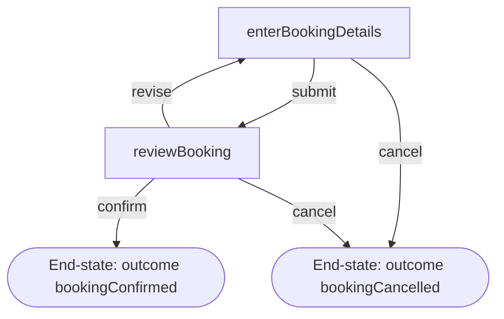

# Thêm end-state cho kết quả thành công và hủy

Một flow đặt phòng thường có hai cách kết thúc rõ ràng: người dùng xác nhận và đặt phòng thành công, hoặc người dùng hủy hành trình. Nếu chỉ có các `view-state` và transition qua lại giữa các màn hình, flow vẫn chưa có điểm kết thúc chính thức. **`<end-state>`** bổ sung điểm kết thúc đó và đặt tên cho kết quả mà flow trả về.

Trong Spring Web Flow, mỗi `end-state` đại diện cho một **flow outcome**. Khi một transition đưa flow tới end-state, flow execution kết thúc và outcome được trả về bằng chính ID của end-state. Vì vậy, ta có thể khai báo hai end-state `bookingConfirmed` và `bookingCancelled` để caller biết hành trình đã hoàn tất hay bị hủy.

## 1. Mục tiêu học tập

Sau bài học, bạn có thể:

1. Giải thích vai trò của `<end-state>` trong vòng đời flow.
2. Phân biệt `view-state`, transition và `end-state`.
3. Khai báo hai end-state cho kết quả thành công và hủy.
4. Nối transition từ các view-state tới đúng end-state.
5. Hiểu ID của end-state trở thành tên outcome được trả về.
6. Phát event từ form bằng các tham số `_eventId_*`.
7. Cho phép người dùng hủy ngay cả khi dữ liệu form chưa hợp lệ.
8. Phân biệt việc flow đi tới outcome thành công với việc service đã thực hiện thành công nghiệp vụ.
9. Kiểm thử cả hai đường kết thúc và những đường quay lại màn hình trước đó.

## 2. Nhắc lại ba phần tử cơ bản

Một flow XML đơn giản thường được xây dựng từ ba phần tử:

| Phần tử | Vai trò | Ví dụ |
| --- | --- | --- |
| `<view-state>` | Một bước hiển thị view và chờ event | `enterBookingDetails` |
| `<transition>` | Xử lý event và chuyển sang state khác | `on="submit" to="reviewBooking"` |
| `<end-state>` | Kết thúc flow và trả outcome | `bookingConfirmed` |

`view-state` mô tả bước người dùng đang thực hiện. `transition` mô tả hành động hoặc event làm flow chuyển bước. `end-state` đánh dấu điểm mà flow không tiếp tục nữa.



Trong sơ đồ, các state hình chữ nhật là những bước của hành trình. Hai nút kết thúc là hai kết quả khác nhau. Sau khi flow đi vào một end-state, execution của flow đó đã kết thúc.

## 3. End-state định nghĩa flow outcome

Cú pháp tối thiểu:

```xml
<end-state id="bookingConfirmed" />
<end-state id="bookingCancelled" />
```

Thuộc tính `id` có hai vai trò:

- Là định danh của end-state trong flow definition.
- Là tên outcome mà flow trả về khi kết thúc tại end-state đó.

Ví dụ:

| End-state ID | Ý nghĩa nghiệp vụ | Outcome trả về |
| --- | --- | --- |
| `bookingConfirmed` | Người dùng đã xác nhận đặt phòng | `bookingConfirmed` |
| `bookingCancelled` | Người dùng đã hủy đặt phòng | `bookingCancelled` |

Tên outcome là chuỗi có ý nghĩa nghiệp vụ. Caller có thể dựa vào tên đó để quyết định điều hướng tiếp theo, hiển thị thông báo hoặc xử lý kết quả khi flow được gọi như subflow.

### 3.1. End-state là điểm kết thúc, không phải màn hình

`<end-state>` không giống `<view-state>`. View-state hiển thị view cho người dùng; end-state kết thúc flow và trả kết quả. Chỉ khai báo:

```xml
<end-state id="bookingConfirmed" />
```

không có nghĩa trình duyệt sẽ tự hiển thị một trang có tiêu đề “Đặt phòng thành công”. Ứng dụng cần xử lý outcome ở tầng gọi flow, hoặc hiển thị một view-state xác nhận trước khi chuyển tới end-state.

### 3.2. End-state không có transition đi ra

End-state là trạng thái cuối của flow. Không khai báo các transition như `<transition on="back" .../>` bên trong end-state để tiếp tục hành trình. Nếu người dùng cần quay lại chỉnh sửa, hãy đặt transition `revise` ở view-state trước khi kết thúc.

## 4. Thêm end-state thành công và hủy vào flow đầu tiên

Ví dụ dưới đây mô tả một hành trình đặt phòng gồm hai màn hình: nhập thông tin và xem lại. Người dùng có thể quay lại sửa, xác nhận hoặc hủy.

```xml
<flow xmlns="http://www.springframework.org/schema/webflow"
      xmlns:xsi="http://www.w3.org/2001/XMLSchema-instance"
      xsi:schemaLocation="http://www.springframework.org/schema/webflow
                          https://www.springframework.org/schema/webflow/spring-webflow.xsd">

    <view-state id="enterBookingDetails">
        <transition on="submit" to="reviewBooking" />
        <transition on="cancel" to="bookingCancelled" />
    </view-state>

    <view-state id="reviewBooking">
        <transition on="confirm" to="bookingConfirmed" />
        <transition on="revise" to="enterBookingDetails" />
        <transition on="cancel" to="bookingCancelled" />
    </view-state>

    <end-state id="bookingConfirmed" />
    <end-state id="bookingCancelled" />
</flow>
```

Đây là flow điều hướng tối thiểu. Hai view-state được khai báo trước; state đầu tiên trong flow definition là điểm bắt đầu, vì vậy người dùng vào `enterBookingDetails` trước. Hai end-state được khai báo ở cuối và được tham chiếu bằng thuộc tính `to` của transition.

Nếu không chỉ rõ thuộc tính `view`, Web Flow mặc định dùng ID của view-state làm view ID tương đối với thư mục flow. Ví dụ, `enterBookingDetails` thường được ánh xạ tới template có tên tương ứng trong thư mục view của flow. Ứng dụng vẫn cần cung cấp các template đó và cấu hình view resolver phù hợp.

## 5. Đọc flow theo từng đường đi

### 5.1. Đường đi thành công

1. Flow bắt đầu ở `enterBookingDetails`.
2. Người dùng nhập thông tin và phát event `submit`.
3. Transition `submit → reviewBooking` đưa flow sang màn hình xem lại.
4. Người dùng kiểm tra thông tin và phát event `confirm`.
5. Transition `confirm → bookingConfirmed` đưa flow tới end-state thành công.
6. Flow execution kết thúc và outcome được trả về là `bookingConfirmed`.

### 5.2. Đường đi hủy từ màn hình đầu

1. Flow đang ở `enterBookingDetails`.
2. Người dùng chọn Hủy và phát event `cancel`.
3. Transition `cancel → bookingCancelled` được chọn.
4. Flow kết thúc với outcome `bookingCancelled`.

### 5.3. Đường đi hủy từ màn hình xem lại

1. Flow đang ở `reviewBooking`.
2. Người dùng chọn Hủy.
3. Transition `cancel → bookingCancelled` được chọn.
4. Flow kết thúc với cùng outcome `bookingCancelled`.

### 5.4. Đường đi quay lại chỉnh sửa

Nếu người dùng chưa muốn xác nhận, họ phát event `revise`. Transition đưa flow về `enterBookingDetails`. Đây vẫn là flow đang chạy; chưa có end-state nào được kích hoạt.

## 6. Event từ view phải khớp với transition

Tên event trong thuộc tính `on` phải khớp với event mà view phát ra. Với Spring MVC, một HTML button có thể gửi event bằng cách đặt tên parameter theo mẫu `_eventId_<eventId>`.

Ví dụ với template Thymeleaf:

```html
<form method="post" th:action="${flowExecutionUrl}">
    <button type="submit" name="_eventId_submit">
        Gửi thông tin
    </button>

    <button type="submit" name="_eventId_cancel">
        Hủy
    </button>
</form>
```

Ở màn hình xem lại:

```html
<form method="post" th:action="${flowExecutionUrl}">
    <button type="submit" name="_eventId_confirm">
        Xác nhận đặt phòng
    </button>

    <button type="submit" name="_eventId_revise">
        Chỉnh sửa
    </button>

    <button type="submit" name="_eventId_cancel">
        Hủy
    </button>
</form>
```

`flowExecutionUrl` là URL của execution hiện tại do Web Flow cung cấp cho view. Cú pháp biểu thức trong ví dụ là Thymeleaf; với JSP hoặc JSF, cách gắn URL và phát event sẽ theo công nghệ view tương ứng.

| Tên button parameter | Event ID được gửi | Transition tương ứng |
| --- | --- | --- |
| `_eventId_submit` | `submit` | `on="submit"` |
| `_eventId_confirm` | `confirm` | `on="confirm"` |
| `_eventId_revise` | `revise` | `on="revise"` |
| `_eventId_cancel` | `cancel` | `on="cancel"` |

Nếu view gửi `_eventId_cancel` nhưng flow chỉ khai báo `on="abort"`, transition hủy sẽ không khớp. Khi kiểm tra lỗi, hãy so sánh event ID trong request với từng thuộc tính `on`.

## 7. Hủy form khi dữ liệu chưa hợp lệ

Giả sử `enterBookingDetails` có model và người dùng nhập ngày nhận phòng sai định dạng. Khi nhấn Hủy, ta thường muốn rời flow ngay thay vì bắt người dùng sửa dữ liệu trước.

Có thể cấu hình transition hủy bỏ qua binding và validation:

```xml
<view-state id="enterBookingDetails" model="booking">
    <transition on="submit" to="reviewBooking" />

    <transition on="cancel"
                to="bookingCancelled"
                bind="false"
                validate="false" />
</view-state>
```

Hai thuộc tính có ý nghĩa:

- `bind="false"`: không thực hiện binding model từ dữ liệu request cho transition này.
- `validate="false"`: không chạy validation model cho transition này.

Vì vậy, người dùng có thể hủy ngay cả khi form đang có lỗi nhập liệu. Transition `submit` vẫn giữ binding/validation mặc định để dữ liệu phải hợp lệ trước khi chuyển sang bước xem lại.

Chỉ áp dụng cấu hình này cho hành động hủy hoặc thao tác tương tự không cần dữ liệu form. Với transition xác nhận hoặc lưu, vẫn cần binding và validation theo yêu cầu nghiệp vụ.

## 8. Phân biệt outcome thành công với việc lưu nghiệp vụ thành công

Trong flow tối giản ở phần 4, transition `confirm` đi thẳng tới `bookingConfirmed`. Đây là ví dụ để học cách kết thúc flow; nó chưa chứng minh dữ liệu đặt phòng đã được ghi vào database.

Trong ứng dụng thật, cần thực hiện thao tác nghiệp vụ trước khi đi tới end-state thành công. Có thể thêm `action-state`:

Đoạn XML sau là **biến thể** của flow ở phần 4: thay transition `confirm` đi thẳng tới `bookingConfirmed` bằng transition tới `confirmBooking`. Không giữ cả hai transition cho cùng event `confirm` trong cùng `view-state`.

```xml
<view-state id="reviewBooking">
    <transition on="confirm" to="confirmBooking" />
    <transition on="revise" to="enterBookingDetails" />
    <transition on="cancel" to="bookingCancelled" />
</view-state>

<action-state id="confirmBooking">
    <evaluate expression="bookingAction.confirm(booking)" />
    <transition on="success" to="bookingConfirmed" />
    <transition on="unavailable" to="bookingUnavailable" />
</action-state>

<end-state id="bookingConfirmed" />
<end-state id="bookingUnavailable" />
<end-state id="bookingCancelled" />
```

Action được gọi tại `confirmBooking`. Kết quả action quyết định transition tiếp theo. Ví dụ, một POJO action có thể trả về chuỗi event:

```java
public String confirm(Booking booking) {
    try {
        bookingService.confirm(booking);
        return "success";
    } catch (RoomNotAvailableException ex) {
        return "unavailable";
    }
}
```

Spring Web Flow ánh xạ giá trị chuỗi trả về thành event ID. Vì vậy `success` khớp transition `on="success"` và `unavailable` khớp transition `on="unavailable"`.

Điểm cần nhớ:

- `bookingConfirmed` là outcome cuối của flow.
- `success` là event kết quả của action.
- Hai tên này có thể khác nhau và phục vụ hai cấp điều khiển khác nhau.

Chỉ khi action xác nhận thao tác nghiệp vụ thành công, flow mới chuyển tới end-state `bookingConfirmed`. Nếu action trả `unavailable`, flow kết thúc theo outcome `bookingUnavailable` hoặc có thể chuyển sang một view-state cho phép thử lại.

## 9. End-state không tự tạo trang kết quả

Một flow top-level kết thúc ở `bookingConfirmed` sẽ trả outcome cho tầng xử lý flow. Nếu muốn người dùng nhìn thấy trang xác nhận, có hai cách thiết kế thường gặp:

**Cách 1: kết thúc flow và điều hướng ở tầng gọi flow.** Một `FlowHandler` tùy chỉnh hoặc cấu hình điều hướng của ứng dụng dựa vào outcome để đưa người dùng tới trang chi tiết đặt phòng.

**Cách 2: hiển thị view-state cuối trước khi kết thúc.** Ví dụ:

```xml
<view-state id="showBookingConfirmation">
    <transition on="finish" to="bookingConfirmed" />
</view-state>

<end-state id="bookingConfirmed" />
```

Khi action đặt phòng thành công, flow có thể đi tới `showBookingConfirmation`. Người dùng đọc thông tin rồi nhấn Hoàn tất; event `finish` mới đưa flow tới end-state. Cách này hữu ích nếu muốn màn hình xác nhận nằm trong chính hành trình flow.

Không nên đặt một `view-state` tên `bookingConfirmed` rồi đồng thời khai báo `end-state id="bookingConfirmed"` trong cùng flow. ID state phải duy nhất trong flow definition.

## 10. Flow outcome khi được gọi như subflow

Khi flow là top-level flow, outcome được trả về cho tầng xử lý flow/MVC. Khi flow được gọi như subflow, outcome của flow con trở thành event mà flow cha xử lý tại `subflow-state`.

Ví dụ flow cha:

```xml
<subflow-state id="bookHotel" subflow="booking">
    <transition on="bookingConfirmed" to="showReceipt" />
    <transition on="bookingCancelled" to="chooseHotel" />
</subflow-state>
```

Flow con kết thúc ở `bookingConfirmed` hoặc `bookingCancelled`; flow cha chọn transition có cùng tên event. Điều này cho phép flow cha quyết định cách tiếp tục dựa trên kết quả của flow con.

Ở cấp cơ bản, chỉ cần nhớ rằng end-state ID là outcome có thể được caller nhận diện. Việc truyền thêm dữ liệu như `bookingId` là phần output mapping được học riêng.

## 11. Đặt tên outcome rõ nghĩa

End-state ID là một phần hợp đồng của flow. Nên đặt tên theo kết quả nghiệp vụ:

| Tên nên dùng | Lý do |
| --- | --- |
| `bookingConfirmed` | Nói rõ đặt phòng đã được xác nhận |
| `bookingCancelled` | Nói rõ người dùng đã hủy |
| `paymentDeclined` | Nêu rõ thanh toán bị từ chối |
| `applicationSubmitted` | Nêu rõ hồ sơ đã được gửi |

Tránh tên quá chung chung như `end`, `finish2` hoặc `done` nếu caller cần phân biệt nhiều kết quả. Nếu flow có nhiều nhánh kết thúc, outcome ID cần đủ rõ để người gọi không phải suy luận từ trạng thái trước đó.

Mỗi state ID trong một flow phải duy nhất. Không dùng cùng ID cho hai end-state hoặc cho một end-state và một view-state.

## 12. Những lỗi thường gặp

| Triệu chứng | Nguyên nhân thường gặp | Cách xử lý |
| --- | --- | --- |
| Flow không khởi động | State đầu tiên tham chiếu view không tồn tại hoặc cấu hình view sai | Kiểm tra view ID và view resolver |
| Nhấn Xác nhận nhưng không kết thúc | Không có transition có `on="confirm"` hoặc target sai | Kiểm tra event ID và `to` |
| Transition trỏ tới end-state không tồn tại | Sai chính tả ID trong `to` | So sánh `to` với `id` của end-state |
| Hủy không hoạt động | View gửi event khác với `cancel` | Kiểm tra parameter `_eventId_cancel` |
| Nhấn Hủy nhưng vẫn hiện lỗi validation | Transition hủy vẫn bind/validate model | Dùng `bind="false" validate="false"` nếu phù hợp |
| Flow kết thúc nhưng không thấy trang thành công | Nhầm end-state với view-state | Điều hướng ở caller hoặc thêm view-state xác nhận |
| Outcome trả về không như mong đợi | Flow kết thúc ở end-state khác | Kiểm tra đường transition thực tế |
| Flow báo thành công nhưng chưa lưu dữ liệu | Transition đi thẳng tới end-state trước khi gọi service | Chèn action-state và chỉ đi tới end-state khi action thành công |
| Action trả event không khớp transition | Giá trị trả về của POJO khác chuỗi trong `on` | Kiểm tra mapping return value → event ID |
| Không quay lại được màn hình nhập | Chưa khai báo transition `revise` | Thêm transition quay về view-state trước |

## 13. Kiểm thử hai kết quả kết thúc

Spring Web Flow cung cấp `AbstractXmlFlowExecutionTests` để kiểm thử flow XML. Với bài học này, các assertion quan trọng là:

- `assertCurrentStateEquals(...)`: xác minh flow đang ở state mong đợi.
- `assertFlowExecutionEnded()`: xác minh flow đã kết thúc.
- `assertFlowExecutionOutcomeEquals(...)`: xác minh outcome được trả về.

### 13.1. Cấu hình test tối thiểu

```java
public class BookingFlowExecutionTests
        extends AbstractXmlFlowExecutionTests {

    @Override
    protected FlowDefinitionResource getResource(
            FlowDefinitionResourceFactory resourceFactory) {
        return resourceFactory.createFileResource(
                "src/main/webapp/WEB-INF/flows/booking/booking.xml");
    }
}
```

Đường dẫn là ví dụ; thay bằng vị trí thực tế của flow XML trong ứng dụng. Nếu flow gọi bean bên ngoài, đăng ký stub/mock trong `configureFlowBuilderContext` để test không phụ thuộc dịch vụ thật.

### 13.2. Test outcome thành công

```java
public void testConfirmEndsWithBookingConfirmed() {
    setCurrentState("reviewBooking");

    MockExternalContext context = new MockExternalContext();
    context.setEventId("confirm");
    resumeFlow(context);

    assertFlowExecutionEnded();
    assertFlowExecutionOutcomeEquals("bookingConfirmed");
}
```

Test này giả định transition `confirm` đi thẳng tới end-state. Nếu flow có action-state, cần đăng ký action bean và kiểm tra cả event kết quả của action.

### 13.3. Test hủy từ màn hình đầu

```java
public void testCancelFromBookingDetails() {
    setCurrentState("enterBookingDetails");

    MockExternalContext context = new MockExternalContext();
    context.setEventId("cancel");
    resumeFlow(context);

    assertFlowExecutionEnded();
    assertFlowExecutionOutcomeEquals("bookingCancelled");
}
```

### 13.4. Test hủy từ màn hình xem lại

```java
public void testCancelFromReview() {
    setCurrentState("reviewBooking");

    MockExternalContext context = new MockExternalContext();
    context.setEventId("cancel");
    resumeFlow(context);

    assertFlowExecutionEnded();
    assertFlowExecutionOutcomeEquals("bookingCancelled");
}
```

Ngoài ba ca trên, nên kiểm thử event `revise` để bảo đảm flow quay về `enterBookingDetails` và chưa kết thúc.

### 13.5. Ma trận kiểm thử

| State ban đầu | Event | State/outcome mong đợi |
| --- | --- | --- |
| `enterBookingDetails` | `submit` | `reviewBooking` |
| `enterBookingDetails` | `cancel` | Kết thúc với `bookingCancelled` |
| `reviewBooking` | `confirm` | Kết thúc với `bookingConfirmed` |
| `reviewBooking` | `revise` | `enterBookingDetails` |
| `reviewBooking` | `cancel` | Kết thúc với `bookingCancelled` |
| `confirmBooking` | Action trả `success` | Kết thúc với `bookingConfirmed` |
| `confirmBooking` | Action trả `unavailable` | Outcome hoặc view xử lý lỗi đã khai báo |

## 14. Bài tập thực hành

Tạo flow `profile-update` cho người dùng cập nhật hồ sơ cá nhân. Flow có:

- `editProfile`: nhập thông tin.
- `reviewProfile`: xem lại dữ liệu.
- `profileUpdated`: end-state khi lưu thành công.
- `profileCancelled`: end-state khi người dùng hủy.

Yêu cầu:

1. Đặt `editProfile` làm state đầu tiên.
2. Event `review` chuyển từ `editProfile` sang `reviewProfile`.
3. Event `revise` đưa người dùng từ `reviewProfile` về `editProfile`.
4. Event `confirm` gọi action lưu hồ sơ rồi mới chuyển tới `profileUpdated`.
5. Event `cancel` từ cả hai view-state đưa flow tới `profileCancelled`.
6. Cấu hình transition hủy ở `editProfile` bỏ qua binding/validation nếu form có model.
7. Viết test cho cả hai outcome và đường quay lại chỉnh sửa.

**Câu hỏi tự kiểm tra:**

- Khi flow chuyển tới `<end-state id="profileUpdated"/>`, flow còn tiếp tục xử lý event không?
- Vì sao ID `profileUpdated` vừa là state ID vừa là outcome name?
- Nếu button gửi `_eventId_cancel` nhưng transition khai báo `on="abort"` thì điều gì xảy ra?
- Vì sao nên thực hiện thao tác lưu trước khi chuyển tới end-state thành công?
- Nếu muốn người dùng nhìn thấy trang xác nhận trong flow, cần thêm loại state nào?

## 15. Checklist trước khi hoàn thành flow

- [ ] Flow có state đầu tiên hợp lệ để bắt đầu.
- [ ] Mỗi view-state có view template tương ứng hoặc thuộc tính `view` hợp lệ.
- [ ] Có end-state riêng cho kết quả thành công và hủy.
- [ ] Mỗi transition có event ID và target state hợp lệ.
- [ ] ID của các state trong flow không trùng nhau.
- [ ] View phát đúng event theo thuộc tính `on`.
- [ ] Transition hủy không bị binding/validation chặn nếu UX yêu cầu hủy ngay.
- [ ] Thao tác nghiệp vụ thực sự hoàn tất trước khi flow vào end-state thành công.
- [ ] Caller biết cách xử lý outcome của flow.
- [ ] Test xác minh flow đã kết thúc và trả đúng outcome.

## 16. Ghi nhớ

- `<end-state>` định nghĩa một flow outcome. Khi flow chuyển tới end-state, flow execution kết thúc và trả outcome.
- ID của end-state chính là tên outcome, ví dụ `bookingConfirmed` hoặc `bookingCancelled`.
- `view-state` hiển thị view và chờ event; `end-state` không phải màn hình hiển thị cho người dùng.
- Transition dùng `on` để khớp event và `to` để chỉ state đích.
- State đầu tiên được khai báo trong flow definition là state bắt đầu nếu không có cấu hình khác.
- Nút HTML có thể phát event bằng parameter `_eventId_<eventId>`.
- Với form có model, transition hủy có thể dùng `bind="false"` và `validate="false"` để bỏ qua binding/validation.
- Nếu cần lưu dữ liệu trước khi kết thúc, dùng action hoặc action-state và chỉ đi tới end-state thành công khi action trả event thành công.
- Kiểm thử cả outcome thành công, outcome hủy và các transition quay lại màn hình trước.

### Tài liệu tham khảo

- [Spring Web Flow 3.0.2 Reference Guide — Essential Language Elements](https://docs.spring.io/spring-webflow/docs/3.0.2/reference/#_essential_language_elements)
- [Spring Web Flow 3.0.2 Reference Guide — The end-state Element](https://docs.spring.io/spring-webflow/docs/3.0.2/reference/#_the_end_state_element)
- [Spring Web Flow 3.0.2 Reference Guide — Signaling an Event from a View](https://docs.spring.io/spring-webflow/docs/3.0.2/reference/#_signaling_an_event_from_a_view)
- [Spring Web Flow 3.0.2 Reference Guide — Suppressing Binding and Validation](https://docs.spring.io/spring-webflow/docs/3.0.2/reference/#_suppressing_binding)
- [Spring Web Flow 3.0.2 Reference Guide — Action States and Action Outcome Event Mappings](https://docs.spring.io/spring-webflow/docs/3.0.2/reference/#_defining_action_states)
- [Spring Web Flow 3.0.2 Reference Guide — Testing Flows](https://docs.spring.io/spring-webflow/docs/3.0.2/reference/#_testing_flows)
