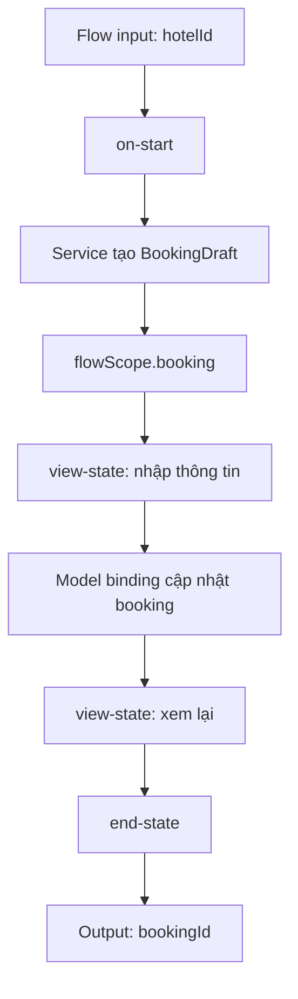

# Khai báo dữ liệu cần dùng trong ví dụ tối giản

## 1. Một flow tối giản cần những dữ liệu nào?

Một flow không chỉ có state và transition. Ngay cả ví dụ đầu tiên cũng cần dữ liệu để biết người dùng đang thao tác với đối tượng nào, lưu các giá trị họ nhập, gọi service tạo kết quả và trả thông tin khi flow kết thúc.

Trong Spring Web Flow, dữ liệu của một hành trình thường đến từ bốn nơi:

1. **Flow input:** dữ liệu được truyền vào lúc khởi chạy flow, ví dụ mã khách sạn.
2. **Flow variable:** object mà flow cần giữ qua nhiều state, ví dụ bản nháp đặt chỗ.
3. **Action result:** giá trị do service hoặc expression trả về, được lưu vào một scope để dùng tiếp.
4. **View model:** object mà view-state dùng để bind dữ liệu form và hiển thị.

Khi flow kết thúc, một **output attribute** có thể trả kết quả cho nơi gọi flow. Những khái niệm này liên quan với nhau nhưng có thời điểm tạo và vòng đời riêng.

Ví dụ đặt chỗ:

- Browser khởi chạy flow với `hotelId`.
- Flow tạo một bản nháp `booking`.
- Người dùng nhập tên và email vào bản nháp.
- Flow trả `bookingId` sau khi xác nhận.



Bài thuộc chương **Flow đầu tiên** của module `SPRING_WEB_FLOW`. Module hướng dẫn mô hình hóa hành trình nhiều bước qua state, event, transition và subflow, đồng thời thực hành form binding, validation, scope, phiên, tích hợp Spring MVC, kiểm thử và phục hồi lỗi. Bài này tập trung vào lượng dữ liệu nhỏ nhất cần có để flow chạy từ đầu đến cuối.

### Mục tiêu học tập

Sau bài này, bạn có thể:

1. Phân biệt flow input, flow variable, action result, view model và output.
2. Khai báo input bằng `<input>` và hiểu cách chuyển kiểu, kiểm tra required.
3. Khai báo object được tạo khi flow bắt đầu bằng `<var>`.
4. Lưu kết quả service vào `flowScope` bằng `<evaluate result="...">`.
5. Chọn scope phù hợp với vòng đời dữ liệu.
6. Dùng một object làm model cho `view-state`.
7. Trả dữ liệu bằng `<output>` trong `end-state`.
8. Kiểm tra khả năng serialization và tránh đưa dữ liệu không phù hợp vào flow scope.

## 2. Flow input: dữ liệu được truyền vào khi bắt đầu

Flow input là dữ liệu bên ngoài truyền vào flow khi một execution mới được khởi chạy. Nó tạo thành contract đầu vào của flow, tương tự tham số của một lời gọi hàm.

Ví dụ, một flow đặt chỗ cần biết khách sạn nào đang được đặt:

```xml
<input name="hotelId" />
```

Giá trị đầu vào được lưu trong flow scope dưới tên `hotelId`. Các state và action tiếp theo có thể đọc biến này.

### 2.1. Khai báo kiểu dữ liệu

Nếu mã khách sạn là số nguyên dài, khai báo kiểu:

```xml
<input name="hotelId" type="long" />
```

Web Flow thử chuyển giá trị nhận được sang kiểu đã khai báo. Khi không khai báo `type`, giá trị đầu vào có thể được giữ theo kiểu mà nơi gọi truyền vào.

Một số ví dụ:

```xml
<input name="hotelId" type="long" required="true" />
<input name="pageSize" type="int" />
<input name="includeBreakfast" type="boolean" />
<input name="campaign" />
```

Tên kiểu phải được conversion service hỗ trợ. Với kiểu domain riêng, ứng dụng cần có converter phù hợp.

### 2.2. Đánh dấu input bắt buộc

Thuộc tính `required="true"` yêu cầu input không null hoặc rỗng:

```xml
<input name="hotelId" type="long" required="true" />
```

Nếu không có `hotelId`, flow không thỏa contract đầu vào. Nếu giá trị là chuỗi không chuyển được sang `long`, conversion cũng có thể thất bại.

`required` chỉ kiểm tra sự hiện diện của giá trị và điều kiện chuyển đổi kiểu. Nó không chứng minh khách sạn tồn tại, còn chỗ hoặc người dùng có quyền đặt. Những kiểm tra đó thuộc service và domain logic.

### 2.3. Input tùy chọn

Một input không khai báo `required="true"` có thể vắng mặt:

```xml
<input name="campaign" />
```

Flow phải xử lý trường hợp `campaign` là null hoặc không có giá trị. Không viết expression giả định mọi client đều gửi tham số này.

### 2.4. Ánh xạ input vào property của object

Thuộc tính `value` chỉ định expression nhận giá trị input:

```xml
<input name="hotelId"
       type="long"
       value="flowScope.requestContext.hotelId"
       required="true" />
```

Ví dụ này giả định `flowScope.requestContext` đã được tạo và property `hotelId` có thể ghi. Khi chỉ cần một biến đơn giản, nên dùng tên input trực tiếp:

```xml
<input name="hotelId" type="long" required="true" />
```

Không nhầm `value` với tên query parameter. Đây là expression đích trong flow context.

## 3. Flow variable: object thuộc về hành trình

Một flow variable là object được Web Flow tạo khi flow bắt đầu. Dùng nó cho dữ liệu có cấu trúc mà nhiều state cần đọc hoặc cập nhật, ví dụ `SearchCriteria`, `RegistrationDraft` hoặc `BookingDraft`.

Khai báo bằng `<var>`:

```xml
<var name="searchCriteria"
     class="com.example.search.SearchCriteria" />
```

`name` là tên biến trong flow. `class` là tên đầy đủ của lớp Java được khởi tạo.

### 3.1. Lớp của flow variable

Ví dụ lớp tiêu chí tìm kiếm:

```java
import java.io.Serializable;

public class SearchCriteria implements Serializable {

    private static final long serialVersionUID = 1L;

    private String destination;
    private Integer guestCount;

    public String getDestination() {
        return destination;
    }

    public void setDestination(String destination) {
        this.destination = destination;
    }

    public Integer getGuestCount() {
        return guestCount;
    }

    public void setGuestCount(Integer guestCount) {
        this.guestCount = guestCount;
    }
}
```

Với implementation mặc định, object lưu trong flow scope cần hỗ trợ serialization vì trạng thái flow được lưu giữa các request. Vì vậy, lớp flow variable nên triển khai `Serializable` và các object mà nó tham chiếu cũng cần đáp ứng yêu cầu lưu trữ tương ứng.

### 3.2. Khi nào dùng var?

Dùng `<var>` khi flow tự sở hữu một object có thể khởi tạo trực tiếp:

```xml
<flow xmlns="http://www.springframework.org/schema/webflow">
    <var name="searchCriteria"
         class="com.example.search.SearchCriteria" />

    <view-state id="enterSearch">
        <transition on="search" to="showResults" />
    </view-state>
</flow>
```

Object `searchCriteria` được tạo khi flow bắt đầu và có thể được dùng trong các state.

Không cần khai báo `<var>` cho mọi biến tạm. Kết quả tính toán chỉ cần tồn tại trong flow scope có thể được tạo bằng action result.

### 3.3. Không khai báo var trùng với biến được tạo từ action result

Hai cách sau là hai cách khởi tạo khác nhau.

**Cách A — Web Flow khởi tạo object theo class:**

```xml
<var name="booking"
     class="com.example.booking.BookingDraft" />
```

**Cách B — Service tạo object và trả về:**

```xml
<evaluate expression="bookingService.createDraft(hotelId)"
          result="flowScope.booking" />
```

Nếu service là nơi tạo object với dữ liệu nghiệp vụ ban đầu, dùng cách B. Không đồng thời khai báo `<var name="booking">` rồi ghi đè nó bằng một object khác mà không có lý do rõ ràng.

## 4. Action result: lưu giá trị trả về từ service

Phần tử `<evaluate>` đánh giá một expression. Expression có thể gọi method của Spring bean hoặc method trên flow variable.

Ví dụ tạo bản nháp:

```xml
<evaluate expression="bookingService.createDraft(hotelId, currentUser.name)"
          result="flowScope.booking" />
```

Khi expression trả về object, thuộc tính `result` chỉ định nơi lưu object đó. Trong ví dụ, Web Flow gán object vào `flowScope.booking`.

### 4.1. Tạo dữ liệu lúc flow bắt đầu

Đặt action trong `on-start` nếu dữ liệu cần được chuẩn bị một lần khi flow bắt đầu:

```xml
<on-start>
    <evaluate expression="bookingService.createDraft(hotelId, currentUser.name)"
              result="flowScope.booking" />
</on-start>
```

`hotelId` là flow input. `currentUser.name` lấy tên principal đã xác thực từ context bảo mật. Service tạo draft và trả về object để flow dùng ở các bước sau.

`on-start` thích hợp cho khởi tạo dữ liệu của cả hành trình. Nếu đặt truy vấn chỉ phục vụ một màn hình trong `on-render`, truy vấn đó có thể chạy lại khi view được render nhiều lần.

### 4.2. Lưu kết quả cho một view-state

Nếu dữ liệu chỉ cần trong một màn hình, có thể lưu kết quả vào view scope:

```xml
<view-state id="chooseRoom" view="booking/rooms">
    <on-render>
        <evaluate expression="roomService.findAvailableRooms(hotelId)"
                  result="viewScope.availableRooms" />
    </on-render>
    <transition on="next" to="review" />
</view-state>
```

`availableRooms` được dùng trong view-state `chooseRoom`. Khi rời state, view scope của state đó kết thúc.

Không lưu dữ liệu vào `viewScope` nếu các state tiếp theo cần đọc lại nó. Khi cần dữ liệu qua nhiều bước, dùng `flowScope` hoặc tính lại ở state tiếp theo.

### 4.3. Action không cần lưu kết quả

Nếu method chỉ thực hiện hành vi và không trả object cần dùng tiếp, có thể bỏ `result`:

```xml
<evaluate expression="auditService.recordFlowStarted(hotelId)" />
```

Không gán result cho method `void`. Nếu flow cần quyết định dựa trên kết quả, service nên trả về một kiểu có ý nghĩa như DTO, enum hoặc Boolean theo contract rõ ràng.

## 5. Dữ liệu khởi tạo bằng set

`<set>` dùng để gán một expression vào một vị trí có thể ghi. Đây là cách đơn giản để tạo một giá trị mặc định hoặc cập nhật property.

Ví dụ tạo một biến mới trong flow scope:

```xml
<on-start>
    <set name="flowScope.source"
         value="'hotel-detail-page'" />
</on-start>
```

Tên scope được ghi rõ trong `name` vì đây là biến mới. Giá trị chuỗi trong SpEL được đặt trong dấu nháy đơn bên trong XML.

### 5.1. Gán literal

```xml
<set name="flowScope.status" value="'DRAFT'" />
<set name="flowScope.retryCount" value="0" />
<set name="flowScope.requiresReview" value="true" />
```

Chuỗi cần dấu nháy đơn trong expression. Số và Boolean dùng literal tương ứng.

### 5.2. Cập nhật biến đã tồn tại

Khi cập nhật property của object đã có, dùng tên biến trực tiếp:

```xml
<set name="booking.status" value="'READY_FOR_REVIEW'" />
```

`booking` đã tồn tại trong flow scope. `booking.status` cập nhật property trên object đó. Không cần gán lại toàn bộ object.

### 5.3. Quy tắc scope khi ghi và đọc

Khi tạo biến mới, phải chỉ rõ scope đích, ví dụ `flowScope.booking` hoặc `viewScope.availableRooms`.

Khi truy cập một biến đã tồn tại, có thể dùng tên biến trực tiếp, ví dụ `booking` hoặc `booking.status`. Web Flow tìm biến theo thuật toán scope search. Tuy vậy, trong biểu thức phức tạp hoặc khi có tên biến trùng giữa các scope, nên ghi rõ scope để code dễ đọc và tránh nhầm lẫn.

## 6. Chọn scope theo vòng đời dữ liệu

Web Flow cung cấp năm scope chính. Chọn scope dựa trên khoảng thời gian dữ liệu cần tồn tại.

| Scope | Vòng đời | Ví dụ sử dụng |
| --- | --- | --- |
| `requestScope` | Trong lần xử lý request flow hiện tại | Giá trị tạm chỉ cần cho lần request |
| `flashScope` | Được giữ tới lần render view kế tiếp rồi được xóa sau render | Thông báo thành công hoặc lỗi ngắn hạn |
| `viewScope` | Từ khi vào đến khi rời một view-state | Danh sách lựa chọn chỉ dùng trong màn hình |
| `flowScope` | Từ khi flow bắt đầu đến khi flow kết thúc | Bản nháp đặt chỗ, tiêu chí tìm kiếm |
| `conversationScope` | Từ khi top-level flow bắt đầu đến khi top-level flow kết thúc; chia sẻ với subflow | Context chung giữa flow cha và subflow |

### 6.1. Flow scope

Flow scope được tạo khi flow bắt đầu và bị hủy khi flow kết thúc. Đây là nơi phù hợp cho object cần tồn tại qua nhiều state.

```xml
<evaluate expression="bookingService.createDraft(hotelId, currentUser.name)"
          result="flowScope.booking" />
```

Trong ví dụ, `booking` còn tồn tại khi người dùng đi từ `enterDetails` sang `review`.

Với implementation mặc định, object trong flow scope cần serializable.

### 6.2. View scope

View scope được tạo khi vào một `view-state` và bị hủy khi rời state. Chỉ tham chiếu view scope trong view-state tương ứng.

```xml
<on-render>
    <evaluate expression="roomService.findAvailableRooms(hotelId)"
              result="viewScope.availableRooms" />
</on-render>
```

Danh sách phòng chỉ dùng để hiển thị trong màn hình chọn phòng có thể nằm ở view scope. Nếu người dùng rời màn hình, không dựa vào `availableRooms` ở state khác.

### 6.3. Request scope

Request scope dành cho dữ liệu ngắn hạn của lần xử lý request. Ví dụ:

```xml
<set name="requestScope.requestLabel"
     value="'booking-submit'" />
```

Không dùng request scope để giữ draft qua nhiều lần submit. Khi request tiếp theo được xử lý, dữ liệu request trước không còn là nguồn lưu trữ phù hợp.

### 6.4. Flash scope

Flash scope được tạo khi flow bắt đầu, được xóa sau mỗi lần render view và kết thúc cùng flow. Dùng cho thông báo ngắn hạn:

```xml
<set name="flashScope.notice"
     value="'Bản nháp đã được lưu'" />
```

Không dùng flash scope cho dữ liệu nghiệp vụ cần tồn tại qua nhiều bước.

### 6.5. Conversation scope

Conversation scope bắt đầu cùng top-level flow và kết thúc khi top-level flow kết thúc. Nó được chia sẻ giữa flow cha và các subflow.

```xml
<set name="conversationScope.customerContext"
     value="customerService.loadContext(currentUser.name)" />
```

Chỉ dùng scope này khi nhiều flow liên quan thực sự cần chia sẻ dữ liệu. Với object chỉ một flow sử dụng, `flowScope` có phạm vi nhỏ và dễ kiểm soát hơn.

Conversation-scoped object mặc định được lưu trong HTTP session và nên serializable để hỗ trợ session replication.

## 7. Phân biệt flow input và requestParameters

Flow input được truyền khi tạo execution mới. Sau khi nhận, input được lưu trong flow scope theo tên attribute.

Ví dụ:

```xml
<input name="hotelId" type="long" required="true" />
```

Các request tiếp theo không cần gửi lại `hotelId` để flow tiếp tục đọc biến này.

`requestParameters` đại diện tham số HTTP của request hiện tại. Ví dụ:

```xml
<transition on="sort">
    <set name="booking.sortBy"
         value="requestParameters.sortBy" />
</transition>
```

`sortBy` chỉ có mặt nếu request hiện tại gửi tham số đó. Nếu cần giữ giá trị qua các bước, hãy sao chép nó vào một scope có vòng đời phù hợp.

| Câu hỏi | Flow input | `requestParameters` |
| --- | --- | --- |
| Được nhận khi nào? | Khi khởi chạy execution mới | Mỗi request đang xử lý flow |
| Dùng để làm gì? | Truyền context ban đầu vào flow | Đọc tham số của request hiện tại |
| Có tồn tại qua nhiều state không? | Có, được lưu trong flow scope | Không nên giả định request sau còn gửi |
| Ví dụ | `hotelId` | `sortBy`, `page` |

Không coi mọi query parameter hoặc form field là flow input. Flow input thuộc contract khởi chạy; `requestParameters` là dữ liệu của request hiện tại.

## 8. Dùng object làm model của view-state

Một `view-state` có thể chỉ định model mà view sẽ bind:

```xml
<view-state id="enterDetails"
            view="booking/details"
            model="booking">
    <binder>
        <binding property="guestName" required="true" />
        <binding property="email" required="true" />
    </binder>
    <transition on="next" to="review" />
</view-state>
```

`booking` là object được tạo ở `on-start` và lưu trong flow scope. Binder chỉ cho phép các property mà form cần cập nhật.

### 8.1. Model cần có property có thể bind

Ví dụ DTO:

```java
import java.io.Serializable;

public class BookingDraft implements Serializable {

    private static final long serialVersionUID = 1L;

    private Long id;
    private Long hotelId;
    private String guestName;
    private String email;
    private String status;

    public Long getId() {
        return id;
    }

    public void setId(Long id) {
        this.id = id;
    }

    public Long getHotelId() {
        return hotelId;
    }

    public void setHotelId(Long hotelId) {
        this.hotelId = hotelId;
    }

    public String getGuestName() {
        return guestName;
    }

    public void setGuestName(String guestName) {
        this.guestName = guestName;
    }

    public String getEmail() {
        return email;
    }

    public void setEmail(String email) {
        this.email = email;
    }

    public String getStatus() {
        return status;
    }

    public void setStatus(String status) {
        this.status = status;
    }
}
```

Model có getter/setter cho các property được bind. Không đưa các field chỉ do server quản lý như `hotelId`, `status` hoặc `id` vào binder nếu người dùng không được phép thay đổi chúng.

### 8.2. Form binding thay đổi object đã có

Khi người dùng gửi form, Web Flow bind giá trị vào model của view-state. Trong ví dụ, `guestName` và `email` được cập nhật trực tiếp trên object `booking`.

Không cần tạo một object mới cho mỗi field. Cũng không cần dùng `<set>` để gán thủ công từng request parameter khi binder đã đảm nhận việc binding.

### 8.3. Binding không thay thế validation

`required="true"` trên binding yêu cầu field có giá trị. Validator có thể kiểm tra định dạng email và các quy tắc dữ liệu khác.

Service vẫn phải kiểm tra các quy tắc nghiệp vụ khi xác nhận đặt chỗ. Ví dụ, hotel phải tồn tại, còn khả năng nhận đặt chỗ và người dùng có quyền thao tác.

## 9. Trả dữ liệu khi flow kết thúc

Flow có thể trả output attributes thông qua `end-state`. Output là một phần của contract giữa flow và nơi gọi flow.

Ví dụ:

```xml
<end-state id="bookingConfirmed">
    <output name="bookingId" value="booking.id" />
</end-state>
```

Khi flow kết thúc ở `bookingConfirmed`, expression `booking.id` được dùng làm giá trị output có tên `bookingId`.

Nếu bỏ thuộc tính `value`, Web Flow lấy giá trị từ flow scope theo tên output:

```xml
<end-state id="bookingConfirmed">
    <output name="bookingId" />
</end-state>
```

Trong trường hợp này, flow cần có biến `bookingId` trong flow scope.

### 9.1. Output phụ thuộc outcome

Mỗi end-state có thể đại diện một kết quả khác nhau. Ví dụ `bookingConfirmed` trả `bookingId`, còn `bookingCancelled` không cần trả ID.

Không đặt output vào giữa các state đang chạy. Output được khai báo trong end-state để thể hiện dữ liệu trả về khi flow kết thúc theo outcome đó.

### 9.2. Output không phải database persistence

Trả `bookingId` không tự lưu bản ghi. Service phải thực hiện thao tác lưu cần thiết trước khi flow kết thúc. Output chỉ chuyển dữ liệu kết quả về caller.

## 10. Ví dụ hoàn chỉnh: flow đặt chỗ tối giản

Ví dụ dưới đây kết hợp flow input, action result, model binding và output. Các bean `bookingService` và lớp `BookingDraft` là thành phần do ứng dụng cung cấp.

```xml
<?xml version="1.0" encoding="UTF-8"?>
<flow xmlns="http://www.springframework.org/schema/webflow"
      xmlns:xsi="http://www.w3.org/2001/XMLSchema-instance"
      xsi:schemaLocation="
          http://www.springframework.org/schema/webflow
          https://www.springframework.org/schema/webflow/spring-webflow.xsd">

    <!-- Context được truyền khi khởi chạy flow. -->
    <input name="hotelId" type="long" required="true" />

    <!-- Tạo dữ liệu ban đầu cho toàn bộ hành trình. -->
    <on-start>
        <evaluate
            expression="bookingService.createDraft(hotelId, currentUser.name)"
            result="flowScope.booking" />
        <set name="flowScope.source"
             value="'hotel-detail-page'" />
    </on-start>

    <!-- Model này được giữ trong flow scope giữa các bước. -->
    <view-state id="enterDetails"
                view="booking/details"
                model="booking">
        <binder>
            <binding property="guestName" required="true" />
            <binding property="email" required="true" />
        </binder>
        <transition on="next" to="review" />
        <transition on="cancel"
                    to="bookingCancelled"
                    bind="false" />
    </view-state>

    <view-state id="review" view="booking/review">
        <transition on="back"
                    to="enterDetails"
                    validate="false" />
        <transition on="confirm" to="confirmBooking" />
    </view-state>

    <action-state id="confirmBooking">
        <evaluate expression="bookingService.confirm(booking)"
                  result="flowScope.booking" />
        <transition on="success" to="bookingConfirmed" />
    </action-state>

    <end-state id="bookingConfirmed">
        <output name="bookingId" value="booking.id" />
    </end-state>

    <end-state id="bookingCancelled" />
</flow>
```

### 10.1. Đọc từng phần dữ liệu

| Phần tử | Dữ liệu | Vai trò |
| --- | --- | --- |
| `<input name="hotelId">` | `hotelId` | Nhận mã khách sạn lúc launch |
| `<evaluate ... result="flowScope.booking">` | `booking` | Lưu draft do service tạo |
| `<set name="flowScope.source">` | `source` | Lưu nguồn khởi chạy |
| `model="booking"` | `booking` | Dùng draft làm model của form |
| `<binding property="guestName">` | `guestName` | Cho phép form cập nhật tên khách |
| `<binding property="email">` | `email` | Cho phép form cập nhật email |
| `<action-state id="confirmBooking">` | `booking` | Gọi service xác nhận draft trước khi kết thúc |
| `<output name="bookingId">` | `bookingId` | Trả ID khi xác nhận |

### 10.2. View nhập thông tin

View `booking/details` hiển thị hai field tương ứng với binder:

```html
<form method="post" action="${flowExecutionUrl}">
    <label for="guestName">Tên khách</label>
    <input id="guestName" name="guestName" type="text" />

    <label for="email">Email</label>
    <input id="email" name="email" type="email" />

    <button type="submit" name="_eventId_next">Tiếp tục</button>
    <button type="submit" name="_eventId_cancel">Hủy</button>
</form>
```

`${flowExecutionUrl}` là biến template của Web Flow trỏ tới URL hiện hành của flow execution. View engine phải render biểu thức này theo cơ chế tích hợp của ứng dụng. Các field name phải khớp property đã khai báo trong binder.

### 10.3. Service tạo draft

Service có thể có contract minh họa:

```java
public interface BookingService {
    BookingDraft createDraft(long hotelId, String username);
    BookingDraft confirm(BookingDraft draft);
}
```

Khi tạo draft, service nên xác minh khách sạn tồn tại và người dùng có quyền đặt. Nó trả về một `BookingDraft` có trạng thái ban đầu phù hợp. Method `confirm` kiểm tra lại dữ liệu và điều kiện nghiệp vụ, lưu booking trong transaction ngắn, rồi trả về bản booking có ID đã được xác nhận.

Không lấy username từ request parameter hoặc hidden field. Ví dụ sử dụng `currentUser.name`, là principal đã xác thực trong context bảo mật.

### 10.4. Điều gì xảy ra khi người dùng đi qua các state?

1. Flow nhận `hotelId` khi launch.
2. `on-start` gọi service và lưu draft vào `flowScope.booking`.
3. View-state `enterDetails` bind tên khách và email vào draft.
4. Event `next` chuyển sang `review`.
5. Event `back` quay lại form để sửa dữ liệu.
6. Event `confirm` chuyển sang action-state `confirmBooking`.
7. Action-state gọi service để kiểm tra và xác nhận booking, rồi lưu kết quả vào flow scope.
8. End-state `bookingConfirmed` trả `bookingId` cho caller.

Flow giữ draft trong suốt hành trình. Service chỉ nên lưu booking chính thức khi nghiệp vụ xác nhận yêu cầu đó; một wizard không nên giữ transaction database mở trong toàn bộ thời gian người dùng nhập liệu.

## 11. Những object không nên lưu trong flow scope

Flow scope có thể tồn tại qua nhiều HTTP request và được lưu thành execution snapshot. Vì vậy, hãy lưu dữ liệu phù hợp với serialization và vòng đời của flow.

Nên lưu:

- DTO hoặc draft object nhỏ, có cấu trúc rõ.
- ID của entity cần tải lại.
- Các lựa chọn người dùng cần giữ qua nhiều state.
- Kết quả tính toán có thể tái sử dụng trong hành trình.

Tránh lưu trực tiếp:

- `HttpServletRequest` hoặc `HttpServletResponse`.
- JDBC connection hoặc transaction manager resource.
- `EntityManager` hoặc persistence context đang mở.
- File stream, socket hoặc thread.
- Multipart upload object cần xử lý trong request hiện tại.
- Object lớn chứa cả một graph không cần thiết.

Với implementation mặc định, object trong flow scope và view scope phải serializable. Conversation scope cũng nên dùng object serializable để hỗ trợ session replication. Khi không chắc object có thể lưu an toàn hay không, chỉ lưu ID và tải dữ liệu lại qua service ở state cần dùng.

## 12. Lỗi thường gặp khi khai báo dữ liệu

| Triệu chứng | Nguyên nhân | Cách xử lý |
| --- | --- | --- |
| Flow không nhận `hotelId` | Caller không truyền input hoặc tên không khớp | Kiểm tra input contract và input map |
| Input chuyển kiểu thất bại | Giá trị không chuyển được sang kiểu khai báo | Kiểm tra `type` và converter |
| Input null nhưng flow vẫn giả định có giá trị | Chưa đặt `required` hoặc chưa xử lý optional | Khai báo required hoặc xử lý null |
| `booking` không tồn tại | Chưa tạo action result hoặc result gán sai scope | Kiểm tra `on-start` và `flowScope.booking` |
| Object bị tạo hai lần | Dùng cả `<var>` và action result cho cùng tên | Chọn một cách khởi tạo |
| View không bind được field | `model` hoặc binder property sai tên | So sánh model name và getter/setter |
| Dữ liệu biến mất khi sang state khác | Lưu vào view/request scope quá ngắn | Dùng flow scope |
| Thông báo biến mất quá sớm hoặc tồn tại quá lâu | Chọn sai scope cho thông báo | Dùng flash scope cho thông báo ngắn hạn |
| Flow lỗi khi lưu snapshot | Object không serializable hoặc chứa resource không thể serialize | Dùng DTO/ID phù hợp |
| Output rỗng | End-state trỏ sai expression hoặc biến chưa được tạo | Kiểm tra output value và flow scope |
| Dữ liệu client sửa được field nhạy cảm | Binder cho phép quá nhiều property | Whitelist field người dùng được phép sửa |
| Service không tìm thấy object | Tin input mà chưa kiểm tra nghiệp vụ | Kiểm tra tồn tại và quyền trong service |

## 13. Kiểm thử contract dữ liệu

Khi kiểm thử ví dụ tối giản, xác minh dữ liệu ở từng mốc của flow.

### 13.1. Kiểm thử input

- Khởi chạy với `hotelId` hợp lệ.
- Khởi chạy khi thiếu `hotelId`.
- Truyền `hotelId` không chuyển được sang `long`.
- Truyền một ID không tồn tại để xác nhận service xử lý lỗi nghiệp vụ.

### 13.2. Kiểm thử khởi tạo

- Xác nhận `on-start` gọi service tạo draft.
- Xác nhận `flowScope.booking` tồn tại.
- Xác nhận `source` được gán đúng.
- Xác nhận flow variable có kiểu và trạng thái ban đầu mong đợi.

### 13.3. Kiểm thử binding

- Gửi `guestName` và `email` hợp lệ.
- Xác nhận hai property trên `booking` được cập nhật.
- Gửi property không có trong binder và xác nhận model không bị thay đổi ngoài ý muốn.
- Quay lại từ `review` và xác nhận dữ liệu draft được giữ.

### 13.4. Kiểm thử output

- Xác nhận flow kết thúc đúng end-state.
- Xác nhận output `bookingId` lấy đúng từ `booking.id`.
- Xác nhận outcome hủy không trả kết quả xác nhận đặt chỗ.
- Xác nhận service đã thực hiện thao tác nghiệp vụ cần thiết trước khi flow trả output.

## 14. Quy trình chọn nơi khai báo dữ liệu

Trước khi thêm một field hoặc object vào flow, hãy trả lời các câu hỏi sau:

1. Dữ liệu được truyền từ caller khi launch? Dùng `<input>`.
2. Flow cần tự khởi tạo một object theo class? Dùng `<var>`.
3. Service tạo object và trả về? Dùng `<evaluate result="flowScope...">`.
4. Chỉ cần một giá trị mặc định? Dùng `<set>` với scope rõ ràng.
5. Chỉ một view-state cần dữ liệu? Cân nhắc `viewScope`.
6. Nhiều state cần cùng draft? Dùng `flowScope`.
7. Flow cha và subflow cần chia sẻ context? Cân nhắc `conversationScope`.
8. Caller cần nhận kết quả khi flow kết thúc? Dùng `<output>` trong `end-state`.

Không tạo biến chỉ vì có thể tạo. Mỗi biến nên có tên rõ, kiểu phù hợp và vòng đời được xác định.

## 15. Checklist và câu hỏi tự luyện

### Checklist

- [ ] Đã phân biệt flow input với request parameter.
- [ ] Input có tên và kiểu phù hợp.
- [ ] Input bắt buộc đã khai báo `required`.
- [ ] Đã chọn giữa `<var>` và action result để tạo object.
- [ ] Kết quả service được lưu vào scope đúng.
- [ ] Model của view-state trỏ tới object đã tồn tại.
- [ ] Binder chỉ cho phép field người dùng được sửa.
- [ ] Scope phù hợp với vòng đời dữ liệu.
- [ ] Object lưu qua request đáp ứng yêu cầu serialization.
- [ ] Output được khai báo trong end-state phù hợp.
- [ ] Service kiểm tra dữ liệu và quyền trước khi ghi nghiệp vụ.

### Câu hỏi tự luyện

1. Flow input được lưu ở đâu sau khi khởi chạy?
2. `type="long"` trong `<input>` có tác dụng gì?
3. `required="true"` có chứng minh ID tồn tại trong database không?
4. `<var>` khác với `result="flowScope.booking"` như thế nào?
5. Khi nào nên tạo object bằng service thay vì `<var>`?
6. Vì sao `result` của một biến mới phải chỉ rõ scope?
7. Khi cập nhật property của biến đã tồn tại, có cần ghi scope prefix không?
8. Vì sao `flowScope` phù hợp với draft nhiều bước?
9. Khi nào nên dùng `viewScope` thay cho `flowScope`?
10. Flash scope phù hợp với loại dữ liệu nào?
11. `conversationScope` được chia sẻ giữa những flow nào?
12. Vì sao object trong flow scope cần serializable?
13. Binder có vai trò gì đối với model của view-state?
14. Output trong end-state khác với một biến flow scope như thế nào?
15. Vì sao output `bookingId` không tự lưu booking vào database?

## Tài liệu tham khảo

- [Spring Web Flow 3.0.2 Reference Guide — Essential Language Elements](https://docs.spring.io/spring-webflow/docs/3.0.2/reference/#_essential_language_elements)
- [Spring Web Flow 3.0.2 Reference Guide — Actions](https://docs.spring.io/spring-webflow/docs/3.0.2/reference/#_actions)
- [Spring Web Flow 3.0.2 Reference Guide — Input/Output Mapping](https://docs.spring.io/spring-webflow/docs/3.0.2/reference/#_input_output_mapping)
- [Spring Web Flow 3.0.2 Reference Guide — Variables](https://docs.spring.io/spring-webflow/docs/3.0.2/reference/#_variables)
- [Spring Web Flow 3.0.2 Reference Guide — Variable Scopes](https://docs.spring.io/spring-webflow/docs/3.0.2/reference/#_variable_scopes)
- [Spring Web Flow 3.0.2 Reference Guide — Special EL Variables](https://docs.spring.io/spring-webflow/docs/3.0.2/reference/#_special_el_variables)
- [Spring Web Flow 3.0.2 Reference Guide — Binding to a Model](https://docs.spring.io/spring-webflow/docs/3.0.2/reference/#_binding_to_a_model)
- [Spring Web Flow 3.0.2 Reference Guide — Testing Flows](https://docs.spring.io/spring-webflow/docs/3.0.2/reference/#_testing_flows)

Các ví dụ dùng XML Flow Definition Language và Spring EL theo Spring Web Flow 3.0.2. Khi áp dụng vào dự án, hãy kiểm tra converter, validator, model binding và cấu hình execution repository đang sử dụng.
