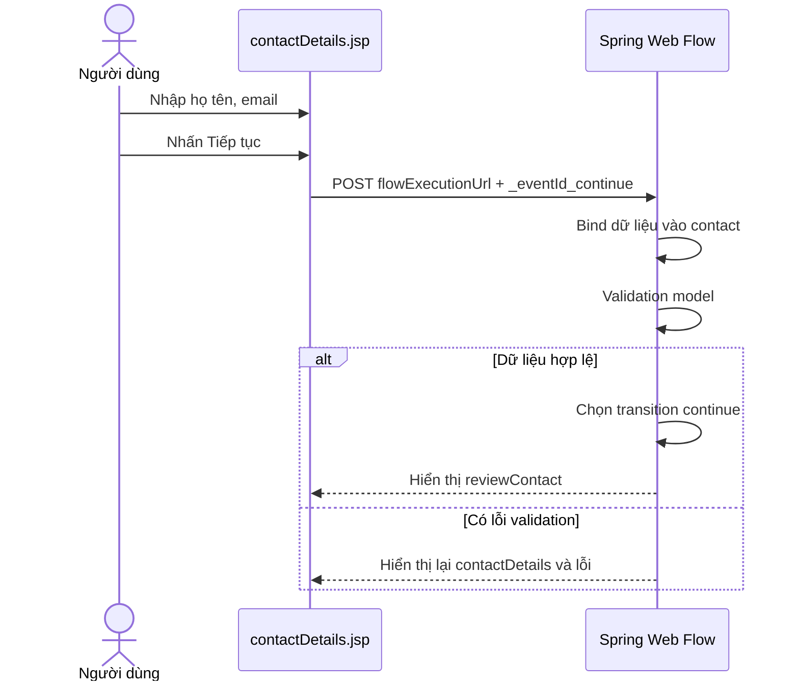

# Tạo form hoặc liên kết phát sự kiện

Trong chương **Flow đầu tiên**, ta cần một cách để người dùng tương tác với từng trạng thái của luồng. Với **SPRING_WEB_FLOW**, form và liên kết có thể phát ra event để Spring Web Flow chọn transition tương ứng. Cách tổ chức này giúp mô hình hóa hành trình web nhiều bước bằng state, event, transition và subflow, thay vì đặt toàn bộ logic điều hướng trong controller.

Bài học này tập trung vào việc gắn một form hoặc một liên kết với event của `view-state`, đồng thời truyền dữ liệu form vào model của flow.

## 1. Từ thao tác của người dùng đến event

Một `view-state` hiển thị một màn hình. Khi người dùng gửi form hoặc nhấn liên kết, request quay lại URL thực thi flow và mang theo một event ID. Spring Web Flow đọc event đó, tìm `<transition>` có `on` trùng tên, rồi chuyển sang state đích nếu transition tồn tại.

Ví dụ, màn hình nhập thông tin đặt chỗ có thể nhận hai event:

- `continue`: người dùng gửi thông tin để đi đến màn hình xem lại.
- `cancel`: người dùng hủy và kết thúc luồng đặt chỗ.

Tên event trong request phải khớp với giá trị `on` trong flow definition. Event ID là tên hành động trong luồng, không phải tên URL hay tên method của controller.

## 2. Khai báo model và transition trong flow

Ta khai báo một đối tượng `contact` ở flow scope. Spring Web Flow tạo đối tượng khi flow bắt đầu và giữ nó trong suốt lần thực thi flow hiện tại. Thuộc tính `model` của `view-state` liên kết đối tượng này với màn hình để dữ liệu form có thể được bind vào nó.

```xml
<var name="contact" class="com.example.web.ContactForm" />

<view-state id="contactDetails" model="contact">
    <binder>
        <binding property="fullName" />
        <binding property="email" />
    </binder>

    <transition on="continue" to="reviewContact" />
    <transition on="cancel" to="cancelled" validate="false" />
</view-state>

<view-state id="reviewContact" />
<end-state id="cancelled" />
```

Trong ví dụ:

- `<var>` khai báo biến flow có tên `contact`. Lớp `ContactForm` cần có constructor phù hợp và các getter/setter JavaBean cho thuộc tính cần bind.
- `model="contact"` chỉ ra đối tượng làm model cho view state hiện tại.
- `<binder>` giới hạn các thuộc tính được phép nhận dữ liệu từ request. Chỉ `fullName` và `email` được bind trong ví dụ này.
- Transition `continue` dẫn đến `reviewContact`; transition `cancel` dẫn đến end state `cancelled`.
- `validate="false"` trên transition hủy cho phép người dùng rời form mà không bị giữ lại bởi lỗi validation của dữ liệu đang nhập.

`reviewContact` và `cancelled` là các state đích được khai báo trong cùng flow. Khi áp dụng vào ứng dụng, hãy bổ sung nội dung màn hình xem lại và xử lý kết thúc phù hợp với nghiệp vụ.

## 3. Tạo form để gửi event

Với JSP, Spring MVC Form Tag Library cung cấp các thẻ gắn trường nhập liệu với thuộc tính của model. Form cần gửi đến `${flowExecutionUrl}` để tiếp tục đúng lần thực thi flow hiện tại.

```jsp
<%@ taglib prefix="form" uri="http://www.springframework.org/tags/form" %>

<h2>Thông tin liên hệ</h2>

<form:form modelAttribute="contact"
           method="post"
           action="${flowExecutionUrl}">
    <div>
        <form:label path="fullName">Họ và tên</form:label>
        <form:input path="fullName" />
        <form:errors path="fullName" cssClass="error" />
    </div>

    <div>
        <form:label path="email">Email</form:label>
        <form:input path="email" type="email" />
        <form:errors path="email" cssClass="error" />
    </div>

    <button type="submit" name="_eventId_continue">
        Tiếp tục
    </button>
</form:form>
```

Các điểm cần chú ý:

1. `modelAttribute="contact"` phải trùng tên biến model mà `view-state` sử dụng.
2. `path="fullName"` và `path="email"` phải trùng với thuộc tính có thể truy cập trên lớp `ContactForm` và được cho phép trong binder.
3. `action="${flowExecutionUrl}"` gửi request về URL thực thi flow. URL này mang thông tin nhận diện lần thực thi hiện tại; không nên tự ghép một URL controller cố định để thay thế.
4. Tên nút `_eventId_continue` yêu cầu Spring Web Flow phát event `continue`. Hậu tố sau `_eventId_` chính là event ID được so khớp với `on="continue"`.

Khi request được xử lý, dữ liệu gửi lên được bind vào `contact`. Nếu validation của model được cấu hình và có lỗi, view state có thể hiển thị lại form cùng lỗi tương ứng; các thẻ `<form:errors>` hiển thị lỗi theo từng thuộc tính. Khi dữ liệu hợp lệ, event `continue` kích hoạt transition sang `reviewContact`.

## 4. Tạo liên kết để gửi event

Không phải thao tác nào cũng cần form. Một liên kết có thể gửi event trực tiếp bằng tham số `_eventId` trong URL thực thi flow:

```jsp
<a href="${flowExecutionUrl}&amp;_eventId=cancel">Hủy</a>
```

Ở đây, `_eventId=cancel` phát event `cancel`, khớp với transition `on="cancel"`. Dùng `&amp;` trong thuộc tính HTML để biểu diễn dấu `&` đúng cú pháp. `${flowExecutionUrl}` đã chứa thông tin thực thi flow, vì vậy liên kết vẫn gắn với đúng flow instance.

Liên kết phù hợp với điều hướng đơn giản như quay lại, hủy hoặc chọn một nhánh không cần gửi dữ liệu form. Với thao tác gửi dữ liệu hoặc thay đổi dữ liệu nghiệp vụ, hãy dùng form `POST` và cấu hình bảo vệ CSRF phù hợp với Spring Security của ứng dụng. Tránh biến một liên kết `GET` thành thao tác có tác dụng phụ như tạo đơn hàng hay thanh toán.

## 5. Theo dõi một lần tương tác

Với form ở trên, trình tự xử lý diễn ra như sau:



Khi người dùng chọn liên kết Hủy, request mang `_eventId=cancel`; flow chọn transition `cancel` và đi đến end state. Vì transition này đặt `validate="false"`, dữ liệu chưa hoàn chỉnh không ngăn người dùng thoát khỏi màn hình.

## 6. Những lỗi thường gặp

| Hiện tượng | Nguyên nhân cần kiểm tra |
|---|---|
| Nhấn nút nhưng không chuyển state | Tên `_eventId_<id>` không khớp `on="<id>"`, hoặc transition không nằm trong view state đang hoạt động. |
| Form không hiển thị dữ liệu đã nhập | `modelAttribute`, `model` hoặc tên thuộc tính `path` không khớp; kiểm tra getter/setter và binder. |
| Flow không nhận đúng lần thực thi | Form hoặc liên kết không gửi đến `${flowExecutionUrl}`. |
| Một thuộc tính không được bind | Thuộc tính chưa được khai báo trong `<binder>` hoặc tên property không chính xác. |
| Nút Hủy cũng bị chặn bởi validation | Kiểm tra transition hủy và đặt `validate="false"` nếu nghiệp vụ cho phép rời form khi dữ liệu chưa hợp lệ. |

Khi cần nhiều nút submit trong cùng form, mỗi nút có thể dùng một tên event riêng, chẳng hạn `_eventId_saveDraft` và `_eventId_continue`. Hãy khai báo transition tương ứng cho từng event để flow có thể phân biệt hành động của người dùng.

## 7. Thực hành

Tạo một màn hình nhập thông tin liên hệ với hai trường `fullName` và `email`.

1. Khai báo biến flow `contact` và gắn nó vào `view-state` bằng `model="contact"`.
2. Tạo form POST đến `${flowExecutionUrl}`; nút Tiếp tục gửi `_eventId_continue`.
3. Thêm liên kết Hủy gửi `_eventId=cancel`.
4. Khai báo hai transition tương ứng: `continue` đến màn hình xem lại, `cancel` đến end state. Cho phép transition hủy bỏ qua validation nếu phù hợp.
5. Thử gửi form với dữ liệu hợp lệ, dữ liệu thiếu và thử hủy khi form còn trống. Quan sát event nào được phát, model thay đổi ra sao và flow đang ở state nào.

Bạn hoàn thành bài khi giải thích được vì sao tên event trong request phải trùng với `on` của transition, cách form bind dữ liệu vào flow model và cách một liên kết phát event mà không cần gửi form.
