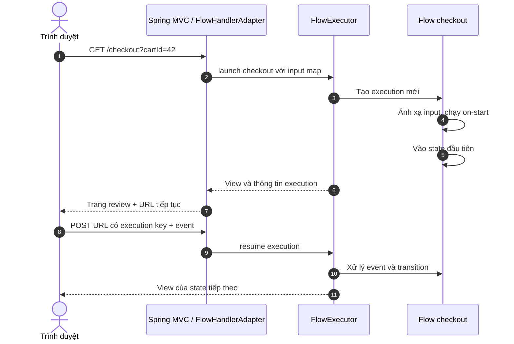

# Khởi tạo một execution và nhận dữ liệu đầu vào trong Spring Web Flow

Trong một ứng dụng Spring MVC thông thường, mỗi request thường được xử lý bởi một controller và trả về một trang hoặc phản hồi HTTP. Với các hành trình nhiều bước như đăng ký tài khoản, đặt lịch, thanh toán hay duyệt hồ sơ, Spring Web Flow bổ sung khái niệm **flow execution**: một lần chạy cụ thể của luồng, có state hiện tại, dữ liệu và lịch sử chuyển state riêng. Bài học này thuộc chương **Vòng đời thực thi** và tập trung vào thời điểm execution được tạo, cách dữ liệu đi vào flow và cách phân biệt request khởi chạy với request tiếp tục luồng.

Sau bài học, bạn có thể:

- Giải thích sự khác nhau giữa flow definition, flow execution và flow execution key.
- Theo dõi một HTTP request từ Spring MVC đến lúc Web Flow tạo execution và hiển thị state đầu tiên.
- Khai báo đầu vào bằng `<input>`, sử dụng dữ liệu đó trong `<on-start>` và chuyển tiếp sang các state.
- Phân biệt **launch input** với dữ liệu form gửi ở các bước tiếp theo.
- Xử lý đúng trường hợp thiếu/sai dữ liệu đầu vào, truy cập trái phép hoặc execution đã hết hiệu lực.

## 1. Một flow definition có thể có nhiều execution

Giả sử ứng dụng có flow `checkout` gồm các bước kiểm tra giỏ hàng, nhập địa chỉ và xác nhận. File `checkout-flow.xml` mô tả **cấu trúc** của hành trình, nhưng không đại diện cho một lượt thanh toán cụ thể. Mỗi lần người dùng khởi chạy `checkout`, Web Flow tạo một **flow execution** mới để theo dõi lượt chạy đó.

| Khái niệm | Ý nghĩa | Ví dụ |
| --- | --- | --- |
| **Flow definition** | Định nghĩa tĩnh về state, event, transition và các action | Luồng `checkout` khai báo trong XML |
| **Flow execution** | Một lần thực thi cụ thể của definition, có state và dữ liệu riêng | Một lượt kiểm tra giỏ hàng `42` |
| **Flow session** | Phiên của một flow đang tham gia execution, bao gồm trường hợp flow cha gọi subflow | Phiên `shipping` bên trong `checkout` |
| **Flow execution key** | Khóa để Web Flow tìm/khôi phục execution khi request tiếp theo đến | Giá trị dạng `e1s1` trong một cấu hình điển hình |
| **Input map** | Tập giá trị bên ngoài truyền vào khi bắt đầu flow hoặc subflow | `cartId = 42` |

**Execution khác với HTTP session**: một người dùng có thể mở nhiều execution của cùng một flow trong các tab khác nhau. Tùy cấu hình repository, dữ liệu execution có thể được lưu hoặc khôi phục theo các cơ chế khác nhau; không được coi mỗi execution là một `HttpSession` riêng. Execution cũng không tồn tại vĩnh viễn: khóa cũ có thể hết hạn hoặc không còn được repository chấp nhận.

## 2. Web Flow tạo execution khi nào?

Với tích hợp Spring MVC quen thuộc, `FlowHandlerMapping` xác định flow cần chạy từ URL, `FlowHandlerAdapter` kết nối request HTTP với `FlowExecutor`, còn executor quản lý việc **launch** hoặc **resume** execution.



Ở **request khởi chạy**, thường chưa có execution key hợp lệ gắn với luồng. Các bước chính là:

1. **Chọn flow**: URL `/checkout` được ánh xạ đến flow definition có ID `checkout`.
2. **Tạo execution**: executor bắt đầu một lượt chạy mới với input map lấy từ nguồn gọi flow, chẳng hạn các request parameter.
3. **Ánh xạ input**: các khai báo `<input>` xác định giá trị được nhận, tên biến, kiểu mong đợi và yêu cầu bắt buộc.
4. **Thực hiện logic khởi tạo**: những action trong `<on-start>` được chạy trước khi vào state đầu tiên.
5. **Vào start state**: Web Flow thực thi state đầu tiên; với `view-state`, hệ thống thường tạm dừng execution và trả trang để người dùng tương tác.
6. **Chuẩn bị tiếp tục**: response cung cấp URL/thông tin execution để request tiếp theo có thể khôi phục đúng lượt chạy.

Ở **request tiếp tục**, adapter chuyển execution key cùng event tương ứng cho executor. Web Flow khôi phục execution hiện có, xử lý event và chọn transition. Request này **không tạo một execution mới** khi khóa hợp lệ và việc resume thành công.

> Tên URL parameter và định dạng execution key phụ thuộc cách tích hợp và cấu hình `FlowUrlHandler`. Trong cấu hình phổ biến, URL tiếp tục có parameter `execution`; các ví dụ bên dưới dùng `${flowExecutionUrl}` do Web Flow cung cấp thay vì tự ghép hoặc tự đoán khóa.

## 3. Khai báo input cho flow

Ví dụ: từ trang giỏ hàng, người dùng mở đường dẫn:

```http
GET /checkout?cartId=42
```

Flow cần nhận ID giỏ hàng, tải giỏ hàng được phép truy cập và hiển thị trang xác nhận thông tin. Một định nghĩa XML rút gọn:

```xml
<?xml version="1.0" encoding="UTF-8"?>
<flow xmlns="http://www.springframework.org/schema/webflow"
      xmlns:xsi="http://www.w3.org/2001/XMLSchema-instance"
      xsi:schemaLocation="http://www.springframework.org/schema/webflow
                          http://www.springframework.org/schema/webflow/spring-webflow-2.0.xsd">

    <input name="cartId" type="java.lang.Long" required="true" />

    <on-start>
        <evaluate expression="cartService.loadAccessibleCart(cartId)"
                  result="flowScope.cart" />
    </on-start>

    <view-state id="review" view="checkout/review">
        <transition on="continue" to="address" />
        <transition on="cancel" to="cancelled" />
    </view-state>

    <view-state id="address" view="checkout/address">
        <transition on="back" to="review" />
        <transition on="finish" to="completed" />
    </view-state>

    <end-state id="completed" view="checkout/completed" />
    <end-state id="cancelled" view="checkout/cancelled" />
</flow>
```

Trong ví dụ này, `cartService` là bean ứng dụng được Web Flow gọi qua expression language; phương thức `loadAccessibleCart` là phương thức minh họa do ứng dụng tự triển khai, **không phải API có sẵn của Spring Web Flow**.

Ý nghĩa từng thành phần:

| Thành phần | Tác dụng khi launch |
| --- | --- |
| `<input name="cartId" ... />` | Khai báo tên đầu vào mà flow nhận từ bên ngoài |
| `type="java.lang.Long"` | Yêu cầu giá trị đầu vào phù hợp kiểu `Long`, áp dụng cơ chế chuyển đổi kiểu của Web Flow |
| `required="true"` | Yêu cầu phải cung cấp giá trị cho input này |
| `cartId` trong expression | Tham chiếu giá trị được ánh xạ vào ngữ cảnh của flow |
| `<on-start>` | Chạy hành động khởi tạo khi bắt đầu lượt thực thi |
| `result="flowScope.cart"` | Lưu kết quả truy vấn vào `flowScope` để các state tiếp theo dùng lại |
| `view-state id="review"` | State đầu tiên chờ thao tác của người dùng |

Thông thường, input khai báo trong `<input>` được ánh xạ vào **flow scope** dưới đúng tên của nó; trong biểu thức có thể viết rõ `flowScope.cartId` nếu muốn nhấn mạnh nguồn dữ liệu. Nếu request truyền `cartId=42`, giá trị ban đầu là chuỗi HTTP; khi ánh xạ vào `Long`, Web Flow sử dụng conversion service phù hợp với cấu hình ứng dụng. Khai báo `type` chỉ giúp bảo đảm kiểu dữ liệu, **không chứng minh** người dùng có quyền truy cập giỏ hàng đó.

### Không dùng `<on-start>` cho thao tác có thể thu tiền hoặc gửi dữ liệu vĩnh viễn

Khởi tạo thường phù hợp cho việc tải dữ liệu, dựng model hoặc kiểm tra điều kiện bắt đầu. Một GET mới vào `/checkout` có thể bắt đầu một execution mới, ví dụ do tải lại URL gốc hay mở thêm tab. Vì vậy, không nên đặt các tác vụ như trừ tiền, tạo đơn cuối cùng hoặc gửi email xác nhận trong `<on-start>`; hãy đưa chúng vào action của bước xác nhận, kiểm soát quyền và tính lặp an toàn ở tầng dịch vụ.

## 4. Dữ liệu đầu vào đến từ đâu?

`<input>` mô tả **hợp đồng đầu vào của flow**. Nguồn cung cấp input phụ thuộc cách flow được gọi:

| Nguồn | Cách hình thành input map | Ví dụ |
| --- | --- | --- |
| HTTP request khởi chạy | Adapter tạo dữ liệu khởi chạy từ request theo cấu hình tích hợp | `/checkout?cartId=42` |
| Flow cha gọi subflow | `<input>` trong `subflow-state` chuyển giá trị từ cha sang con | Truyền `cartId` vào flow `shipping` |
| Java code chủ động gọi executor | Mã gọi truyền một attribute map khi launch | Job hoặc ứng dụng điều phối flow tạo input map |

Ví dụ flow `checkout` mở một **subflow** chọn phương thức giao hàng:

```xml
<!-- Trích đoạn đặt trong flow cha checkout -->
<subflow-state id="selectShipping" subflow="shipping">
    <input name="cartId" value="flowScope.cartId" />
    <transition on="shippingSelected" to="review" />
</subflow-state>
```

Trong flow con `shipping`, khai báo tương ứng:

```xml
<!-- Trích đoạn đặt trong flow con shipping -->
<input name="cartId" type="java.lang.Long" required="true" />
```

Flow con có phạm vi biến và lifecycle riêng ở cấp flow session, nhưng vẫn tham gia execution của hành trình cha. Đầu vào truyền cho subflow được ánh xạ khi **subflow bắt đầu**; việc gán lại biến ở flow con không mặc nhiên cập nhật biến ở flow cha. Muốn trả dữ liệu từ flow con về cha, cần khai báo output và mapping đầu ra phù hợp khi subflow kết thúc.

## 5. Launch input khác với dữ liệu form của từng bước

Đây là điểm rất dễ nhầm khi mới học Web Flow:

- `cartId` ở URL dùng để **khởi chạy** flow và xác định ngữ cảnh ban đầu.
- `street`, `city` trong form địa chỉ là dữ liệu được người dùng gửi **trong lúc execution đang hoạt động**.
- `_eventId` là **tín hiệu hành động** để Web Flow chọn transition, không phải input khai báo bằng `<input>`.
- Execution key xác định **lượt chạy cần khôi phục**, không phải ID nghiệp vụ như `cartId`.

Một JSP đơn giản của state `review` có thể gửi event `continue`:

```jsp
<form method="post" action="${flowExecutionUrl}">
    <p>Giỏ hàng: ${cart.id}</p>
    <button type="submit" name="_eventId_continue" value="1">
        Tiếp tục
    </button>
    <button type="submit" name="_eventId_cancel" value="1">
        Hủy
    </button>
</form>
```

Biến `cart` được lấy từ `flowScope.cart`; ví dụ JSP sử dụng cách Web Flow đưa các thuộc tính thích hợp vào ngữ cảnh render view. `flowExecutionUrl` giữ thông tin cần thiết để gửi lại đúng execution. Trong ứng dụng dùng Spring Security, biểu mẫu POST còn phải tuân thủ cơ chế CSRF đang bật.

Nếu cần nhận và kiểm tra trường form ở state `address`, một thiết kế thường dùng là khai báo **model riêng** rồi cấu hình view-state binding:

```xml
<!-- Các trích đoạn mở rộng cho flow có form địa chỉ -->
<var name="addressForm" class="com.example.checkout.AddressForm" />

<view-state id="address" view="checkout/address" model="addressForm">
    <transition on="continue" to="reviewOrder" />
    <transition on="back" to="review" />
</view-state>
```

```jsp
<form method="post" action="${flowExecutionUrl}">
    <label>Địa chỉ: <input name="street" value="${addressForm.street}" /></label>
    <label>Thành phố: <input name="city" value="${addressForm.city}" /></label>
    <button type="submit" name="_eventId_continue" value="1">Tiếp tục</button>
</form>
```

Ở đây, `AddressForm` là lớp Java do ứng dụng định nghĩa, có các thuộc tính có thể bind. Đoạn XML này là **minh họa phần bổ sung**; muốn chạy cần tích hợp state `reviewOrder` và các thành phần form vào một flow hoàn chỉnh. Web Flow có cơ chế binding và validation theo `view-state model`; các lỗi form phải được hiển thị và xử lý tại state tương ứng. **Không khai báo một `<input>` mới cho mỗi ô form**: `<input>` phục vụ dữ liệu từ bên ngoài đi vào *một lần khởi chạy*, còn form binding nhận dữ liệu khi người dùng phát event trong quá trình thực thi.

## 6. Flow scope, request scope và dữ liệu cần giữ lại

Trong vòng đời execution, việc chọn scope ảnh hưởng trực tiếp đến dữ liệu có còn tồn tại ở bước tiếp theo hay không.

| Scope | Phạm vi sử dụng điển hình | Ví dụ |
| --- | --- | --- |
| `requestScope` | Dữ liệu tạm trong một request đang xử lý | Thông tin tạm chỉ dùng để render phản hồi hiện tại |
| `flashScope` | Thông báo hoặc dữ liệu ngắn hạn cần đưa sang lần render tiếp theo | Thông báo cập nhật thành công |
| `viewScope` | Dữ liệu của view-state hiện tại, còn khi vẫn ở view đó | Lựa chọn tạm của một màn hình |
| `flowScope` | Dữ liệu đi theo flow session qua nhiều state | `cartId`, `cart`, model của wizard |
| `conversationScope` | Dữ liệu chung của conversation, có thể dùng qua flow cha/con | Context điều phối một hành trình có subflow |

Khi `on-start` đặt `cart` vào `flowScope.cart`, state `review` và `address` có thể cùng truy cập nó, miễn flow/session tương ứng còn hoạt động. Không nên đưa cả object graph lớn hoặc đối tượng chứa dữ liệu nhạy cảm không cần thiết vào execution: nhiều cấu hình repository phải lưu/khôi phục trạng thái và đôi khi cần serialize dữ liệu. Một ID ổn định kèm thao tác nạp lại có kiểm tra quyền thường dễ quản lý hơn.

## 7. Thiếu input, sai kiểu và không đủ quyền

Khai báo đầu vào làm rõ yêu cầu ban đầu, nhưng có **ba lớp kiểm tra** cần tách biệt:

1. **Kiểm tra sự hiện diện**: `required="true"` yêu cầu `cartId` phải được cung cấp khi khởi chạy.
2. **Chuyển đổi và kiểm tra định dạng**: `type="java.lang.Long"` yêu cầu giá trị chuyển được sang kiểu tương ứng. Chuỗi như `abc` không phải ID số hợp lệ.
3. **Kiểm tra nghiệp vụ và phân quyền**: `cartId=42` dù hợp lệ về kiểu cũng có thể không tồn tại, đã bị khóa hoặc thuộc người dùng khác. Service phải kiểm tra điều kiện này dựa trên danh tính đã xác thực.

| Tình huống | Điều xảy ra và hướng xử lý |
| --- | --- |
| `GET /checkout` không có `cartId` | Input bắt buộc không được đáp ứng; cần xử lý lỗi khởi chạy và hướng người dùng về trang chọn giỏ hàng |
| `GET /checkout?cartId=abc` | Chuyển kiểu sang `Long` thất bại; trả thông báo đầu vào không hợp lệ thay vì coi là giỏ hàng rỗng |
| `GET /checkout?cartId=42` nhưng không được phép xem giỏ | Service từ chối truy cập; controller/handler lỗi của ứng dụng xử lý theo chính sách bảo mật |
| POST tới execution key đã hết hạn | Không khôi phục được lượt chạy cũ; cho phép bắt đầu hành trình mới một cách rõ ràng |
| Người dùng mở hai tab từ cùng URL khởi chạy | Có thể tạo hai execution độc lập; mỗi form cần gửi về đúng execution của nó |

Đừng xem lỗi input xảy ra **trước hoặc trong lúc launch** như một transition nghiệp vụ thông thường: flow có thể chưa vào view-state nào để phát event. Cơ chế xử lý ngoại lệ của ứng dụng (và cấu hình Web Flow) cần quyết định cách báo lỗi hoặc điều hướng hợp lý. Nếu hệ thống cho phép tiếp tục luồng sau lỗi, phải bảo đảm execution vẫn hợp lệ trước khi dùng lại khóa cũ.

## 8. Kiểm thử quá trình khởi tạo và nhận đầu vào

Có thể kết hợp kiểm thử flow ở cấp definition/execution với kiểm thử tích hợp Spring MVC. Các tình huống cốt lõi:

| Ca kiểm thử | Input / thao tác | Kỳ vọng |
| --- | --- | --- |
| Launch hợp lệ | Khởi chạy `checkout` với `cartId=42` và service trả giỏ được phép truy cập | Vào state `review`; `flowScope.cartId` và `flowScope.cart` có giá trị đúng |
| Thiếu input | Không truyền `cartId` | Khởi chạy bị chặn hoặc báo lỗi đúng cấu hình |
| Sai kiểu | Truyền `cartId=abc` | Có lỗi chuyển đổi/ánh xạ input; không gọi nghiệp vụ với ID tùy ý |
| Không đủ quyền | ID hợp lệ nhưng không thuộc người dùng | Service từ chối, không hiển thị dữ liệu giỏ hàng |
| Resume đúng execution | Gửi event `continue` kèm khóa vừa nhận | Từ `review` chuyển đến `address` và giữ được dữ liệu flow |
| Khóa không tồn tại/hết hạn | Gửi request tiếp tục với khóa không hợp lệ | Xử lý tình huống không khôi phục được execution, không tự kết luận đã hoàn thành flow |
| Hai lượt chạy đồng thời | Mở hai lần URL launch với ID khác nhau | Mỗi execution có dữ liệu/state riêng theo cơ chế repository |

Để quan sát trực tiếp, bạn có thể đặt log hoặc breakpoint tại phương thức `cartService.loadAccessibleCart`, sau đó thực hiện hai request: mở URL khởi chạy và gửi form từ trang `review`. Lần đầu gọi service trong `<on-start>`; lần gửi event sau tiếp tục execution hiện có và chuyển state mà không cần chạy lại toàn bộ chuỗi launch.

## 9. Bài tập thực hành

Hãy xây dựng flow đăng ký lịch hẹn với đầu vào bắt buộc là `serviceId`:

1. Khai báo `<input name="serviceId" type="java.lang.Long" required="true" />`.
2. Trong `<on-start>`, gọi một service tự xây dựng để tải dịch vụ đặt lịch và kiểm tra quyền truy cập, lưu kết quả vào `flowScope.service`.
3. Tạo state đầu tiên `chooseTime` hiển thị dịch vụ đã chọn; gửi event `next` để chuyển đến state `confirm`.
4. Kiểm tra launch thành công, thiếu `serviceId`, sai kiểu và không đủ quyền. Dùng hai tab để xác minh dữ liệu hai execution không bị lẫn.
5. Kiểm tra việc POST từ `chooseTime` phải mang đúng URL tiếp tục và event, thay vì gửi về URL launch ban đầu khiến flow bắt đầu lại.

**Tự kiểm tra kiến thức:** Nếu người dùng đang ở bước `confirm` và gửi event `back`, Web Flow cần khóa để tìm execution nào? Nếu họ mở lại `/appointments?serviceId=7` mà không có khóa cũ, đó là hành động launch hay resume? Tại sao việc một tham số có kiểu `Long` vẫn chưa đủ để cho phép tải dữ liệu tương ứng?

## Ghi nhớ

**Flow definition** mô tả hành trình; **flow execution** là một lượt chạy cụ thể. Khi khởi chạy, Web Flow nhận input map, ánh xạ các `<input>`, thực hiện `<on-start>` rồi vào state đầu tiên. Ở các bước tiếp theo, trình duyệt gửi **execution key và event** để tiếp tục đúng lượt chạy; dữ liệu form được binding theo state, không phải input khởi chạy mới. Việc kiểm tra kiểu, quyền truy cập và vòng đời execution quyết định một hành trình nhiều bước có vận hành đúng và an toàn hay không.
