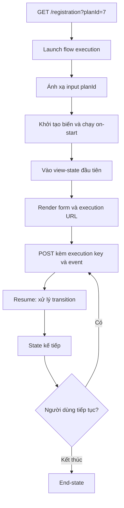
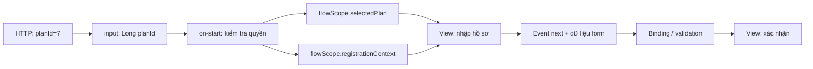

# `on-start` và khởi tạo dữ liệu của flow trong Spring Web Flow

Một hành trình web nhiều bước thường cần chuẩn bị dữ liệu trước khi hiển thị màn hình đầu tiên: xác định đối tượng đang thao tác, kiểm tra quyền, tải danh mục lựa chọn, tạo form model hoặc đặt các giá trị mặc định. Trong **Spring Web Flow**, phần tử `<on-start>` là nơi khai báo các action cần thực hiện **khi một flow session bắt đầu**. Việc khởi tạo tập trung tại đây giúp các state phía sau làm việc trên một ngữ cảnh nhất quán, thay vì mỗi controller hoặc mỗi trang tự lặp lại logic chuẩn bị.

Bài học thuộc chương **Vòng đời thực thi** của `SPRING_WEB_FLOW`. Trọng tâm là cách phối hợp input, `<var>`, `<on-start>`, scope và các state để xây dựng luồng nhiều bước, đồng thời tránh những lỗi phổ biến khi người dùng quay lại, mở nhiều tab hoặc gặp sự cố ở giữa hành trình.

Sau bài này, bạn có thể:

- Mô tả **thời điểm** `<on-start>` chạy và vì sao nó không chạy lại ở mỗi request.
- Khởi tạo dữ liệu bằng `<evaluate>`, `<set>` và `<var>` một cách có mục đích.
- Chọn scope phù hợp để dữ liệu tồn tại qua nhiều state, kể cả khi có subflow.
- Phân biệt `<on-start>` với `<on-entry>`, `<on-render>` và event/transition.
- Thiết kế xử lý lỗi, kiểm tra quyền và kiểm thử phần khởi tạo của một flow.

## 1. `<on-start>` nằm ở đâu trong vòng đời?

**Flow definition** mô tả cấu trúc luồng; **flow execution** là một lượt chạy cụ thể; **flow session** biểu diễn phiên hoạt động của một flow bên trong execution. Một execution có thể gồm flow cha và các flow con. Mỗi khi một flow session mới bắt đầu, Web Flow thực hiện bước khởi tạo dành cho flow đó.

Với một request mới đến flow `/registration`, thứ tự khái niệm thường là:

1. Spring MVC và Web Flow xác định flow definition cần khởi chạy.
2. Một execution/flow session được tạo và input khởi chạy được ánh xạ theo các khai báo `<input>`.
3. Những biến đã khai báo cho flow được chuẩn bị, các action trong `<on-start>` được thực thi.
4. Flow đi vào state bắt đầu, chẳng hạn `view-state` nhập thông tin.
5. Khi người dùng gửi event, Web Flow **resume** execution đang có, xử lý transition và tiếp tục hành trình.



**Điểm then chốt:** `<on-start>` gắn với **việc bắt đầu một phiên flow**, không gắn với mỗi HTTP request. Nếu người dùng ở state thứ hai và gửi event `back`, Web Flow quay lại state trước trong cùng execution; `<on-start>` không mặc nhiên chạy lại. Ngược lại, nếu người dùng mở lại URL khởi chạy như `/registration?planId=7` và hệ thống launch một execution mới, `<on-start>` sẽ được gọi trong execution mới đó.

Với subflow, mỗi lần flow cha **bắt đầu một phiên subflow mới**, `<on-start>` của subflow được thực thi cho phiên subflow đó. Không nên hiểu `<on-start>` là một callback chỉ chạy đúng một lần trong suốt tuổi đời của toàn bộ ứng dụng hoặc toàn bộ HTTP session.

## 2. Ví dụ: chuẩn bị dữ liệu cho quy trình đăng ký

Giả sử người dùng chọn một gói dịch vụ, sau đó nhập hồ sơ và xác nhận đăng ký. URL khởi chạy là:

```http
GET /registration?planId=7
```

Ứng dụng cần:

- Nhận `planId` bắt buộc dưới dạng `Long`.
- Kiểm tra gói dịch vụ có tồn tại, còn hiệu lực và được phép chọn.
- Tạo model để bind form đăng ký.
- Ghi nhận bước hiện tại của wizard ở flow scope.

Một flow XML minh họa:

```xml
<?xml version="1.0" encoding="UTF-8"?>
<flow xmlns="http://www.springframework.org/schema/webflow"
      xmlns:xsi="http://www.w3.org/2001/XMLSchema-instance"
      xsi:schemaLocation="http://www.springframework.org/schema/webflow
                          http://www.springframework.org/schema/webflow/spring-webflow-2.0.xsd">

    <!-- Hợp đồng input của flow -->
    <input name="planId" type="java.lang.Long" required="true" />

    <!-- Form model được tạo khi flow bắt đầu -->
    <var name="registrationForm"
         class="com.example.registration.RegistrationForm" />

    <!-- Các action khởi tạo cho một phiên flow mới -->
    <on-start>
        <evaluate expression="registrationService.requireAccessiblePlan(planId)"
                  result="flowScope.selectedPlan" />
        <set name="flowScope.currentStep" value="1" />
    </on-start>

    <view-state id="enterProfile" view="registration/profile"
                model="registrationForm">
        <transition on="next" to="review" />
        <transition on="cancel" to="cancelled" />
    </view-state>

    <view-state id="review" view="registration/review">
        <on-entry>
            <set name="flowScope.currentStep" value="2" />
        </on-entry>
        <transition on="back" to="enterProfile" />
        <transition on="confirm" to="completed" />
    </view-state>

    <end-state id="completed" view="registration/completed" />
    <end-state id="cancelled" view="registration/cancelled" />
</flow>
```

Đây là cấu trúc giảng dạy. `RegistrationForm` và phương thức `registrationService.requireAccessiblePlan(...)` **do ứng dụng tự định nghĩa**, không phải API dựng sẵn của Spring Web Flow. Hệ thống thực tế cần triển khai service, bảo đảm form có các thuộc tính có thể binding, xác nhận dữ liệu trước khi hoàn tất và cấu hình xử lý lỗi/CSRF phù hợp.

### Giải thích ba công cụ khởi tạo

| Thành phần | Vai trò | Đầu ra minh họa |
| --- | --- | --- |
| `<input name="planId" ... />` | Nhận dữ liệu từ bên ngoài **khi launch**; khai báo kiểu và tính bắt buộc | `flowScope.planId = 7L` |
| `<var name="registrationForm" ... />` | Khai báo biến/model thuộc đời sống flow; Web Flow khởi tạo instance theo class được chỉ định | `flowScope.registrationForm` |
| `<evaluate ... result="flowScope.selectedPlan" />` | Gọi phương thức bean để tải/kiểm tra dữ liệu đầu vào rồi giữ kết quả | `flowScope.selectedPlan` |
| `<set name="flowScope.currentStep" value="1" />` | Khởi tạo một giá trị mặc định đơn giản bằng expression | `flowScope.currentStep = 1` |

`<var>` phù hợp khi cần một model có kiểu để form binding. `<evaluate>` phù hợp khi kết quả cần đến từ service, chẳng hạn truy vấn database hoặc kiểm tra quyền. `<set>` thích hợp cho gán giá trị đơn giản. Cả ba cùng phục vụ việc chuẩn bị trạng thái; tuy nhiên **không phải mọi biến đều cần khai báo bằng `<var>`**. Có thể ghi kết quả action trực tiếp vào `flowScope` như ví dụ `selectedPlan`.

Trong biểu thức Web Flow, `planId` trỏ tới giá trị input đã được ánh xạ vào context của flow. Có thể sử dụng `flowScope.planId` để diễn đạt rõ nguồn giá trị. Không nên bỏ khai báo `<input>` rồi đọc tùy tiện `requestParameters.planId` ở mọi action: request đầu tiên và request resume có ý nghĩa khác nhau, trong khi input contract mang tính rõ ràng và có thể kiểm thử.

## 3. Chọn `<on-start>`, `<on-entry>` hay `<on-render>`?

Những hook này khác nhau về **điểm kích hoạt**. Nhầm lẫn chúng là nguyên nhân thường gặp của việc truy vấn lặp, reset form hoặc tạo bản ghi thừa.

| Hook | Khi nào thực thi? | Phù hợp cho |
| --- | --- | --- |
| `<on-start>` | Khi một flow session mới được bắt đầu | Nạp context khởi chạy, chuẩn bị dữ liệu dùng chung, kiểm tra điều kiện đầu vào |
| `<on-entry>` | Khi **đi vào một state** | Nạp dữ liệu đặc thù của màn hình, cập nhật bước wizard, chuẩn bị state vừa đến |
| `<on-render>` | Trong quá trình render một view-state | Chuẩn bị dữ liệu chỉ cần cho việc hiển thị view, khi framework thực hiện render |
| `<on-exit>` | Khi **rời một state** | Thu dọn dữ liệu tạm hoặc hành động cần thực hiện khi rời state |
| `<on-end>` | Khi flow session kết thúc | Xử lý kết thúc ở mức flow, dọn dẹp phù hợp |

Ví dụ, `selectedPlan` được dùng ở nhiều state và thường ít thay đổi trong một lượt đăng ký, nên tải trong `<on-start>` có thể hợp lý. `currentStep` thay đổi khi người dùng đi tiếp/quay lại, nên cập nhật nó ở `<on-entry>` của từng state thay vì cố gắng đặt lại trong `<on-start>`.

Nếu một state cần danh sách quận/huyện thay đổi theo lựa chọn quốc gia của người dùng, việc nạp danh sách nên gắn với thời điểm nhập/chọn lại state hoặc action xử lý sự kiện, tùy thiết kế. Đặt dữ liệu dễ biến động vào `<on-start>` có thể khiến người dùng nhìn thấy bản sao cũ trong suốt execution.

**Lưu ý về render:** một view có thể được render nhiều lần trong cùng state, ví dụ sau lỗi validation. Logic đặt trong hook render phải chịu được việc gọi lại. Một event chuyển state ngược lại cũng có thể khiến `<on-entry>` chạy lại khi state được vào lần nữa.

## 4. Dữ liệu khởi tạo được lưu ở scope nào?

Scope quyết định dữ liệu có sẵn ở đâu và sống bao lâu. Chọn scope theo nhu cầu, tránh giữ mọi thứ ở phạm vi dài nhất chỉ vì tiện truy cập.

| Scope | Vòng đời sử dụng | Có nên đặt dữ liệu khởi tạo? |
| --- | --- | --- |
| `requestScope` | Request đang xử lý | Chỉ khi dữ liệu phục vụ request hiện tại |
| `flashScope` | Dữ liệu ngắn hạn qua các bước render/redirect được framework quản lý | Thích hợp cho thông báo tạm, không nên làm nguồn dữ liệu chính của wizard |
| `viewScope` | Vòng đời view-state hiện tại | Chỉ khi dữ liệu dành riêng cho một view; chưa phải scope phù hợp để chuẩn bị context trước state đầu tiên |
| `flowScope` | Một flow session qua nhiều state | Lựa chọn thường gặp cho ID, context và form model dùng xuyên các bước |
| `conversationScope` | Conversation bao trùm các flow session tham gia | Khi thực sự cần chia sẻ dữ liệu giữa flow cha và subflow |

Ví dụ `selectedPlan` được lưu vào `flowScope`, nên trang `enterProfile` và `review` có thể tham chiếu nó. Tại thời điểm `<on-start>` chạy, chưa nên dựa vào `viewScope` của một view-state cụ thể; view-state đầu tiên chưa được vào.

### Vì sao không đưa mọi đối tượng vào `flowScope`?

Flow execution có thể cần lưu và khôi phục trạng thái trong repository. Tùy cấu hình, object graph lớn, proxy ORM, connection, stream hoặc đối tượng không phù hợp để serialize có thể gây lỗi lưu trạng thái hoặc tăng chi phí bộ nhớ. Một số quy tắc thiết kế hữu ích:

- Giữ `planId`, lựa chọn người dùng và model tương đối gọn trong scope.
- Tái tải thông tin có thể thay đổi nếu hành trình kéo dài và yêu cầu dữ liệu mới nhất.
- Không giữ đối tượng kết nối cơ sở dữ liệu, transaction hay credential trong flow scope.
- Phân biệt **dữ liệu hiển thị ban đầu** với **dữ liệu cần xác thực lại tại bước xác nhận**.

Đặc biệt, việc đọc gói dịch vụ ở `<on-start>` không thay thế kiểm tra giá/điều kiện tại bước chốt đơn: dữ liệu có thể thay đổi giữa lúc người dùng bắt đầu và lúc xác nhận.

## 5. Thứ tự các action trong `<on-start>`

Một `<on-start>` có thể chứa nhiều action. Hãy đặt chúng theo thứ tự phụ thuộc dữ liệu. Ví dụ, trước tiên lấy kế hoạch đăng ký; sau đó tạo context dựa trên kế hoạch:

```xml
<on-start>
    <evaluate expression="registrationService.requireAccessiblePlan(planId)"
              result="flowScope.selectedPlan" />

    <evaluate expression="registrationContextFactory.create(selectedPlan)"
              result="flowScope.registrationContext" />

    <set name="flowScope.currentStep" value="1" />
</on-start>
```

`registrationContextFactory` cũng là bean do ứng dụng định nghĩa. Nếu lần tải `selectedPlan` thất bại, các action phụ thuộc phía sau không thể coi là đã khởi tạo xong. Không dựa vào dữ liệu do một action **chưa chạy** tạo ra; hãy xác định rõ quan hệ phụ thuộc ngay trong thứ tự khai báo.

Khi logic chỉ đơn thuần gán dữ liệu, `<set>` thường đủ rõ. Khi có nghiệp vụ phức tạp, đưa logic vào service rồi gọi bằng `<evaluate>` dễ kiểm thử hơn so với đặt nhiều expression dài trong XML. Web Flow điều phối hành trình; service chịu trách nhiệm quy tắc nghiệp vụ và giao dịch.

### Chú ý đến giao dịch và tác dụng phụ

`<on-start>` chạy trong quá trình khởi tạo flow, **không mặc nhiên có một giao dịch nghiệp vụ kéo dài đến cuối wizard**. Nếu cần transaction, kiểm soát ở service hoặc cấu hình persistence/transaction thích hợp của ứng dụng.

Nên ưu tiên các hành động an toàn khi lặp lại ở nhiều lần launch: đọc dữ liệu, cấp model, kiểm tra điều kiện truy cập. Tránh đặt tại đây các thao tác không thể hoàn tác như:

- Trừ tiền, gửi yêu cầu thanh toán hoặc chốt đơn.
- Gửi email/SMS xác nhận hoàn tất.
- Tạo bản ghi nghiệp vụ chính thức mà mỗi lần mở URL sẽ sinh một bản mới.

Nếu nghiệp vụ thật sự cần tạo một **draft** ngay lúc bắt đầu, service phải có chiến lược chống tạo trùng, thời hạn lưu và cơ chế dọn draft bỏ dở; không thể chỉ trông chờ Web Flow bảo đảm toàn bộ request của người dùng luôn chạy đúng một lần.

## 6. Dữ liệu từ input sang form model

`<input>` và `<on-start>` thường phối hợp như sau:



**Launch input** là thông tin truyền từ bên ngoài để bắt đầu flow, chẳng hạn `planId`. **Form binding** là thao tác ánh xạ dữ liệu người dùng gửi khi execution đang hoạt động vào model của `view-state`. `_eventId_next` hoặc một cơ chế event tương đương cho Web Flow biết transition cần thực hiện; nó không phải là input mới cần khai báo bằng `<input>`.

Ví dụ JSP dùng execution URL do Web Flow cung cấp:

```jsp
<form method="post" action="${flowExecutionUrl}">
    <label>
        Họ và tên
        <input name="fullName" value="${registrationForm.fullName}" />
    </label>
    <button type="submit" name="_eventId_next" value="1">
        Tiếp tục
    </button>
</form>
```

`RegistrationForm` là Java bean của ứng dụng có thuộc tính `fullName`. Khi người dùng submit, Web Flow xử lý event và binding/validation theo cấu hình của view-state. Với ứng dụng tích hợp Spring Security, POST còn phải mang CSRF token hợp lệ. Trường form không làm chạy lại `<on-start>` mỗi khi người dùng bấm `Tiếp tục`.

Để thử nghiệm, đặt một breakpoint trong `requireAccessiblePlan`: truy cập URL launch sẽ gọi phương thức; gửi event từ form đang hoạt động thông thường không gọi lại phương thức này. Nếu breakpoint bị kích hoạt mỗi lần submit, hãy kiểm tra action form có đang trỏ nhầm về URL launch hoặc hệ thống có liên tục tạo execution mới.

## 7. Khởi tạo trong subflow

Spring Web Flow cho phép tách một quy trình lớn thành các subflow: đăng ký chính có thể gọi flow xác minh địa chỉ, xác thực bổ sung hoặc chọn gói thanh toán.

```xml
<!-- Đặt bên trong flow cha registration -->
<subflow-state id="verifyContact" subflow="contactVerification">
    <input name="userId" value="registrationForm.userId" />
    <transition on="verified" to="review" />
</subflow-state>
```

Trong flow con `contactVerification`:

```xml
<input name="userId" type="java.lang.Long" required="true" />

<on-start>
    <evaluate expression="contactService.loadVerifiedChannels(userId)"
              result="flowScope.availableChannels" />
</on-start>
```

Khi flow cha đi vào `subflow-state`, nó truyền input được khai báo sang flow con. Flow con khởi tạo phiên và chạy `<on-start>` của chính nó. Khi subflow kết thúc, flow cha nhận outcome để chọn transition. Nếu lần sau flow cha lại đi vào `subflow-state` đó và tạo phiên subflow mới, phần khởi tạo của flow con có thể được thực thi lần nữa.

Phạm vi `flowScope` của cha và con được quản lý theo từng flow session; **đừng giả định biến `flowScope.availableChannels` của con tự xuất hiện ở `flowScope` của cha**. Muốn trả dữ liệu ra ngoài, hãy khai báo output của subflow và mapping khi rời subflow. Dữ liệu thật sự cần dùng chung xuyên các phiên flow trong cùng conversation mới nên cân nhắc `conversationScope`.

## 8. Kiểm tra input, quyền và lỗi khởi tạo

Khởi tạo flow là ranh giới dữ liệu đầu vào, vì vậy cần tách ba lớp kiểm tra:

1. **Có giá trị hay không:** `required="true"` yêu cầu `planId` được cung cấp.
2. **Đúng kiểu hay không:** khai báo `type="java.lang.Long"` đòi hỏi giá trị có thể chuyển sang `Long`; `planId=abc` là input không hợp lệ.
3. **Đúng nghiệp vụ và đúng quyền hay không:** `planId=7` vẫn có thể là gói không tồn tại, đã khóa hoặc không được phép truy cập; `requireAccessiblePlan` phải kiểm tra danh tính hiện tại trong service.

| Tình huống | Rủi ro | Cách xử lý |
| --- | --- | --- |
| Thiếu input bắt buộc | Không đủ dữ liệu để khởi chạy | Xử lý lỗi input theo cấu hình Web Flow/MVC |
| Input sai kiểu | Không thể ánh xạ vào kiểu khai báo | Thông báo đầu vào không hợp lệ; không xử lý dựa trên ID suy đoán |
| Input hợp lệ nhưng không được phép | Rò rỉ dữ liệu nghiệp vụ | Service kiểm tra quyền và từ chối theo chính sách |
| Dịch vụ đọc dữ liệu gặp lỗi | Không hoàn thành `<on-start>` | Xử lý ngoại lệ khởi chạy, ghi log và cung cấp đường quay lại/thử lại phù hợp |
| Execution key cũ/hết hạn | Không thể resume lần chạy đã tạo | Hướng người dùng bắt đầu flow mới; không tự coi việc resume là thành công |
| Mở nhiều tab từ URL launch | Có thể có nhiều execution độc lập | Mỗi form gửi đúng execution URL, dữ liệu không chia sẻ nhầm |

**Không nên giả định lỗi trong `<on-start>` luôn có thể xử lý bằng transition của view-state đầu tiên.** Khi action khởi tạo thất bại, flow có thể chưa vào state đó. Ứng dụng cần cơ chế xử lý ngoại lệ và điều hướng ở tầng Web Flow/Spring MVC thích hợp; với lỗi nghiệp vụ dự kiến, cũng có thể thiết kế bước kiểm tra ở một action/decision-state có đường chuyển rõ ràng thay vì ném ngoại lệ.

Ví dụ nếu điều kiện khởi tạo chỉ là `gói không khả dụng` và muốn trình bày trang giải thích trong flow, có thể tách kiểm tra mềm sang service trả kết quả rồi điều hướng qua `decision-state`. Còn việc truy cập trái phép phải được chặn tại service, ngay cả khi giao diện đã ẩn lựa chọn.

### Khi nào cần nạp lại dữ liệu?

Vì `<on-start>` chỉ chạy lúc bắt đầu, dữ liệu được tải có thể trở nên cũ sau nhiều phút. Đặc biệt ở bước thanh toán hoặc đặt lịch, cần **kiểm tra lại giá, trạng thái tồn kho/quyền và tính khả dụng ngay trước thao tác quyết định**, trong một service có kiểm soát giao dịch nếu cần. Không nên dựa vào đối tượng `selectedPlan` cũ như nguồn sự thật cuối cùng.

## 9. Kiểm thử `<on-start>` một cách có chủ đích

Kiểm thử cần chứng minh phần khởi tạo chạy **đúng thời điểm** và tạo **đúng trạng thái**, chứ không chỉ kiểm tra trang đầu tiên render được.

| Trường hợp | Thiết lập / thao tác | Điều cần xác nhận |
| --- | --- | --- |
| Launch hợp lệ | `planId=7`, service trả gói được phép | Vào `enterProfile`; `flowScope.selectedPlan` và model được chuẩn bị |
| Thiếu input | Launch không có `planId` | Lỗi bắt buộc được xử lý theo cấu hình; service không xử lý ID tùy ý |
| Sai kiểu | `planId=abc` | Lỗi chuyển đổi input được nhận diện |
| Gói không tồn tại | Service báo không tìm thấy | Không vào flow ở trạng thái giả định đã khởi tạo thành công |
| Không có quyền | Người dùng khác yêu cầu `planId=7` | Service từ chối; không lộ thông tin gói |
| Resume cùng execution | POST event `next` theo execution URL | Chuyển `enterProfile` → `review`; `on-start` không chạy lại |
| Quay lại state | Gửi `back` từ `review` | Model giữ dữ liệu theo scope; `on-entry` của state được vào lại có thể chạy |
| Launch lần thứ hai | Mở lại URL khởi chạy trong tab mới | Tạo flow session mới; thực hiện khởi tạo mới |
| Gọi lại subflow | Flow cha vào lại `verifyContact` | Subflow mới thực thi `on-start` riêng theo lần vào đó |
| Trạng thái không thể phục hồi | Gửi khóa execution đã hết hạn | Xử lý lỗi resume, không tạo cảm giác đã lưu/xác nhận |

Có thể thực hiện một bài kiểm tra đơn giản bằng **mock service có bộ đếm**: gọi launch một lần và xác nhận `requireAccessiblePlan` được gọi một lần; sau đó gửi event trong cùng execution và xác nhận bộ đếm không tăng; cuối cùng launch lần mới và xác nhận bộ đếm tăng. Kết hợp kiểm tra `flowScope` và state hiện tại bằng công cụ kiểm thử Web Flow, hoặc kiểm thử tích hợp qua Spring MVC khi cần xác nhận URL, execution key, binding và CSRF.

Khi debug, nên ghi nhận flow ID, state ID và mã tương quan request/execution theo mức log phù hợp. Tránh ghi các thông tin như mật khẩu, token, giấy tờ định danh và toàn bộ form model vào log. Nếu đang cố gắng xác định `<on-start>` chạy lặp ngoài ý muốn, kiểm tra URL form và đường điều hướng **launch/resume** trước khi thay đổi action.

## 10. Bài tập: khởi tạo wizard đặt lịch

Hãy tạo flow `appointment` nhận `serviceId` và dẫn người dùng qua `selectTime`, `enterContact`, `confirm`:

1. Dùng `<input>` khai báo `serviceId` kiểu `Long` và bắt buộc.
2. Dùng `<var>` tạo `AppointmentForm` để giữ thông tin liên hệ và thời gian chọn.
3. Trong `<on-start>`, gọi `appointmentService.requireBookableService(serviceId)` để kiểm tra quyền/tính hợp lệ, lưu kết quả vào `flowScope.service`.
4. Gán `flowScope.currentStep` ban đầu và cập nhật nó tại `<on-entry>` của các state sau.
5. Bind form ở view-state thích hợp, kiểm tra dữ liệu người dùng trước khi chuyển bước.
6. Tại action xác nhận cuối cùng, kiểm tra lại slot còn trống và thực hiện đặt lịch qua service có cơ chế chống tạo bản ghi trùng.
7. Kiểm thử việc quay lại, reload view, hai tab độc lập, thiếu input, lỗi service và execution đã hết hạn.

**Câu hỏi tự đánh giá:**

- Vì sao `<on-start>` là nơi phù hợp để nạp gói dịch vụ đã chọn nhưng không phù hợp để trừ tiền?
- Nếu người dùng quay lại view đầu tiên từ state thứ hai, hook nào có thể chạy lại: `<on-start>` hay `<on-entry>`?
- Khi flow cha gọi lại subflow lần thứ hai, flow con có khởi tạo lại dữ liệu riêng không?
- Khi người dùng gửi `POST` với execution key đang hợp lệ, dữ liệu `planId` ban đầu có cần được truyền lại như input khởi chạy hay không?
- Tại sao một `Long` hợp lệ vẫn cần được service kiểm tra quyền?

## Ghi nhớ

`<on-start>` là hook khởi tạo **một flow session mới**. Nó chạy sau khi nhận ngữ cảnh input khởi chạy và trước khi hành trình đi vào state đầu tiên; nó không mặc nhiên lặp lại khi Web Flow resume execution để xử lý event. Kết hợp `<input>`, `<var>`, `<evaluate>` và `<set>` giúp chuẩn bị model và context dùng xuyên nhiều state. Để xây dựng hành trình web an toàn, hãy chọn đúng scope, phân biệt hook khởi chạy với hook của state, kiểm tra quyền tại service và xác thực lại dữ liệu quan trọng khi người dùng xác nhận hành động cuối cùng.
