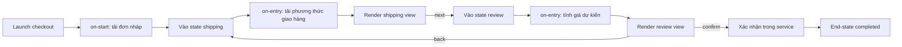

# `on-entry` và hành động khi vào state trong Spring Web Flow

Trong một quy trình web nhiều bước, có những công việc cần thực hiện **mỗi khi người dùng đi vào một bước cụ thể**: nạp danh sách tùy chọn mới, tính lại bản xem trước, kiểm tra điều kiện để hiển thị màn hình, hoặc cập nhật tiến độ. Spring Web Flow cung cấp phần tử `<on-entry>` để khai báo các action đó ngay trong state thay vì dàn trải logic điều hướng qua các Spring MVC controller.

Bài học nằm trong chương **Vòng đời thực thi** của module `SPRING_WEB_FLOW`. Chúng ta tìm hiểu thời điểm action khi vào state được kích hoạt, cách lưu kết quả vào scope phù hợp, ảnh hưởng của việc quay lại state, quan hệ với form binding/validation và cách thiết kế những action an toàn khi một state được vào nhiều lần.

Sau khi học, bạn có thể:

- Giải thích `<on-entry>` chạy **khi nào**, đặc biệt khi luồng đi tiếp, quay lại hoặc hiển thị lại form lỗi.
- Sử dụng `<evaluate>` và `<set>` trong `<on-entry>` để chuẩn bị dữ liệu trước lúc render view.
- Phân biệt `<on-entry>` với `<on-start>`, `<on-render>`, `<on-exit>`, `action-state` và `transition`.
- Chọn `viewScope` hoặc `flowScope` đúng theo vòng đời dữ liệu.
- Kiểm soát việc gọi lại service, ngoại lệ, dữ liệu cũ, side effect và tình huống người dùng thao tác ở nhiều tab.
- Viết các ca kiểm thử xác nhận số lần chạy và kết quả khởi tạo của state.

## 1. Entry action là gì?

Một **state** là điểm người dùng hoặc hệ thống đang ở trong một flow execution. Với `view-state`, Web Flow thường hiển thị giao diện rồi tạm dừng để chờ sự kiện tiếp theo. Khi một flow thực sự **đi vào** state, các action trong `<on-entry>` được gọi như một phần của quá trình vào state.

Ví dụ, quy trình đặt hàng có các state `shipping`, `review`, `completed`. Khi đến bước `shipping`, giao diện cần một danh sách phương thức giao hàng; khi đến `review`, hệ thống cần tính bản tổng hợp chi phí. Hai nhiệm vụ này gắn với thời điểm **vào từng state**.



Điều quan trọng là **đi vào state** khác với **HTTP request đến server**. Một state có thể được render lại vì lỗi nhập liệu mà không có transition thực sự rời rồi quay vào state. Ngược lại, một request có thể gây ra nhiều lần chuyển state bên trong flow, đặc biệt khi đi qua các state xử lý tự động. Vì vậy, không nên suy ra số lần chạy `<on-entry>` chỉ từ số lượng request hay số lần người dùng nhìn thấy màn hình.

### Nguyên tắc thời điểm

1. **Launch mới:** Web Flow bắt đầu flow, xử lý khởi tạo, rồi đi vào start state; `<on-entry>` của start state được gọi.
2. **Chuyển sang state khác:** Nếu event làm flow đi từ `shipping` sang `review`, Web Flow thực hiện các action vào `review`.
3. **Quay lại state trước:** Nếu event `back` từ `review` trở lại `shipping`, state `shipping` được vào lại nên action `<on-entry>` của nó chạy lại.
4. **Vẫn ở cùng view-state:** Một lỗi binding/validation có thể làm view được hiển thị lại trong cùng state mà không thực hiện một lần vào state mới; không nên dựa vào `<on-entry>` để chạy lại trong trường hợp này.
5. **Mở URL khởi chạy lần nữa:** Khi tạo flow execution mới, start state của execution mới thực hiện entry action mới, độc lập với execution trước.

Với các transition trỏ về chính state đang đứng, cần phân biệt việc framework thực hiện **re-entry** thực sự với việc giữ nguyên state rồi render lại. Cách định nghĩa transition và cơ chế xử lý sự kiện quyết định điều đó; hãy kiểm chứng bằng test nếu nghiệp vụ phụ thuộc vào số lần gọi action.

## 2. Ví dụ hoàn chỉnh: bước chọn phương thức giao hàng

Giả sử người dùng mở `/checkout?orderId=42`, chọn cách giao hàng, xem tổng tiền rồi xác nhận. Flow cần nạp đơn nháp một lần khi bắt đầu và làm mới dữ liệu hiển thị ở từng bước.

```xml
<?xml version="1.0" encoding="UTF-8"?>
<flow xmlns="http://www.springframework.org/schema/webflow"
      xmlns:xsi="http://www.w3.org/2001/XMLSchema-instance"
      xsi:schemaLocation="http://www.springframework.org/schema/webflow
                          http://www.springframework.org/schema/webflow/spring-webflow-2.0.xsd">

    <!-- Nhận input khi khởi chạy flow -->
    <input name="orderId" type="java.lang.Long" required="true" />

    <!-- Model giữ dữ liệu người dùng chọn qua các bước -->
    <var name="shippingForm" class="com.example.checkout.ShippingForm" />

    <on-start>
        <evaluate expression="orderService.requireEditableOrder(orderId)"
                  result="flowScope.order" />
    </on-start>

    <view-state id="shipping"
                view="checkout/shipping"
                model="shippingForm">
        <on-entry>
            <set name="flowScope.currentStep" value="1" />
            <evaluate expression="shippingService.findAvailableMethods(order.id)"
                      result="viewScope.shippingMethods" />
        </on-entry>

        <transition on="next" to="review" />
        <transition on="cancel" to="cancelled" />
    </view-state>

    <view-state id="review" view="checkout/review">
        <on-entry>
            <set name="flowScope.currentStep" value="2" />
            <evaluate expression="pricingService.previewTotal(order.id, shippingForm.methodId)"
                      result="viewScope.pricePreview" />
        </on-entry>

        <transition on="back" to="shipping" />
        <transition on="confirm" to="completed">
            <evaluate expression="orderService.confirm(order.id, shippingForm.methodId)" />
        </transition>
    </view-state>

    <end-state id="completed" view="checkout/completed" />
    <end-state id="cancelled" view="checkout/cancelled" />
</flow>
```

Các lớp `ShippingForm` và phương thức `requireEditableOrder`, `findAvailableMethods`, `previewTotal`, `confirm` là **API minh họa do ứng dụng tự xây dựng**, không phải API có sẵn của Spring Web Flow. Để triển khai thực tế, cần cài đặt các bean đó, cấu hình quyền truy cập, validation, xử lý lỗi và bảo vệ thao tác xác nhận chống thực thi trùng.

### Vai trò của từng đoạn

| Khai báo | Khi nào chạy | Dữ liệu tạo ra |
| --- | --- | --- |
| `<input name="orderId" ... />` | Khi launch flow | `orderId` đầu vào, kiểu `Long` |
| `<var name="shippingForm" ... />` | Khi tạo phiên flow | Form model dùng xuyên nhiều state |
| `<on-start>` | Khi flow bắt đầu | `flowScope.order` |
| `shipping/<on-entry>` | Mỗi lần vào state `shipping` | Bước hiện tại, `viewScope.shippingMethods` |
| `review/<on-entry>` | Mỗi lần vào state `review` | Bước hiện tại, `viewScope.pricePreview` |
| `<transition on="next" ... />` | Khi event `next` được xử lý | Chuyển state `shipping → review` |
| `<transition on="confirm" ... />` | Khi event `confirm` được xử lý | Thực hiện nghiệp vụ và kết thúc flow |

Tình huống cụ thể: người dùng vào `shipping`, chọn giao hàng nhanh và bấm `next`; Web Flow bind `shippingForm.methodId`, sau đó sang `review`, nơi `<on-entry>` gọi `pricingService.previewTotal` dựa trên lựa chọn vừa nhập. Nếu người dùng bấm `back`, flow quay về `shipping` và gọi lại `findAvailableMethods`; model `shippingForm` vẫn có thể giữ lựa chọn cũ nhờ phạm vi flow.

### Vì sao không đặt tất cả vào `<on-start>`?

Danh sách phương thức giao hàng có thể phụ thuộc vào tình trạng đơn hàng, địa chỉ hoặc quy tắc vận chuyển thay đổi trong hành trình. Bản xem trước chi phí lại phụ thuộc trực tiếp vào phương thức người dùng mới chọn. Nếu tính cả hai ngay lúc launch, dữ liệu có thể thiếu hoặc cũ. `<on-entry>` cho phép nạp dữ liệu **đúng thời điểm cần dùng**.

Ngược lại, nếu một dữ liệu là context dùng xuyên toàn bộ hành trình và không phụ thuộc state cụ thể, `<on-start>` thường hợp lý hơn để tránh gọi lại service khi người dùng tiến/lùi.

## 3. Viết action bên trong `<on-entry>`

Các action có thể được viết bằng các phần tử Web Flow như `<evaluate>` hoặc `<set>`.

### `<evaluate>`: gọi bean nghiệp vụ và nhận kết quả

```xml
<on-entry>
    <evaluate expression="shippingService.findAvailableMethods(order.id)"
              result="viewScope.shippingMethods" />
</on-entry>
```

Biểu thức gọi một method của bean ứng dụng và đưa kết quả vào view scope. Service nên trả về dữ liệu phù hợp để render, ví dụ các lựa chọn có ID và tên hiển thị, thay vì đưa đối tượng database session hoặc kết nối hạ tầng trực tiếp vào flow.

Nếu kết quả cần giữ lại qua nhiều state, có thể chọn `flowScope`:

```xml
<on-entry>
    <evaluate expression="profileService.getContactDefaults(order.customerId)"
              result="flowScope.contactDefaults" />
</on-entry>
```

Tuy nhiên, việc chọn `flowScope` chỉ để tiện truy cập có thể kéo dài đời sống dữ liệu quá mức. Hãy cân nhắc thời gian sử dụng thật sự.

### `<set>`: cập nhật giá trị đơn giản

```xml
<on-entry>
    <set name="flowScope.currentStep" value="2" />
</on-entry>
```

Đây là cách dễ đọc để đặt chỉ số bước hoặc cờ trạng thái. Biểu thức `value="2"` được đánh giá trong expression language đã cấu hình. Khi cần quy tắc phức tạp, nên gọi method của service thay vì nhồi nhiều điều kiện vào thuộc tính `value`.

### Nhiều action và dữ liệu phụ thuộc

```xml
<on-entry>
    <evaluate expression="shippingService.findAvailableMethods(order.id)"
              result="viewScope.shippingMethods" />
    <evaluate expression="shippingService.suggestDefaultMethod(shippingMethods)"
              result="viewScope.suggestedMethod" />
</on-entry>
```

Các action trong block được thực hiện theo thứ tự khai báo, nên action sau có thể sử dụng kết quả do action trước tạo ra. `suggestDefaultMethod` là method ví dụ của ứng dụng. Khi một bước gặp lỗi không được xử lý, không nên giả định những bước tiếp theo vẫn hoàn thành; logic xử lý lỗi của flow cần nêu rõ cách phục hồi.

## 4. `on-entry` liên hệ thế nào với các lifecycle hook khác?

Một luồng có nhiều điểm đặt action. Chọn đúng hook giúp tránh lẫn lộn trách nhiệm:

| Điểm thực thi | Điều kiện kích hoạt | Công việc phù hợp |
| --- | --- | --- |
| `<on-start>` của flow | Khi flow session mới bắt đầu | Nạp context toàn luồng, cấp model, kiểm tra input khởi chạy |
| `<on-entry>` của state | Khi flow đi vào state | Nạp dữ liệu màn hình, tính bản xem trước, cập nhật chỉ số bước |
| `<on-render>` của view-state | Khi view được render theo lifecycle của Web Flow | Chuẩn bị dữ liệu phải được làm mới lúc render |
| `<on-exit>` của state | Khi flow rời state | Dọn trạng thái tạm, thực hiện công việc cần có trước khi rời state |
| Action trong `<transition>` | Khi transition tương ứng được chọn | Xử lý hành động do event kích hoạt, ví dụ lưu một thay đổi |
| `<on-end>` của flow | Khi flow session kết thúc | Hoàn tất dọn dẹp cấp flow |

Ví dụ, một form chọn địa chỉ có thể có:

- `<on-entry>` nạp danh sách tỉnh/thành khi vào state.
- `<on-render>` chuẩn bị thông báo và dữ liệu hiển thị khi form cần render lại.
- `<transition on="save">` gọi service lưu dữ liệu sau khi binding/validation thành công.
- `<on-exit>` xóa một dữ liệu tạm khi state thực sự kết thúc.

Không nên chỉ vì event được gửi trong state mà thực hiện lưu dữ liệu ở `<on-entry>`: việc vào lại state sau nút `back` có thể lặp lại thao tác đó. Cũng không nên đặt mọi logic vào `<on-render>` vì render có thể xảy ra nhiều lần, kể cả khi không hề đổi state.

### `<on-entry>` và `action-state`

`view-state` có thể tạm dừng để chờ người dùng. `action-state` thường chạy các action rồi dựa vào kết quả để tự chọn transition, không cần một event do người dùng submit ở chính action-state đó.

```xml
<action-state id="checkEligibility">
    <evaluate expression="eligibilityService.check(order.id)" />
    <transition on="eligible" to="shipping" />
    <transition on="ineligible" to="notEligible" />
</action-state>
```

Nếu mục tiêu là **kiểm tra điều kiện rồi rẽ nhánh**, một `action-state` hoặc `decision-state` có thể rõ nghĩa hơn một `view-state` với `<on-entry>` tự cố điều hướng. Dùng `<on-entry>` chủ yếu để **chuẩn bị state sắp được sử dụng**; dùng transition và state điều phối để thể hiện đường đi của flow.

## 5. Scope quyết định tuổi thọ dữ liệu được khởi tạo

Trong Spring Web Flow, dữ liệu của mỗi lần vào state không nhất thiết cần giữ đến cuối luồng.

| Scope | Tuổi thọ / đặc điểm | Dùng trong ví dụ |
| --- | --- | --- |
| `requestScope` | Dữ liệu cho request đang xử lý | Thông tin chỉ phục vụ một lần xử lý |
| `flashScope` | Dữ liệu ngắn hạn qua các điểm tương tác/render được framework quản lý | Thông báo tác vụ thành công |
| `viewScope` | Gắn với một view-state hiện tại; không dùng để giữ dữ liệu sau khi đã rời view-state | `shippingMethods`, `pricePreview` |
| `flowScope` | Tồn tại trong flow session qua nhiều state | `order`, `shippingForm`, `currentStep` |
| `conversationScope` | Chia sẻ trong conversation chứa các flow session liên quan | Ngữ cảnh dùng chung nếu có flow cha/con |

`viewScope.shippingMethods` trong `shipping` chỉ cần dùng ở màn hình đó. Khi rời `shipping` sang `review`, dữ liệu view scope của `shipping` không còn là nguồn lưu bền của hành trình. Nếu sau đó quay lại `shipping`, Web Flow thiết lập ngữ cảnh của lần vào view-state mới và `<on-entry>` có thể tải lại danh sách.

`shippingForm` được khai báo bằng `<var>` ở cấp flow để giữ lựa chọn người dùng qua các state. Điều này giúp màn `review` biết lựa chọn `methodId` ngay cả khi người dùng đã rời view-state nhập liệu.

**Quy tắc thực hành:** đặt ở `viewScope` dữ liệu hiển thị có thể nạp lại, đặt ở `flowScope` dữ liệu thực sự phải tồn tại qua nhiều bước. Đừng lưu nguyên object graph lớn, credential hoặc các tài nguyên như database connection vào flow scope vì execution có thể cần lưu/khôi phục trạng thái trong repository.

## 6. Kết hợp form binding và validation

`<on-entry>` được chạy khi flow **đi vào** view-state. Form binding và validation lại liên quan tới giai đoạn người dùng gửi dữ liệu/event từ một view-state đang hoạt động.

Ví dụ một form JSP đơn giản:

```jsp
<form method="post" action="${flowExecutionUrl}">
    <label>
        Phương thức giao hàng:
        <select name="methodId">
            <!-- Render các option từ shippingMethods -->
        </select>
    </label>
    <button type="submit" name="_eventId_next" value="1">
        Tiếp tục
    </button>
</form>
```

`shippingForm` phải là bean cho phép bind thuộc tính `methodId`. `shippingMethods` là tập tùy chọn đã nạp trong state hiện tại. `flowExecutionUrl` chứa thông tin điều hướng để request tiếp tục **đúng execution**; `_eventId_next` biểu thị event chuyển bước. Trong ứng dụng tích hợp Spring Security, form POST phải gửi CSRF token theo cấu hình bảo mật thực tế.

Luồng xử lý thường là:

1. Vào `shipping` → chạy `<on-entry>` → render form.
2. Người dùng chọn `methodId` và gửi event `next`.
3. Web Flow xử lý request tiếp tục, binding dữ liệu và validation của view-state theo cấu hình.
4. Nếu dữ liệu hợp lệ và transition được chọn, luồng rời `shipping`, vào `review` và thực thi entry action của `review`.
5. Nếu dữ liệu không hợp lệ, view có thể được render lại trong state hiện tại; trường hợp này **không nhất thiết làm `<on-entry>` chạy lại**.

Vì vậy, nếu dữ liệu hỗ trợ render cần được làm mới cả lúc hiển thị lại form lỗi, nên xem xét `<on-render>` hoặc cơ chế phù hợp cho việc chuẩn bị dữ liệu hiển thị. Không đặt logic có side effect trong `<on-render>` vì có thể bị gọi nhiều lần. Nếu chọn dữ liệu hiển thị trong `<on-entry>`, hãy kiểm thử đặc biệt tình huống form lỗi để chắc chắn view còn đủ tập tùy chọn cần thiết.

### Tránh làm mất dữ liệu người dùng khi quay lại

Một lỗi thiết kế dễ gặp là reset form ngay trong `<on-entry>`:

```xml
<!-- Ví dụ CẦN TRÁNH nếu người dùng được phép quay lại chỉnh lựa chọn -->
<on-entry>
    <evaluate expression="shippingForm.reset()" />
</on-entry>
```

Khi người dùng từ `review` bấm `back`, `shipping` được vào lại và `reset()` xóa lựa chọn đã nhập. Thay vào đó, chỉ khởi tạo form mặc định **khi chưa có lựa chọn**, hoặc khởi tạo một lần ở `<on-start>`/`<var>`. Các danh sách lựa chọn và bản xem trước có thể nạp lại, còn dữ liệu người dùng cần được bảo toàn theo yêu cầu nghiệp vụ.

## 7. Entry action được chạy lại: an toàn và hiệu năng

Người dùng không luôn đi theo một đường thẳng từ bước 1 đến bước cuối. Họ có thể quay lại, đổi lựa chọn, mở tab khác hoặc gặp lỗi. Mỗi lần flow thực sự đi vào state, `<on-entry>` có thể thực thi lại.

Với các action **đọc** như `findAvailableMethods`, việc chạy lại thường chấp nhận được và đôi khi còn giúp dữ liệu mới hơn. Với action **ghi** như `chargePayment()`, việc chạy lại có thể tạo hậu quả nghiêm trọng.

| Action dự định đặt ở entry | Đánh giá | Hướng triển khai |
| --- | --- | --- |
| Tải danh mục tỉnh/thành | Thường phù hợp | Nạp vào `viewScope`; cân nhắc cache nếu ít thay đổi |
| Tính chi phí dự kiến | Phù hợp nếu không gây side effect | Tính lại theo lựa chọn hiện tại, xác thực lại ở bước chốt |
| Cập nhật chỉ số bước | Thường phù hợp | Dùng `<set>` vào `flowScope` |
| Tạo bản nháp mới mỗi lần vào state | Dễ sinh trùng | Khởi tạo có điều kiện và có khóa định danh nghiệp vụ |
| Gửi email xác nhận | Không phù hợp | Gọi sau thao tác xác nhận có kiểm soát |
| Trừ tiền hoặc chốt đơn | Không phù hợp | Đặt trong service của hành động xác nhận, có chống lặp |

**Idempotency** nghĩa là thực hiện cùng một lệnh nhiều lần không tạo thêm hiệu ứng ngoài ý muốn so với một lần. Với các action có side effect không tránh được, tầng service cần cơ chế giao dịch và khóa idempotency/định danh nghiệp vụ; đừng dựa vào giả định người dùng chỉ vào state đúng một lần.

Về hiệu năng, nếu mỗi lần quay lại state đều thực hiện truy vấn lớn, cân nhắc:

- Chỉ tải dữ liệu thật sự cần cho màn hình.
- Cache có thời hạn ở service đối với danh mục ít thay đổi.
- Sử dụng kết quả đã có trong flow scope khi tính hợp lệ còn được bảo đảm.
- Đo thời gian action ở state có độ trễ cao để xác định truy vấn cần tối ưu.

Không cache các dữ liệu ảnh hưởng tới quyết định cuối cùng mà bỏ qua bước kiểm tra lại quyền, giá hoặc tồn kho tại thời điểm xác nhận.

## 8. Xử lý lỗi xảy ra khi vào state

Lỗi trong `<on-entry>` xảy ra **trước khi state hoàn tất bước chuẩn bị để render**. Cần phân biệt lỗi dự kiến của nghiệp vụ với lỗi kỹ thuật bất thường.

| Lỗi | Ví dụ | Cách xử lý mong muốn |
| --- | --- | --- |
| Không đủ quyền | Người dùng không còn được phép xem đơn | Service từ chối và ứng dụng xử lý theo chính sách bảo mật |
| Dữ liệu không còn hợp lệ | Phương thức giao hàng đã ngừng hỗ trợ | Điều hướng về bước lựa chọn hợp lý hoặc hiển thị thông báo rõ ràng |
| Service tạm thời không sẵn sàng | Lỗi mạng khi tải giá vận chuyển | Thông báo lỗi có thể thử lại; không tiếp tục với dữ liệu giả |
| Dữ liệu tính toán không nhất quán | ID phương thức không thuộc danh sách hợp lệ | Yêu cầu chọn lại; kiểm tra cả ở service trước khi xác nhận |
| Execution không còn tồn tại | Khóa cũ/hết hạn | Xử lý lỗi resume, hướng người dùng khởi chạy lượt mới |

**Không mặc định rằng exception trong `<on-entry>` sẽ biến thành event để transition `on="error"` tự chạy.** Action ném ngoại lệ có thể làm gián đoạn việc vào state và cần cơ chế xử lý exception của Web Flow/MVC hoặc một thiết kế phân nhánh chủ động. Để có đường đi cụ thể cho lỗi nghiệp vụ dự kiến, có thể đặt bước kiểm tra trong `action-state` trả outcome như `available`/`unavailable`, sau đó chuyển tới view-state phù hợp.

Ví dụ:

```xml
<action-state id="checkShippingOptions">
    <evaluate expression="shippingService.checkAvailability(order.id)" />
    <transition on="available" to="shipping" />
    <transition on="unavailable" to="shippingUnavailable" />
</action-state>
```

Action `checkAvailability` ở đây là API ví dụ do ứng dụng cung cấp, trả kết quả sự kiện tương thích với các transition. Cách làm này thể hiện điều kiện rẽ nhánh như một phần của state machine, còn `<on-entry>` của `shipping` chỉ chuẩn bị dữ liệu cho màn hình khi người dùng thực sự được đi vào.

Nếu cần phục hồi từ lỗi tạm thời, hãy xác định liệu state hiện tại đã được vào thành công, execution có thể được resume và dữ liệu scope còn nhất quán hay chưa. Không dùng lại execution key một cách mù quáng nếu quá trình lưu hoặc khôi phục execution đã thất bại.

## 9. `on-entry` trong subflow và nhiều tab

Một flow cha có thể gọi subflow để xác nhận địa chỉ hoặc lấy thêm thông tin. Khi một subflow session mới bắt đầu, nó có các state riêng; mỗi khi đi vào một state của subflow, các entry action của state đó hoạt động trong **ngữ cảnh flow con**.

```xml
<!-- Trích đoạn view-state trong flow con addressVerification -->
<view-state id="verifyAddress" view="address/verify">
    <on-entry>
        <evaluate expression="addressService.getSuggestions(addressId)"
                  result="viewScope.suggestions" />
    </on-entry>
    <transition on="verified" to="done" />
</view-state>
```

`addressId` cần được cung cấp trong flow con theo input contract hoặc context phù hợp. `viewScope.suggestions` thuộc view-state của flow con; nó không tự xuất hiện trong `flowScope` của flow cha. Muốn trả dữ liệu đã xác nhận về flow cha, cần xác định output của subflow và mapping ở phía flow gọi.

Tương tự, nếu người dùng mở **hai execution độc lập** của cùng một flow trong hai tab, `<on-entry>` của mỗi execution phải xử lý ngữ cảnh riêng; form cần gửi về `flowExecutionUrl` tương ứng. Không nên dùng một biến trong HTTP session chung để lưu `currentStep` hoặc form của tất cả execution vì các tab có thể ghi đè lẫn nhau. Nếu người dùng sao chép một URL chứa cùng execution key sang tab khác, tình huống lại là **cùng execution được truy cập từ nhiều tab** và cần cân nhắc chính sách concurrency, snapshot/repository và cách xử lý back/refresh.

## 10. Kiểm thử hành vi vào state

Cần xác nhận không chỉ dữ liệu được tạo đúng mà cả **số lần action thực sự chạy**. Trong kiểm thử Web Flow, dùng mock bean cho service và công cụ kiểm thử execution/flow để khởi chạy, phát event và quan sát state/scope. Ở kiểm thử tích hợp Spring MVC, đồng thời xác minh URL, event, form binding và bảo mật request.

| Ca kiểm thử | Thao tác | Kỳ vọng |
| --- | --- | --- |
| Vào start state | Launch `checkout` với `orderId=42` | `shipping` được vào; `findAvailableMethods` chạy; `viewScope.shippingMethods` có giá trị |
| Chuyển state | Từ `shipping` gửi `next` với form hợp lệ | Vào `review`; chạy `previewTotal`; cập nhật `currentStep=2` |
| Quay lại state | Từ `review` gửi `back` | Vào lại `shipping`; entry action của `shipping` chạy lại |
| Giữ dữ liệu form | Chọn phương thức, sang review rồi quay lại | `shippingForm.methodId` không mất nếu flow thiết kế giữ model |
| Form không hợp lệ | Gửi `next` với methodId sai | Binding/validation lỗi; không xác nhận đơn và không coi view render lại là một lần vào state mới |
| Exception khi tải danh sách | Mock service ném lỗi | Hiển thị/điều hướng theo cơ chế lỗi đã thiết kế; không dùng danh sách giả |
| Nhiều execution | Launch hai lượt với hai orderId | State và dữ liệu không lẫn nhau |
| Gửi event với key hết hạn | Resume execution không còn hợp lệ | Có thông báo/đường khởi chạy mới, không chốt đơn |
| Gọi lại cùng state có chủ đích | Transition thực sự đưa execution vào lại state | Đếm và xác nhận entry action chạy theo lần vào mới |

Một cách debug dễ áp dụng: ghi log với **flow ID, state ID, action ID và correlation ID**; đặt breakpoint trong `findAvailableMethods`. Từ trình duyệt, launch → next → back → gửi form sai. So sánh số lần method được gọi với số lần thực sự đi vào `shipping`, không so trực tiếp với tổng số HTTP request.

Tránh ghi execution key còn hiệu lực, mật khẩu, token, dữ liệu cá nhân hoặc toàn bộ form vào log ở môi trường thực tế.

## 11. Bài tập: wizard đặt lịch hẹn

Hãy thiết kế flow `appointment` có các state `chooseTime`, `enterContact`, `review`, `completed`.

1. Tạo input bắt buộc `serviceId` và dùng `<on-start>` để tải dịch vụ được phép đặt.
2. Ở `chooseTime/<on-entry>`, gọi service đọc danh sách khung giờ đang mở và lưu vào `viewScope.availableSlots`.
3. Ở `enterContact/<on-entry>`, cập nhật `flowScope.currentStep` nhưng không reset dữ liệu đã nhập nếu người dùng quay lại.
4. Ở `review/<on-entry>`, tính bản xem trước dựa trên khung giờ và thông tin liên hệ trong flow model.
5. Dùng binding và validation cho form, giữ execution URL đúng khi gửi event.
6. Chỉ khi người dùng phát event xác nhận mới gọi service đặt lịch; service phải kiểm tra slot vẫn còn trống và bảo vệ khỏi yêu cầu trùng.
7. Kiểm thử quay lại hai bước, submit form sai, một execution hết hạn, hai execution song song và lỗi tạm thời của service.

**Tự kiểm tra:**

- Khi từ `review` quay về `chooseTime`, `<on-entry>` có chạy lại không? Vì sao?
- Tại sao việc render lại form lỗi không đủ để kết luận đã có một lần vào state mới?
- Danh sách slot và lựa chọn slot của người dùng nên lưu ở scope nào?
- Nếu muốn lưu bản ghi đặt lịch, vì sao không gọi service trong `<on-entry>` của `review`?
- Khi gặp ngoại lệ trong entry action, có thể mặc định Web Flow tự phát event `error` không?

## Ghi nhớ

`<on-entry>` mô tả **hành động khi một flow đi vào state**. Nó phù hợp để nạp dữ liệu cho màn hình, tính bản xem trước và cập nhật tiến độ của wizard. Khi người dùng rời state rồi quay lại, entry action có thể được thực hiện lại; khi chỉ render lại view hiện tại do lỗi form, không nên giả định nó sẽ chạy lại. Phối hợp đúng `<on-start>`, `<on-entry>`, `<on-render>`, event/transition và scope giúp Spring Web Flow quản lý hành trình nhiều bước rõ ràng, dễ kiểm thử và an toàn trước lỗi hoặc thao tác lặp.
