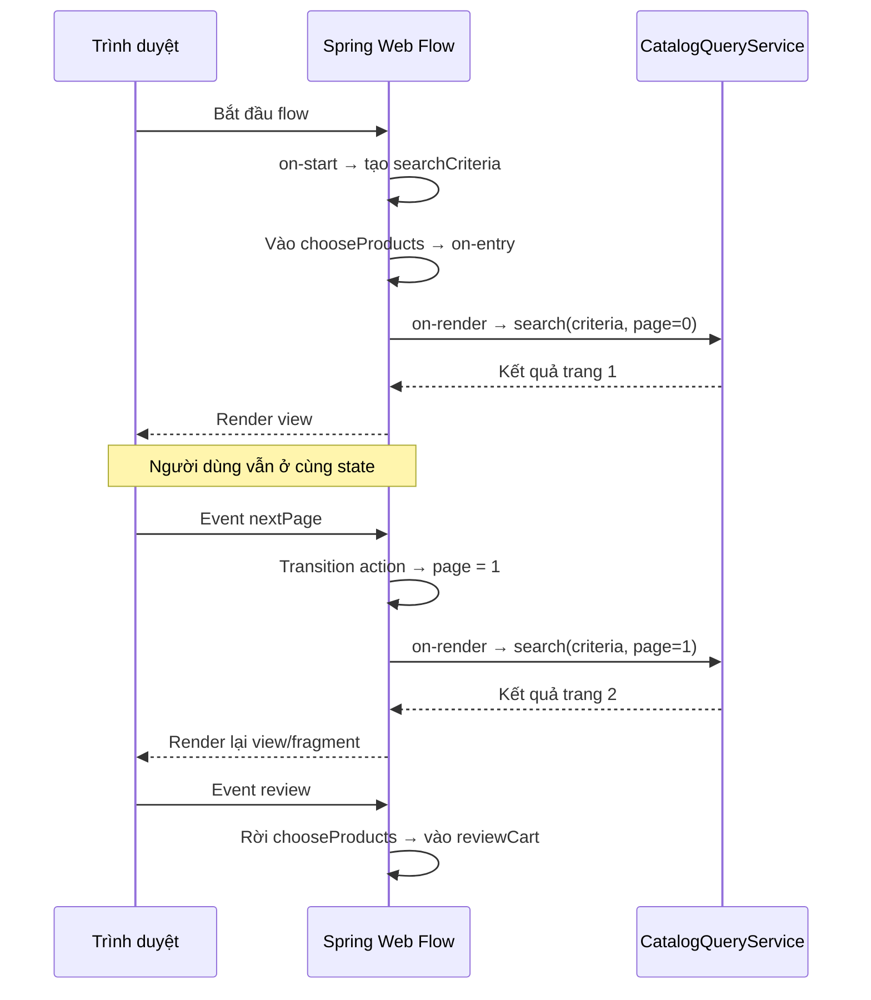
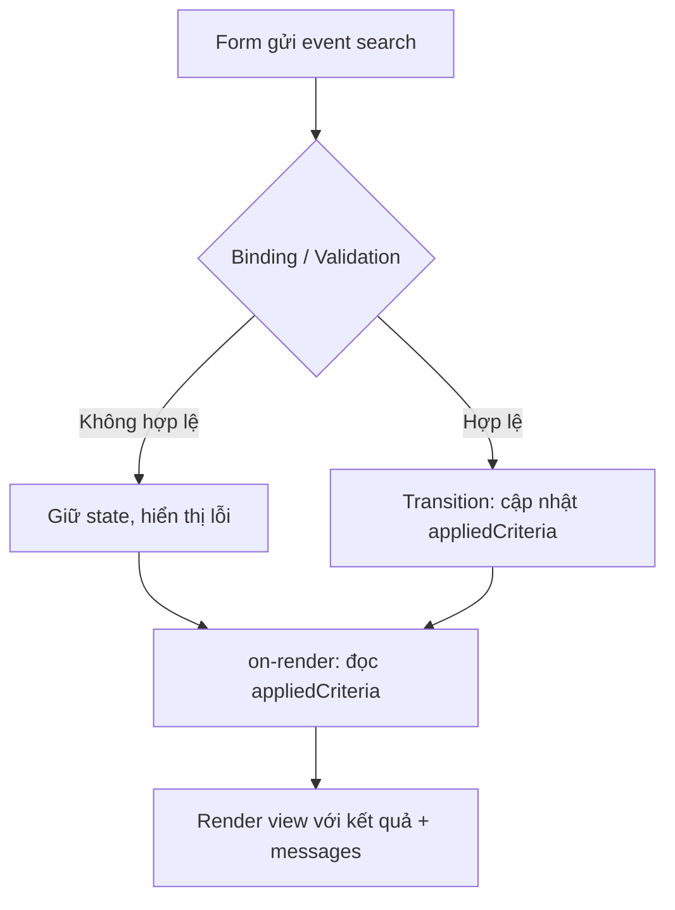

# `on-render` và dữ liệu cần chuẩn bị cho lần hiển thị

## Mục tiêu bài học

Trong Spring Web Flow, một **flow execution** có thể trải qua nhiều `view-state`, nhận các event như `next`, `back`, `search` và chuyển tiếp bằng `transition`. Một `view-state` không chỉ được render khi người dùng lần đầu bước vào: cùng màn hình có thể được hiển thị lại sau khi lọc danh sách, phân trang, nhập form sai hoặc thực hiện một thao tác Ajax.

Vì vậy, khi thiết kế **vòng đời thực thi** của Spring Web Flow, chúng ta phải trả lời hai câu hỏi khác nhau:

1. **Dữ liệu nào cần được tạo khi bắt đầu hoặc khi đi vào một state?**
2. **Dữ liệu nào phải được chuẩn bị lại ngay trước mỗi lần giao diện được render?**

`<on-render>` giải quyết câu hỏi thứ hai. Sau bài này, bạn có thể:

- Xác định thời điểm chạy của `<on-start>`, `<on-entry>`, `<on-render>` và `<on-exit>`.
- Giải thích vì sao `<on-render>` chạy khi hiển thị toàn view **và** khi render một phần.
- Dùng `<evaluate>` trong `<on-render>` để đọc dữ liệu qua service, đặt kết quả vào scope phù hợp và cập nhật màn hình.
- Phân biệt vòng đời `requestScope`, `viewScope` và `flowScope` trong tình huống render lại.
- Kết hợp sự kiện ở cùng state, binding, validation, phân trang và Ajax fragments.
- Tránh tác vụ ghi dữ liệu, gọi API có tác dụng phụ hoặc giữ transaction dài trong render action.
- Kiểm tra các lỗi thường gặp như kết quả cũ, dữ liệu scope không còn, lazy loading hoặc query lặp quá nhiều.

## 1. Bối cảnh: hiển thị một view không chỉ diễn ra một lần

Xét một flow đặt hàng gồm ba bước:

```text
Chọn sản phẩm → Xem lại giỏ hàng → Xác nhận
```

Tại màn hình **Chọn sản phẩm**, người dùng có thể:

- Mở màn hình lần đầu.
- Nhập từ khóa rồi nhấn **Tìm kiếm**.
- Chuyển từ trang kết quả 1 sang trang 2.
- Nhập tiêu chí không hợp lệ và phải sửa lại.
- Dùng Ajax để chỉ cập nhật bảng sản phẩm.
- Rời màn hình sang **Xem lại giỏ hàng**, rồi quay về **Chọn sản phẩm**.

Nếu chỉ truy vấn danh sách sản phẩm một lần trong lúc tạo flow, kết quả sẽ không theo kịp bộ lọc và phân trang. Nhưng nếu tự gọi truy vấn trong mọi transition riêng lẻ, chúng ta dễ lặp lại code và bỏ quên một đường hiển thị.

`<on-render>` cung cấp một điểm tập trung cho công việc **chuẩn bị dữ liệu ngay trước khi view được vẽ**.

```xml
<view-state id="chooseProducts" view="catalog/list">
    <on-render>
        <evaluate expression="catalogQueryService.search(searchCriteria)"
                  result="viewScope.productResults" />
    </on-render>
</view-state>
```

Trong ví dụ, `catalogQueryService` là Spring bean do ứng dụng cung cấp; `searchCriteria` là model chứa điều kiện tìm kiếm. Kết quả được đặt vào `viewScope.productResults` để template `catalog/list` sử dụng. Tên view phải được phân giải bằng cơ chế view phù hợp của ứng dụng.

**Nguyên tắc:** `on-render` phục vụ **chuẩn bị dữ liệu để hiển thị**, không phải nơi thực thi thao tác tạo đơn hàng, ghi thanh toán hoặc gửi email.

## 2. Phân biệt các hook theo vòng đời

Các hook sau dễ bị nhầm vì đều có thể chứa `<evaluate>`:

| Hook | Thời điểm chạy | Mục đích thông dụng |
| --- | --- | --- |
| `<on-start>` | Một lần khi **flow bắt đầu** | Tạo bản nháp, khởi tạo model dùng qua nhiều bước |
| `<on-entry>` | Khi **đi vào state** | Khởi tạo dữ liệu riêng cho lần vào state, chuẩn bị cờ/trạng thái ban đầu |
| `<on-render>` | Trước **mỗi lần render** một `view-state` | Đọc lại danh sách, số lượng, thông tin hiển thị hoặc thông báo cần cập nhật |
| `<on-exit>` | Khi **rời state** theo transition | Dọn dữ liệu tạm, thực hiện thao tác kết thúc state nếu phù hợp |

Ví dụ minh họa kết hợp ba hook:

```xml
<on-start>
    <evaluate expression="catalogFlowService.newSearchCriteria()"
              result="flowScope.searchCriteria" />
</on-start>

<view-state id="chooseProducts" view="catalog/list">
    <on-entry>
        <set name="viewScope.pageOpened" value="true" />
    </on-entry>

    <on-render>
        <evaluate expression="catalogQueryService.search(searchCriteria)"
                  result="viewScope.productResults" />
    </on-render>

    <transition on="review" to="reviewCart" />
</view-state>
```

Phân biệt:

- `on-start` tạo điều kiện tìm kiếm ban đầu cho **lần chạy flow**.
- `on-entry` chạy khi `chooseProducts` được **vào**; nếu flow rời state rồi quay lại, đó là lần vào mới.
- `on-render` lấy danh sách sản phẩm mỗi lần Web Flow chuẩn bị **render màn hình** này, kể cả khi vẫn ở `chooseProducts` mà không có lần vào mới.

### Timeline của một màn hình có phân trang



Ở request `nextPage`, state không thay đổi; vì vậy không có lý do để `on-entry` của `chooseProducts` chạy lại. Nhưng view cần hiển thị dữ liệu mới, nên `on-render` được thực hiện.

**Cẩn thận với số lần thực thi:** một hành vi ở giao diện có thể dẫn đến redirect và một request render sau đó; render action chạy khi framework thực sự render. Không dựa vào việc nhấn nút đúng một lần để suy luận `on-render` chỉ được gọi đúng một lần.

## 3. Quy tắc kích hoạt `on-render`

`<on-render>` là thành phần của một `view-state`, được chạy **trước khi render view**. Những đường đi phổ biến:

| Tình huống | Có chuẩn bị render không? | Ý nghĩa của `on-render` |
| --- | --- | --- |
| Flow lần đầu đi vào `view-state` | Có | Chuẩn bị dữ liệu cho lần hiển thị đầu |
| Transition không có `to` giữ nguyên state | Thường có | Làm mới dữ liệu sau thao tác trong cùng màn hình |
| Binding/validation thất bại và form phải hiện lại | Có | Chuẩn bị lại phần dữ liệu cần render cùng lỗi |
| Ajax event cập nhật fragment | Có | Chuẩn bị dữ liệu trước khi render fragment |
| Chuyển sang một `view-state` khác | Có, tại state mới | `on-render` của **state đích** chạy khi view đích render |
| Đi qua `action-state` hoặc `decision-state` chưa render | Không tự render tại các state đó | `on-render` chỉ áp dụng cho `view-state` khi có hoạt động render |
| Flow đi tới `end-state` và kết thúc | Không còn render `view-state` đang chờ | Không mặc định gọi `on-render` của state cũ |

Các tình huống lỗi/binding có thể tùy cơ chế view mà chọn render lại đầy đủ hoặc một phần. Điểm ổn định là **khi Web Flow chuẩn bị render một `view-state`, các render action của state đó được thực thi**.

### Render khác transition

Hãy so sánh hai khai báo:

```xml
<!-- Event được xử lý ngay trong state hiện tại -->
<transition on="refresh" bind="false" />

<!-- Event đưa flow sang state khác -->
<transition on="next" to="reviewCart" />
```

Với `refresh`, flow vẫn ở state hiện tại và có thể render lại view, khiến `on-render` chạy. Với `next`, flow rời state hiện tại; nếu `reviewCart` là `view-state`, render action của `reviewCart` sẽ chạy khi state mới được hiển thị.

**Không nhầm `on-render` với transition action.** Transition action chạy trong quá trình xử lý event cụ thể; `on-render` chạy khi cần hiển thị view, bất kể sự kiện nào dẫn đến việc hiển thị đó.

## 4. Ví dụ hoàn chỉnh: chuẩn bị dữ liệu cho tìm kiếm và phân trang

Giả sử một flow cho phép lọc sản phẩm rồi chuyển sang màn hình xem lại đơn. Bạn muốn:

1. Lưu điều kiện tìm kiếm qua nhiều request.
2. Lấy danh sách kết quả mới trước mỗi lần render.
3. Làm mới trang kết quả khi người dùng tìm kiếm/phân trang.
4. Chuyển state khi chọn sản phẩm.

### 4.1. Cấu hình XML

```xml
<?xml version="1.0" encoding="UTF-8"?>
<flow xmlns="http://www.springframework.org/schema/webflow"
      xmlns:xsi="http://www.w3.org/2001/XMLSchema-instance"
      xsi:schemaLocation="http://www.springframework.org/schema/webflow
                          https://www.springframework.org/schema/webflow/spring-webflow.xsd">

    <on-start>
        <evaluate expression="catalogFlowService.newSearchCriteria()"
                  result="flowScope.searchCriteria" />
    </on-start>

    <view-state id="chooseProducts"
                view="catalog/list"
                model="searchCriteria">

        <binder>
            <binding property="keyword" />
            <binding property="categoryId" />
        </binder>

        <on-render>
            <evaluate expression="catalogQueryService.search(searchCriteria)"
                      result="viewScope.productResults" />
        </on-render>

        <!-- Người dùng sửa bộ lọc và yêu cầu tìm kiếm lại. -->
        <transition on="search">
            <evaluate expression="searchCriteria.resetPage()" />
        </transition>

        <!-- Event phân trang chỉ thay page, không bind lại bộ lọc. -->
        <transition on="nextPage" bind="false">
            <evaluate expression="searchCriteria.nextPage()" />
        </transition>

        <transition on="previousPage" bind="false">
            <evaluate expression="searchCriteria.previousPage()" />
        </transition>

        <!-- Sang bước khác khi người dùng lựa chọn xong. -->
        <transition on="review" to="reviewCart" />
        <transition on="cancel" to="cancelled" bind="false" />
    </view-state>

    <view-state id="reviewCart" view="catalog/review">
        <transition on="back" to="chooseProducts" />
        <transition on="confirm" to="completed" />
    </view-state>

    <end-state id="completed" />
    <end-state id="cancelled" />
</flow>
```

Đây là ví dụ về **render và điều hướng**. Để chạy trong ứng dụng thật, bạn phải đăng ký hai service bean, DTO tìm kiếm, view renderer, form binding/validation và xử lý chọn sản phẩm. Bước `confirm` ở đây chỉ minh họa một transition; nếu cần thực sự tạo đơn, hãy gọi service nghiệp vụ trước khi vào `completed` và xử lý cả lỗi ghi.

### 4.2. Model giữ điều kiện tìm kiếm

Ví dụ DTO đơn giản:

```java
import java.io.Serializable;

public class SearchCriteria implements Serializable {
    private static final long serialVersionUID = 1L;

    private String keyword = "";
    private Long categoryId;
    private int page;

    public String getKeyword() {
        return keyword;
    }

    public void setKeyword(String keyword) {
        this.keyword = keyword;
    }

    public Long getCategoryId() {
        return categoryId;
    }

    public void setCategoryId(Long categoryId) {
        this.categoryId = categoryId;
    }

    public int getPage() {
        return page;
    }

    public void resetPage() {
        page = 0;
    }

    public void nextPage() {
        page++;
    }

    public void previousPage() {
        page = Math.max(0, page - 1);
    }
}
```

`SearchCriteria` được đưa vào `flowScope` ở `<on-start>`, nên các event trong `chooseProducts` nhìn thấy cùng một điều kiện tìm kiếm. Nếu người dùng sang `reviewCart` rồi quay về `chooseProducts`, dữ liệu trong `flowScope` vẫn có thể được dùng để chạy lại truy vấn.

Trong ứng dụng thật, hãy xác thực/giới hạn từ khóa, `categoryId`, số trang và `pageSize` ở phía server. `nextPage()` ở đây cố ý tối giản để minh họa: service cần chặn page quá lớn hoặc trạng thái phân trang không hợp lệ.

### 4.3. Tầng service chỉ đọc dữ liệu hiển thị

```java
import org.springframework.stereotype.Service;
import org.springframework.transaction.annotation.Transactional;

@Service
public class CatalogQueryService {
    private final ProductQueryRepository repository;

    public CatalogQueryService(ProductQueryRepository repository) {
        this.repository = repository;
    }

    @Transactional(readOnly = true)
    public ProductSearchResult search(SearchCriteria criteria) {
        // Áp dụng giới hạn page/pageSize và bộ lọc đã kiểm tra.
        // Chỉ lấy dữ liệu được phép hiển thị cho người dùng hiện tại.
        // Tạo DTO hoặc projection cần thiết trước khi transaction kết thúc.
        return repository.findVisibleProducts(
                criteria.getKeyword(),
                criteria.getCategoryId(),
                criteria.getPage()
        );
    }
}
```

`ProductQueryRepository`, `ProductSearchResult` và phương thức `findVisibleProducts(...)` là các thành phần minh họa do ứng dụng triển khai. `ProductSearchResult` nên là DTO gọn, chứa danh sách sản phẩm, tổng số kết quả và thông tin phân trang; tránh giữ JPA entity lớn hoặc proxy chưa khởi tạo trong scope.

Transaction đọc chỉ tồn tại khi method service chạy. Sau khi trả DTO, flow giữ kết quả phục vụ view, không giữ `EntityManager` hay database connection mở trong lúc chờ người dùng tương tác.

### 4.4. Vì sao `on-render` là đúng chỗ?

Theo thứ tự:

```text
Lần đầu:
  on-start → tạo SearchCriteria(page=0)
  vào chooseProducts → on-render search(page=0) → render

Nhấn Search:
  bind keyword/categoryId → transition search → resetPage()
  on-render search(page=0, bộ lọc mới) → render lại

Nhấn Next Page:
  transition nextPage → page tăng
  on-render search(page mới) → render lại

Sang Review:
  transition review → rời chooseProducts → vào reviewCart

Nhấn Back từ Review:
  trở về chooseProducts (lần vào mới)
  on-render search(theo SearchCriteria đang giữ) → render
```

Nếu đưa truy vấn vào `<on-entry>` của `chooseProducts`, thao tác `search` hoặc `nextPage` **giữ nguyên state** sẽ không tạo một lần vào state mới, nên dữ liệu có thể không được làm mới. Nếu đưa truy vấn vào từng transition, đường render do validation thất bại hoặc điều hướng quay lại dễ bị bỏ sót.

## 5. Chọn scope nào cho dữ liệu ở `on-render`?

Một render action có thể lấy dữ liệu từ nhiều scope và đặt kết quả vào scope thích hợp.

| Scope | Vòng đời thông thường | Ví dụ phù hợp |
| --- | --- | --- |
| `requestScope` | Request đang xử lý | Dữ liệu phụ chỉ cần dùng trong lần render hiện tại |
| `viewScope` | Từ khi vào `view-state` đến lúc rời state | Danh sách sản phẩm, thông tin phân trang của màn hình |
| `flowScope` | Suốt một flow execution | Bản nháp đặt hàng, điều kiện tìm kiếm cần giữ khi đi qua nhiều bước |
| `conversationScope` | Flow cấp cao nhất và các subflow | Dữ liệu chia sẻ giữa flow cha và flow con nếu thực sự cần |
| `flashScope` | Dữ liệu/thông báo ngắn hạn quanh chu kỳ render/redirect | Thông báo cần hiển thị trong thời gian ngắn |

Trong ví dụ:

```xml
<evaluate expression="catalogQueryService.search(searchCriteria)"
          result="viewScope.productResults" />
```

`searchCriteria` tồn tại ở `flowScope`, còn `productResults` thuộc `viewScope`. Việc phân tách này có lý do:

- Người dùng muốn giữ từ khóa hoặc danh mục khi quay lại từ bước xem lại.
- Danh sách kết quả có thể tải lại khi vào `chooseProducts`, nên không cần giữ nó qua mọi màn hình.
- Khi `on-render` chạy lần mới ở **cùng state**, nó ghi đè `viewScope.productResults` bằng kết quả mới.

### `viewScope` bị hủy khi rời state

Khi flow rời `chooseProducts` và vào `reviewCart`, `viewScope` cũ của `chooseProducts` không còn. Nếu quay lại, đó là lần vào mới và `on-render` sẽ truy vấn lại sản phẩm bằng `searchCriteria` còn trong `flowScope`.

Vì vậy, nếu dữ liệu là **bản nháp cần đi xuyên các bước**, lưu trong `flowScope`; nếu chỉ là **dữ liệu hiển thị có thể dựng lại**, dùng `viewScope` hoặc `requestScope` phù hợp.

### Không đưa mọi thứ vào `flowScope`

Một danh sách hàng nghìn entity có quan hệ JPA có thể làm flow execution/snapshot lớn, khó serialize và tăng chi phí lưu session. Thay vì cất toàn bộ danh sách vào `flowScope`, hãy giữ điều kiện tìm kiếm cùng ID cần thiết và đọc lại kết quả ở `on-render`.

Ngược lại, không nên đọc lại dữ liệu đắt đỏ không thay đổi ở mọi request nếu không cần. Có thể chọn caching có thời hạn hoặc lưu DTO nhỏ trong scope thích hợp, nhưng phải xét cả dữ liệu đổi theo quyền, phiên người dùng và cập nhật từ các request khác.

## 6. `on-render` với binding và validation

Giả sử form tìm kiếm có trường `minPrice` và `maxPrice`. Người dùng gửi:

```text
minPrice=5000000
maxPrice=100000
```

Khi validator xác định khoảng giá không hợp lệ, Web Flow có thể **render lại cùng view-state** để người dùng sửa. Trong lần render đó, `<on-render>` vẫn là điểm chuẩn bị dữ liệu cho màn hình.

Tuy nhiên, có ba lưu ý:

1. **Validation xảy ra trước khi transition tương ứng được thực hiện.** Nếu validation chặn event `search`, các action bên trong transition, như `resetPage()`, có thể chưa chạy.
2. **Render action không phải validator.** Lỗi field và thông báo cần được tạo bởi cơ chế binding/validation và đưa tới template qua `MessageContext` hoặc cơ chế view tương ứng.
3. **Dữ liệu form có thể chưa hợp lệ để truy vấn.** Service gọi từ `on-render` phải có chính sách đối với model đang lỗi: dùng tiêu chí hợp lệ cuối cùng, trả kết quả rỗng có giải thích hoặc tránh truy vấn nếu chưa đủ dữ liệu.

Không nên để `catalogQueryService.search(...)` giả định tất cả điều kiện đều hợp lệ trong mọi lần render; user có thể vừa nhập sai. Có thể dùng hai model riêng:

- `filterForm`: dữ liệu đang nhập và được validate.
- `appliedCriteria`: điều kiện đã được chấp nhận để truy vấn.

Khi event `search` hợp lệ, một transition action sao chép các giá trị đã kiểm tra từ `filterForm` sang `appliedCriteria`. `on-render` chỉ đọc `appliedCriteria`. Nhờ vậy, khi người dùng nhập lỗi, màn hình vẫn có thể hiển thị kết quả theo bộ lọc hợp lệ gần nhất cùng thông báo cần sửa.



**Đừng xử lý lỗi bằng cách ép tất cả transition `validate="false"`**. Những event cần kiểm tra form phải đi qua validation; event hủy hoặc phân trang có thể chọn `bind="false"` nếu đúng nghiệp vụ.

## 7. Full rendering và Ajax fragment đều cần dữ liệu

`on-render` không chỉ chạy khi trả **toàn trang**. Khi một Ajax event yêu cầu làm mới một fragment, dữ liệu cho fragment đó cũng cần được chuẩn bị.

Ví dụ:

```xml
<view-state id="chooseProducts"
            view="catalog/list"
            model="searchCriteria">
    <on-render>
        <evaluate expression="catalogQueryService.search(searchCriteria)"
                  result="viewScope.productResults" />
    </on-render>

    <transition on="search">
        <evaluate expression="searchCriteria.resetPage()" />
        <render fragments="resultsPanel,messagesPanel" />
    </transition>

    <transition on="nextPage" bind="false">
        <evaluate expression="searchCriteria.nextPage()" />
        <render fragments="resultsPanel" />
    </transition>
</view-state>
```

Với event `nextPage`, trình tự điển hình:

1. Request Ajax mang event `nextPage` cùng execution key hợp lệ.
2. Web Flow khôi phục execution, thực thi transition và tăng page.
3. `<on-render>` truy vấn kết quả cho trang mới.
4. Bộ render view tương thích chỉ render `resultsPanel` theo yêu cầu.
5. Client nhận phản hồi và cập nhật vùng tương ứng.

**Lưu ý về tích hợp:** `<render fragments="resultsPanel" />` diễn tả fragment cần hiển thị; để thực sự chỉ trả một vùng DOM, view technology và Ajax integration phải biết fragment này và cách xử lý response. Chỉ thêm một `<div id="resultsPanel">` trong HTML hoặc tự gọi `fetch(...)` không bảo đảm Web Flow tự cắt HTML. Những integration như JSF Ajax, Tiles legacy hoặc adapter riêng có contract fragment khác nhau.

### Partial render không tự làm query nhẹ hơn

Ngay cả khi browser chỉ cập nhật `resultsPanel`, `on-render` vẫn có thể thực hiện `catalogQueryService.search(...)`. Vì vậy cần tối ưu query ở service: dùng pagination ở database, giới hạn page size, trả DTO/projection gọn và tránh nạp object graph quá lớn.

## 8. Không đặt tác vụ ghi có tác dụng phụ trong `on-render`

Một lỗi thiết kế nguy hiểm:

```xml
<!-- KHÔNG NÊN: render lại có thể ghi đơn hàng nhiều lần -->
<on-render>
    <evaluate expression="orderService.createOrder(orderDraft)" />
</on-render>
```

Vì `on-render` có thể chạy nhiều lần, thao tác tạo đơn có thể bị lặp khi refresh, khi validation lỗi, khi client gửi Ajax event hoặc khi flow cần render lại vì lý do khác.

Thay vào đó, hãy đặt lệnh ghi vào một bước nghiệp vụ riêng:

```xml
<view-state id="reviewOrder" view="checkout/review">
    <on-render>
        <evaluate expression="checkoutQueryService.prepareSummary(orderDraft)"
                  result="viewScope.orderSummary" />
    </on-render>

    <transition on="confirm" to="submitOrder" />
</view-state>

<action-state id="submitOrder">
    <evaluate expression="orderCommandService.submit(orderDraft)" />
    <transition on="success" to="completed" />
</action-state>

<end-state id="completed" />
```

`checkoutQueryService.prepareSummary(...)` nên là thao tác đọc/chuẩn bị view. `orderCommandService.submit(...)` nằm trong service có transaction ngắn, kiểm tra lại quyền, giá, tồn kho và điều kiện nghiệp vụ. XML trên mô tả đường thành công; ứng dụng thật phải có nhánh phục hồi cho lỗi lưu và cơ chế chống gửi trùng.

### Tính “an toàn khi gọi lại” của render action

Một render action tốt thường có các đặc tính:

- **Có thể gọi lại** mà không làm thay đổi dữ liệu nghiệp vụ.
- Chỉ đọc dữ liệu người dùng được phép thấy.
- Không gửi email, thanh toán, trừ tồn kho hoặc thực hiện cập nhật trạng thái lâu dài.
- Không phụ thuộc vào việc đây là lần render thứ mấy, trừ khi có chủ đích và được kiểm thử.
- Không giữ `EntityManager`, stream hoặc transaction mở khi đã trả kết quả để view render.

Một truy vấn đọc vẫn có thể tốn tài nguyên hoặc tạo log/audit kỹ thuật; đó là vấn đề hiệu năng và quan sát hệ thống. Điều cốt lõi là không đặt **tác dụng phụ không thể lặp** của nghiệp vụ trong render action.

## 9. Kết nối tầng service, giao dịch đọc và DTO

`on-render` thường gọi service để đọc dữ liệu từ database. Trong Spring, điều đó có thể được triển khai bằng:

```java
@Transactional(readOnly = true)
public ProductSearchResult search(SearchCriteria criteria) {
    // Truy vấn dữ liệu; chuyển thành DTO cần render ngay trong transaction.
    return repository.search(...);
}
```

Khi transaction kết thúc, **đối tượng JPA lấy trong đó có thể trở thành detached**. Nếu view được render sau khi service đã trả về và cố truy cập một quan hệ `LAZY` chưa được khởi tạo, ứng dụng có thể gặp lỗi lazy initialization.

Do đó, dữ liệu trả về cho view nên là:

- DTO/projection gồm các trường cần hiển thị.
- Danh sách có giới hạn và đã phân trang.
- Đối tượng thích hợp để lưu trong scope/snapshot của Web Flow nếu cần.
- Dữ liệu đã được kiểm tra quyền và làm sạch nội dung theo yêu cầu bảo mật.

Một pattern không nên lạm dụng là giữ kết nối JPA mở trong suốt thời gian chờ người dùng. `view-state` có thể tạm dừng hàng phút hoặc lâu hơn; transaction nên kết thúc trong lời gọi service, rồi Web Flow lưu execution riêng.

## 10. Chuẩn bị dữ liệu động và dữ liệu ổn định

Không phải mọi loại dữ liệu đều cần truy vấn mỗi lần render.

| Loại dữ liệu | Nơi chuẩn bị nên cân nhắc | Lý do |
| --- | --- | --- |
| Danh sách kết quả theo bộ lọc, phân trang | `on-render` + query service | Thay đổi giữa các event cùng state |
| Số lượng kết quả, nhãn phân trang | `on-render` hoặc tính từ kết quả truy vấn | Phải khớp danh sách hiện tại |
| Bản nháp đơn hàng dùng qua nhiều bước | `on-start` + `flowScope` | Cần giữ giữa các view-state |
| Danh sách quốc gia/loại sản phẩm ít đổi | Cache/service, tải khi cần | Tránh query trùng không cần thiết |
| Dữ liệu chỉ cần khi lần đầu vào state | `on-entry` | Không cần chạy ở mỗi lần render |
| Thông báo validation của request | Validator/`MessageContext` | Phản ánh lỗi binding/validation hiện tại |
| Lưu đơn sau xác nhận | Service ghi từ transition/action-state | Bảo đảm thao tác do event nghiệp vụ điều khiển |
| Quyền xem dữ liệu theo tài khoản hiện tại | Service đọc/permission policy | Phải kiểm tra khi truy xuất, kể cả khi dữ liệu được cache |

Ví dụ, menu bộ lọc tĩnh có thể được cache, trong khi bảng kết quả nên cập nhật theo từ khóa/trang. Chọn đúng nơi chuẩn bị giúp `on-render` dễ đọc và tránh lạm dụng scope.

### Dữ liệu từ service có thể đổi trong lúc người dùng chờ

Một người dùng mở màn hình sản phẩm, sau đó giá hoặc tồn kho thay đổi. `on-render` cho phép hiển thị thông tin mới khi view được render lại. Nhưng việc hiển thị thông tin mới **không thay thế** kiểm tra lại giá/tồn kho trong service tại thời điểm gửi đơn: hai thời điểm vẫn có thể cách nhau vài phút.

## 11. Một số lỗi thường gặp và cách xử lý

### 11.1. Phân trang nhưng kết quả vẫn là trang cũ

**Triệu chứng:** `nextPage()` đã tăng page, nhưng bảng vẫn hiển thị trang trước.

**Kiểm tra:** query có nằm trong `on-render` hay chỉ `on-entry`? Service `search(...)` có sử dụng `searchCriteria.page` không? `viewScope.productResults` có bị một action sau đó ghi đè không?

### 11.2. Quay lại một màn hình thì danh sách biến mất

**Nguyên nhân thường gặp:** dữ liệu danh sách được lưu trong `viewScope` cũ; khi rời state, scope đó bị hủy.

**Hướng xử lý:** giữ **tiêu chí tìm kiếm** ở `flowScope`, rồi chuẩn bị lại kết quả ở `on-render` khi quay về. Đừng mặc định `viewScope` còn nguyên qua các state.

### 11.3. Form sai nhưng `on-render` ném exception

**Nguyên nhân:** query service giả định các trường đã được validate, trong khi form vẫn chứa dữ liệu lỗi ở thời điểm render lại.

**Hướng xử lý:** kiểm tra input trong service và có chiến lược với bộ lọc chưa hợp lệ; có thể giữ `appliedCriteria` hợp lệ riêng. Để validator cung cấp thông báo lỗi, không bắt mọi lỗi rồi trả kết quả rỗng gây hiểu nhầm.

### 11.4. Cứ refresh là tạo thêm một bản ghi

**Nguyên nhân:** đặt lệnh ghi trong `<on-render>`.

**Hướng xử lý:** chuyển lệnh ghi sang `action-state` hoặc action của transition xác nhận; triển khai transaction/idempotency ở service. Không dùng một cờ `alreadyRendered` trong session như biện pháp chính để ngăn ghi trùng.

### 11.5. Chỉ render fragment nhưng dữ liệu không mới

**Kiểm tra:** event Ajax có được giải mã đúng không? `on-render` có chạy không? Các tham số lọc có được bind đúng không? Fragment renderer có lấy `viewScope.productResults` mới không? Response client có bị cũ đè lên do request gửi gần đồng thời không?

### 11.6. `LazyInitializationException` sau khi service đọc xong

**Nguyên nhân:** view đang truy cập thuộc tính `LAZY` của entity detached.

**Hướng xử lý:** dùng DTO/projection hoặc truy vấn lấy đủ trường cần render trong transaction đọc. Không giữ cả persistence context trong flow execution.

### 11.7. Màn hình chậm dần khi người dùng thao tác nhiều lần

**Kiểm tra:** `on-render` có truy vấn danh sách lớn mà không phân trang, gọi nhiều service lặp hoặc dựng object graph nặng không? Có thể cache dữ liệu tĩnh hay ghép query hợp lý không? Snapshot/session chứa object quá lớn không?

### 11.8. Người dùng mất quyền nhưng fragment vẫn chứa dữ liệu cũ

**Nguyên nhân:** dữ liệu đã cache theo scope rộng mà không gắn với quyền truy cập hoặc không kiểm tra quyền lúc truy vấn.

**Hướng xử lý:** đặt kiểm tra quyền trong service truy vấn, thiết kế cache theo user/tenant và chính sách invalidation phù hợp. Không coi việc ẩn nút ở client là bảo mật.

## 12. Kiểm thử `on-render` theo tình huống thực tế

Khi viết test cho flow, đừng chỉ kiểm tra `state ID`: cần xác nhận dữ liệu hiển thị được chuẩn bị đúng **ở mọi đường render**.

| Kịch bản | State | Kỳ vọng đối với `on-render` và dữ liệu |
| --- | --- | --- |
| Bắt đầu flow | `chooseProducts` | Query trang đầu chạy, kết quả xuất hiện |
| Gửi `search` hợp lệ | Giữ `chooseProducts` | Tiêu chí mới được áp dụng và truy vấn lại |
| Gửi `nextPage` | Giữ `chooseProducts` | Page tăng, kết quả trang kế tiếp |
| Gửi `previousPage` | Giữ `chooseProducts` | Page giảm có giới hạn, không âm |
| Binding/validation lỗi | Giữ `chooseProducts` | Form hiển thị lỗi, render action không gây ghi dữ liệu |
| Ajax cập nhật `resultsPanel` | Giữ `chooseProducts` | Dữ liệu mới được chuẩn bị trước khi fragment render |
| Chuyển tới `reviewCart` | Rời `chooseProducts` | Không gọi lại `on-render` của state cũ để tạo side effect |
| Quay lại `chooseProducts` | Vào state lần nữa | Query chạy với tiêu chí còn trong `flowScope` |
| User session/flow hết hạn | Execution cũ không được resume | Trả lỗi phiên phù hợp; không giả lập scope đã mất |
| Service đọc thất bại | Không render dữ liệu sai | Có chính sách thông báo/retry hoặc error view |
| Thay đổi quyền truy cập | Render lại | Dữ liệu chỉ gồm các mục người dùng còn quyền xem |
| Refresh nhiều lần | Cùng state khi request hợp lệ | Không tạo đơn, gửi email hoặc nhân đôi thao tác nghiệp vụ |

### Kiểm thử unit logic service và integration flow

Có thể dùng mock cho query service trong kiểm thử flow, nhằm kiểm tra:

```text
startFlow()
  → state = chooseProducts
  → search(criteria page=0) được gọi

event nextPage
  → state vẫn = chooseProducts
  → criteria.page = 1
  → search(criteria page=1) được gọi khi view render

event review
  → state = reviewCart
```

Đây là **mô tả kiểm thử**, không phải code chạy trực tiếp. API test cụ thể phụ thuộc phiên bản Web Flow, cách tạo `MockExternalContext` và cách các view được render trong môi trường test.

Với Ajax, cần **kiểm thử tích hợp view/HTTP** để chứng minh fragment thực sự được render và client cập nhật vùng DOM đúng. Unit test state transition không đủ xác nhận `ViewResolver`, response fragment, redirect hay hành vi khi JavaScript bị tắt.

### Các chỉ số nên theo dõi khi tối ưu

Khi một render action gọi database, có thể đo:

- Số lần `on-render`/query service được gọi trên mỗi tương tác.
- Thời gian truy vấn và render.
- Số dòng/bytes được lấy về và độ lớn DTO trong scope.
- Số lần Ajax event gửi liên tiếp hoặc bị retry.
- Tỷ lệ validation lỗi khiến view phải render lại.

Các chỉ số này giúp nhận biết render action quá nặng thay vì chỉ kết luận “Ajax nhanh hơn” từ cảm giác giao diện.

## 13. Bài tập thực hành

Hãy thiết kế `view-state` cho màn hình `selectCourse` trong một flow đăng ký khóa học:

```text
selectCourse → reviewEnrollment → completed
```

Yêu cầu:

1. Khi bắt đầu flow, tạo `CourseSearchCriteria` với `keyword=""`, `page=0`.
2. Trước mỗi lần render, service `courseCatalog.search(criteria)` lấy danh sách khóa học và ghi vào `viewScope.courses`.
3. Event `filter` bind keyword, đặt lại `page=0`, rồi render lại danh sách.
4. Event `nextPage` tăng page nhưng vẫn ở `selectCourse`.
5. Event `review` đi sang `reviewEnrollment`.
6. Khi người dùng quay từ `reviewEnrollment`, điều kiện tìm kiếm vẫn còn và danh sách được nạp lại.
7. Không có thao tác đăng ký chính thức trong `on-render`.

Đoạn XML gợi ý:

```xml
<on-start>
    <evaluate expression="courseFlowService.newCriteria()"
              result="flowScope.criteria" />
</on-start>

<view-state id="selectCourse"
            view="courses/select"
            model="criteria">
    <on-render>
        <evaluate expression="courseCatalog.search(criteria)"
                  result="viewScope.courses" />
    </on-render>

    <transition on="filter">
        <evaluate expression="criteria.resetPage()" />
    </transition>

    <transition on="nextPage" bind="false">
        <evaluate expression="criteria.nextPage()" />
    </transition>

    <transition on="review" to="reviewEnrollment" />
</view-state>
```

Hãy bổ sung service model và cách hiển thị lỗi khi từ khóa hoặc điều kiện lọc không hợp lệ. Nếu muốn cập nhật `courseList` bằng Ajax, thêm fragment rendering **sau khi** chọn view technology có hỗ trợ, rồi kiểm thử cả trường hợp render toàn trang.

**Câu hỏi tự kiểm tra:** Nếu bạn chuyển `courseCatalog.search(criteria)` từ `<on-render>` sang `<on-entry>`, thao tác `nextPage` ở cùng `selectCourse` có còn tự nạp danh sách mới không? Nếu không, bạn sẽ phải sửa luồng chuẩn bị dữ liệu ở đâu?

## 14. Ghi nhớ

`<on-render>` là hook quan trọng của **vòng đời render** trong Spring Web Flow:

- Nó chạy ngay trước khi một `view-state` được render, kể cả render lại cùng state và trường hợp cập nhật fragment được hỗ trợ.
- Nó phù hợp để **đọc và chuẩn bị dữ liệu hiển thị**, chẳng hạn danh sách, số lượng kết quả, summary và lựa chọn cho form.
- `on-start` tạo dữ liệu của cả flow; `on-entry` chỉ chạy khi vào state; `on-render` có thể chạy nhiều lần trong cùng một lần ở state.
- `flowScope` phù hợp cho dữ liệu cần qua nhiều bước, còn `viewScope` phù hợp cho kết quả riêng của màn hình đang mở.
- Render action nên **an toàn khi gọi lặp** và không chứa nghiệp vụ ghi có tác dụng phụ.
- Binding/validation, quyền truy cập, query performance và khả năng render fragment phải được xử lý theo cơ chế thực tế của ứng dụng.

### Tài liệu tham khảo

- [Spring Web Flow Reference Guide 3.0.x — View State và Render Actions](https://docs.spring.io/spring-webflow/docs/3.0.x/reference/): các phần về `view-state`, `on-render`, event handler và view scope.
- [Spring Web Flow Reference Guide 3.0.x — Rendering Views](https://docs.spring.io/spring-webflow/docs/3.0.x/reference/): render toàn view, fragment rendering và tích hợp Ajax.
- [Spring Framework Reference — Transaction Management](https://docs.spring.io/spring-framework/reference/data-access/transaction.html): giao dịch ngắn ở tầng service.
- [Spring Data JPA Reference — Repositories](https://docs.spring.io/spring-data/jpa/reference/repositories.html): truy vấn dữ liệu qua repository và phân trang.
