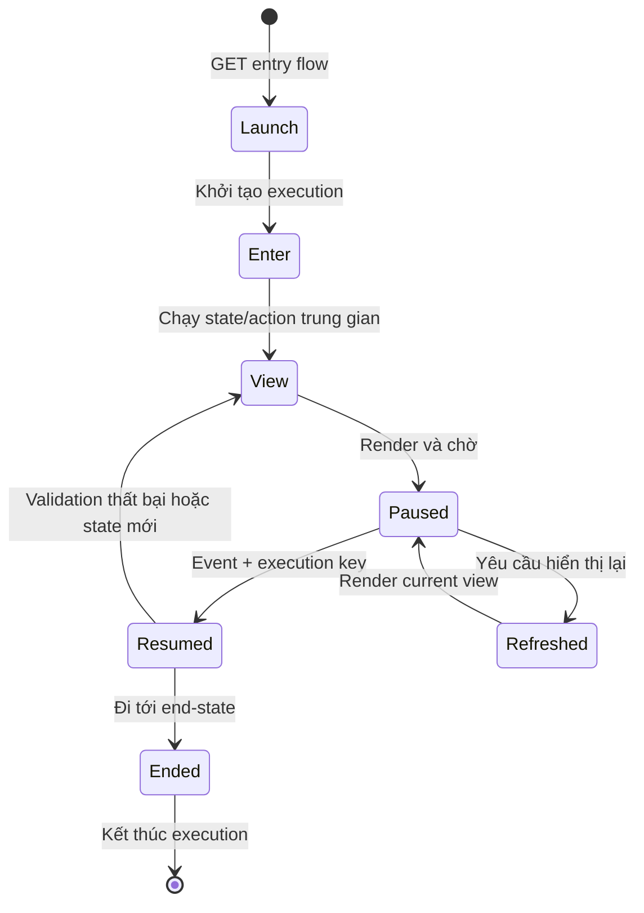
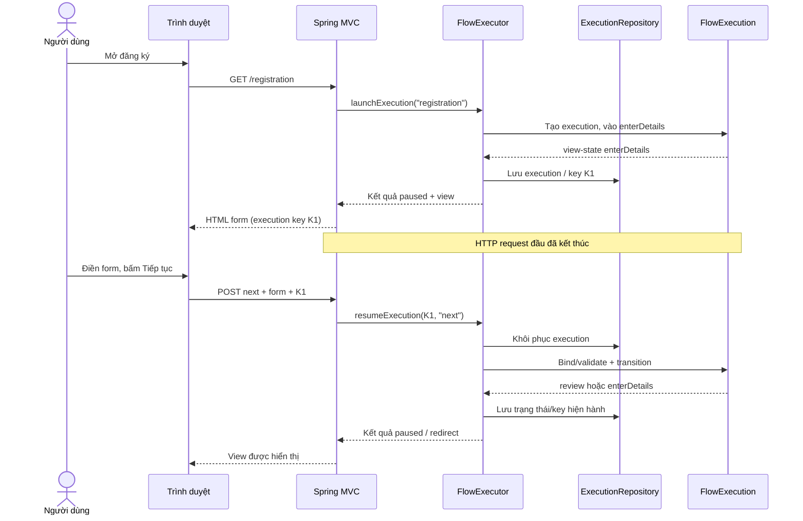
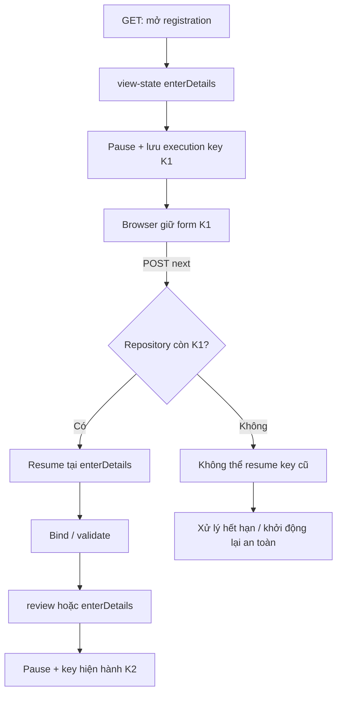
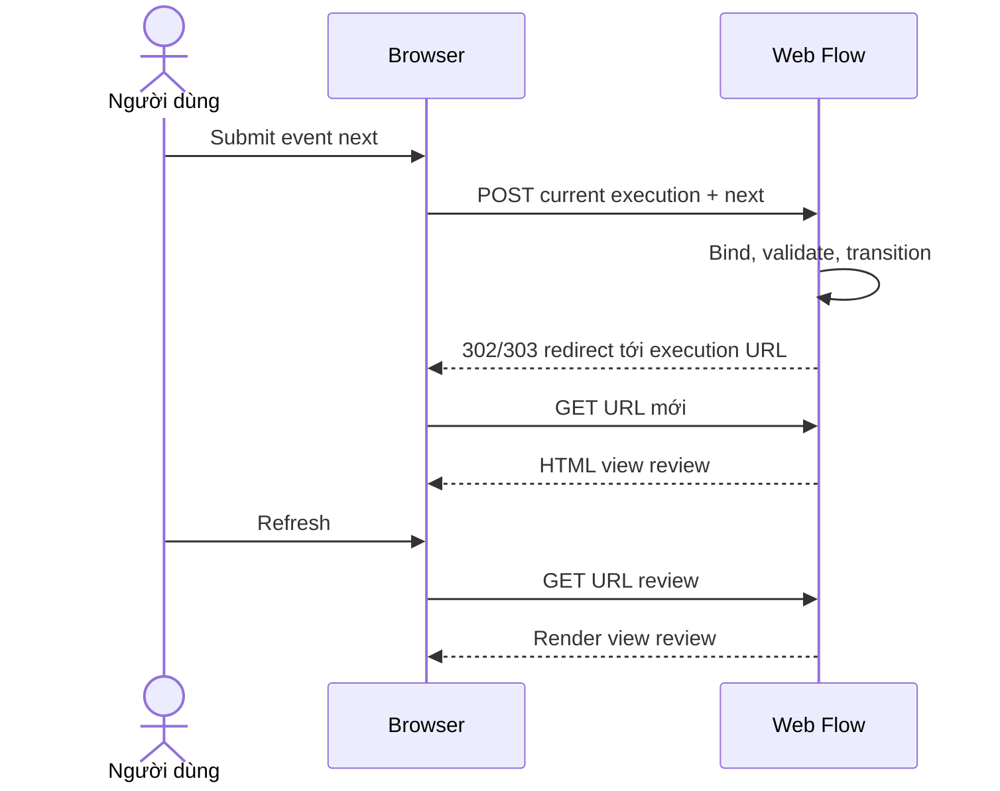

# Tạm dừng tại view-state để chờ người dùng

## 1. Tạm dừng trong Web Flow thực sự có nghĩa gì?

Trong module `SPRING_WEB_FLOW`, ứng dụng mô hình hóa hành trình nhiều bước bằng **state**, **event**, **transition** và **subflow** thay vì tự giữ “bước hiện tại” trong nhiều Spring MVC controller. Một hành trình phổ biến là đăng ký dịch vụ:

1. Mở màn hình nhập thông tin.
2. Người dùng điền form rồi bấm **Tiếp tục**.
3. Hiển thị trang **Xem lại**.
4. Người dùng bấm **Xác nhận** hoặc **Quay lại**.
5. Hệ thống thực hiện nghiệp vụ và kết thúc.

Các bước 1 và 3 có điểm chung: ứng dụng cần **hiển thị giao diện và chờ tương tác từ bên ngoài**. Spring Web Flow diễn tả điểm chờ này bằng **`view-state`**.

> **Ý quan trọng nhất:** Một flow “tạm dừng” tại `view-state` **không có nghĩa** server chặn HTTP request, giữ thread đang chạy hoặc mở kết nối chờ người dùng. Engine render/trả response và **lưu trạng thái cần thiết của flow execution**. Khi trình duyệt gửi request mới với execution key và event phù hợp, Web Flow **khôi phục execution rồi tiếp tục**.

Khái niệm này giúp hiểu tại sao một form có thể mở trên trình duyệt trong vài phút, sau đó người dùng bấm nút mà server vẫn biết đang ở state nào, dữ liệu form đã nhập trước đó nằm ở đâu và transition nào được phép chạy.

Bài thuộc chương **Vòng đời thực thi**, tập trung vào: cơ chế vào `view-state`, kết quả *pause*, *resume* bằng event, model binding và validation, dữ liệu scope, lưu/khôi phục execution, tích hợp Spring MVC, Refresh/Back, kiểm thử và phục hồi khi request cũ không còn hợp lệ.

### Mục tiêu học tập

Sau bài này, bạn có thể:

- Phân biệt **flow definition**, **flow execution**, **view-state** và HTTP request.
- Mô tả trình tự **launch → render/pause → resume → render/pause hoặc end**.
- Viết `<view-state>` cùng event `next`, `back`, `cancel` và model binding.
- Biết khi nào `on-entry`, `on-render` và `on-exit` được thực hiện.
- Chọn `viewScope`, `flowScope` và các scope khác theo vòng đời cần thiết.
- Phân biệt Refresh GET, gửi lại POST, execution key cũ và event không hợp lệ.
- Thiết kế kiểm thử và xử lý lỗi phiên an toàn.

## 2. Định nghĩa flow, lần chạy flow và view-state

| Khái niệm | Bản chất | Ví dụ |
| --- | --- | --- |
| `FlowDefinition` | Mô tả cấu trúc state/transition, dùng chung cho nhiều người | Flow có ID `registration` |
| `FlowExecution` | Một lần thực thi cụ thể, có current state và dữ liệu riêng | Lần đăng ký của người A |
| `view-state` | Loại state gắn với một view và chờ event bên ngoài | `enterDetails`, `review` |
| `FlowExecutor` | API điều phối khởi chạy, tiếp tục và hiển thị lại execution | `launchExecution`, `resumeExecution`, `refreshExecution` |
| `FlowExecutionRepository` | Lưu/khôi phục execution và quản lý key/snapshot theo cấu hình | Lưu lần chạy khi dừng ở form |
| `ExternalContext` | Cầu nối với môi trường HTTP/session/request | Lấy request parameters và tương tác response |

Một definition có thể được nhiều browser truy cập đồng thời. Mỗi người nhận một execution riêng; cùng ở state `review` không có nghĩa chia sẻ cùng `registration` hoặc `flowScope`.

### 2.1. View-state vừa là điểm render vừa là điểm chờ

Ví dụ tối giản:

```xml
<view-state id="enterDetails" view="registration/details">
    <transition on="next" to="review" />
    <transition on="cancel" to="cancelled" />
</view-state>
```

Ở đây:

- `id="enterDetails"`: tên **state** trong flow, dùng làm đích của transition.
- `view="registration/details"`: tên **view** cần render. View resolver quyết định đó là JSP, Thymeleaf hoặc tài nguyên khác.
- `<transition on="next">`: khi đang ở state này và nhận event `next`, engine có thể chuyển sang `review`.
- `<transition on="cancel">`: event `cancel` có thể kết thúc nếu `cancelled` là một `end-state`.

**State ID không phải URL và không nhất thiết trùng tên file view.** URL HTTP thường trỏ tới flow ID, còn state nằm trong execution do engine quản lý.

### 2.2. Chỉ view-state mới chờ người dùng?

Trong các state cốt lõi của Web Flow, `view-state` là điểm tương tác UI thường **tạm dừng execution**. Các loại `action-state` và `decision-state` thực thi logic/chọn nhánh ngay và thường đi tiếp trong **cùng một lượt xử lý** cho đến khi tới view-state hoặc end-state. Một `subflow-state` gọi flow con; nếu flow con đi tới view-state thì execution toàn cục có thể tạm dừng tại view của flow con.

Không nên hiểu `view-state` là nơi thực hiện mọi công việc; việc ghi dữ liệu, gọi API, quyết định nhánh và transaction thường phù hợp với action/service khác.

## 3. Vòng đời: launch, pause, resume, refresh, end



Lưu ý: các ô `Paused`/`Resumed` trong sơ đồ là **trạng thái vòng đời execution**, không phải các ID `<view-state>` bạn phải khai báo trong flow XML.

### 3.1. Launch: bắt đầu một execution mới

Trình duyệt mở URL ứng dụng tương ứng `registration`. `FlowHandlerMapping` nhận diện flow trong registry; `FlowHandlerAdapter` gọi `FlowExecutor` để bắt đầu execution. Engine có thể:

1. Đọc definition của flow ID `registration`.
2. Tạo flow variables và scope theo cấu hình.
3. Chạy `<on-start>` của flow nếu có.
4. Vào start state (có thể qua action/decision-state).
5. Khi tới `view-state id="enterDetails"`, render view.
6. Đánh dấu execution **paused** và lưu/duy trì key để request sau tiếp tục.

Nếu flow đi tới `end-state` ngay trong lúc launch, nó có thể **kết thúc mà chưa từng chờ ở view-state**.

### 3.2. Pause: kết thúc request, giữ khả năng tiếp tục

Khi flow đến `view-state`, Web Flow không chặn thread servlet đợi nút bấm. Sau khi chuẩn bị kết quả hiển thị, request hoàn tất như một HTTP response thông thường.

Phần state cần tiếp tục được quản lý bởi `FlowExecutionRepository`/session theo cấu hình. Browser thường nhận một URL/form action chứa **execution key** tương ứng. Những dữ liệu cần dùng lại ở request sau nên nằm trong scope thích hợp hoặc kho nghiệp vụ bền vững.

### 3.3. Resume: request mới mang event

Khi người dùng bấm nút `next`, trình duyệt gửi HTTP request mới gồm:

- Execution key của lần chạy cần tiếp tục.
- Event ID, ví dụ `next`.
- Các field form cần bind, nếu state có model.
- Thông tin phiên/CSRF/quyền truy cập theo cấu hình ứng dụng.

`FlowExecutor.resumeExecution(...)` khôi phục execution rồi gửi event vào current state. Engine xử lý binding/validation/transition/action và có thể tạm dừng ở view-state khác hoặc kết thúc.

### 3.4. Refresh: yêu cầu xem lại không nhất thiết gửi event

API `FlowExecutor.refreshExecution(...)` phục vụ trường hợp lấy lại trình bày của một execution mà không phát một event điều hướng mới. **Refresh của trình duyệt** không tự động đồng nghĩa gọi đúng API này: hành vi phụ thuộc HTTP method, redirect, adapter và query parameters.

Sau một **POST–Redirect–GET** thành công, Refresh thường lặp lại **GET của current view**, không gửi lại event POST trước đó. Nếu response là nội dung trực tiếp từ POST, trình duyệt có thể hỏi gửi lại form. Đây là lý do cần hiểu chiến lược redirect ở phần sau.

### 3.5. End: không còn execution đang chờ

Khi một transition dẫn tới `end-state`, flow kết thúc. Key của một execution đã hoàn tất **không còn là hợp đồng tiếp tục hợp lệ**; cách handler trình bày kết quả và xử lý request cũ phụ thuộc cấu hình ứng dụng.

Không xem `flowScope` của một execution đã end như cơ sở dữ liệu lâu dài. Nếu cần xem biên nhận hoặc bản đăng ký đã được ghi sau nhiều ngày, phải tra cứu từ kho nghiệp vụ bằng ID phù hợp.

## 4. Timeline qua hai HTTP request và một lần render



**Không có HTTP connection nào buộc phải chờ từ lúc người dùng mở `enterDetails` cho tới khi bấm `next`.** Hai lần tương tác có thể cách nhau hàng phút, nhưng state machine vẫn biết phải xử lý event trong ngữ cảnh nào nếu execution còn hợp lệ.

Những event như `next`, `back` và `confirm` **không phải các endpoint Spring MVC riêng biệt**. Chúng thường là request parameters để `FlowHandlerAdapter` khôi phục execution, sau đó Web Flow chọn transition.

## 5. Ví dụ flow XML hoàn chỉnh: đăng ký dịch vụ

Giả sử yêu cầu:

1. Nhập họ tên/email.
2. Xem lại thông tin.
3. Quay lại nếu cần chỉnh sửa.
4. Xác nhận và gọi service lưu đăng ký.
5. Có thể hủy tại bước nhập hoặc xem lại.

Một flow XML minh họa:

```xml
<?xml version="1.0" encoding="UTF-8"?>
<flow xmlns="http://www.springframework.org/schema/webflow"
      xmlns:xsi="http://www.w3.org/2001/XMLSchema-instance"
      xsi:schemaLocation="
          http://www.springframework.org/schema/webflow
          https://www.springframework.org/schema/webflow/spring-webflow.xsd">

    <var name="registration"
         class="com.example.registration.RegistrationDraft" />

    <view-state id="enterDetails"
                view="registration/details"
                model="registration">
        <binder>
            <binding property="fullName" required="true" />
            <binding property="email" required="true" />
        </binder>
        <transition on="next" to="review" />
        <transition on="cancel"
                    to="cancelled"
                    bind="false" />
    </view-state>

    <view-state id="review"
                view="registration/review">
        <transition on="back"
                    to="enterDetails"
                    validate="false" />
        <transition on="confirm"
                    to="saveRegistration" />
        <transition on="cancel"
                    to="cancelled"
                    bind="false" />
    </view-state>

    <action-state id="saveRegistration">
        <evaluate expression="registrationService.register(registration)"
                  result="flowScope.receipt" />
        <transition on="success" to="finished" />
    </action-state>

    <end-state id="finished" />
    <end-state id="cancelled" />
</flow>
```

Giả định dự án cung cấp class `RegistrationDraft` (JavaBean có getter/setter và dữ liệu cần bind), bean `registrationService` và view resolver ánh xạ các logical view IDs đến template thật. Phương thức `register(...)` trả về DTO kết quả để Web Flow gán vào `flowScope.receipt`. Đây là **ví dụ cơ chế**, chưa bao gồm transaction, lưu bản nháp, bảo mật hoặc trang biên nhận sau end-state.

### 5.1. Bước 1: vào view-state enterDetails

Flow bắt đầu ở `enterDetails` vì đó là state thực thi đầu tiên trong ví dụ. Engine tạo `registration` qua `<var>` và hiển thị view `registration/details`.

**View-state tạm dừng** trong khi trình duyệt chờ người dùng nhập. Tại thời điểm này:

- `currentState` là `enterDetails`.
- `registration` tồn tại trong scope của flow.
- Chưa có event `next`, `cancel` hoặc `confirm` nào được xử lý.
- Một execution key/URL thích hợp được đưa ra cho lần submit kế tiếp.

### 5.2. Bước 2: người dùng gửi event next

Khi event `next` được gửi tới execution đang ở `enterDetails`, Web Flow gắn các field với model `registration` rồi thực hiện validation theo cấu hình:

- Nếu dữ liệu hợp lệ, transition đưa flow đến `review`. Engine render view mới rồi lại **pause**.
- Nếu binding/conversion/validation thất bại, thường vẫn ở `enterDetails` và hiển thị lỗi để người dùng sửa. **Event không mặc nhiên làm state đổi**.

Không có yêu cầu rằng một lượt resume chỉ được đi qua đúng một state. Nếu transition đi vào `action-state` hoặc `decision-state`, engine có thể chạy tiếp qua nhiều state trong cùng lượt xử lý cho đến khi cần chờ người dùng hoặc kết thúc.

### 5.3. Bước 3: review rồi back hoặc confirm

Tại `review`, người dùng có hai lựa chọn chính:

- `back`: đi lại vào `enterDetails`, sửa model đã lưu trong flow.
- `confirm`: chuyển tới `saveRegistration`, gọi service và, nếu action có outcome `success`, đến `finished` để kết thúc.

`validate="false"` trên transition `back` minh họa việc quay lại không cần validation model ở bước `review`. `bind="false"` trên `cancel` bỏ cả binding/validation liên quan lần submit, hữu ích khi form đang có dữ liệu sai.

### 5.4. Bước 4: kết thúc không phải “tạm dừng thêm một lần”

`finished` là `end-state`, không phải `view-state`. Khi flow kết thúc, hệ thống không tiếp tục chờ một event nữa cho execution đó. Nếu ứng dụng muốn trang biên nhận có thể Refresh sau khi đăng ký thành công, hãy dùng URL nhận dữ liệu nghiệp vụ đã lưu và redirect phù hợp, thay vì phụ thuộc vào `flowScope.receipt` đã hết vòng đời.

## 6. Tích hợp Spring MVC và form action

Một ứng dụng dùng Spring MVC thường đăng ký:

```java
import org.springframework.context.annotation.Bean;
import org.springframework.context.annotation.Configuration;
import org.springframework.webflow.config.AbstractFlowConfiguration;
import org.springframework.webflow.definition.registry.FlowDefinitionRegistry;
import org.springframework.webflow.executor.FlowExecutor;
import org.springframework.webflow.mvc.servlet.FlowHandlerAdapter;
import org.springframework.webflow.mvc.servlet.FlowHandlerMapping;

@Configuration
public class RegistrationFlowConfiguration
        extends AbstractFlowConfiguration {

    @Bean
    public FlowDefinitionRegistry flowRegistry() {
        return getFlowDefinitionRegistryBuilder()
                .addFlowLocation(
                    "/WEB-INF/flows/registration/registration-flow.xml",
                    "registration")
                .build();
    }

    @Bean
    public FlowExecutor flowExecutor() {
        return getFlowExecutorBuilder(flowRegistry()).build();
    }

    @Bean
    public FlowHandlerMapping flowHandlerMapping() {
        FlowHandlerMapping handlerMapping = new FlowHandlerMapping();
        handlerMapping.setFlowRegistry(flowRegistry());
        handlerMapping.setOrder(0);
        return handlerMapping;
    }

    @Bean
    public FlowHandlerAdapter flowHandlerAdapter() {
        FlowHandlerAdapter adapter = new FlowHandlerAdapter();
        adapter.setFlowExecutor(flowExecutor());
        return adapter;
    }
}
```

Ví dụ Java trên chỉ minh họa Web Flow wiring. Cần có `DispatcherServlet`, Spring WebApplicationContext, ViewResolver, flow XML và service bean tương thích. Trong ứng dụng dùng Jakarta Faces, phải chọn hạ tầng `spring-faces` và `JsfFlowHandlerAdapter` thay vì áp dụng nguyên cấu hình view MVC này.

### 6.1. Gửi form đúng execution key

Với JSP/JSTL (một cấu hình view MVC phổ biến), form có thể dùng biến `flowExecutionUrl` do Web Flow cung cấp:

```jsp
<%@ taglib prefix="c" uri="jakarta.tags.core" %>

<form method="post"
      action="<c:out value='${flowExecutionUrl}' />">

    <label for="fullName">Họ tên</label>
    <input id="fullName"
           name="fullName"
           value="<c:out value='${registration.fullName}' />" />

    <label for="email">Email</label>
    <input id="email"
           name="email"
           type="email"
           value="<c:out value='${registration.email}' />" />

    <button type="submit" name="_eventId_next">Tiếp tục</button>
    <button type="submit" name="_eventId_cancel">Hủy</button>
</form>
```

Trong một dự án thực tế, form còn phải tích hợp **CSRF token** theo Spring Security và validation messages theo view technology. Cú pháp `${...}` sẽ thành JSP EL sau khi tài liệu được lưu; `c:out` thực hiện HTML escaping khi đưa giá trị vào attribute, nhưng với app phức tạp nên dùng form tag/library chuẩn đã được kiểm thử.

Hai cách phát event thường gặp:

| Dạng request | Event nhận được |
| --- | --- |
| Input tên `_eventId` với giá trị `next` | `next` |
| Nút submit có tên `_eventId_next` | `next` |
| Nút submit có tên `_eventId_cancel` | `cancel` |

Không hardcode execution key như `e1s1` vào action URL. Key do repository cấp và có thể thay đổi theo lưu/snapshot. Một form có key cũ có thể không tiếp tục được, đặc biệt sau khi browser Back hoặc session timeout.

### 6.2. URL flow khác event và state ID

Ví dụ request:

```http
GET /registration HTTP/1.1
Host: example.test
```

Lần request đầu có thể **launch** flow ID `registration`. Sau đó, form submit:

```http
POST /registration?execution=KEY_CURRENT HTTP/1.1
Host: example.test
Content-Type: application/x-www-form-urlencoded

fullName=An+Nguyen&email=an%40example.test&_eventId=next
```

Trên request thứ hai, `FlowHandlerAdapter` có thể yêu cầu **resume** execution theo key và event. `enterDetails` và `review` không phải hai HTTP endpoint riêng do `@GetMapping` tạo ra.

### 6.3. Đừng tạo một controller cho mỗi bước nếu đã dùng flow

Có thể dùng Spring MVC controller để cung cấp entry point, xử lý trang độc lập hay tương tác ngoài flow. Tuy nhiên, việc viết riêng `@PostMapping("/review")` để quyết định event `next` trong khi XML flow cũng quyết định `enterDetails → review` dễ gây hai nguồn sự thật.

Giữ các transition của wizard trong **flow definition**, chuyển nghiệp vụ vào **Spring service** và để adapter giải mã HTTP request.

## 7. Binding và validation quyết định có rời view-state hay không

**Điểm chờ `view-state` không tự biến mất khi người dùng gửi request.** Trước khi chuyển bước, engine có thể xử lý binding, conversion và validation. Các bước này quyết định có thực sự được đi tới state đích không.

Ví dụ form `enterDetails` có `model="registration"`:

```xml
<view-state id="enterDetails"
            view="registration/details"
            model="registration">
    <binder>
        <binding property="fullName" required="true" />
        <binding property="email" required="true" />
    </binder>

    <transition on="next" to="review" />
    <transition on="cancel" to="cancelled" bind="false" />
</view-state>
```

Giả sử người dùng gửi email không hợp lệ. Trong ứng dụng đã cấu hình converter/validator thích hợp, Web Flow xử lý input, ghi lỗi và **giữ ở `enterDetails`** để render lại form. Không nhất thiết có một transition được thực hiện.

Cần phân biệt:

- **Binding:** chuyển request parameters thành thuộc tính của model.
- **Conversion:** chuyển chuỗi input thành kiểu Java như `LocalDate`, `BigDecimal` hay enum.
- **Validation:** kiểm tra ràng buộc dữ liệu và quy tắc model.
- **Transition:** chuyển sang state đích theo event hợp lệ và điều kiện được thỏa.

Thuộc tính `required="true"` trong `<binder>` giúp ràng buộc yêu cầu có field khi binding; **không phải** toàn bộ chính sách kiểm tra định dạng email. Cần thêm validator/Bean Validation hoặc logic nghiệp vụ phù hợp với model.

### 7.1. Khi nào dùng bind=false và validate=false?

| Tình huống | Cấu hình | Ý nghĩa |
| --- | --- | --- |
| Bấm `next` cần dữ liệu hợp lệ | Cấu hình mặc định, model validator phù hợp | Bind và validate trước khi đi tiếp |
| Bấm `back` về bước trước | `validate="false"` | Không chặn bằng validation của bước hiện tại; binding vẫn có thể diễn ra |
| Bấm `cancel` bỏ cả form đang sai | `bind="false"` | Bỏ binding/validation gắn với transition để hủy |
| Gửi nút không có transition | Không có đích phù hợp | Không tự động chuyển; cần xử lý event hợp lệ hoặc lỗi có kiểm soát |

Nếu muốn quay lại mà **không cập nhật model từ form hiện tại**, cân nhắc `bind="false"` thay vì chỉ `validate="false"`. Chọn theo đúng trải nghiệm người dùng mong muốn.

### 7.2. Validation failure không phải kết thúc execution

Sai lầm thường gặp là coi một form không hợp lệ là “flow thất bại nên restart”. Trong thực tế, validation failure là trạng thái tương tác bình thường. Cần:

1. Giữ model/giá trị form đủ để người dùng sửa.
2. Đưa lỗi conversion/validation vào message context.
3. Render cùng view-state hoặc view thích hợp.
4. Duy trì execution key hợp lệ cho submit lần sau.

Không làm mất toàn bộ bản nháp chỉ vì email sai định dạng. Những lỗi như repository không tìm thấy execution hoặc session hết hạn cần chiến lược phục hồi **khác** với lỗi input.

## 8. Lifecycle hooks: on-entry, on-render và on-exit

View-state có thể khai báo action vào state, khi render và khi rời state. Chúng khác nhau ở **thời điểm kích hoạt**:

| Hook | Khi nào dùng? | Điều cần tránh |
| --- | --- | --- |
| `<on-entry>` | Chuẩn bị dữ liệu khi flow **vào** state | Ghi đơn không idempotent nếu state được vào lại |
| `<on-render>` | Nạp/cập nhật dữ liệu ngay trước khi **render view** | Side effect lớn vì Refresh/render lại có thể kích hoạt nhiều lần |
| `<on-exit>` | Dọn dữ liệu hoặc ghi nhận khi **rời** state | Nhầm với hành động người dùng chỉ nhìn vào trang |

Ví dụ:

```xml
<view-state id="choosePlan" view="registration/plans">
    <on-entry>
        <evaluate expression="selectionService.prepareDefaults(registration)" />
    </on-entry>

    <on-render>
        <evaluate expression="catalogService.availablePlans()"
                  result="viewScope.availablePlans" />
    </on-render>

    <transition on="select" to="review" />

    <on-exit>
        <evaluate expression="auditService.logSelectionStep(registration)" />
    </on-exit>
</view-state>
```

Một cách hiểu thực tế:

- Vào `choosePlan` lần đầu: `on-entry` có thể chuẩn bị mặc định; `on-render` nạp danh sách để render.
- Render lại `choosePlan` trong cùng state: `on-render` có thể chạy lại mà không có `on-entry` mới.
- Người dùng rời `choosePlan` qua transition sang `review`: `on-exit` được thực hiện theo vòng đời của state.
- Quay lại `choosePlan` từ `review`: đây là một lần **vào state mới**, các hook tương ứng có thể chạy lại.

Không dùng `on-render` để thực hiện **thanh toán, tạo đơn hàng, gửi email**, vì Refresh GET hoặc render khi validation failure có thể gọi lại action. Nếu `on-exit` ghi audit hoặc có side effect, nó cũng cần được thiết kế chịu được retry/backtracking và có hợp đồng rõ ràng.

### 8.1. Render lại cùng state khác rời state rồi quay lại

Nếu transition không có thuộc tính `to`, Web Flow có thể xử lý action và vẫn ở cùng view-state:

```xml
<view-state id="searchProducts" view="catalog/search">
    <transition on="filter">
        <evaluate expression="searchCriteria.applyFilter()" />
        <render fragments="results" />
    </transition>
</view-state>
```

Ở tình huống này, engine vẫn ở `searchProducts` và yêu cầu render lại một phần hoặc toàn bộ view tùy kênh request. Không nên mặc định coi đó là rời state rồi tái nhập state (và vì thế không tự suy luận `on-exit`/`on-entry` luôn chạy).

### 8.2. Bao nhiêu lần on-render có thể chạy?

Không gắn kỳ vọng “chính xác một lần” cho `on-render`. Nó có thể chạy khi:

- Lần đầu tới view-state.
- View cần render lại do validation failure.
- Request GET sau redirect cần hiển thị current view.
- Người dùng Refresh một URL đã dừng ở view.
- Event/Ajax chỉ yêu cầu cập nhật một phần trang.

Vì vậy service trong `on-render` nên ưu tiên **đọc/tính dữ liệu**, tránh side effect. Nếu việc nạp dữ liệu rất tốn kém, xem xét cache đúng scope, kiểm soát tính mới và số lần tải; đừng giải quyết bằng cách đặt mutable state trong singleton dùng chung.


## 9. Scope: dữ liệu nào tồn tại trong lúc view-state đang chờ?

Việc pause tại `view-state` có ích chỉ khi engine lưu được **dữ liệu cần tiếp tục**. Nhưng không phải mọi thông tin trong HTTP request đều tự động tồn tại ở request sau. Web Flow cung cấp nhiều scope có vòng đời khác nhau.

| Scope | Vòng đời điển hình | Ví dụ | Dùng ở bước tiếp theo? |
| --- | --- | --- | --- |
| `requestScope` | Một request xử lý flow | Giá trị tính toán tạm | Không nên kỳ vọng sau HTTP request mới |
| `flashScope` | Dữ liệu ngắn hạn qua render theo chính sách Web Flow | Thông báo thao tác | Không dùng cho bản nháp dài hạn |
| `viewScope` | Khi đang ở cùng một view-state | Danh sách lựa chọn, trạng thái UI | Mất khi rời view-state |
| `flowScope` | Suốt flow hiện tại | `RegistrationDraft`, lựa chọn nhiều bước | Có, nếu execution còn hợp lệ |
| `conversationScope` | Cả root flow và các subflow trong conversation | Dữ liệu phối hợp nhiều flow | Có, theo vòng đời conversation |

Đặc biệt:

- `<var name="registration" class="..."/>` khai báo flow variable, thường được giữ trong flow scope.
- `viewScope` thích hợp cho dữ liệu có thể nạp lại tại **một trang**, không cần mang sang `review`.
- `flowScope` thích hợp cho đối tượng cần giữ qua `enterDetails`, `review` và khi quay lại.
- `conversationScope` chỉ nên dùng khi thực sự cần chia sẻ qua nhiều flow/subflow, tránh làm phạm vi dữ liệu quá rộng.

### 9.1. Tạo dữ liệu cho viewScope trong on-render

```xml
<view-state id="choosePlan" view="registration/plans">
    <on-render>
        <evaluate expression="planService.findAvailablePlans()"
                  result="viewScope.plans" />
    </on-render>
    <transition on="next" to="review" />
</view-state>
```

`plans` phục vụ việc hiển thị danh sách gói dịch vụ. Khi chuyển sang `review`, dữ liệu của view-state cũ không còn trong view scope hiện hành.

**Không cố ghi `result="viewScope.plans"` ở một `action-state` thuần** khi không có view scope tương ứng. Nếu action-state tính dữ liệu cho view kế tiếp, có thể ghi vào `flowScope`, hoặc chuyển trách nhiệm nạp danh sách sang `on-render` của view.

### 9.2. Không lưu quá nhiều vào execution

Repository có thể tạo snapshot/serialize execution. Vì vậy:

- Nên lưu DTO, ID nghiệp vụ hoặc các dữ liệu form có kích thước vừa phải.
- Không giữ trực tiếp JDBC connection, `EntityManager`, `InputStream` hoặc stream upload đang mở.
- Không lưu mật khẩu/secret thô trong scope lâu hơn cần thiết.
- Nếu bản nháp phải sống qua nhiều ngày, lưu qua service/database và chỉ giữ ID tham chiếu phù hợp trong flow.
- Nếu thay đổi cấu trúc Java class khi đã có session đang sống, kiểm tra ảnh hưởng tới serialization và cách khôi phục.

**Pause không đồng nghĩa persistence bền vững.** Thời gian sống phụ thuộc HTTP session, execution repository, snapshot policy và kiến trúc triển khai.

## 10. FlowExecutionRepository, execution key và chờ qua nhiều request

Một `FlowExecutionRepository` quản lý những lần chạy đang hoạt động. Tùy implementation/cấu hình, nó lưu execution, khôi phục theo key, quản lý snapshot và cơ chế khóa để bảo vệ tính nhất quán khi request đồng thời.



Trong sơ đồ, `K1` và `K2` là tên minh họa. Chúng có thể khác nhau theo chính sách snapshot. Một key có thể biểu diễn execution và phiên bản continuation; **không được tự suy diễn** định dạng key hoặc nối key từ flow ID.

### 10.1. Cấu hình giới hạn thực thi/snapshot

Ví dụ Spring XML (đặt trong Spring bean configuration có namespace `webflow`):

```xml
<webflow:flow-executor id="flowExecutor"
                       flow-registry="flowRegistry">
    <webflow:flow-execution-repository
        max-executions="5"
        max-execution-snapshots="10" />
</webflow:flow-executor>
```

Các thuộc tính trên giới hạn số execution và số snapshot được lưu, **không** giới hạn số state có thể khai báo trong flow. Tăng snapshot hỗ trợ history tốt hơn nhưng tốn tài nguyên hơn; giảm snapshot khiến browser Back đến key cũ dễ gặp lỗi.

Tùy phiên bản/cấu hình repository, việc lưu có thể dựa trên HTTP session hoặc cơ chế khác. Nếu ứng dụng chạy trên nhiều node, phải xét session affinity, replication/serialization hoặc hạ tầng lưu phù hợp. Không giả định một execution trên node A sẽ tự có mặt ở node B khi chưa cấu hình.

### 10.2. Nhiều tab cùng một form

Khi người dùng mở hai tab:

1. Tab A và B có thể cùng chứa form từ một execution snapshot.
2. Tab A gửi `next`, engine lưu state mới.
3. Tab B gửi lại `next` từ key cũ.

Hệ thống có thể chấp nhận một continuation còn tồn tại, từ chối key không hợp lệ hoặc áp dụng quy tắc khóa/snapshot khác. **Không có một kết quả duy nhất cho mọi repository/configuration.** Với action có side effect như đăng ký/thanh toán, service vẫn cần idempotency và transaction.

### 10.3. Phân biệt execution key và key nghiệp vụ

| Loại key | Mục đích | Có nên dùng để chống tạo đơn trùng? |
| --- | --- | --- |
| `FlowExecutionKey` | Khôi phục execution đang paused | Không mặc định |
| `registrationAttemptId` hoặc `operationKey` | Định danh một ý định gửi đăng ký | Có thể dùng cùng ràng buộc persistence |
| `registrationId` | Định danh bản ghi đã hoàn tất | Dùng để tra cứu kết quả |

Execution key có thể hết hạn, thay đổi hoặc khác nhau giữa hai lần chạy. Không nên dùng nó làm ràng buộc duy nhất cho nghiệp vụ.

## 11. POST–Redirect–GET khi view-state tạm dừng

Trình duyệt có thể Refresh, Back hoặc gửi lại form. Spring Web Flow thường áp dụng **POST–Redirect–GET (PRG)** khi chuyển tới view-state mới để tách request **xử lý event** khỏi request **hiển thị view**.



HTTP status/method redirect cụ thể tùy adapter và cấu hình; sơ đồ nhằm minh họa mẫu PRG. Sau redirect, Refresh thông thường lặp lại GET, thay vì hỏi người dùng có muốn gửi lại POST trước đó không.

### 11.1. Khi vẫn ở cùng view do lỗi validation

Một request `next` với form sai có thể làm execution ở lại `enterDetails`. Với request không phải Ajax, Web Flow thường vẫn redirect để render lại current view, kể cả không đổi state. Cơ chế này giúp tránh việc browser Refresh gửi lại POST lỗi.

Tùy chọn `redirect-in-same-state` có thể điều chỉnh hành vi này. Ví dụ namespace:

```xml
<webflow:flow-executor id="flowExecutor"
                       flow-registry="flowRegistry">
    <webflow:flow-execution-attributes>
        <webflow:redirect-in-same-state value="false" />
    </webflow:flow-execution-attributes>
</webflow:flow-executor>
```

**Không tắt PRG mặc định chỉ để “giảm request”** nếu chưa kiểm tra Refresh/back và tích hợp view cụ thể. Một số cấu hình JSF có lý do riêng để thay đổi redirect trong cùng state; điều đó không áp dụng mặc định cho mọi JSP/Thymeleaf flow.

### 11.2. Back của trình duyệt khác event back của Web Flow

- **Browser Back** chuyển history entry hoặc tải trang cache. Nó có thể đưa người dùng về form chứa **execution key cũ**.
- **Event `back`** được gửi qua form của execution đang hoạt động, và Web Flow xử lý `<transition on="back">` rõ ràng.

```xml
<view-state id="review">
    <transition on="back"
                to="enterDetails"
                validate="false" />
    <transition on="confirm"
                to="saveRegistration" />
</view-state>
```

Với wizard quan trọng, cung cấp nút **Quay lại** dùng event chính thức thường dễ dự đoán hơn so với chỉ dựa trên nút Back của trình duyệt.

### 11.3. Snapshot cũ có thể phát lại action

Nếu browser phục hồi một snapshot cũ và submit event, engine có thể đi qua action-state đã từng được thực thi. Điều này không đồng nghĩa repository có lỗi: khả năng backtracking là tính năng tùy cấu hình.

Với thao tác tạo đăng ký/thanh toán, phải thiết kế service theo hướng **idempotent**, dùng ID lệnh và unique constraint/transaction phù hợp. PRG giảm khả năng gửi lại POST do Refresh, nhưng không bảo đảm exactly-once.

## 12. Refresh, Ajax và view-state không đổi

Không phải mỗi event đều khiến flow chuyển sang một view-state khác. Có thể xử lý event rồi ở lại cùng view, đặc biệt trong search/filter hoặc component Ajax.

```xml
<view-state id="searchResults" view="catalog/results">
    <on-render>
        <evaluate expression="catalogService.search(searchCriteria)"
                  result="viewScope.results" />
    </on-render>

    <transition on="filter">
        <evaluate expression="searchCriteria.apply()" />
        <render fragments="resultsPanel" />
    </transition>

    <transition on="select" to="reviewProduct" />
</view-state>
```

Ví dụ giả định `searchCriteria` đã được tạo trong flow và `catalogService` là Spring bean. `resultsPanel` phải là fragment ID mà view technology biết cách render.

### 12.1. Không tự đồng nhất Ajax với PRG

Trong request Ajax, adapter có thể trả **partial response** thay vì redirect toàn trang, và history của browser có thể không thêm entry mới. Với flow dạng embedded, behavior redirect cũng khác so với flow full-page.

Vì vậy cần phân biệt:

| Tình huống | Cần quan sát |
| --- | --- |
| Người dùng bấm `filter` qua Ajax | Request/response partial và fragment được render |
| User nhấn Refresh toàn trang | GET tới URL nào? State từ execution nào? |
| User Back sau Ajax | Browser có history entry mới hay chỉ DOM thay đổi? |
| Event `select` chuyển view | Adapter redirect hay render trực tiếp theo cấu hình? |
| Ajax bị retry | Service có action nào bị gọi lại không? |

**Đừng đặt action có side effect trong `on-render`** chỉ vì muốn UI cập nhật qua Ajax. Một request chỉ để xem lại màn hình có thể kích hoạt render nhiều lần.

### 12.2. Jakarta Faces (JSF) cũng có view-state pause

Nếu view technology là Jakarta Faces, `view-state` vẫn là điểm dừng của Web Flow. Tuy nhiên, postback và validation xảy ra theo **JSF component lifecycle**. Khi đó cần hạ tầng `spring-faces`, `FlowFacesContextLifecycleListener` và `JsfFlowHandlerAdapter` phù hợp.

Khác biệt về việc JSF hay Spring MVC binder xử lý input **không thay đổi nguyên tắc pause/resume**: engine vẫn chờ event ở view-state và cần execution key hợp lệ để tiếp tục.

## 13. View-state trong subflow và conversation

Một flow nhiều bước có thể gọi flow con để thu thập địa chỉ giao hàng hoặc xác thực bổ sung:

```xml
<subflow-state id="collectAddress" subflow="addressFlow">
    <transition on="addressSaved" to="review" />
    <transition on="cancelled" to="enterDetails" />
</subflow-state>
```

Khi vào `subflow-state`:

1. Web Flow tạo hoặc kích hoạt flow session con theo definition `addressFlow`.
2. Flow con có thể thực hiện các action/decision states.
3. Khi flow con tới một `view-state`, **toàn bộ execution tạm dừng để chờ người dùng** ở màn hình của flow con.
4. Request tiếp theo resume cùng conversation/execution theo cơ chế repository.
5. Khi flow con tới end-state `addressSaved`, outcome được flow cha xử lý để đi tới `review`.

Không nên hiểu rằng mỗi `view-state` trong subflow tạo một Spring MVC controller/HTTP session độc lập. Flow cha có thể vẫn đang chờ kết quả subflow, trong khi event form được xử lý bởi state đang hoạt động của flow con.

**Scope cần nhớ:** `flowScope` thuộc về flow session hiện tại; nếu cần truyền dữ liệu rõ ràng giữa parent và subflow, dùng `<input>` và `<output>` theo hợp đồng. `conversationScope` có thể chia sẻ dữ liệu xuyên nhiều flow trong một conversation nhưng không nên dùng vô điều kiện.

## 14. Bảo mật trong khoảng thời gian “đang chờ”

Việc tạm dừng có thể kéo dài đủ lâu để **dữ liệu, quyền hạn hoặc trạng thái nghiệp vụ thay đổi**.

Ví dụ: người dùng mở form đặt hàng lúc 10:00, tới 10:20 mới bấm `confirm`. Trong khoảng này, giá sản phẩm, tồn kho, quyền của tài khoản hoặc session có thể thay đổi. Flow không bảo đảm những điều kiện từng đúng lúc render vẫn còn đúng khi resume.

Các nguyên tắc quan trọng:

1. **Kiểm tra lại dữ liệu nghiệp vụ tại thời điểm ghi.** Giá, tồn kho, hạn mức và quyền thao tác phải được service xác thực lại.
2. **Không dùng execution key làm bằng chứng phân quyền.** Request phải gắn với user/session/principal và quyền đối với tài nguyên.
3. **Bảo vệ CSRF** cho form POST theo cấu hình Spring Security, kể cả khi form có execution key.
4. **Không tin các hidden fields.** Người dùng có thể chỉnh event ID, số tiền, product ID hoặc role do client gửi.
5. **Không giữ secret lâu trong flow scope.** Chọn cơ chế tokenization/ủy quyền phù hợp, tránh snapshot chứa dữ liệu quá nhạy cảm.
6. **Chống double-submit ở tầng service.** User có thể bấm confirm nhiều lần hoặc phát lại request từ tab cũ.
7. **Xử lý session timeout rõ ràng.** Không âm thầm biến một POST có key hết hạn thành thao tác ghi mới với dữ liệu không xác định.

### 14.1. View-state không tự giới hạn thời gian chờ

Không có nghĩa “flow chờ vô hạn” chỉ vì UI vẫn đang hiển thị. Web Flow execution có thể bị hết hạn/loại khỏi repository; phiên đăng nhập có thể hết hạn; server có thể restart.

Khi sản phẩm cần “lưu bản nháp và quay lại sau một tuần”, hãy thiết kế persistence nghiệp vụ với access control. Web Flow quản lý **hành trình tương tác**, không thay thế hồ sơ draft trong database.

## 15. Lỗi khi tiếp tục từ view-state

Một số tình huống thường bị gộp thành “flow hỏng” nhưng nguyên nhân khác nhau:

| Tình huống | Điều xảy ra | Hướng xử lý |
| --- | --- | --- |
| Form sai dữ liệu | Binding/validation từ chối chuyển bước | Render lại cùng view, giữ dữ liệu và báo lỗi |
| Event `next` không hợp lệ tại current state | Không có transition phù hợp | Báo lỗi điều hướng/an toàn, không ép chuyển |
| Execution key thiếu | Adapter có thể hiểu là yêu cầu launch mới | Xác định request contract, không dựa vào HTTP method đơn thuần |
| Execution key cũ không còn snapshot | Không thể resume trạng thái cũ | Hướng dẫn dùng trang hiện hành/bắt đầu lại |
| Session hết hạn | Repository hoặc security context không còn | Xác thực lại, khôi phục draft bền vững nếu có |
| Service timeout khi đang resume | Outcome chưa chắc thành công hay thất bại | Kiểm tra trạng thái lệnh/idempotency trước khi retry |
| Hai tab cùng submit | Có thể tranh chấp execution hoặc stale key | Repository policy + transaction/unique constraint |
| View template lỗi khi render | Execution có thể còn nhưng response lỗi | Log nguyên nhân, có trang lỗi an toàn |
| Snapshot không serialize được | Repository không lưu được execution | Giảm dữ liệu scope, DTO phù hợp |
| Subflow thiếu definition hoặc outcome | Không thể đi tiếp đúng state | Kiểm tra registry và hợp đồng subflow |

### 15.1. NoSuchFlowExecutionException

Khi repository không tìm thấy key để resume, Spring Web Flow có thể phát sinh `NoSuchFlowExecutionException`. Handler/adapter có thể áp dụng chính sách mặc định tùy phiên bản, bao gồm trường hợp bắt đầu flow mới; ứng dụng cần xác định chính sách rõ trước khi triển khai.

Với wizard đơn giản, bắt đầu lại có thể chấp nhận được. Với tạo đơn/thanh toán, **không tự phát lại event `confirm` trên execution mới**: trước tiên phải biết giao dịch trước đã được ghi nhận hay chưa.

### 15.2. Đường phục hồi thân thiện

Một flow có thể cung cấp UX như:

- “Phiên nhập thông tin đã hết hạn” kèm nút **Bắt đầu lại**.
- Link **Tiếp tục bản nháp đã lưu** nếu có draft trong database và user đủ quyền.
- Trang **Xem kết quả đăng ký** tra cứu bằng business ID sau khi đã submit thành công.
- Thông báo lỗi form cụ thể, không xóa draft vô lý khi validation thất bại.

Không hiển thị stack trace, raw execution keys hay thông tin session cho người dùng cuối.

## 16. Kiểm thử đúng vòng đời pause/resume

Bài toán này cần nhiều cấp kiểm thử vì unit test flow có thể đúng nhưng HTTP redirect hoặc repository vẫn sai cấu hình.

### 16.1. Test flow state machine

Dùng Spring Web Flow test support của phiên bản đang chạy để:

1. Start `registration`, assert current state là `enterDetails`.
2. Kiểm tra model `registration` đã được khởi tạo.
3. Signal event `next` với form hợp lệ; assert current state là `review`.
4. Signal event `back`; assert quay về `enterDetails` và model vẫn giữ dữ liệu phù hợp.
5. Signal `cancel`; assert flow kết thúc ở `cancelled`.
6. Signal `confirm` tại `review`; assert service được gọi và flow kết thúc ở `finished`.
7. Signal một event không hợp lệ và kiểm tra phản hồi đúng contract.

Mục tiêu test chính là **hành trình dừng ở view nào sau mỗi event**, không phải chỉ kiểm tra XML parse được.

Ví dụ dạng mã giả (không phải API framework được cung cấp sẵn):

```java
// Pseudocode: methods thuộc test harness của dự án.
testHarness.startFlow("registration");
testHarness.assertCurrentState("enterDetails");

testHarness.bindForm("fullName", "An Nguyen");
testHarness.bindForm("email", "an@example.test");
testHarness.signalEvent("next");
testHarness.assertCurrentState("review");

testHarness.signalEvent("back");
testHarness.assertCurrentState("enterDetails");
```

Các phương thức `testHarness` trên minh họa kịch bản; khi viết test thật, sử dụng `org.springframework.webflow.test` hoặc các fixture tương thích version để tạo request context, khởi chạy và phát event.

### 16.2. Test HTTP integration với browser-like requests

| Kịch bản | Điều cần xác minh |
| --- | --- |
| GET entry URL không có execution key | Flow được launch, form đầu tiên render |
| POST `next` với key hiện hành | Resume đúng execution, bind/validate model |
| POST form sai | Vẫn ở `enterDetails`, có messages, không gọi service |
| POST `back` tại `review` | Quay lại state nhập, giá trị draft giữ đúng |
| POST `cancel` khi form sai | Hủy được do `bind="false"` |
| Refresh sau PRG | Không tự phát lại POST `next` |
| Tải URL execution cũ sau khi snapshot bị loại | Xử lý rõ stale key |
| Hai tab dùng chung execution | Kết quả nhất quán theo repository policy |
| Session timeout | Có UX phục hồi, không rò dữ liệu user khác |
| POST `confirm` bị retry | Không tạo hai kết quả nghiệp vụ |
| JSF/Ajax hoặc fragment rendering nếu có | Response/update phù hợp với view technology |
| Subflow view-state | Pause/resume đúng flow session đang hoạt động |

### 16.3. Test lifecycle hook và side effects

Mock những service dùng trong hooks để đo số lần gọi:

- Lần đầu vào `choosePlan`: `prepareDefaults` chạy theo on-entry.
- Render lại view: `availablePlans` có thể được gọi lại ở on-render.
- Chỉ xem trang: service tạo đơn, thu tiền, gửi email **không được gọi**.
- Rời `choosePlan` theo transition: on-exit được gọi theo contract.
- Quay lại `choosePlan`: on-entry có thể chạy lại, model vẫn đúng.

Nếu application thực hiện nghiệp vụ trong `on-entry` hoặc `on-exit`, test thêm retry/backtracking và kiểm soát idempotency.

### 16.4. Quan sát log khi debug

Một bản ghi debug hữu ích nên thể hiện:

```text
flowId=registration
execution=masked-key
stateBefore=enterDetails
event=next
binding=success
transition=enterDetails->review
stateAfter=review
result=paused
```

Đây là **định dạng log đề xuất**, không phải log tự động của framework. Mask/hạn chế dữ liệu nhạy cảm. Đừng log raw CSRF token, mật khẩu, session ID hoặc đầy đủ dữ liệu người dùng chỉ để kiểm tra flow.

## 17. Những ngộ nhận thường gặp

| Ngộ nhận | Cách hiểu đúng |
| --- | --- |
| “Pause giữ một Java thread đến khi user bấm nút” | Request kết thúc, execution được lưu để resume sau |
| “Mỗi state là một URL” | URL thường định danh flow; state là một phần của execution |
| “Mỗi request chỉ thực hiện được đúng một state” | Một request có thể chạy qua nhiều action/decision states |
| “Bấm next là chắc chắn qua view mới” | Binding/validation hoặc condition có thể giữ current view |
| “Refresh browser luôn gọi refreshExecution” | Còn phụ thuộc HTTP method, PRG và adapter |
| “flowScope chính là database” | Flow scope có vòng đời theo execution, không lưu bền vững |
| “View đã render là execution không thể hết hạn” | Session/repository có thể hết hạn khi browser vẫn mở |
| “Back của browser giống event back” | Browser history và flow transition là hai cơ chế khác nhau |
| “on-render chỉ chạy một lần” | Render lại/Refresh/Ajax có thể gọi thêm lần nữa |
| “viewScope dùng được trong mọi action-state” | View scope gắn với view-state hiện hành |
| “Execution key đủ để chống submit trùng” | Cần idempotency/unique constraint ở tầng nghiệp vụ |
| “End-state là một view-state chờ event mới” | End-state chấm dứt flow execution |
| “Subflow bắt đầu HTTP request mới mỗi khi tới view” | Subflow chạy trong conversation; view-state vẫn là điểm pause |
| “Không còn execution key thì có thể tự xử lý lại confirm” | Trước hết kiểm tra kết quả nghiệp vụ để tránh tạo bản ghi trùng |

## 18. Checklist áp dụng và câu hỏi tự luyện

Trước khi triển khai một flow nhiều bước:

1. Định nghĩa các `view-state` nơi người dùng phải nhập hoặc xem dữ liệu.
2. Chỉ rõ những event hợp lệ ở từng state: `next`, `back`, `cancel`, `confirm`.
3. Gắn model, binder, converter và validator vào view-state thích hợp.
4. Dùng scope đúng; lưu DTO tối thiểu và có thể serialize nếu repository cần.
5. Tách tính toán/side effect khỏi `on-render`; dùng action/service rõ trách nhiệm.
6. Giữ form action URL do framework cung cấp cùng execution key hiện hành.
7. Chọn repository/snapshot và redirect policy theo nhu cầu Back/Refresh.
8. Chuẩn bị UX cho session timeout, key hết hạn, invalid event và lỗi service.
9. Bảo vệ CSRF, authorization, transaction và idempotency.
10. Test cả state machine lẫn HTTP/Browser integration.

### Câu hỏi tự luyện

1. “Tạm dừng tại `view-state`” có giữ servlet thread đang chạy không? Vì sao?
2. Sự khác nhau giữa `FlowDefinition`, `FlowExecution`, `FlowExecutor` và `FlowExecutionRepository` là gì?
3. Sau khi flow tới `enterDetails`, browser cần gửi gì để Web Flow tiếp tục đúng execution?
4. Vì sao event `next` có thể khiến engine render lại `enterDetails` thay vì chuyển tới `review`?
5. `on-entry` và `on-render` khác nhau thế nào khi người dùng Refresh?
6. Khi nào nên lưu dữ liệu ở `viewScope`, khi nào ở `flowScope`?
7. Tại sao không nên gọi `paymentService.charge(...)` từ `on-render`?
8. Browser Back có tương đương gửi event `back` hay không?
9. Khi một `subflow-state` đi tới view-state trong flow con, execution nào tạm dừng?
10. PRG giúp giảm vấn đề gì, và tại sao nó không thay thế idempotency?
11. Những lỗi nào cần giữ nguyên view và báo validation, lỗi nào cần xử lý session/exception?
12. Nếu người dùng muốn trở lại bản nháp sau một tuần, nên lưu dữ liệu ở đâu?
13. Tại sao `end-state` không phải một điểm chờ tiếp tục?
14. Nên xác minh điều gì khi form mang execution key cũ được gửi từ tab khác?

## Tài liệu tham khảo

- [Spring Web Flow — Reference Guide (3.0.x)](https://docs.spring.io/spring-webflow/docs/3.0.x/reference/)
- [Spring Web Flow — FlowExecutor Javadoc](https://docs.spring.io/spring-webflow/docs/3.0.0/api/org/springframework/webflow/executor/FlowExecutor.html)
- [Spring Web Flow — ViewState Javadoc](https://docs.spring.io/spring-webflow/docs/3.0.0/api/org/springframework/webflow/engine/ViewState.html)
- [Spring Web Flow — FlowExecution Javadoc](https://docs.spring.io/spring-webflow/docs/3.0.0/api/org/springframework/webflow/execution/FlowExecution.html)
- [Spring Web Flow — FlowExecutionRepository Javadoc](https://docs.spring.io/spring-webflow/docs/3.0.0/api/org/springframework/webflow/execution/repository/FlowExecutionRepository.html)
- [Spring Framework — Web MVC reference](https://docs.spring.io/spring-framework/reference/web/webmvc.html)

Các ví dụ nhằm minh họa **vòng đời pause/resume của Web Flow** trong một ứng dụng Spring MVC. Khi dùng cho dự án thật, hãy kiểm tra API/XSD của phiên bản Spring Web Flow, cấu hình view resolver, repository, validation, security và các service nghiệp vụ thực tế.
