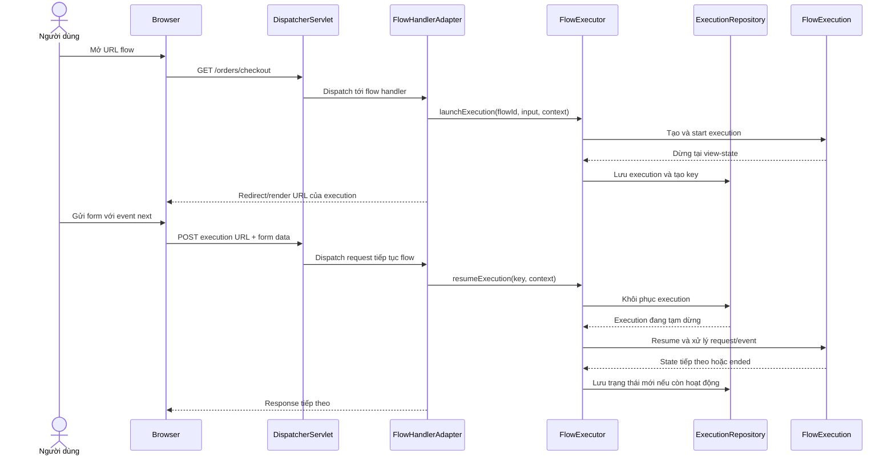
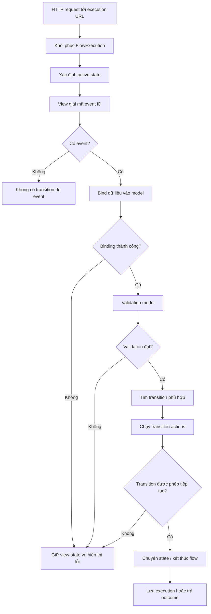

# Tiếp tục execution khi nhận một sự kiện trong Spring Web Flow

Một người dùng đang điền biểu mẫu đặt hàng. Sau khi bấm **Tiếp tục**, ứng dụng cần nhận dữ liệu, kiểm tra hợp lệ, chuyển từ bước nhập thông tin sang bước xem lại và trả về trang mới. Nếu người dùng bấm **Quay lại**, flow phải đi theo nhánh khác. Nếu họ bấm **Refresh**, trang có thể được hiển thị lại mà không tự động phát sinh hành động nghiệp vụ mới.

Trong Spring Web Flow, những thao tác này được điều phối bởi một **FlowExecution**. Khi execution đang dừng tại một `view-state`, nó chờ một request tiếp theo. Request mang thông tin execution và một event có thể làm flow tiếp tục: Web Flow khôi phục execution, xác định state đang hoạt động, giải mã event từ request, xử lý binding/validation nếu có, rồi tìm transition phù hợp. Sau khi xử lý, execution lại tạm dừng để chờ request tiếp theo hoặc kết thúc nếu đã đi tới `end-state`.

Bài học thuộc chương **Vòng đời thực thi** của module `SPRING_WEB_FLOW`. Nội dung tập trung vào việc **tiếp tục execution khi nhận một sự kiện**, bao gồm vai trò của `FlowExecutor`, execution key, `RequestContext`, event ID, transition, listener, repository, xử lý lỗi và kiểm thử qua nhiều HTTP request.

Sau bài học, bạn có thể:

- Phân biệt khởi chạy execution mới với tiếp tục một execution đang tạm dừng.
- Giải thích cách `FlowHandlerAdapter` và `FlowExecutor` chọn đường launch/resume.
- Theo dõi execution key từ URL của view-state tới repository.
- Phân biệt `FlowExecutionContext` tồn tại qua nhiều request với `RequestContext` chỉ tồn tại trong một lần xử lý.
- Phát event bằng `_eventId` hoặc `_eventId_<eventId>` từ form và liên kết.
- Mô tả thứ tự binding, validation, event, transition action và state tiếp theo.
- Sử dụng lifecycle listener để quan sát việc resume, pause và xử lý lỗi.
- Xử lý event không hợp lệ, key hết hạn, request lặp, nhiều tab và thao tác nhạy cảm.

## 1. Execution tạm dừng ở đâu và chờ điều gì?

Một flow definition mô tả các state và transition. Khi người dùng bắt đầu flow, Web Flow tạo một **FlowExecution** cho lượt chạy cụ thể. Execution có thể đi qua nhiều state trong cùng một request; khi đến một `view-state`, flow thường hiển thị view rồi **tạm dừng để chờ người dùng**.

Ví dụ:

```xml
<flow xmlns="http://www.springframework.org/schema/webflow"
      xmlns:xsi="http://www.w3.org/2001/XMLSchema-instance"
      xsi:schemaLocation="http://www.springframework.org/schema/webflow
                          https://www.springframework.org/schema/webflow/spring-webflow.xsd">

    <view-state id="enterDetails" view="orders/enterDetails">
        <transition on="next" to="review" />
    </view-state>

    <view-state id="review" view="orders/review">
        <transition on="back" to="enterDetails" />
        <transition on="confirm" to="completed" />
    </view-state>

    <end-state id="completed" view="orders/completed" />
</flow>
```

Khi execution đi vào `enterDetails`, nó không tự chuyển sang `review`. Nó chờ một request có event `next`. Khi nhận event hợp lệ, state machine xử lý transition rồi đi tới state mới. Nếu state mới là `review`, execution lại tạm dừng để hiển thị view đó.

**Tạm dừng không có nghĩa execution bị hủy hoặc HTTP thread bị giữ lại.** Request hiện tại kết thúc sau khi Web Flow tạo response phù hợp. Trạng thái execution được quản lý qua cơ chế repository; request tiếp theo có thể tiếp tục cùng lượt chạy.

| Thời điểm | Execution đang làm gì? | Điều xảy ra tiếp theo |
| --- | --- | --- |
| Mở URL launch | Tạo execution mới và bắt đầu flow | Chạy từ state đầu tiên |
| Đi vào `view-state` | Render view rồi tạm dừng | Chờ request/event tiếp theo |
| Nhận request có execution key | Khôi phục execution đã tạm dừng | Xử lý request trong state đang hoạt động |
| Event khớp transition | Chạy transition và action liên quan | Sang state tiếp theo hoặc kết thúc |
| Event được xử lý nhưng không rời state | Chạy event handler hoặc xử lý lại view | Render lại state hiện tại |
| Đi tới `end-state` | Kết thúc flow session/execution tương ứng | Không thể tiếp tục execution đã kết thúc |

## 2. Launch và resume là hai thao tác khác nhau

`FlowExecutor` là điểm vào cấp cao để điều khiển execution. Hai thao tác quan trọng có chữ ký khái niệm như sau:

```java
FlowExecutionResult launchExecution(
        String flowId,
        MutableAttributeMap<?> input,
        ExternalContext context);

FlowExecutionResult resumeExecution(
        String flowExecutionKey,
        ExternalContext context);
```

| Thao tác | Tham số chính | Ý nghĩa |
| --- | --- | --- |
| `launchExecution` | `flowId`, input, external context | Tạo và khởi chạy một execution mới của flow definition |
| `resumeExecution` | execution key, external context | Tiếp tục một execution đang tạm dừng được nhận diện bởi key |

Điểm dễ nhầm là **`resumeExecution` không nhận event ID như một tham số Java riêng**. Nó nhận execution key và `ExternalContext` của request. Event được view technology hoặc thành phần tích hợp giải mã từ request hiện tại rồi đưa vào state đang hoạt động.

Trong ứng dụng Spring MVC, `FlowHandlerAdapter` thực hiện việc nối request HTTP với `FlowExecutor`. Adapter xem thông tin request để quyết định nên khởi chạy flow mới hay tiếp tục execution hiện có. Vì vậy, cùng một đường dẫn flow có thể phục vụ cả URL launch lẫn URL tiếp tục execution.



Sơ đồ cho thấy event nằm trong request được gửi tới execution hiện tại. Cách lưu/khôi phục cụ thể phụ thuộc loại repository và cấu hình persistence; không nên giả định mọi ứng dụng đều lưu execution theo cùng một cách.

## 3. Execution key nhận diện lượt chạy cần tiếp tục

Khi flow vào view-state, Web Flow cung cấp URL tiếp tục execution, thường có một tham số như `execution`:

```text
/orders/checkout?execution=<execution-key>
```

`<execution-key>` là placeholder minh họa, không phải giá trị có thể tự tạo. Key do Web Flow cấp và phải được giữ nguyên khi form hoặc link gửi request tiếp theo.

Trong JSP, có thể dùng biến `flowExecutionUrl` do Web Flow cung cấp:

```jsp
<form method="post" action="${flowExecutionUrl}">
    <input name="customerName" />
    <button type="submit" name="_eventId_next" value="1">
        Tiếp tục
    </button>
</form>
```

Biến `flowExecutionUrl` trỏ tới URL của execution hiện tại. Không hardcode `execution=...`, không lấy key của tab khác và không gửi form về URL launch nếu mục đích là tiếp tục wizard đang mở.

### Repository và snapshot

`FlowExecutionRepository` quản lý việc lưu, lấy lại và cập nhật execution. Tùy cấu hình, repository có thể lưu execution trong HTTP session hoặc theo một chiến lược persistence khác. Một execution key có thể gắn với một trạng thái/snapshot cụ thể để hỗ trợ lịch sử trình duyệt.

Spring Web Flow cho phép giới hạn số execution và số snapshot:

```xml
<webflow:flow-executor id="flowExecutor"
                       flow-registry="flowRegistry">
    <webflow:flow-execution-repository
            max-executions="5"
            max-execution-snapshots="30" />
</webflow:flow-executor>
```

- `max-executions` giới hạn số flow execution được tạo trong một HTTP session người dùng; khi vượt giới hạn, execution cũ nhất có thể bị loại bỏ.
- `max-execution-snapshots` giới hạn số snapshot lịch sử của mỗi execution.
- Giá trị `0` tắt snapshot; giá trị `-1` cho phép số snapshot không giới hạn theo cấu hình được tài liệu mô tả.

Snapshot hỗ trợ browser Back. Nếu tắt snapshot, browser có thể quay về URL trỏ tới snapshot không còn được ghi nhận và không thể tiếp tục theo cách mong đợi. Hãy chọn giới hạn dựa trên số wizard đồng thời, nhu cầu Back/Forward, dung lượng session và chính sách timeout.

**Execution key không phải token xác thực.** Có key không có nghĩa người gửi request có quyền truy cập đơn hàng hoặc thực hiện hành động nghiệp vụ. Service vẫn phải kiểm tra principal, quyền trên tài nguyên và trạng thái dữ liệu.

## 4. Event được giải mã từ request như thế nào?

Với các view HTML dùng Spring MVC, Spring Web Flow hỗ trợ hai quy ước phổ biến.

### 4.1. Nút submit mang tên event

Khi một form có nhiều hành động, đặt event ID trong phần tên của nút:

```jsp
<form method="post" action="${flowExecutionUrl}">
    <input name="customerName" />

    <button type="submit" name="_eventId_next" value="1">
        Tiếp tục
    </button>

    <button type="submit" name="_eventId_cancel" value="1">
        Hủy
    </button>
</form>
```

Nếu người dùng bấm nút Tiếp tục, browser gửi tham số có tên `_eventId_next`; Web Flow lấy phần sau tiền tố `_eventId_` làm event ID là `next`. Nếu bấm Hủy, event ID là `cancel`.

Chỉ nút submit được kích hoạt thường gửi cặp name/value của nó. Đây là cách thuận tiện khi một form có nhiều event khác nhau.

### 4.2. Tham số ẩn `_eventId`

Nếu form chỉ có một hành động submit, có thể gửi event ID trong một hidden field:

```jsp
<form method="post" action="${flowExecutionUrl}">
    <input name="customerName" />
    <input type="hidden" name="_eventId" value="next" />
    <button type="submit">Tiếp tục</button>
</form>
```

Web Flow đọc giá trị `_eventId=next` làm event ID. Không nên dùng hidden field cố định cùng lúc với nhiều nút có event riêng nếu không kiểm soát rõ tham số nào được gửi.

### 4.3. Link phát event

Một link cũng có thể gửi event qua URL:

```jsp
<a href="${flowExecutionUrl}&amp;_eventId=cancel">Hủy</a>
```

Link dùng GET nên chỉ phù hợp với event không tạo thay đổi nghiệp vụ nhạy cảm. Với lưu dữ liệu, phê duyệt, thanh toán, xóa hoặc các thao tác có side effect, nên dùng POST và bảo vệ CSRF theo cấu hình Spring Security.

### 4.4. Nếu request không có event ID thì sao?

Với Spring MVC view implementation, nếu request không có `_eventId` hoặc tham số bắt đầu bằng `_eventId_`, thì **không có flow event nào được phát**. Điều này quan trọng khi phân biệt:

- **Refresh:** browser tải lại URL hiện tại; không tự phát event `next` hoặc `confirm`.
- **Resume kèm event:** request có execution key và event ID phù hợp.
- **Launch:** request khởi chạy một flow execution mới.

Việc một request có execution key không đồng nghĩa nó luôn gây transition. Khi không có event, Web Flow có thể phục vụ việc hiển thị lại view hiện tại theo luồng refresh/render phù hợp; state machine không tự đoán người dùng muốn thực hiện hành động nào.

## 5. Điều gì xảy ra sau khi event được nhận?

Với một `view-state` có khai báo `model`, quá trình postback thông thường gồm các bước:

1. **Khôi phục execution:** adapter/executor lấy execution từ repository bằng key.
2. **Xác định state đang hoạt động:** request được xử lý trong flow và state hiện tại.
3. **Giải mã event:** view implementation đọc `_eventId` hoặc `_eventId_<id>`.
4. **Binding dữ liệu:** nếu state có model, dữ liệu request được bind vào thuộc tính model theo binder/conversion service.
5. **Validation:** sau binding, validator của model được chạy nếu có và không bị transition suppress.
6. **Xử lý transition:** Web Flow tìm transition có event ID phù hợp trong state hiện tại.
7. **Chạy transition action:** các action khai báo trên transition có thể chạy trước khi state rời đi; action có thể ngăn transition khi trả kết quả lỗi.
8. **Chuyển state hoặc render lại:** flow có thể đi sang state khác, giữ nguyên state để xử lý event, hoặc kết thúc.
9. **Lưu và trả response:** nếu execution còn hoạt động, trạng thái mới được repository quản lý; view tiếp theo được render/redirect theo cấu hình.



Đây là đường đi khái niệm của một postback có model. Với view không có model, request AJAX, event handler không rời state hoặc action-state, một số bước sẽ khác.

### Binding phải thành công để event làm transition

Nếu `view-state` khai báo `model`, Web Flow bind giá trị request trước khi event có thể dẫn tới transition. Nếu conversion/binding thất bại, view được render lại để người dùng sửa; không coi request đó là một lần chuyển state thành công.

Validation chạy sau binding. Do đó, hai lỗi sau khác nhau:

| Lỗi | Ví dụ | Hệ quả |
| --- | --- | --- |
| Binding/conversion | Gửi `quantity=abc` cho thuộc tính `Integer` | Không thể chuyển chuỗi thành kiểu model |
| Validation | Gửi `quantity=-2`, parse được nhưng vi phạm `@Positive` | Model nhận giá trị nhưng không đạt quy tắc hợp lệ |

### Điều chỉnh binding và validation theo event

```xml
<view-state id="editOrder" view="orders/edit" model="orderForm">
    <binder>
        <binding property="quantity" required="true" />
        <binding property="note" />
    </binder>

    <transition on="next" to="review" />
    <transition on="back" to="previous" validate="false" />
    <transition on="cancel" to="cancelled" bind="false" />
</view-state>
```

- `validate="false"` bỏ qua validation của model cho event đó nhưng **binding vẫn xảy ra**.
- `bind="false"` bỏ qua cả binding và validation cho event đó.
- Không dùng `bind="false"` cho nút Quay lại nếu cần giữ những giá trị người dùng vừa submit.

## 6. Event phải được xử lý trong state hiện tại

Event ID không tự xác định state đích. Transition thuộc về state đang hoạt động:

```xml
<view-state id="edit" view="orders/edit">
    <transition on="next" to="review" />
    <transition on="cancel" to="cancelled" />
</view-state>

<view-state id="review" view="orders/review">
    <transition on="back" to="edit" />
    <transition on="confirm" to="placeOrder" />
</view-state>
```

Ở state `edit`, event `next` có đường chuyển tới `review`; event `confirm` chưa được khai báo tại đây. Khi execution đang ở `review`, event `confirm` mới là hành động phù hợp để đi tới `placeOrder`.

Các điểm cần nhớ:

- Một event có thể được khai báo ở nhiều state với kết quả khác nhau.
- `global-transitions` cho phép khai báo transition áp dụng trên nhiều view-state.
- Một transition không có `to` có thể xử lý event mà **không đổi state**, sau đó render lại view hoặc fragment.
- Không nên phát event bất kỳ từ client rồi kỳ vọng flow tự tìm state đích theo tên event.

Ví dụ event handler giữ nguyên view-state để phân trang:

```xml
<view-state id="searchResults" view="orders/search">
    <on-render>
        <evaluate expression="orderService.search(criteria)"
                  result="viewScope.results" />
    </on-render>

    <transition on="nextPage">
        <evaluate expression="criteria.nextPage()" />
        <render fragments="searchResultsFragment" />
    </transition>
</view-state>
```

Event `nextPage` cập nhật tiêu chí và yêu cầu render lại fragment. Flow vẫn ở `searchResults`; execution tiếp tục hoạt động nhưng không chuyển sang một state khác.

## 7. Action-state cũng có thể phát event nội bộ

Không phải event nào cũng đến từ browser. Trong `action-state`, kết quả trả về từ action có thể được ánh xạ thành event để chọn transition.

Ví dụ:

```xml
<action-state id="placeOrder">
    <evaluate expression="orderService.place(orderForm)" />
    <transition on="success" to="completed" />
    <transition on="rejected" to="review" />
</action-state>
```

Nếu phương thức `orderService.place(orderForm)` trả về chuỗi `"success"`, Web Flow ánh xạ chuỗi đó thành event ID `success`. Nếu trả về `"rejected"`, transition tương ứng được chọn.

Các quy tắc ánh xạ thường dùng:

| Kiểu kết quả action | Event ID |
| --- | --- |
| `String` | Chính giá trị chuỗi |
| `Boolean true` | `yes` |
| `Boolean false` | `no` |
| `Enum` | Tên enum |
| Kiểu kết quả khác | `success` |

Đây là **event nội bộ do action tạo ra**, khác event ID do view gửi. Action-state có thể thực hiện nhiều state/action liên tiếp trong cùng request trước khi flow tạm dừng ở một view-state hoặc kết thúc.

### Khi action cần từ chối transition

Một transition action có thể trả kết quả lỗi để ngăn state rời đi và render lại view:

```xml
<view-state id="review" view="orders/review">
    <transition on="confirm" to="completed">
        <evaluate expression="orderService.validateAndReserve(orderForm, messageContext)" />
    </transition>
</view-state>
```

Trong ví dụ, phương thức service/action cần được thiết kế để trả kết quả phù hợp với quy ước transition action hoặc ghi message và ngăn transition theo cơ chế Web Flow. Không coi việc khai báo `to="completed"` là bảo đảm flow luôn đi tới đó; action có thể từ chối tiếp tục.

Với thao tác ghi quan trọng, service vẫn phải dùng transaction, kiểm tra quyền và chống xử lý trùng. Không đặt toàn bộ quy tắc nghiệp vụ vào transition XML.

## 8. RequestContext khác FlowExecutionContext

Khi execution tiếp tục, Web Flow tạo một **RequestContext** cho lần xử lý hiện tại. Context này được truyền qua các thành phần runtime như state, action, transition criteria và listener.

| Đối tượng | Vòng đời | Chứa thông tin gì? |
| --- | --- | --- |
| `FlowExecutionContext` | Gắn với execution và trạng thái có thể kéo dài qua nhiều request | Flow đang active, state hiện tại, trạng thái execution |
| `RequestContext` | Một lần gọi vào flow system; hết hiệu lực khi lần xử lý kết thúc | Event hiện tại, transition hiện tại, message context, request scope và external context |
| `ExternalContext` | Đại diện môi trường gọi flow trong lần xử lý | Request/response, session và các thuộc tính môi trường tùy adapter |
| `FlowExecutionKey` | Nhận diện execution/snapshot cần tiếp tục | Thông tin định tuyến tới execution được repository quản lý |

Trong XML/EL, Web Flow cung cấp các biến:

- `flowRequestContext`: truy cập API `RequestContext` của request hiện tại.
- `flowExecutionContext`: truy cập context của execution.
- `currentEvent`: event đang được xử lý; có thể không tồn tại nếu request không phát event.
- `flowExecutionUrl`: URL tiếp tục execution của view-state hiện tại.
- `requestParameters`: các tham số request hiện tại.
- `messageContext`: nơi ghi nhận thông báo lỗi/thành công để view hiển thị.

Ví dụ một action đọc event và ghi log audit:

```java
public class FlowAuditAction {

    public void record(RequestContext context) {
        Event event = context.getCurrentEvent();
        if (event == null) {
            return;
        }

        String eventId = event.getId();
        String stateId = context.getCurrentState().getId();

        // Ghi metadata không nhạy cảm: flow/state/event/correlation ID.
        auditService.recordFlowEvent(stateId, eventId);
    }
}
```

Đây là ví dụ minh họa; bean `auditService` do ứng dụng cung cấp và cách lấy flow ID/correlation ID có thể tùy thiết kế. **Không lưu RequestContext vào flowScope hoặc giữ nó sau khi request kết thúc.** Context này chỉ có giá trị trong lần xử lý hiện tại.

## 9. Quan sát vòng đời resume bằng FlowExecutionListener

Nếu cần theo dõi thời điểm execution được khôi phục, event được xử lý và flow tạm dừng, có thể đăng ký `FlowExecutionListener` với flow executor.

```xml
<webflow:flow-executor id="flowExecutor"
                       flow-registry="flowRegistry">
    <webflow:flow-execution-listeners>
        <webflow:listener ref="flowAuditListener" />
    </webflow:flow-execution-listeners>
</webflow:flow-executor>
```

Một số callback hữu ích trong lifecycle:

| Callback | Thời điểm | Mục đích quan sát |
| --- | --- | --- |
| `requestSubmitted` | Request gửi vào để thao tác execution | Ghi nhận request bắt đầu |
| `resuming` | Execution đã được khôi phục sau pause, **trước event processing** | Đo thời gian/đếm lần resume |
| `paused` | Sau xử lý request khi execution đang chờ tiếp | Đếm số lần execution quay về trạng thái chờ |
| `requestProcessed` | Request đã xử lý xong | Ghi thời gian xử lý và kết quả tổng quát |
| `exceptionThrown` | Exception phát sinh trong quá trình thực thi | Ghi nhận lỗi để chẩn đoán |

Tên callback và chữ ký cụ thể cần đối chiếu Javadoc của phiên bản Web Flow đang dùng. Listener phù hợp cho metrics, audit và tích hợp lifecycle; **không dùng listener để thay thế transition hoặc xử lý nghiệp vụ chính**. Các thao tác như tạo đơn hàng hay trừ tiền nên nằm ở action/service có transaction rõ ràng.

### Khi nào nên dùng listener?

- Đếm số lần resume của một flow để phát hiện request bất thường.
- Đo thời gian xử lý event hoặc số lần execution pause.
- Ghi nhận flow/state/outcome để hỗ trợ tracing.
- Kết nối flow với persistence context theo cơ chế được framework hỗ trợ.
- Ghi nhận exception trước khi exception handler xử lý.

Không ghi mật khẩu, mã OTP, dữ liệu thẻ, toàn bộ form, CSRF token hoặc execution key đang còn hiệu lực vào log chung. Với audit, chỉ ghi metadata cần thiết và có kiểm soát truy cập.

## 10. Điều gì xảy ra nếu execution đã kết thúc hoặc key không còn hợp lệ?

Một execution sau khi đi tới end-state có trạng thái **ended** và không thể resume như một execution đang pause. Nếu request gửi key không còn trong repository, Web Flow có thể ném lỗi như `NoSuchFlowExecutionException`.

Trong tích hợp Spring MVC mặc định, `FlowHandlerAdapter` có thể xử lý `NoSuchFlowExecutionException` bằng cách khởi chạy lại flow; ứng dụng có thể tùy chỉnh bằng `FlowHandler` để quyết định cách xử lý outcome hoặc exception.

| Tình huống | Nguyên nhân có thể | Hướng xử lý |
| --- | --- | --- |
| Key không tồn tại | Execution bị xóa, session hết hạn hoặc URL sai | Hiển thị thông báo và hướng người dùng khởi chạy lại |
| Key trỏ tới snapshot cũ | Snapshot đã bị giới hạn/xóa | Xử lý Back/Forward theo chính sách repository |
| Execution đã kết thúc | Request tiếp tục dùng key cũ sau end-state | Điều hướng tới trang kết quả hoặc khởi chạy flow mới có chủ đích |
| Hai request cùng tiếp tục một execution | Double-click, nhiều tab hoặc retry | Kiểm tra trạng thái, xử lý cạnh tranh và chống side effect trùng |
| Session HTTP hết hạn | Cookie/session không còn hợp lệ | Yêu cầu xác thực lại hoặc bắt đầu lại |
| Flow definition thay đổi khi deploy | Execution cũ không còn phù hợp runtime mới | Có kế hoạch drain, invalidate hoặc phục hồi draft |

### Tùy chỉnh bằng FlowHandler

`FlowHandler` là extension point của tích hợp servlet, cho phép ứng dụng:

- Xác định flow ID từ request.
- Tạo input cho execution mới.
- Xử lý outcome khi flow kết thúc.
- Xử lý exception phát sinh trong lúc gọi flow.

Ví dụ phác thảo:

```java
public class CheckoutFlowHandler extends AbstractFlowHandler {

    @Override
    public String getFlowId() {
        return "checkout";
    }

    @Override
    public String handleExecutionOutcome(
            FlowExecutionOutcome outcome,
            HttpServletRequest request,
            HttpServletResponse response) {

        if ("completed".equals(outcome.getId())) {
            Object orderId = outcome.getOutput().get("orderId");
            return "/orders/" + orderId;
        }
        return "/cart";
    }
}
```

Đây là ví dụ định hướng; API có thể có khác biệt nhỏ giữa các thế hệ Web Flow. Hãy kiểm tra chữ ký `FlowHandler`/ `AbstractFlowHandler` của phiên bản đang dùng. URL trả về phải được xây dựng an toàn, kiểm tra quyền đọc đơn hàng và không đưa dữ liệu nhạy cảm vào query string.

## 11. Refresh, Back và PRG không giống phát event

Spring Web Flow mặc định thực hiện redirect phía client khi đi vào view-state, theo mẫu **Post/Redirect/Get (PRG)**. Nhờ vậy, sau khi POST event chuyển bước, browser thường hiển thị view thông qua GET; Refresh sẽ tải lại trang mà không tự động gửi lại POST vừa xử lý.

Phân biệt:

| Thao tác | Có phát event flow không? | Ý nghĩa |
| --- | --- | --- |
| Submit form có `_eventId_next` | Có | Phát event `next` tới active state |
| Click link có `_eventId=back` | Có | Gửi request phát event `back` |
| Refresh URL execution không có event parameter | Không | Yêu cầu hiển thị lại view theo execution hiện tại |
| Browser Back | Không tự động | Di chuyển trong browser history/snapshot |
| GET URL launch | Không nhất thiết có event | Có thể tạo execution mới |

Đối với AJAX hoặc flow được nhúng trong một trang khác, redirect mặc định có thể không phù hợp. Web Flow có chế độ embedded để tránh redirect trong các AJAX request; cần cấu hình và gửi request đúng cách theo tài liệu tích hợp. Không áp dụng logic full-page PRG một cách máy móc cho fragment request.

**Refresh không bảo đảm mọi lần đều là GET.** Nếu một response POST được render trực tiếp trong trường hợp đặc biệt, browser có thể hỏi người dùng có gửi lại form hay không. Hãy kiểm tra Network để biết phương thức và response thực tế.

## 12. Không được nhầm event ID với quyền truy cập

Event ID là dữ liệu request do client gửi. Người dùng có thể tự tạo request với `_eventId=confirm`, ngay cả khi giao diện không hiển thị nút xác nhận. Vì vậy:

- Transition kiểm soát đường đi trong flow, không thay thế authentication/authorization.
- Service phải kiểm tra người dùng có quyền trên đúng đối tượng, trạng thái nghiệp vụ và dữ liệu hiện tại.
- POST cần CSRF protection theo cấu hình Spring Security.
- Binder allowlist giới hạn property được bind; validation kiểm tra giá trị sau binding.
- Các thao tác ghi quan trọng cần transaction và idempotency/unique constraint.

Ví dụ, nút **Xác nhận đơn** chỉ hiển thị khi người dùng đủ quyền không phải cơ chế bảo mật. Request giả mạo vẫn có thể phát event `confirm`; service phải kiểm tra quyền và điều kiện đơn hàng tại thời điểm commit.

### Event lặp không đồng nghĩa transition chỉ chạy một lần

Browser retry, double-click hoặc hai tab cùng dùng một execution có thể khiến server nhận nhiều request. Snapshot và execution key hỗ trợ quản lý trạng thái, nhưng **không thay thế idempotency của nghiệp vụ**.

Với thao tác tạo đơn, hãy dùng định danh yêu cầu hoặc unique constraint phù hợp; trong transaction, kiểm tra đơn đã được tạo chưa và trả lại kết quả đã có khi request được gửi lại. Không chỉ vô hiệu hóa nút ở JavaScript.

## 13. Kiểm thử tiếp tục execution theo event

Kiểm thử phải chứng minh cả ba điều:

1. Request tiếp tục đúng execution.
2. Event được giải mã và xử lý ở state đúng.
3. Kết quả transition/action và dữ liệu nghiệp vụ đúng.

| Ca kiểm thử | Request/thao tác | Kỳ vọng |
| --- | --- | --- |
| Launch flow | GET URL launch | Tạo execution mới, vào state đầu |
| Resume bằng event | POST execution URL với `_eventId_next` | Cùng execution tiếp tục và đi tới state đích |
| Event hidden field | POST `_eventId=next` | View adapter giải mã đúng event |
| Không có event parameter | GET execution URL | Không phát event, không tự chuyển state |
| Event không khai báo ở state | Gửi `_eventId=confirm` từ state `edit` | Không được phép bỏ qua quy tắc transition của state |
| Binding hợp lệ | POST form với kiểu dữ liệu đúng | Model cập nhật và transition có thể chạy |
| Binding lỗi | Gửi chuỗi không parse được | View được render lại; không chuyển state như request hợp lệ |
| Validation lỗi | Gửi dữ liệu parse được nhưng vi phạm constraint | Giữ view-state, hiển thị lỗi |
| `validate="false"` | Gửi event Back | Binding vẫn chạy nhưng model validation bị bỏ qua |
| `bind="false"` | Gửi event Cancel | Bỏ binding và validation cho event đó |
| Event handler không target | Gửi event phân trang | Chạy action, render lại cùng state/fragment |
| Action-state outcome | Service trả `success` | Outcome được ánh xạ thành event nội bộ và chọn transition |
| Listener lifecycle | Resume và pause execution | Callback quan sát đúng thứ tự lifecycle |
| Key hết hạn | Gửi URL execution cũ | Xử lý recovery theo FlowHandler/exception policy |
| Execution ended | Gửi lại key sau end-state | Không tiếp tục execution đã kết thúc |
| Refresh sau PRG | Refresh view URL | Không tự phát event POST trước |
| Double submit | Gửi hai POST xác nhận gần nhau | Service không tạo hai giao dịch |
| Hai tab độc lập | Mỗi tab launch execution mới | Scope và state không trộn nhau |
| Hai tab cùng key | Cùng tiếp tục một execution | Xử lý snapshot/stale request theo chính sách |
| CSRF sai | POST không có token hợp lệ | Spring Security từ chối theo cấu hình |

### Kiểm thử bằng AbstractXmlFlowExecutionTests

Spring Web Flow cung cấp test harness như `AbstractXmlFlowExecutionTests` để kiểm thử flow XML. Một test thường thực hiện các bước:

1. Nạp flow definition và các bean phụ thuộc.
2. Launch flow bằng input phù hợp.
3. Xác nhận execution dừng tại view-state đầu tiên.
4. Gửi event như `next` bằng test harness.
5. Kiểm tra state hiện tại, scope, message context và kết quả action.
6. Gửi event tiếp theo để kiểm tra nhánh Back/Cancel/Confirm.

Tên method cụ thể của test harness có thể thay đổi theo version; dùng API của dependency đang cài. Test flow không thay thế integration test HTTP: cần thêm test với Spring MVC để kiểm tra execution URL, form parameter, redirect, session và CSRF.

### Gợi ý quan sát khi debug

- Ghi flow ID, state ID, event ID và correlation ID.
- Quan sát URL có execution key do Web Flow cấp.
- So sánh request method, query string, form data và response `Location`.
- Kiểm tra `RequestContext.getCurrentEvent()` và `getCurrentTransition()` khi debug action.
- Xem message context để phân biệt binding/validation lỗi với event không hợp lệ.
- Kiểm tra repository có còn execution/snapshot tương ứng không.
- Đối chiếu dữ liệu database trước và sau event để phát hiện side effect lặp.

## 14. Những lỗi thường gặp

| Hiện tượng | Nguyên nhân có thể | Hướng xử lý |
| --- | --- | --- |
| Mỗi lần bấm nút lại tạo wizard mới | Form submit về URL launch thay vì execution URL | Dùng `flowExecutionUrl` |
| Bấm nút nhưng state không đổi | Tên event không khớp transition hoặc không được gửi | Kiểm tra `_eventId` và Form Data |
| Event chạy ở state không mong muốn | Request dùng execution key cũ hoặc state đã thay đổi | Kiểm tra active state và snapshot |
| Form bị render lại dù đã có event | Binding/conversion/validation thất bại | Kiểm tra lỗi binding và message context |
| Hủy vẫn bị validation chặn | Transition chưa dùng `bind="false"` khi cần bỏ dữ liệu | Cấu hình binding theo ý nghĩa event |
| Back làm mất dữ liệu | Dùng `bind="false"` không đúng nhu cầu hoặc scope bị khởi tạo lại | Kiểm tra model/scope và `validate="false"` |
| Refresh gây cảnh báo resubmit | Response trước là POST render trực tiếp hoặc không qua PRG | Kiểm tra redirect policy và request history |
| Không resume được key cũ | Execution/snapshot hết hạn hoặc bị xóa | Recovery qua FlowHandler và draft đã lưu |
| Nhiều tab ghi đè nhau | Cùng execution key/snapshot hoặc dữ liệu nghiệp vụ stale | Kiểm tra version, concurrency và idempotency |
| Listener không được gọi | Chưa đăng ký vào FlowExecutor hoặc criteria không khớp | Kiểm tra cấu hình listener |
| Action chạy nhiều lần khi render | Đặt side effect trong `on-render` | Chuyển side effect sang transition/action-state phù hợp |

## 15. Bài tập thực hành: wizard xác nhận đơn hàng

Tạo flow `checkout` gồm `enterDetails`, `review`, `placeOrder`, `completed` và `cancelled`:

1. Khai báo `CheckoutForm` với tên người nhận, địa chỉ và ghi chú; dùng binder allowlist cho các field được sửa.
2. Từ `enterDetails`, dùng form POST tới `flowExecutionUrl` với event `next`.
3. Ở `review`, cho phép event `back` quay lại và event `confirm` vào action-state.
4. Cấu hình service `placeOrder` trả outcome `success` hoặc `rejected`; chỉ outcome hợp lệ mới tới `completed`.
5. Dùng listener để ghi nhận thời điểm execution resume và pause, chỉ log metadata cần thiết.
6. Thử gửi request thiếu event ID, event sai state và execution key cũ; quan sát phản hồi.
7. Nhấn Refresh sau khi POST thành công; xác nhận browser không tự phát event xác nhận lần nữa.
8. Gửi hai request confirm gần nhau; kiểm chứng service/database không tạo hai đơn.
9. Mở hai tab với hai execution độc lập, rồi thử sao chép cùng execution URL sang tab thứ hai.
10. Viết flow test và MVC integration test cho binding, validation, redirect, session, CSRF và lỗi resume.

**Câu hỏi tự đánh giá:**

- Vì sao `FlowExecutor.resumeExecution` nhận execution key và external context thay vì nhận event ID trực tiếp?
- `FlowExecutionContext` và `RequestContext` khác nhau thế nào về vòng đời?
- Nếu request có execution key nhưng không có `_eventId`, flow có tự chuyển state không?
- Vì sao binding phải thành công trước khi event có thể làm transition của view-state?
- `validate="false"` khác `bind="false"` ở điểm nào?
- Khi action-state nhận kết quả `"success"`, event nội bộ được tạo như thế nào?
- Snapshot repository hỗ trợ browser Back ra sao?
- Tại sao execution key không thay thế quyền truy cập và idempotency?

## 16. Tài liệu tham khảo

- [Spring Web Flow 4.0.2 Reference Guide](https://docs.spring.io/spring-webflow/docs/current/reference/) — mục **Spring MVC Integration**, **Signaling an Event from a View**, **Binding to a Model**, **Flow Managed Persistence** và **Testing Flows**.
- [FlowExecutor API — Spring Web Flow 3.0.1](https://docs.spring.io/spring-webflow/docs/3.0.1/api/org/springframework/webflow/executor/FlowExecutor.html) — hợp đồng `launchExecution` và `resumeExecution`.
- [FlowExecution API — Spring Web Flow 3.0.1](https://docs.spring.io/spring-webflow/docs/3.0.1/api/org/springframework/webflow/execution/FlowExecution.html) — trạng thái paused/ended và thao tác resume.
- [FlowExecutionListener API — Spring Web Flow 3.0.0](https://docs.spring.io/spring-webflow/docs/3.0.0/api/org/springframework/webflow/execution/FlowExecutionListener.html) — callback quan sát lifecycle, gồm `resuming`.
- [RequestContext API — Spring Web Flow 2.5.1](https://docs.spring.io/spring-webflow/docs/2.5.x/api/org/springframework/webflow/execution/RequestContext.html) — context cho một lần xử lý flow request; khi nâng cấp, đối chiếu API của version đang dùng.

## Ghi nhớ

Khi một `view-state` tạm dừng, execution chờ request tiếp theo. Spring MVC `FlowHandlerAdapter` dùng request để chọn launch hay resume; `FlowExecutor.resumeExecution` khôi phục execution bằng key và external context. View giải mã event từ `_eventId` hoặc `_eventId_<id>`; nếu không có tham số event thì không phát event và không có transition do event đó. Với state có model, Web Flow bind rồi validate trước khi cho event làm transition. Sau xử lý, execution lại pause ở view-state hoặc kết thúc ở end-state. Để hành trình đáng tin cậy, hãy giữ đúng execution URL, hiểu vòng đời RequestContext, kiểm soát repository/snapshot, kiểm thử request thực tế và bảo vệ mọi side effect bằng quyền, transaction và idempotency ở service.
