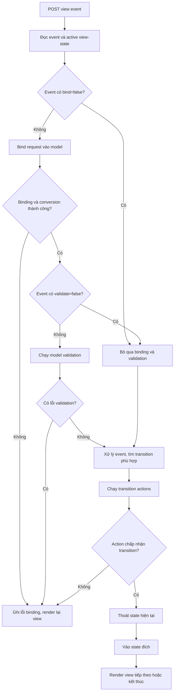

# Thứ tự liên kết dữ liệu, kiểm tra và xử lý transition trong Spring Web Flow

Một người dùng đang nhập thông tin đặt hàng. Họ gửi form với event `next` để chuyển sang bước xem lại. Trước khi màn hình thay đổi, ứng dụng cần đọc các trường request, chuyển chuỗi thành kiểu Java, cập nhật form model, kiểm tra dữ liệu và chỉ sau đó mới thực hiện hành động của transition. Nếu địa chỉ thiếu hoặc số lượng không hợp lệ, flow phải giữ người dùng ở màn hình hiện tại để sửa. Nếu họ bấm `cancel`, ứng dụng có thể cần bỏ qua binding và validation để không bị dữ liệu đang nhập dở ngăn cản việc hủy.

Spring Web Flow định nghĩa rõ lifecycle này cho `view-state` có khai báo `model`. Khi một view event được gửi về, Web Flow **liên kết dữ liệu từ view vào model trước, chạy validation sau binding, rồi mới cho event điều khiển transition nếu các bước trước đó thành công**. Transition có thể chạy action; action có thể chấp nhận hoặc ngăn state rời đi. Hiểu đúng thứ tự giúp tránh các lỗi như transition chạy với model cũ, nút Hủy bị validation chặn, dữ liệu ngoài form bị bind ngoài ý muốn hoặc service ghi dữ liệu trước khi kiểm tra hợp lệ.

Bài học thuộc chương **Vòng đời thực thi** của module `SPRING_WEB_FLOW`. Nội dung tập trung vào mối quan hệ giữa **data binding → validation → event/transition → transition actions → state tiếp theo**, cùng các tùy chọn `bind`/`validate`, binder allowlist, thông báo lỗi, bảo mật và kiểm thử.

Sau bài học, bạn có thể:

- Giải thích vai trò của thuộc tính `model` trên `view-state`.
- Mô tả thứ tự binding, type conversion, validation và xử lý event.
- Phân biệt lỗi chuyển đổi kiểu, lỗi binding, lỗi validation và lỗi nghiệp vụ.
- Cấu hình `<binder>` để chỉ cho phép các property mà view được sửa.
- Phân biệt `bind="false"` và `validate="false"`.
- Dùng Bean Validation, validation theo quy ước hoặc validator riêng với `ValidationContext`.
- Hiển thị lỗi qua `MessageContext` và message bundle.
- Thiết kế transition action có thể ngăn chuyển state khi nghiệp vụ chưa sẵn sàng.
- Kiểm thử các nhánh thành công, lỗi, Back, Cancel và event handler không đổi state.

## 1. Toàn cảnh lifecycle của một view-state

Khi flow đang dừng ở một `view-state` và browser gửi request có event, Web Flow xử lý theo chuỗi khái niệm sau:

1. **Nhận view event:** request được giải mã thành event, ví dụ `next`, `back` hoặc `cancel`.
2. **Binding từ view vào model:** nếu state khai báo `model` và event không tắt binding, các request parameter được bind vào thuộc tính model.
3. **Type conversion:** giá trị chuỗi được chuyển thành kiểu đích như `Long`, `BigDecimal`, `LocalDate` hoặc enum.
4. **Model validation:** sau khi binding thành công, các cơ chế validation đã cấu hình được gọi nếu event không tắt validation.
5. **Xử lý lỗi binding/validation:** nếu có lỗi, view-state được render lại để người dùng sửa; transition thông thường chưa được thực hiện.
6. **Chọn transition theo event:** khi binding/validation cho phép tiếp tục, Web Flow xử lý transition phù hợp với event trong state hiện tại.
7. **Chạy transition action:** action trong transition được thực hiện trước khi state rời đi; action có thể từ chối tiếp tục.
8. **Rời state và vào state đích:** nếu transition được chấp nhận, action `on-exit` của state hiện tại và hành vi vào state đích được thực hiện theo lifecycle.
9. **Render hoặc kết thúc:** state đích có thể hiển thị view mới, tiếp tục qua action/decision state hoặc kết thúc flow.



Sơ đồ mô tả đường đi thông thường của một `view-state` có model. Nếu state không khai báo `model`, Web Flow không tự thực hiện model binding/validation theo cơ chế này. Một event handler không có target có thể chạy action và render lại chính view hiện tại.

**Điểm cần nhớ:** validation không thay thế transition action. Validation kiểm tra model sau khi người dùng gửi dữ liệu; transition action thường xử lý điều kiện nghiệp vụ gắn với việc rời state, chẳng hạn kiểm tra còn chỗ, giữ hàng hoặc xác nhận một thao tác.

## 2. Khai báo model để bật binding và validation

Thuộc tính `model` trên `view-state` chỉ định object mà view sẽ bind dữ liệu vào. Model có thể nằm trong một scope mà flow truy cập được, ví dụ `flowScope` hoặc `viewScope`.

```xml
<var name="orderForm" class="com.example.order.OrderForm" />

<view-state id="enterDetails"
            view="orders/enterDetails"
            model="orderForm">
    <transition on="next" to="review" />
</view-state>
```

Khi view postback, Web Flow sử dụng model `orderForm` để nhận các giá trị từ form. Sau binding, nếu model có cơ chế validation phù hợp, Web Flow sẽ gọi validation trước khi cho event thực hiện transition.

Không có `model`, request parameter không tự động được bind vào một form object chỉ vì view có HTML input. Khi cần xử lý dữ liệu, ứng dụng có thể đọc request parameter trong action, nhưng sẽ phải tự quản lý việc chuyển đổi, validation và lỗi. Với form nhiều trường, dùng `model` giúp lifecycle nhất quán và dễ kiểm thử hơn.

### Model trong flow scope hay view scope?

| Scope | Vòng đời | Khi phù hợp |
| --- | --- | --- |
| `flowScope` | Tồn tại trong suốt execution của flow | Form cần giữ qua nhiều view-state, ví dụ thông tin đơn hàng |
| `viewScope` | Được tạo khi vào view-state và hủy khi rời state | Model chỉ dùng trong một màn hình hoặc một chuỗi Ajax của màn hình đó |

Ví dụ, `orderForm` cần giữ dữ liệu khi đi từ `enterDetails` sang `review` rồi quay lại, nên thường được đặt trong `flowScope`. Một bộ lọc tạm hoặc dữ liệu phân trang chỉ dùng tại màn hình kết quả có thể đặt trong `viewScope`.

## 3. Binding và type conversion xảy ra trước validation

Browser gửi dữ liệu form dưới dạng chuỗi. Model Java có thể dùng kiểu mạnh hơn:

| Request parameter | Kiểu thuộc tính model | Công việc của binding |
| --- | --- | --- |
| `quantity=3` | `Integer` | Chuyển chuỗi `"3"` thành số nguyên |
| `unitPrice=125000.50` | `BigDecimal` | Parse chuỗi thành số thập phân |
| `deliveryDate=2026-12-01` | `LocalDate` | Dùng formatter/converter ngày phù hợp |
| `paymentMethod=CARD` | `PaymentMethod` | Chuyển chuỗi thành enum |

Web Flow dùng hệ thống type conversion và formatting của Spring cho phần lớn nhu cầu chuyển đổi. Có thể đăng ký converter/formatter riêng thông qua `ConversionService`. Nếu không thể chuyển chuỗi sang kiểu đích, binding tạo lỗi chuyển đổi, ví dụ `typeMismatch`.

### Ví dụ model

```java
package com.example.order;

import java.math.BigDecimal;
import java.time.LocalDate;

public class OrderForm {

    private String recipientName;
    private Integer quantity;
    private BigDecimal unitPrice;
    private LocalDate deliveryDate;

    public String getRecipientName() {
        return recipientName;
    }

    public void setRecipientName(String recipientName) {
        this.recipientName = recipientName;
    }

    public Integer getQuantity() {
        return quantity;
    }

    public void setQuantity(Integer quantity) {
        this.quantity = quantity;
    }

    public BigDecimal getUnitPrice() {
        return unitPrice;
    }

    public void setUnitPrice(BigDecimal unitPrice) {
        this.unitPrice = unitPrice;
    }

    public LocalDate getDeliveryDate() {
        return deliveryDate;
    }

    public void setDeliveryDate(LocalDate deliveryDate) {
        this.deliveryDate = deliveryDate;
    }
}
```

Model là một POJO của ứng dụng. Các getter/setter giúp binder cập nhật thuộc tính sau khi conversion thành công. Formatter ngày cần được cấu hình phù hợp với chuỗi mà view gửi.

### Khi conversion thất bại

Giả sử người dùng gửi `quantity=abc`:

1. Web Flow tìm binding cho property `quantity`.
2. Conversion service không thể chuyển `"abc"` thành `Integer`.
3. Binding error được ghi nhận.
4. Model validation không thể coi property đó là một giá trị `Integer` hợp lệ.
5. View-state được render lại để người dùng sửa.
6. Event không được dùng để rời state như một postback hợp lệ.

Đây là lỗi kiểu dữ liệu, không phải lỗi nghiệp vụ “số lượng phải lớn hơn 0”. Trường hợp `quantity=-2` có thể conversion thành công nhưng validation từ chối.

## 4. Dùng binder để giới hạn property được phép cập nhật

Nếu không khai báo `<binder>`, mặc định tất cả public property phù hợp của model có thể đủ điều kiện binding từ view. Điều này có thể gây rủi ro nếu model chứa các thuộc tính mà người dùng không được quyền sửa, chẳng hạn `approved`, `ownerId`, `discountPercent` hoặc `totalAmount`.

Khai báo binder tường minh tạo **allowlist các property** được phép bind trong view-state:

```xml
<view-state id="enterDetails"
            view="orders/enterDetails"
            model="orderForm">
    <binder>
        <binding property="recipientName" required="true" />
        <binding property="quantity" required="true" />
        <binding property="unitPrice" required="true" />
        <binding property="deliveryDate" />
    </binder>

    <transition on="next" to="review" />
</view-state>
```

Các property không nằm trong binder không được view này cập nhật qua cơ chế binding được khai báo. Đây là biện pháp quan trọng để hạn chế over-posting/mass assignment.

### Ví dụ property không được bind từ browser

Giả sử model còn có:

```java
private Long ownerId;
private boolean approved;
private BigDecimal serverCalculatedTotal;
```

Các thuộc tính này không nằm trong binder. Người dùng gửi thêm request parameter `approved=true` hoặc `serverCalculatedTotal=1` cũng không làm các thuộc tính đó được bind qua cấu hình view-state trên. Service vẫn phải xác định chủ sở hữu và tính tổng tiền ở server; binder không thay thế authorization hoặc kiểm tra nghiệp vụ.

### Binding có converter và required check

Mỗi binding có thể chỉ định converter và `required`:

```xml
<binder>
    <binding property="deliveryDate"
             converter="localDateConverter"
             required="true" />
    <binding property="quantity" required="true" />
</binder>
```

- `converter` chọn converter đã đăng ký cho property.
- `required="true"` tạo lỗi khi giá trị gửi lên là null/rỗng theo cơ chế binding.
- Nếu không chỉ định converter, converter mặc định cho kiểu thuộc tính được sử dụng.

Required check ở binder là kiểm tra đầu vào của binding. Nó không thay thế các constraint nghiệp vụ như ngày giao phải ở tương lai hoặc số lượng không vượt hạn mức.

## 5. Validation chạy sau binding

Sau khi dữ liệu request đã được bind vào model, Web Flow chạy các cơ chế validation được cấu hình. Có thể dùng:

1. **Bean Validation** với annotation trên model.
2. **Validation method theo quy ước** trên model.
3. **Validator bean riêng** theo quy ước tên.
4. **Validation theo nhóm** khi một model đi qua nhiều view-state.

Các cơ chế có thể được kết hợp; không cần chọn duy nhất một cách nếu ứng dụng có nhiều loại quy tắc.

### 5.1. Bean Validation

Ví dụ model:

```java
import jakarta.validation.constraints.DecimalMin;
import jakarta.validation.constraints.NotBlank;
import jakarta.validation.constraints.Positive;
import jakarta.validation.constraints.Size;

public class OrderForm {

    @NotBlank
    @Size(max = 100)
    private String recipientName;

    @Positive
    private Integer quantity;

    @DecimalMin("0.01")
    private BigDecimal unitPrice;

    // Getter và setter
}
```

Với stack Spring Web Flow 4.x/Jakarta, ví dụ dùng package `jakarta.validation`. Dự án Web Flow 2.x cũ có thể dùng namespace `javax.validation`; hãy dùng namespace khớp dependency thực tế.

Cấu hình validator cho flow builder:

```xml
<webflow:flow-registry id="flowRegistry"
                       flow-builder-services="flowBuilderServices">
    <webflow:flow-location path="/WEB-INF/flows/orders/checkout.xml" />
</webflow:flow-registry>

<webflow:flow-builder-services id="flowBuilderServices"
                               validator="validator" />

<bean id="validator"
      class="org.springframework.validation.beanvalidation.LocalValidatorFactoryBean" />
```

Validator được cấu hình sẽ áp dụng lên model sau khi binding. Cần bảo đảm provider Bean Validation tương thích với phiên bản Spring và namespace API mà ứng dụng đang dùng.

### 5.2. Validation method trên model

Web Flow hỗ trợ quy ước phương thức validation gắn với ID của view-state. Nếu state có ID `enterDetails`, model có thể định nghĩa:

```java
public void validateEnterDetails(ValidationContext context) {
    MessageContext messages = context.getMessageContext();

    if (deliveryDate != null && deliveryDate.isBefore(LocalDate.now())) {
        messages.addMessage(
            new MessageBuilder()
                .error()
                .source("deliveryDate")
                .defaultText("Ngày giao phải từ hôm nay trở đi.")
                .build()
        );
    }
}
```

Web Flow tự tìm và gọi phương thức phù hợp trong postback lifecycle của view-state, trừ khi validation bị tắt cho event đó. Dùng `MessageContext` để gắn lỗi với field hoặc thêm thông báo chung.

### 5.3. Validator bean riêng

Có thể tách validation ra khỏi model:

```java
@Component("orderFormValidator")
public class OrderFormValidator {

    public void validateEnterDetails(
            OrderForm orderForm,
            ValidationContext context) {

        if (orderForm.getQuantity() != null
                && orderForm.getQuantity() > 100) {
            context.getMessageContext().addMessage(
                new MessageBuilder()
                    .error()
                    .source("quantity")
                    .defaultText("Số lượng vượt giới hạn cho phép.")
                    .build()
            );
        }
    }
}
```

Tên bean theo quy ước là tên model expression được viết hoa chữ đầu cộng hậu tố `Validator`; với model `orderForm`, bean có tên `orderFormValidator`. Validator có thể định nghĩa phương thức theo state để chỉ kiểm tra các trường được chỉnh sửa tại màn hình đó.

### 5.4. ValidationContext và MessageContext

`ValidationContext` cung cấp `MessageContext` để ghi lỗi, đồng thời có thông tin về event người dùng gửi và principal hiện tại. Điều này hữu ích khi quy tắc kiểm tra phụ thuộc nút đã bấm hoặc người đang thao tác.

Ví dụ, cùng một form có thể cho phép người dùng quay lại mà không cần kiểm tra mọi trường, nhưng khi bấm `next` phải kiểm tra đầy đủ. Tốt hơn hết hãy cấu hình hành vi này bằng thuộc tính transition `validate` và giữ quy tắc nghiệp vụ quan trọng ở service/domain.

## 6. Phân biệt lỗi binding và lỗi validation

Hai loại lỗi này xuất hiện ở hai thời điểm khác nhau:

| Loại lỗi | Xảy ra khi nào? | Ví dụ | Có model value mới không? |
| --- | --- | --- | --- |
| Type conversion/binding | Khi chuyển request string và gán vào model | `quantity=abc` với property Integer | Property không thể được cập nhật thành giá trị hợp lệ |
| Required binding | Khi binding kiểm tra field bắt buộc | `recipientName` rỗng với binding required | Binding error được ghi nhận |
| Bean/programmatic validation | Sau khi binding thành công | `quantity=-2` | Model đã nhận giá trị, nhưng giá trị bị từ chối |
| Business validation | Trong service/action theo trạng thái nghiệp vụ | Không còn tồn kho | Có thể cần giữ view và hiển thị thông báo |

Khi binding lỗi, validation model không thể xử lý như thể toàn bộ dữ liệu đã hợp lệ. Khi validation có lỗi, view-state thường được render lại và thông báo được hiển thị cho người dùng.

### Message code cho binding error

Web Flow tạo message code cho lỗi binding, ví dụ property `checkinDate` trên model `Booking` bị nhập sai định dạng có thể tra:

```properties
booking.checkinDate.typeMismatch=Ngày nhận phòng phải theo định dạng yyyy-MM-dd.
typeMismatch=Trường {0} có kiểu dữ liệu không hợp lệ.
```

Framework tìm message cụ thể theo model/property/error code trước, sau đó mới thử message chung. Có thể khai báo message bundle ở cấp flow hoặc cấu hình MessageSource chung.

### Hiển thị lỗi trong view

Với JSP Spring form tag:

```jsp
<form:form modelAttribute="orderForm">
    <form:input path="recipientName" />
    <form:errors path="recipientName" cssClass="error" />

    <form:input path="quantity" />
    <form:errors path="quantity" cssClass="error" />
</form:form>
```

Thông báo được ghi vào MessageContext cũng có thể được render qua thành phần thông báo phù hợp với view technology. Cần phân biệt lỗi field-level trong binding result với message chung do action/validator ghi vào MessageContext.

## 7. bind=false và validate=false có ý nghĩa khác nhau

Hai thuộc tính này thường bị nhầm khi cấu hình nút Back hoặc Cancel.

| Thuộc tính trên transition | Binding dữ liệu? | Model validation? | Khi nào dùng |
| --- | --- | --- | --- |
| Mặc định | Có | Có | Nút Next/Submit cần cập nhật và kiểm tra model |
| `validate="false"` | **Có** | **Không** | Nút Back vẫn giữ dữ liệu vừa nhập nhưng không bắt người dùng hoàn thành mọi trường |
| `bind="false"` | **Không** | **Không** | Nút Cancel bỏ form đang nhập dở và rời state |

### Ví dụ Back bỏ qua validation nhưng vẫn bind

```xml
<view-state id="enterDetails"
            view="orders/enterDetails"
            model="orderForm">
    <transition on="next" to="review" />
    <transition on="back" to="previousStep" validate="false" />
</view-state>
```

Khi người dùng bấm Back, giá trị đang gửi vẫn được bind vào `orderForm`. Web Flow bỏ qua model validation cho event đó nên người dùng có thể quay lại dù một số trường chưa hoàn tất.

### Ví dụ Cancel bỏ qua cả binding lẫn validation

```xml
<view-state id="enterDetails"
            view="orders/enterDetails"
            model="orderForm">
    <transition on="next" to="review" />
    <transition on="cancel" to="cancelled" bind="false" />
</view-state>
```

Cancel không cần cập nhật form model bằng các giá trị đang nhập dở, và cũng không cần validation. Vì vậy `bind="false"` phù hợp.

**Hệ quả:** nếu người dùng đã sửa một trường rồi bấm Cancel, giá trị mới chưa được bind vào model. Đây thường là điều mong muốn khi hủy, nhưng không phù hợp nếu nút Back cần giữ lại các thay đổi.

### Không dùng bind=false để sửa lỗi validation

Nếu một nút Next đang bị lỗi validation, đổi nó thành `bind="false"` không phải cách sửa đúng: request sẽ không cập nhật model. Hãy sửa constraint, form binding hoặc dùng `validate="false"` cho một event thực sự có ý nghĩa bỏ qua validation.

## 8. Transition action chạy sau khi event đã qua binding/validation

Sau khi binding và validation cho phép tiếp tục, Web Flow xử lý event theo transition phù hợp của state hiện tại. Transition có thể khai báo một hoặc nhiều action:

```xml
<view-state id="review"
            view="orders/review"
            model="orderForm">
    <transition on="confirm" to="completed">
        <evaluate expression="orderService.confirm(orderForm, messageContext)" />
    </transition>
</view-state>
```

Transition action có thể:

- Kiểm tra điều kiện nghiệp vụ tại thời điểm người dùng xác nhận.
- Gọi service giữ chỗ, kiểm tra tồn kho hoặc kiểm tra hạn mức.
- Thêm thông báo lỗi vào `MessageContext`.
- Ngăn flow rời state hiện tại nếu hành động không thể tiếp tục.

Ví dụ action POJO:

```java
public boolean confirm(OrderForm form, MessageContext messages) {
    try {
        orderService.confirm(form);
        return true;
    } catch (InventoryUnavailableException ex) {
        messages.addMessage(
            new MessageBuilder()
                .error()
                .defaultText("Sản phẩm không còn đủ số lượng.")
                .build()
        );
        return false;
    }
}
```

Với POJO action, giá trị boolean có thể điều khiển transition: `true` cho phép tiếp tục, `false` ngăn transition. Các kết quả chuỗi `success`, `yes` hoặc `true` cũng được hiểu là chấp nhận; kết quả khác có thể ngăn transition theo quy tắc của transition action.

Nếu action trả kết quả lỗi, view được render lại và thông báo cần hiển thị. Khi transition có nhiều action, nếu một action trả error result, các action còn lại trong chuỗi không được chạy.

### Phân biệt validation với transition action

| Validation | Transition action |
| --- | --- |
| Kiểm tra tính hợp lệ của model sau binding | Xử lý hành động gắn với việc chuyển state |
| Thường kiểm tra required, format, range, quan hệ field | Có thể kiểm tra tồn kho, trạng thái đơn, quyền thao tác, khả năng giữ chỗ |
| Chạy theo lifecycle model validation | Chỉ chạy khi event khớp transition có action |
| Có thể chạy trước khi quyết định transition | Chạy trước khi transition rời state |
| Không nên tạo side effect nghiệp vụ | Có thể gọi service, nhưng cần transaction/idempotency rõ ràng |

Không đặt thao tác ghi dữ liệu không thể đảo ngược vào validation method. Validation có thể chạy lại khi người dùng postback, Back hoặc retry; validation nên có tính kiểm tra và không tạo side effect.

## 9. Event handler không có target vẫn đi qua lifecycle view

Một transition không có thuộc tính `to` được gọi là **event handler**. Nó xử lý event nhưng không chuyển sang state khác:

```xml
<view-state id="searchResults"
            view="orders/search"
            model="searchCriteria">
    <transition on="nextPage">
        <evaluate expression="searchCriteria.nextPage()" />
        <render fragments="searchResultsFragment" />
    </transition>
</view-state>
```

Với state có model, binding/validation vẫn liên quan đến view event theo cấu hình transition. Sau đó action cập nhật trang kết quả và render fragment; state vẫn là `searchResults`.

Điều này hữu ích cho:

- Phân trang kết quả tìm kiếm.
- Lọc danh sách bằng Ajax.
- Mở rộng/thu gọn phần thông tin trên cùng view.
- Cập nhật dữ liệu phụ trợ mà không rời màn hình.

Nếu event handler chỉ cần thao tác UI mà không cần bind model, có thể cân nhắc cấu hình binding/validation phù hợp để tránh chạy các kiểm tra không liên quan.

## 10. Validation theo nhóm cho form nhiều bước

Một form model có thể được chỉnh sửa qua nhiều view-state. Không phải tất cả constraint đều cần chạy ở mọi bước. Bean Validation hỗ trợ **validation groups**, và Web Flow cho phép khai báo `validation-hints` trên view-state hoặc transition.

Ví dụ:

```java
public interface ContactStep {}
public interface PaymentStep {}

public class CheckoutForm {

    @NotBlank(groups = ContactStep.class)
    private String email;

    @NotBlank(groups = PaymentStep.class)
    private String cardHolder;

    @NotBlank(groups = PaymentStep.class)
    private String cardToken;
}
```

Trong flow:

```xml
<view-state id="contact" model="checkoutForm"
            validation-hints="'ContactStep'">
    <transition on="next" to="payment" />
</view-state>

<view-state id="payment" model="checkoutForm"
            validation-hints="'PaymentStep'">
    <transition on="confirm" to="completed" />
</view-state>
```

`validation-hints` là expression được resolver chuyển thành các group tương ứng. Với resolver mặc định, Web Flow có thể tìm các kiểu group bên trong model hoặc dùng tên đầy đủ. Cần kiểm tra cấu hình resolver và provider Bean Validation thực tế của dự án.

Validation group hữu ích khi model được chia sẻ giữa nhiều bước: bước liên hệ kiểm tra email; bước thanh toán kiểm tra chủ thẻ và token; bước cuối có thể kiểm tra toàn bộ dữ liệu. Dù dùng group, service vẫn phải kiểm tra invariant nghiệp vụ tại thời điểm ghi.

## 11. Thứ tự lifecycle trong ví dụ hoàn chỉnh

Flow checkout dưới đây minh họa binding, validation, transition action và state đích:

```xml
<?xml version="1.0" encoding="UTF-8"?>
<flow xmlns="http://www.springframework.org/schema/webflow"
      xmlns:xsi="http://www.w3.org/2001/XMLSchema-instance"
      xsi:schemaLocation="http://www.springframework.org/schema/webflow
                          https://www.springframework.org/schema/webflow/spring-webflow.xsd">

    <var name="orderForm" class="com.example.order.OrderForm" />

    <view-state id="enterDetails"
                view="orders/enterDetails"
                model="orderForm">
        <binder>
            <binding property="recipientName" required="true" />
            <binding property="quantity" required="true" />
            <binding property="deliveryDate" />
        </binder>

        <transition on="next" to="review" />
        <transition on="back" to="previousStep" validate="false" />
        <transition on="cancel" to="cancelled" bind="false" />
    </view-state>

    <view-state id="review"
                view="orders/review"
                model="orderForm">
        <transition on="revise" to="enterDetails" />
        <transition on="confirm" to="confirmOrder">
            <evaluate expression="orderService.checkCanConfirm(orderForm, messageContext)" />
        </transition>
    </view-state>

    <action-state id="confirmOrder">
        <evaluate expression="orderService.confirm(orderForm)"
                  result="flowScope.confirmation" />
        <transition on="success" to="completed" />
    </action-state>

    <end-state id="completed" />
    <end-state id="cancelled" />
    <view-state id="previousStep" view="orders/previousStep" />
</flow>
```

Đọc luồng theo từng tình huống:

**Người dùng bấm Next ở enterDetails**

1. Request được bind vào `orderForm`.
2. Các binding bắt buộc được kiểm tra.
3. Model validation chạy.
4. Nếu không có lỗi, event `next` khớp transition.
5. Flow rời `enterDetails` và vào `review`.

**Người dùng bấm Back**

1. Binding vẫn xảy ra để giữ dữ liệu vừa nhập.
2. Validation bị bỏ qua do `validate="false"`.
3. Event `back` chuyển về state trước.

**Người dùng bấm Cancel**

1. Binding bị bỏ qua do `bind="false"`.
2. Validation cũng bị bỏ qua.
3. Event `cancel` chuyển đến end-state `cancelled`.

**Người dùng bấm Confirm**

1. Event được xử lý trong `review`.
2. Transition action `checkCanConfirm` chạy và có thể từ chối rời state.
3. Nếu được chấp nhận, flow chuyển sang `confirmOrder`.
4. Action-state gọi service xác nhận; outcome `success` đưa flow tới `completed`.

Ví dụ này chỉ minh họa lifecycle. Các bean `orderService`, model và state `previousStep` cần được triển khai/khai báo phù hợp trong flow thực tế. Với xác nhận đơn hàng, `checkCanConfirm` nên là kiểm tra không tạo side effect; `confirm` cần transaction, kiểm tra quyền, trạng thái và chống ghi trùng.

Trong ví dụ action-state, `orderService.confirm` được giả định trả về một object xác nhận như `OrderConfirmation`; kiểu kết quả object này được ánh xạ thành event `success`. Nếu service trả về `boolean`, kết quả `true` được ánh xạ thành event `yes`, khi đó transition phải dùng `on="yes"`.

## 12. Các lỗi thiết kế thường gặp

| Lỗi | Hậu quả | Cách xử lý |
| --- | --- | --- |
| Không khai báo `model` nhưng mong form tự bind | Model không nhận dữ liệu tự động | Khai báo model hoặc tự xử lý request một cách có chủ đích |
| Để binder mặc định cho model có field nhạy cảm | Over-posting/mass assignment | Khai báo allowlist bằng `<binder>` |
| Dùng `bind="false"` cho nút Back | Dữ liệu vừa nhập không được cập nhật vào model | Dùng `validate="false"` nếu cần giữ dữ liệu nhưng bỏ validation |
| Dùng `validate="false"` cho Cancel | Dữ liệu vẫn được bind dù người dùng hủy | Dùng `bind="false"` khi muốn bỏ cả binding |
| Đặt side effect trong validation method | Retry/postback có thể thực hiện side effect nhiều lần | Validation chỉ kiểm tra; ghi dữ liệu trong service/action có transaction |
| Nghĩ transition action chạy trước binding | Action đọc model cũ | Nhớ binding và validation của view-state diễn ra trước xử lý transition |
| Bỏ qua type conversion error | Giá trị model không được cập nhật đúng | Đăng ký converter/formatter và hiển thị message rõ |
| Chỉ validate ở client | Request giả mạo bỏ qua được kiểm tra | Validate phía server và kiểm tra lại trong service |
| Dùng message chung cho mọi field | Người dùng khó biết trường nào sai | Gắn source field và message code cụ thể |
| Chạy tất cả constraint ở mọi bước | Người dùng không thể đi tiếp khi field thuộc bước sau còn trống | Dùng validation group/hints hoặc validator theo state |
| Transition action ghi dữ liệu rồi trả false | Side effect có thể đã xảy ra dù state không chuyển | Thiết kế thao tác atomic, transaction và kết quả rõ ràng |

## 13. Kiểm thử thứ tự binding, validation và transition

Test cần xác nhận **thứ tự**, không chỉ kiểm tra state cuối cùng. Một bộ kiểm thử nên bao gồm:

| Kịch bản | Dữ liệu/request | Kỳ vọng |
| --- | --- | --- |
| Binding hợp lệ | quantity là số nguyên hợp lệ | Model nhận giá trị mới |
| Conversion lỗi | quantity là chuỗi không phải số | Binding error, view giữ nguyên |
| Required field rỗng | recipientName trống | Lỗi required, không rời state |
| Bean Validation lỗi | quantity âm | Model nhận giá trị nhưng validation từ chối |
| Validation method lỗi | deliveryDate ở quá khứ | MessageContext có lỗi field deliveryDate |
| Event Next | Model hợp lệ và event next | Transition tới review |
| Event Back | Model có trường chưa hợp lệ, validate=false | Binding vẫn cập nhật, Back vẫn chạy |
| Event Cancel | Model có dữ liệu dở, bind=false | Không bind/validate, đi tới cancelled |
| Transition action thành công | Service check trả true | State rời đi |
| Transition action từ chối | Service check trả false và thêm message | Giữ state hiện tại, hiển thị lỗi |
| Nhiều transition action | Action đầu trả error | Action sau không được gọi |
| Event handler không target | nextPage | Action chạy, state giữ nguyên, fragment render lại |
| Binder allowlist | Request gửi thêm approved=true | Property không được khai báo không bị bind |
| Validation group | Chỉ nhập dữ liệu của bước liên hệ | Contact group đạt; payment group chưa chạy |
| Locale/type conversion | Chuỗi ngày hoặc tiền theo locale | Parse đúng theo ConversionService |
| Request lặp | Gửi lại event confirm | Service không tạo giao dịch trùng |

### Kiểm thử thứ tự bằng stub

Có thể dùng một service giả ghi lại thứ tự các lời gọi:

```java
public class OrderFlowProbe {

    private final List<String> calls = new ArrayList<>();

    public void validateModel(OrderForm form) {
        calls.add("validate");
    }

    public boolean checkCanConfirm(OrderForm form, MessageContext messages) {
        calls.add("transition-action");
        return form.getQuantity() != null && form.getQuantity() > 0;
    }

    public List<String> getCalls() {
        return calls;
    }
}
```

Trong flow test, gửi event và xác nhận:

- Model đã có giá trị request trước khi validation được gọi.
- Transition action chỉ được gọi sau khi binding/validation cho phép.
- Khi validation có lỗi, transition action không được gọi.
- Khi transition action từ chối, state không thay đổi và message được ghi nhận.

Đây là cách mô tả test strategy; test harness cụ thể cần dùng API của phiên bản Web Flow và validator được cấu hình trong ứng dụng.

### Test ở ba tầng

1. **Unit test validator/formatter:** kiểm tra quy tắc field và chuyển đổi độc lập.
2. **Flow execution test:** gửi event, xác nhận model, message context, state và thứ tự action.
3. **MVC integration test:** gửi HTTP form thật qua FlowHandlerAdapter, kiểm tra parameter, CSRF, redirect và render lỗi.

Flow test không chứng minh browser gửi đúng field name hoặc HTML hiển thị lỗi đúng; cần integration/E2E test cho phần giao diện.

## 14. Bài tập thực hành: form đặt lịch nhiều bước

Tạo flow `appointment` gồm `enterContact`, `chooseSlot`, `review` và `confirmed`.

1. Tạo model `AppointmentForm` có `email`, `phone`, `appointmentDate`, `timeSlot` và `adminApproved`.
2. Ở `enterContact`, khai báo `model="appointmentForm"` và binder chỉ cho phép `email`, `phone`.
3. Dùng Bean Validation để kiểm tra email và số điện thoại; dùng validation method theo state để kiểm tra điều kiện nghiệp vụ.
4. Ở `chooseSlot`, binder chỉ cho phép `appointmentDate` và `timeSlot`.
5. Cấu hình transition `back` với `validate="false"` để giữ dữ liệu đang nhập nhưng quay lại được.
6. Cấu hình transition `cancel` với `bind="false"` để hủy mà không bind dữ liệu dở.
7. Ở `review`, transition `confirm` gọi service kiểm tra slot còn trống; nếu không còn, ghi message và giữ state.
8. Khi kiểm tra thành công, chuyển sang action-state thực hiện đặt lịch bằng transaction.
9. Viết test gửi thêm `adminApproved=true` và chứng minh binder không cho client cập nhật property này.
10. Kiểm thử conversion lỗi, validation lỗi, Back, Cancel, transition action từ chối, double submit và request thiếu CSRF trong MVC integration test.

**Câu hỏi tự đánh giá:**

- Vì sao Web Flow phải bind model trước khi validation?
- Điều gì xảy ra nếu binding không chuyển đổi được một request parameter?
- Vì sao model validation không nên gửi email hoặc ghi database?
- `bind="false"` khác `validate="false"` ở điểm nào?
- Khi nào cần binder allowlist?
- Validation method theo state được Web Flow tìm dựa trên thông tin nào?
- `ValidationContext` cung cấp thêm thông tin gì ngoài MessageContext?
- Vì sao transition action có thể giữ flow ở view-state hiện tại?
- Event handler không có target có làm flow đổi state không?
- Làm thế nào để ngăn một request giả mạo cập nhật property chỉ dành cho server?

## 15. Tài liệu tham khảo

- [Spring Web Flow 4.0.2 Reference — Binding to a Model](https://docs.spring.io/spring-webflow/docs/4.0.2/reference/#binding-to-a-model): model binding và thứ tự validation trong view-state.
- [Spring Web Flow 4.0.2 Reference — Specifying Bindings Explicitly](https://docs.spring.io/spring-webflow/docs/4.0.2/reference/#specifying-bindings-explicitly): binder allowlist, converter và required check.
- [Spring Web Flow 4.0.2 Reference — Validating a Model](https://docs.spring.io/spring-webflow/docs/4.0.2/reference/#validating-a-model): Bean Validation, validation convention, Validator và ValidationContext.
- [Spring Web Flow 4.0.2 Reference — Suppressing Validation](https://docs.spring.io/spring-webflow/docs/4.0.2/reference/#suppressing-validation): bỏ validation nhưng vẫn binding.
- [Spring Web Flow 4.0.2 Reference — Transition Actions](https://docs.spring.io/spring-webflow/docs/4.0.2/reference/#transition-actions): action trong transition và cách ngăn state rời đi.
- [Spring Web Flow 2.5.1 Reference — Rendering Views](https://docs.spring.io/spring-webflow/docs/2.5.1.RELEASE/reference/html/views.html): cách cấu hình binding, validation và transition trong ứng dụng legacy.

## Ghi nhớ

Trong một `view-state` có `model`, Spring Web Flow xử lý **binding request vào model trước, validation sau binding, rồi mới cho event điều khiển transition**. Binding lỗi khiến view được render lại; validation lỗi cũng giữ người dùng ở bước hiện tại. `validate="false"` bỏ qua validation nhưng vẫn bind dữ liệu; `bind="false"` bỏ qua cả binding lẫn validation. Binder tường minh giới hạn property được phép cập nhật, giảm nguy cơ over-posting. Khi event hợp lệ khớp transition, transition action chạy trước khi state rời đi và có thể ngăn việc chuyển state bằng kết quả lỗi. Hãy giữ validation thuần kiểm tra, đặt side effect trong service/action có transaction, và kiểm thử cả đường thành công lẫn lỗi để bảo đảm model, state và nghiệp vụ luôn nhất quán.
