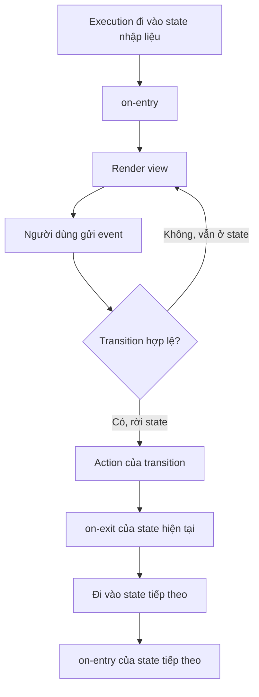

# on-exit và hành động khi rời state

Trong chương **Vòng đời thực thi**, `on-exit` là hook gắn với vòng đời của một state trong Spring Web Flow. Nó cho phép chạy một nhóm action khi flow thực sự rời state hiện tại, chẳng hạn ghi nhận dấu mốc rời bước, giải phóng tài nguyên tạm hoặc hoàn tất việc dọn dẹp thuộc riêng bước đó. Vì hook thuộc về state, nó áp dụng chung cho các đường chuyển tiếp rời state; đây là điểm quan trọng khi quyết định đặt logic ở `on-exit` hay đặt ngay trong một transition cụ thể.

Module `SPRING_WEB_FLOW` hướng tới việc mô hình hóa hành trình web nhiều bước bằng state, event, transition và subflow, đồng thời thực hành form binding, validation, quản lý scope và phiên, tích hợp Spring MVC, kiểm thử và phục hồi luồng khi có lỗi. Trong bối cảnh đó, hiểu đúng `on-exit` giúp tổ chức hành động theo đúng thời điểm của vòng đời. Một hook rời state không phải là nơi thích hợp để đặt mọi nghiệp vụ phát sinh sau khi người dùng bấm nút; cần phân biệt hành động chung của state, hành động riêng của transition và nghiệp vụ cần bảo đảm bền vững.

## 1. `on-exit` là gì?

State biểu diễn một điểm trong lần thực thi flow, ví dụ màn hình nhập thông tin, màn hình xem lại hoặc một bước xử lý. Khi một sự kiện được gửi đến state, flow đánh giá các transition có thể áp dụng. Nếu một transition hợp lệ được chọn và execution rời state hiện tại, các action khai báo trong `on-exit` của state đó được thực thi như một phần của vòng đời rời state.

Ví dụ, state `enterDetails` có thể có hai đường ra:

- Người dùng gửi `continue` để chuyển sang bước xem lại.
- Người dùng gửi `cancel` để rời quy trình nhập liệu.

Nếu cần ghi nhận rằng người dùng đã rời bước nhập liệu bất kể họ đi theo đường nào, `on-exit` là vị trí phù hợp. Nếu chỉ muốn ghi nhận khi họ chọn `continue`, action nên nằm trong transition `continue`.

`on-exit` không chạy chỉ vì một view được hiển thị lại hoặc vì người dùng gửi một request vẫn ở cùng state. Chẳng hạn, form bị validation lỗi và được render lại ở chính view state thì state chưa bị rời; không nên dựa vào `on-exit` để xử lý mỗi lần submit hoặc mỗi lần render. Nếu cần action cho mỗi lần render, hãy xem xét hook `on-render` hoặc cơ chế phù hợp với sự kiện đó.

## 2. Vị trí của `on-exit` trong vòng đời state

Các hook state có trách nhiệm khác nhau. Phân biệt chúng giúp tránh chạy một hành động quá sớm, quá nhiều lần hoặc ở sai nhánh.

| Hook hoặc action | Thời điểm và phạm vi | Ví dụ phù hợp |
|---|---|---|
| `on-entry` | Khi execution đi vào state | Chuẩn bị dữ liệu để hiển thị bước hiện tại |
| `on-render` | Khi view state được render | Tính dữ liệu trình bày cần cập nhật theo lần render |
| Action trong `transition` | Khi transition cụ thể được thực thi | Kiểm tra hoặc xử lý riêng cho sự kiện `confirm` |
| `on-exit` | Khi execution rời state hiện tại | Ghi nhận dấu mốc rời bước, dọn dữ liệu tạm thuộc state |
| Action ở `end-state` hoặc hook kết thúc flow | Khi hành trình đi tới điểm kết thúc theo cấu hình | Hoàn tất phản hồi hoặc xử lý kết thúc flow |

Ví dụ một hành trình có thể được hiểu theo trình tự khái quát sau:



Sơ đồ mô tả trách nhiệm của từng phần trong một đường chuyển tiếp thành công. Chi tiết xử lý request, validation, listener và exception có thể ảnh hưởng tới luồng thực thi cụ thể; không nên dùng một hook để thay thế logic vốn cần gắn với một điểm khác trong lifecycle.

Điểm cần nhớ là `on-exit` gắn với việc rời state, không gắn với một tên event cụ thể. Nếu state có nhiều transition, cùng một nhóm action `on-exit` sẽ được áp dụng cho những đường ra đó. Đó là ưu điểm khi cần hành vi chung và cũng là lý do cần thận trọng khi đặt side effect phụ thuộc vào lựa chọn của người dùng.

## 3. Khai báo `on-exit` trong flow definition

Trong flow definition XML, `on-exit` được đặt bên trong phần khai báo state. Các action con có thể dùng `evaluate` để gọi bean hoặc biểu thức trong flow context. Ví dụ sau minh họa state nhập thông tin đặt chỗ có hai đường ra:

```xml
<flow xmlns="http://www.springframework.org/schema/webflow">
    <var name="booking" class="com.example.BookingDraft" />

    <view-state id="enterDetails"
                view="booking/details"
                model="booking">
        <transition on="continue" to="review">
            <evaluate expression="bookingActions.validateDetails(flowRequestContext)" />
        </transition>

        <transition on="cancel" to="cancelled" />

        <on-exit>
            <evaluate expression="bookingActions.recordDetailsExit(flowRequestContext)" />
        </on-exit>
    </view-state>

    <view-state id="review" view="booking/review">
        <transition on="confirm" to="completed" />
        <transition on="back" to="enterDetails" />
    </view-state>

    <end-state id="cancelled" />
    <end-state id="completed" />
</flow>
```

Trong ví dụ, `bookingActions` đại diện cho bean action do ứng dụng cung cấp. `recordDetailsExit` được gọi khi execution rời `enterDetails`, dù transition được chọn là `continue` hay `cancel`. Action `validateDetails` nằm trong transition `continue`, vì việc kiểm tra đó chỉ thuộc đường đi tiếp tục. Cần cấu hình bean, expression và namespace tương ứng với phiên bản Spring Web Flow của dự án; đoạn XML tập trung minh họa vị trí và phạm vi của hook.

Một cách thiết kế action dễ kiểm soát là để method nhận `RequestContext` hoặc `flowRequestContext` theo API mà dự án đang sử dụng, rồi đọc dữ liệu cần thiết từ flow scope hoặc service. Ví dụ minh họa bằng Java:

```java
public class BookingActions {

    public void recordDetailsExit(RequestContext context) {
        BookingDraft booking = (BookingDraft) context.getFlowScope().get("booking");
        if (booking == null) {
            return;
        }

        // Ghi nhận dấu mốc rời bước; tránh ghi dữ liệu nhạy cảm vào log.
        auditService.recordStepExit(booking.getReference(), "enterDetails");
    }
}
```

Đây là phác thảo về cách action lấy dữ liệu từ flow context; constructor injection, kiểu trả về, bean registration và API cụ thể cần khớp cấu hình thực tế. Không nên để flow definition chứa các biểu thức dài với nhiều quy tắc nghiệp vụ. Đặt công việc vào method có tên rõ ràng giúp kiểm thử độc lập và giữ XML tập trung vào cấu trúc luồng.

## 4. Chọn `on-exit` hay action trong transition?

Đây là quyết định quan trọng nhất khi thiết kế hook rời state.

### Dùng `on-exit` cho hành vi chung của mọi đường ra

Chọn `on-exit` khi hành động có cùng ý nghĩa bất kể state được rời bằng transition nào. Ví dụ:

- Ghi nhận thời điểm người dùng rời bước nhập thông tin.
- Giải phóng một tài nguyên tạm gắn riêng với bước hiện tại.
- Đóng một đối tượng theo dõi hoặc bộ thu thập số liệu đã mở khi vào state.
- Xóa dữ liệu trình bày tạm mà state đó sở hữu, nếu dữ liệu không tự hết hạn theo scope.

Hành động cần thật sự thuộc vòng đời của state. Nếu state có nhiều đường ra mang ý nghĩa nghiệp vụ khác nhau, hãy chắc chắn rằng cùng một hành động vẫn đúng với tất cả các đường đó.

### Dùng transition action cho hành vi phụ thuộc event hoặc nhánh

Action trong transition phù hợp khi kết quả cần phụ thuộc vào sự kiện và đích chuyển tiếp. Ví dụ:

- Chỉ khi `confirm` mới tạo lệnh xác nhận.
- Chỉ khi `cancel` mới ghi nhận lý do hủy.
- Khi `continue`, kiểm tra dữ liệu và chuẩn bị bản nháp cho bước review.
- Khi một nhánh đặc biệt được chọn, gọi service áp dụng quy tắc riêng của nhánh đó.

Nếu đặt những việc này trong `on-exit`, chúng có thể bị thực hiện cả khi người dùng đi theo đường ra khác. Khi có nhiều nhánh, đây là lỗi logic dễ bị bỏ sót trong kiểm thử.

### Dùng service/domain layer cho nghiệp vụ cần bảo đảm

Một thao tác tạo đơn, trừ tiền, xác nhận đặt chỗ hoặc thay đổi trạng thái hồ sơ là nghiệp vụ có tác dụng phụ. Hãy đặt quy tắc và ranh giới giao dịch trong service/domain layer. Flow có thể gọi service ở transition hoặc action thích hợp, nhưng `on-exit` không tự biến thao tác đó thành giao dịch bền vững, cũng không bảo đảm thao tác chỉ chạy đúng một lần.

Một bảng quyết định ngắn:

| Câu hỏi | Vị trí nên cân nhắc |
|---|---|
| Hành động có cần chạy khi rời state bằng bất kỳ transition hợp lệ nào không? | `on-exit` |
| Hành động chỉ đúng với một event hoặc một đường chuyển tiếp? | Action trong transition đó |
| Hành động là quy tắc nghiệp vụ cần giao dịch, phân quyền hoặc chống lặp? | Service/domain layer, được gọi từ điểm flow phù hợp |
| Hành động cần chạy mỗi lần view được render, kể cả render lại sau lỗi? | `on-render` hoặc cơ chế xử lý render phù hợp |
| Hành động chỉ cần chạy khi đi vào state? | `on-entry` |

## 5. Sử dụng `on-exit` với scope và dữ liệu của flow

Khi state bị rời, action có thể cần đọc dữ liệu đã được binding từ form hoặc dữ liệu dùng chung trong lần thực thi flow. Cần hiểu vòng đời scope để tránh giữ dữ liệu quá lâu hoặc xóa nhầm dữ liệu mà state tiếp theo vẫn cần.

| Scope | Cách cân nhắc khi rời state |
|---|---|
| `requestScope` | Chỉ phù hợp với dữ liệu của request hiện tại; không dùng để lưu thông tin cần qua nhiều bước |
| `viewScope` | Dữ liệu thuộc view state; kiểm tra xem có cần xử lý trước khi state kết thúc hay để lifecycle quản lý tự nhiên |
| `flashScope` | Thích hợp cho thông báo ngắn được chuyển qua lần hiển thị kế tiếp; tránh dùng làm nơi lưu bản nháp dài hạn |
| `flowScope` | Dữ liệu có thể cần cho state kế tiếp; chỉ xóa khi chắc chắn không còn đường đi nào cần nó |
| `conversationScope` | Có thể được flow cha và subflow cùng sử dụng; không xóa dữ liệu chung chỉ vì một state con vừa kết thúc |

Ví dụ, state `enterDetails` có thể lưu `booking` trong `flowScope`. Khi rời state để sang `review`, dữ liệu này vẫn cần thiết. Nếu `on-exit` xóa toàn bộ `booking`, state review sẽ không còn dữ liệu để hiển thị. Thay vào đó, hook chỉ nên dọn những thuộc tính thực sự thuộc riêng bước nhập liệu, hoặc để scope tự kết thúc theo lifecycle của nó.

Một số nguyên tắc an toàn:

- Xác định rõ state sở hữu dữ liệu nào và state tiếp theo có cần dữ liệu đó hay không.
- Không xóa flow scope hoặc conversation scope một cách tổng quát trong hook của một state con.
- Không giữ entity lớn, tài nguyên mở hoặc đối tượng gắn với request trong scope dài hơn vòng đời của chúng.
- Không coi dữ liệu trong scope là dữ liệu đã được xác thực hoặc được phép thay đổi; kiểm tra quyền ở service layer.
- Tránh ghi thông tin nhạy cảm như token, thông tin thanh toán hoặc dữ liệu cá nhân đầy đủ vào audit log.

## 6. Những lỗi thiết kế thường gặp

### Đặt nghiệp vụ chỉ thuộc một nhánh vào `on-exit`

Một state có cả `confirm` và `cancel`, nhưng `on-exit` lại gọi service xác nhận. Người dùng chọn hủy vẫn có thể kích hoạt logic xác nhận vì hook áp dụng cho mọi đường rời state. Cách sửa là chuyển logic xác nhận vào transition `confirm`, còn `on-exit` chỉ giữ hành vi chung.

### Nghĩ rằng `on-exit` chạy sau mỗi lần submit

Người dùng gửi form không hợp lệ và flow trả lại cùng view state. State chưa bị rời nên hook `on-exit` không phải nơi phù hợp để ghi nhận mỗi lần submit thất bại. Dùng validation/action gắn với request hoặc transition, tùy mục đích.

### Dùng `on-exit` như một khối `finally` bảo đảm luôn chạy

Hook chỉ tham gia vào lifecycle khi execution rời state theo luồng thực thi của Spring Web Flow. Không nên giả định nó sẽ chạy khi JVM bị dừng đột ngột, máy chủ mất điện, session bị xóa, execution hết hạn hoặc trạng thái không thể khôi phục. Nếu cần giải phóng tài nguyên có bảo đảm, hãy dùng cơ chế quản lý tài nguyên phù hợp ở tầng sở hữu tài nguyên; nếu cần nghiệp vụ bền vững, hãy ghi nhận trong service/repository với cơ chế phục hồi riêng.

### Gọi dịch vụ ngoài đồng bộ trong hook

Một request rời state có thể bị kéo dài bởi HTTP call hoặc thao tác I/O. Nếu dịch vụ ngoài chậm hoặc timeout, việc chuyển state có thể thất bại hoặc bị trì hoãn. Giữ hook ngắn, có timeout rõ ràng và xử lý lỗi có chủ đích. Công việc nền dài hạn nên được giao cho cơ chế xử lý nền phù hợp.

### Giả định action chỉ chạy đúng một lần

Request có thể được gửi lại, người dùng refresh, hoặc client không nhận được phản hồi dù máy chủ đã xử lý một phần. Không dùng `on-exit` để bảo đảm tính duy nhất của thao tác. Với audit hoặc side effect có thể bị lặp, dùng khóa idempotency, ràng buộc duy nhất hoặc cơ chế ghi nhận phù hợp trong tầng dữ liệu/nghiệp vụ.

### Xóa dữ liệu mà state kế tiếp vẫn cần

Việc dọn dữ liệu ở `on-exit` có thể làm mất bản nháp dùng chung. Trước khi xóa, xác định scope, các transition có thể có và các state/subflow sử dụng dữ liệu đó. Chỉ dọn dữ liệu có quyền sở hữu và vòng đời rõ ràng.

## 7. Xử lý lỗi phát sinh trong `on-exit`

Action trong `on-exit` là một phần của quá trình thực thi flow. Nếu action ném exception, quá trình chuyển state có thể không hoàn tất như dự kiến và lỗi đi vào cơ chế xử lý exception của flow hoặc ứng dụng. Vì vậy, không nên xem hook là một nơi “chạy thêm” không ảnh hưởng tới kết quả điều hướng.

Khi thiết kế, hãy phân loại lỗi:

- **Lỗi không làm thay đổi nghiệp vụ:** ví dụ không ghi được một số liệu đo lường phụ. Có thể ghi log có kiểm soát và cho flow tiếp tục nếu yêu cầu nghiệp vụ cho phép.
- **Lỗi dọn dẹp tài nguyên:** cần xác định tài nguyên có được giải phóng bởi cơ chế sở hữu khác hay không, và cách retry hoặc thu hồi khi hook thất bại.
- **Lỗi nghiệp vụ:** ví dụ không thể lưu trạng thái bắt buộc. Phải xử lý ở service/domain layer và trả kết quả phù hợp; không nuốt exception rồi giả vờ chuyển bước thành công.
- **Lỗi hệ thống ngoài:** timeout hoặc mất kết nối cần có timeout, retry có giới hạn và khả năng đối soát; tránh retry mù quáng một thao tác không idempotent.

Không nên bắt mọi exception rồi bỏ qua. Việc tiếp tục flow khi một thao tác quan trọng thất bại có thể tạo trạng thái giao diện và trạng thái dữ liệu không nhất quán. Ngược lại, một audit phụ không nên làm người dùng không thể rời màn hình nếu nghiệp vụ không yêu cầu audit đó phải đồng bộ. Chính sách cần dựa trên mức độ quan trọng của hành động.

Nếu cần khôi phục khi một lần thực thi bị gián đoạn, hãy lưu dấu vết nghiệp vụ đủ để xác định thao tác đã hoàn tất hay chưa. Flow state có thể hết hạn hoặc không còn khôi phục được; dữ liệu bền vững phải cho phép ứng dụng tiếp tục hoặc đối soát độc lập với phiên web.

## 8. Kiểm thử `on-exit`

Kiểm thử hook cần xác nhận cả thời điểm gọi và số lần gọi theo từng đường đi. Chỉ kiểm tra rằng method action có thể chạy là chưa đủ; điều quan trọng là nó có chạy đúng lúc, đúng nhánh và không làm mất dữ liệu cần thiết hay không.

Với state `enterDetails` có `continue` và `cancel`, nên bao phủ ít nhất các tình huống sau:

| Kịch bản | Điều cần xác minh |
|---|---|
| Vào state lần đầu | `on-entry` chạy theo kỳ vọng; `on-exit` chưa chạy |
| Render view lần đầu và render lại | `on-render` theo đúng số lần; `on-exit` không chạy khi state vẫn còn hoạt động |
| Submit form không hợp lệ | Flow ở lại state; dữ liệu và lỗi validation được giữ phù hợp; không ghi nhận exit giả |
| Transition `continue` thành công | Action riêng của `continue` và `on-exit` thực hiện đúng vai trò |
| Transition `cancel` thành công | `on-exit` chạy; action xác nhận không bị gọi |
| Rời state khi có lỗi ở action | Exception được xử lý theo chính sách; state và dữ liệu không rơi vào trạng thái khó phục hồi |
| Hook được gửi lại do request lặp | Side effect không tạo bản ghi hoặc thao tác nghiệp vụ trùng ngoài ý muốn |
| Flow hết hạn hoặc session bị mất | Không giả định `on-exit` đã chạy; dữ liệu bền vững vẫn có thể đối soát |

Spring Web Flow có các cơ chế kiểm thử flow execution để khởi chạy flow, gửi event và kiểm tra state hiện tại. API test support phụ thuộc phiên bản. Có thể kết hợp kiểm thử tích hợp cho định nghĩa flow với unit test cho bean action và service. Dùng mock hoặc spy để xác minh `recordDetailsExit` được gọi ở các đường rời state, đồng thời xác minh action chỉ thuộc transition `confirm` không bị gọi khi người dùng chọn `cancel`.

Một ví dụ về các khẳng định cần có trong test (mã giả, không phụ thuộc API test cụ thể):

```java
// Đường continue: state nhập liệu được rời.
assertThat(flow.currentState()).isEqualTo("review");
verify(bookingActions).recordDetailsExit(any());
verify(bookingActions).validateDetails(any());

// Đường cancel: state nhập liệu cũng được rời,
// nhưng logic chỉ dành cho continue không được gọi.
assertThat(flow.currentState()).isEqualTo("cancelled");
verify(bookingActions).recordDetailsExit(any());
verify(bookingActions, never()).validateDetails(any());
```

Mục tiêu của ví dụ là chỉ ra các điều cần xác minh. Trong test thực tế, tạo execution và gửi event bằng API của phiên bản Spring Web Flow đang dùng; không sao chép nguyên các lời gọi giả lập nếu dự án chưa có abstraction tương ứng.

## 9. Checklist trước khi đưa hook vào flow

Trước khi thêm `on-exit`, hãy trả lời các câu hỏi sau:

1. State có những đường ra nào? Hành động này có đúng với tất cả các đường ra hợp lệ không?
2. Nếu hành động chỉ đúng với một event, tại sao nó không nằm trong transition tương ứng?
3. Action có tác dụng phụ hay ghi dữ liệu không? Có cần transaction, idempotency hoặc phân quyền ở service layer không?
4. Dữ liệu mà action đọc thuộc scope nào? State tiếp theo có còn cần dữ liệu đó không?
5. Nếu action thất bại, flow phải dừng, tiếp tục hay chuyển sang trạng thái lỗi? Ai chịu trách nhiệm phục hồi?
6. Nếu request bị gửi lại hoặc flow hết hạn, hệ thống có thể đối soát và tránh xử lý trùng không?
7. Có kiểm thử cho từng đường rời state, trường hợp validation lỗi và trường hợp hook phát sinh exception không?

Nếu chưa trả lời được các câu hỏi này, chưa nên đưa side effect quan trọng vào `on-exit`. Hãy làm rõ vòng đời và trách nhiệm của action trước.

## Kết luận

`on-exit` là hook để thực thi hành động chung khi Spring Web Flow rời một state. Nó hữu ích cho audit, dọn dẹp hoặc công việc phụ thuộc vào vòng đời của state, đặc biệt khi state có nhiều đường chuyển tiếp nhưng tất cả đều cần cùng một hành vi. Action trong transition phù hợp hơn với logic phụ thuộc event hoặc nhánh; nghiệp vụ cần giao dịch, phân quyền và chống xử lý lặp phải được bảo vệ ở service/domain layer.

Thiết kế tốt bắt đầu từ việc xác định ai sở hữu dữ liệu và hành động, hook chạy ở thời điểm nào, và điều gì xảy ra khi action lỗi hoặc flow bị gián đoạn. Kiểm thử từng đường ra, submit không hợp lệ, request lặp và tình huống hết phiên sẽ giúp bảo đảm lifecycle của state phù hợp với hành vi thực tế của ứng dụng.
