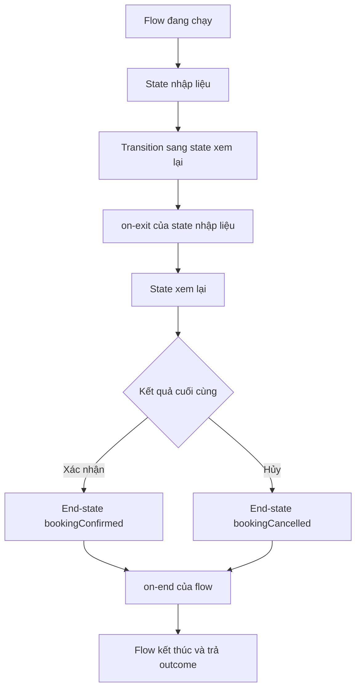

# on-end và dữ liệu kết quả của flow

Trong chương **Vòng đời thực thi**, `on-end` là hook ở cấp flow, được thực thi khi một lần thực thi flow đi đến điểm kết thúc. Hook này phù hợp với công việc chung cần thực hiện khi hành trình hoàn tất, chẳng hạn ghi nhận kết quả kết thúc, phát tín hiệu audit hoặc dọn dữ liệu tạm thuộc flow. Dữ liệu kết quả mà flow trả cho nơi gọi được khai báo riêng tại `end-state` bằng các phần tử `output`. Hai cơ chế liên quan đến cùng thời điểm kết thúc nhưng có trách nhiệm khác nhau: `on-end` thực hiện hành động cuối vòng đời, còn `output` xác định dữ liệu được trả ra.

Module `SPRING_WEB_FLOW` hướng tới việc mô hình hóa hành trình web nhiều bước bằng state, event, transition và subflow; thực hành form binding, validation, quản lý scope và phiên; tích hợp Spring MVC; kiểm thử và phục hồi luồng khi gặp lỗi. Hiểu `on-end` cùng flow output giúp kết thúc một hành trình có chủ đích, đồng thời truyền một kết quả nhỏ, rõ ràng sang flow cha hoặc thành phần khởi chạy flow.

## 1. `on-end` thuộc vòng đời của flow

Một flow có thể đi qua nhiều state trước khi kết thúc. Các state có thể rời đi để chuyển sang state khác; việc đó không làm flow kết thúc. Chỉ khi execution đi tới một `end-state` thì lần thực thi flow mới hoàn tất theo đường kết thúc được định nghĩa.

`on-end` được khai báo ở cấp flow và gắn với việc flow kết thúc, không gắn với một state cụ thể hay một event duy nhất. Vì thế, nếu flow có nhiều end state như `bookingConfirmed`, `bookingCancelled` và `bookingExpired`, hook `on-end` là nơi đặt hành động chung cho các trường hợp kết thúc đó. Nếu hành động chỉ đúng với một kết quả, hãy đặt nó ở transition hoặc action gắn với end state tương ứng.

Ví dụ, một flow đặt chỗ có thể kết thúc theo hai cách:

- `bookingConfirmed`: đặt chỗ đã được xác nhận.
- `bookingCancelled`: người dùng hủy trước khi xác nhận.

Cả hai đều kết thúc flow, nhưng kết quả nghiệp vụ khác nhau. Hook `on-end` có thể ghi nhận rằng lần thực thi đã kết thúc; còn việc xác nhận đặt chỗ chỉ được thực hiện ở nhánh xác nhận. Không nên đặt logic tạo đặt chỗ vào `on-end` nếu nhánh hủy cũng đi qua hook đó.

`on-end` cũng không phải một khối `finally` được bảo đảm chạy trong mọi sự cố của tiến trình. Nó tham gia vào lifecycle khi flow kết thúc theo cơ chế thực thi bình thường. JVM dừng đột ngột, máy chủ mất điện, session bị xóa, execution hết hạn hoặc trạng thái không thể khôi phục có thể khiến hook không được thực thi. Các công việc cần bảo đảm bền vững phải có cơ chế ở tầng nghiệp vụ và lưu trữ.

## 2. Phân biệt `on-end`, `on-exit` và `end-state`

Ba khái niệm này dễ bị nhầm vì đều xuất hiện gần thời điểm một hành trình rời khỏi phần xử lý hiện tại.

| Thành phần | Phạm vi | Mục đích |
|---|---|---|
| `on-exit` | Một state | Thực hiện hành động khi rời state đó, bất kể transition hợp lệ nào được chọn |
| `end-state` | Điểm kết thúc cụ thể của flow | Xác định flow kết thúc theo kết quả/event nào; có thể khai báo view và dữ liệu output |
| `on-end` | Toàn bộ flow | Thực hiện hành động chung khi flow kết thúc |

Ví dụ, khi flow rời state nhập thông tin để sang state xem lại, `on-exit` của state nhập liệu có thể ghi nhận thời điểm rời bước. Flow vẫn tiếp tục chạy. Sau đó, khi người dùng xác nhận và flow đi tới `bookingConfirmed`, `on-end` của flow được thực thi vì lần thực thi đã kết thúc.

Sơ đồ khái quát:



Sơ đồ nhấn mạnh rằng `on-exit` có thể chạy nhiều lần trong một flow nếu nhiều state được rời, trong khi `on-end` gắn với việc kết thúc lần thực thi flow. Một state chuyển sang state tiếp theo không làm `on-end` chạy.

## 3. Khai báo `on-end` trong flow definition

`on-end` được khai báo ở cấp cao nhất bên trong flow definition. Các action con có thể dùng `evaluate` để gọi bean hoặc expression trong flow context. Ví dụ sau minh họa hook ghi nhận kết quả kết thúc:

```xml
<flow xmlns="http://www.springframework.org/schema/webflow">
    <var name="booking" class="com.example.BookingDraft" />

    <on-end>
        <evaluate expression="bookingActions.recordFlowEnd(flowRequestContext)" />
    </on-end>

    <view-state id="enterDetails" view="booking/details" model="booking">
        <transition on="continue" to="review" />
        <transition on="cancel" to="bookingCancelled" />
    </view-state>

    <view-state id="review" view="booking/review">
        <transition on="confirm" to="bookingConfirmed" />
        <transition on="back" to="enterDetails" />
    </view-state>

    <end-state id="bookingCancelled" />
    <end-state id="bookingConfirmed" />
</flow>
```

`bookingActions` là bean do ứng dụng cung cấp. `recordFlowEnd` được gọi khi flow kết thúc qua một trong các end state. Cú pháp XML, namespace, cách đăng ký bean và expression phải khớp phiên bản Spring Web Flow của ứng dụng; ví dụ tập trung vào vị trí cấp flow của hook.

Một action Java có thể đọc thông tin cần thiết từ flow context:

```java
public class BookingActions {

    public void recordFlowEnd(RequestContext context) {
        BookingDraft booking =
                (BookingDraft) context.getFlowScope().get("booking");

        if (booking == null) {
            return;
        }

        auditService.recordFlowEnd(
                booking.getReference(),
                context.getActiveFlow().getId());
    }
}
```

Đây là phác thảo để minh họa cách action truy cập flow context. Constructor injection, kiểu trả về và API truy cập flow phụ thuộc cấu hình, phiên bản dự án. Nên giữ method ngắn, có tên mô tả rõ và chuyển quy tắc nghiệp vụ sang service/domain layer. Tránh đặt truy vấn, tính toán hoặc chuỗi thao tác dài trực tiếp trong expression XML.

`on-end` là hook chung, do đó action cần xem xét liệu nó có thể được gọi cho mọi end state hay không. Nếu cần biết flow kết thúc theo kết quả nào, hãy thiết kế cách lấy kết quả từ context phù hợp với phiên bản hoặc ghi nhận kết quả tại từng nhánh kết thúc. Không suy đoán trạng thái chỉ từ việc hook đã được gọi.

## 4. Khai báo dữ liệu kết quả bằng `output`

Flow output là tập hợp các giá trị mà end state công bố khi flow kết thúc. Trong định nghĩa flow, mỗi `<output>` có tên và expression xác định giá trị. Output được khai báo tại end state cụ thể vì mỗi kết quả kết thúc có thể trả dữ liệu khác nhau.

Ví dụ, sau khi xác nhận đặt chỗ, flow chỉ cần trả mã đặt chỗ và trạng thái:

```xml
<end-state id="bookingConfirmed" view="booking/confirmation">
    <output name="bookingId" value="flowScope.booking.id" />
    <output name="confirmationCode"
            value="flowScope.booking.confirmationCode" />
    <output name="resultStatus" value="'CONFIRMED'" />
</end-state>

<end-state id="bookingCancelled" view="booking/cancelled">
    <output name="resultStatus" value="'CANCELLED'" />
</end-state>
```

Ở đây, `bookingConfirmed` trả ba thuộc tính; `bookingCancelled` chỉ trả trạng thái. Đây là hợp đồng kết quả của từng end state. Biểu thức `value` được đánh giá trong ngữ cảnh flow theo cấu hình expression của ứng dụng. Hãy kiểm tra tên biến và cú pháp với phiên bản đang dùng.

Output có thể là dữ liệu nguyên thủy, chuỗi, mã định danh hoặc DTO nhỏ có cấu trúc rõ. Nên ưu tiên các giá trị ổn định, dễ kiểm tra và đủ cho nơi gọi thực hiện bước tiếp theo. Không nên trả toàn bộ entity đang được quản lý bởi persistence context, đối tượng chứa tài nguyên mở hoặc một object graph lớn.

Output không đồng nghĩa với việc dữ liệu đã được lưu bền vững. Ví dụ, trả `bookingId` chỉ cho biết flow công bố mã định danh; việc bản ghi đặt chỗ có thực sự được commit hay không phải được bảo đảm bởi service và transaction thực hiện nghiệp vụ. Khi cần tiếp tục sau khi flow kết thúc, nơi gọi nên tải lại dữ liệu đáng tin cậy từ kho lưu trữ bằng ID và kiểm tra quyền truy cập.

## 5. Nhận output từ subflow trong flow cha

Một trường hợp sử dụng quan trọng của output là truyền kết quả từ subflow về flow cha. Subflow có thể xử lý một hành trình con độc lập, ví dụ đặt chỗ hoặc xác minh địa chỉ. Khi subflow kết thúc, end-state ID trở thành event mà flow cha nhận được; các thuộc tính output được đính kèm event để transition của flow cha có thể sử dụng.

Flow con `booking`:

```xml
<flow xmlns="http://www.springframework.org/schema/webflow">
    <var name="booking" class="com.example.BookingDraft" />

    <view-state id="review" view="booking/review">
        <transition on="confirm" to="bookingConfirmed" />
        <transition on="cancel" to="bookingCancelled" />
    </view-state>

    <end-state id="bookingConfirmed">
        <output name="bookingId" value="flowScope.booking.id" />
        <output name="confirmationCode"
                value="flowScope.booking.confirmationCode" />
    </end-state>

    <end-state id="bookingCancelled">
        <output name="reason" value="flowScope.booking.cancelReason" />
    </end-state>
</flow>
```

Flow cha gọi subflow và ánh xạ kết quả:

```xml
<subflow-state id="booking" subflow="booking">
    <input name="customerId" value="flowScope.customerId" />

    <transition on="bookingConfirmed" to="showConfirmation">
        <set name="flowScope.bookingId"
             value="currentEvent.attributes.bookingId" />
        <set name="flowScope.confirmationCode"
             value="currentEvent.attributes.confirmationCode" />
    </transition>

    <transition on="bookingCancelled" to="showCancellation">
        <set name="flowScope.cancelReason"
             value="currentEvent.attributes.reason" />
    </transition>
</subflow-state>
```

Khi flow con kết thúc tại `bookingConfirmed`, flow cha nhận event cùng các thuộc tính đã khai báo trong output. Transition tương ứng có thể đọc `currentEvent.attributes.bookingId` và lưu giá trị vào scope của flow cha. Nhánh hủy có event và output riêng. Tên event phải khớp `id` của end state trong flow con; tên output phải khớp key được đọc ở flow cha.

Đây là hợp đồng giữa hai flow. Flow con nên công bố đúng dữ liệu mà flow cha cần, không để flow cha phụ thuộc trực tiếp vào toàn bộ cấu trúc nội bộ của flow con. Khi thay đổi tên output hoặc end-state ID, cần cập nhật nơi gọi và các kiểm thử tích hợp liên quan.

## 6. Output của flow gốc và view kết thúc

Subflow có một flow cha nhận event và output trực tiếp. Với flow được khởi chạy như một hành trình web gốc, end state có thể gắn view để hiển thị trang kết quả cho người dùng. Kết quả thực thi flow cũng có thể được biểu diễn bởi outcome trong cơ chế tích hợp khởi chạy flow. Cách thành phần gọi truy cập outcome phụ thuộc cách ứng dụng tích hợp Spring Web Flow.

Không nên nhầm ba thứ sau:

- **End-state ID:** tên kết quả kết thúc, chẳng hạn `bookingConfirmed`.
- **Flow output:** các thuộc tính được công bố bởi end state, chẳng hạn `bookingId`.
- **End-state view:** view được hiển thị cho người dùng ở kết thúc, chẳng hạn `booking/confirmation`.

Khai báo `view="booking/confirmation"` không tự động biến output thành JSON response hoặc lưu nó vào session của người dùng. Nếu ứng dụng cần trả dữ liệu qua REST API, hãy thiết kế controller/API adapter rõ ràng, chuyển outcome thành response theo hợp đồng API và áp dụng kiểm tra quyền, validation phù hợp. Spring Web Flow chủ yếu mô hình hóa hành trình tương tác web; không nên dùng flow output như một cơ chế serialization tùy ý.

## 7. Chọn dữ liệu nào để trả về?

Output là ranh giới công khai giữa flow và nơi gọi. Một hợp đồng nhỏ, ổn định giúp flow con có thể được tái sử dụng và thay đổi nội bộ mà không ảnh hưởng các caller.

| Loại dữ liệu | Khuyến nghị | Lý do |
|---|---|---|
| ID của bản ghi đã lưu | Phù hợp | Caller có thể tải lại dữ liệu mới nhất và kiểm tra quyền |
| Mã kết quả hoặc trạng thái | Phù hợp | Nhẹ, dễ kiểm thử và ít phụ thuộc cấu trúc nội bộ |
| DTO nhỏ chỉ chứa trường cần thiết | Có thể phù hợp | Hữu ích khi caller cần một snapshot có cấu trúc |
| Toàn bộ entity hoặc object graph lớn | Tránh | Tăng coupling, có thể chứa proxy hoặc dữ liệu không cần thiết |
| Password, token, bí mật hoặc dữ liệu thanh toán | Không trả qua output thông thường | Dễ lộ qua log, caller hoặc vùng lưu trữ ngoài dự kiến |
| Đối tượng gắn với request, stream hoặc tài nguyên mở | Tránh | Vòng đời không phù hợp sau khi flow kết thúc |

Hãy xem output như một API nội bộ: đặt tên có nghĩa, xác định kiểu và ý nghĩa của từng giá trị, quy định khi nào có thể vắng mặt và giữ tương thích khi caller được triển khai độc lập. Nếu output có thể null, caller phải xử lý rõ thay vì giả định luôn tồn tại.

Đừng dùng output để thay thế lưu trữ nghiệp vụ. Nếu kết quả cần được truy cập sau khi phiên web kết thúc, hãy lưu trạng thái cần thiết vào database hoặc kho bền vững trước khi flow hoàn tất, rồi trả ID hoặc mã tham chiếu.

## 8. `on-end` không thay thế xử lý nghiệp vụ và transaction

Hook kết thúc flow là một phần của lifecycle điều hướng. Nó không tự tạo transaction phân tán, không bảo đảm một thao tác chỉ chạy một lần và không thay thế service layer.

Ví dụ, khi người dùng xác nhận đặt chỗ, transition `confirm` nên gọi service thực hiện nghiệp vụ xác nhận với transaction và quy tắc chống trùng phù hợp. Sau khi kết quả được lưu, end state `bookingConfirmed` có thể công bố ID và mã xác nhận. `on-end` có thể ghi nhận audit tổng quát hoặc dọn dữ liệu tạm. Nếu người dùng hủy, end state `bookingCancelled` trả kết quả hủy và hook vẫn có thể ghi nhận flow đã kết thúc.

Một số nguyên tắc:

- Đặt quy tắc xác nhận, tính giá, kiểm tra tồn chỗ và ghi database trong service/domain layer.
- Dùng transaction ở ranh giới nghiệp vụ cần tính nguyên tử; đừng dựa vào việc flow đi đến end state để suy ra dữ liệu đã commit.
- Với thao tác có thể được gửi lại, dùng idempotency key, ràng buộc duy nhất hoặc cơ chế đối soát.
- Giữ `on-end` ngắn; tránh gọi hệ thống ngoài đồng bộ trong hook nếu việc đó làm kéo dài request kết thúc.
- Chỉ dọn dữ liệu thuộc flow và không còn cần cho output hoặc bước tiếp theo của caller.
- Không ghi dữ liệu nhạy cảm vào audit log; chỉ ghi ID, loại sự kiện, thời điểm và mã tương quan cần thiết.

Nếu cần gửi thông báo hoặc chạy công việc dài hạn, hãy cân nhắc phát sự kiện nghiệp vụ sau khi transaction được commit và giao cho worker hoặc hệ thống xử lý nền. Flow không nên giữ request của người dùng mở chỉ để chờ một tác vụ kéo dài.

## 9. Xử lý lỗi trong giai đoạn kết thúc

Action trong `on-end` có thể gặp lỗi giống các action khác: database không sẵn sàng, dịch vụ audit timeout hoặc dữ liệu trong flow scope không như mong đợi. Lỗi đó có thể ảnh hưởng tới quá trình kết thúc execution. Cần xác định hành động nào là bắt buộc và hành động nào chỉ mang tính bổ trợ.

| Loại hành động | Cách xử lý nên cân nhắc |
|---|---|
| Lưu kết quả nghiệp vụ bắt buộc | Thực hiện trong service/transaction trước khi flow đi tới end state; báo lỗi nếu không thể hoàn tất |
| Audit bắt buộc theo quy định nghiệp vụ | Thiết kế lưu bền vững và chính sách lỗi rõ ràng; không âm thầm bỏ qua |
| Metric hoặc telemetry phụ | Có thể cho phép thất bại có kiểm soát nếu chính sách hệ thống cho phép |
| Dọn dữ liệu tạm | Có thể bổ sung cơ chế hết hạn hoặc dọn định kỳ để xử lý trường hợp hook không chạy |
| Gửi thông báo hoặc tác vụ nền | Dùng outbox/event hoặc hàng đợi sau commit nếu cần retry và theo dõi |

Không bắt mọi exception rồi bỏ qua. Nếu một hành động bắt buộc thất bại mà flow vẫn báo thành công, người dùng và hệ thống sẽ nhìn thấy hai kết quả khác nhau. Ngược lại, một metric phụ không nên làm thất bại nghiệp vụ nếu yêu cầu không đòi hỏi nó phải đồng bộ. Chính sách phải được xác định theo tác động của hành động.

Đặc biệt, đừng giả định `on-end` sẽ chạy khi flow bị hủy do session hết hạn hoặc khi tiến trình dừng đột ngột. Dữ liệu tạm cần dọn phải có thời hạn hoặc cơ chế thu hồi; nghiệp vụ cần phục hồi phải dựa vào trạng thái bền vững và quy trình đối soát.

## 10. Kiểm thử `on-end` và flow output

Kiểm thử cần xác nhận hook chạy ở đúng thời điểm, output đúng theo từng end state và caller xử lý đúng hợp đồng. Một bài kiểm thử chỉ xác nhận flow đến được end state là chưa đủ.

Với flow đặt chỗ có hai kết quả `bookingConfirmed` và `bookingCancelled`, nên kiểm tra:

| Kịch bản | Điều cần xác minh |
|---|---|
| Flow đi qua state trung gian | `on-end` chưa chạy khi flow vẫn còn hoạt động |
| Kết thúc bằng `bookingConfirmed` | `on-end` chạy; output có `bookingId`, `confirmationCode` và trạng thái đúng |
| Kết thúc bằng `bookingCancelled` | `on-end` chạy; output phản ánh kết quả hủy, không chứa dữ liệu xác nhận không phù hợp |
| Gọi subflow từ flow cha | Event ID và tên thuộc tính output khớp hợp đồng; transition cha ánh xạ dữ liệu đúng |
| Output thiếu hoặc null | Caller xử lý rõ ràng, không phát sinh lỗi ngoài dự kiến |
| Action `on-end` ném exception | Lỗi được xử lý theo chính sách; không báo kết quả thành công sai lệch |
| Request kết thúc bị gửi lại | Side effect không tạo bản ghi hoặc thông báo trùng ngoài ý muốn |
| Session hoặc execution mất trước khi kết thúc | Không giả định hook đã chạy; dữ liệu bền vững có thể đối soát |

Spring Web Flow cung cấp cơ chế kiểm thử flow execution để khởi chạy flow, gửi event và kiểm tra trạng thái/outcome. API cụ thể phụ thuộc phiên bản. Có thể kết hợp kiểm thử tích hợp cho flow definition với unit test cho bean action và service. Khi kiểm tra subflow, hãy xác minh cả event kết thúc lẫn các output attributes được chuyển về flow cha.

Ví dụ các khẳng định cần có trong test (mã giả, không phụ thuộc API test cụ thể):

```java
// Kết thúc bằng bookingConfirmed.
assertThat(outcome.getId()).isEqualTo("bookingConfirmed");
assertThat(outcome.getOutput().get("bookingId")).isEqualTo(expectedBookingId);
verify(bookingActions).recordFlowEnd(any());

// Kết thúc bằng bookingCancelled.
assertThat(outcome.getId()).isEqualTo("bookingCancelled");
assertThat(outcome.getOutput().get("resultStatus")).isEqualTo("CANCELLED");
verify(bookingActions).recordFlowEnd(any());
```

Đây là minh họa về nội dung cần xác minh; kiểu outcome và API truy cập output phải được điều chỉnh theo phiên bản và cách tích hợp trong dự án. Ngoài kiểm thử flow, hãy kiểm thử service để bảo đảm transaction, phân quyền và idempotency đúng độc lập với engine điều hướng.

## 11. Checklist thiết kế kết quả flow

Trước khi hoàn thiện một flow có `on-end` và output, hãy trả lời:

1. Flow có những end state nào? Mỗi end state đại diện cho kết quả nghiệp vụ gì?
2. Hành động trong `on-end` có đúng cho mọi đường kết thúc không? Nếu chỉ đúng cho một nhánh, nó có nên nằm ở transition hoặc action riêng không?
3. Kết quả nào cần trả cho caller? Tên, kiểu và khả năng vắng mặt của từng output đã rõ chưa?
4. Caller là flow cha, controller hay thành phần khác? Nó nhận event và output qua cơ chế nào?
5. Dữ liệu đã được lưu bền vững trước khi kết thúc chưa? Output có chỉ chứa dữ liệu cần thiết không?
6. Nếu hook lỗi, flow và caller phải phản ứng thế nào? Hành động nào có thể retry hoặc đối soát?
7. Nếu session hết hạn hoặc server dừng, hệ thống có thể khôi phục nghiệp vụ mà không phụ thuộc `on-end` không?
8. Có kiểm thử cho mọi end state, output, subflow mapping và lỗi kết thúc không?

Nếu câu trả lời chưa rõ, hãy làm rõ hợp đồng kết quả và trách nhiệm của service trước khi thêm action kết thúc. Một flow nên công bố kết quả tối thiểu cần thiết để caller tiếp tục công việc của nó.

## Kết luận

`on-end` là hook cấp flow để thực hiện hành động chung khi một lần thực thi kết thúc. `end-state` xác định kết quả kết thúc cụ thể và có thể công bố dữ liệu qua các phần tử `output`. Khi dùng subflow, flow cha nhận event theo end-state ID và có thể đọc output attributes để tiếp tục hành trình.

Giữ hai trách nhiệm này tách bạch giúp flow dễ bảo trì: dùng `on-end` cho công việc cuối vòng đời thực sự chung, dùng output để định nghĩa hợp đồng kết quả, và đặt nghiệp vụ cần transaction, phân quyền hoặc chống lặp trong service/domain layer. Kiểm thử từng end state cùng dữ liệu trả về sẽ giúp xác nhận flow kết thúc đúng và caller nhận được kết quả đáng tin cậy.
