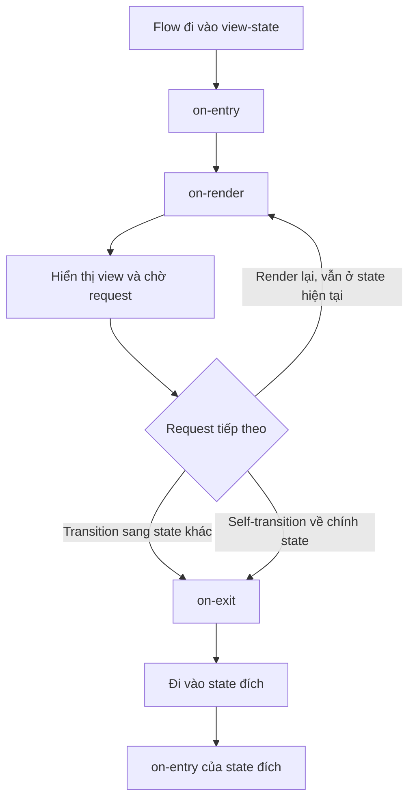

# Phân biệt làm mới view với đi vào state lần nữa

Trong chương **Vòng đời thực thi**, bài này làm rõ một khác biệt quan trọng khi xây dựng ứng dụng bằng **Spring Web Flow**: một `view-state` có thể hiển thị lại nhiều lần trong cùng một lần đi vào state, hoặc flow có thể rời state rồi đi vào chính state đó một lần nữa. Hai tình huống có vẻ giống nhau trên giao diện nhưng kích hoạt các phần khác nhau của vòng đời.

Phân biệt đúng hai tình huống giúp đặt hành động vào đúng thời điểm, tránh tải dữ liệu quá nhiều lần, tạo bản ghi trùng hoặc thực hiện side effect ngoài ý muốn. Đây là một phần trong mục tiêu của module `SPRING_WEB_FLOW`: điều phối hành trình nhiều bước qua state, event, transition và subflow, đồng thời quản lý binding, validation, scope, phiên, tích hợp Spring MVC, kiểm thử và phục hồi lỗi.

## 1. Một view-state có thể được render nhiều lần

Flow là định nghĩa quy trình; flow execution là một lần chạy cụ thể của định nghĩa đó. Trong một execution, flow đang ở một state tại một thời điểm. Với `view-state`, flow hiển thị view rồi tạm dừng để chờ người dùng gửi event hoặc request tiếp theo.

Điểm cần nhớ là **render view không đồng nghĩa với đi vào state**. Khi flow đã ở trong một `view-state`, view có thể được render lại mà state hiện tại vẫn giữ nguyên. Ví dụ thường gặp:

- Người dùng gửi form nhưng dữ liệu không vượt qua binding hoặc validation, nên flow hiển thị lại form để sửa.
- Một request yêu cầu flow hiển thị lại view hiện tại.
- View được render lại sau khi một thao tác chỉ cập nhật dữ liệu trình bày.

Trong các trường hợp render lại mà không có transition rời state, flow vẫn ở state cũ. Vì thế action gắn với lúc vào state không chạy lại; action gắn với lúc render sẽ chạy khi view được chuẩn bị hiển thị lần nữa.

## 2. Ba hook cần phân biệt

Spring Web Flow cung cấp ba hook thường dùng để xử lý vòng đời của state:

| Hook | Thời điểm chạy | Cách sử dụng phù hợp |
| --- | --- | --- |
| `on-entry` | Khi flow đi vào state. Chạy khi state được kích hoạt, kể cả khi transition quay lại chính state đó. | Chuẩn bị dữ liệu hoặc khởi tạo trạng thái chỉ cần làm khi bắt đầu một lượt ở state. |
| `on-render` | Mỗi lần `view-state` chuẩn bị render view. | Chuẩn bị dữ liệu hiển thị cần có mỗi lần render, chẳng hạn danh sách lựa chọn mới nhất hoặc thông tin trình bày. |
| `on-exit` | Khi flow rời state để chuyển sang state khác, kể cả self-transition. | Giải phóng tài nguyên tạm hoặc ghi nhận việc rời state khi nghiệp vụ cần. |

`on-entry` và `on-exit` thuộc vòng đời state. `on-render` gắn với việc render của `view-state`; nó không phải hook thay thế cho entry action và không chạy khi flow đang ở một action state mà không render view.

Vòng đời điển hình của một view state:



Sơ đồ thể hiện thứ tự khái niệm. Khi đi vào một `view-state` mới, flow chạy entry action rồi chuẩn bị render view. Khi view được render lại mà không rời state, flow chạy phần render tương ứng. Khi transition rời state, exit action chạy trước khi state đích được kích hoạt.

## 3. Ví dụ: màn hình chọn khung giờ

Giả sử flow đặt lịch có màn hình `chooseSlot`. Khi vào màn hình, ứng dụng tải các khung giờ còn trống. Mỗi lần view được render, ứng dụng chuẩn bị thêm thông tin hiển thị như ghi chú về múi giờ hoặc thời gian cập nhật.

```xml
<flow xmlns="http://www.springframework.org/schema/webflow"
      xmlns:xsi="http://www.w3.org/2001/XMLSchema-instance"
      xsi:schemaLocation="http://www.springframework.org/schema/webflow
                          https://www.springframework.org/schema/webflow/spring-webflow.xsd">

    <view-state id="chooseSlot" view="booking/slots">
        <on-entry>
            <evaluate expression="slotService.findAvailable(flowScope.booking.date)"
                      result="viewScope.availableSlots" />
        </on-entry>

        <on-render>
            <evaluate expression="slotService.loadDisplayHints(flowScope.booking.date)"
                      result="viewScope.displayHints" />
        </on-render>

        <on-exit>
            <evaluate expression="stateAudit.recordExit('chooseSlot')" />
        </on-exit>

        <transition on="refresh" to="chooseSlot" />
        <transition on="continue" to="review" />
    </view-state>

    <view-state id="review" view="booking/review">
        <transition on="back" to="chooseSlot" />
    </view-state>
</flow>
```

Các bean `slotService`, `stateAudit` và dữ liệu `flowScope.booking` là thành phần của ứng dụng, cần được đăng ký hoặc khởi tạo trong Spring context/flow phù hợp.

Ở đây có hai kiểu hành vi:

- Nếu `chooseSlot` chỉ được render lại trong khi flow vẫn ở state này, `on-render` chạy lại. `on-entry` không chạy lại, nên danh sách `availableSlots` được giữ trong `viewScope` từ lần vào state hiện tại.
- Nếu người dùng phát event `refresh` và transition có đích `chooseSlot`, đây là **self-transition**. Flow rời `chooseSlot`, chạy `on-exit`, sau đó vào lại `chooseSlot`, chạy `on-entry` và chuẩn bị render view. Danh sách khung giờ được tải lại.

Nếu người dùng chọn `continue`, flow rời `chooseSlot` để vào `review`. `on-exit` của `chooseSlot` chạy; entry và render của `review` sẽ được xử lý theo cấu hình state đó. Nếu người dùng quay lại bằng event `back`, flow đi vào `chooseSlot` lần nữa và `on-entry` của state này chạy lại.

Trong JSP, view có thể đọc dữ liệu thuộc view scope, ví dụ `${viewScope.availableSlots}` và `${viewScope.displayHints}`. Dữ liệu nghiệp vụ cần giữ qua nhiều state nên nằm trong `flowScope` hoặc được lưu qua service; dữ liệu chỉ phục vụ màn hình hiện tại phù hợp hơn với `viewScope`.

## 4. So sánh các tình huống theo thứ tự chạy

| Tình huống | `on-exit` của state hiện tại | `on-entry` của state hiện tại | `on-render` của view-state hiện tại |
| --- | --- | --- | --- |
| Lần đầu đi vào view-state | Không | Có | Có khi view được render |
| Render lại view, không rời state | Không | Không | Có |
| Validation thất bại và hiển thị lại cùng view | Không | Không | Có |
| Transition sang state khác | Có | Không còn là entry của state cũ; state đích chạy entry của nó | Không render lại view của state cũ; view state đích có render riêng |
| Self-transition về cùng state | Có | Có | Có sau khi state được vào lại và view được render |

Một ví dụ cụ thể giúp tránh nhầm lẫn: người dùng mở màn hình chọn giờ, nhập dữ liệu sai và gửi form. Nếu validation ngăn transition, flow vẫn ở `chooseSlot`; việc render lại form không làm `on-entry` chạy lần nữa. Ngược lại, nếu người dùng chọn nút **Tải lại khung giờ** được ánh xạ đến event `refresh` với transition quay về `chooseSlot`, flow rời rồi vào lại state. Cả `on-exit` và `on-entry` đều được thực hiện.

## 5. Chọn vị trí đặt logic

Hãy chọn hook theo yêu cầu về thời điểm chạy:

**Đặt trong `on-entry` khi dữ liệu cần được chuẩn bị mỗi lần bắt đầu một lượt ở state.** Ví dụ tải danh sách khung giờ khi người dùng lần đầu vào màn hình hoặc khi họ quay lại màn hình sau bước review. Nếu người dùng chỉ xem lại cùng view vì lỗi validation, không cần tải lại toàn bộ dữ liệu theo cách này.

**Đặt trong `on-render` khi dữ liệu cần được chuẩn bị mỗi lần view được hiển thị.** Hook này thích hợp cho dữ liệu trình bày có thể thay đổi giữa hai lần render. Vì nó có thể chạy nhiều lần trong một state, hãy giữ action ngắn, có thể chạy lặp và ưu tiên đọc dữ liệu. Không gửi email, thu tiền, tạo đơn hoặc giữ chỗ trong `on-render`.

**Đặt trong `on-exit` khi cần phản ứng với việc rời state.** Có thể dùng để giải phóng tài nguyên tạm hoặc ghi nhận dấu mốc kỹ thuật. Nếu thao tác dọn dẹp có thể được gọi lại, hãy thiết kế nó an toàn khi lặp. Không dùng `on-exit` làm cơ chế duy nhất để bảo đảm một nghiệp vụ quan trọng đã hoàn tất.

**Đặt nghiệp vụ có side effect trong service/action phù hợp với transition.** Các thao tác như xác nhận lịch, tạo giao dịch, thu tiền hoặc gửi thông báo cần được gọi tại bước nghiệp vụ có chủ đích. Service cần kiểm tra điều kiện hiện tại và hỗ trợ idempotency khi request có thể được gửi lại. Lifecycle hook không phải cơ chế đảm bảo một thao tác chỉ chạy đúng một lần trong mọi tình huống lỗi hoặc phục hồi session.

## 6. Ảnh hưởng của scope khi vào lại state

Phân biệt render và entry còn quan trọng vì dữ liệu trong các scope có vòng đời khác nhau:

| Scope | Khi view chỉ render lại | Khi flow rời rồi vào lại view-state |
| --- | --- | --- |
| `requestScope` | Dữ liệu của request mới được tạo theo request đó. | Request mới cũng có request scope mới. |
| `viewScope` | Vẫn thuộc lượt hiện tại của view-state. | Lượt view-state mới được tạo; không nên dựa vào dữ liệu view scope cũ để giữ nghiệp vụ. |
| `flowScope` | Tiếp tục tồn tại trong flow execution. | Tiếp tục tồn tại trong cùng flow execution, trừ khi ứng dụng chủ động thay đổi hoặc kết thúc flow. |
| `conversationScope` | Tiếp tục tồn tại trong conversation của flow. | Tiếp tục được chia sẻ theo vòng đời conversation, bao gồm các subflow liên quan. |

Ví dụ, `availableSlots` là dữ liệu hiển thị có thể tải lại nên phù hợp với `viewScope`. Ngày người dùng đã chọn và mã bản nháp đặt lịch cần tồn tại khi họ đi từ `chooseSlot` sang `review`, vì vậy nên giữ trong `flowScope` hoặc lưu bền vững qua service. Không dùng `viewScope` làm nơi lưu duy nhất cho dữ liệu phải tồn tại sau khi rời view-state.

## 7. Làm mới view trong trình duyệt không đồng nghĩa với self-transition

Nút reload của trình duyệt, nút quay lại của trình duyệt và event do form gửi đến flow là các hành vi ở những lớp khác nhau. Một request từ trình duyệt chỉ làm flow re-render, tiếp tục execution hoặc phát event khi URL, execution key và loại request được Spring Web Flow xử lý theo cách tương ứng.

Vì vậy, không suy ra rằng cứ nhấn F5 là `on-entry` sẽ chạy lại. Trình duyệt có thể tải lại một URL hiển thị, yêu cầu gửi lại POST hoặc dùng một execution key cũ. Hành vi cụ thể phụ thuộc vào request được gửi và cơ chế continuation/redirect của ứng dụng. Hãy kiểm tra request và trạng thái flow thực tế khi debug.

Form cần gửi execution key mà Spring Web Flow cấp cho lần thực thi hiện tại, ví dụ:

```jsp
<form method="post">
    <input type="hidden" name="_flowExecutionKey" value="${flowExecutionKey}" />

    <button type="submit" name="_eventId_refresh" value="true">
        Tải lại khung giờ
    </button>

    <button type="submit" name="_eventId_continue" value="true">
        Tiếp tục
    </button>
</form>
```

Event `refresh` trong ví dụ được định nghĩa thành self-transition nên chủ động kích hoạt một lượt vào state mới. Event `continue` chuyển sang state khác. Không tự tạo, sửa hoặc lưu execution key bằng JavaScript; hãy để Spring Web Flow quản lý định danh và việc tiếp tục flow execution.

## 8. Kiểm thử để xác nhận lifecycle

Đừng chỉ kiểm tra nội dung HTML sau mỗi request. Hãy kiểm tra cả số lần và thứ tự các hook đã chạy. Có thể tạo một bean probe dành cho test với ba bộ đếm `entries`, `renders` và `exits`; các method `recordEntry()`, `recordRender()` và `recordExit()` tăng bộ đếm tương ứng. Gọi chúng từ các hook của state:

```xml
<view-state id="chooseSlot" view="booking/slots">
    <on-entry>
        <evaluate expression="lifecycleProbe.recordEntry()" />
    </on-entry>
    <on-render>
        <evaluate expression="lifecycleProbe.recordRender()" />
    </on-render>
    <on-exit>
        <evaluate expression="lifecycleProbe.recordExit()" />
    </on-exit>

    <transition on="refresh" to="chooseSlot" />
    <transition on="continue" to="review" />
</view-state>
```

Với một execution mới, các kết quả mong đợi có thể kiểm tra theo bảng:

| Thao tác | `entries` của `chooseSlot` | `renders` của `chooseSlot` | `exits` của `chooseSlot` |
| --- | ---: | ---: | ---: |
| Khởi chạy flow và hiển thị lần đầu | 1 | 1 | 0 |
| Render lại cùng view do validation không đạt | 1 | 2 | 0 |
| Gửi event `refresh` về chính state | 2 | 3 | 1 |
| Gửi event `continue` sang `review` | 2 | 3 | 2 |

Đây là chuỗi thao tác minh họa; nếu test render thêm lần nào thì bộ đếm `renders` tăng tương ứng. Có thể kiểm thử flow XML bằng test support của Spring Web Flow, khởi chạy flow rồi gửi event qua `MockExternalContext` hoặc cơ chế test tương ứng với phiên bản thư viện đang dùng. Mỗi test nên tạo probe mới hoặc reset bộ đếm để kết quả không bị ảnh hưởng bởi test trước.

Các trường hợp nên có trong bộ kiểm thử:

1. Khởi chạy flow: xác nhận entry và render xảy ra theo đúng thứ tự.
2. Gửi form không hợp lệ: xác nhận view được render lại, nhưng entry và exit không tăng.
3. Gửi event self-transition: xác nhận exit, entry và render đều tăng.
4. Chuyển sang state khác rồi quay lại: xác nhận state cũ được rời và vào lại.
5. Gửi request với execution key không còn hợp lệ: xác nhận ứng dụng đưa ra phản hồi hết hạn hoặc không hợp lệ có thể hiểu được, thay vì dựa vào việc lifecycle hook sẽ tự khôi phục dữ liệu.

## 9. Lỗi thường gặp

- Đặt truy vấn tốn kém trong `on-render`, khiến truy vấn chạy lại sau mỗi lần view được hiển thị.
- Đặt thao tác tạo đơn, giữ chỗ hoặc gửi thông báo trong `on-render`, dẫn đến side effect lặp khi form bị render lại.
- Nghĩ rằng self-transition chỉ vẽ lại HTML, trong khi nó làm flow rời và vào lại state.
- Đặt dữ liệu cần dùng ở state tiếp theo trong `viewScope`, rồi mất dữ liệu khi rời view-state.
- Dùng `on-exit` để hoàn tất nghiệp vụ quan trọng mà không có cơ chế retry, idempotency hoặc lưu trạng thái bền vững.
- Nhầm lẫn thao tác reload/back của trình duyệt với event transition của flow.
- Chỉ kiểm tra state cuối cùng mà không xác nhận số lần hook chạy trong các nhánh validation, self-transition và quay lại.

## 10. Tiêu chí hoàn thành

Bạn đã phân biệt đúng hai hành vi khi có thể giải thích và kiểm chứng được các điểm sau:

- Render lại view trong khi giữ nguyên state sẽ chạy `on-render`; nó không tự kích hoạt `on-entry` hay `on-exit`.
- Transition sang state khác chạy `on-exit` của state hiện tại và `on-entry` của state đích.
- Self-transition rời state hiện tại rồi vào lại chính state đó, nên entry và exit được chạy lại trước lần render tiếp theo.
- Dữ liệu hiển thị và dữ liệu nghiệp vụ được đặt vào scope có vòng đời phù hợp.
- Các hook có thể chạy lặp được thiết kế an toàn; side effect quan trọng được bảo vệ ở tầng service.
- Bộ kiểm thử phân biệt được render lại, validation thất bại, self-transition và chuyển state.

Khi nắm rõ vòng đời này, bạn có thể quyết định chính xác lúc nào cần làm mới dữ liệu của một màn hình và lúc nào cần khởi động lại một lượt ở state. Điều đó giúp flow Spring Web Flow dễ dự đoán hơn khi người dùng sửa form, quay lại bước trước, tải lại dữ liệu hoặc tiếp tục một execution sau nhiều request.
