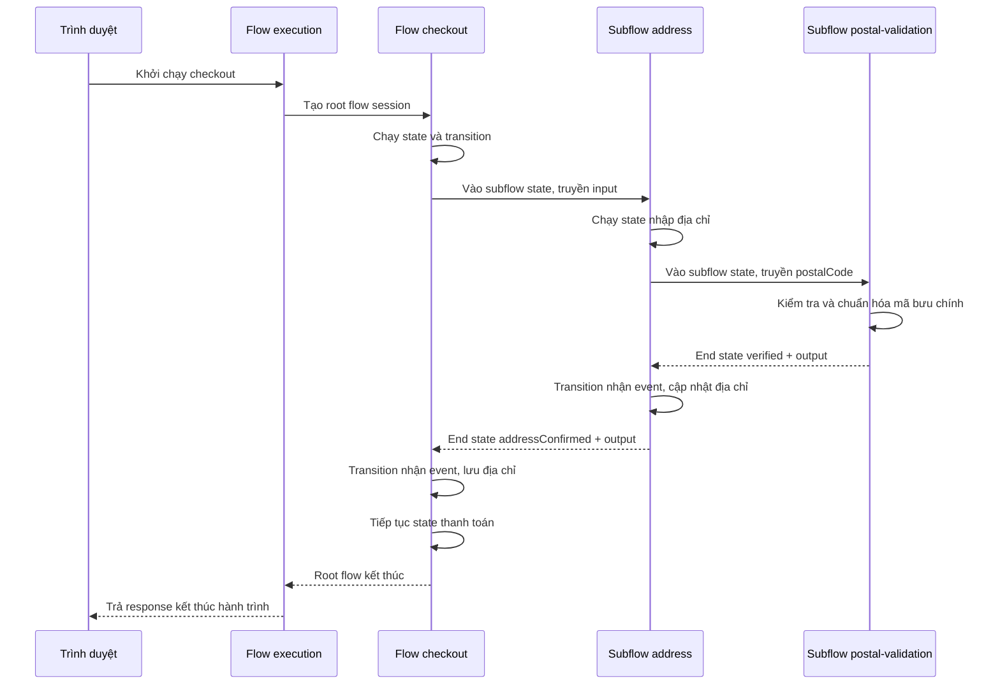

# Theo dõi vòng đời khi có subflow lồng nhau

## Bối cảnh và mục tiêu

Bài học thuộc chương **Vòng đời thực thi** của module `SPRING_WEB_FLOW`. Spring Web Flow mô hình hóa hành trình web nhiều bước bằng state, event, transition và subflow; ứng dụng còn phải quản lý form binding, validation, scope, phiên, tích hợp Spring MVC, kiểm thử và phục hồi khi luồng gặp lỗi. Khi một flow gọi subflow, rồi subflow đó tiếp tục gọi một subflow khác, việc hiểu rõ flow nào đang hoạt động, dữ liệu đi qua ranh giới nào và quyền điều khiển trở về đâu là điều kiện để theo dõi và xử lý luồng chính xác.

Sau bài học, bạn có thể:

- Phân biệt flow definition, flow execution, flow session và HTTP session.
- Mô tả thứ tự khởi chạy, tạm dừng, thực thi và kết thúc của các flow lồng nhau.
- Theo dõi event và dữ liệu output khi subflow trả kết quả cho flow cha.
- Chọn scope phù hợp để chia sẻ dữ liệu giữa các cấp flow.
- Thiết kế log, kiểm thử và xử lý các tình huống hủy, lỗi hoặc execution hết hạn.

## 1. Các khái niệm cần phân biệt

Spring Web Flow dùng một số khái niệm có tên gần nhau nhưng mang ý nghĩa khác nhau:

| Khái niệm | Ý nghĩa trong vòng đời |
| --- | --- |
| **Flow definition** | Bản định nghĩa tĩnh mô tả state, transition, action, input, output và các subflow. Nó giống bản thiết kế có thể được nhiều người dùng thực thi. |
| **Flow execution** | Một lần chạy cụ thể của flow. Execution giữ trạng thái runtime và tiến trình của hành trình nhiều bước. |
| **Flow session** | Một lần tham gia của một flow definition trong flow execution. Flow cha và mỗi lần gọi subflow có session riêng. |
| **Flow session stack** | Ngăn xếp các flow session trong một execution. Session đang ở trên cùng là flow đang hoạt động; các session cha chờ ở trạng thái gọi subflow. |
| **HTTP session** | Phiên của người dùng ở tầng web container. Nó có thể tham gia lưu trữ execution tùy cấu hình, nhưng không đồng nghĩa với flow execution hoặc flow session. |

Một flow execution có thể chứa nhiều flow session. Khi flow cha gọi subflow, Spring Web Flow thêm session của flow con vào execution hiện tại. Nếu flow con lại gọi subflow, một session nữa được thêm lên trên. Các session được tháo theo thứ tự ngược lại khi flow con kết thúc: session con sâu nhất kết thúc trước, sau đó quyền điều khiển trở lại session cha trực tiếp.

Điều này tạo ra quan hệ **vào sau, ra trước** (LIFO). Không nên hình dung mỗi subflow là một HTTP request độc lập hoặc một flow execution hoàn toàn tách biệt. Các request HTTP có thể tiếp tục cùng một flow execution trong khi session đang hoạt động thay đổi giữa flow cha và các cấp subflow.

## 2. Vòng đời từ flow gốc đến subflow lồng nhau

Một hành trình có thể bắt đầu từ flow gốc `checkout`, gọi flow `address` để thu thập địa chỉ, rồi flow `address` gọi tiếp `postal-validation` để kiểm tra mã bưu chính.

Trình tự khái quát:

1. **Khởi chạy flow gốc:** Spring MVC chuyển request đến cơ chế xử lý flow. Flow executor tra cứu flow definition, tạo flow execution và khởi tạo flow session gốc.
2. **Flow gốc tiến đến subflow state:** các state và transition của flow gốc được xử lý cho đến khi execution đi vào state có nhiệm vụ gọi flow con.
3. **Ánh xạ input và bắt đầu flow con:** các biểu thức input được đánh giá trong ngữ cảnh flow cha. Flow con nhận giá trị đầu vào và bắt đầu vòng đời của session riêng.
4. **Flow con xử lý state và event:** người dùng có thể đi qua nhiều view state, action state, decision state và transition của flow con. Flow cha vẫn chờ tại subflow state.
5. **Flow con gọi subflow sâu hơn:** nếu flow con đi vào một subflow state khác, một flow session mới được thêm lên stack. Flow con trung gian trở thành session cha đang chờ.
6. **Subflow sâu nhất kết thúc:** end state phát ra kết quả. Output được công bố như thuộc tính của event trả về cho flow gọi nó; session con kết thúc và được tháo khỏi stack.
7. **Flow cha trực tiếp tiếp tục:** transition trên subflow state nhận event kết quả. Các action trong transition có thể đọc output qua `currentEvent.attributes`, lưu dữ liệu vào scope phù hợp và chuyển sang state tiếp theo.
8. **Kết quả đi ngược lên các cấp:** khi flow trung gian hoàn tất, nó trả event và output cho flow gốc theo cùng cơ chế. Flow gốc tiếp tục hành trình.
9. **Flow gốc kết thúc:** khi root flow đi vào end state, toàn bộ flow execution kết thúc. Dữ liệu thuộc vòng đời của execution được giải phóng theo quy tắc scope và repository.

Sơ đồ dưới đây thể hiện đường đi của quyền điều khiển. Các request của trình duyệt có thể xen giữa các bước xử lý; sơ đồ tập trung vào quan hệ giữa các flow session.



Nếu subflow chưa kết thúc, request tiếp theo vẫn được định tuyến đến flow execution đang hoạt động. Khi session trên cùng là `postal-validation`, event của người dùng được xử lý trong flow đó; flow cha `address` và flow gốc `checkout` chưa nhận event này.

## 3. Ranh giới giữa flow cha và flow con

### Khi bắt đầu subflow

State gọi subflow thường được khai báo bằng `subflow-state`. Thuộc tính `subflow` chỉ ra flow definition cần chạy. Mỗi phần tử `input` ánh xạ một giá trị từ ngữ cảnh của flow gọi sang input mà flow con khai báo.

Ví dụ, flow gốc cần thu thập địa chỉ giao hàng:

```xml
<subflow-state id="collectAddress" subflow="address">
    <input name="customerId" value="flowScope.customerId"/>
    <transition on="addressConfirmed" to="payment">
        <evaluate expression="currentEvent.attributes.address"
                  result="flowScope.shippingAddress"/>
    </transition>
    <transition on="cancelled" to="review"/>
</subflow-state>
```

Flow `address` khai báo input tương ứng:

```xml
<flow>
    <input name="customerId" type="long" required="true"/>

    <on-start>
        <evaluate expression="customerService.load(customerId)"
                  result="flowScope.customer"/>
    </on-start>

    <!-- Các state nhập và xác nhận địa chỉ được khai báo tại đây. -->
</flow>
```

Tên input ở hai phía phải khớp. Biểu thức ở flow cha quyết định giá trị nào được truyền vào; khai báo input của flow con mô tả tên, kiểu và yêu cầu của dữ liệu nhận được. Nếu thiếu input bắt buộc, truyền sai kiểu hoặc biểu thức không đánh giá được, flow có thể không khởi chạy đúng như dự kiến.

Input là dữ liệu đầu vào của lần gọi flow con. Nó không tự động biến flow scope của cha thành flow scope dùng chung. Flow con có ngữ cảnh và vòng đời riêng; nếu cần chia sẻ dữ liệu sau khi bắt đầu, hãy chọn output hoặc scope dùng chung có chủ đích.

### Khi subflow kết thúc

Một end state trong flow con xác định kết quả trả về. ID của end state trở thành event mà flow gọi nhận được. Các phần tử `output` công bố giá trị để flow gọi đọc trong event attributes.

Ví dụ cuối flow `address`:

```xml
<end-state id="addressConfirmed">
    <output name="address" value="flowScope.address"/>
</end-state>

<end-state id="cancelled"/>
```

Khi end state `addressConfirmed` được kích hoạt, flow cha nhận event `addressConfirmed`. Transition tương ứng trong `subflow-state` có thể đọc giá trị output bằng `currentEvent.attributes.address` và ghi vào `flowScope.shippingAddress` của flow cha. Với end state `cancelled`, flow cha nhận event `cancelled` và đi theo transition hủy.

Cần giữ nhất quán ba tên sau:

- ID của end state ở flow con.
- Giá trị `on` trong transition của subflow state ở flow cha.
- Tên output mà flow con công bố và tên thuộc tính mà flow cha đọc.

Nếu flow con kết thúc bằng một event mà flow cha không có transition phù hợp, luồng không thể tiếp tục theo nhánh mong muốn. Hãy xử lý rõ các kết quả thành công, hủy và các kết quả nghiệp vụ khác.

### Subflow lồng thêm một cấp

Trong flow `address`, bước xác minh mã bưu chính có thể được tách thành flow riêng:

```xml
<subflow-state id="verifyPostalCode" subflow="postal-validation">
    <input name="postalCode" value="flowScope.address.postalCode"/>
    <transition on="verified" to="addressConfirmed">
        <evaluate expression="currentEvent.attributes.normalizedPostalCode"
                  result="flowScope.address.postalCode"/>
    </transition>
    <transition on="invalid" to="editAddress"/>
</subflow-state>
```

Flow `postal-validation` có thể kết thúc như sau:

```xml
<end-state id="verified">
    <output name="normalizedPostalCode"
            value="postalService.normalize(postalCode)"/>
</end-state>

<end-state id="invalid"/>
```

Khi `postal-validation` kết thúc bằng `verified`, flow `address` nhận event, cập nhật mã bưu chính đã chuẩn hóa và tiếp tục tới state `addressConfirmed`. Sau đó, flow `address` kết thúc và trả địa chỉ cho flow `checkout`. Đây là hai lần trả kết quả riêng biệt: output của flow sâu nhất trước hết thuộc về flow gọi trực tiếp nó; flow trung gian sau đó quyết định dữ liệu nào sẽ được xuất tiếp cho flow gốc.

Các đoạn XML trên minh họa ranh giới gọi và trả kết quả. Trong ứng dụng, cần khai báo đầy đủ các view state, model, validator, transition và flow definition tương ứng; đồng thời kiểm tra namespace và cấu hình registry theo phiên bản đang dùng.

## 4. Theo dõi dữ liệu qua các scope

Subflow lồng nhau thường phát sinh lỗi vì dữ liệu được tạo ở một cấp nhưng lại được đọc ở cấp khác. Cần phân biệt vòng đời dữ liệu với quan hệ gọi flow.

| Scope | Vòng đời và phạm vi sử dụng | Lưu ý khi có subflow |
| --- | --- | --- |
| `requestScope` | Trong một request hiện tại | Không dùng để giữ dữ liệu qua nhiều lần submit hoặc qua nhiều bước flow. |
| `viewScope` | Trong vòng đời của view state hiện tại | Phù hợp với dữ liệu phục vụ một màn hình; không nên coi là kho dữ liệu xuyên suốt subflow. |
| `flashScope` | Dữ liệu tạm thời phục vụ quá trình chuyển tiếp theo quy tắc của framework | Kiểm tra chính xác thời điểm dữ liệu được giữ và xóa; không dùng thay cho dữ liệu nghiệp vụ dài hạn. |
| `flowScope` | Trong vòng đời của một flow session | Mỗi flow session có flow scope riêng. Flow con không tự động đọc được biến flow scope riêng của flow cha. |
| `conversationScope` | Trong vòng đời conversation của flow execution gốc | Có thể dùng để chia sẻ dữ liệu giữa các flow session trong cùng execution; cần kiểm soát quyền sở hữu và thời điểm cập nhật. |

Ví dụ, `flowScope.address` của flow `address` không mặc nhiên là `flowScope.address` của flow `checkout`. Để chuyển địa chỉ về cha, cách tường minh là khai báo output ở end state và đọc output trong transition của cha. Nếu dữ liệu thực sự cần được chia sẻ xuyên suốt nhiều flow session, có thể cân nhắc `conversationScope`, nhưng nên dùng có giới hạn để tránh các flow phụ thuộc ngầm vào nhau.

Một quy tắc thiết kế hữu ích:

- Dữ liệu chỉ phục vụ một màn hình đặt trong view scope.
- Dữ liệu thuộc riêng một bước nghiệp vụ hoặc một flow session đặt trong flow scope.
- Dữ liệu cần đi qua ranh giới flow được truyền bằng input/output.
- Dữ liệu thật sự dùng chung trong toàn bộ conversation mới cân nhắc conversation scope.

Không nên đưa toàn bộ object nghiệp vụ vào conversation scope chỉ để tránh khai báo output. Cách đó khiến khó biết flow nào đang sửa dữ liệu, thời điểm nào dữ liệu hợp lệ và liệu một nhánh hủy có để lại thay đổi chưa được xác nhận hay không.

## 5. Quan hệ với request, FlowExecutor và repository

Trong ứng dụng Spring MVC, một flow thường được bắt đầu hoặc tiếp tục qua request HTTP. Cơ chế tích hợp định tuyến request đến flow handler; flow executor chịu trách nhiệm khởi chạy hoặc tiếp tục execution. Khi người dùng submit form, request mang event cần phát và thông tin nhận diện flow execution. Flow executor khôi phục execution, xử lý event trên flow session đang hoạt động, rồi lưu trạng thái tiếp theo thông qua execution repository theo cấu hình ứng dụng.

Cần phân biệt ba tầng:

1. **HTTP request:** một lần trao đổi giữa trình duyệt và máy chủ. Một hành trình nhiều bước thường có nhiều request.
2. **Flow execution:** tiến trình nghiệp vụ có thể tiếp tục qua nhiều request. Nó giữ trạng thái của flow session hiện tại và các flow session cha đang chờ.
3. **HTTP session / execution repository:** cơ chế lưu trữ và tra cứu execution. Cấu hình repository quyết định cách execution được lưu, khôi phục và hết hạn.

Một request khi subflow sâu nhất đang hoạt động sẽ phát event vào session đó. Khi subflow kết thúc, event kết quả được chuyển cho flow cha trong cùng flow execution; không cần tạo một execution nghiệp vụ mới chỉ vì đã đi qua ranh giới subflow.

Khi theo dõi trên môi trường thực tế, cần ghi lại flow ID, execution key hoặc mã tương quan tương đương, state đang hoạt động, event nhận được và độ sâu subflow. Không ghi nội dung form, thông tin định danh cá nhân hoặc dữ liệu nhạy cảm vào log chỉ để tiện debug. Khi execution key không còn hợp lệ do phiên hết hạn, execution đã kết thúc hoặc trạng thái lưu trữ không còn tồn tại, cần đưa người dùng tới luồng khôi phục phù hợp, chẳng hạn thông báo hết phiên và hướng dẫn bắt đầu lại.

## 6. Quan sát và truy vết vòng đời

Có thể theo dõi vòng đời ở nhiều điểm. Spring Web Flow cung cấp cơ chế listener cho flow execution; tùy phiên bản, listener có thể quan sát các sự kiện như bắt đầu/kết thúc session, vào state, thực thi transition, render view, tạm dừng, tiếp tục và phát sinh exception. Hãy xác minh interface và callback có sẵn trong Javadoc đúng phiên bản trước khi triển khai.

Một bản ghi truy vết hữu ích thường có:

| Trường log | Mục đích |
| --- | --- |
| Execution key hoặc correlation ID | Gom các request thuộc cùng một hành trình |
| Flow ID và state ID | Biết flow nào và state nào đang hoạt động |
| Độ sâu subflow hoặc đường dẫn flow | Nhận ra đang ở flow gốc, flow con hay flow cháu |
| Event ID | Biết hành động nào kích hoạt transition |
| Kết quả transition / end state | Xác định nhánh đã được chọn |
| Thời gian xử lý và kết quả | Phát hiện bước chậm hoặc lỗi lặp lại |

Ví dụ, một chuỗi log có thể được đọc như sau:

```text
execution=E42 flow=checkout depth=0 state=collectAddress event=continue
execution=E42 flow=address depth=1 state=verifyPostalCode event=submit
execution=E42 flow=postal-validation depth=2 state=validate event=verified
execution=E42 flow=address depth=1 result=addressConfirmed
execution=E42 flow=checkout depth=0 result=payment
```

Đây là log minh họa, không phải định dạng bắt buộc của framework. Điểm quan trọng là giữ cùng mã tương quan cho cả execution, ghi nhận flow và state hiện hành, đồng thời thể hiện rõ event và kết quả trả về. Khi có nhiều người dùng hoặc nhiều tab trình duyệt, không được chỉ dựa vào flow ID vì nhiều execution có thể chạy cùng một flow definition.

## 7. Xử lý hủy, lỗi và gián đoạn

Không phải mọi nhánh kết thúc của subflow đều là lỗi kỹ thuật. Nên mô hình hóa các kết quả nghiệp vụ thành event rõ ràng để flow cha có thể quyết định tiếp tục như thế nào.

| Tình huống | Cách theo dõi và xử lý |
| --- | --- |
| Người dùng xác nhận thành công | Subflow đi tới end state thành công, xuất dữ liệu cần thiết; flow cha nhận đúng event và tiếp tục. |
| Người dùng chủ động hủy | Dùng end state riêng như `cancelled`; flow cha có transition để quay lại bước phù hợp hoặc kết thúc theo quy tắc nghiệp vụ. |
| Validation không đạt | Giữ người dùng trong flow con ở view phù hợp, hiển thị lỗi và cho phép sửa; chưa kết thúc subflow nếu nghiệp vụ yêu cầu thử lại. |
| Lỗi dịch vụ trong flow con | Ghi nhận exception tại ranh giới thích hợp, hiển thị lỗi có thể xử lý hoặc chuyển sang nhánh phục hồi; không biến lỗi kỹ thuật thành kết quả thành công. |
| Flow execution hết hạn | Kiểm tra execution key và repository; hướng dẫn người dùng bắt đầu lại hoặc khôi phục theo chính sách ứng dụng. |
| Event trả về không được flow cha xử lý | Đối chiếu ID end state với các transition trên subflow state; bổ sung nhánh kết quả có chủ đích. |
| Người dùng gửi lại request hoặc mở nhiều tab | Kiểm tra hành vi với execution key và snapshot của repository; bảo đảm các thao tác nghiệp vụ không bị thực hiện trùng ngoài ý muốn. |

Khi một flow con phát sinh exception, cần xác định exception được xử lý tại state/action, flow exception handler hay tầng xử lý request của ứng dụng. Phạm vi xử lý phụ thuộc nơi exception phát sinh và cấu hình flow. Đừng giả định exception tự động trở thành một end-state event. Hãy kiểm tra hành vi thực tế của phiên bản đang chạy và viết kiểm thử cho nhánh lỗi.

Với thao tác có tác dụng phụ như tạo đơn hàng, giữ chỗ hoặc trừ tồn kho, việc người dùng refresh hay gửi lại event có thể gây xử lý lặp. Nên kết hợp quy tắc idempotency ở tầng nghiệp vụ với việc kiểm thử vòng đời execution; flow state không thay thế cơ chế bảo vệ giao dịch của dịch vụ.

## 8. Kiểm thử flow có nhiều cấp subflow

Kiểm thử cần xác minh cả thứ tự chuyển state và dữ liệu đi qua từng ranh giới. Có thể dùng bộ hỗ trợ kiểm thử Spring Web Flow phù hợp phiên bản dự án để khởi chạy flow, phát event và kiểm tra state hiện tại hoặc kết quả kết thúc.

Một ma trận kiểm thử tối thiểu:

| Ca kiểm thử | Hành động | Điều cần xác minh |
| --- | --- | --- |
| Thành công toàn bộ | Root gọi child, child gọi grandchild; cả hai trả kết quả thành công | Stack được tháo đúng thứ tự; root nhận output cuối cùng và đi tới state dự kiến. |
| Hủy ở subflow sâu nhất | Người dùng hủy bước xác minh mã bưu chính | Flow cha trực tiếp nhận event hủy và xử lý theo nhánh đã định nghĩa; flow gốc chưa nhận nhầm output thành công. |
| Validation thất bại | Nhập dữ liệu không hợp lệ ở flow con | Người dùng ở lại đúng view state; dữ liệu cần thiết được giữ; subflow chưa kết thúc ngoài ý muốn. |
| Output thiếu hoặc sai tên | Thay đổi tên output hoặc event trong fixture kiểm thử | Kiểm thử phát hiện flow cha không nhận được dữ liệu hoặc không có transition phù hợp. |
| Lỗi dịch vụ | Service được gọi từ flow sâu nhất ném exception | Exception được quan sát và xử lý ở đúng tầng; không trả kết quả nghiệp vụ thành công. |
| Scope độc lập | Đặt biến cùng tên trong flow cha và flow con | Flow scope của hai session độc lập; chỉ dữ liệu được truyền hoặc đặt trong scope chung mới được chia sẻ. |
| Conversation scope | Flow con ghi dữ liệu cần chia sẻ trong cùng execution | Flow cha đọc được dữ liệu theo thiết kế; dữ liệu không còn được dùng sau khi root flow kết thúc. |
| Execution hết hạn | Tiếp tục bằng execution key không còn hợp lệ | Ứng dụng đưa ra phản hồi có thể hiểu và có hướng bắt đầu lại phù hợp. |

Ngoài các test đơn vị cho action và validator, nên có kiểm thử tích hợp qua Spring MVC để xác nhận request mapping, flow execution key, session và repository phối hợp đúng. Kiểm thử bằng cách gọi trực tiếp một action không đủ chứng minh toàn bộ vòng đời của nested subflow hoạt động đúng.

## 9. Quy trình debug khi flow không trở về đúng cha

Khi người dùng hoàn tất một bước nhưng ứng dụng không quay lại màn hình của flow cha, hãy truy vết theo thứ tự:

1. Xác định execution key và flow session đang hoạt động tại request cuối cùng.
2. Kiểm tra state hiện tại có đúng là subflow state dự kiến hay không.
3. Xác minh event được gửi có đúng ID transition trong flow con hay không.
4. Kiểm tra transition có thực sự dẫn tới end state hay chỉ chuyển sang state khác bên trong flow con.
5. Nếu đã tới end state, kiểm tra ID end state có khớp giá trị `on` của flow cha hay không.
6. Kiểm tra output được khai báo ở end state và biểu thức đọc output trong transition của cha.
7. Kiểm tra exception, execution key hết hạn hoặc lỗi lưu/khôi phục execution.
8. Chạy lại ca kiểm thử tối thiểu cho đúng nhánh vừa phát hiện và bổ sung kiểm thử hồi quy.

Cách truy vết này giúp phân biệt lỗi điều hướng, lỗi mapping dữ liệu và lỗi lưu trữ execution. Chẳng hạn, nếu flow con đã kết thúc nhưng flow cha không vào state tiếp theo, hãy kiểm tra event trả về và transition của cha trước khi thay đổi cấu hình Spring MVC.

## 10. Checklist thiết kế và vận hành

- [ ] Mỗi flow có một trách nhiệm rõ ràng; subflow có ranh giới vào/ra dễ hiểu.
- [ ] Flow cha khai báo input cho từng subflow và flow con khai báo input tương ứng.
- [ ] End state của flow con biểu diễn kết quả nghiệp vụ rõ ràng, bao gồm nhánh hủy khi cần.
- [ ] ID end state khớp với event mà transition của flow cha xử lý.
- [ ] Output được khai báo tường minh và được flow cha đọc qua event attributes.
- [ ] Flow scope của cha và con được xem là độc lập; conversation scope chỉ dùng khi cần chia sẻ xuyên suốt execution.
- [ ] Có log hoặc listener để theo dõi execution, flow ID, state, event và độ sâu subflow.
- [ ] Exception, validation thất bại, hủy và execution hết hạn có hành vi được xác định.
- [ ] Có kiểm thử cho đường đi thành công, nhánh hủy, lỗi ở subflow sâu nhất và dữ liệu output.
- [ ] Các thao tác nghiệp vụ có tác dụng phụ được bảo vệ trước request lặp hoặc submit trùng.

## 11. Bài tập thực hành

Thiết kế flow đặt hàng gồm ba cấp:

- Flow gốc `checkout` thu thập thông tin đơn hàng và gọi subflow `address`.
- Subflow `address` nhập địa chỉ và gọi `postal-validation`.
- Subflow `postal-validation` kiểm tra mã bưu chính rồi trả kết quả chuẩn hóa.

Thực hiện các yêu cầu:

1. Vẽ stack flow session tại bốn thời điểm: root vừa khởi chạy, đang ở `address`, đang ở `postal-validation`, và sau khi cả hai subflow trả kết quả.
2. Khai báo input/output cho từng ranh giới. Đảm bảo flow gốc nhận được địa chỉ cuối cùng qua output của `address`, còn `address` nhận mã bưu chính đã chuẩn hóa từ `postal-validation`.
3. Bổ sung event hủy và event dữ liệu không hợp lệ. Xác định flow nào nhận từng event và state tiếp theo là gì.
4. Chọn scope cho customer, address draft, mã bưu chính và dữ liệu cần chia sẻ trong toàn bộ execution. Giải thích vòng đời của từng giá trị.
5. Viết test cho đường đi thành công, hủy tại bước xác minh, validation thất bại và lỗi dịch vụ.
6. Đề xuất các trường log đủ để tìm ra flow session nào đang hoạt động khi người dùng báo rằng nút xác nhận không đưa họ về màn hình trước.

**Tiêu chí hoàn thành:** người học giải thích được quan hệ LIFO giữa các flow session; mô tả chính xác event và output qua từng ranh giới; phân biệt flow scope với conversation scope và HTTP session; đồng thời đưa ra được ca kiểm thử chứng minh flow cha tiếp tục đúng sau khi subflow lồng nhau kết thúc.

## Kết luận

Theo dõi nested subflow là theo dõi một flow execution có nhiều flow session được xếp chồng theo quan hệ gọi. Flow cha chờ tại subflow state, flow con nhận input và thực thi trong scope riêng, end state trả event cùng output cho flow gọi, rồi quyền điều khiển trở lại theo thứ tự ngược với lúc gọi. Khi kết hợp mapping tường minh, lựa chọn scope có chủ đích, log theo execution và kiểm thử cả nhánh thành công lẫn lỗi, nhóm có thể kiểm soát những hành trình Spring Web Flow nhiều bước ngay cả khi chúng lồng nhau qua nhiều cấp.

