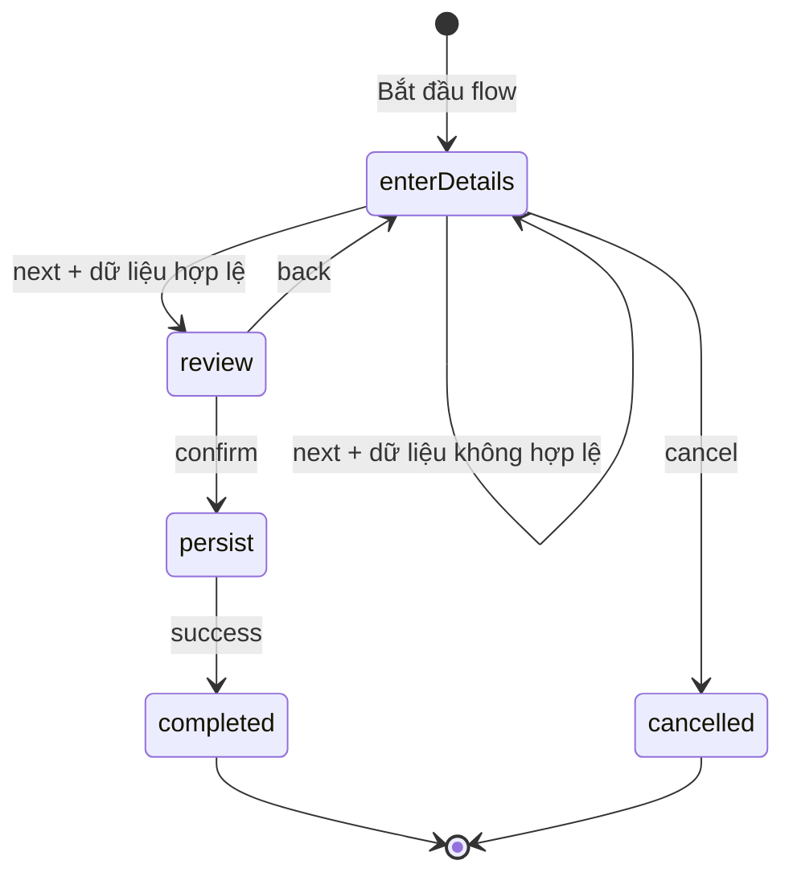

# Vai trò của `view-state` trong việc chờ tương tác

## Mục tiêu học tập

Sau bài này, bạn có thể:

- Giải thích vì sao `view-state` là điểm **tạm dừng có chủ đích** của một Spring Web Flow.
- Phân biệt việc flow chờ người dùng với việc một luồng Java bị chặn hoặc một HTTP request đang chạy mãi.
- Mô tả đường đi từ hiển thị view, nhận event, binding/validation đến transition tiếp theo.
- Chọn phạm vi lưu dữ liệu phù hợp khi người dùng đi qua nhiều màn hình và xử lý tình huống nhập sai, quay lại hoặc hủy.

## 1. Vì sao ứng dụng nhiều bước cần một trạng thái chờ?

Giả sử một website cho phép người dùng đăng ký dịch vụ theo ba bước:

1. Nhập họ tên và email.
2. Kiểm tra lại thông tin.
3. Xác nhận gửi đăng ký.

Ở bước nhập, ứng dụng đã có đủ thông tin để **hiển thị form**, nhưng chưa có đủ thông tin để quyết định người dùng sẽ làm gì tiếp theo. Họ có thể nhấn **Tiếp tục**, **Hủy**, hoặc để trang mở một lúc rồi mới thao tác. Nếu mỗi controller tự quyết định trang kế tiếp bằng các nhánh `if/else`, logic điều hướng sẽ phân tán giữa nhiều request handler; việc kiểm soát quay lại, dữ liệu đang nhập và validation trở nên khó theo dõi.

**Spring Web Flow** mô hình hóa hành trình này thành các *state* và *transition*. Trong đó, `view-state` đại diện cho một bước cần tương tác với người dùng:

> Khi flow đi vào `view-state`, framework chuẩn bị và hiển thị một view, kết thúc request hiện tại, lưu ngữ cảnh thực thi cần thiết và chờ một **event** ở request sau để tiếp tục.

Từ “chờ” ở đây là **chờ về mặt logic nghiệp vụ**. Không có chuyện một Java thread bị giữ lại để đợi người dùng nhấn nút. Máy chủ có thể xử lý các request khác trong khi flow tạm dừng ở state này.

Ví dụ tối giản:

```xml
<view-state id="enterDetails">
    <transition on="next" to="review" />
    <transition on="cancel" to="cancelled" />
</view-state>
```

`enterDetails` là tên state; theo quy ước, framework có thể dùng tên này để tìm view tương ứng. Hai `transition` mô tả điều gì xảy ra **sau khi** người dùng phát ra event `next` hoặc `cancel`. Bản thân `view-state` không tự chạy sang `review` chỉ vì đã hiển thị trang xong.

## 2. Điều gì thực sự diễn ra trong lúc `view-state` chờ?

Một vòng đời điển hình gồm các giai đoạn sau:

| Giai đoạn | Spring Web Flow làm gì? | Người dùng nhìn thấy gì? |
| --- | --- | --- |
| **Vào state** | Xác định state, tạo `viewScope` mới, thực hiện hành động lúc vào nếu có | Chưa nhất thiết thấy trang |
| **Render** | Chuẩn bị dữ liệu hiển thị, giải quyết view và trả HTTP response | Form hoặc màn hình hiện ra |
| **Chờ tương tác** | Lưu trạng thái flow theo cơ chế quản lý flow execution | Có thể đọc, nhập, suy nghĩ hoặc đóng tab |
| **Nhận event** | Request mới mang thông tin flow execution và event như `next` | Người dùng nhấn nút hoặc liên kết |
| **Xử lý event** | Binding, validation, chạy transition phù hợp | Sang bước khác hoặc thấy lỗi cần sửa |



Điểm cần nhớ: **HTTP request kết thúc khi view được trả về**, nhưng **flow execution chưa kết thúc**. Khi người dùng tương tác, framework khôi phục ngữ cảnh của flow và tiếp tục xử lý từ state hiện tại. Việc duy trì ngữ cảnh phụ thuộc cấu hình *flow execution repository*, session và chính sách lưu các snapshot; vì thế không nên coi flow là tồn tại vĩnh viễn.

### `view-state` khác gì các state khác?

| Thành phần | Vai trò chính | Có chờ thao tác người dùng? |
| --- | --- | --- |
| `view-state` | Hiển thị giao diện, nhận event, điều hướng sau tương tác | **Có** |
| `action-state` | Gọi nghiệp vụ tự động, chuyển tiếp dựa trên kết quả action | Thông thường **không** |
| `decision-state` | Rẽ nhánh theo điều kiện | **Không** |
| `subflow-state` | Gọi một flow con và đợi outcome của flow con | Bản thân state không phải màn hình; flow con có thể có `view-state` |
| `end-state` | Kết thúc flow và trả outcome | **Không** |

Vì vậy, màn hình “Nhập thông tin” hay “Xem lại đơn” thường phù hợp với `view-state`; thao tác “Lưu đơn” có thể thuộc `action-state`; “Thành công” có thể là `end-state` tùy thiết kế.

## 3. Ví dụ hoàn chỉnh: flow đăng ký ba bước

Giả sử ứng dụng đã tích hợp Spring Web Flow với Spring MVC, có bean `registrationService`, model `RegistrationDraft` và các view được cấu hình trong `ViewResolver`. Ta định nghĩa flow như sau:

```xml
<?xml version="1.0" encoding="UTF-8"?>
<flow xmlns="http://www.springframework.org/schema/webflow"
      xmlns:xsi="http://www.w3.org/2001/XMLSchema-instance"
      xsi:schemaLocation="http://www.springframework.org/schema/webflow
                          https://www.springframework.org/schema/webflow/spring-webflow.xsd">

    <on-start>
        <evaluate expression="registrationService.newDraft()"
                  result="flowScope.registration" />
    </on-start>

    <view-state id="enterDetails"
                view="registration/form"
                model="registration">
        <transition on="next" to="review" />
        <transition on="cancel" to="cancelled" bind="false" />
    </view-state>

    <view-state id="review" view="registration/review">
        <transition on="back" to="enterDetails" />
        <transition on="confirm" to="persist" />
    </view-state>

    <action-state id="persist">
        <evaluate expression="registrationService.save(registration)" />
        <transition on="success" to="completed" />
    </action-state>

    <end-state id="completed" />
    <end-state id="cancelled" />
</flow>
```

Đọc flow theo trình tự:

1. Khi flow bắt đầu, `registrationService.newDraft()` tạo đối tượng nháp, đặt vào `flowScope.registration`.
2. Framework đi vào `enterDetails`, render view logic `registration/form` và **dừng tại đây để chờ event**.
3. Khi nhận event `next`, framework bind/validate `registration` (nếu validation được cấu hình). Thành công thì chuyển sang `review`; thất bại thì hiển thị form lại.
4. Ở `review`, người dùng có thể gửi `back` để quay về form hoặc `confirm` để gọi `persist`.
5. `persist` thực hiện tác vụ lưu qua service. Với ví dụ service trả `void`, action hoàn thành bình thường tạo outcome `success` và flow chuyển tới `completed`. Xử lý ngoại lệ hoặc lỗi lưu thực tế cần được thiết kế thêm.
6. `cancel` đi tới `cancelled` và kết thúc flow mà không yêu cầu bind dữ liệu form.

Một số chi tiết cần hiểu đúng:

- `view="registration/form"` là **tên view logic**; đường dẫn file `.jsp`, `.xhtml` hoặc template cụ thể tùy ViewResolver và công nghệ giao diện. Nếu bỏ `view`, Web Flow dùng `id` theo quy ước tìm view.
- `model="registration"` trỏ tới model có thể truy cập trong scope hiện tại; trong ví dụ là đối tượng được tạo lúc bắt đầu flow.
- `registrationService`, `RegistrationDraft` và template chỉ là thành phần minh họa phải được ứng dụng cung cấp. XML không tự sinh service hoặc cấu hình Spring MVC.
- Không bắt buộc mọi `view-state` đều có `model`. Màn hình chỉ đọc như `review` vẫn có thể dùng view-state để chờ lệnh xác nhận.

### Form gửi event trở lại flow

Với view kiểu Spring MVC/JSP, có thể biểu diễn ý tưởng phát event bằng HTML sau (đoạn rút gọn, chưa gồm hiển thị dữ liệu đã nhập, lỗi validation và CSRF token):

```html
<form action="${flowExecutionUrl}" method="post">
    <label>
        Họ tên:
        <input type="text" name="fullName" />
    </label>

    <label>
        Email:
        <input type="email" name="email" />
    </label>

    <button type="submit" name="_eventId_next">Tiếp tục</button>
    <button type="submit" name="_eventId_cancel">Hủy</button>
</form>
```

Ở đây:

- `${flowExecutionUrl}` là URL dành cho **flow execution hiện tại**, do Spring Web Flow cung cấp cho view trong ngữ cảnh tích hợp phù hợp. Hãy dùng URL do framework tạo, không tự chế execution key.
- Tên nút `_eventId_next` được giải mã thành event `next`; `_eventId_cancel` thành event `cancel`. Nếu form chỉ có một lựa chọn, có thể dùng tham số ẩn `_eventId` với giá trị event tương ứng.
- Các ô `name="fullName"` và `name="email"` là đầu vào để binder ánh xạ tới thuộc tính của `RegistrationDraft` khi xử lý postback.

**Quan trọng:** người dùng gửi **HTTP request mới** tới URL flow. Máy chủ không “thức dậy” từ một thread đang ngủ; Spring Web Flow xác định flow execution, đọc event và tiếp tục state machine. Nếu thiếu execution key hợp lệ, request hết hạn hoặc state không còn hiệu lực, framework có thể không thể tiếp tục flow cũ và ứng dụng cần có cách phục hồi hoặc bắt đầu lại phù hợp.

## 4. Event và transition: ai quyết định bước tiếp theo?

`view-state` giữ quyền điều hướng tại một điểm tập trung. Mỗi `<transition on="..." to="..." />` khai báo event nào dẫn đến state nào. Đây là điểm khác biệt quan trọng so với việc tự chuyển hướng bằng các chuỗi `redirect:` rải trong nhiều controller.

```xml
<view-state id="review" view="registration/review">
    <transition on="back" to="enterDetails" />
    <transition on="confirm" to="persist" />
</view-state>
```

Nút `back` và `confirm` là hai **ý định nghiệp vụ**. `back` có nghĩa “quay về chỉnh sửa”, còn `confirm` có nghĩa “xác nhận tiếp tục”. Trên cùng một view, từng event có thể có transition khác nhau. Event không có transition phù hợp sẽ không tự động nhảy tới một state tùy ý; cần thiết kế xử lý tương ứng.

Transition cũng có thể chạy action rồi render lại cùng view khi cần, ví dụ thao tác phân trang danh sách tìm kiếm. Không phải event nào cũng bắt buộc làm flow rời `view-state`.

### Khi submit có lỗi thì sao?

Khi `view-state` khai báo `model`, Spring Web Flow hỗ trợ bước **binding** dữ liệu request vào model và **validation** theo cơ chế đã cấu hình. Với event `next`:

1. Framework nhận dữ liệu từ form.
2. Binder chuyển kiểu và gán dữ liệu cho model; ví dụ trường số phải đổi từ chuỗi sang kiểu số.
3. Validator kiểm tra các ràng buộc áp dụng cho bước hiện tại.
4. Nếu binding/validation không thành công, Web Flow **render lại view hiện tại** để người dùng sửa, thay vì thực hiện transition sang `review`.
5. Nếu hợp lệ, event `next` mới dẫn tới transition tương ứng.

Trong `RegistrationDraft`, bạn có thể dùng ràng buộc như `@NotBlank` cho họ tên hoặc `@Email` cho email khi Bean Validation được tích hợp phù hợp. Cần hiển thị message lỗi trên template; chỉ có kiểm tra HTML `required` ở phía trình duyệt là chưa đủ.

Một số hành động không nên bị buộc phải sửa dữ liệu trước, chẳng hạn nhấn **Hủy**. XML trong ví dụ dùng `bind="false"` để bỏ cả binding lẫn validation trên transition `cancel`:

```xml
<transition on="cancel" to="cancelled" bind="false" />
```

Nếu muốn **vẫn bind dữ liệu** nhưng **bỏ qua validation** cho event quay lại, có thể dùng `validate="false"`:

```xml
<transition on="back" to="previousStep" validate="false" />
```

Chỉ nên áp dụng lựa chọn này cho event phù hợp với nghiệp vụ, không tắt validation vô điều kiện trên hành động lưu/xác nhận. Ngoài ra, cần giới hạn các thuộc tính được phép binding khi model chứa trường nhạy cảm hoặc trường không do người dùng quản lý.

## 5. Dữ liệu được giữ ở đâu trong lúc chờ?

Để người dùng chuyển qua lại giữa các bước, dữ liệu không thể chỉ nằm trong biến cục bộ của một method xử lý HTTP request. Spring Web Flow có các scope phục vụ mục đích khác nhau:

| Scope | Thời gian sống điển hình | Dùng cho |
| --- | --- | --- |
| `requestScope` | Một request | Dữ liệu tạm phục vụ request hiện tại |
| `flashScope` | Thông điệp/dữ liệu ngắn hạn quanh việc hiển thị hoặc redirect của flow | Thông báo hoặc dữ liệu chỉ cần ngắn hạn |
| `viewScope` | Từ lúc **vào** `view-state` đến khi **rời** state | Bộ lọc, kết quả phân trang, dữ liệu phục vụ riêng màn hình |
| `flowScope` | Suốt một lần thực thi flow | Bản nháp đăng ký cần dùng ở nhiều bước |
| `conversationScope` | Suốt flow cấp cao nhất và các subflow | Dữ liệu cần chia sẻ giữa flow cha và flow con |

`viewScope` là điểm rất dễ nhầm. Khi vào một `view-state`, Web Flow cấp `viewScope` mới. Dữ liệu trong đó vẫn có thể được dùng qua **nhiều request khi vẫn ở cùng state**, chẳng hạn lọc hoặc phân trang bằng Ajax. Tuy nhiên, khi chuyển sang state khác, `viewScope` cũ bị hủy. Khi quay lại màn hình đó, bạn đang vào một lần mới và không nên kỳ vọng `viewScope` cũ còn nguyên.

Chẳng hạn một trang tìm kiếm có thể tải dữ liệu ngay trước lúc render:

```xml
<view-state id="searchResults" view="search/results">
    <on-render>
        <evaluate expression="searchService.search(searchCriteria)"
                  result="viewScope.results" />
    </on-render>
    <transition on="refresh" />
</view-state>
```

`on-render` được chạy ở lần render đầu tiên **và ở những lần render lại**, nên phù hợp với logic truy vấn dữ liệu hiển thị; không phù hợp để trừ tiền, ghi đơn hàng hoặc thực hiện tác vụ gây tác dụng phụ không thể lặp. Trong khi đó, bản nháp `registration` ở ví dụ trước thuộc `flowScope` vì cả `enterDetails` và `review` đều cần đến nó.

Đừng đồng nhất `flowScope` với HTTP session chung: flow execution có vòng đời riêng và có thể kết thúc hoặc hết hạn. Khi cần dữ liệu bền vững sau khi người dùng rời flow, hãy lưu có chủ đích vào tầng nghiệp vụ/cơ sở dữ liệu.

## 6. Tình huống thực tế và cách xử lý

### Người dùng nhấn **Quay lại**

Định nghĩa event `back` trong flow khi đó là hành vi nghiệp vụ chủ động và dễ kiểm thử. Browser Back có thể liên quan đến lịch sử các snapshot của flow execution; không nên suy luận rằng nút Back của trình duyệt luôn tương đương event `back`. Với quy trình nhạy cảm như thanh toán, cần thiết kế chính sách lịch sử và kiểm tra trạng thái giao dịch để tránh gửi lại thao tác cũ.

### Người dùng nhấn Refresh hoặc submit nhiều lần

Việc vào `view-state` thường gắn với cơ chế redirect trước khi render để hỗ trợ mô hình **Post/Redirect/Get**. Tuy nhiên, refresh hoặc gửi trùng vẫn có thể xảy ra. Đối với action tạo đơn hoặc thanh toán, cần bảo đảm cơ chế chống xử lý trùng (ví dụ khóa nghiệp vụ hoặc idempotency key) tại tầng service, không dựa vào giả định rằng giao diện chỉ phát event một lần.

### Người dùng để trang quá lâu mới nhấn Tiếp tục

Flow execution có thể hết hạn, session có thể mất hoặc phiên bản execution cũ có thể không còn hợp lệ. Ứng dụng cần quy định thời gian chờ, xử lý trang hết hạn và hướng dẫn bắt đầu lại hoặc khôi phục bản nháp đã lưu. `view-state` không bảo đảm lưu mãi dữ liệu chưa submit.

### Event bị gửi thủ công từ client

Tên event nằm trong request nên client có thể tự tạo request với `_eventId_confirm` hay giá trị khác. Kiểm tra quyền, điều kiện chuyển state và tính hợp lệ của nghiệp vụ vẫn phải thực hiện phía server. Bảo vệ CSRF và dữ liệu nhạy cảm theo cấu hình bảo mật của ứng dụng.

## 7. Cách kiểm tra một `view-state` hoạt động đúng

Với flow đăng ký ở trên, có thể thiết kế các trường hợp kiểm thử ở mức flow và tích hợp MVC:

| Tình huống | Kết quả cần quan sát |
| --- | --- |
| Bắt đầu flow | State hiện tại là `enterDetails`, form hiển thị |
| Phát `next` với dữ liệu hợp lệ | Chuyển sang `review`, dữ liệu vẫn nằm trong `flowScope.registration` |
| Phát `next` với dữ liệu sai | Không đi tới `review`; form hiện lại cùng thông báo lỗi (khi đã cấu hình validation) |
| Phát `cancel` khi form có dữ liệu sai | Chuyển tới `cancelled` vì transition có `bind="false"` |
| Phát `back` từ `review` | Về `enterDetails`, dữ liệu trong `flowScope` còn để chỉnh sửa |
| Phát `confirm` | Đi qua `persist`; service lưu được gọi theo thiết kế; kết thúc ở `completed` |
| Gửi event với execution key hết hạn | Ứng dụng xử lý lỗi hết hạn và điều hướng phục hồi phù hợp |

Khi debug, theo dõi **state hiện tại, event được giải mã, kết quả binding/validation, transition được chọn và vòng đời scope**. Đây là các điểm giải thích phần lớn lỗi “nhấn nút nhưng vẫn ở trang cũ” hoặc “quay lại bị mất dữ liệu”.

## 8. Những nhầm lẫn thường gặp

- **“`view-state` gọi view xong là tự động chạy tiếp.”** Sai: nó chờ event; muốn tự chạy nghiệp vụ và chuyển tiếp, hãy cân nhắc `action-state`.
- **“Chờ nghĩa là server đang giữ request/thread.”** Sai: request render có thể kết thúc và flow được tiếp tục ở request sau.
- **“Dữ liệu trong `viewScope` sẽ theo người dùng qua mọi màn hình.”** Sai: scope này kết thúc khi rời state. Chọn `flowScope` cho bản nháp dùng chung qua các bước.
- **“Mọi event đều phải chuyển sang trang mới.”** Sai: có thể cập nhật và render lại cùng view.
- **“Chỉ cần nút submit là flow hiểu phải đi đâu.”** Chưa đủ: event phải được truyền và có transition phù hợp.
- **“Có `model` thì mọi lần submit đều thành công.”** Sai: binding hoặc validation có thể thất bại khiến view được render lại.

## 9. Ghi nhớ

`view-state` là **ranh giới giữa xử lý tự động của ứng dụng và quyết định tương tác của người dùng** trong Spring Web Flow. Nó xác định màn hình cần hiển thị, cung cấp nơi nhận event và mô tả những hướng đi hợp lệ tiếp theo. Khi kết hợp với `flowScope`, binding, validation và transition, bạn có thể quản lý hành trình nhiều bước bằng một mô hình trạng thái rõ ràng, thay vì phân tán logic điều hướng vào nhiều controller.

**Tự kiểm tra:** Trong một flow đăng ký, bạn muốn cho phép nút **Hủy** hoạt động ngay cả khi email đang sai định dạng. Bạn sẽ đặt event và transition ở state nào, dùng `bind="false"` hay `validate="false"`, và vì sao bản nháp đăng ký nên ở `flowScope` thay vì `viewScope`?

### Tài liệu tham khảo

- [Spring Web Flow Reference Guide 3.0.2 — Rendering Views](https://docs.spring.io/spring-webflow/docs/3.0.2/reference/#rendering-views)
- [Spring Web Flow Reference Guide 3.0.2 — Spring MVC Integration](https://docs.spring.io/spring-webflow/docs/3.0.2/reference/#spring-mvc-integration)
