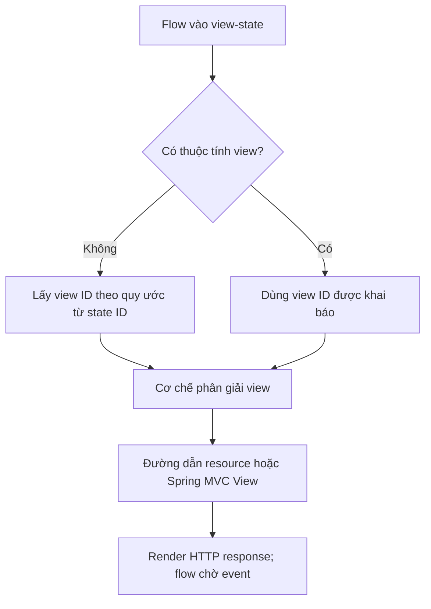
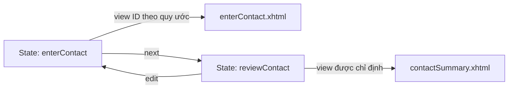

# Ánh xạ `state ID` sang định danh `view` trong Spring Web Flow

## Mục tiêu bài học

Trong Spring Web Flow, một bước của hành trình web có thể được khai báo ngắn gọn bằng `<view-state>`. Để framework hiển thị đúng giao diện, cần hiểu **tên trạng thái** (`state ID`) được ánh xạ như thế nào sang **định danh view** (`view ID`), rồi từ định danh đó đến **tài nguyên giao diện thực tế**.

Sau bài này, bạn có thể:

- Giải thích quy ước mặc định khi `<view-state>` không có thuộc tính `view`.
- Sử dụng `view="..."` để chọn view khác tên state, bằng đường dẫn tương đối, đường dẫn tuyệt đối hoặc tên logic.
- Phân biệt `flow ID`, `state ID`, `view ID`, tên template, URL truy cập flow và đích của transition.
- Cấu hình cách phân giải view khi tích hợp Spring Web Flow với Spring MVC.
- Tìm nguyên nhân khi flow đã vào đúng state nhưng ứng dụng vẫn không render được màn hình mong muốn.

## 1. Ba tên gọi có vai trò khác nhau

Hãy xét một hành trình đăng ký dịch vụ (`registration`) có bước nhập liên hệ:

```xml
<view-state id="collectContact" view="registration/contact-form">
    <transition on="next" to="reviewContact" />
</view-state>
```

Trong khai báo này:

| Thành phần | Giá trị ví dụ | Công dụng |
| --- | --- | --- |
| **Flow ID** | `registration` | Nhận diện toàn bộ hành trình được đăng ký trong `FlowRegistry`. |
| **State ID** | `collectContact` | Nhận diện **bước hiện tại** trong flow, được các transition tham chiếu bằng `to="collectContact"`. |
| **View ID** | `registration/contact-form` | Chỉ cho Web Flow biết **giao diện nào** phải được render khi vào state. |
| **View resource** | `/WEB-INF/views/registration/contact-form.jsp` | File thực tế có thể được `ViewResolver` của Spring MVC chọn theo quy tắc prefix/suffix. |

Đây là bốn lớp thông tin khác nhau. `state ID` xác định **flow đang đứng ở đâu**; `view ID` xác định **giao diện nào được hiển thị**. Một view ID logic có thể được một `ViewResolver` biến thành đường dẫn file; tên file phụ thuộc cấu hình giao diện.

**Không nên hiểu `state ID` là URL HTTP.** URL khởi chạy hoặc tiếp tục flow do tầng tích hợp Web Flow/Spring MVC và flow execution quyết định. Tương tự, `to="reviewContact"` trong transition là **state đích**, không phải đường dẫn JSP hay tên view.

## 2. Quy ước mặc định: không khai báo `view` thì lấy ID của state

Ví dụ tối giản:

```xml
<view-state id="enterContact">
    <transition on="next" to="reviewContact" />
</view-state>
```

Web Flow dùng quy ước **`state ID` → định danh view tương ứng**. Với cách đóng gói truyền thống, Web Flow tìm view trong thư mục làm việc của flow, tức thư mục chứa flow definition.

Giả sử cấu trúc webapp như sau:

```text
src/main/webapp/
└── WEB-INF/
    └── flows/
        └── registration/
            ├── registration.xml
            ├── enterContact.xhtml
            └── reviewContact.xhtml
```

Nếu `registration.xml` khai báo `id="enterContact"` và Web Flow được cấu hình cho các resource XHTML ở thư mục đó, quy ước này có thể render `/WEB-INF/flows/registration/enterContact.xhtml`. Chữ `.xhtml` đến từ công nghệ view/cấu hình giải quyết resource, **không phải vì Spring Web Flow mặc định bắt buộc dùng XHTML**.

Quy ước giúp XML súc tích khi mỗi state có một view cùng tên. Tuy nhiên, thay `id` có thể ảnh hưởng tới cả hai thứ: tên state được transition tham chiếu và định danh view được suy ra mặc định. Vì vậy, khi đổi tên state, hãy kiểm tra cả các transition liên quan lẫn view được resolve.

### Minh họa luồng phân giải



Điều quan trọng là **ánh xạ view xảy ra trong quá trình render state**. Nó không tự sinh event, không gọi transition và không thay đổi state đang hoạt động.

## 3. Chỉ định view rõ ràng bằng thuộc tính `view`

Nếu tên state phục vụ nghiệp vụ không phù hợp với tên file/template, hãy khai báo `view`:

```xml
<view-state id="collectContact" view="enterContact.xhtml">
    <transition on="next" to="reviewContact" />
</view-state>
```

Ở đây:

- `collectContact` vẫn là **ID của state**.
- `enterContact.xhtml` là **ID của view** cần render.
- Transition `to="reviewContact"` vẫn trỏ tới một state; không có mối liên hệ bắt buộc giữa tên `reviewContact` và tên file.

Theo tài liệu Spring Web Flow, có ba nhóm view ID phổ biến.

### 3.1. View ID tương đối theo thư mục flow

```xml
<view-state id="collectContact" view="enterContact.xhtml" />
```

Nếu flow definition nằm tại `/WEB-INF/flows/registration/registration.xml`, đường dẫn tương đối `enterContact.xhtml` hướng tới resource bên cạnh flow:

```text
/WEB-INF/flows/registration/enterContact.xhtml
```

Cách này thích hợp khi **đóng gói flow và các màn hình liên quan cùng một thư mục**. Việc sử dụng phần mở rộng `.xhtml`, `.jsp` hay kiểu resource khác phụ thuộc bộ render view thực tế. Trong ví dụ, `.xhtml` chỉ là minh họa cho một cấu hình XHTML tương thích.

### 3.2. View ID tuyệt đối tính từ webapp root

```xml
<view-state id="collectContact"
            view="/WEB-INF/flows/registration/enterContact.xhtml" />
```

Đường dẫn bắt đầu bằng `/` nên được diễn giải từ **gốc tài nguyên webapp**, không nối tiếp vào thư mục flow. Kiểu này hữu ích nếu muốn nêu chính xác một resource hoặc dùng resource ngoài thư mục định nghĩa flow.

Đừng nhầm `/WEB-INF/...` với URL mà trình duyệt có thể gọi trực tiếp: `WEB-INF` thường không được web container phục vụ trực tiếp. Resource vẫn được render thông qua cơ chế view phía server.

### 3.3. View ID logic do Spring MVC `ViewResolver` giải quyết

```xml
<view-state id="collectContact"
            view="registration/contact-form" />
```

Khi Web Flow được cấu hình sử dụng các `ViewResolver` của Spring MVC, chuỗi `registration/contact-form` có thể là **tên view logic** thay vì tên file. Ví dụ resolver với:

```text
prefix = /WEB-INF/views/
suffix = .jsp
```

thì view logic ở trên có thể trỏ đến:

```text
/WEB-INF/views/registration/contact-form.jsp
```

Ở đây không cần đặt file JSP trong thư mục chứa flow definition. Cách ánh xạ thực tế phụ thuộc `ViewResolver`, công nghệ template và thứ tự các resolver được cấu hình.

### Bảng so sánh

| Khai báo trong `view-state` | Ý nghĩa | Phụ thuộc chính |
| --- | --- | --- |
| `id="enterContact"` và không có `view` | Dùng view ID theo quy ước của state | Tên state, quy tắc phân giải view |
| `view="enterContact.xhtml"` | Resource tương đối theo thư mục flow | Vị trí flow definition, resource resolver |
| `view="/WEB-INF/flows/registration/enterContact.xhtml"` | Đường dẫn resource tuyệt đối từ webapp root | Đường dẫn resource được đóng gói |
| `view="registration/contact-form"` | Tên logic, khi dùng Spring MVC ViewResolver phù hợp | Cấu hình `ViewResolver`, prefix/suffix hoặc template engine |

**Lưu ý:** Một chuỗi như `registration/contact-form` không tự bảo đảm sẽ được hiểu theo resolver MVC. Nếu ứng dụng không cấu hình Web Flow dùng resolver đó, cơ chế mặc định có thể xử lý chuỗi như một đường dẫn tương đối và gây lỗi tìm view.

## 4. Ví dụ xuyên suốt: state mang tên nghiệp vụ, view mang tên giao diện

Xét flow hai màn hình nhập và rà soát thông tin. Trong ví dụ sau, một view dùng quy ước và một view được chỉ định riêng:

```text
WEB-INF/
└── flows/
    └── registration/
        ├── registration.xml
        ├── enterContact.xhtml
        └── contactSummary.xhtml
```

Nội dung `registration.xml`:

```xml
<?xml version="1.0" encoding="UTF-8"?>
<flow xmlns="http://www.springframework.org/schema/webflow"
      xmlns:xsi="http://www.w3.org/2001/XMLSchema-instance"
      xsi:schemaLocation="http://www.springframework.org/schema/webflow
                          https://www.springframework.org/schema/webflow/spring-webflow.xsd">

    <view-state id="enterContact">
        <transition on="next" to="reviewContact" />
        <transition on="cancel" to="cancelled" />
    </view-state>

    <view-state id="reviewContact" view="contactSummary.xhtml">
        <transition on="edit" to="enterContact" />
        <transition on="confirm" to="completed" />
    </view-state>

    <end-state id="completed" />
    <end-state id="cancelled" />
</flow>
```

Giả sử đã cấu hình Web Flow để render các resource XHTML tương ứng:

1. Flow bắt đầu ở `enterContact` (state đầu tiên). Không có thuộc tính `view`, nên Web Flow suy ra view theo `enterContact`, rồi hiển thị `enterContact.xhtml`.
2. Khi form gửi event `next`, transition đưa flow tới `reviewContact`.
3. `reviewContact` có `view="contactSummary.xhtml"`, nên giao diện hiển thị là `contactSummary.xhtml`, **không phải** `reviewContact.xhtml`.
4. Event `edit` từ màn hình rà soát quay về state `enterContact`; event `confirm` đi tới `completed`.

Sơ đồ thể hiện hai quan hệ độc lập:



**Một lời nhắc về dữ liệu form:** ví dụ trên chỉ minh họa ánh xạ view và transition. Nếu màn hình nhập cần giữ dữ liệu để xem lại, bạn phải khai báo model và quản lý scope/binding/validation phù hợp. Việc hai state có view hợp lệ **không tự bảo đảm dữ liệu form được lưu qua các bước**.

## 5. Kết nối với `ViewResolver` trong Spring MVC

Trong ứng dụng đã dùng Spring MVC, bạn thường có bộ template đặt tập trung tại `/WEB-INF/views/` và muốn mọi view, kể cả view của Web Flow, tuân theo cùng quy ước.

Ví dụ cấu hình XML bên dưới nằm **trong Spring bean configuration đã khai báo namespace `webflow` và `beans`**:

```xml
<webflow:flow-registry id="flowRegistry"
                       flow-builder-services="flowBuilderServices">
    <webflow:location path="/WEB-INF/flows/registration/registration.xml" />
</webflow:flow-registry>

<webflow:flow-builder-services
        id="flowBuilderServices"
        view-factory-creator="mvcViewFactoryCreator" />

<bean id="mvcViewFactoryCreator"
      class="org.springframework.webflow.mvc.builder.MvcViewFactoryCreator">
    <property name="viewResolvers" ref="registrationViewResolver" />
</bean>

<bean id="registrationViewResolver"
      class="org.springframework.web.servlet.view.InternalResourceViewResolver">
    <property name="prefix" value="/WEB-INF/views/" />
    <property name="suffix" value=".jsp" />
</bean>
```

Với cấu hình minh họa này, flow có thể khai báo:

```xml
<view-state id="enterContact"
            view="registration/contact-form">
    <transition on="next" to="reviewContact" />
</view-state>

<view-state id="reviewContact"
            view="registration/contact-review">
    <transition on="back" to="enterContact" />
</view-state>
```

Và các view có thể được giải quyết thành:

```text
/WEB-INF/views/registration/contact-form.jsp
/WEB-INF/views/registration/contact-review.jsp
```

`MvcViewFactoryCreator` là thành phần giúp Web Flow kết nối hệ thống view của Spring MVC. Cấu hình tích hợp MVC đầy đủ còn cần những thành phần như `FlowExecutor`, `FlowHandlerMapping` và `FlowHandlerAdapter` để các request HTTP được xử lý qua flow. Đoạn trên **chỉ tập trung vào phần phân giải view**.

Nếu ứng dụng dùng Thymeleaf hoặc một template engine khác, hãy dùng resolver tương ứng. Không nên sao chép cấu hình `InternalResourceViewResolver` dành cho JSP rồi kỳ vọng nó tự render mọi loại template.

**Khi nào dùng cách nào?** Nếu module flow đóng gói mỗi màn hình ngay cạnh XML, đường dẫn theo flow rất dễ kiểm tra. Nếu dự án đã thống nhất cấu trúc `views/...` chung với Spring MVC, dùng tên view logic sẽ giúp tái sử dụng cấu hình resolver và giảm phụ thuộc vào vị trí file khi refactor.

## 6. Một template có thể được nhiều state sử dụng

Không có ràng buộc bắt buộc “một state tương ứng một file giao diện duy nhất”. Hai state có thể render cùng một template:

```xml
<view-state id="editShippingAddress"
            view="checkout/address"
            model="shippingAddress">
    <transition on="next" to="editBillingAddress" />
</view-state>

<view-state id="editBillingAddress"
            view="checkout/address"
            model="billingAddress">
    <transition on="next" to="reviewOrder" />
</view-state>
```

Hai state đều sử dụng `checkout/address` nhưng có **ID riêng, model riêng và transition riêng**. Nếu dùng view chung, template cần được thiết kế để trình bày đúng nhãn và dữ liệu theo ngữ cảnh của từng state.

Ngược lại, **hai state không được dùng trùng ID trong cùng một flow**. `state ID` cần duy nhất để Web Flow có thể xác định chính xác state đích của transition. Trong các flow khác nhau, cùng một state ID có thể mang nghĩa độc lập.

Quy tắc này hữu ích khi thiết kế hành trình nhiều bước hoặc subflow: tái sử dụng view là lựa chọn giao diện; tái sử dụng tên state giữa các flow là vấn đề định danh nội bộ; không nên trộn hai quyết định đó.

## 7. Các lỗi ánh xạ thường gặp

### Trường hợp A: đổi `state ID`, quên đổi hoặc khai báo `view`

Trước đó:

```xml
<view-state id="enterContact" />
```

Sau khi sửa:

```xml
<view-state id="collectContact" />
```

Nếu template vẫn tên `enterContact.xhtml` và không có cấu hình ánh xạ bổ sung, Web Flow sẽ tìm view theo tên mới `collectContact`. Hãy chỉ rõ:

```xml
<view-state id="collectContact" view="enterContact.xhtml" />
```

Và cập nhật các transition đang trỏ tới ID cũ nếu state thực sự được đổi tên.

### Trường hợp B: nhầm đường dẫn tương đối và tuyệt đối

```xml
<!-- Tương đối theo thư mục của flow -->
<view-state id="details" view="details.xhtml" />

<!-- Tuyệt đối theo webapp root -->
<view-state id="details" view="/WEB-INF/views/details.xhtml" />
```

Hai khai báo không tương đương. Khi gặp lỗi resource không tồn tại, hãy kiểm tra **đường dẫn thực của flow definition**, vị trí view và chế độ phân giải view đang được dùng.

### Trường hợp C: cho rằng `ViewResolver` của MVC luôn áp dụng tự động

Bạn có thể đã cấu hình `InternalResourceViewResolver` cho các controller MVC, nhưng flow lại dùng bộ phân giải view khác. Khi đó `view="registration/contact-form"` không nhất thiết được biến thành `/WEB-INF/views/registration/contact-form.jsp`.

Hãy kiểm tra `flow-builder-services` và `MvcViewFactoryCreator`, cùng danh sách `viewResolvers` được truyền vào Web Flow.

### Trường hợp D: nhầm `transition.to` với `view`

Sai về ý nghĩa:

```xml
<view-state id="enterContact" view="registration/contact-form">
    <transition on="next" to="registration/contact-review" />
</view-state>
```

Nếu flow không có state tên `registration/contact-review`, transition không có state đích hợp lệ. Cách khai báo đúng là tham chiếu state rồi để chính state đó chọn view:

```xml
<view-state id="enterContact" view="registration/contact-form">
    <transition on="next" to="reviewContact" />
</view-state>

<view-state id="reviewContact" view="registration/contact-review" />
```

### Trường hợp E: view resolve được nhưng không nhận được event

Khi form hiển thị đúng, đó mới là **render view thành công**. Để flow tiếp tục, request gửi về cần thuộc flow execution tương ứng và mang event mà state có thể xử lý, chẳng hạn `_eventId_next`.

Ví dụ tên nút submit trong HTML:

```html
<button type="submit" name="_eventId_next">Tiếp tục</button>
```

Việc đặt tên file view đúng không tự tạo transition; ngược lại, một transition hợp lệ cũng không thể sửa lỗi thiếu template. Hãy kiểm tra riêng cả **view resolution** và **event/transition handling**.

## 8. Quy trình kiểm tra khi sai màn hình hoặc không tìm thấy template

| Bước kiểm tra | Câu hỏi cần trả lời | Dấu hiệu thu hẹp vấn đề |
| --- | --- | --- |
| 1. State đang chạy | Flow có thật sự vào `view-state` mong đợi? | Event dẫn đến state khác hoặc transition thiếu |
| 2. State ID | `id` có đúng và duy nhất trong flow không? | Đổi tên state khiến transition tham chiếu sai |
| 3. Thuộc tính `view` | Có khai báo `view` không, giá trị chính xác là gì? | Không có `view` thì đang dùng quy ước từ ID |
| 4. Đường dẫn | View là tên resource tương đối, tuyệt đối hay tên logic? | Trỏ nhầm thư mục flow/webapp |
| 5. Resolver | Web Flow sử dụng `ViewResolver` nào? | Prefix/suffix hoặc resolver không phù hợp |
| 6. Resource | Template có được đóng gói đúng chỗ khi chạy ứng dụng? | File không tồn tại, tên sai chữ hoa/thường |
| 7. Render/event | Trang lỗi ngay lúc render hay chỉ lỗi sau submit? | Hai giai đoạn có nguyên nhân khác nhau |

Nếu có thể kiểm thử tích hợp, hãy xác nhận cả hai lớp:

1. **Kiểm thử flow:** bắt đầu flow, xác nhận state hiện tại; gửi một event và kiểm tra state kế tiếp.
2. **Kiểm thử render:** khởi chạy flow bằng cấu hình MVC/view thực tế và kiểm tra view/template được chọn. Một bài test chỉ mô phỏng event nhưng không khởi tạo `ViewResolver` **không đủ** để bảo đảm đường dẫn JSP hoặc template đang đúng.

Chẳng hạn với ví dụ ở mục 4, các kỳ vọng là:

- Vào `enterContact` → view theo quy ước `enterContact` → template `enterContact.xhtml` trong cấu hình minh họa.
- Event `next` → state `reviewContact` → view `contactSummary.xhtml`.
- Event `edit` → quay về state `enterContact`, rồi render lại view tương ứng.
- Đổi ID thành `collectContact` nhưng không cập nhật mapping → kiểm tra phát hiện resource không còn đúng theo quy ước.

## 9. Tổng kết và tự luyện

Trong Spring Web Flow, **`state ID` là danh tính của một bước trong flow; `view ID` là chỉ dẫn chọn giao diện**. Nếu không khai báo `view`, framework dùng quy ước dựa trên state ID. Khi khai báo `view`, bạn có thể chỉ ra resource tương đối theo flow, resource tuyệt đối trong webapp hoặc tên logic được giải quyết bởi Spring MVC. `ViewResolver` và cấu hình view factory quyết định cách định danh đó trở thành giao diện được render.

**Bài tập:** Một flow đặt tại `/WEB-INF/flows/checkout/checkout.xml` có state:

```xml
<view-state id="confirmOrder" view="review.jsp">
    <transition on="edit" to="editOrder" />
</view-state>
```

Hãy trả lời:

1. ID của state hiện tại là gì? View ID là gì?
2. Với cấu hình phân giải resource tương đối theo flow, framework sẽ tìm `review.jsp` ở đâu?
3. Nếu đổi thành `view="/WEB-INF/views/checkout/review.jsp"`, đường dẫn được hiểu theo gốc nào?
4. Nếu muốn dùng `view="checkout/review"` và template `/WEB-INF/views/checkout/review.jsp`, bạn cần cấu hình cơ chế nào?
5. Event `edit` tìm state tên nào? Có liên hệ bắt buộc với tên file view không?

Đáp án định hướng: (1) `confirmOrder` và `review.jsp`; (2) `/WEB-INF/flows/checkout/review.jsp`; (3) webapp root; (4) `ViewResolver` phù hợp được kết nối qua `MvcViewFactoryCreator`; (5) state `editOrder`, độc lập với view ID.

### Tài liệu tham khảo

- [Spring Web Flow 3.0.2 Reference Guide — Rendering Views, mục 13.1–13.2](https://docs.spring.io/spring-webflow/docs/3.0.2/reference/#rendering-views): quy ước state ID, view ID tương đối, tuyệt đối và logic.
- [Spring Web Flow 3.0.2 Reference Guide — Spring MVC Integration, mục View Resolution](https://docs.spring.io/spring-webflow/docs/3.0.2/reference/#spring-mvc-integration): cấu hình `MvcViewFactoryCreator` và tích hợp `ViewResolver`.
