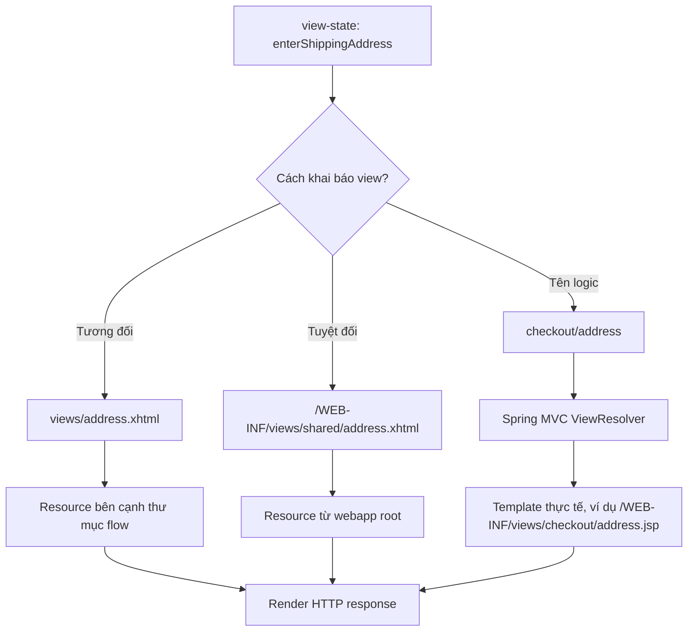
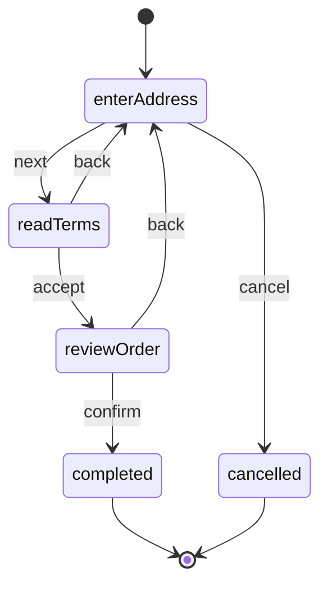

# View tương đối với flow, view tuyệt đối và tên view logic trong Spring Web Flow

## Bạn sẽ học được gì?

Trong module **Spring Web Flow**, một hành trình nhiều bước được biểu diễn bằng các state, event và transition. `view-state` là điểm framework hiển thị màn hình, kết thúc request render và chờ người dùng phát event để tiếp tục flow. Để màn hình đó xuất hiện đúng, framework phải xác định **view cần render nằm ở đâu**.

Bài này tập trung vào ba cách chỉ định view cho `view-state`:

1. **View tương đối với flow**: đường dẫn tài nguyên tính từ nơi đặt tài liệu định nghĩa flow.
2. **View tuyệt đối**: đường dẫn tài nguyên tính từ gốc web application.
3. **Tên view logic**: một tên độc lập với vị trí file, được `ViewResolver` phù hợp của Spring MVC chuyển thành view thực tế.

Sau khi học, bạn có thể đọc chính xác một thuộc tính `view`, chọn cách khai báo phù hợp với cấu trúc dự án, thiết lập phân giải view khi tích hợp Spring MVC và chẩn đoán lỗi hiển thị trong hành trình nhiều bước.

## 1. `view-state` có những định danh nào?

Xét ví dụ đơn giản:

```xml
<view-state id="enterShippingAddress" view="address-form.xhtml">
    <transition on="next" to="reviewOrder" />
</view-state>
```

Trong một dòng `<view-state>` có hai thông tin độc lập:

| Thuộc tính | Giá trị ví dụ | Ý nghĩa |
| --- | --- | --- |
| `id` | `enterShippingAddress` | **State ID**, định danh bước trong state machine của flow. |
| `view` | `address-form.xhtml` | **View ID**, mô tả view mà framework cần hiển thị tại bước này. |

`to="reviewOrder"` là **ID của state đích** khi nhận event `next`. Nó không phải đường dẫn file view, cũng không phải tên URL cần gửi từ trình duyệt.

Nếu **bỏ thuộc tính `view`**, Spring Web Flow dùng **quy ước view ID từ state ID**. Ví dụ:

```xml
<view-state id="enterShippingAddress">
    <transition on="next" to="reviewOrder" />
</view-state>
```

Với khai báo này, tên `enterShippingAddress` được dùng làm cơ sở tìm view theo cơ chế phân giải đang áp dụng. Resource hoặc template thực tế vẫn phụ thuộc công nghệ giao diện và cấu hình resolver; không nên suy ra một phần mở rộng cố định như `.jsp` hay `.xhtml` chỉ từ state ID.

Nếu muốn **tên state ổn định theo nghiệp vụ** nhưng **tên màn hình khác**, hãy khai báo `view` rõ ràng. Ba kiểu view dưới đây chính là những cách đặt định danh này.

## 2. View tương đối với flow

### 2.1. Đường dẫn được tính từ đâu?

Một flow thường có một file định nghĩa, ví dụ `checkout-flow.xml`. Nếu view được đặt trong cùng thư mục với file định nghĩa flow, có thể dùng đường dẫn tương đối:

```text
src/main/webapp/
└── WEB-INF/
    └── flows/
        └── checkout/
            ├── checkout-flow.xml
            ├── address-form.xhtml
            └── order-review.xhtml
```

Trong `checkout-flow.xml`:

```xml
<view-state id="enterShippingAddress" view="address-form.xhtml">
    <transition on="next" to="reviewOrder" />
</view-state>

<view-state id="reviewOrder" view="order-review.xhtml">
    <transition on="back" to="enterShippingAddress" />
</view-state>
```

`address-form.xhtml` được hiểu là tài nguyên nằm **cạnh file định nghĩa flow**, nghĩa là đường dẫn đích trong ví dụ sẽ là:

```text
/WEB-INF/flows/checkout/address-form.xhtml
```

Tương tự, `order-review.xhtml` trỏ tới:

```text
/WEB-INF/flows/checkout/order-review.xhtml
```

Lưu ý rằng **đây là ví dụ về vị trí tài nguyên và cách phân giải theo flow**, không phải quy tắc buộc mọi dự án Spring Web Flow đều dùng XHTML. Tùy nền tảng rendering, dự án có thể dùng một loại view hoặc resolver khác.

### 2.2. Có thể tổ chức thêm thư mục con

Đường dẫn tương đối có thể gồm phần thư mục:

```text
WEB-INF/flows/checkout/
├── checkout-flow.xml
└── views/
    ├── address-form.xhtml
    └── order-review.xhtml
```

Khai báo:

```xml
<view-state id="enterShippingAddress" view="views/address-form.xhtml" />
<view-state id="reviewOrder" view="views/order-review.xhtml" />
```

Ở đây, `views/address-form.xhtml` được phân giải so với **thư mục chứa `checkout-flow.xml`**, chứ không phải so với URL hiện tại trên thanh địa chỉ trình duyệt.

### 2.3. Khi nào phù hợp?

View tương đối thường hữu ích khi:

- Mỗi flow có nhóm màn hình riêng, được đóng gói và quản lý cùng một nơi.
- Bạn muốn người đọc flow tìm ngay được template tương ứng mà không phải truy ngược tới bộ view toàn ứng dụng.
- Bạn cần di chuyển nguyên thư mục flow và các template đi cùng trong một lần refactor.

Đổi lại, nếu nhiều flow muốn dùng chung một tập template tập trung, đường dẫn tương đối có thể làm tăng nhu cầu tổ chức các thư mục chia sẻ hoặc phải khai báo đường dẫn khác. Khi đó hãy cân nhắc view tuyệt đối hay tên view logic.

## 3. View tuyệt đối từ gốc web application

### 3.1. Dấu `/` ở đầu thay đổi ý nghĩa

Giả sử một template được lưu tại:

```text
src/main/webapp/WEB-INF/views/shared/address-form.xhtml
```

Mặc dù flow definition vẫn nằm tại:

```text
src/main/webapp/WEB-INF/flows/checkout/checkout-flow.xml
```

bạn có thể trỏ trực tiếp tới view bằng đường dẫn tuyệt đối:

```xml
<view-state id="enterShippingAddress"
            view="/WEB-INF/views/shared/address-form.xhtml" />
```

Dấu `/` đứng đầu cho biết đây là một **đường dẫn tài nguyên tuyệt đối trong web application**, không ghép thêm thư mục chứa flow. Trong ví dụ webapp trên:

```text
view="address-form.xhtml"
  → /WEB-INF/flows/checkout/address-form.xhtml

view="/WEB-INF/views/shared/address-form.xhtml"
  → /WEB-INF/views/shared/address-form.xhtml
```

Hai khai báo có thể có tên file giống nhau nhưng chỉ tới **hai vị trí khác nhau**.

### 3.2. “Tuyệt đối” không đồng nghĩa với URL ngoài Internet

Đường dẫn `/WEB-INF/views/shared/address-form.xhtml` ở đây là đường dẫn **resource trong webapp**. Nó không phải `https://...`, không phải đường dẫn tuyệt đối của hệ điều hành như `C:\...`, và cũng không phải một endpoint mà trình duyệt được quyền truy cập trực tiếp.

Thông thường, tài nguyên trong `/WEB-INF/` được web container bảo vệ khỏi truy cập trực tiếp; framework phía server có thể chọn và render nó thông qua cơ chế view phù hợp.

### 3.3. Khi nào phù hợp?

View tuyệt đối giúp ích khi:

- Màn hình nằm ngoài thư mục flow nhưng bạn muốn **chỉ rõ vị trí resource**.
- Nhiều flow cùng dùng một file view chung trong webapp.
- Dự án đang chuyển đổi dần từ những template cũ và cần giữ nguyên vị trí tài nguyên.

Nhược điểm là khai báo flow phụ thuộc trực tiếp vào cấu trúc thư mục của webapp. Di chuyển template từ `/WEB-INF/views/shared/` sang vị trí mới có thể đòi hỏi cập nhật nhiều flow XML.

## 4. Tên view logic qua Spring MVC

### 4.1. Tại sao cần tách tên view và đường dẫn file?

Trong ứng dụng Spring MVC, controller thường trả về một **tên view logic**, chẳng hạn `checkout/address`, còn `ViewResolver` quyết định template nào thể hiện tên đó.

Bạn có thể dùng cách tương tự trong Spring Web Flow:

```xml
<view-state id="enterShippingAddress"
            view="checkout/address" />
```

Nếu Web Flow được nối đúng với cơ chế phân giải view của Spring MVC và có `InternalResourceViewResolver` với:

```text
prefix = /WEB-INF/views/
suffix = .jsp
```

thì tên logic này có thể được giải quyết thành:

```text
checkout/address
      ↓ ViewResolver
/WEB-INF/views/checkout/address.jsp
```

Điểm khác biệt: `checkout/address` là **tên logic**, không cần thể hiện loại template hoặc vị trí thư mục vật lý đầy đủ. Khi thay JSP bằng một giải pháp view khác, bạn có thể giữ lại tên logic nếu bộ resolver mới hỗ trợ cùng tên.

### 4.2. Không thể đoán kiểu chỉ từ chuỗi `view`

So sánh:

```xml
<view-state id="details" view="details.xhtml" />
<view-state id="details" view="checkout/details" />
```

`details.xhtml` là minh họa điển hình cho tài nguyên tương đối; `checkout/details` là minh họa điển hình cho tên view logic. Tuy nhiên, **chuỗi không có `/` ở đầu không tự động trở thành tên logic**. Cấu hình `ViewFactoryCreator` và `ViewResolver` quyết định cách Web Flow diễn giải và tìm view thực tế.

Nếu ứng dụng chưa cấu hình Web Flow sử dụng các MVC `ViewResolver` thích hợp, khai báo `view="checkout/details"` có thể bị diễn giải như một đường dẫn tương đối theo flow và thất bại khi không có resource tại đó.

### 4.3. Cấu hình tích hợp với Spring MVC

Ví dụ XML dưới đây minh họa những bean liên quan đến **phần phân giải view**. Nó giả định ứng dụng đang dùng Spring Web Flow tích hợp Spring MVC và khai báo các namespace `beans` và `webflow` phù hợp:

```xml
<webflow:flow-registry id="flowRegistry"
                       flow-builder-services="flowBuilderServices">
    <webflow:location
            path="/WEB-INF/flows/checkout/checkout-flow.xml" />
</webflow:flow-registry>

<webflow:flow-builder-services
        id="flowBuilderServices"
        view-factory-creator="mvcViewFactoryCreator" />

<bean id="mvcViewFactoryCreator"
      class="org.springframework.webflow.mvc.builder.MvcViewFactoryCreator">
    <property name="viewResolvers">
        <list>
            <ref bean="checkoutViewResolver" />
        </list>
    </property>
</bean>

<bean id="checkoutViewResolver"
      class="org.springframework.web.servlet.view.InternalResourceViewResolver">
    <property name="prefix" value="/WEB-INF/views/" />
    <property name="suffix" value=".jsp" />
</bean>
```

Khi cấu hình này được áp dụng, các khai báo:

```xml
<view-state id="enterShippingAddress"
            view="checkout/address" />

<view-state id="reviewOrder"
            view="checkout/review" />
```

có thể ánh xạ tới:

```text
/WEB-INF/views/checkout/address.jsp
/WEB-INF/views/checkout/review.jsp
```

**Giới hạn của ví dụ:** đoạn cấu hình chưa bao gồm toàn bộ phần khởi chạy flow qua HTTP như `FlowExecutor`, `FlowHandlerMapping`, `FlowHandlerAdapter` và đăng ký các bean MVC. Nó chỉ minh họa điểm kết nối `MvcViewFactoryCreator` với `ViewResolver`. Trong dự án dùng Java config hoặc Spring Boot, phần đăng ký bean có thể khác, nhưng nguyên tắc vẫn là phải có cơ chế phân giải view tương thích.

### 4.4. Tên logic có nhất thiết là JSP?

Không. `checkout/address` chỉ là một tên; template thực tế phụ thuộc bộ resolver. Một ứng dụng khác có thể dùng Thymeleaf hay một công nghệ render khác và ánh xạ tên logic đó tới template tương ứng. Điều cần kiểm tra là **view resolver thích hợp đã được cấu hình và gắn cho Web Flow**, chứ không chỉ được cấu hình ở riêng các MVC controller thông thường.

Tên logic đặc biệt hữu ích nếu:

- Dự án có thư mục view tập trung và nhiều controller/flow dùng chung.
- Bạn muốn tránh hardcode phần mở rộng `.jsp`, `.xhtml` trong từng flow.
- Việc đổi công nghệ render hoặc di chuyển template có thể giải quyết ở tầng cấu hình mà không phải sửa hàng loạt state.

## 5. Bảng so sánh ba kiểu view

Giả sử flow nằm tại `/WEB-INF/flows/checkout/checkout-flow.xml`.

| Cách chỉ định | Ví dụ `view` | Cách phân giải điển hình | Điểm mạnh |
| --- | --- | --- | --- |
| **Tương đối với flow** | `view="views/address.xhtml"` | `/WEB-INF/flows/checkout/views/address.xhtml` | Đóng gói màn hình ngay trong thư mục flow |
| **Tuyệt đối** | `view="/WEB-INF/views/shared/address.xhtml"` | `/WEB-INF/views/shared/address.xhtml` | Thể hiện rõ tài nguyên chung trong webapp |
| **Tên logic** | `view="checkout/address"` | Qua Spring MVC `ViewResolver` → ví dụ `/WEB-INF/views/checkout/address.jsp` | Tách cấu trúc file khỏi flow XML |

Đừng dùng bảng này để suy luận rằng mọi dự án chắc chắn render được ba định dạng này ngay lập tức. Mỗi kiểu cần cơ chế phân giải resource/view tương ứng.



## 6. Ví dụ thực hành: một checkout flow sử dụng các màn hình khác vị trí

Một hệ thống có thể có nhiều thế hệ giao diện:

- Form địa chỉ cũ nằm ngay trong flow.
- Màn hình điều khoản được chia sẻ giữa nhiều hành trình.
- Màn hình xác nhận đơn hàng mới sử dụng layout chung của Spring MVC.

Giả sử cấu trúc:

```text
src/main/webapp/
└── WEB-INF/
    ├── flows/
    │   └── checkout/
    │       ├── checkout-flow.xml
    │       └── address-form.xhtml
    └── views/
        ├── shared/
        │   └── terms.xhtml
        └── checkout/
            └── review.jsp
```

Trong ví dụ này, ứng dụng có cấu hình phân giải view/resource phù hợp với từng đường dẫn được dùng trong flow. Khi dùng chung nhiều kiểu trong một flow, cần xác nhận `ViewFactoryCreator`/resolver hỗ trợ chúng như mong muốn.

```xml
<?xml version="1.0" encoding="UTF-8"?>
<flow xmlns="http://www.springframework.org/schema/webflow"
      xmlns:xsi="http://www.w3.org/2001/XMLSchema-instance"
      xsi:schemaLocation="http://www.springframework.org/schema/webflow
                          https://www.springframework.org/schema/webflow/spring-webflow.xsd">

    <view-state id="enterAddress" view="address-form.xhtml">
        <transition on="next" to="readTerms" />
        <transition on="cancel" to="cancelled" />
    </view-state>

    <view-state id="readTerms"
                view="/WEB-INF/views/shared/terms.xhtml">
        <transition on="accept" to="reviewOrder" />
        <transition on="back" to="enterAddress" />
    </view-state>

    <view-state id="reviewOrder"
                view="checkout/review">
        <transition on="back" to="enterAddress" />
        <transition on="confirm" to="completed" />
    </view-state>

    <end-state id="completed" />
    <end-state id="cancelled" />
</flow>
```

Vòng đi của người dùng:



Từ XML, ta đọc được:

1. `enterAddress` chọn **view tương đối**, `address-form.xhtml` nằm trong thư mục chứa `checkout-flow.xml`.
2. `readTerms` chọn **view tuyệt đối**, `/WEB-INF/views/shared/terms.xhtml` từ gốc webapp.
3. `reviewOrder` chọn **view logic**, `checkout/review`; trong cấu hình MVC resolver có `prefix=/WEB-INF/views/`, `suffix=.jsp`, nó hướng tới `/WEB-INF/views/checkout/review.jsp`.
4. `next`, `accept`, `back`, `confirm`, `cancel` là **event**; `to="..."` là ID state đích. Các event không thay đổi cách xác định `view` của state.

**Lưu ý về khả năng chạy được:** Đây là mô hình minh họa ba cách định danh; một ứng dụng cụ thể cần có renderer và resolver thực sự hỗ trợ các file XHTML/JSP cùng lúc. Không giả định cứ đặt các file này vào dự án là Web Flow sẽ tự cấu hình mọi template engine. Để tạo dự án nhất quán, bạn có thể chọn **một công nghệ view** rồi chuyển tất cả ba ví dụ về công nghệ đó.

### Dùng `model` với cả ba cách có khác nhau không?

Không có sự khác biệt về *ý nghĩa của `model`*. Đường dẫn view chỉ quyết định nơi render; binding, validation và scope vẫn được Spring Web Flow điều khiển theo state, model và transition.

Ví dụ:

```xml
<on-start>
    <evaluate expression="checkoutService.newDraft()"
              result="flowScope.orderDraft" />
</on-start>

<view-state id="enterAddress"
            view="checkout/address"
            model="orderDraft">
    <transition on="next" to="reviewOrder" />
    <transition on="cancel" to="cancelled" bind="false" />
</view-state>
```

`orderDraft` được đặt trong `flowScope` để giữ bản nháp qua nhiều state; `view="checkout/address"` chỉ chọn template. Form có thể gửi event `next` qua `_eventId_next`, rồi framework thực hiện binding/validation theo cấu hình trước khi chuyển state. Nếu dữ liệu sai, việc render lại view là kết quả xử lý form, không phải lỗi đường dẫn.

## 7. Khi nào nên chọn kiểu nào?

### Kịch bản A: một flow độc lập với ba màn hình riêng

Ưu tiên **view tương đối với flow** nếu cả ba màn hình luôn đi cùng flow, ít được tái sử dụng ở phần khác của hệ thống. Khi mở thư mục flow, bạn có thể nhìn thấy gần như toàn bộ XML và template liên quan.

### Kịch bản B: dùng một màn hình điều khoản chung cho nhiều flow

**View tuyệt đối** có thể diễn đạt rõ vị trí chung của resource trong webapp. Nếu cấu trúc thư mục dự kiến ổn định, đây là cách dễ đọc, dễ đối chiếu với file thực tế.

### Kịch bản C: ứng dụng Spring MVC đã có naming convention và ViewResolver

Ưu tiên **tên view logic** nếu muốn giữ nhất quán với cách controller thông thường trả về view name; đường dẫn file có thể thay đổi khi cập nhật resolver mà không ảnh hưởng nhiều đến flow definition.

Không cần chọn một quy tắc cứng cho mọi hệ thống. Điều quan trọng là **cơ chế phân giải được cấu hình rõ ràng**, tên view dễ đoán và kiểm thử render thực tế được đưa vào quy trình thay đổi.

## 8. Những hiểu nhầm thường gặp

### Nhầm đường dẫn tài nguyên với URL trên trình duyệt

Nếu người dùng đang ở `/checkout?execution=e1s2`, đường dẫn tương đối `address-form.xhtml` **không được ghép với `/checkout`**. Nó được xử lý dựa trên vị trí flow definition và cơ chế resource/view resolution. URL flow execution phục vụ routing và quản lý trạng thái chứ không đóng vai trò làm thư mục của template.

### Nhầm dấu `/` mở đầu với tên view logic

```xml
<view-state id="reviewOrder"
            view="/WEB-INF/views/checkout/review.jsp" />
```

Đây là khai báo đường dẫn resource tuyệt đối. Trong khi đó:

```xml
<view-state id="reviewOrder"
            view="checkout/review" />
```

thường được thiết kế như tên logic khi có MVC `ViewResolver`. Không nên tự thêm tiền tố `/WEB-INF/views/` vào mọi tên view nếu resolver đã có `prefix`, vì có thể tạo đường dẫn lặp hoặc đưa view sang resolver khác.

### Đặt `ViewResolver` cho MVC controller rồi nghĩ Web Flow tự dùng

Controller thông thường có thể render thành công `checkout/review` nhưng `view-state` vẫn báo không tìm thấy view nếu cấu hình Web Flow chưa gắn `MvcViewFactoryCreator` với resolver phù hợp. Hãy kiểm tra đồng thời **cấu hình MVC** và **flow-builder-services**.

### Bỏ phần mở rộng khi đang dùng resource theo flow

```xml
<view-state id="enterAddress" view="address-form" />
```

Không thể mặc định coi đó là `address-form.xhtml`. Với một cấu hình view resource yêu cầu tên file, việc bỏ đuôi sẽ khiến phân giải thất bại. Khi đi theo resource-path approach, hãy viết view ID đúng định dạng resource của bộ resolver bạn đang sử dụng.

### Nhầm `transition.to` với đường dẫn view

```xml
<!-- Sai nếu không có state ID tên checkout/review -->
<transition on="next" to="checkout/review" />
```

Nếu state đích là `reviewOrder`, phải dùng:

```xml
<transition on="next" to="reviewOrder" />
```

Sau đó state `reviewOrder` có thể chọn view bằng `view="checkout/review"`.

### Màn hình render được nhưng event không chạy

Render đúng template mới xác nhận **view resolution**. Một request tiếp tục flow còn cần execution key hiện hành và event hợp lệ, ví dụ nút:

```html
<button type="submit" name="_eventId_next">Tiếp tục</button>
```

Nếu nhấn nút rồi vẫn ở màn hình hiện tại, hãy phân biệt lỗi **binding/validation** và lỗi **transition/event**, thay vì quy toàn bộ cho view ID.

## 9. Checklist gỡ lỗi theo đúng thứ tự

Khi ứng dụng báo không tìm thấy view hoặc render sai trang, kiểm tra:

| Điểm kiểm tra | Câu hỏi | Ví dụ phát hiện |
| --- | --- | --- |
| **State hiện tại** | Flow đã vào đúng state cần render chưa? | `next` chuyển đến `reviewOrder`, nhưng log cho thấy flow vẫn ở `enterAddress` |
| **View ID** | Có `view` không, hoặc đang dùng tên theo quy ước? | Đổi `id` nhưng quên mapping `view` |
| **Kiểu định danh** | Đang muốn dùng relative resource, absolute resource hay tên logic? | `checkout/review` bị xử lý như relative path |
| **Vị trí flow definition** | File XML định nghĩa flow đang nằm ở đâu? | Đường dẫn tương đối vô tình trỏ sang thư mục khác |
| **Gốc webapp** | Resource tuyệt đối có tồn tại từ webapp root không? | Thiếu `/WEB-INF/` hoặc đặt sai thư mục |
| **View resolver** | Resolver nào thực sự được Web Flow dùng? | Quên `MvcViewFactoryCreator` hoặc gắn resolver không đúng |
| **Template engine** | Resolver có hỗ trợ loại template đang chọn? | Resolver JSP nhưng view lại là XHTML |
| **Packaging** | File có được đưa vào artifact chạy thực tế không? | Có trong source tree nhưng thiếu sau khi build WAR |

Với tên logic, kiểm tra cụ thể chuỗi chuyển đổi:

```text
view="checkout/review"
        |
        v
InternalResourceViewResolver
        |
        +-- prefix: /WEB-INF/views/
        +-- view name: checkout/review
        +-- suffix: .jsp
        |
        v
/WEB-INF/views/checkout/review.jsp
```

Với view tương đối, kiểm tra:

```text
Flow definition:
  /WEB-INF/flows/checkout/checkout-flow.xml

View ID:
  views/address-form.xhtml

Resource đích dự kiến:
  /WEB-INF/flows/checkout/views/address-form.xhtml
```

Việc kiểm tra resource đích giúp phát hiện nhanh nhất lỗi đặt nhầm file và nhầm quan hệ giữa đường dẫn tương đối/tuyệt đối.

## 10. Kiểm thử định danh view và điều hướng

Để xác nhận cấu hình đã đúng, nên tách hai loại kiểm thử:

**Kiểm thử flow logic**

Khởi động một `FlowExecution`, xác nhận state được kích hoạt và phát event để kiểm tra transition. Ví dụ `next` phải đi từ `enterAddress` tới `readTerms`, `accept` tới `reviewOrder`. Kiểm thử này giúp phát hiện nhầm `state ID` và `transition.to`.

**Kiểm thử tích hợp view**

Khởi động ứng dụng với flow registry, view factory, MVC resolver và resource thực tế. Gửi HTTP request để render từng bước, kiểm tra template trả về có đúng không. Kiểm thử chỉ kiểm tra XML transition sẽ **không xác nhận được** rằng `/WEB-INF/views/checkout/review.jsp` thực sự tồn tại và được resolver chọn.

Bảng kỳ vọng cho ví dụ:

| Tình huống | State dự kiến | View dự kiến |
| --- | --- | --- |
| Bắt đầu flow | `enterAddress` | `address-form.xhtml` cạnh flow |
| Gửi `next` | `readTerms` | `/WEB-INF/views/shared/terms.xhtml` |
| Gửi `accept` | `reviewOrder` | Tên logic `checkout/review` → resolver phù hợp |
| Gửi `back` từ `reviewOrder` | `enterAddress` | Render lại `address-form.xhtml` |
| Gửi `confirm` | `completed` | Flow kết thúc, không còn `view-state` đang chờ |

Nếu flow dùng JSP ở môi trường triển khai thực tế, test render nên chạy bằng cấu hình servlet container phù hợp với JSP; một bài test chỉ dùng mock context có thể không thực thi đầy đủ bước render template.

## 11. Bài tập áp dụng

Cho thư mục:

```text
src/main/webapp/
└── WEB-INF/
    ├── flows/
    │   └── profile/
    │       ├── profile-flow.xml
    │       └── views/
    │           └── edit.xhtml
    └── views/
        ├── common/
        │   └── terms.xhtml
        └── profile/
            └── summary.jsp
```

Ứng dụng có `MvcViewFactoryCreator` được gắn với MVC resolver kiểu JSP, `prefix="/WEB-INF/views/"`, `suffix=".jsp"`.

Hãy điền ba giá trị `view`:

1. State `editProfile` muốn hiển thị XHTML nằm ở `views/edit.xhtml` **tương đối với flow**.
2. State `acceptTerms` muốn hiển thị `/WEB-INF/views/common/terms.xhtml` bằng **đường dẫn tuyệt đối**.
3. State `profileSummary` muốn hiển thị JSP `summary.jsp` thông qua **tên view logic**.

**Đáp án định hướng**:

```xml
<!-- 1. Đường dẫn tương đối -->
<view-state id="editProfile" view="views/edit.xhtml" />

<!-- 2. Đường dẫn tuyệt đối từ webapp root -->
<view-state id="acceptTerms"
            view="/WEB-INF/views/common/terms.xhtml" />

<!-- 3. Tên logic, cần MVC resolver phù hợp -->
<view-state id="profileSummary" view="profile/summary" />
```

Điểm cần kiểm tra thêm trong ứng dụng thật là renderer/resolver có hỗ trợ đồng thời các tài nguyên XHTML và tên logic JSP. Nếu không, hãy chuyển sang một cơ chế view thống nhất hoặc bổ sung resolver tương ứng một cách có kiểm soát.

## 12. Ghi nhớ

- `view-state.id` định danh **trạng thái**; `view-state.view` định danh **giao diện**. Hai giá trị có thể giống hoặc khác nhau.
- **View tương đối** được tìm theo vị trí file định nghĩa flow, ví dụ `view="views/edit.xhtml"`.
- **View tuyệt đối** bắt đầu bằng `/` và mô tả đường dẫn resource từ gốc webapp, ví dụ `view="/WEB-INF/views/common/terms.xhtml"`.
- **Tên view logic** cần cơ chế phân giải thích hợp, thường là `MvcViewFactoryCreator` sử dụng `ViewResolver` của Spring MVC, ví dụ `view="profile/summary"`.
- Chọn đúng view chỉ giải quyết phần **render**; event, transition, binding, validation, flow scope và xử lý phiên vẫn phải được định nghĩa riêng cho hành trình web.

### Tài liệu tham khảo

- [Spring Web Flow Reference Guide — Rendering Views](https://docs.spring.io/spring-webflow/docs/3.0.2/reference/#rendering-views): quy ước tìm view và cách khai báo view.
- [Spring Web Flow Reference Guide — Spring MVC Integration](https://docs.spring.io/spring-webflow/docs/3.0.2/reference/#spring-mvc-integration): liên kết Spring MVC view resolution với Spring Web Flow.
