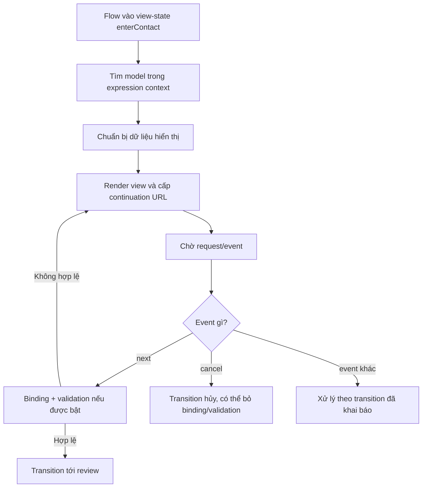
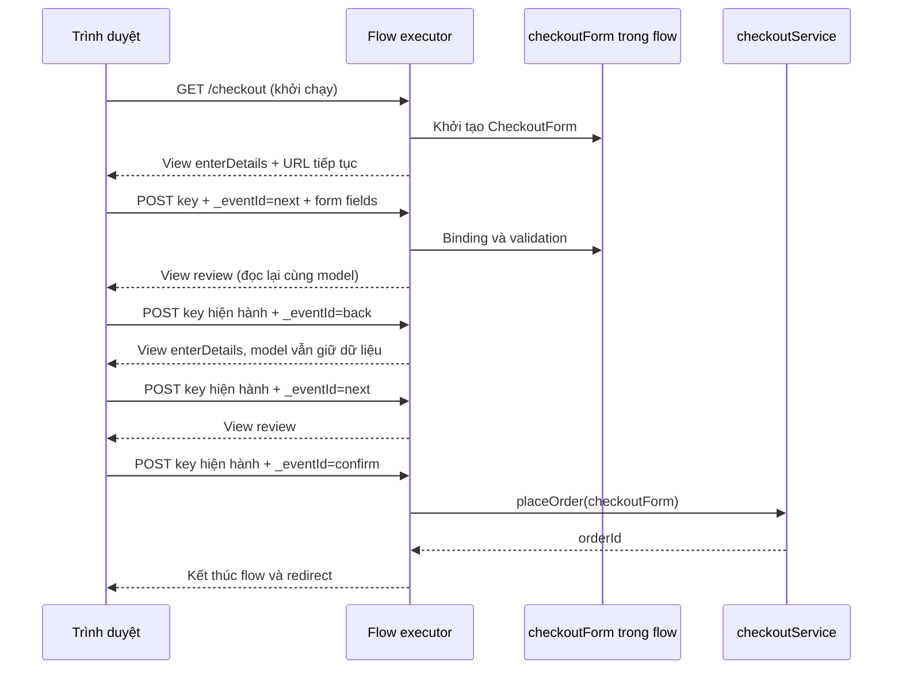

# Khai báo model phục vụ hiển thị và nhập liệu trong view-state

## 1. Mục tiêu của model trong Spring Web Flow

**Spring Web Flow (SWF)** dùng `view-state` để dừng một hành trình web nhiều bước ở màn hình cần tương tác với người dùng. Người dùng có thể nhập thông tin, gửi một `event` như `next`, `back` hoặc `confirm`, sau đó Web Flow xử lý binding, validation và chọn `transition` thích hợp.

Trong hành trình đặt hàng, form ở bước nhập địa chỉ cần giữ dữ liệu khi người dùng chuyển sang bước xem lại rồi quay về chỉnh sửa. Nếu chỉ dùng tham số của một HTTP request, dữ liệu sẽ không tự tồn tại qua nhiều request. Vì vậy, ta dùng **model object thuộc một scope của flow** và khai báo nó cho view-state thông qua thuộc tính `model`.

Ví dụ ngắn:

```xml
<var name="checkoutForm"
     class="com.example.checkout.CheckoutForm" />

<view-state id="enterAddress"
            view="checkout/address"
            model="checkoutForm">
    <transition on="next" to="review" />
</view-state>
```

Ở đây:

- `checkoutForm` là **đối tượng dữ liệu** được Web Flow tạo cho một flow execution từ khai báo `<var>`.
- `view="checkout/address"` chọn **view** để hiển thị. Tên view không phải tên model.
- `model="checkoutForm"` chỉ định **đối tượng dùng làm form model** để các trường trong request có thể được bind.
- Event `next` chọn transition từ `enterAddress` đến `review` nếu các điều kiện xử lý form cho phép.

**Điểm cốt lõi:** `view` và `model` giải quyết hai vấn đề khác nhau. View quyết định *hiển thị màn hình nào*; model quyết định *dữ liệu của màn hình được đọc và cập nhật trên đối tượng nào*.

## 2. Phân biệt view-state, model object và dữ liệu của view

Trong Spring MVC truyền thống, lập trình viên thường chuẩn bị `Model` trong controller và nhận form qua `@ModelAttribute`. Với Spring Web Flow, state machine giữ vai trò điều phối, còn `view-state` có cơ chế tích hợp với view và binding. Ta cần phân biệt:

| Thành phần | Vai trò | Ví dụ |
| --- | --- | --- |
| `<view-state>` | Một state dừng để render màn hình và chờ event | `enterAddress` |
| `view` | Tên view/đường dẫn do view resolver xử lý | `checkout/address` |
| `model` | Biểu thức tham chiếu tới form model cho binding | `checkoutForm` hoặc `flowScope.checkoutForm` |
| Java form/DTO | Nơi giữ những thuộc tính người dùng nhập | `CheckoutForm` |
| `flowScope` | Scope giữ dữ liệu qua các state của cùng flow | `flowScope.checkoutForm` |
| `viewScope` | Scope gắn với view-state hiện hành | `viewScope.shippingOptions` |
| `<binder>` | Giới hạn/điều chỉnh các thuộc tính được bind | `<binding property="email" />` |
| `<transition>` | Chọn bước tiếp theo theo event | `on="next" to="review"` |

Một view có thể cần **nhiều loại dữ liệu**: đối tượng form để nhập, danh sách quốc gia để chọn, thông điệp trạng thái và thông tin chỉ đọc. Không nhất thiết gom tất cả vào một DTO. Hãy xem `model` là **form model chính**, còn các giá trị chỉ dùng hiển thị có thể được đưa vào scope/model của view theo cơ chế tích hợp.

### 2.1. Model không phải tên một thuộc tính HTML

Trong flow XML:

```xml
<view-state id="enterContact" model="registrationForm">
    <transition on="next" to="review" />
</view-state>
```

Tên `registrationForm` được resolver biểu thức của Web Flow dùng để tìm **đối tượng**. Trong HTML, trường `name="email"` lại biểu thị **thuộc tính** của đối tượng đó cần được bind. Không viết `model="email"` nếu mục đích là bind nhiều trường của một `RegistrationForm`.

### 2.2. Vì sao không bind thẳng vào JPA entity?

Một entity `Customer` có thể chứa `id`, `role`, `creditLimit` hoặc những quan hệ không nên cho người dùng chỉnh sửa. Bind trực tiếp request vào toàn bộ entity có nguy cơ **over-posting/mass assignment** và gây rối ranh giới transaction/lazy loading.

Thiết kế an toàn hơn là khai báo một **form DTO** chỉ chứa dữ liệu cần nhập, giới hạn property được bind, rồi chuyển DTO sang nghiệp vụ qua service sau khi validate và kiểm tra quyền.

## 3. Vòng đời model trong một view-state

Mô tả khái quát một chu kỳ của view-state:



Đó là luồng thường gặp, không phải cam kết về số lần render hay thứ tự chi tiết của mọi interceptor. Tùy cấu hình transition, binding có thể tắt hoặc validation có thể được xử lý bổ sung bởi validator/service.

Khi flow đã dừng ở view-state, model và những dữ liệu cần thiết phải còn tồn tại để request sau có thể tiếp tục. Với `<var>` thuộc root flow, đối tượng thường được giữ cùng **flow execution** và có thể được tham chiếu qua các state khác.

Điều này khác với một object đặt trong `requestScope`: object chỉ tồn tại trong một lượt request thường **không phù hợp** làm model xuyên nhiều state.

## 4. Hai cách phổ biến để khởi tạo form model

### 4.1. Khai báo biến bằng `<var>`

Khi form object có constructor phù hợp và không đòi hỏi khởi tạo nghiệp vụ phức tạp:

```xml
<flow xmlns="http://www.springframework.org/schema/webflow">
    <var name="registrationForm"
         class="com.example.registration.RegistrationForm" />

    <view-state id="enterDetails"
                view="registration/details"
                model="registrationForm">
        <transition on="next" to="review" />
    </view-state>

    <view-state id="review"
                view="registration/review"
                model="registrationForm">
        <transition on="back" to="enterDetails" />
    </view-state>
</flow>
```

`<var>` khai báo **biến của flow**; không phải singleton bean Spring chia sẻ cho mọi người dùng. Hai root flow execution mới thường có **hai instance form độc lập**. Đây là điều kiện quan trọng để nhiều người dùng/nhiều tab không ghi đè dữ liệu của nhau.

Ví dụ trên chỉ minh họa việc khai báo model và chuyển state; dự án thật cần thêm nhánh kết thúc và những thành phần hạ tầng phù hợp.

### 4.2. Khởi tạo qua một Spring service ở `<on-start>`

Nếu form cần dữ liệu mặc định, thông tin người dùng hoặc bản nháp từ database, có thể khởi tạo ở đầu flow:

```xml
<on-start>
    <evaluate
        expression="registrationService.createForm()"
        result="flowScope.registrationForm" />
</on-start>

<view-state id="enterDetails"
            view="registration/details"
            model="flowScope.registrationForm">
    <transition on="next" to="review" />
</view-state>
```

Ở cách này, service `createForm()` phải trả về một đối tượng có những property mà binder/view mong đợi. Nếu muốn sử dụng một biến được tạo qua `<var>` thì không nên vô tình khởi tạo lại **cùng model** thêm lần nữa ở `<on-start>` khi không có lý do: điều đó làm tăng nguy cơ thay thế dữ liệu mà bạn muốn giữ.

**Không nên tạo form mới mỗi lần render.** Nếu đặt thao tác `createForm()` trong logic `<on-render>` hay `<on-entry>` mà không bảo vệ thích hợp, việc quay lại state hoặc render lại có thể làm mất dữ liệu đã nhập. Khởi tạo model ở thời điểm đầu hành trình hoặc ở một transition có chủ đích thường dễ kiểm soát hơn.

### 4.3. Chọn biểu thức model thích hợp

Hai kiểu tham chiếu thường thấy:

```xml
<!-- Tên biến được flow expression context phân giải. -->
<view-state id="enterName" model="registrationForm" />

<!-- Trỏ rõ tới một thuộc tính trong flow scope. -->
<view-state id="enterEmail" model="flowScope.registrationForm" />
```

Không phải mọi tên đều tự xuất hiện trong expression context. Nếu viết sai `registrationForm`, model là `null` hoặc class không có property tương ứng, framework có thể báo lỗi khi render, bind hoặc validate. Nên nhất quán giữa nơi khai báo object, tên được resolve và `modelAttribute` của view nếu dùng Spring form tag.

## 5. Tạo Java form object

Giả sử nghiệp vụ là đăng ký nhận hàng, có bốn giá trị nhập: tên, email, địa chỉ và chấp thuận điều khoản. Có thể dùng một JavaBean đơn giản:

```java
package com.example.checkout;

public class CheckoutForm {
    private String fullName;
    private String email;
    private String deliveryAddress;
    private boolean acceptedPolicy;

    public String getFullName() {
        return fullName;
    }
    public void setFullName(String fullName) {
        this.fullName = fullName;
    }

    public String getEmail() {
        return email;
    }
    public void setEmail(String email) {
        this.email = email;
    }

    public String getDeliveryAddress() {
        return deliveryAddress;
    }
    public void setDeliveryAddress(String deliveryAddress) {
        this.deliveryAddress = deliveryAddress;
    }

    public boolean isAcceptedPolicy() {
        return acceptedPolicy;
    }
    public void setAcceptedPolicy(boolean acceptedPolicy) {
        this.acceptedPolicy = acceptedPolicy;
    }
}
```

Các setter cho phép binder cập nhật thuộc tính khi người dùng submit. Nếu dự án dùng immutable types/records hoặc constructor binding, cần kiểm tra khả năng hỗ trợ tương ứng của phiên bản Web Flow và conversion service; **không mặc định** mẫu JavaBean trên có thể thay bằng bất kỳ immutable DTO mà không chỉnh binding.

### 5.1. Constraint validation không thể thay bằng HTML `required`

Ứng dụng nên kiểm tra dữ liệu ở server. Với stack tương ứng, có thể gắn Bean Validation:

```java
// Minh họa constraint, đặt trên các property trong form thực tế.
@NotBlank
private String fullName;

@NotBlank
@Email
private String email;

@NotBlank
private String deliveryAddress;

@AssertTrue
private boolean acceptedPolicy;
```

Import của Bean Validation có thể thuộc namespace `javax.validation.constraints` hoặc `jakarta.validation.constraints` tùy phiên bản Spring/Java/Jakarta mà ứng dụng dùng. Cần có validator được tích hợp vào Web Flow; chỉ thêm annotation nhưng không cấu hình validator phù hợp sẽ không bảo đảm các constraint chạy.

Lưu ý `required="true"` trên `<binding>` và `@AssertTrue` **khác nhau**: binder có thể yêu cầu field được cung cấp, nhưng nghiệp vụ còn cần xác minh checkbox thực sự là `true`.

## 6. Ví dụ flow hoàn chỉnh: nhập thông tin → xem lại → xác nhận

Flow sau sử dụng `CheckoutForm` làm model xuyên nhiều view-state. Các event `next`, `back`, `confirm` và `cancel` định nghĩa đường đi; dữ liệu nhập được giữ ở flow execution.

```xml
<?xml version="1.0" encoding="UTF-8"?>
<flow xmlns="http://www.springframework.org/schema/webflow"
      xmlns:xsi="http://www.w3.org/2001/XMLSchema-instance"
      xsi:schemaLocation="
        http://www.springframework.org/schema/webflow
        http://www.springframework.org/schema/webflow/spring-webflow.xsd">

    <var name="checkoutForm"
         class="com.example.checkout.CheckoutForm" />

    <view-state id="enterDetails"
                view="checkout/details"
                model="checkoutForm">
        <binder>
            <binding property="fullName" required="true" />
            <binding property="email" required="true" />
            <binding property="deliveryAddress" required="true" />
            <binding property="acceptedPolicy" />
        </binder>

        <transition on="next" to="review" />
        <transition on="cancel" to="cancelled"
                    bind="false" validate="false" />
    </view-state>

    <view-state id="review"
                view="checkout/review"
                model="checkoutForm">
        <transition on="back" to="enterDetails"
                    bind="false" validate="false" />
        <transition on="confirm" to="completed">
            <evaluate
                expression="checkoutService.placeOrder(checkoutForm)"
                result="flowScope.orderId" />
        </transition>
    </view-state>

    <end-state id="completed"
               view="externalRedirect:contextRelative:/checkout/success" />
    <end-state id="cancelled"
               view="externalRedirect:contextRelative:/checkout/cancelled" />
</flow>
```

Ví dụ giả định đã có Spring bean `checkoutService`, class `CheckoutForm`, flow registry/executor, tích hợp Spring MVC, view resolver và các route kết quả. Ngoài việc bảo đảm form hợp lệ, service phải **xác thực nghiệp vụ, quyền truy cập và chống tạo đơn lặp**.

### 6.1. Dòng dữ liệu qua các state



Từng continuation URL được Web Flow cấp theo repository/configuration; không dự đoán hoặc hardcode khóa `execution`. Khi người dùng bấm Back bằng **transition của flow**, model có thể giữ dữ liệu để hiển thị lại. Nút Back của trình duyệt không đồng nhất với event `back` và có thể liên quan tới snapshot cũ.

## 7. Hiển thị form bằng Spring MVC/JSP

Nếu Web Flow tích hợp với Spring MVC và view là JSP dùng Spring form tags, có thể khai báo:

```jsp
<%@ taglib prefix="form" uri="http://www.springframework.org/tags/form" %>

<form:form method="post"
           modelAttribute="checkoutForm"
           action="${flowExecutionUrl}">
    <label for="fullName">Họ tên</label>
    <form:input path="fullName" id="fullName" />
    <form:errors path="fullName" />

    <label for="email">Email</label>
    <form:input path="email" id="email" />
    <form:errors path="email" />

    <label for="deliveryAddress">Địa chỉ nhận hàng</label>
    <form:textarea path="deliveryAddress" id="deliveryAddress" />
    <form:errors path="deliveryAddress" />

    <label for="acceptedPolicy">Đồng ý điều khoản</label>
    <form:checkbox path="acceptedPolicy" id="acceptedPolicy" />
    <form:errors path="acceptedPolicy" />

    <button type="submit" name="_eventId_next" value="next">
        Tiếp tục
    </button>
    <button type="submit" name="_eventId_cancel" value="cancel">
        Hủy
    </button>
</form:form>
```

Giải thích:

1. `modelAttribute="checkoutForm"` chọn form backing object được đưa vào model của view; nó phải tương thích với `model="checkoutForm"` trong view-state.
2. `path="email"` trỏ tới property `email` của `CheckoutForm`; vì vậy class cần API truy cập property mà binder hỗ trợ.
3. `form:errors` cho phép view trình bày lỗi binding/validation khi adapter đã đưa lỗi tương ứng vào ngữ cảnh view.
4. `action="${flowExecutionUrl}"` đưa POST về **execution đang chạy**, không gửi về start URL để khởi tạo một flow khác.
5. `_eventId_next` và `_eventId_cancel` là quy ước đặt tên nút để gửi event phù hợp với `on="next"` và `on="cancel"`.

Nếu bật Spring Security, form POST cần có CSRF token theo cấu hình bảo mật. Đừng vô tình bỏ token khi viết form thủ công. Khi hiển thị dữ liệu người dùng ở vị trí chỉ đọc, cần HTML escape theo ngữ cảnh; tránh nội suy chuỗi chưa được encode trực tiếp vào markup/script.

**Ghi chú về stack giao diện:** đây là mẫu dùng **Spring form tags của JSP**. Thymeleaf có cách bind form riêng (chẳng hạn `th:object`, `th:field`); JSF có component/EL và vòng đời xử lý riêng. Không sao chép nguyên cú pháp JSP cho các engine khác mà không xem cơ chế tích hợp Web Flow của chúng.

### 7.1. Trang review có đọc được model không?

Trong view `checkout/review`, ta có thể hiển thị các giá trị của form model:

```jsp
<%@ taglib prefix="c" uri="http://java.sun.com/jsp/jstl/core" %>

<dl>
    <dt>Họ tên</dt>
    <dd><c:out value="${checkoutForm.fullName}" /></dd>

    <dt>Email</dt>
    <dd><c:out value="${checkoutForm.email}" /></dd>
</dl>

<form method="post" action="${flowExecutionUrl}">
    <button type="submit" name="_eventId_back" value="back">
        Quay lại sửa
    </button>
    <button type="submit" name="_eventId_confirm" value="confirm">
        Xác nhận
    </button>
</form>
```

`c:out` giúp escape nội dung khi xuất dữ liệu HTML theo thông lệ của JSTL. Ở trang review, nếu không cần người dùng thay đổi form fields, ta chỉ hiển thị dữ liệu thay vì tạo thêm input có thể gửi lại giá trị chưa được kiểm soát. Service vẫn phải kiểm tra trước khi ghi đơn.

## 8. Dữ liệu hiển thị khác với dữ liệu được nhập vào model

Một màn hình địa chỉ có thể cần danh sách tỉnh/thành và các lựa chọn giao hàng. Những thứ này thường không nên biến thành property thay đổi tùy ý của `CheckoutForm`. Có thể nạp dữ liệu chỉ dành cho view khi render:

```xml
<view-state id="enterDetails"
            view="checkout/details"
            model="checkoutForm">
    <on-render>
        <evaluate expression="shippingService.availableMethods()"
                  result="viewScope.shippingMethods" />
    </on-render>

    <transition on="next" to="review" />
</view-state>
```

Ví dụ cho thấy **form model** và **dữ liệu hỗ trợ render** có thể tách nhau. View có thể đọc `shippingMethods` trong ngữ cảnh view theo cấu hình tích hợp; nếu cần bind phương thức giao hàng đã chọn, hãy thêm một property phù hợp như `shippingMethodId` vào form và cho phép bind nó.

### 8.1. Cẩn thận với `<on-render>`

Logic trong `<on-render>` có thể được gọi mỗi khi framework render lại view, kể cả sau lỗi validation hoặc quay lại state. Vì thế:

- Phù hợp: truy vấn danh sách tùy chọn, chuẩn bị dữ liệu **chỉ đọc** cần hiển thị.
- Không phù hợp: tạo đơn hàng, trừ tiền, gửi email hoặc reset toàn bộ form ở mỗi lần render.
- Nếu danh sách rất lớn, cân nhắc phân trang/caching ở service thay vì giữ graph lớn trong `viewScope` hoặc `flowScope`.
- Nếu yêu cầu tính nhất quán, khi submit cần kiểm tra lại lựa chọn mà client gửi còn hợp lệ tại thời điểm thao tác nghiệp vụ.

Khi phải sinh model phụ từ dữ liệu request, hãy xác định rõ scope và validation. Request parameter không trở nên đáng tin chỉ vì đã được dùng ở `on-render`.

## 9. Chọn scope cho model trong hành trình nhiều bước

| Nơi giữ dữ liệu | Dùng khi nào? | Lưu ý |
| --- | --- | --- |
| `requestScope` | Chỉ cần trong request đang xử lý | Không phù hợp với form cần dùng ở nhiều bước |
| `viewScope` | Dữ liệu gắn với view-state hiện hành | Có thể mất khi rời state; không phù hợp với form cần quay lại từ state khác |
| `flowScope` | Form/biến phục vụ nhiều state trong cùng flow | Thường phù hợp với model nhiều bước |
| `conversationScope` | Ngữ cảnh chung cho root flow và subflow của cùng hành trình | Có thể sống lâu hơn một flow con; tránh lạm dụng |
| HTTP session | Dữ liệu cần chia sẻ qua nhiều flow độc lập theo thiết kế rõ ràng | Nguy cơ hai tab/flow ghi đè dữ liệu nếu dùng chung form |
| Database/draft storage | Dữ liệu cần tồn tại qua timeout, logout hoặc deploy | Cần quản lý chủ sở hữu, version, cập nhật và quyền |

### 9.1. Vì sao flowScope thường là lựa chọn tốt?

Nếu `checkoutForm` nằm ở `flowScope` hoặc được tạo bằng `<var>`, các state `enterDetails` và `review` thuộc cùng flow có thể dùng lại đối tượng. Khi rời view-state, `viewScope` có thể được làm mới; vì vậy đặt model nhiều bước trong viewScope dễ gây mất dữ liệu ở lần quay lại.

Ngược lại, nếu toàn bộ form chỉ tồn tại ở một state duy nhất, viewScope có thể phù hợp nếu logic của flow và repository cho phép. **Chọn scope theo vòng đời dữ liệu thực tế**, không phải theo tên thành phần giao diện.

### 9.2. Khi chuyển sang subflow

Root flow và subflow có `flowScope` riêng. Nếu subflow cần một phần dữ liệu của form cha, nên khai báo input/output tường minh:

```xml
<subflow-state id="selectShipping" subflow="shippingOptions">
    <input name="currentAddress"
           value="flowScope.checkoutForm.deliveryAddress" />

    <transition on="done" to="review">
        <set name="flowScope.checkoutForm.shippingMethodId"
             value="currentEvent.attributes.shippingMethodId" />
    </transition>
</subflow-state>
```

Subflow cần khai báo `<input name="currentAddress" />` và `<output name="shippingMethodId" ... />` ở end-state tương ứng. Mẫu này tránh giả định subflow tự thấy toàn bộ `flowScope` của cha. Đảm bảo `CheckoutForm` có property `shippingMethodId` nếu triển khai ví dụ.

### 9.3. Kết thúc execution thì model đi đâu?

Khi flow đến end-state, execution có thể được repository giải phóng. Dữ liệu trong `flowScope` không phải nơi lưu bền vững. Nếu cần hiển thị đơn hàng ngày hôm sau, nên dùng `orderId` và service/database thay vì cố resume URL `?execution=...` cũ.

## 10. Binding: giới hạn trường được phép cập nhật

Một biểu mẫu có thể gửi nhiều HTTP parameter hơn những input hiện trên giao diện. Người dùng có thể tự tạo POST:

```text
fullName=An Nguyen
email=an@example.test
deliveryAddress=...
role=ADMIN
price=0
```

Nếu bind tự do vào đối tượng có những thuộc tính nhạy cảm, ứng dụng có thể gặp **mass assignment**. Vì vậy `<binder>` ở view-state hữu ích để khai báo những property dự kiến nhận input:

```xml
<view-state id="enterDetails"
            model="checkoutForm">
    <binder>
        <binding property="fullName" required="true" />
        <binding property="email" required="true" />
        <binding property="deliveryAddress" required="true" />
        <binding property="acceptedPolicy" />
    </binder>
    <transition on="next" to="review" />
</view-state>
```

Lưu ý rằng `required` ở binding kiểm tra tính hiện diện/khả năng bind theo cơ chế tương ứng, **không thay thế** validation nội dung như email hợp lệ, độ dài địa chỉ, điều khoản phải được chấp nhận hoặc kiểm tra bảo mật của service.

### 10.1. Trường lồng nhau và conversion

Với property lồng nhau như `address.cityId` hoặc danh sách như `items[0].quantity`, binder cần hỗ trợ đường dẫn property tương ứng, giá trị trung gian hợp lệ và converter phù hợp.

Nếu form dùng enum, `LocalDate`, `BigDecimal` hoặc ID kiểu số, hãy kiểm tra việc chuyển từ chuỗi HTTP tới kiểu Java. Một giá trị sai định dạng phải tạo lỗi binding được báo rõ cho người dùng, không tự động đi qua transition `next`.

**Quy tắc bảo mật:** ID từ form chỉ là input được cung cấp bởi client. Khi service tải địa chỉ, đơn hàng hoặc sản phẩm theo ID, phải kiểm tra quyền sở hữu và điều kiện nghiệp vụ.

## 11. Validation và chuyển trạng thái

Một flow thường cần validation ở nhiều tầng:

1. **Binding/conversion:** trường trong request có map được vào model không?
2. **Bean Validation hoặc validator của Web Flow:** property có hợp lệ, bắt buộc, đúng định dạng không?
3. **Validation nghiệp vụ ở service:** email đã được đăng ký chưa, đơn hàng có quyền truy cập không, giá hiện tại có hợp lệ không?

Việc view có `model` tạo điều kiện cho xử lý binding/validation; nhưng **validator phải được kết nối phù hợp**. Tùy phiên bản/configuration, Web Flow có thể hỗ trợ validator tích hợp Bean Validation hoặc phương thức validate theo state trên model/validator. Không mặc định annotation tự chạy ở mọi project.

### 11.1. Khi validation thất bại

Giả sử người dùng bấm `next` nhưng gửi email không hợp lệ. Với xử lý binding/validation được bật, flow có thể:

- Ghi lỗi vào ngữ cảnh validation/message.
- Giữ lại view-state hiện tại.
- Render lại form với dữ liệu người dùng vừa nhập và thông báo lỗi.
- Không chạy action ghi nghiệp vụ hoặc chuyển sang review.

Test nên xác minh **state không đổi**, lỗi được hiển thị và những trường hợp lệ vẫn được giữ lại.

### 11.2. Back và Cancel không nên bị chặn bởi form chưa hoàn chỉnh

Nếu người dùng nhấn Quay lại hoặc Hủy khi form chưa hợp lệ, có thể cấu hình transition bỏ binding/validation:

```xml
<transition on="back" to="previous"
            bind="false" validate="false" />

<transition on="cancel" to="cancelled"
            bind="false" validate="false" />
```

Tuy vậy, nếu event `saveDraft` cần giữ các giá trị đang nhập dở, tắt binding hoàn toàn sẽ khiến dữ liệu mới chưa cập nhật vào model. Thiết kế `saveDraft` cần quyết định **có bind hay không** và **mức validation nào** phù hợp với yêu cầu lưu nháp.

### 11.3. Không dùng model như biện pháp xác thực

Model có thể chứa `customerId` và `orderId`, nhưng các giá trị ấy vẫn có thể đến từ request. Chuyển state thành công không bảo đảm người dùng được phép tạo đơn. Bước `confirm` phải dùng service thực thi business validation/authorization và xử lý yêu cầu trùng một cách nhất quán.

## 12. Các lỗi thường gặp khi khai báo model

| Hiện tượng | Nguyên nhân khả dĩ | Hướng xử lý |
| --- | --- | --- |
| Render/bind báo không tìm thấy model | `model` trỏ sai tên, chưa khởi tạo biến, expression không resolve | Kiểm tra `<var>`, `<on-start>` và scope được dùng |
| Field không cập nhật sau POST | `name/path` khác property, setter thiếu, binder không cho phép field | Kiểm tra payload, JavaBean property và `<binding>` |
| Nhấn Next quay về bước đầu | Form action trỏ start URL, thiếu continuation key | Dùng `flowExecutionUrl` hoặc cơ chế tương ứng |
| Đi qua review rồi Back mất dữ liệu | Model tạo trong request/view scope hoặc bị khởi tạo lại khi render | Giữ DTO ở flowScope, tránh reset trong on-entry/on-render |
| Email invalid vẫn tới review | Validator chưa được kết nối hoặc transition tắt validation | Kiểm tra cấu hình validation và test negative case |
| Nút Cancel yêu cầu điền đủ form | Cancel transition vẫn bind/validate | Xem `bind="false" validate="false"` |
| Value sai kiểu gây lỗi chuyển đổi | Thiếu formatter/converter, dữ liệu không hợp lệ | Cấu hình conversion service, hiển thị lỗi field |
| Hai tab mới chia sẻ cùng dữ liệu | Dùng singleton bean/static/session form chung | Dùng form thuộc mỗi flow execution và key riêng |
| Cần dữ liệu trong subflow nhưng thấy null | Hiểu nhầm flowScope cha thành flowScope con | Khai báo `<input>` và `<output>` |
| Model quá lớn, heap tăng | Lưu entity graph/file bytes/lists lớn qua nhiều snapshot | Giữ ID/DTO nhỏ, tải lại dữ liệu qua service |
| Người dùng sửa field nhạy cảm qua request | Binder mở rộng, bind trực tiếp entity | Allowlist field, DTO riêng, authorization ở service |
| Ghi đơn hàng hai lần | Confirm bị gửi lặp, service thiếu idempotency | Transaction/unique constraint/idempotency phù hợp |

### 12.1. Quy trình debug một lần submit

Đi theo thứ tự:

1. **URL và session:** request có về đúng continuation URL của execution không?
2. **Event:** `_eventId` hoặc `_eventId_next` có đúng với transition đang khai báo không?
3. **Model resolution:** expression `model` có trả về đúng instance không?
4. **Binding:** HTTP field names có map được với JavaBean properties và binder allowlist không?
5. **Validation:** có conversion errors/constraint violations không?
6. **Transition/action:** nếu validation đạt, service có chạy và chuyển đúng state không?

Khi log lỗi, tránh ghi dữ liệu cá nhân nhạy cảm, session cookie hoặc toàn bộ form object. Dùng correlation ID và mã lỗi phù hợp.

## 13. Kiểm thử model trong hành trình nhiều bước

Nên kết hợp **flow-level tests** với **HTTP integration tests**. Nhóm thứ nhất xác minh state, binding, validation và transition khi gửi event; nhóm thứ hai kiểm tra view form, session cookie, execution key và redirect thực tế.

### 13.1. Ma trận ca thử

| Ca thử | Dữ liệu/event | Kỳ vọng |
| --- | --- | --- |
| Launch | Vào start URL `/checkout` | Tạo model mới, initial state `enterDetails` |
| Next hợp lệ | Gửi đủ field, `_eventId=next` | Bind model rồi tới `review` |
| Next thiếu email | Gửi `next` nhưng `email` rỗng | Ở lại màn hình nhập và hiển thị lỗi |
| Email sai định dạng | Gửi chuỗi không phải email | Validator báo lỗi nếu được cấu hình |
| Back từ review | `_eventId=back` | Về `enterDetails`, form giữ giá trị đã nhập |
| Cancel với form trống | `_eventId=cancel` | Kết thúc theo transition, không chặn bởi required field |
| Confirm thành công | `_eventId=confirm` từ `review` | Service nhận dữ liệu đã validate; flow kết thúc |
| Confirm ở state nhập | Gửi `confirm` tại `enterDetails` | Không được bỏ qua state để ghi đơn |
| Field ngoài allowlist | Gửi thêm `role=ADMIN` hoặc `price=0` | Không thay đổi thuộc tính nhạy cảm |
| Hai start requests | Khởi chạy hai checkout trong một HTTP session | Mỗi execution có model riêng nếu repository hỗ trợ |
| Hết phiên | Gửi event với key sau khi session hết hạn | Không resume được model cũ; có đường phục hồi |
| Retry confirm | Gửi hai event xác nhận | Không tạo hai đơn hàng do thiếu bảo vệ |

### 13.2. Mẫu pseudo-test ở mức flow

```text
launchFlow("checkout")
assertCurrentState("enterDetails")

setCurrentRequestParameters(
    fullName="An Nguyen",
    email="an@example.test",
    deliveryAddress="Hanoi",
    acceptedPolicy="true"
)
signalEvent("next")
assertCurrentState("review")
assertFlowModel("checkoutForm").email == "an@example.test"

signalEvent("back")
assertCurrentState("enterDetails")
assertFlowModel("checkoutForm").fullName == "An Nguyen"
```

Đây là **pseudocode mô tả các assertion cần có**, không phải API chạy trực tiếp. Các lớp kiểm thử của Spring Web Flow và cách dựng `MockExternalContext` phụ thuộc thư viện/version; bạn có thể sử dụng test support tương ứng để hiện thực kịch bản. Khi test HTTP bằng MockMvc, cần giữ `MockHttpSession` giữa các request và lấy continuation URL hiện hành từ response/view thay vì hardcode `execution=e1s1`.

### 13.3. Kiểm thử hồi quy khi đổi cấu hình

Sau khi đổi parser SpEL/Unified EL, form binding, conversion service, validator hoặc view engine, hãy kiểm thử lại:

- Model expression còn resolve đúng đối tượng trong flow scope không?
- Form tag/Thymeleaf/JSF có đọc đúng dữ liệu và lỗi validation không?
- Các nút `next`, `back`, `cancel` phát đúng event không?
- Khi lỗi validation, người dùng còn thấy giá trị đã nhập không?
- Subflow có nhận/trả dữ liệu đúng hợp đồng không?
- Khi session hết hạn, có đường khôi phục phù hợp không?

## 14. Bài tập thực hành

### Bài 1 — Chọn nơi khởi tạo model

Một flow đặt lịch có ba state `enterCustomer` → `selectTime` → `review`. Dữ liệu khách hàng phải giữ nguyên khi quay lại từ `review`. Nên đặt `BookingForm` ở đâu?

**Gợi ý đáp án:** dùng một model thuộc flow execution, ví dụ `<var name="bookingForm" class="...BookingForm" />` hoặc tạo trong `<on-start>` rồi lưu `flowScope.bookingForm`. Không tạo lại form trong `<on-render>` của từng view-state.

### Bài 2 — Tìm lỗi trong form JSP

Flow có:

```xml
<view-state id="enterEmail" model="registrationForm">
    <transition on="next" to="review" />
</view-state>
```

Nhưng JSP lại dùng:

```jsp
<form:form modelAttribute="user" action="/registration">
    <form:input path="email" />
    <button type="submit" name="_eventId_next">Tiếp tục</button>
</form:form>
```

**Câu hỏi:** ít nhất hai vấn đề nào cần kiểm tra?

**Gợi ý đáp án:** `modelAttribute="user"` không nhất quán với form model `registrationForm`, và `action="/registration"` có thể là start URL, không có execution key. Cần thống nhất model attribute với dữ liệu thực tế view nhận được và dùng continuation URL của Web Flow; thêm `method="post"` cùng CSRF nếu cần.

### Bài 3 — Validation khi quay lại

Người dùng đang ở `review`, muốn nhấn `back` trong lúc một trường không hợp lệ. Làm cách nào để không chặn thao tác quay lại?

**Gợi ý đáp án:** trên transition quay lại, sử dụng `bind="false"` và `validate="false"` nếu không cần lấy dữ liệu mới từ view review. Nếu muốn giữ các field đang sửa trong cùng request, phải thiết kế binding có chủ đích thay vì tắt toàn bộ.

### Bài 4 — Truyền model tới subflow

Root flow giữ `flowScope.checkoutForm.deliveryAddress`, còn subflow lựa chọn vận chuyển cần biết địa chỉ và trả về `shippingMethodId`.

**Gợi ý:** truyền địa chỉ qua `<input>`; subflow khai báo input và trả giá trị qua `<output>`. Parent nhận output ở transition `done` và cập nhật property thích hợp của form. Không giả định subflow tự có `flowScope.checkoutForm` của root.

### Bài 5 — Bảo mật binding

Form cho phép sửa tên và email, nhưng người dùng tự thêm `role=ADMIN` vào request. Vì sao một model khai báo đúng vẫn chưa đủ bảo vệ?

**Đáp án:** khai báo `model` chỉ xác định đối tượng để bind; nó không thay thế allowlist property hay authorization. Dùng form DTO chỉ có các field cần thiết, khai báo binder cho phép những property mong muốn, và kiểm tra quyền ở service trước khi thay đổi dữ liệu.

## 15. Ghi nhớ

- Trong Spring Web Flow, `view-state` xác định màn hình; thuộc tính **`model` xác định form object** dùng cho hiển thị và binding.
- Có thể khởi tạo model bằng **`<var>` hoặc `<on-start>`** rồi giữ ở scope phù hợp. Với form nhiều bước, **flowScope** thường tốt hơn requestScope hoặc viewScope.
- `view`, `model`, JavaBean property và `modelAttribute` của view engine là các tầng khác nhau nhưng phải nhất quán.
- `<binder>`, conversion service và validator kiểm soát cách cập nhật model; **validation nghiệp vụ và authorization** vẫn phải thực hiện ở service.
- `next`, `back`, `cancel` và `confirm` có thể cần cấu hình binding/validation khác nhau; form phải gửi event về **continuation URL**, không phải start URL.
- Dữ liệu hỗ trợ render như danh sách lựa chọn nên tách khỏi form model và tránh thao tác ghi trong `<on-render>`.
- Khi có subflow, truyền dữ liệu qua input/output rõ ràng. Khi flow kết thúc hoặc session hết hạn, cần dựa vào kho dữ liệu bền vững thay vì form model còn trong execution.
