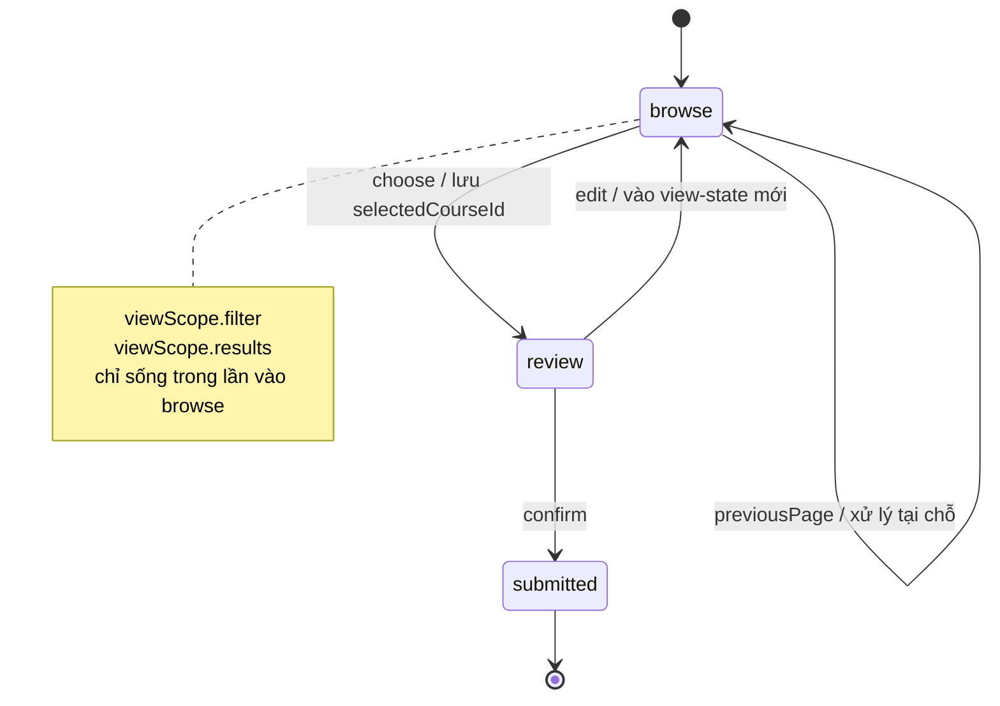
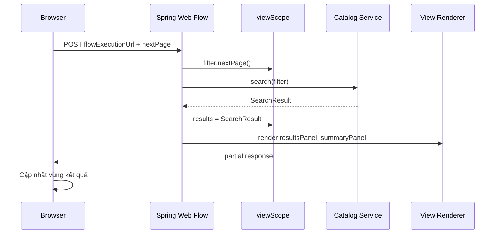

# Tạo biến chỉ tồn tại trong một view-state

Trong một flow nhiều bước, không phải dữ liệu nào cũng cần tồn tại từ đầu đến cuối hành trình. Chẳng hạn, người dùng đăng ký khóa học qua ba bước **tìm khóa học → xem lại lựa chọn → xác nhận**. Ở màn tìm kiếm, ứng dụng cần giữ từ khóa, trang kết quả đang xem và danh sách khóa học để hỗ trợ phân trang hay tìm kiếm Ajax. Nhưng sau khi người dùng rời màn này, màn xem lại chỉ cần biết **khóa học đã chọn**, không cần mang theo toàn bộ dữ liệu tìm kiếm.

**Spring Web Flow** hỗ trợ mô hình này bằng biến sống trong **`viewScope`**. Một cách trực tiếp là khai báo `<var>` **bên trong `<view-state>`**, thay vì ở cấp `<flow>`. Biến sẽ được tạo khi vào view-state và được quản lý trong phạm vi view đang hoạt động; khi rời state, không nên tiếp tục dựa vào biến đó.

Bài thuộc chương **View-state** của module **SPRING_WEB_FLOW**. Trọng tâm là **tạo biến chỉ tồn tại trong một view-state**, sau đó dùng nó với model binding, validation, event, transition, cập nhật Ajax và quản lý dữ liệu khi quay lại. Các ví dụ cũng liên hệ tới Spring MVC, execution URL, phiên làm việc, kiểm thử và phục hồi lỗi trong một hành trình web.

Mục tiêu học tập:

1. Phân biệt `<var>` ở cấp flow với `<var>` bên trong `<view-state>`.
2. Hiểu khi nào biến view-local được khởi tạo, cập nhật và hết vòng đời.
3. Tạo model view-local bằng JavaBean, bind form vào model đó và lưu kết quả truy vấn trong `viewScope`.
4. Sử dụng event ở lại cùng view-state để phân trang/lọc mà không vô tình xóa biến.
5. Chuyển **dữ liệu cần giữ lâu hơn** sang `flowScope` trước khi rời state.
6. Kiểm thử sự khác nhau giữa làm mới tại chỗ và rời màn rồi quay lại.

## 1. Hai vị trí khai báo `<var>` — hai vòng đời khác nhau

Xét hai đoạn XML:

**Biến của cả flow:**

```xml
<flow xmlns="http://www.springframework.org/schema/webflow">
    <var name="registration"
         class="com.example.registration.RegistrationDraft"/>

    <view-state id="browse" view="catalog/browse">
        <!-- Có thể dùng registration trong state này. -->
    </view-state>
</flow>
```

**Biến chỉ thuộc màn `browse`:**

```xml
<flow xmlns="http://www.springframework.org/schema/webflow">
    <view-state id="browse" view="catalog/browse">
        <var name="filter"
             class="com.example.catalog.CourseFilter"/>
    </view-state>
</flow>
```

Khác biệt quan trọng nằm ở **vị trí của phần tử `<var>`**:

| Đặc điểm | `<var>` trong `<flow>` | `<var>` trong `<view-state>` |
| --- | --- | --- |
| Phạm vi mặc định | `flowScope` | `viewScope` |
| Được tạo khi | Flow execution bắt đầu | Execution đi vào view-state |
| Sống qua transition sang state khác | Có, trong vòng đời flow | Không, scope của view-state cũ kết thúc |
| Thích hợp cho | Bản nháp, thông tin cần dùng qua nhiều bước | Bộ lọc, phân trang, trạng thái UI cục bộ |
| Khi quay lại một state | Còn dữ liệu của flow nếu chưa bị thay đổi | View-state mới có biến cục bộ mới |
| Dùng khi xác nhận nghiệp vụ | Có thể chứa dữ liệu cần truyền cho service | Không nên là nguồn dữ liệu duy nhất sau khi rời state |

Với biến được khai báo bằng `<var>`, Spring Web Flow tạo một instance của class tương ứng. Class cần phù hợp với cách framework khởi tạo, ví dụ JavaBean có constructor không tham số, và **nên triển khai `Serializable`** vì execution/snapshot có thể được lưu giữa các request.

Một biến view-local có thể được tham chiếu theo tên `filter` trong biểu thức của view-state, hoặc viết rõ `viewScope.filter` khi cần phân biệt. Khả năng truy cập từ JSP/JSF phụ thuộc cơ chế view/EL đã tích hợp; hãy kiểm tra tên model thực tế được đưa tới template.

## 2. viewScope được tạo và hủy ở thời điểm nào?

`viewScope` gắn với **một lần đi vào view-state của một flow execution**. Nó không tương đương HTTP request và cũng không tương đương một object lưu toàn cục trong session.

Các bước thường gặp:

1. Flow chuyển từ `chooseCategory` vào `browse`.
2. Web Flow tạo view scope mới cho `browse`, trong đó có biến `filter` đã khai báo.
3. Màn `browse` được render; dữ liệu trong `filter` có thể được bind và đọc qua nhiều request khi vẫn ở state này.
4. Người dùng gửi event `search`, `nextPage` hoặc `previousPage`. Nếu transition chỉ xử lý tại chỗ và **không có thuộc tính `to`**, view-state hiện hành vẫn được sử dụng.
5. Người dùng chọn khóa học rồi chuyển tới `review`. View scope của lần vào `browse` đó kết thúc.
6. Từ `review`, người dùng nhấn `edit` để quay lại `browse`. Đây là lần vào mới, nên biến `filter` được khởi tạo mới theo cấu hình.



**Lưu ý cách đọc sơ đồ:** các mũi tên `browse → browse` chỉ mô tả **giao diện vẫn ở cùng màn**. Trong XML, để giữ view-state/viewScope hiện tại, nên dùng transition **không chỉ định `to`**. Một self-transition viết `to="browse"` có thể gây thoát và vào lại state, làm thay đổi vòng đời biến; không dùng hai dạng này như thể chúng chắc chắn tương đương.

### viewScope khác requestScope ở điểm nào?

Nếu mỗi lần tìm kiếm Ajax đều tạo HTTP request mới, `requestScope` trước đó đã hết. `viewScope` có thể giữ `filter.pageIndex` và các giá trị UI qua những request đó **miễn là execution vẫn ở cùng view-state**.

### viewScope có sống sau khi chuyển sang review không?

Không theo hợp đồng vòng đời. Nếu `review` cần `selectedCourseId`, phải đưa giá trị đó vào một phạm vi rộng hơn, chẳng hạn `flowScope.registration.selectedCourseId`, **trước khi rời `browse`**.

## 3. Lựa chọn giữa biến view-local và dữ liệu cần đi qua nhiều màn

Trong ví dụ đăng ký khóa học, ta chia dữ liệu như sau:

| Dữ liệu | Mục đích | Vị trí đề xuất |
| --- | --- | --- |
| `filter.keyword` | Từ khóa tìm kiếm | Biến `filter` trong `viewScope` |
| `filter.level` | Cấp độ khóa học cần lọc | Biến `filter` trong `viewScope` |
| `filter.pageIndex` | Trang kết quả đang xem | Biến `filter` trong `viewScope` |
| `filter.selectedCourseId` | Lựa chọn tạm trên màn tìm kiếm | Có thể ở `viewScope` cho tới lúc người dùng nhấn Chọn |
| `viewScope.results` | Kết quả tìm kiếm để render | `viewScope` |
| `registration.selectedCourseId` | ID cần hiển thị ở review và dùng khi xác nhận | `flowScope` |
| `registration.requestId` | Khóa cho yêu cầu đăng ký logic, chống gửi lặp | `flowScope`, server quản lý |
| Bản ghi đăng ký đã xác nhận | Kết quả nghiệp vụ bền vững | Database |

Không phải biến nào *có thể* đặt trong flow scope cũng *nên* đặt ở đó. Giữ toàn bộ kết quả tìm kiếm trong `flowScope` khiến object sống qua nhiều state không cần thiết và có thể làm tăng kích thước snapshot.

Ngược lại, đưa `selectedCourseId` duy nhất vào view scope rồi rời màn sẽ khiến `review` thiếu dữ liệu. Vì vậy **biến cục bộ cần có ranh giới xuất dữ liệu rõ ràng** khi transition sang state khác.

## 4. Tạo JavaBean cho biến view-state

`CourseFilter` chứa trạng thái tìm kiếm và phân trang trên màn `browse`:

```java
package com.example.catalog;

import java.io.Serializable;

public class CourseFilter implements Serializable {
    private static final long serialVersionUID = 1L;

    private String keyword = "";
    private String level = "ALL";
    private String selectedCourseId;
    private int pageIndex = 0;

    public CourseFilter() {}

    public String getKeyword() { return keyword; }
    public void setKeyword(String keyword) {
        this.keyword = keyword;
    }

    public String getLevel() { return level; }
    public void setLevel(String level) {
        this.level = level;
    }

    public String getSelectedCourseId() {
        return selectedCourseId;
    }
    public void setSelectedCourseId(String selectedCourseId) {
        this.selectedCourseId = selectedCourseId;
    }

    public int getPageIndex() { return pageIndex; }

    public void resetPage() { pageIndex = 0; }

    public void nextPage() {
        if (pageIndex < 100) {
            pageIndex++;
        }
    }

    public void previousPage() {
        if (pageIndex > 0) {
            pageIndex--;
        }
    }
}
```

Trong ứng dụng thực tế, service phải giới hạn pagination và xác định có trang tiếp theo hay không; giới hạn `100` chỉ là hàng rào đơn giản của ví dụ, không phải quy tắc nghiệp vụ chung.

Để giữ lựa chọn qua các màn, tạo model ở cấp flow:

```java
package com.example.registration;

import java.io.Serializable;
import java.util.UUID;

public class RegistrationDraft implements Serializable {
    private static final long serialVersionUID = 1L;

    private String selectedCourseId;
    private final String requestId = UUID.randomUUID().toString();

    public RegistrationDraft() {}

    public String getSelectedCourseId() {
        return selectedCourseId;
    }

    public void setSelectedCourseId(String selectedCourseId) {
        this.selectedCourseId = selectedCourseId;
    }

    public String getRequestId() {
        return requestId;
    }
}
```

Hai object khác nhau về vòng đời:

- `CourseFilter` chỉ tồn tại trong lần vào `browse`.
- `RegistrationDraft` tồn tại từ khi flow bắt đầu cho đến khi kết thúc và phục vụ bước `review`/`confirm`.

Không để client tùy ý bind `requestId`. Khóa này phải do server quản lý và được service sử dụng theo cơ chế idempotency khi có thao tác ghi.

## 5. XML tối thiểu: khai báo biến bên trong view-state

Đây là ví dụ nhỏ nhất thể hiện đúng trọng tâm:

```xml
<view-state id="browse"
            view="catalog/browse"
            model="filter">

    <var name="filter"
         class="com.example.catalog.CourseFilter"/>

    <transition on="search"/>
    <transition on="cancel" to="cancelled"
                bind="false" validate="false"/>
</view-state>
```

Ý nghĩa:

- `<view-state id="browse">` định nghĩa màn hình nhận event.
- `<var name="filter" .../>` đặt **bên trong** view-state nên tạo **view instance variable**.
- `model="filter"` yêu cầu form ở view này bind dữ liệu vào object `filter`.
- `<transition on="search"/>` là một event được xử lý trong view-state, không chuyển state đích.
- `cancel` rời màn và có `bind="false" validate="false"` để không bị chặn bởi dữ liệu nhập dở.

Phần tử `<var>` khác với `<set>`: `<var>` khai báo một object theo class và vòng đời, còn `<set>` gán một giá trị/biểu thức vào biến hoặc property đã có.

**Đừng đặt `<var>` ở cấp `<flow>` rồi mong nó biến mất khi rời `browse`**. Cùng tên biến nhưng vị trí khai báo thay đổi phạm vi sống của nó.

## 6. XML hoàn chỉnh: biến cục bộ, dữ liệu render và chuyển thông tin tới review

Ví dụ `catalog-registration-flow.xml` sau bao gồm model toàn flow, model cục bộ của màn `browse`, render results và action đăng ký. Các class `CourseFilter`, `RegistrationDraft`, bean `courseCatalogService`, `registrationAction` và view templates phải được cung cấp bởi ứng dụng; đoạn flow giả định chúng đã được đăng ký.

```xml
<?xml version="1.0" encoding="UTF-8"?>
<flow xmlns="http://www.springframework.org/schema/webflow"
      xmlns:xsi="http://www.w3.org/2001/XMLSchema-instance"
      xsi:schemaLocation="
        http://www.springframework.org/schema/webflow
        http://www.springframework.org/schema/webflow/spring-webflow.xsd"
      start-state="browse">

    <!-- Biến dùng chung từ browse đến review/confirm. -->
    <var name="registration"
         class="com.example.registration.RegistrationDraft"/>

    <view-state id="browse"
                view="catalog/browse"
                model="filter">

        <!-- Biến chỉ tồn tại trong lần vào browse. -->
        <var name="filter"
             class="com.example.catalog.CourseFilter"/>

        <!-- Tránh cho form sửa trực tiếp pageIndex và field nội bộ. -->
        <binder>
            <binding property="keyword"/>
            <binding property="level"/>
            <binding property="selectedCourseId"/>
        </binder>

        <!-- Nạp dữ liệu mỗi khi render browse. -->
        <on-render>
            <evaluate
                expression="courseCatalogService.search(filter)"
                result="viewScope.results"/>
        </on-render>

        <!-- Tìm kiếm tại chỗ, bind bộ lọc nhưng chưa bắt buộc chọn khóa học. -->
        <transition on="search"
                    bind="true"
                    validate="false">
            <evaluate expression="filter.resetPage()"/>
            <render fragments="resultsPanel,summaryPanel"/>
        </transition>

        <!-- Chuyển trang ở cùng view-state, không bind form. -->
        <transition on="nextPage"
                    bind="false"
                    validate="false">
            <evaluate expression="filter.nextPage()"/>
            <render fragments="resultsPanel,summaryPanel"/>
        </transition>

        <transition on="previousPage"
                    bind="false"
                    validate="false">
            <evaluate expression="filter.previousPage()"/>
            <render fragments="resultsPanel,summaryPanel"/>
        </transition>

        <!-- Chuyển đúng một giá trị cần sống tiếp sang flowScope. -->
        <transition on="choose"
                    to="review"
                    bind="true"
                    validate="true">
            <set name="registration.selectedCourseId"
                 value="filter.selectedCourseId"/>
        </transition>

        <transition on="cancel"
                    to="cancelled"
                    bind="false"
                    validate="false"/>
    </view-state>

    <view-state id="review" view="catalog/review">
        <transition on="edit" to="browse"/>
        <transition on="confirm" to="submitRegistration"/>
        <transition on="cancel" to="cancelled"/>
    </view-state>

    <action-state id="submitRegistration">
        <evaluate expression="registrationAction.submit(registration)"/>
        <transition on="success" to="completed"/>
        <transition on="unavailable" to="unavailable"/>
        <transition on="retryableFailure" to="retryView"/>
    </action-state>

    <view-state id="unavailable" view="catalog/unavailable">
        <transition on="chooseAgain" to="browse"/>
        <transition on="cancel" to="cancelled"/>
    </view-state>

    <view-state id="retryView" view="catalog/retry">
        <transition on="retry" to="submitRegistration"/>
        <transition on="cancel" to="cancelled"/>
    </view-state>

    <end-state id="completed" view="catalog/completed"/>
    <end-state id="cancelled" view="catalog/cancelled"/>
</flow>
```

### Vì sao hai vị trí `<var>` rất quan trọng?

Ở cấp root, `registration` thuộc flow scope nên `review` và `submitRegistration` đọc được `registration.selectedCourseId`.

Ở bên trong `browse`, `filter` thuộc view scope. Các transition `search`/`nextPage` có thể sử dụng nó vì flow chưa rời view-state. Khi `choose` chuyển sang `review`, XML chỉ **sao chép ID khóa học cần thiết** bằng `<set name="registration.selectedCourseId" value="filter.selectedCourseId"/>`; không chuyển object `filter` hay danh sách `results`.

Tại `review`, không nên viết `filter.selectedCourseId` vì view-local model không còn thuộc ngữ cảnh đang hoạt động. Hãy dùng `registration.selectedCourseId`.

### Kết quả của action trong `on-render` cũng có thể là biến view-local

`result="viewScope.results"` đặt dữ liệu trả về từ `courseCatalogService.search(filter)` vào view scope. Đây là **cách thứ hai tạo một entry trong view scope**: không khai báo bằng `<var>` mà gán kết quả vào tên thuộc phạm vi view.

Vì `on-render` được gọi trước khi render view, bao gồm các lần render lại phù hợp, kết quả tìm kiếm có thể được cập nhật theo `filter.pageIndex` sau khi chạy event phân trang. Hãy bảo đảm lệnh tìm kiếm an toàn khi thực hiện lặp, không gây ghi giao dịch.

### Giới hạn ví dụ XML

Đây là skeleton tích hợp, không phải ứng dụng tự chạy chỉ bằng một file XML. Để validation `validate="true"` hoạt động đúng, cần cấu hình validator cho model `filter`. Để `<render fragments="..."/>` thực sự cập nhật các vùng, cần view technology hỗ trợ render fragment và thư viện Ajax phía browser hiểu response. Không mặc định JSP với HTML `id="resultsPanel"` tự có khả năng partial rendering.

## 7. Vòng đời biến qua các event: bảng diễn tiến

| Thao tác | State đang hoạt động | Số phận `filter` | Số phận `registration` |
| --- | --- | --- | --- |
| Bắt đầu flow | `browse` | Tạo `CourseFilter` mới | Tạo `RegistrationDraft` |
| Tìm kiếm | `browse` | Cập nhật keyword/level, reset trang; cùng view scope | Không đổi |
| Sang trang kết quả | `browse` | Tăng pageIndex trong cùng object | Không đổi |
| Chọn khóa học | `browse` → `review` | Đọc selectedCourseId trước khi rời; scope kết thúc | Nhận selectedCourseId từ `filter` |
| Xem lại | `review` | Không còn dựa vào object của `browse` | Giữ selectedCourseId |
| Bấm sửa | `review` → `browse` | Tạo `CourseFilter` mới với giá trị mặc định | Vẫn giữ selectedCourseId cũ |
| Xác nhận | `review` → action-state | Không tham gia | Cung cấp khóa học đã chọn cho service |
| Kết thúc flow | `completed`/`cancelled` | Đã kết thúc từ trước | Scope của flow kết thúc |

Dòng “Bấm sửa” rất dễ gây ngạc nhiên. Nếu yêu cầu sản phẩm muốn **giữ lại cả từ khóa và trang đang xem** khi từ review quay lại, việc chỉ dùng biến view-local là **không đáp ứng yêu cầu**. Khi đó có thể chọn:

- Chuyển bộ lọc cần giữ sang biến cấp flow và giữ danh sách kết quả ở view scope.
- Trước khi rời màn, sao chép vài thuộc tính cần nhớ sang flow scope; khi vào lại, khởi tạo view-local từ dữ liệu đó.
- Lưu bộ lọc trong một draft bền vững nếu hành trình cần khôi phục sau khi session hết hạn.

Tức là **phạm vi lưu trữ phải theo yêu cầu vòng đời**, không phải theo việc một biến “trông giống dữ liệu giao diện”.

## 8. Binding model vào biến view-state

Trong XML chính, `model="filter"` là chỉ dẫn cho Web Flow bind form vào JavaBean `filter` đã khai báo bên trong `browse`.

```xml
<view-state id="browse"
            view="catalog/browse"
            model="filter">
    <var name="filter" class="com.example.catalog.CourseFilter"/>

    <binder>
        <binding property="keyword"/>
        <binding property="level"/>
        <binding property="selectedCourseId"/>
    </binder>

    <transition on="search" bind="true" validate="false"/>
    <transition on="choose" to="review"
                bind="true" validate="true"/>
</view-state>
```

`<binder>` là danh sách được phép bind. Không thêm `pageIndex` hoặc `requestId` chỉ vì chúng có getter/setter trong các object khác. Đối với bộ lọc, event `search` có thể nhận keyword và level khi chưa chọn khóa học; event `choose` cần có ID khóa học phù hợp.

Phân biệt hai lỗi:

- **Binding/conversion:** HTTP request có giá trị không thể chuyển sang kiểu property; chẳng hạn nếu `pageSize` là số nguyên mà client gửi `abc`.
- **Validation:** giá trị bind thành công nhưng sai quy tắc; ví dụ `selectedCourseId` rỗng khi bấm Chọn hoặc `level` không thuộc tập cho phép.

`validate="true"` chỉ yêu cầu sử dụng cơ chế validation đã cấu hình, **không tự sinh các quy tắc nghiệp vụ**. Để không chặn tìm kiếm khi chưa chọn khóa học, ví dụ dùng `validate="false"` ở event `search`, nhưng service tìm kiếm vẫn phải kiểm tra độ dài từ khóa, level và giới hạn phân trang.

### Mẫu validator theo view-state

Nếu dùng cơ chế validator do Spring Web Flow hỗ trợ theo quy ước bean/model, có thể đăng ký bean `filterValidator` với phương thức kiểm tra cho state `browse`:

```java
package com.example.catalog;

import org.springframework.binding.message.MessageBuilder;
import org.springframework.binding.validation.ValidationContext;
import org.springframework.stereotype.Component;
import org.springframework.util.StringUtils;

@Component("filterValidator")
public class CourseFilterValidator {

    public void validateBrowse(
            CourseFilter filter,
            ValidationContext context) {

        if (!StringUtils.hasText(filter.getSelectedCourseId())) {
            context.getMessageContext().addMessage(
                new MessageBuilder()
                    .error()
                    .source("selectedCourseId")
                    .defaultText("Hãy chọn một khóa học trước khi tiếp tục.")
                    .build()
            );
        }
    }
}
```

Cần bảo đảm cơ chế lookup bean và validation method phù hợp với phiên bản/cấu hình của dự án. Cũng cần xác minh mã khóa học tồn tại và được phép chọn ở tầng service, đặc biệt tại thời điểm xác nhận.

## 9. JSP: hiển thị và gửi event tới đúng execution

Giả sử Spring MVC/Web Flow view integration đã đưa `filter` và `results` vào model mà JSP nhìn thấy. Đoạn `catalog/browse.jsp` minh họa:

```jsp
<%@ taglib prefix="form" uri="http://www.springframework.org/tags/form" %>
<%@ taglib prefix="c" uri="http://java.sun.com/jsp/jstl/core" %>

<h1>Tìm khóa học</h1>

<form:form modelAttribute="filter"
           action="${flowExecutionUrl}"
           method="post"
           id="courseForm">

    <label for="keyword">Từ khóa</label>
    <form:input path="keyword" id="keyword"/>

    <label for="level">Cấp độ</label>
    <form:select path="level" id="level">
        <form:option value="ALL" label="Tất cả"/>
        <form:option value="BEGINNER" label="Cơ bản"/>
        <form:option value="ADVANCED" label="Nâng cao"/>
    </form:select>

    <button type="submit" name="_eventId_search">
        Tìm kiếm
    </button>

    <div id="summaryPanel">
        Có <c:out value="${results.totalCount}"/> kết quả.
    </div>

    <div id="resultsPanel">
        <c:forEach items="${results.items}" var="course">
            <label>
                <form:radiobutton path="selectedCourseId"
                                  value="${course.id}"/>
                <c:out value="${course.title}"/>
            </label>
        </c:forEach>
        <form:errors path="selectedCourseId" cssClass="field-error"/>
    </div>

    <button type="submit" name="_eventId_previousPage">
        Trang trước
    </button>
    <button type="submit" name="_eventId_nextPage">
        Trang sau
    </button>
    <button type="submit" name="_eventId_choose">
        Chọn khóa học
    </button>
    <button type="submit" name="_eventId_cancel">
        Hủy
    </button>
</form:form>
```

Lưu ý:

- `modelAttribute="filter"` trùng tên biến view-local, không phải `registration` ở flow scope.
- `flowExecutionUrl` bảo đảm event được gửi tới **execution hiện tại**. Không POST thẳng vào URL của JSP.
- `_eventId_search` và `_eventId_nextPage` là những event khác nhau, mỗi event có xử lý binding riêng.
- `<c:out>` giúp escape nội dung khóa học khi render; dữ liệu ngoài vẫn cần được kiểm tra/escape theo ngữ cảnh.
- Khi có Spring Security CSRF protection, form POST phải gửi token hợp lệ theo cấu hình MVC/Security.
- `results` ở ví dụ là DTO do service trả về; tên và cấu trúc của nó phải khớp với model mà view resolver thực sự expose.

**Một hành vi UX cần thiết kế rõ:** do `nextPage` có `bind="false"`, nếu người dùng đã sửa keyword nhưng chưa nhấn Tìm kiếm, rồi bấm Trang sau, flow dùng **keyword đã được bind trước đó**, không nhất thiết lấy nội dung đang hiển thị trong ô text. Đây là quyết định về event, không phải lỗi của view scope. Có thể điều chỉnh binding policy nếu muốn các nút phân trang áp dụng luôn bộ lọc mới.

## 10. Render lại view-local data qua Ajax

Vì `filter` thuộc view scope, một event Ajax phân trang ở cùng view-state có thể cập nhật `filter.pageIndex` rồi nạp kết quả mới qua `on-render`.

```xml
<transition on="nextPage"
            bind="false"
            validate="false">
    <evaluate expression="filter.nextPage()"/>
    <render fragments="resultsPanel,summaryPanel"/>
</transition>
```

Hợp đồng phía client cần rõ ràng:

1. Gửi request vào URL flow execution hiện tại, kèm event `nextPage`.
2. Web Flow giữ `browse`, tăng `filter.pageIndex`.
3. `on-render` truy vấn lại dữ liệu và ghi vào `viewScope.results`.
4. View renderer trả nội dung fragment đã yêu cầu.
5. JavaScript/JSF runtime thay vùng `resultsPanel` và `summaryPanel`.



Bản thân `<render fragments="..."/>` **không tự cắt một trang JSP thành fragment chỉ vì HTML có `id`**. Cần view technology hỗ trợ partial rendering và client parser hiểu response/redirect. Với JSF, component IDs và giao thức `partial-response` có quy tắc riêng; với JSP/Thymeleaf có thể cần renderer tùy biến hoặc stack tương thích.

Nếu chỉ dùng form HTML truyền thống, vẫn có thể chuyển sang render toàn trang sau event; bài tập về vòng đời view scope **không yêu cầu** bắt buộc phải có Ajax.

## 11. Dữ liệu cần vượt ranh giới view-state phải được chuyển đi

Đoạn XML quan trọng nhất khi rời `browse`:

```xml
<transition on="choose"
            to="review"
            bind="true"
            validate="true">
    <set name="registration.selectedCourseId"
         value="filter.selectedCourseId"/>
</transition>
```

Khi event `choose` hợp lệ:

1. Web Flow bind dữ liệu form vào `filter`.
2. Validator được cấu hình kiểm tra lựa chọn.
3. Action `<set>` ghi `selectedCourseId` vào object `registration` ở flow scope.
4. Transition chuyển sang `review`.
5. Scope view-local của lần vào `browse` kết thúc; `registration` vẫn tồn tại.

Từ màn review, dùng:

```xml
<view-state id="review" view="catalog/review">
    <transition on="edit" to="browse"/>
    <transition on="confirm" to="submitRegistration"/>
</view-state>
```

Trong JSP review, hiển thị `registration.selectedCourseId` và dữ liệu an toàn do service tra cứu theo ID; không cố truy xuất `filter.keyword` hoặc danh sách `viewScope.results` của màn đã rời.

Nếu từ review quay lại `browse` qua event `edit`, filter được **khởi tạo mới**. Để giữ một vài giá trị lọc, hãy dùng flow scope hoặc chuyển ngược dữ liệu khi đi vào state; điều này cần được thiết kế rõ và kiểm thử, không phải lỗi ngẫu nhiên.

### Không đẩy toàn bộ dữ liệu view sang flow scope

Không nên làm:

```xml
<!-- Phản ví dụ: giữ nguyên danh sách lớn qua nhiều màn. -->
<set name="flowScope.results"
     value="viewScope.results"/>
```

Đa số trường hợp, review chỉ cần `selectedCourseId`. Giữ toàn bộ kết quả tìm kiếm có thể làm tăng memory/snapshot, mang dữ liệu đã lỗi thời và tạo phụ thuộc giữa các màn.

## 12. `<var>` trong view-state khác gì `<evaluate result="viewScope...">`?

Cả hai đều đưa dữ liệu vào view scope nhưng tạo ra nó theo cách khác:

| Cơ chế | Dùng khi nào | Ví dụ |
| --- | --- | --- |
| `<var name="filter" class="..."/>` trong view-state | Cần object view-local có kiểu rõ ràng và trạng thái qua nhiều event | Bộ lọc, phân trang, lựa chọn tạm |
| `<evaluate expression="..." result="viewScope.results"/>` | Muốn lưu kết quả tính toán/service vào view scope | Danh sách và tổng số kết quả |
| `<set name="viewScope.message" value="..."/>` | Gán giá trị đơn giản trong ngữ cảnh view-state | Cờ hiển thị hoặc thông báo UI ngắn hạn |
| `<var name="registration" .../>` ở cấp flow | Cần model qua nhiều view-state | Draft đăng ký |

Một view-state có thể vừa khai báo `filter` bằng `<var>` vừa sử dụng `<on-render>` để gán `results`. Hai kiểu dữ liệu có quan hệ nhưng không nên gộp làm một object lớn: `filter` là tiêu chí/interaction state, còn `results` là dữ liệu dẫn xuất có thể truy vấn lại.

### `on-entry` và `on-render` khác nhau

- `on-entry` chạy khi **đi vào** state; phù hợp khởi tạo dữ liệu chỉ cần khi state được mở.
- `on-render` chạy trước **mỗi lần render phù hợp**, bao gồm render lại/partial render, phù hợp danh sách phải được cập nhật theo bộ lọc mới.
- Transition không có `to` có thể làm thay đổi `filter` rồi render lại cùng view-state mà không phá hủy view scope.
- Transition có `to` rời state; khi quay lại, `on-entry` và khai báo biến view-local được xử lý cho lần vào mới.

Một sai lầm thường gặp là nạp kết quả ở **cả transition phân trang và `on-render`** mà không xét số lần gọi, dẫn tới hai truy vấn cho một event. Chọn một chiến lược rõ ràng và đo số lần service được gọi khi test.

## 13. Thử nghiệm sai: biến ở root làm rò vòng đời, biến trong view mất sau khi rời

Để tự quan sát, tạo ba biến:

```xml
<!-- Cấp flow: sống qua nhiều state. -->
<var name="registration"
     class="com.example.registration.RegistrationDraft"/>

<view-state id="browse" view="catalog/browse">
    <!-- Cấp view: biến mới mỗi lần vào browse. -->
    <var name="filter"
         class="com.example.catalog.CourseFilter"/>

    <on-render>
        <!-- Dữ liệu dẫn xuất cũng nằm trong viewScope. -->
        <evaluate expression="courseCatalogService.search(filter)"
                  result="viewScope.results"/>
    </on-render>
    <transition on="choose" to="review"/>
</view-state>
```

Hãy quan sát thực tế:

- Khi còn ở `browse`, event phân trang có thể đổi `filter.pageIndex` qua nhiều request.
- Nếu chuyển sang `review`, không còn dùng `viewScope.filter` hay `viewScope.results` từ state cũ.
- Khi `review` có event quay lại `browse`, filter mặc định xuất hiện lại.
- `registration` vẫn là object của cùng flow execution.

**Không nên dùng state ID hoặc template URL làm chứng cứ rằng dữ liệu cũ còn tồn tại.** Vòng đời được quyết định bởi flow execution và state transition.

## 14. View scope và các scope khác: chọn thế nào?

| Scope | Vòng đời khái niệm | Trường hợp phù hợp |
| --- | --- | --- |
| `requestScope` | Một lần xử lý request | Giá trị tạm khi xử lý event |
| `flashScope` | Thông điệp/dữ liệu ngắn hạn quanh render/transition | Thông báo vừa phát sinh |
| **`viewScope`** | Một lần vào và hoạt động trong view-state | Biến filter, page index, results |
| `flowScope` | Từ đầu đến cuối một flow execution | RegistrationDraft, lựa chọn đã xác nhận ở bước |
| `conversationScope` | Conversation có thể bao gồm flow cha/con | Dữ liệu có chủ đích chia sẻ giữa các flow |
| HTTP session | Theo phiên HTTP | Security context và trạng thái session cần thiết |
| Database | Ngoài vòng đời flow | Đăng ký đã commit hoặc bản nháp dài hạn |

Một vài câu hỏi giúp quyết định:

- Dữ liệu cần sử dụng sau khi người dùng nhấn **Tiếp tục** không? Nếu có, cân nhắc `flowScope`.
- Dữ liệu chỉ giúp màn hình hiện tại phân trang hoặc render lại? `viewScope` thường phù hợp.
- Dữ liệu chỉ cần trong một request rồi bỏ? Dùng `requestScope` hoặc biến cục bộ của action.
- Dữ liệu phải khôi phục sau khi phiên hết hạn? Cần storage bền vững và cơ chế xác thực khi khôi phục.
- Dữ liệu thuộc trách nhiệm một service giao dịch? Đừng lưu object transaction/connection vào view scope.

**Không nhầm Web Flow `viewScope` với JSF `@ViewScoped`.** Chúng có bộ quản lý vòng đời riêng. Khi dùng Spring Faces/JSF, cần xác minh integration giữa Web Flow view-state, JSF view state và component lifecycle trước khi suy ra hai scope hoạt động giống hệt nhau.

## 15. Browser Back, nhiều tab, stale execution và lỗi phục hồi

Một execution có thể được lưu theo cơ chế snapshot/repository. Khi người dùng bấm Back của trình duyệt, trang HTML cũ hoặc execution key cũ có thể được sử dụng. Điều này khác với gửi event `edit` để flow chuyển chính thức từ `review` về `browse`.

Ba trường hợp cần tách:

1. **Ở cùng view-state:** biến view-local tiếp tục được sử dụng qua các request phù hợp.
2. **Rời view-state rồi quay lại bằng transition:** biến cũ không phải dữ liệu của lần vào mới.
3. **Khôi phục lịch sử/snapshot cũ:** có thể hiển thị dữ liệu từ trạng thái lịch sử nếu repository hỗ trợ; không được coi dữ liệu đó luôn còn mới hoặc có thể dùng để commit nghiệp vụ.

**Hai tab độc lập** nên khởi chạy hai execution riêng nếu cần tách bản nháp. Nếu nhân đôi một tab có cùng execution URL, hai tab có thể cùng tác động lên một execution/snapshot; đó không phải hai viewScope độc lập được bảo đảm. Cần test concurrency và stale request theo cấu hình thực tế.

Khi execution đã hết hạn, view scope không phải kho khôi phục. Ứng dụng cần hướng người dùng bắt đầu flow mới hoặc mở một bản nháp đã lưu có kiểm tra quyền. Không tự lấy event `confirm` từ URL cũ rồi thực hiện thao tác ghi một cách âm thầm.

### Lỗi kỹ thuật không làm thay đổi quy tắc nghiệp vụ

Nếu service truy vấn kết quả timeout trong `on-render`, không nên nói “không tìm thấy khóa học”. Đây là lỗi kỹ thuật, cần xử lý và thông báo phù hợp. Nếu người dùng chọn khóa học đã hết chỗ, đó là kết quả nghiệp vụ mà service có thể trả `unavailable`. Event/exception và đường phục hồi phải phân biệt rõ.

## 16. Bộ nhớ, serialization và dữ liệu cần tránh đưa vào viewScope

Spring Web Flow có thể lưu execution giữa request. Với implementation mặc định, dữ liệu trong view scope cần phù hợp với việc **serialize** khi lưu snapshot.

Nên ưu tiên:

- JavaBean hoặc DTO nhỏ, `Serializable` khi cấu hình yêu cầu.
- Bộ lọc, page index, selection UI.
- Danh sách kết quả có kích thước kiểm soát và khả năng nạp lại.
- Dữ liệu không nhạy cảm cần thiết cho màn hình.

Không nên lưu:

- `EntityManager`, `Connection`, transaction đang mở, stream/socket.
- JPA entity graph lớn hoặc lazy proxy khó serialize.
- Toàn bộ kết quả truy vấn hàng chục nghìn hàng khi chỉ hiển thị một trang.
- Token bảo mật hoặc thông tin nhạy cảm không cần cho view.
- Kết quả nghiệp vụ đã commit như thể nó chỉ là state UI tạm.

Trong ví dụ, `filter` là DTO nhỏ; `viewScope.results` có thể là một trang kết quả giới hạn số item. Nếu kết quả quá lớn, chỉ giữ tiêu chí lọc và truy vấn lại khi render để tránh tăng bộ nhớ.

**Lưu ý `@Autowired` trong biến `<var>`:** Spring Web Flow có cơ chế khôi phục tham chiếu autowired ở các biến của flow/view khi resume theo integration, nhưng thiết kế đơn giản thường nên để **model là dữ liệu**, còn service là Spring bean được gọi qua action. Không đưa service, connection hoặc request object vào `CourseFilter` nếu không có lý do rõ ràng.

## 17. Kiểm thử vòng đời biến được khai báo trong view-state

Một bài test tốt phải chứng minh đúng **thời điểm tạo/hủy biến**, không chỉ assert màn hình cuối cùng.

| ID | Kịch bản | Kỳ vọng |
| --- | --- | --- |
| T1 | Khởi động flow vào `browse` | `filter` mới có keyword rỗng, level ALL, page 0 |
| T2 | Gửi event `search` | Vẫn `browse`; `filter.keyword` cập nhật và page reset |
| T3 | Gửi event `nextPage` | Vẫn `browse`; pageIndex tăng trong cùng view |
| T4 | Gửi event `previousPage` | PageIndex giảm nhưng không âm |
| T5 | Search chưa chọn khóa học | Không bị validator của `choose` chặn nếu search bỏ validation |
| T6 | Gửi `choose` khi chưa chọn ID | Ở lại `browse` và thấy message |
| T7 | Gửi `choose` với ID hợp lệ | Tới `review`; registration nhận ID |
| T8 | Ở `review` | Chỉ dựa vào `registration`, không dùng filter cũ |
| T9 | Gửi `edit` về `browse` | Tạo filter mới; registration vẫn giữ ID |
| T10 | Form gửi field không thuộc binder | Không thể sửa trực tiếp property nội bộ qua binding |
| T11 | `on-render` chạy sau tìm kiếm/phân trang | Service nhận filter/page mới và trả kết quả phù hợp |
| T12 | Ajax partial update | Fragment đúng, execution URL mới được xử lý đúng |
| T13 | Gửi event với execution key cũ | Hệ thống xử lý stale/expired state theo chính sách |
| T14 | Hai flow execution độc lập | Biến viewScope không trộn giữa hai người/tab |
| T15 | Dữ liệu scope được snapshot | Không lỗi serialization khi lưu/khôi phục |
| T16 | Nhấn `cancel` khi form sai | Có thể hủy vì bind/validate bị tắt |
| T17 | Service xác nhận khóa học hết chỗ | Trả outcome nghiệp vụ, không dùng dữ liệu viewScope cũ |
| T18 | Gửi `confirm` hai lần | Service bảo vệ idempotency |

Pseudocode minh họa kịch bản:

```text
startFlow("catalogRegistration")
  -> state == browse
  -> viewScope.filter.keyword == ""
  -> viewScope.filter.pageIndex == 0

submitEvent("search", keyword="spring", level="BEGINNER")
  -> state == browse
  -> viewScope.filter.keyword == "spring"
  -> viewScope.filter.pageIndex == 0

submitEvent("nextPage")
  -> state == browse
  -> viewScope.filter.pageIndex == 1

submitEvent("choose", selectedCourseId="COURSE-101")
  -> state == review
  -> flowScope.registration.selectedCourseId == "COURSE-101"

submitEvent("edit")
  -> state == browse
  -> viewScope.filter.keyword == ""
  -> viewScope.filter.pageIndex == 0
  -> flowScope.registration.selectedCourseId == "COURSE-101"
```

Đây là **mã giả về kết quả mong đợi**, không phải API thật của một test framework. Khi triển khai, có thể dùng công cụ test flow của Spring Web Flow kết hợp mock catalog service để assert state, event và scope. Kiểm tra JSP binding/render và Ajax contract cần test tích hợp HTTP hoặc trình duyệt; kiểm tra transaction/idempotency cần test service/database riêng.

### Test hành vi khởi tạo lại khi quay về

Để phân biệt biến view-local với flow variable, hãy ghi nhận `filter.pageIndex` trước khi bấm Chọn. Sau khi đi tới `review` và quay lại `browse` bằng event `edit`, assert `filter.pageIndex` được khởi tạo theo giá trị mặc định. Đồng thời, `registration.selectedCourseId` vẫn là ID đã chọn trước đó.

Nếu filter vẫn giữ pageIndex cũ mà ứng dụng không có cơ chế copy từ flowScope hay restore snapshot có chủ đích, hãy kiểm tra xem bạn có vô tình đặt `<var name="filter">` ở cấp `<flow>` hoặc dùng session attribute chung hay không.

## 18. Các sai lầm thường gặp và cách sửa

| Sai lầm | Hậu quả | Hướng xử lý |
| --- | --- | --- |
| Khai báo `filter` dưới root `<flow>` | Filter sống qua nhiều màn hơn dự kiến | Đưa `<var>` vào view-state |
| Đặt `selectedCourseId` duy nhất ở viewScope | Mất lựa chọn khi chuyển tới review | Copy ID sang flowScope trước transition |
| Dùng `to="browse"` cho phân trang tại chỗ | Có thể rời/vào lại state và reset biến | Dùng transition không có `to` |
| Đặt model `filter` nhưng thiếu bean/class hợp lệ | Không khởi tạo/bind được object | Kiểm tra constructor, classpath, scope và view factory |
| Quên `<binder>` | Client có thể sửa property không nên bind | Whitelist các field được phép |
| Mọi event đều `validate="true"` | Search bị chặn khi chưa chọn course | Validation theo event/state phù hợp |
| Gọi truy vấn ở cả transition và `on-render` | Lặp service call, có thể có kết quả không nhất quán | Chọn một nơi nạp dữ liệu |
| Coi viewScope là cache vĩnh viễn | Kết quả lỗi thời, tăng bộ nhớ | Dùng DTO nhỏ, tải lại khi cần |
| JSP chỉ có ID fragment nhưng không có renderer Ajax | Partial update không hoạt động | Cấu hình renderer và client protocol |
| Dùng session key chung cho hai tab | Dữ liệu nhiều execution bị lẫn | Dựa vào flow/view scope theo execution |
| Dựa vào browser Back để giữ biến | State/history có thể không còn hợp lệ | Dùng event transition có kiểm soát |
| Bắt mọi timeout thành “hết khóa học” | Che lỗi kỹ thuật, thông báo sai | Phân loại outcome và exception |
| Tin biến viewScope để xác nhận giao dịch | Có thể ghi với dữ liệu lỗi thời | Service kiểm tra lại trong transaction |

Bài học không chỉ nằm ở việc biết cú pháp `<var>`: **thiết kế đúng vòng đời biến** giúp flow có bản nháp rõ ràng, tránh giữ dữ liệu không cần thiết và làm cho điều hướng nhiều bước dễ kiểm thử.

## 19. Bài thực hành: biến cục bộ cho bộ lọc lịch tư vấn

Hãy xây dựng flow đặt lịch gồm `chooseService` → `chooseSlot` → `review` → `completed`.

Yêu cầu:

1. Trong `chooseSlot`, khai báo `<var name="slotFilter" class="..."/>` ở bên trong view-state, không khai báo cấp flow.
2. `slotFilter` có `date`, `period`, `pageIndex` và `selectedSlotId`.
3. Dữ liệu từ service tìm slot lưu trong `viewScope.availableSlots` để render danh sách hiện tại.
4. Event `filter` và `nextPage` là transition tại chỗ, không có `to`; event cập nhật filter và render fragment phù hợp.
5. Event `choose` chỉ chuyển `selectedSlotId` sang model `booking` nằm ở flowScope.
6. Ở `review`, chỉ hiển thị dữ liệu booking; không truy cập vào `slotFilter` của view-state đã rời.
7. Khi bấm sửa từ `review`, filter được tạo mới. Nếu muốn giữ ngày đã chọn, thiết kế một biến flowScope riêng và giải thích vì sao.
8. Thêm validator cho `choose`, test form sai và event `cancel`.
9. Trong service xác nhận, kiểm tra lại slot khả dụng, quyền của người dùng và idempotency.
10. Tạo test cho Ajax pagination, stale execution, browser Back và hai flow execution độc lập.

Đầu ra mong đợi: sơ đồ state, XML flow, JavaBean, view với event, bảng phạm vi dữ liệu, kịch bản kiểm thử và giải thích ngắn về lifecycle.

## 20. Checklist và nguồn tham khảo

- [ ] Đã phân biệt `<var>` dưới `<flow>` và `<var>` bên trong `<view-state>`.
- [ ] Biến view-local chỉ phục vụ một lần vào view-state.
- [ ] Class của view variable phù hợp với cơ chế khởi tạo và serialization.
- [ ] Model binding dùng tên biến cục bộ và binder whitelist.
- [ ] Event tìm kiếm/phân trang được xử lý tại chỗ khi cần giữ view scope.
- [ ] Không dùng self-transition có đích để thay cho transition nội bộ một cách máy móc.
- [ ] Dữ liệu cần đi sang review được chuyển vào flow scope trước khi rời state.
- [ ] Kết quả service nạp vào `viewScope` chỉ để render, không coi là kết quả đã commit.
- [ ] Quay lại view-state mới sẽ khởi tạo lại dữ liệu view-local.
- [ ] Không nhầm Web Flow `viewScope` với JSF `@ViewScoped`.
- [ ] CSRF, phân quyền, transaction và idempotency được xử lý đúng tầng.
- [ ] Có test state/scope, binding/validation, render fragment, browser history và hết phiên.

Nguồn để tra cứu theo phiên bản sử dụng:

- [Spring Web Flow Reference Guide — View scope và Allocating View Variables](https://docs.spring.io/spring-webflow/docs/3.0.x/reference/) (mục **Rendering Views → View scope**).
- [Spring Web Flow Reference Guide — Variable Scopes](https://docs.spring.io/spring-webflow/docs/3.0.x/reference/) (mục **Variable Scopes**).
- [Spring Web Flow 2.5.x — Rendering Views](https://docs.spring.io/spring-webflow/docs/2.5.x/reference/html/views.html) để đối chiếu các dự án đời cũ.

**Kết luận:** muốn tạo biến **chỉ tồn tại trong một `view-state`**, hãy đặt `<var>` **bên trong định nghĩa `<view-state>`**; khi cần lưu kết quả action cho màn đó, dùng `viewScope.<tên-biến>`. Các event tại chỗ có thể tiếp tục sử dụng những biến này, còn khi rời state, dữ liệu cần mang sang bước khác phải được chuyển rõ ràng vào scope phù hợp. Đây là ranh giới giúp Spring Web Flow quản lý form, điều hướng, Ajax và phục hồi một cách dự đoán được.
