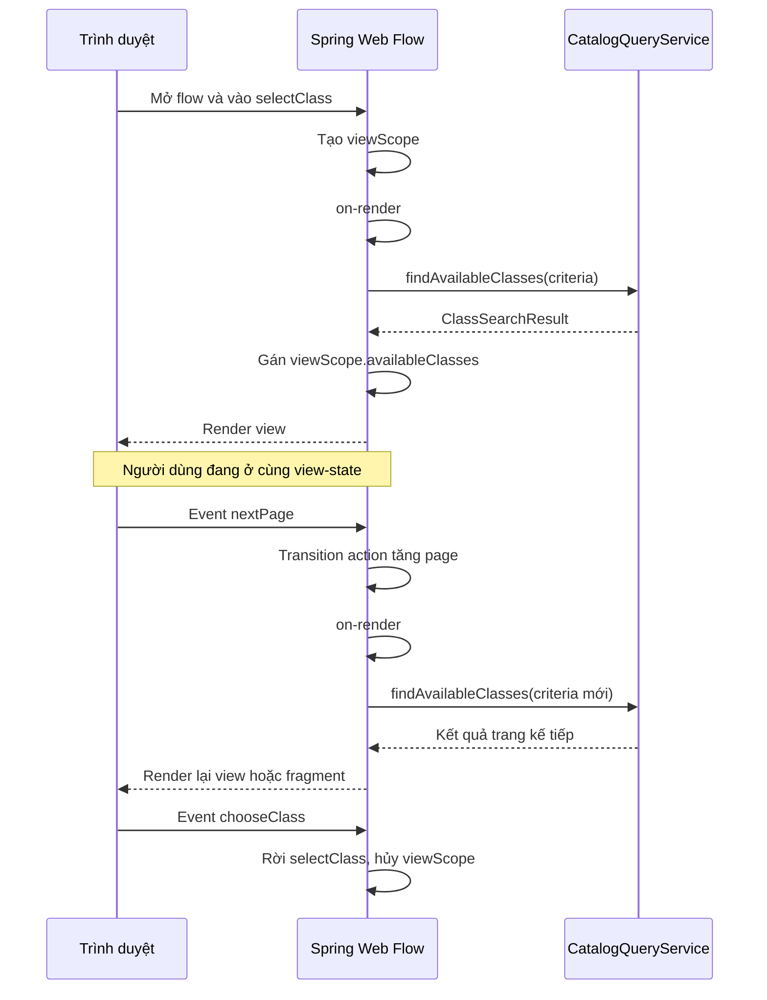

# Chuẩn bị dữ liệu hiển thị bằng `on-render`

## Mục tiêu bài học

Một `view-state` trong Spring Web Flow vừa đại diện cho một bước của hành trình, vừa là nơi hiển thị dữ liệu để người dùng quan sát và tương tác. Có màn hình cần bản nháp từ các bước trước, có màn hình cần truy vấn danh sách mới nhất, có màn hình cần tính tổng tiền hoặc tạo dữ liệu phụ cho bảng và bộ lọc.

`<on-render>` là hook dành cho công việc **chuẩn bị dữ liệu ngay trước khi view được render**. Bài học này tập trung vào cách dùng hook đó trong chính `view-state`, cách đặt kết quả vào `viewScope`, cách phối hợp với service và template, cũng như cách tránh truy vấn thừa hoặc tác dụng phụ khi view được render lại.

Sau bài học, bạn có thể:

- Giải thích mối quan hệ giữa `view-state`, `viewScope` và `<on-render>`.
- Phân biệt dữ liệu cần giữ qua nhiều state với dữ liệu chỉ phục vụ một màn hình.
- Dùng `<evaluate>` trong `<on-render>` để gọi service và gán kết quả vào scope rõ ràng.
- Chuẩn bị dữ liệu cho lần render đầu, refresh, phân trang và Ajax fragment.
- Chọn DTO/projection phù hợp để view không phụ thuộc vào entity JPA đã detached.
- Xử lý trạng thái có dữ liệu, rỗng, lỗi và dữ liệu đã cũ.
- Giữ render action an toàn khi được gọi nhiều lần, có kiểm soát hiệu năng và quyền truy cập.

## 1. `view-state` cần dữ liệu nào để hiển thị?

Giả sử flow đăng ký khóa học có màn hình chọn lớp:

```text
Chọn khóa học → Chọn lớp → Xem lại → Xác nhận
```

Màn hình **Chọn lớp** có thể cần:

- Danh sách lớp còn nhận đăng ký.
- Số chỗ còn lại và thời gian học.
- Bộ lọc theo cơ sở hoặc khung giờ.
- Tổng số kết quả và thông tin phân trang.
- Thông báo nếu không có lớp phù hợp.

Đây là dữ liệu phục vụ **một view-state cụ thể**. Nó có thể thay đổi khi người dùng lọc, chuyển trang hoặc quay lại màn hình sau một khoảng thời gian.

Trong khi đó, `enrollmentDraft` là bản nháp cần giữ qua nhiều bước. Nó không nên bị tạo lại chỉ vì người dùng làm mới danh sách lớp.

| Loại dữ liệu | Ví dụ | Nơi lưu phù hợp |
| --- | --- | --- |
| Bản nháp của cả hành trình | `enrollmentDraft`, `bookingDraft` | `flowScope` |
| Điều kiện tìm kiếm cần giữ khi quay lại màn hình | `classSearchCriteria` | `flowScope` nếu cần qua nhiều state; `viewScope` nếu chỉ sống trong state hiện tại |
| Kết quả danh sách của màn hình đang mở | `availableClasses`, `searchResults` | `viewScope` |
| Tổng số dòng, trang hiện tại, lựa chọn phụ của bảng | `resultCount`, `pageSummary` | Thường là `viewScope` |
| Dữ liệu đã được xác nhận và cần tồn tại lâu dài | Hồ sơ đăng ký, đơn hàng | Database qua service nghiệp vụ |

**Nguyên tắc thiết kế:** giữ lại những gì cần để tiếp tục hành trình; chuẩn bị lại những gì chỉ là dữ liệu hiển thị và có thể truy vấn/tính toán khi render.

## 2. Vòng đời của `viewScope` và `on-render`

Khi flow đi vào một `view-state`, Spring Web Flow tạo `viewScope` mới. Scope này tồn tại trong thời gian flow ở state đó và bị hủy khi flow rời state. Nó có thể được sử dụng qua nhiều request của cùng màn hình, ví dụ các request Ajax hoặc event phân trang.

`<on-render>` chạy **trước khi view được render**:

- Khi lần đầu vào `view-state`.
- Khi cùng state được render lại sau một event.
- Khi view được refresh.
- Khi chỉ một fragment được render lại theo cơ chế partial rendering.



Điểm quan trọng là **event phân trang không nhất thiết làm flow rời state**. Vì vậy `on-entry` không chạy lại, nhưng `on-render` vẫn chạy khi framework chuẩn bị hiển thị lại màn hình.

### So sánh `on-entry` với `on-render`

| Hook | Khi nào chạy? | Dùng cho |
| --- | --- | --- |
| `<on-entry>` | Mỗi lần flow đi vào state | Khởi tạo giá trị khi bắt đầu một lượt ở state |
| `<on-render>` | Trước mỗi lần view-state render | Đọc dữ liệu mới, tính dữ liệu hiển thị, cập nhật kết quả cho template |
| `<on-exit>` | Khi rời state | Dọn dẹp hoặc xử lý tác vụ gắn với việc rời state |

Ví dụ, `on-entry` phù hợp để đặt cờ `viewScope.firstVisit`, còn truy vấn danh sách cần chạy lại khi phân trang nên đặt ở `on-render`.

**Không đặt truy vấn cần cập nhật sau mỗi event chỉ trong `on-entry`.** Nếu event giữ nguyên state, dữ liệu sẽ không tự được chuẩn bị lại chỉ vì state chưa được vào lần nữa.

## 3. Cú pháp cơ bản của `<on-render>`

Ví dụ tối thiểu:

```xml
<view-state id="selectClass" view="enrollment/classes">
    <on-render>
        <evaluate expression="catalogQueryService.findAvailableClasses(classSearchCriteria)"
                  result="viewScope.availableClasses" />
    </on-render>
</view-state>
```

Đọc từ ngoài vào trong:

1. `view-state` có ID `selectClass`.
2. View logic `enrollment/classes` được dùng để render giao diện.
3. Trước khi render, Web Flow chạy các action trong `on-render`.
4. `<evaluate>` gọi method `findAvailableClasses(...)` trên Spring bean `catalogQueryService`.
5. Giá trị trả về được gán vào `viewScope.availableClasses`.
6. Template có thể đọc `availableClasses` để hiển thị danh sách.

### Luôn chỉ rõ scope của kết quả

Khi gán kết quả action vào một biến mới, nên chỉ rõ scope:

```xml
result="viewScope.availableClasses"
```

Điều này nói rõ dữ liệu chỉ thuộc màn hình hiện tại. Nếu muốn giữ một giá trị xuyên suốt flow, có thể dùng `flowScope`, nhưng không nên đưa danh sách hiển thị lớn vào flow scope chỉ vì tiện truy cập.

Một lỗi thường gặp là viết:

```xml
<!-- Không rõ ràng về nơi lưu biến mới -->
<evaluate expression="catalogQueryService.findAvailableClasses(classSearchCriteria)"
          result="availableClasses" />
```

Với biến mới, hãy chỉ rõ `viewScope.availableClasses`, `flowScope.availableClasses` hoặc scope phù hợp. Khi cập nhật một biến đã tồn tại, có thể tham chiếu trực tiếp biến đó theo quy tắc EL của Web Flow.

### Một `on-render` có thể có nhiều action

Ví dụ:

```xml
<on-render>
    <evaluate expression="catalogQueryService.findAvailableClasses(classSearchCriteria)"
              result="viewScope.availableClasses" />
    <evaluate expression="catalogQueryService.countAvailableClasses(classSearchCriteria)"
              result="viewScope.totalAvailable" />
    <evaluate expression="catalogPresentationService.createPageSummary(availableClasses)"
              result="viewScope.pageSummary" />
</on-render>
```

Các action được khai báo trong hook để chuẩn bị nhiều phần dữ liệu cho cùng view. Khi làm thực tế, nên cân nhắc gộp những truy vấn có thể trả về trong một DTO tổng hợp để tránh tạo nhiều lượt truy cập database không cần thiết.

Ví dụ trên giả định `availableClasses` là kết quả đã được gán ở action trước và `createPageSummary(...)` có thể đọc nó. Nếu các action phụ thuộc nhau, hãy giữ thứ tự khai báo rõ ràng và kiểm thử giá trị đầu vào/đầu ra.

## 4. Khai báo view variable bằng `<var>`

Ngoài việc gán kết quả trong `<on-render>`, `view-state` có thể khai báo biến riêng bằng `<var>`:

```xml
<view-state id="searchClasses" view="enrollment/search">
    <var name="classSearchCriteria"
         class="com.example.enrollment.ClassSearchCriteria" />

    <on-render>
        <evaluate expression="catalogQueryService.search(classSearchCriteria)"
                  result="viewScope.searchResult" />
    </on-render>
</view-state>
```

`<var>` ở cấp `view-state` tạo biến phục vụ view-state đó. Khi rời state, view scope kết thúc và biến không còn thuộc màn hình đó.

Khi nào nên dùng?

- Tiêu chí tìm kiếm chỉ có ý nghĩa trong màn hình tìm kiếm hiện tại.
- Một đối tượng điều khiển bảng hoặc bộ lọc chỉ được sử dụng ở state đó.
- Không cần mang dữ liệu qua bước xác nhận hoặc subflow.

Nếu điều kiện tìm kiếm cần còn lại khi người dùng đi tới state khác rồi quay về, hãy khởi tạo nó ở flow scope:

```xml
<var name="classSearchCriteria"
     class="com.example.enrollment.ClassSearchCriteria" />

<view-state id="searchClasses" view="enrollment/search">
    <on-render>
        <evaluate expression="catalogQueryService.search(classSearchCriteria)"
                  result="viewScope.searchResult" />
    </on-render>
</view-state>
```

Ở đây `<var>` nằm trực tiếp trong flow definition, nên biến thuộc flow và tồn tại tới khi flow kết thúc.

### Chọn đúng scope

| Khai báo | Vòng đời | Trường hợp dùng |
| --- | --- | --- |
| `<var>` ở cấp flow | Từ lúc flow bắt đầu đến lúc flow kết thúc | Model/bộ lọc dùng qua nhiều state |
| `<var>` bên trong `view-state` | Từ lúc vào state đến lúc rời state | Model phụ chỉ dùng trong một view |
| `result="viewScope.x"` | Trong view-state hiện tại | Kết quả truy vấn và dữ liệu render |
| `result="flowScope.x"` | Trong flow hiện tại | Bản nháp hoặc dữ liệu cần giữ qua các bước |

Với implementation mặc định, object lưu trong flow scope và view scope cần hỗ trợ serialization vì trạng thái flow có thể được lưu giữa các request. Dùng DTO nhỏ, không giữ stream, database connection hoặc `EntityManager` trong scope.

## 5. Ví dụ xuyên suốt: tìm lớp học và phân trang

Giả sử trang đăng ký lớp có:

- Bộ lọc cơ sở và từ khóa.
- Danh sách lớp còn chỗ.
- Số lượng kết quả.
- Nút Trang trước/Trang sau.
- Event chọn một lớp để đi tới màn hình xác nhận.

### 5.1. Flow XML

```xml
<?xml version="1.0" encoding="UTF-8"?>
<flow xmlns="http://www.springframework.org/schema/webflow"
      xmlns:xsi="http://www.w3.org/2001/XMLSchema-instance"
      xsi:schemaLocation="http://www.springframework.org/schema/webflow
                          https://www.springframework.org/schema/webflow/spring-webflow.xsd">

    <var name="classSearchCriteria"
         class="com.example.enrollment.ClassSearchCriteria" />

    <on-start>
        <evaluate expression="enrollmentDraftFactory.create()"
                  result="flowScope.enrollmentDraft" />
    </on-start>

    <view-state id="searchClasses"
                view="enrollment/search"
                model="classSearchCriteria">

        <binder>
            <binding property="keyword" />
            <binding property="campusId" />
        </binder>

        <on-render>
            <evaluate expression="classCatalogService.search(classSearchCriteria)"
                      result="viewScope.searchResult" />
        </on-render>

        <transition on="search">
            <evaluate expression="classSearchCriteria.resetPage()" />
        </transition>

        <transition on="nextPage" bind="false">
            <evaluate expression="classSearchCriteria.nextPage()" />
        </transition>

        <transition on="previousPage" bind="false">
            <evaluate expression="classSearchCriteria.previousPage()" />
        </transition>

        <transition on="chooseClass" to="reviewEnrollment" />
        <transition on="cancel" to="cancelled" bind="false" />
    </view-state>

    <view-state id="reviewEnrollment" view="enrollment/review">
        <transition on="back" to="searchClasses" bind="false" />
        <transition on="confirm" to="saveEnrollment" bind="false" />
    </view-state>

    <action-state id="saveEnrollment">
        <evaluate expression="enrollmentCommandService.enroll(enrollmentDraft)" />
        <transition on="created" to="completed" />
        <transition on="full" to="classNoLongerAvailable" />
    </action-state>

    <view-state id="classNoLongerAvailable"
                view="enrollment/unavailable">
        <transition on="searchAgain" to="searchClasses" bind="false" />
        <transition on="cancel" to="cancelled" bind="false" />
    </view-state>

    <end-state id="completed" />
    <end-state id="cancelled" />
</flow>
```

Các class/bean trong ví dụ là thành phần minh họa cần được ứng dụng triển khai. `classSearchCriteria` là flow variable vì người dùng có thể đi sang màn hình Review rồi quay lại. `searchResult` là view data vì chỉ dùng để render danh sách lớp ở `searchClasses`.

Đoạn XML tập trung vào việc chuẩn bị danh sách. `chooseClass` trong một ứng dụng thật cần ghi lớp đã chọn vào `enrollmentDraft` trước khi chuyển state; service xác nhận cuối cùng vẫn phải kiểm tra lớp còn nhận đăng ký và còn chỗ.

### 5.2. Model tiêu chí tìm kiếm

```java
import java.io.Serializable;

public class ClassSearchCriteria implements Serializable {
    private static final long serialVersionUID = 1L;

    private String keyword;
    private Long campusId;
    private int page;
    private int pageSize = 20;

    public String getKeyword() {
        return keyword;
    }

    public void setKeyword(String keyword) {
        this.keyword = keyword;
    }

    public Long getCampusId() {
        return campusId;
    }

    public void setCampusId(Long campusId) {
        this.campusId = campusId;
    }

    public int getPage() {
        return page;
    }

    public int getPageSize() {
        return pageSize;
    }

    public void resetPage() {
        page = 0;
    }

    public void nextPage() {
        page++;
    }

    public void previousPage() {
        page = Math.max(0, page - 1);
    }
}
```

Đây là DTO tối giản để minh họa. Trong ứng dụng thật, service phải giới hạn `pageSize`, kiểm tra page không vượt phạm vi hợp lý, làm sạch keyword và xác thực `campusId` theo quyền người dùng. Không cho client tự đặt `pageSize` lớn tùy ý.

### 5.3. DTO kết quả cho view

```java
import java.io.Serializable;
import java.util.List;

public class ClassSearchResult implements Serializable {
    private static final long serialVersionUID = 1L;

    private final List<ClassRow> items;
    private final long totalElements;
    private final int page;
    private final int pageSize;

    public ClassSearchResult(List<ClassRow> items,
                             long totalElements,
                             int page,
                             int pageSize) {
        this.items = List.copyOf(items);
        this.totalElements = totalElements;
        this.page = page;
        this.pageSize = pageSize;
    }

    public List<ClassRow> getItems() {
        return items;
    }

    public long getTotalElements() {
        return totalElements;
    }

    public int getPage() {
        return page;
    }

    public int getPageSize() {
        return pageSize;
    }
}
```

`ClassRow` cũng là DTO hiển thị, chứa những trường cần thiết như `id`, `name`, `schedule`, `campusName` và `availableSeats`. Trả DTO giúp view không phụ thuộc vào entity JPA và các quan hệ `LAZY` chưa được tải.

### 5.4. Service đọc dữ liệu

```java
import org.springframework.stereotype.Service;
import org.springframework.transaction.annotation.Transactional;

@Service
public class ClassCatalogService {
    private final ClassQueryRepository repository;

    public ClassCatalogService(ClassQueryRepository repository) {
        this.repository = repository;
    }

    @Transactional(readOnly = true)
    public ClassSearchResult search(ClassSearchCriteria criteria) {
        int safePage = Math.max(0, criteria.getPage());
        int safePageSize = Math.min(
                Math.max(1, criteria.getPageSize()), 50);

        return repository.searchVisibleClasses(
                criteria.getKeyword(),
                criteria.getCampusId(),
                safePage,
                safePageSize
        );
    }
}
```

`ClassQueryRepository` và `searchVisibleClasses(...)` là contract minh họa. Trong triển khai thật, repository cần áp dụng phân trang ở database, lọc theo tenant/quyền truy cập, và trả DTO/projection. `@Transactional(readOnly = true)` bao quanh lời gọi đọc; nó kết thúc khi service trả kết quả, không kéo dài trong lúc người dùng xem trang.

### 5.5. Template sử dụng dữ liệu

Template logic `enrollment/search` có thể đọc:

```text
searchResult.items
searchResult.totalElements
searchResult.page
searchResult.pageSize
```

Một cách tổ chức view:

```html
<main>
  <section id="classFilters">
    <!-- Form nhập keyword và campusId -->
  </section>

  <section id="classResults" aria-live="polite">
    <!-- Hiển thị searchResult.items -->
  </section>

  <section id="pagination">
    <!-- Trang hiện tại / tổng số trang và nút điều hướng -->
  </section>
</main>
```

Đây là cấu trúc giao diện minh họa. Việc truy cập model trong template cụ thể phụ thuộc JSP, Thymeleaf, JSF hoặc view technology mà ứng dụng dùng. `id` trong HTML không tự trở thành fragment ID của Spring Web Flow nếu view renderer chưa hỗ trợ mapping.

## 6. Thứ tự xử lý khi người dùng gửi event

Với màn hình có `model`, một request postback có thể gồm binding, validation, transition action và render lại view. Khi cần chuẩn bị dữ liệu, điều quan trọng là transition cập nhật tiêu chí trước, rồi `on-render` đọc tiêu chí mới.

Ví dụ:

```xml
<view-state id="searchClasses"
            model="classSearchCriteria">
    <on-render>
        <evaluate expression="classCatalogService.search(classSearchCriteria)"
                  result="viewScope.searchResult" />
    </on-render>

    <transition on="nextPage" bind="false">
        <evaluate expression="classSearchCriteria.nextPage()" />
        <render fragments="classResults,pagination" />
    </transition>
</view-state>
```

Luồng xử lý:

1. Browser gửi event `nextPage`.
2. Web Flow khôi phục execution và xử lý transition ở `searchClasses`.
3. Transition action tăng số trang trong `classSearchCriteria`.
4. Web Flow chuẩn bị render lại view/fragment.
5. `on-render` gọi `classCatalogService.search(...)` với số trang mới.
6. Kết quả mới được gán vào `viewScope.searchResult`.
7. Renderer trả nội dung cần render; client cập nhật vùng giao diện tương ứng.

Nếu truy vấn nằm trong `on-entry`, nó không tự chạy lại khi event `nextPage` vẫn ở cùng state. Nếu truy vấn nằm lặp lại trong mọi transition, bạn dễ quên đường render do validation lỗi hoặc refresh. `on-render` gom công việc chuẩn bị dữ liệu tại một vị trí.

### Khi nào dùng `bind="false"`?

Event `nextPage` không nhất thiết phải bind lại các trường lọc từ form. Dùng `bind="false"` nếu request phân trang chỉ thay đổi trang và không cần cập nhật model từ dữ liệu form. Ngược lại, event `search` thường cần bind tiêu chí mới trước khi chạy transition:

```xml
<transition on="search">
    <evaluate expression="classSearchCriteria.resetPage()" />
</transition>
```

Nếu binding/validation của form lọc thất bại, transition `search` không nên được thực hiện; view được render lại với lỗi. `on-render` cần xử lý tình huống model hiện có thể chứa giá trị chưa hợp lệ hoặc dùng tiêu chí đã áp dụng trước đó.

## 7. Tạo dữ liệu cho bảng JSF bằng `result-type="dataModel"`

Khi dùng JSF `h:dataTable`, view thường cần một `DataModel` thay vì chỉ một `List`. Spring Web Flow hỗ trợ chuyển kết quả action thành cấu trúc data model:

```xml
<view-state id="searchClasses" view="enrollment/search">
    <on-render>
        <evaluate expression="classCatalogService.searchRows(classSearchCriteria)"
                  result="viewScope.classes"
                  result-type="dataModel" />
    </on-render>
</view-state>
```

Ví dụ trên dành cho **tích hợp JSF**. Với JSP, Thymeleaf hoặc view engine không dùng JSF `DataModel`, không nên thêm `result-type="dataModel"` chỉ vì tên biến là danh sách. Hãy giữ kiểu DTO/list phù hợp với view technology.

Trong JSF, một bảng có thể đọc:

```xhtml
<h:dataTable value="#{classes}" var="course">
    <h:column>
        <f:facet name="header">Tên lớp</f:facet>
        #{course.name}
    </h:column>
    <h:column>
        <f:facet name="header">Lịch học</f:facet>
        #{course.schedule}
    </h:column>
</h:dataTable>
```

`classes` ở đây là view variable được tạo từ `result-type="dataModel"`. Cấu hình JSF và Web Flow phải được tích hợp đúng để EL của view nhìn thấy biến đó.

## 8. Chuẩn bị dữ liệu khi view không có kết quả

Một màn hình tìm kiếm không phải lúc nào cũng có kết quả. Đừng để template giả định danh sách luôn có ít nhất một phần tử.

Ví dụ DTO có thể cung cấp:

```text
searchResult.items = []
searchResult.totalElements = 0
searchResult.page = 0
```

Template nên phân biệt:

| Trạng thái | Nội dung giao diện |
| --- | --- |
| Có kết quả | Hiển thị bảng và phân trang |
| Không có kết quả | Thông báo “Không tìm thấy lớp phù hợp” |
| Bộ lọc chưa đủ | Hướng dẫn nhập thêm tiêu chí |
| Dữ liệu không còn khả dụng | Hiển thị thông báo và yêu cầu tìm lại |
| Truy vấn thất bại | Thông báo lỗi có thể thử lại, không hiển thị stack trace |

Có thể dùng một view model tổng hợp:

```java
public class ClassSearchViewData {
    private final ClassSearchResult result;
    private final String notice;
    private final boolean retryable;

    // Constructor/getter
}
```

Ví dụ chỉ minh họa cấu trúc; cần tạo DTO serializable và quy tắc thông báo phù hợp. Nếu service ném exception, không nên bắt mọi exception trong `on-render` rồi trả danh sách rỗng vì người dùng sẽ nhầm lỗi hệ thống với “không có kết quả”. Hãy để lỗi đi theo exception handling của flow/MVC hoặc chuyển một lỗi nghiệp vụ đã biết thành trạng thái hiển thị rõ ràng.

## 9. Giữ dữ liệu hiển thị an toàn khi truy cập database

Một service đọc thường mở transaction trong thời gian ngắn:

```java
@Transactional(readOnly = true)
public ClassSearchResult search(ClassSearchCriteria criteria) {
    // Query và map thành DTO ngay trong transaction.
}
```

Khi method trả về, persistence context transaction-scoped thường kết thúc. Nếu `viewScope.searchResult` giữ JPA entity có quan hệ `LAZY`, template truy cập quan hệ chưa được tải có thể gây `LazyInitializationException`.

Thiết kế nên ưu tiên:

- **DTO/projection** chứa đúng trường view cần.
- Truy vấn có pagination và giới hạn page size.
- Tính tổng số kết quả ngay trong query/service khi cần.
- Kiểm tra quyền truy cập dữ liệu tại service.
- Không giữ `EntityManager`, connection, stream hoặc resource đang mở trong scope của flow.

Không cần giữ transaction JPA mở trong lúc người dùng xem trang. Web Flow giữ trạng thái điều hướng; service quản lý transaction cho mỗi thao tác đọc/ghi.

### Kiểm tra quyền mỗi lần truy vấn phù hợp

Một danh sách được hiển thị trước đó có thể không còn được phép xem khi quyền người dùng thay đổi hoặc tenant context khác. Vì thế service cần áp dụng điều kiện truy cập trong truy vấn hoặc trước khi trả DTO. Việc đã lưu danh sách trong `viewScope` không phải bằng chứng người dùng vẫn được phép xem nó vô thời hạn.

## 10. `on-render` phải an toàn khi chạy lại

Vì `on-render` chạy khi view hiển thị lần đầu và các lần refresh/partial render tiếp theo, hành động trong đó phải được thiết kế với giả định **có thể gọi nhiều lần**.

### Nên làm trong `on-render`

- Đọc danh sách và chi tiết để hiển thị.
- Tính tổng, nhãn, summary và lựa chọn giao diện.
- Chuẩn bị dữ liệu phụ cho dropdown.
- Lấy trạng thái hiện tại để hiển thị thông báo phù hợp.
- Ghi kết quả vào `viewScope`.

### Không nên làm trong `on-render`

- Tạo đơn hàng hoặc bản đăng ký.
- Trừ tồn kho, giữ ghế hoặc ghi nhận thanh toán.
- Gửi email/SMS hoặc gọi API có tác dụng phụ không idempotent.
- Tăng số lượt sử dụng hoặc chuyển trạng thái nghiệp vụ lâu dài.
- Ghi audit nghiệp vụ với giả định chỉ có một lần render.

Ví dụ không nên:

```xml
<on-render>
    <!-- Sai: mỗi lần render có thể tạo thêm đơn hàng -->
    <evaluate expression="orderService.createOrder(orderDraft)"
              result="flowScope.order" />
</on-render>
```

Hãy chuyển lệnh ghi sang action được kích hoạt bởi event xác nhận:

```xml
<view-state id="reviewOrder" view="checkout/review">
    <on-render>
        <evaluate expression="orderQueryService.createSummary(orderDraft)"
                  result="viewScope.orderSummary" />
    </on-render>
    <transition on="confirm" to="saveOrder" bind="false" />
</view-state>

<action-state id="saveOrder">
    <evaluate expression="orderCommandService.submit(orderDraft)" />
    <transition on="saved" to="completed" />
</action-state>
```

`createSummary` cần là thao tác đọc/tính toán không ghi nghiệp vụ. `submit` chạy qua service transaction, kiểm tra quyền và dữ liệu mới nhất, đồng thời có cơ chế idempotency nếu request được retry.

**Đừng dùng một cờ `alreadyRendered` trong scope để che tác dụng phụ.** Cách đúng là đặt side effect ở đúng điểm nghiệp vụ và bảo vệ tính lặp tại service/database.

## 11. Phân trang và partial rendering

`on-render` đặc biệt hữu ích khi cùng một `view-state` hiển thị danh sách lớn. Người dùng gửi event phân trang, transition cập nhật tiêu chí và yêu cầu render fragment:

```xml
<view-state id="searchClasses">
    <on-render>
        <evaluate expression="classCatalogService.search(classSearchCriteria)"
                  result="viewScope.searchResult" />
    </on-render>

    <transition on="nextPage" bind="false">
        <evaluate expression="classSearchCriteria.nextPage()" />
        <render fragments="classResults,pagination" />
    </transition>
</view-state>
```

Khi partial rendering được tích hợp đúng, server chỉ cần trả những fragment đã chọn. Nhưng `on-render` vẫn chạy để chuẩn bị dữ liệu trước khi fragment được render. Điều này có nghĩa:

- Client nhận ít HTML hơn.
- Query vẫn có thể chạy ở server.
- Service vẫn phải phân trang ở database.
- Không nên dùng partial rendering làm lý do bỏ qua tối ưu query.

Tên `classResults,pagination` phải khớp với cách view technology ánh xạ fragment. Một `id` HTML đơn lẻ không đảm bảo resolver tự trích xuất được fragment.

## 12. Hiệu năng và tránh truy vấn lặp không cần thiết

Nếu một trang có 5 danh sách dropdown và 3 vùng kết quả, gọi 8 service riêng trong `on-render` có thể làm số query tăng đáng kể. Có một số hướng tối ưu:

| Tình huống | Hướng xử lý |
| --- | --- |
| Nhiều dữ liệu cùng một nguồn | Tạo service query tổng hợp trả DTO màn hình |
| Dropdown ít thay đổi | Cache có thời hạn hoặc cache dùng chung an toàn |
| Danh sách lớn | Pagination ở database, không load hết rồi cắt ở Java |
| Cùng dữ liệu được tính hai lần | Tính một lần trong service và trả nhiều field |
| Một fragment không cần toàn bộ dữ liệu | Thiết kế query/renderer phù hợp với fragment |
| Query thay đổi theo user/tenant | Phân vùng cache và kiểm tra quyền |
| Render chậm do quan hệ JPA | Projection/fetch phù hợp, tránh lazy loading trong view |

Ví dụ service tổng hợp:

```java
@Transactional(readOnly = true)
public ClassSearchViewData prepareSearchView(ClassSearchCriteria criteria) {
    ClassSearchResult result = repository.search(criteria);
    List<CampusOption> campuses = campusRepository.findVisibleOptions();
    return new ClassSearchViewData(result, campuses);
}
```

Sau đó XML chỉ cần một action:

```xml
<on-render>
    <evaluate expression="classCatalogService.prepareSearchView(classSearchCriteria)"
              result="viewScope.searchViewData" />
</on-render>
```

Đây là cách gom dữ liệu cho view. Các repository và DTO phải được triển khai phù hợp; nếu `campuses` không thay đổi thường xuyên, có thể tách cache riêng thay vì truy vấn lại ở mọi render.

### Theo dõi chi phí render

Khi tối ưu, có thể đo:

- Số lần `on-render` chạy trên mỗi event.
- Số lần service query được gọi.
- Thời gian truy vấn và thời gian render.
- Số dòng/byte dữ liệu trả về.
- Kích thước object lưu trong `viewScope`.
- Tỷ lệ request Ajax bị lặp hoặc gửi đồng thời.

Đo lường giúp phân biệt vấn đề nằm ở query, service, template hay client; đừng kết luận chỉ từ cảm giác trang tải nhanh hơn.

## 13. Các lỗi thường gặp và cách chẩn đoán

### 13.1. Dữ liệu chỉ đúng ở lần mở đầu

**Triệu chứng:** chuyển trang hoặc thay bộ lọc nhưng danh sách vẫn cũ.

**Kiểm tra:** truy vấn có nằm trong `on-render` không? Transition có cập nhật criteria trước khi render không? `result` có gán vào đúng `viewScope` không? Service có dùng page/filter mới không?

### 13.2. Quay lại view thì mất dữ liệu phụ

**Nguyên nhân:** dữ liệu chỉ nằm trong `viewScope`, scope bị hủy khi rời state.

**Cách xử lý:** giữ tiêu chí hoặc bản nháp cần thiết trong `flowScope`; để `on-render` truy vấn lại kết quả riêng của màn hình.

### 13.3. Template báo biến không tồn tại

**Nguyên nhân:** kết quả evaluate chưa được gán vào scope đúng, EL dùng sai tên, hoặc view đang đọc biến ngoài scope.

**Cách xử lý:** khai báo rõ `result="viewScope.searchResult"` và kiểm tra tên biến ở template. `viewScope` chỉ được tham chiếu trong `view-state` tương ứng.

### 13.4. `LazyInitializationException`

**Nguyên nhân:** service trả entity có quan hệ lazy chưa được khởi tạo; template truy cập sau khi transaction đóng.

**Cách xử lý:** trả DTO/projection hoặc truy vấn đủ trường trong service transaction.

### 13.5. Không có kết quả nhưng template ném lỗi

**Nguyên nhân:** template truy cập phần tử đầu tiên mà không kiểm tra danh sách rỗng hoặc service trả `null`.

**Cách xử lý:** contract kết quả nên trả collection rỗng thay vì `null`; template có nhánh empty state.

### 13.6. Refresh nhiều lần tạo dữ liệu trùng

**Nguyên nhân:** action ghi nằm trong `on-render`.

**Cách xử lý:** chuyển ghi sang action-state/transition do event nghiệp vụ kích hoạt; bảo vệ idempotency ở service/database.

### 13.7. Query chạy dù chỉ render một fragment

Đây là hành vi dự kiến: render action chạy trước cả full render và partial render. Nếu query không cần cho fragment, cân nhắc tách dữ liệu theo vùng hoặc dùng model/cache phù hợp với integration. Không giả định partial render tự bỏ qua `on-render`.

### 13.8. Dữ liệu hiển thị không còn quyền xem

**Nguyên nhân:** kết quả cũ trong scope/cache được dùng lại mà không kiểm tra quyền ở lần truy cập mới.

**Cách xử lý:** service kiểm tra quyền khi đọc, cache theo user/tenant nếu cần, và làm mới dữ liệu theo chính sách bảo mật.

## 14. Kiểm thử việc chuẩn bị dữ liệu cho view

Kiểm thử cần xác nhận không chỉ flow ở state nào mà còn **view nhận được dữ liệu nào**.

| Kịch bản | Điều cần kiểm tra |
| --- | --- |
| Lần đầu vào `searchClasses` | `on-render` gọi query với tiêu chí mặc định và gán `viewScope.searchResult` |
| Event `search` hợp lệ | Tiêu chí mới được bind, page reset, dữ liệu mới được nạp |
| Event `nextPage` | Page tăng trước query; danh sách phản ánh trang mới |
| Event `previousPage` ở trang đầu | Page không âm; kết quả vẫn hợp lệ |
| Rời state rồi quay lại | `viewScope` mới được tạo; `flowScope` giữ tiêu chí cần thiết |
| Kết quả rỗng | Template hiển thị empty state, không ném lỗi |
| Query service ném exception | Có thông báo lỗi/phục hồi, không giả dạng empty result |
| Ajax fragment | Render action chạy và fragment nhận dữ liệu mới |
| View chỉ đọc dữ liệu | Không có lệnh ghi nghiệp vụ trong `on-render` |
| Nhiều request liên tiếp | Không dùng response cũ ghi đè kết quả mới ngoài ý muốn |
| User/tenant khác nhau | Service chỉ trả dữ liệu người đó được phép xem |
| Flow snapshot/restore | DTO trong view/flow scope đáp ứng yêu cầu serialization của repository |

### Kiểm thử flow

Có thể dùng test support của Spring Web Flow để:

1. Khởi chạy flow và xác nhận state `searchClasses`.
2. Mock `classCatalogService.search(...)` trả về kết quả mẫu.
3. Xác nhận `viewScope.searchResult` được gán sau khi render.
4. Gửi event `nextPage`.
5. Xác nhận tiêu chí trang đã thay đổi và query được gọi với giá trị mới.
6. Gửi event chuyển sang state Review rồi quay lại; xác nhận kết quả được chuẩn bị lại.

Đây là mô tả test; API cụ thể phụ thuộc cách cấu hình test context và phiên bản Web Flow. Unit test flow không đủ chứng minh HTML thực tế được render đúng bởi `ViewResolver`; nếu dùng Ajax/fragment hoặc JSF DataModel, cần thêm kiểm thử tích hợp view tương ứng.

### Kiểm thử service riêng

Service đọc cần được kiểm thử cho:

- Giới hạn page/pageSize.
- Bộ lọc không hợp lệ.
- Quyền theo user/tenant.
- Kết quả rỗng.
- Mapping projection/DTO.
- Hiệu năng và pagination khi dữ liệu lớn.

Đừng dùng một test mock duy nhất để kết luận truy vấn database đã phân trang đúng; hãy có integration test với repository/database khi đó là yêu cầu quan trọng.

## 15. Bài tập thực hành

Bạn cần xây dựng màn hình chọn phòng khám trong flow đặt lịch:

```text
selectClinic → reviewAppointment → completed
```

Màn hình `selectClinic` hiển thị:

- Bộ lọc theo khu vực và chuyên khoa.
- Danh sách phòng khám còn nhận lịch.
- Tổng số kết quả và phân trang.
- Thông báo nếu không có kết quả.

Yêu cầu:

1. Khởi tạo `ClinicSearchCriteria` trong flow scope nếu cần giữ khi quay lại.
2. Dùng `<on-render>` để gọi `clinicQueryService.search(criteria)`.
3. Gán kết quả vào `viewScope.clinicResults`.
4. Event `search` bind bộ lọc và reset page.
5. Event `nextPage`/`previousPage` giữ nguyên state và nạp dữ liệu trang mới.
6. Event `chooseClinic` chuyển sang `reviewAppointment`.
7. Không tạo lịch hẹn trong `on-render`; chỉ ghi khi người dùng xác nhận và service kiểm tra slot còn trống.

**Nhiệm vụ mở rộng:**

- Thiết kế `ClinicSearchResult` DTO serializable.
- Viết service query với transaction đọc và phân trang database.
- Bổ sung empty state và error state.
- Thêm test xác nhận `on-render` chạy khi vào lần đầu, phân trang và quay lại state.
- Giải thích dữ liệu nào ở `flowScope`, dữ liệu nào ở `viewScope`, và vì sao.

## 16. Ghi nhớ

- `view-state` là một bước giao diện; nó có `viewScope` riêng từ lúc vào state tới lúc rời state.
- `<on-render>` chạy trước mỗi lần render, gồm render đầu, refresh và partial re-render.
- Dùng `<evaluate>` trong hook để gọi service và gán kết quả vào `viewScope` rõ ràng.
- Giữ bản nháp/tiêu chí cần qua nhiều bước ở `flowScope`; giữ danh sách và dữ liệu chỉ phục vụ màn hình ở `viewScope`.
- Dùng DTO/projection để view không phụ thuộc entity JPA detached hoặc quan hệ lazy.
- Đặt query/read preparation trong `on-render`; đặt ghi nghiệp vụ trong action/transition gọi service có transaction.
- Partial rendering giảm nội dung giao diện cần cập nhật nhưng không tự bỏ qua render actions hoặc tối ưu query.
- Thiết kế render action để có thể gọi lại an toàn; kiểm tra quyền và dữ liệu mới nhất tại service.

### Tài liệu tham khảo

- [Spring Web Flow 3.0.2 Reference Guide — View Scope](https://docs.spring.io/spring-webflow/docs/3.0.2/reference/#view-scope): vòng đời view scope và khai báo view variables.
- [Spring Web Flow 3.0.2 Reference Guide — Assigning a `viewScope` Variable](https://docs.spring.io/spring-webflow/docs/3.0.2/reference/#view-scope): gán kết quả action vào view scope.
- [Spring Web Flow 3.0.2 Reference Guide — Running Render Actions](https://docs.spring.io/spring-webflow/docs/3.0.2/reference/#running-render-actions): render actions ở lần đầu và các lần refresh/partial render.
- [Spring Web Flow 3.0.2 Reference Guide — Manipulating Objects in View Scope](https://docs.spring.io/spring-webflow/docs/3.0.2/reference/#manipulating-objects-in-view-scope): xử lý dữ liệu và phân trang trong cùng view-state.
- [Spring Web Flow 3.0.2 Reference Guide — JSF Data Models](https://docs.spring.io/spring-webflow/docs/3.0.2/reference/#data-model-implementations): chuyển kết quả sang JSF DataModel khi tích hợp JSF.
