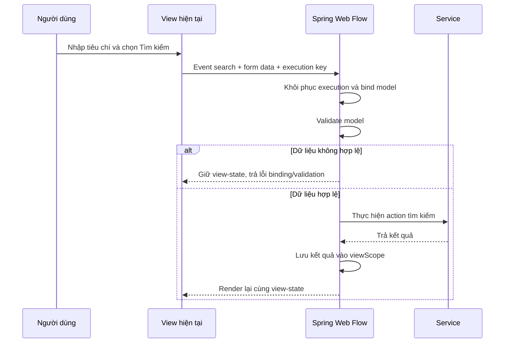

# Cập nhật tại chỗ khi transition không chuyển sang màn hình khác

Trong một hành trình web nhiều bước, không phải thao tác nào của người dùng cũng cần mở màn hình mới. Khi tìm kiếm, lọc danh sách, tính lại giá hoặc kiểm tra dữ liệu nhập, ứng dụng thường cần xử lý một event rồi hiển thị kết quả ngay trên màn hình hiện tại. Spring Web Flow hỗ trợ cách làm này bằng transition không chỉ định state đích: flow xử lý event và action, sau đó tiếp tục ở view-state đang hoạt động.

Đây là một kỹ thuật hữu ích trong `SPRING_WEB_FLOW`, nơi state, event, transition và subflow mô hình hóa hành trình thay cho logic điều hướng phân tán trong controller. Kết hợp transition tại chỗ với form binding, validation và scope phù hợp giúp view-state vừa xử lý được tương tác ngắn, vừa giữ được trạng thái cần thiết qua các HTTP request. Cần phân biệt việc giữ nguyên view-state với việc chỉ cập nhật một phần DOM bằng AJAX: hai việc có liên quan nhưng không đồng nhất.

## 1. Transition tại chỗ là gì?

Một `view-state` đại diện cho một màn hình hoặc một điểm tương tác đang chờ người dùng. Transition nhận event từ view, có thể bind dữ liệu form, kiểm tra validation và chạy các action. Nếu transition không khai báo `to`, flow không chuyển sang state khác mà vẫn ở view-state hiện tại.

Ví dụ, màn hình tìm kiếm có thể nhận event `search`, gọi service để lấy kết quả rồi render lại chính màn hình tìm kiếm:

```xml
<view-state id="search" model="searchForm">
    <transition on="search" bind="true" validate="true">
        <evaluate expression="searchService.search(searchForm)"
                  result="viewScope.results" />
    </transition>
</view-state>
```

Transition `search` không có thuộc tính `to`, vì vậy sau khi action hoàn tất, flow vẫn ở state `search`. Kết quả được đặt trong `viewScope.results` để view hiện tại có thể hiển thị. `searchForm` là model đã được chuẩn bị trong flow; ví dụ giả định model này có validator phù hợp nếu ứng dụng bật validation.

Một transition như vậy phù hợp với các thao tác có kết quả ngay trên cùng màn hình:

- Tìm kiếm hoặc lọc danh sách theo tiêu chí người dùng nhập.
- Kiểm tra mã giảm giá và hiển thị mức giảm hoặc lỗi.
- Tính thử phí vận chuyển, thuế hoặc tổng tiền.
- Kiểm tra tính khả dụng của một lựa chọn trước khi người dùng tiếp tục.
- Tải thêm dữ liệu phụ trợ để người dùng quyết định mà chưa rời màn hình.

Khi thao tác hoàn tất, người dùng vẫn ở cùng điểm trong flow. Một event khác, chẳng hạn `continue`, có thể đưa họ sang state kế tiếp khi họ đã sẵn sàng.

## 2. Vòng đời xử lý một event tại chỗ

Một request gửi event của view-state đi qua các bước chính sau:

1. Trình duyệt gửi flow execution key và event id, kèm dữ liệu form nếu có.
2. Spring Web Flow khôi phục execution tương ứng và xác định view-state đang hoạt động.
3. Framework bind các trường được gửi lên model theo cấu hình của transition.
4. Validation chạy nếu transition yêu cầu. Nếu có lỗi, flow giữ người dùng ở view-state để hiển thị lỗi.
5. Nếu dữ liệu hợp lệ, các action trong transition được thực thi theo thứ tự.
6. Vì transition không có state đích, execution tiếp tục ở view-state hiện tại và view được render lại.



Trong quá trình này, `FlowExecution` vẫn giữ ngữ cảnh của hành trình. Repository quản lý việc lưu và khôi phục execution giữa các request; transition quyết định event sẽ làm gì; view chịu trách nhiệm trình bày model và kết quả.

## 3. Binding và validation trước khi chạy action

Với một form, transition tại chỗ thường cần bind dữ liệu và validation. Thuộc tính `bind="true"` yêu cầu framework bind dữ liệu request vào model của view-state. Thuộc tính `validate="true"` yêu cầu chạy validation theo cơ chế đã cấu hình. Viết rõ hai thuộc tính trong ví dụ giúp người đọc thấy ý định của transition, đặc biệt khi trong cùng view có các event khác nhau với chính sách validation khác nhau.

Ví dụ JSP dùng Spring Form tag:

```jsp
<form:form modelAttribute="searchForm"
           method="post"
           action="${flowExecutionUrl}">
    <label for="keyword">Từ khóa</label>
    <form:input path="keyword" id="keyword" />
    <form:errors path="keyword" cssClass="error" />

    <button type="submit" name="_eventId_search">Tìm kiếm</button>
</form:form>

<c:if test="${not empty results}">
    <ul>
        <c:forEach items="${results}" var="item">
            <li>${item.name}</li>
        </c:forEach>
    </ul>
</c:if>
```

`flowExecutionUrl` là URL tiếp tục execution hiện tại. Tên nút `_eventId_search` phát event `search` theo quy ước event parameter của Spring Web Flow. Model attribute `searchForm` phải tương ứng với model được khai báo trong `view-state`; `results` là dữ liệu kết quả mà flow đã đặt vào scope để view đọc.

Nếu validation thất bại, transition action phía sau không nên được dùng để thực hiện nghiệp vụ như tìm kiếm hoặc ghi dữ liệu. View được render lại với binding result và thông báo lỗi để người dùng sửa form. Nếu muốn có event bỏ qua validation, ví dụ nút hủy hoặc xóa bộ lọc, hãy cấu hình riêng transition đó một cách có chủ đích; không tắt validation chung chỉ để một nút hoạt động.

Validation cũng cần phân biệt hai lớp. Validator của form kiểm tra dữ liệu người dùng nhập như từ khóa bắt buộc hoặc khoảng ngày hợp lệ. Service nghiệp vụ vẫn phải kiểm tra quyền truy cập, trạng thái dữ liệu và các điều kiện có thể thay đổi sau khi form được hiển thị. Một form hợp lệ không đồng nghĩa thao tác nghiệp vụ chắc chắn được phép.

## 4. Quản lý dữ liệu khi ở lại cùng view-state

Transition tại chỗ thường phát sinh dữ liệu mới để view hiển thị. Hãy chọn scope dựa trên vòng đời của từng giá trị:

| Scope | Dùng khi | Ví dụ trong màn hình tìm kiếm |
|---|---|---|
| `requestScope` | Chỉ cần trong request đang xử lý | Giá trị tạm phục vụ một lần render |
| `viewScope` | Chỉ cần trong thời gian view-state hiện tại còn hoạt động | Kết quả tìm kiếm, thông báo hoặc lựa chọn phụ trên màn hình |
| `flowScope` | Cần giữ qua nhiều view-state trong cùng flow session | Tiêu chí tìm kiếm cần dùng tiếp ở bước xác nhận |
| `conversationScope` | Cần chia sẻ trong phạm vi flow cha và subflow | Ngữ cảnh chung mà các bước con cùng sử dụng |

Ví dụ trên đặt kết quả vào `viewScope.results` vì kết quả chỉ phục vụ màn hình tìm kiếm. Nếu người dùng tiếp tục sang state xác nhận và cần dùng lại tiêu chí tìm kiếm, có thể giữ tiêu chí đó trong `flowScope`. Không nên đẩy mọi kết quả truy vấn lớn vào flow scope chỉ vì muốn chúng tồn tại lâu hơn; thường nên giữ tiêu chí hoặc ID, rồi truy vấn lại qua service khi cần.

Vì transition không rời view-state, dữ liệu `viewScope` tiếp tục thuộc về màn hình đó qua các lần render. Khi flow chuyển sang view-state khác, vòng đời view scope hiện tại kết thúc theo cơ chế của framework. Dữ liệu cần tồn tại qua bước tiếp theo phải được đặt trong scope có vòng đời rộng hơn.

## 5. `on-entry`, `on-render` và action trong transition

Ba vị trí khai báo action có thời điểm thực thi khác nhau:

| Vị trí | Thời điểm | Công việc phù hợp |
|---|---|---|
| `on-entry` | Khi flow đi vào view-state | Khởi tạo dữ liệu ban đầu cho màn hình |
| `on-render` | Mỗi lần view-state được render | Nạp dữ liệu trình bày cần làm mới cho lần hiển thị |
| Action trong `transition` | Khi event tương ứng được xử lý | Thực hiện đúng thao tác người dùng vừa yêu cầu |

Ví dụ, dữ liệu gợi ý có thể được nạp mỗi lần màn hình được render:

```xml
<view-state id="search" model="searchForm">
    <on-entry>
        <evaluate expression="searchService.loadInitialFilters()"
                  result="viewScope.filters" />
    </on-entry>

    <on-render>
        <evaluate expression="searchService.loadSuggestions()"
                  result="viewScope.suggestions" />
    </on-render>

    <transition on="search" bind="true" validate="true">
        <evaluate expression="searchService.search(searchForm)"
                  result="viewScope.results" />
    </transition>
</view-state>
```

Đoạn XML minh họa vai trò của từng hook; trong ứng dụng thực tế, tên và vị trí model phải nhất quán với cấu hình `model` của view-state. Không nên đưa thao tác ghi dữ liệu hoặc side effect không idempotent vào `on-render`, vì hook này có thể chạy nhiều lần khi cùng view được hiển thị lại. Những thao tác đó nên gắn với event rõ ràng và được bảo vệ ở tầng service.

`on-entry` không phải nơi thay thế action trong transition tại chỗ: khi transition không rời state, flow không đi vào một state mới. Nếu cần cập nhật kết quả theo event `search`, đặt action trong transition. Dùng `on-render` cho dữ liệu cần nạp ở mỗi lần hiển thị, đồng thời giữ action nhẹ và an toàn khi chạy lặp.

## 6. Giữ nguyên view-state không đồng nghĩa với AJAX partial update

Khi transition không có `to`, Spring Web Flow giữ execution ở cùng view-state và render view đó. Với một request thông thường, trình duyệt có thể nhận lại toàn bộ trang và tải lại document. Điều này vẫn là cập nhật tại cùng bước của flow, nhưng không đảm bảo chỉ một vùng HTML được thay đổi.

Nếu yêu cầu trải nghiệm là chỉ cập nhật một phần giao diện mà không tải lại toàn trang, cần kết hợp event của flow với cơ chế AJAX và fragment rendering mà view technology hoặc thư viện giao diện đang sử dụng hỗ trợ. Khi đó:

- Spring Web Flow vẫn nhận event, khôi phục execution, bind và validate model, chạy transition action.
- Cơ chế AJAX gửi request và nhận response theo định dạng mà view layer hỗ trợ.
- View layer xác định fragment nào được render và thay thế trong DOM.
- Execution key vẫn phải được gửi đúng để request tiếp tục đúng flow execution.

Không nên giả định rằng chỉ cần bỏ thuộc tính `to` là trình duyệt tự động cập nhật một phần DOM. Hãy kiểm tra cả hai phía: request có được gửi theo chế độ AJAX hay không, và response có chứa fragment mà client biết cách cập nhật hay không. Nếu dùng Spring JavaScript hoặc thư viện khác, cần theo tài liệu của đúng phiên bản đang triển khai để cấu hình handler và fragment response.

## 7. Xử lý lỗi và thao tác có side effect

Một transition tại chỗ có thể thất bại trong lúc gọi service. Ví dụ, dịch vụ tìm kiếm tạm thời không khả dụng hoặc mã giảm giá không còn hiệu lực. Nên chuyển lỗi có thể dự đoán thành thông báo phù hợp để view-state tiếp tục hiển thị, đồng thời ghi log kỹ thuật đủ để chẩn đoán. Không đưa stack trace hoặc chi tiết nội bộ vào thông báo cho người dùng.

Với thao tác chỉ đọc như tìm kiếm, việc gửi lại event thường ít rủi ro. Với thao tác làm thay đổi dữ liệu, chẳng hạn áp dụng mã khuyến mãi, giữ chỗ hoặc lưu bản nháp, cần xem xét:

- Service phải kiểm tra lại điều kiện nghiệp vụ tại thời điểm thực thi.
- Thao tác có thể được gửi lặp do double-click, refresh hoặc mạng retry; thiết kế idempotent khi phù hợp.
- Transaction phải nằm ở tầng xử lý nghiệp vụ, không dựa vào việc người dùng vẫn ở cùng view-state.
- Nếu thao tác thành công nhưng render thất bại, request tiếp theo không được vô tình thực hiện side effect lần nữa.

Nếu session hết hạn hoặc execution key không còn hợp lệ, framework có thể không khôi phục được view-state để tiếp tục event. Ứng dụng nên xử lý trường hợp đó bằng thông báo phiên làm việc hết hạn và hướng dẫn người dùng bắt đầu lại flow. Không tự tạo execution mới từ dữ liệu form cũ như thể đó là trạng thái đã được xác thực.

## 8. Kiểm thử transition tại chỗ

Kiểm thử nên xác minh cả hành vi của flow lẫn dữ liệu view nhận được. Với một view-state tìm kiếm, các trường hợp quan trọng gồm:

1. Gửi event hợp lệ và xác minh service được gọi với model đã bind.
2. Xác minh execution vẫn ở cùng view-state sau transition không có `to`.
3. Xác minh kết quả được đặt vào đúng scope và xuất hiện trong model của lần render kế tiếp.
4. Gửi dữ liệu không hợp lệ và xác minh lỗi được hiển thị, action tìm kiếm không chạy.
5. Gửi event khác như `continue` và xác minh flow chuyển sang state kế tiếp theo định nghĩa.
6. Render lại view nhiều lần và xác minh `on-render` không tạo side effect ngoài ý muốn.
7. Nếu dùng AJAX, xác minh request mang execution key đúng và response cập nhật đúng fragment.
8. Gửi event lặp hoặc mô phỏng lỗi service để xác minh thao tác nghiệp vụ không bị thực hiện trùng.

Ở kiểm thử tích hợp, hãy chạy qua nhiều request để xác nhận scope và execution được giữ đúng. Kiểm thử đơn vị cho service vẫn cần thiết để xác minh quy tắc nghiệp vụ, còn kiểm thử flow tập trung vào binding, validation, event, state và kết quả render. Không nên chỉ kiểm tra rằng trang trả về mã HTTP thành công; cần xác minh flow ở lại đúng state và model chứa dữ liệu mong đợi.

## 9. Khi nào nên dùng và khi nào nên chuyển state?

Transition tại chỗ phù hợp khi thao tác chỉ bổ sung thông tin hoặc cập nhật dữ liệu của màn hình hiện tại. Chuyển sang state khác phù hợp khi người dùng thực sự bước sang một giai đoạn mới, chẳng hạn từ nhập thông tin sang xác nhận, hoặc từ kết quả tìm kiếm sang chi tiết một lựa chọn.

Tránh tạo một transition tại chỗ cho mọi nút chỉ để giữ người dùng trên cùng trang. Nếu event biểu thị một bước nghiệp vụ mới, một state riêng thường làm flow dễ đọc, dễ kiểm thử và dễ phục hồi hơn. Ngược lại, không cần tạo state mới chỉ để hiển thị kết quả lọc hoặc lỗi validation của chính form hiện tại.

Khi thiết kế, hãy tự kiểm tra ba điều: event có ý nghĩa gì, dữ liệu nào cần thay đổi, và người dùng có thực sự rời điểm tương tác hiện tại hay không. Câu trả lời giúp quyết định nên đặt action trong transition tại chỗ, nạp dữ liệu ở `on-render`, hay chuyển sang state kế tiếp.

Transition không có state đích là một cách đơn giản để xử lý tương tác ngay tại view-state đang hoạt động. Khi kết hợp đúng form binding, validation, scope và action theo vòng đời, ứng dụng có thể cập nhật dữ liệu màn hình mà vẫn giữ nguyên tiến trình flow. Nếu cần cập nhật một phần giao diện, hãy bổ sung cơ chế AJAX ở tầng view và kiểm thử riêng giao thức render fragment.
