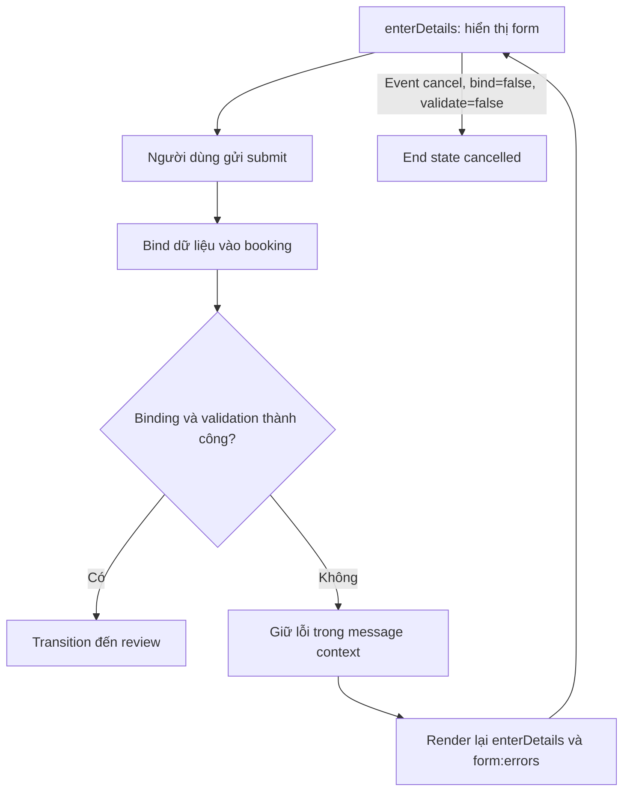

# Xử lý lỗi dữ liệu và hiển thị lại view

Trong chương **View-state**, mỗi màn hình là một điểm tương tác của người dùng trong flow. Với **SPRING_WEB_FLOW**, `view-state` có thể nhận dữ liệu từ form, bind dữ liệu vào model và kiểm tra dữ liệu trước khi thực hiện transition. Khi dữ liệu không hợp lệ, flow giữ người dùng ở màn hình hiện tại và hiển thị lỗi để họ sửa. Cơ chế này giúp hành trình web nhiều bước được quản lý bằng state, event, transition và subflow, thay vì để controller tự điều phối từng màn hình.

Bài học sử dụng một form đặt chỗ để minh họa ba việc: nhận diện lỗi binding, kiểm tra quy tắc nghiệp vụ và hiển thị lại view cùng thông báo phù hợp.

## 1. Phân biệt lỗi binding và lỗi validation

Hai nhóm lỗi thường xuất hiện khi người dùng gửi form:

| Loại lỗi | Ví dụ | Cách xử lý |
|---|---|---|
| Binding/conversion | Người dùng nhập chữ vào trường số lượng khách có kiểu `Integer`; ngày nhập không chuyển được sang kiểu ngày của model. | Bộ binding không chuyển đổi được giá trị. Lỗi được ghi nhận để view có thể hiển thị lại cùng dữ liệu và thông báo lỗi. |
| Validation | Số lượng khách là số hợp lệ nhưng bằng 0; email để trống; ngày nhận phòng nằm trong quá khứ. | Validator hoặc phương thức validation kiểm tra giá trị đã bind và thêm thông báo lỗi vào message context. |

Binding trả lời câu hỏi “giá trị gửi lên có chuyển được thành kiểu dữ liệu của model hay không?”. Validation trả lời câu hỏi “giá trị đã nhận có thỏa mãn quy tắc của ứng dụng hay không?”. Một giá trị có thể bind thành công nhưng vẫn không hợp lệ về nghiệp vụ.

Không nên chỉ dựa vào kiểm tra ở trình duyệt. Request có thể được gửi trực tiếp hoặc dữ liệu phía client có thể bị thay đổi, vì vậy quy tắc quan trọng phải được kiểm tra ở máy chủ.

## 2. Khai báo model và view-state

Ví dụ dưới đây dùng `BookingForm` làm model của màn hình nhập thông tin. Đối tượng này có các thuộc tính `fullName`, `email` và `guestCount`, cùng getter/setter JavaBean tương ứng.

```xml
<var name="booking" class="com.example.booking.BookingForm" />

<view-state id="enterDetails" model="booking">
    <binder>
        <binding property="fullName" />
        <binding property="email" />
        <binding property="guestCount" />
    </binder>

    <transition on="submit" to="review" />
    <transition on="cancel" to="cancelled"
                bind="false" validate="false" />
</view-state>

<view-state id="review" />
<end-state id="cancelled" />
```

`<var>` tạo biến `booking` trong flow scope. Thuộc tính `model="booking"` gắn đối tượng đó với `enterDetails`; binder liệt kê những thuộc tính được phép nhận từ form. Khi event `submit` được gửi, Web Flow bind dữ liệu và thực hiện validation trước khi chuyển sang `review`.

Hai thuộc tính trên transition `cancel` có ý nghĩa riêng:

- `validate="false"` bỏ qua bước validation cho hành động hủy. Người dùng có thể rời form dù các trường còn trống.
- `bind="false"` bỏ qua việc bind dữ liệu gửi lên cho transition này. Điều đó hữu ích khi dữ liệu form không cần được lưu lại trong flow model lúc hủy.

Với transition `submit`, binding và validation được bật theo mặc định. Chỉ khai báo `validate="false"` cho những hành động thực sự được phép bỏ qua kiểm tra, chẳng hạn hủy hoặc quay lại theo quy tắc của ứng dụng.

## 3. Viết logic validation cho view-state

Spring Web Flow hỗ trợ phương thức validation theo quy ước tên state trên model. Với state `enterDetails`, ta có thể định nghĩa phương thức `validateEnterDetails` nhận một `ValidationContext`.

```java
package com.example.booking;

import org.springframework.binding.message.MessageBuilder;
import org.springframework.binding.message.MessageContext;
import org.springframework.binding.validation.ValidationContext;

public class BookingForm {
    private String fullName;
    private String email;
    private Integer guestCount;

    public void validateEnterDetails(ValidationContext context) {
        MessageContext messages = context.getMessageContext();

        if (fullName == null || fullName.trim().isEmpty()) {
            messages.addMessage(new MessageBuilder()
                    .error()
                    .source("fullName")
                    .defaultText("Vui lòng nhập họ và tên.")
                    .build());
        }

        if (email == null || email.trim().isEmpty()) {
            messages.addMessage(new MessageBuilder()
                    .error()
                    .source("email")
                    .defaultText("Vui lòng nhập email.")
                    .build());
        }

        if (guestCount == null || guestCount < 1 || guestCount > 8) {
            messages.addMessage(new MessageBuilder()
                    .error()
                    .source("guestCount")
                    .defaultText("Số lượng khách phải từ 1 đến 8.")
                    .build());
        }
    }

    // Bổ sung getter và setter cho fullName, email, guestCount.
}
```

Trong ví dụ, `ValidationContext` cung cấp `MessageContext` để thêm thông báo. Mỗi thông báo có `source` là tên thuộc tính, nhờ đó view có thể gắn lỗi đúng với trường nhập liệu. `defaultText` là nội dung dự phòng được hiển thị nếu không dùng mã thông báo trong message bundle.

Tên phương thức validation phải khớp với ID state theo quy ước `validate` + tên state viết theo dạng PascalCase. Nếu đổi `id="enterDetails"` thành một tên khác, hãy đổi tên phương thức tương ứng. Các getter/setter cần thiết phải được triển khai đầy đủ trong lớp model.

Nếu ứng dụng đã tích hợp Bean Validation hoặc một Spring `Validator`, có thể dùng các ràng buộc như `@NotBlank`, `@Email`, `@Min` và `@Max` theo cấu hình validator của ứng dụng. Dù dùng cách nào, hãy kiểm tra dữ liệu ở phía máy chủ và bảo đảm lỗi được đưa về view state đang hiển thị.

## 4. Hiển thị lỗi trong JSP

Spring MVC Form Tag Library giúp liên kết input với model và render lỗi theo thuộc tính. Form phải gửi đến `${flowExecutionUrl}` để request tiếp tục đúng flow execution hiện tại.

```jsp
<%@ taglib prefix="form" uri="http://www.springframework.org/tags/form" %>

<h2>Thông tin đặt chỗ</h2>

<form:form modelAttribute="booking"
           method="post"
           action="${flowExecutionUrl}">

    <div class="error-summary">
        <form:errors path="*" />
    </div>

    <div>
        <form:label path="fullName">Họ và tên</form:label>
        <form:input path="fullName" />
        <form:errors path="fullName" cssClass="field-error" />
    </div>

    <div>
        <form:label path="email">Email</form:label>
        <form:input path="email" type="email" />
        <form:errors path="email" cssClass="field-error" />
    </div>

    <div>
        <form:label path="guestCount">Số lượng khách</form:label>
        <form:input path="guestCount" type="number" />
        <form:errors path="guestCount" cssClass="field-error" />
    </div>

    <button type="submit" name="_eventId_submit">Tiếp tục</button>
    <button type="submit" name="_eventId_cancel">Hủy</button>
</form:form>
```

`modelAttribute="booking"` phải trùng tên model trong `view-state`. Mỗi `path` phải trùng với property Java và property đó phải được khai báo trong binder. `form:errors path="*"` hiển thị danh sách lỗi tổng quát; `form:errors path="email"` hiển thị lỗi của riêng trường email.

Khi dữ liệu bind hoặc validation không thành công, transition `submit` không được thực hiện. Flow vẫn ở `enterDetails`, view được render lại và các thẻ `form:errors` hiển thị thông báo. Các giá trị đã bind thành công vẫn nằm trong model để người dùng không phải nhập lại toàn bộ form. Với lỗi chuyển đổi kiểu, trường gây lỗi có thể không nhận được giá trị mới vì giá trị đó không thể chuyển thành kiểu của property.

## 5. Luồng xử lý khi có lỗi



Quá trình có thể hiểu theo thứ tự sau:

1. Người dùng mở `enterDetails`; view nhận model `booking`.
2. Người dùng gửi event `submit` cùng các giá trị trong form.
3. Web Flow bind các thuộc tính được cho phép trong binder. Nếu có lỗi chuyển đổi hoặc binding, lỗi được ghi nhận.
4. Khi binding cho phép tiếp tục, validation kiểm tra quy tắc của model và thêm lỗi vào message context nếu cần.
5. Nếu có lỗi, flow giữ nguyên state hiện tại và render lại view. Nếu không có lỗi, transition `submit` đưa flow đến `review`.

Vì vậy, việc hiển thị lại view là một phần tự nhiên của vòng đời `view-state`. Không cần tạo một controller riêng chỉ để điều hướng người dùng trở lại cùng màn hình khi dữ liệu không hợp lệ.

## 6. Xử lý thông báo lỗi từ nghiệp vụ

Không phải lỗi nào cũng phát hiện được trong validation của form. Ví dụ, email có định dạng hợp lệ nhưng đã được một tài khoản khác sử dụng. Quy tắc này thường chỉ xác định được khi gọi service hoặc truy vấn dữ liệu.

Khi một action trong flow phát hiện lỗi nghiệp vụ và cần quay lại form, action có thể thêm thông báo vào message context của `RequestContext`, sau đó trả về event để flow chọn transition quay lại `enterDetails`. Ví dụ về phần thêm thông báo:

```java
import org.springframework.binding.message.MessageBuilder;
import org.springframework.webflow.execution.RequestContext;

public void addDuplicateEmailMessage(RequestContext context) {
    context.getMessageContext().addMessage(new MessageBuilder()
            .error()
            .source("email")
            .defaultText("Email này đã được sử dụng. Hãy nhập email khác.")
            .build());
}
```

Đoạn mã minh họa cách đưa lỗi nghiệp vụ về cùng cơ chế hiển thị lỗi của form. Trong action thực tế, hãy gọi hàm này khi service trả về kết quả email bị trùng và cấu hình transition của action quay lại view nhập liệu. Không nên để exception nghiệp vụ thông thường thoát ra ngoài như một lỗi máy chủ không được xử lý.

Nếu lỗi không gắn với một trường cụ thể, có thể thêm message không có `source` để hiển thị như lỗi chung của form. Nếu cần giữ lại dữ liệu người dùng đã nhập, hãy bảo đảm flow model vẫn còn trong scope phù hợp khi quay lại view.

## 7. Bỏ qua validation đúng lúc

Một số event không cần dữ liệu hợp lệ. Ví dụ, người dùng chọn Hủy khi chưa nhập đủ thông tin. Nếu transition hủy vẫn chạy validation, họ có thể bị giữ lại ở form vì các trường bắt buộc còn trống.

```xml
<transition on="submit" to="review" />
<transition on="cancel" to="cancelled"
            bind="false" validate="false" />
```

Transition `cancel` bỏ qua binding và validation nên có thể kết thúc flow ngay cả khi form chưa hoàn chỉnh. Không áp dụng cấu hình này cho transition lưu hoặc xác nhận dữ liệu, vì như vậy có thể cho phép dữ liệu không hợp lệ đi tiếp vào quy trình nghiệp vụ.

## 8. Những lỗi thường gặp khi hiển thị lại view

| Hiện tượng | Nguyên nhân cần kiểm tra |
|---|---|
| Flow chuyển sang state tiếp theo dù dữ liệu sai | Validation chưa được gọi, transition đặt `validate="false"`, hoặc logic validation không thêm message vào `MessageContext`. |
| Flow ở lại form nhưng không thấy thông báo | `source` không trùng property, view thiếu `form:errors`, hoặc thông báo chưa được thêm vào message context của request hiện tại. |
| Giá trị nhập bị mất khi form hiển thị lại | Tên `modelAttribute`, `model` hoặc property không khớp; kiểm tra scope và quá trình tạo lại model. |
| Một trường không nhận dữ liệu | Property chưa có trong binder, thiếu setter hoặc giá trị gửi lên không chuyển đổi được sang kiểu Java. |
| Không thể hủy khi form còn trống | Transition hủy chưa đặt `validate="false"`; cân nhắc thêm `bind="false"` nếu không cần nhận dữ liệu khi hủy. |
| Lỗi nghiệp vụ không xuất hiện cạnh trường | Message chưa có `source` đúng tên property hoặc action không đưa message vào `RequestContext.getMessageContext()`. |

Khi debug, hãy xác định lỗi phát sinh ở bước binding, validation hay action nghiệp vụ. Sau đó kiểm tra message context và property name trước khi thay đổi transition. Cách phân loại này giúp tránh sửa nhầm cấu hình điều hướng khi nguyên nhân thực tế nằm ở model hoặc view.

## 9. Thực hành

Hãy hoàn thiện màn hình đặt chỗ với ba trường `fullName`, `email` và `guestCount`.

1. Tạo model `BookingForm`, khai báo biến `booking` và gắn nó vào `view-state` `enterDetails`.
2. Giới hạn binder ở ba thuộc tính của form.
3. Viết `validateEnterDetails(ValidationContext context)` để kiểm tra họ tên, email và số lượng khách từ 1 đến 8.
4. Tạo JSP dùng `form:form`, `form:input` và `form:errors` để hiển thị lỗi tổng quát lẫn lỗi theo trường.
5. Gửi form với số lượng khách bằng 0; xác nhận flow vẫn ở `enterDetails` và lỗi xuất hiện cạnh trường tương ứng.
6. Nhập chữ vào trường số lượng khách để quan sát lỗi chuyển đổi kiểu.
7. Nhấn Hủy khi form còn trống; xác nhận transition hủy bỏ qua binding và validation theo cấu hình.

Bạn hoàn thành bài khi có thể phân biệt lỗi binding với lỗi validation, giải thích vì sao flow giữ nguyên `view-state` khi dữ liệu sai, và đưa được thông báo lỗi về đúng trường trên form.
