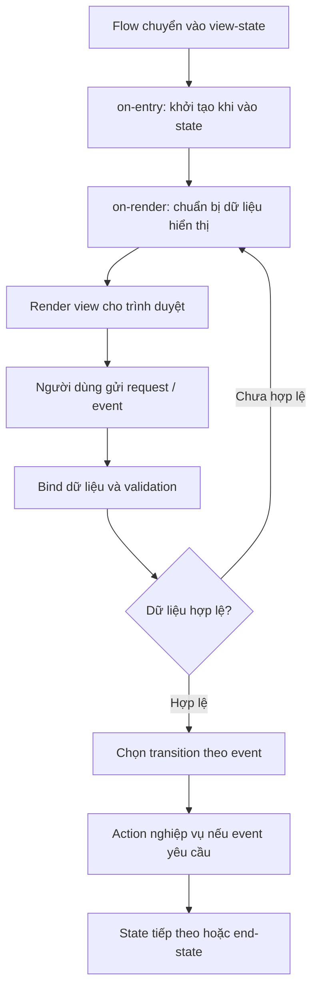

# Thiết kế màn hình có thể render lại mà không lặp tác vụ nghiệp vụ

Trong chương **View-state**, bài này tập trung vào cách thiết kế một màn hình Spring Web Flow sao cho hệ thống có thể hiển thị lại màn hình nhiều lần mà không thực hiện lặp các thay đổi nghiệp vụ. Đây là yêu cầu quan trọng trong những hành trình web nhiều bước của module **SPRING_WEB_FLOW**: flow giữ trạng thái, nhận event, điều khiển transition và subflow; còn view-state chịu trách nhiệm trình bày dữ liệu và tiếp nhận thao tác của người dùng.

Ví dụ xuyên suốt là quy trình đặt chỗ. Người dùng chọn ngày và khung giờ, xem lại thông tin rồi xác nhận. Màn hình chọn giờ có thể được render lần đầu, render lại khi dữ liệu nhập không hợp lệ, khi người dùng quay lại, hoặc khi flow được tiếp tục sau một request khác. Việc render lại có thể cần tải danh sách giờ còn trống, nhưng không được tạo đặt chỗ, giữ chỗ vĩnh viễn, trừ tiền hay gửi email xác nhận.

## 1. Render màn hình và thực hiện nghiệp vụ là hai việc khác nhau

**Render** là tạo phản hồi giao diện từ trạng thái hiện tại của flow và dữ liệu cần hiển thị. Ví dụ: tải danh sách khung giờ còn trống, tính giá dự kiến, hiển thị địa chỉ đã chọn hoặc dựng thông báo lỗi.

**Tác vụ nghiệp vụ** làm thay đổi trạng thái có ý nghĩa đối với hệ thống hoặc người dùng khác. Ví dụ: tạo đơn đặt chỗ, giữ chỗ, trừ tiền, cập nhật hồ sơ, phát hành vé hoặc gửi email xác nhận.

Một view-state có thể được render nhiều lần trong cùng một lần thực thi flow. Vì vậy, mọi thao tác được gọi trong quá trình render phải an toàn khi lặp lại. Thông thường, chúng nên là truy vấn chỉ đọc. Những thay đổi nghiệp vụ cần gắn với event rõ ràng như `confirm`, `save` hoặc `cancel`, rồi được xử lý trong transition hoặc action-state bằng service của ứng dụng.

Không nên dựa vào giả định rằng trình duyệt chỉ yêu cầu một lần, người dùng chỉ bấm nút một lần, hoặc một state chỉ được vào một lần. Refresh, gửi lại form, lỗi validation, nút Back, nhiều tab và việc khôi phục flow đều có thể làm màn hình được hiển thị lại hoặc một event được gửi lại.

## 2. Vòng đời của một view-state

Một view-state đại diện cho một màn hình trong flow. Khi flow chuyển vào view-state, SWF thực hiện các action lúc vào state, chuẩn bị dữ liệu render và hiển thị view. Khi nhận request chứa event, SWF bind dữ liệu form vào model, thực hiện validation theo cấu hình, rồi tìm transition tương ứng. Nếu dữ liệu không hợp lệ, người dùng có thể ở lại màn hình hiện tại để sửa.



Các hook có vai trò khác nhau:

| Vị trí | Khi nào chạy | Công việc phù hợp |
|---|---|---|
| `on-entry` | Khi flow đi vào view-state | Khởi tạo dữ liệu của state, thiết lập giá trị mặc định hoặc chuẩn bị ngữ cảnh ban đầu. |
| `on-render` | Mỗi lần view-state chuẩn bị render view | Tải hoặc làm mới dữ liệu chỉ đọc cần cho lần hiển thị hiện tại. |
| `transition` | Khi request gửi event khớp transition | Điều phối hành động theo ý định của người dùng, chẳng hạn lưu hoặc xác nhận. |
| `action-state` | Khi flow chuyển vào action-state | Thực hiện một bước xử lý nghiệp vụ độc lập rồi chọn state tiếp theo theo kết quả. |

`on-entry` không đồng nghĩa với “chạy đúng một lần trong toàn bộ flow”. Nếu flow rời state rồi quay lại, state được vào lại và action `on-entry` có thể chạy lại. `on-render` có thể chạy nhiều lần ngay cả khi người dùng vẫn đang ở cùng view-state. Transition cũng có thể nhận request lặp, vì vậy service ghi dữ liệu vẫn phải có cơ chế bảo vệ trùng lặp.

## 3. Đặt đúng loại công việc vào đúng hook

Có thể dùng quy tắc sau để quyết định vị trí của một đoạn xử lý:

- Nếu công việc chỉ lấy dữ liệu để hiển thị và có thể chạy lại mà không làm thay đổi nghiệp vụ, đặt ở `on-render` hoặc một query service được gọi từ đó.
- Nếu công việc chuẩn bị trạng thái ban đầu khi vừa vào màn hình, đặt ở `on-entry`; bảo đảm việc vào lại state không làm mất dữ liệu người dùng đã nhập hoặc tạo side effect.
- Nếu công việc chỉ được thực hiện khi người dùng xác nhận ý định, gọi command service từ transition hoặc action-state tương ứng.
- Nếu công việc có nhiều bước, có thể tách thành action-state hoặc subflow; mỗi bước cần có trạng thái và cách phục hồi rõ ràng.

Ví dụ với màn hình chọn giờ:

| Công việc | Nơi xử lý đề xuất | Lý do |
|---|---|---|
| Đọc danh sách giờ còn trống | `on-render` gọi query service | Cần hiển thị dữ liệu mới nhất; truy vấn có thể lặp. |
| Tính giá dự kiến | Query service từ `on-render` | Chỉ tính dữ liệu trình bày, chưa ghi nhận giao dịch. |
| Tạo giá trị mặc định cho form | `on-entry` hoặc factory khi khởi tạo flow | Chỉ chuẩn bị model ban đầu; cần tránh ghi đè dữ liệu đã nhập khi quay lại. |
| Kiểm tra dữ liệu người dùng gửi | Binding và validation trước khi chuyển state | Ngăn dữ liệu sai đi tiếp trong hành trình. |
| Xác nhận đặt chỗ | Transition `confirm` gọi command service | Đây là thay đổi nghiệp vụ được người dùng yêu cầu rõ ràng. |
| Gửi email xác nhận | Sau khi nghiệp vụ xác nhận thành công, qua cơ chế xử lý phù hợp | Không gửi lại chỉ vì màn hình được render lại. |

## 4. Ví dụ cấu hình view-state an toàn khi render lại

Giả sử ứng dụng có `ReservationForm` chứa ngày và mã khung giờ người dùng chọn. Form được khai báo ở flow scope để giữ dữ liệu qua các bước. Danh sách giờ và báo giá chỉ phục vụ màn hình hiện tại nên được đặt trong view scope.

```xml
<?xml version="1.0" encoding="UTF-8"?>
<flow xmlns="http://www.springframework.org/schema/webflow"
      xmlns:xsi="http://www.w3.org/2001/XMLSchema-instance"
      xsi:schemaLocation="http://www.springframework.org/schema/webflow
                          http://www.springframework.org/schema/webflow/spring-webflow.xsd">

    <var name="reservationForm"
         class="com.example.reservation.ReservationForm"/>

    <on-start>
        <evaluate expression="submissionIdFactory.create()"
                  result="flowScope.submissionId"/>
    </on-start>

    <view-state id="chooseSlot"
                view="reservation/choose-slot"
                model="reservationForm">
        <binder>
            <binding property="date" required="true"/>
            <binding property="slotId" required="true"/>
        </binder>

        <on-render>
            <evaluate expression="slotQueryService.findAvailableSlots(reservationForm.date)"
                      result="viewScope.availableSlots"/>
            <evaluate expression="pricingQueryService.quote(reservationForm)"
                      result="viewScope.quote"/>
        </on-render>

        <transition on="continue" to="review">
            <evaluate expression="reservationValidator.validate(reservationForm, messageContext)"/>
        </transition>
    </view-state>

    <view-state id="review" view="reservation/review" model="reservationForm">
        <transition on="back" to="chooseSlot"/>
        <transition on="confirm" to="completed">
            <evaluate expression="reservationCommandService.confirm(reservationForm, flowScope.submissionId)"
                      result="flowScope.receipt"/>
        </transition>
    </view-state>

    <end-state id="completed" view="reservation/confirmation"/>
</flow>
```

Trong ví dụ này, `slotQueryService` và `pricingQueryService` là các bean chỉ đọc. Chúng được gọi trong `on-render`, do đó cần chịu được nhiều lần gọi. `availableSlots` và `quote` nằm trong `viewScope`, gắn với màn hình chọn giờ. `reservationForm` nằm trong flow scope để dữ liệu người dùng nhập vẫn có thể được dùng ở bước xem lại.

`reservationValidator` cần tích hợp với cơ chế validation của flow và ghi lỗi vào `messageContext` để flow giữ người dùng ở màn hình khi dữ liệu chưa đạt yêu cầu. Service xác nhận chỉ được gọi ở event `confirm`. `submissionId` là mã do server tạo một lần cho lần gửi yêu cầu nghiệp vụ này; phần tiếp theo giải thích cách dùng mã đó để chống xử lý trùng.

Các tên bean trong biểu thức phải khớp bean thực tế trong Spring application context. Tên view và flow ID cũng cần khớp cấu hình registry và `ViewResolver` của ứng dụng.

## 5. Viết query service chỉ đọc

Query service phục vụ view nên trả về dữ liệu cần hiển thị và không thực hiện thay đổi nghiệp vụ. Có thể đánh dấu transaction là chỉ đọc để thể hiện ý định và hỗ trợ persistence provider tối ưu phù hợp.

```java
import java.time.LocalDate;
import java.util.List;
import java.util.stream.Collectors;
import org.springframework.stereotype.Service;
import org.springframework.transaction.annotation.Transactional;

@Service("slotQueryService")
public class SlotQueryService {

    private final SlotRepository slotRepository;

    public SlotQueryService(SlotRepository slotRepository) {
        this.slotRepository = slotRepository;
    }

    @Transactional(readOnly = true)
    public List<SlotOption> findAvailableSlots(LocalDate date) {
        return slotRepository.findAvailableOptions(date).stream()
                .map(SlotOption::from)
                .collect(Collectors.toList());
    }
}
```

Phương thức trên chỉ truy vấn các lựa chọn đang có thể hiển thị. Nó không tạo bản ghi reservation, không khóa tồn kho và không đánh dấu slot là đã bán. Trạng thái còn trống có thể thay đổi giữa lúc render và lúc người dùng xác nhận; vì vậy command service phải kiểm tra lại điều kiện tại thời điểm ghi dữ liệu.

Không nên dùng một truy vấn hiển thị để ngầm giữ tài nguyên. Nếu nghiệp vụ cần giữ chỗ tạm thời, đó là một command riêng có thời hạn, định danh và cơ chế giải phóng rõ ràng. Việc command này có được gọi khi người dùng chọn giờ hay chỉ khi xác nhận phụ thuộc vào quy tắc nghiệp vụ, nhưng không được ẩn trong `on-render`.

## 6. Giữ dữ liệu form và dữ liệu hiển thị trong đúng scope

Chọn scope theo vòng đời của dữ liệu:

| Scope | Dùng cho | Ví dụ trong màn hình đặt chỗ |
|---|---|---|
| `requestScope` | Dữ liệu chỉ cần trong request hiện tại | Thông tin tạm của một lần xử lý request. |
| `flashScope` | Dữ liệu chuyển qua redirect | Thông báo một lần sau khi chuyển hướng. |
| `viewScope` | Dữ liệu gắn với view-state hiện tại | Danh sách giờ, báo giá hiển thị, lựa chọn phụ trợ của màn hình. |
| `flowScope` | Dữ liệu cần tồn tại trong suốt flow execution | Form đặt chỗ, mã submission, dữ liệu dùng ở bước xem lại. |
| `conversationScope` | Dữ liệu cần chia sẻ giữa flow cha và subflow trong cùng conversation | Ngữ cảnh chung mà cả flow cha và flow con cùng sử dụng. |

Không đặt toàn bộ dữ liệu của ứng dụng vào flow scope hoặc conversation scope. Scope dài hơn làm tăng lượng dữ liệu được giữ trong phiên và khiến trạng thái cũ khó được quản lý. Không lưu entity đang được quản lý, request/response object, stream hoặc object lớn vào scope dài hạn nếu không có lý do rõ ràng.

Với dữ liệu chỉ để render, `viewScope` thường phù hợp vì nó gắn với vòng đời màn hình. Khi người dùng rời view-state, dữ liệu này không nên được xem là nguồn sự thật lâu dài. Nếu quay lại màn hình, `on-render` có thể tải lại dữ liệu mới.

## 7. Form binding, validation và render lại khi có lỗi

`model` trên view-state chỉ ra object nhận dữ liệu form. `<binder>` cho phép khai báo các thuộc tính được phép bind. Việc liệt kê rõ field giúp tránh để request cập nhật các thuộc tính do server kiểm soát như `ownerId`, `status`, `approved`, số tiền cuối cùng hoặc quyền người dùng.

Khi request gửi event, SWF bind các giá trị gửi lên model và áp dụng validation theo cấu hình. Nếu binding hoặc validation thất bại, flow có thể hiển thị lại cùng view-state kèm thông báo để người dùng sửa. Đây là một tình huống render lại bình thường; `on-render` có thể chạy lại và cần an toàn khi lặp.

Ví dụ view dùng `flowExecutionUrl` để gửi event cho đúng flow execution:

```html
<form method="post"
      th:action="${flowExecutionUrl}"
      th:object="${reservationForm}">

    <label for="date">Ngày đặt</label>
    <input id="date" type="date" th:field="*{date}">

    <label for="slotId">Khung giờ</label>
    <select id="slotId" th:field="*{slotId}">
        <option value="">Chọn khung giờ</option>
        <option th:each="slot : ${availableSlots}"
                th:value="${slot.id}"
                th:text="${slot.label}">
        </option>
    </select>

    <button type="submit" name="_eventId_continue">Tiếp tục</button>
</form>
```

Event `_eventId_continue` phải khớp với `transition on="continue"`. Khi validation lỗi, màn hình cần hiển thị lại giá trị người dùng đã nhập và các message tương ứng. Không khởi tạo lại form bằng dữ liệu mặc định trong mỗi lần render vì thao tác đó sẽ xóa nội dung người dùng vừa sửa.

Đối với dữ liệu thay đổi nhanh như giờ còn trống hoặc giá, có thể làm mới dữ liệu hiển thị trong `on-render`. Tuy nhiên, giá trị được gửi từ trình duyệt luôn là dữ liệu không đáng tin cậy. Khi xác nhận, server phải đọc lại dữ liệu cần thiết và kiểm tra quyền, giá, tình trạng chỗ trống cũng như các quy tắc nghiệp vụ.

## 8. Đặt command tại transition và bảo vệ khỏi request lặp

Command service thực hiện thay đổi nghiệp vụ. Một transition nên gọi command khi event thể hiện ý định rõ ràng của người dùng. Ví dụ event `confirm` mới gọi `reservationCommandService.confirm(...)`; việc mở lại màn hình review hoặc render lại màn hình chọn giờ không được gọi command này.

```java
import java.util.UUID;
import org.springframework.stereotype.Service;
import org.springframework.transaction.annotation.Transactional;

@Service("reservationCommandService")
public class ReservationCommandService {

    private final ReservationRepository reservationRepository;

    public ReservationCommandService(ReservationRepository reservationRepository) {
        this.reservationRepository = reservationRepository;
    }

    @Transactional
    public Receipt confirm(ReservationForm form, UUID submissionId) {
        return reservationRepository.findReceiptBySubmissionId(submissionId)
                .orElseGet(() -> createReservation(form, submissionId));
    }

    private Receipt createReservation(ReservationForm form, UUID submissionId) {
        // Kiểm tra lại quyền, giá và tình trạng chỗ trống trong transaction.
        // Ghi reservation cùng submissionId có ràng buộc unique.
        // Trả về receipt đã lưu.
        throw new UnsupportedOperationException("Implement domain operation");
    }
}
```

Đây là phác thảo minh họa cho cơ chế idempotency; phần ghi dữ liệu cần được triển khai theo repository và quy tắc transaction của ứng dụng. `submissionId` được tạo ở server và gắn với một yêu cầu xác nhận. Nếu cùng yêu cầu được gửi lại, service tìm kết quả đã tạo và trả lại thay vì tạo reservation mới.

Chỉ kiểm tra trước bằng `findReceiptBySubmissionId` chưa đủ để chống hai request đồng thời. Cần ràng buộc unique ở cơ sở dữ liệu cho mã submission và xử lý xung đột khi hai transaction cùng cố tạo bản ghi. Với thao tác thanh toán hoặc tích hợp bên ngoài, dùng idempotency key mà hệ thống đích hỗ trợ, hoặc ghi nhận trạng thái command/outbox để việc retry không tạo tác động trùng.

Không xem flow execution key là khóa idempotency nghiệp vụ. Execution key giúp SWF định vị một lần thực thi flow; nó không thay thế mã yêu cầu bền vững của domain service. Một người dùng có thể mở nhiều flow cho cùng nghiệp vụ, và một request có thể được gửi lại qua nhiều cơ chế khác nhau.

## 9. Xử lý `on-entry` và `on-render` mà không ghi đè dữ liệu

Có hai kiểu dữ liệu thường cần chuẩn bị trước khi hiển thị:

**Dữ liệu khởi tạo:** giá trị mặc định hoặc dữ liệu cần thiết khi người dùng mới vào màn hình. Có thể tạo trong factory lúc khởi tạo flow hoặc trong `on-entry`. Việc khởi tạo phải có điều kiện để không thay thế dữ liệu người dùng đã nhập khi flow quay lại state.

**Dữ liệu hiển thị có thể làm mới:** danh sách lựa chọn, trạng thái hiện tại, cảnh báo, thông tin tóm tắt. Có thể truy vấn trong `on-render` và lưu kết quả vào `viewScope`. Vì `on-render` chạy mỗi lần view được hiển thị, truy vấn cần đủ nhanh và không gây thay đổi nghiệp vụ.

Ví dụ riêng cho `on-entry` chỉ khởi tạo khi form chưa có giá trị:

```xml
<on-entry>
    <evaluate expression="reservationForm.initializeIfNeeded()"/>
</on-entry>
```

Đoạn trên chỉ phù hợp nếu `initializeIfNeeded()` là thao tác khởi tạo model trong bộ nhớ và không ghi dữ liệu nghiệp vụ. Nếu flow có thể quay lại state sau khi người dùng đã nhập dữ liệu, phương thức phải giữ nguyên các trường đã có. Không dùng `on-entry` để tạo reservation hoặc trừ tiền.

Nếu dữ liệu hiển thị đắt để truy vấn và không cần tươi mới ở mọi lần render, có thể nạp khi vào state rồi giữ trong `viewScope`. Khi chọn cách này, hãy xác định rõ lúc nào dữ liệu hết hạn và cần làm mới. Không đánh đổi tính đúng đắn của quyết định nghiệp vụ lấy việc tái sử dụng dữ liệu hiển thị cũ.

## 10. Refresh, nút Back, nhiều tab và khôi phục flow

Các thao tác trình duyệt có thể làm lộ lỗi thiết kế nếu command bị đặt nhầm vào hook render:

- **Refresh màn hình:** view có thể được hiển thị lại hoặc trình duyệt gửi lại request trước đó. Query render có thể chạy lại; command không được tự chạy chỉ vì view xuất hiện.
- **Validation thất bại:** người dùng vẫn ở view-state để sửa dữ liệu. `on-render` chạy lại, nhưng không được tạo reservation hoặc gửi email.
- **Nút Back:** người dùng có thể quay lại state trước. `on-entry` của state đó có thể chạy lại; cần tránh reset dữ liệu đã nhập và tránh side effect.
- **Mở nhiều tab:** mỗi tab có thể tiếp tục một execution hoặc snapshot khác nhau. Khi xác nhận, service phải kiểm tra dữ liệu và quyền tại thời điểm ghi.
- **Session hết hạn hoặc execution không còn hợp lệ:** hướng dẫn người dùng bắt đầu lại flow; chỉ phục hồi dữ liệu từ nguồn bền vững khi quy tắc nghiệp vụ cho phép.

Không giả định việc quay lại một state sẽ tự hoàn tác thay đổi đã ghi ở state trước. Nếu người dùng có thể hủy một đặt chỗ đã xác nhận, hãy xây dựng command hủy riêng với kiểm tra trạng thái và quyền; việc chuyển về màn hình trước chỉ là điều hướng giao diện.

## 11. Kiểm thử hành vi render lặp

Kiểm thử cần xác nhận cả nội dung hiển thị lẫn số lần tác vụ nghiệp vụ được gọi. Với màn hình chọn giờ, có thể xây dựng các trường hợp sau:

| Tình huống | Kết quả mong đợi |
|---|---|
| Mở view-state lần đầu | Query danh sách giờ và báo giá; chưa có reservation được tạo. |
| Render lại cùng view-state | Query có thể chạy lại; số reservation và số lần trừ tiền không đổi. |
| Gửi form thiếu trường bắt buộc | Hiển thị lỗi và giữ dữ liệu hợp lệ đã nhập; command xác nhận chưa được gọi. |
| Quay lại từ màn hình review | Form vẫn có dữ liệu cần giữ; dữ liệu hiển thị được tải lại theo chính sách. |
| Gửi event confirm một lần | Command service xác nhận đúng một reservation. |
| Gửi lại cùng submissionId | Trả về kết quả đã tạo; không tạo reservation hoặc giao dịch thứ hai. |
| Hai request confirm đồng thời | Ràng buộc dữ liệu và xử lý xung đột bảo đảm chỉ có một kết quả nghiệp vụ. |
| Session hết hạn | Flow xử lý lỗi có kiểm soát; không phát sinh command ngầm. |

Có thể dùng unit test cho query service và command service, test flow execution cho các event/state, và MockMvc hoặc kiểm thử tích hợp tương đương cho đường đi HTTP. Dùng spy/mock để xác nhận `confirm()` không bị gọi trong lần render đầu, lần render lại và trường hợp validation lỗi.

Ví dụ kiểm tra ý tưởng bằng Mockito:

```java
verify(reservationCommandService, never())
        .confirm(any(ReservationForm.class), any(UUID.class));
```

Chỉ thực hiện assertion trên sau khi test đã đi qua request render hoặc validation lỗi. Với test xác nhận, kiểm tra command được gọi đúng với submission ID và kết quả không bị nhân đôi khi request lặp.

## 12. Các lỗi thiết kế thường gặp

| Cách làm sai | Hậu quả | Cách sửa |
|---|---|---|
| Tạo đơn trong `on-render` | Mỗi lần hiển thị có thể tạo thêm đơn. | Chuyển sang command gắn với event xác nhận và thêm idempotency. |
| Gửi email trong `on-entry` | Quay lại state có thể gửi lại email. | Gửi sau khi nghiệp vụ thành công, có trạng thái gửi và cơ chế retry an toàn. |
| Đặt form trong `viewScope` dù cần dùng ở nhiều state | Dữ liệu có thể mất khi rời view-state. | Đặt form ở `flowScope`; giữ dữ liệu chỉ phục vụ màn hình ở `viewScope`. |
| Khởi tạo lại form trong mỗi lần render | Dữ liệu người dùng nhập bị ghi đè. | Chỉ khởi tạo khi cần; giữ model qua lần render lại. |
| Dùng dữ liệu từ view để quyết định giá hoặc quyền | Người dùng có thể sửa request hoặc dữ liệu đã cũ. | Tính và kiểm tra lại ở server trong command service. |
| Dùng flow execution key làm idempotency key | Không bảo vệ đầy đủ khi có nhiều flow hoặc request nghiệp vụ khác nhau. | Dùng mã submission nghiệp vụ được tạo phía server và ràng buộc unique. |
| Bắt mọi ngoại lệ rồi render lại như không có gì xảy ra | Có thể che giấu trạng thái giao dịch không rõ ràng. | Phân loại lỗi, ghi nhận trạng thái và phục hồi theo quy tắc nghiệp vụ. |

## 13. Checklist trước khi hoàn thành một view-state

- [ ] Mỗi action trong `on-render` chỉ đọc dữ liệu hoặc tính dữ liệu trình bày và an toàn khi gọi nhiều lần.
- [ ] `on-entry` chỉ khởi tạo ngữ cảnh; vào lại state không làm mất dữ liệu người dùng hoặc lặp side effect.
- [ ] Command chỉ chạy từ event/transition có ý nghĩa nghiệp vụ rõ ràng.
- [ ] Service kiểm tra lại quyền, giá, tình trạng tài nguyên và các bất biến tại thời điểm ghi.
- [ ] Form object và dữ liệu view-only được đặt đúng scope.
- [ ] Binder chỉ cho phép các thuộc tính người dùng được sửa.
- [ ] Validation lỗi giữ người dùng ở màn hình phù hợp và không gọi command.
- [ ] Command có transaction và cơ chế chống request lặp phù hợp với domain.
- [ ] Các trường hợp refresh, Back, nhiều tab, session hết hạn và retry đã được kiểm thử.
- [ ] Log có đủ thông tin chẩn đoán nhưng không ghi dữ liệu nhạy cảm hoặc token thực thi flow.

## 14. Kết luận

View-state có thể được render nhiều lần trong vòng đời của một flow. Thiết kế an toàn là đặt truy vấn và dữ liệu trình bày vào `on-render`, khởi tạo ngữ cảnh có kiểm soát trong `on-entry`, và chỉ gọi command khi người dùng gửi event nghiệp vụ rõ ràng. Kết hợp form binding, validation, scope phù hợp và idempotency ở service sẽ giúp màn hình có thể hiển thị lại sau lỗi, refresh hoặc điều hướng mà không tạo ra tác động nghiệp vụ ngoài ý muốn.
