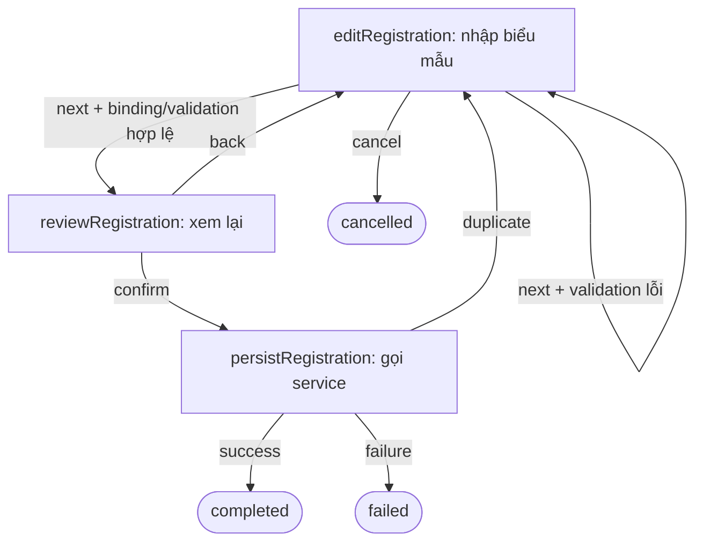

# Event ID, nguồn sự kiện và dữ liệu đi kèm trong Spring Web Flow

Khi xây dựng quy trình đăng ký, đặt hàng hoặc xác minh danh tính gồm nhiều màn hình, việc người dùng bấm **Tiếp tục**, **Quay lại** hay **Xác nhận** không đơn thuần là chuyển tới một URL khác. Mỗi thao tác là một **event** được xử lý trong ngữ cảnh của **state hiện tại**. Spring Web Flow (SWF) dùng **event ID** để chọn **transition** phù hợp, đồng thời cho phép mang dữ liệu từ biểu mẫu, hành động nghiệp vụ hoặc subflow qua các bước của một flow.

Bài này tập trung vào ba câu hỏi: event ID biểu thị điều gì; sự kiện đến từ đâu; và dữ liệu đi cùng sự kiện nên được truy cập, kiểm tra, lưu ở đâu. Đây là nền tảng để tách logic điều hướng khỏi controller của Spring MVC và kiểm soát chính xác một hành trình nhiều bước.

## 1. Event ID là gì?

Trong SWF, **event** là tín hiệu cho biết một điều vừa xảy ra. Event có một **ID** (chuỗi định danh) và có thể có **attributes** (các giá trị gắn kèm). Một transition khai báo `on="<event-id>"` để nói rằng: *nếu state hiện tại nhận event có ID này, hãy thực hiện transition đó*.

Ví dụ:

```xml
<view-state id="shipping" model="shippingForm">
    <transition on="next" to="payment" />
    <transition on="cancel" to="cancelled" bind="false" />
</view-state>
```

- `shipping` là **state ID**: định danh màn hình hiện tại.
- `next` và `cancel` là **event ID**: định danh điều người dùng muốn làm.
- `payment` và `cancelled` là **state ID đích** của transition tương ứng.
- `on` **khớp ID**, không nhận trực tiếp giá trị của toàn bộ biểu mẫu.

Tên `next` có thể được dùng ở nhiều state nhưng dẫn tới đích khác nhau. Vì thế, **ý nghĩa của event phụ thuộc vào state hiện tại**. Trong thực tế nên dùng ID nhất quán, dễ đọc như `next`, `back`, `saveDraft`, `confirm`, `cancel`, `success`, `duplicate`, `failure`; giữ đúng chữ hoa/chữ thường trong tất cả nơi phát và nơi xử lý event.

Một event thường được mô tả bằng ba phần:

| Thành phần | Vai trò | Ví dụ |
|---|---|---|
| `source` | Đối tượng đã tạo ra event ở cấp API Java | Đối tượng action kiểm tra điều kiện |
| `id` | Mã sự kiện dùng để chọn transition | `approved`, `rejected` |
| `attributes` | Metadata tùy chọn đi cùng event | `reasonCode`, `remainingQuota` |

**Phân biệt quan trọng:** event ID trả lời câu hỏi *"điều gì vừa xảy ra?"*; dữ liệu nghiệp vụ trả lời *"xảy ra với đối tượng nào và giá trị gì?"*. Chẳng hạn `confirm` là ID, còn tên khách hàng và địa chỉ giao hàng thuộc đối tượng form đã được binding.

## 2. Những nguồn tạo event phổ biến

### 2.1. Người dùng gửi sự kiện từ một `view-state`

Khi đang ở một trang do `view-state` hiển thị, người dùng có thể gửi request mang tham số đặc biệt `_eventId`. SWF nhận dạng ID sự kiện để kích hoạt transition khai báo ở state đó.

**Cách 1 — tên nút có tiền tố `_eventId_`:**

```html
<form action="${flowExecutionUrl}" method="post">
    <input type="text" name="fullName" />
    <button type="submit" name="_eventId_next">Tiếp tục</button>
    <button type="submit" name="_eventId_cancel">Hủy</button>
</form>
```

Nút được bấm quyết định `next` hoặc `cancel`. Những trường như `fullName` là **request/form data**, không tự động biến thành event attributes.

**Cách 2 — truyền ID qua giá trị của `_eventId`:**

```html
<form action="${flowExecutionUrl}" method="post">
    <button type="submit" name="_eventId" value="back">Quay lại</button>
    <button type="submit" name="_eventId" value="confirm">Xác nhận</button>
</form>
```

**Cách 3 — liên kết điều hướng trong flow:**

```html
<a href="${flowExecutionUrl}&amp;_eventId=back">Quay lại</a>
```

Trong ví dụ HTML này, `&amp;` là cách escape dấu `&` trong thuộc tính URL. Khi sử dụng template engine hoặc thẻ hỗ trợ URL của Spring MVC, hãy để engine mã hóa đúng tham số. Dùng `flowExecutionUrl` của flow hiện tại để SWF có thể gắn request với flow execution; không tự dựng một URL cố định bỏ qua execution key. Các thao tác làm thay đổi dữ liệu nên dùng POST và cơ chế bảo vệ CSRF thích hợp.

### 2.2. Kết quả của hành động trong một `action-state`

`action-state` thường gọi service hoặc action nghiệp vụ. Giá trị kết quả có thể được chuyển thành event để quyết định nhánh tiếp theo. Ví dụ một service trả về kết quả `success`, `duplicate` hoặc `failure`:

```xml
<action-state id="persistRegistration">
    <evaluate expression="registrationService.register(flowScope.registration)" />
    <transition on="success" to="completed" />
    <transition on="duplicate" to="editRegistration" />
    <transition on="failure" to="failed" />
</action-state>
```

Ở đây không có nút HTML nào gửi `success`. Kết quả trả về từ `registrationService.register(...)` làm phát sinh outcome event tương ứng. Service cần có hợp đồng trả về rõ ràng, chẳng hạn các chuỗi kết quả hợp lệ. Có thể trả về đối tượng `Event` khi cần gắn thêm attributes; phần 4 sẽ minh họa.

Hãy phân biệt **kết quả nghiệp vụ được chủ động trả về** với **ngoại lệ Java**. Exception chưa được xử lý không mặc nhiên trở thành event ID `failure`. Cần thiết kế nhánh lỗi hoặc cơ chế xử lý exception phù hợp; SWF cũng có cấu hình `on-exception` cho trường hợp lỗi, khác với `on` dùng để khớp event ID.

### 2.3. Subflow kết thúc và báo kết quả cho flow cha

Flow cha có thể gọi một flow con qua `subflow-state`. Khi flow con đi tới `end-state`, **ID của end-state** trở thành kết quả mà flow cha dùng để chọn transition.

```xml
<!-- Trong flow cha -->
<subflow-state id="verifyCustomer" subflow="customerVerification">
    <input name="customerId" value="flowScope.customer.id" />
    <transition on="verified" to="reviewOrder" />
    <transition on="cancelled" to="editCustomer" />
</subflow-state>
```

```xml
<!-- Trong flow con customerVerification -->
<end-state id="verified" />
<end-state id="cancelled" />
```

Việc flow con kết thúc với `verified` không tự bảo đảm khách hàng đã được xác thực: bước xác minh thực sự phải do action/service của flow con thực hiện. Nếu cần mang kết quả xác minh ra ngoài, dùng cơ chế **output** của subflow để chuyển dữ liệu về flow cha; không cố nhồi toàn bộ dữ liệu vào event ID.

### 2.4. Java action chủ động tạo một `Event`

Với các action triển khai `org.springframework.webflow.execution.Action`, phương thức `execute(RequestContext)` trả về một `Event` có ID xác định. Đây là lựa chọn hữu ích khi cần điều khiển cả kết quả và metadata:

```java
import org.springframework.webflow.core.collection.LocalAttributeMap;
import org.springframework.webflow.execution.Action;
import org.springframework.webflow.execution.Event;
import org.springframework.webflow.execution.RequestContext;

public class CheckEligibilityAction implements Action {
    private final EligibilityService eligibilityService;

    public CheckEligibilityAction(EligibilityService eligibilityService) {
        this.eligibilityService = eligibilityService;
    }

    @Override
    public Event execute(RequestContext context) {
        Registration registration =
                (Registration) context.getFlowScope().get("registration");

        EligibilityResult result = eligibilityService.check(registration);
        LocalAttributeMap<Object> attributes = new LocalAttributeMap<>();
        attributes.put("reasonCode", result.getReasonCode());

        String eventId = result.isEligible() ? "eligible" : "ineligible";
        return new Event(this, eventId, attributes);
    }
}
```

`eligible`/`ineligible` quyết định hướng đi; `reasonCode` là dữ liệu đi cùng event. Lớp `EligibilityService`, `EligibilityResult` và `Registration` trong ví dụ là những kiểu nghiệp vụ do ứng dụng tự định nghĩa.

## 3. Luồng thực thi: từ nút bấm tới transition

Xét quy trình đăng ký hai màn hình `editRegistration` và `reviewRegistration`. Người dùng nhập biểu mẫu, kiểm tra, quay lại sửa nếu cần rồi xác nhận.



Định nghĩa flow rút gọn:

```xml
<flow xmlns="http://www.springframework.org/schema/webflow"
      xmlns:xsi="http://www.w3.org/2001/XMLSchema-instance"
      xsi:schemaLocation="http://www.springframework.org/schema/webflow
                          http://www.springframework.org/schema/webflow/spring-webflow-2.0.xsd">

    <var name="registration" class="com.example.registration.Registration" />

    <view-state id="editRegistration"
                view="registration/edit"
                model="registration">
        <transition on="next" to="reviewRegistration"
                    bind="true" validate="true" />
        <transition on="cancel" to="cancelled" bind="false" />
    </view-state>

    <view-state id="reviewRegistration" view="registration/review">
        <transition on="back" to="editRegistration" />
        <transition on="confirm" to="persistRegistration" />
    </view-state>

    <action-state id="persistRegistration">
        <evaluate expression="registrationService.register(registration)" />
        <transition on="success" to="completed" />
        <transition on="duplicate" to="editRegistration" />
        <transition on="failure" to="failed" />
    </action-state>

    <end-state id="completed" />
    <end-state id="cancelled" />
    <end-state id="failed" />
</flow>
```

Trong JSP dùng Spring Form tags, form có thể được gửi bằng:

```jsp
<form:form method="post" action="${flowExecutionUrl}"
           modelAttribute="registration">
    <label for="email">Email</label>
    <form:input path="email" id="email" />
    <form:errors path="email" />

    <button type="submit" name="_eventId_next">Tiếp tục</button>
    <button type="submit" name="_eventId_cancel">Hủy</button>
</form:form>
```

Trình tự xử lý event `next` trong `editRegistration`:

1. Request đi tới URL của flow execution hiện hành và mang `_eventId_next` cùng giá trị trường `email`.
2. SWF xác định event ID là `next`, tìm transition phù hợp từ `editRegistration`.
3. Vì transition bật `bind` và `validate`, SWF binding dữ liệu request vào model `registration` và chạy cơ chế validation đã cấu hình.
4. Nếu hợp lệ, flow chuyển sang `reviewRegistration`; nếu có lỗi binding/validation, flow giữ hoặc render lại view nhập liệu cùng thông báo lỗi, thay vì tiếp tục theo transition dự kiến.
5. Khi người dùng nhấn `confirm`, flow chuyển tới `persistRegistration`; service quyết định nhánh tiếp theo bằng event `success`, `duplicate` hoặc `failure`.

`bind="false"` ở nhánh `cancel` cho phép hủy thao tác mà không cố lưu các giá trị form đang dở dang. Trong ứng dụng thực, cần cấu hình Bean Validation hoặc validator cho model; `validate="true"` chỉ phát huy tác dụng khi có quy tắc validation tương ứng.

## 4. Dữ liệu đi kèm event: ba kênh khác nhau

Cùng được xử lý trong một lần chuyển state nhưng **request parameters**, **event attributes** và **flow scopes** có nguồn gốc, thời gian sống và mục đích khác nhau.

| Kênh dữ liệu | Được tạo từ đâu? | Cách sử dụng | Nên chứa gì? |
|---|---|---|---|
| Request parameters | URL, form POST, các trường input | `requestParameters` hoặc binding vào `model` của `view-state` | Dữ liệu người dùng vừa gửi, chỉ dẫn sự kiện `_eventId` |
| Event attributes | Action Java tạo `Event` có attributes | `currentEvent.attributes` trong ngữ cảnh xử lý event | Metadata nhỏ của **kết quả vừa xảy ra**, như mã lý do |
| Flow scopes | Các action, form binding hoặc phép gán của SWF | `flowScope`, `viewScope`, `flashScope`, ... | Trạng thái cần giữ để tiếp tục hành trình |

### 4.1. Request parameters không phải event attributes

Khi gửi:

```text
POST /register?execution=e1s2
_eventId=next
email=learner@example.org
```

`next` là event ID, còn `email` là tham số request. Trong expression của flow, `requestParameters.email` thể hiện dữ liệu từ request hiện tại. Với biểu mẫu nhiều trường, nên cấu hình `model` và sử dụng **binding + validation** thay vì tự chép từng tham số vào `flowScope`.

Đừng sử dụng `requestParameters` như nguồn dữ liệu đáng tin cậy. Trường `_eventId`, giá trị biểu mẫu và mọi query parameter đều có thể bị client sửa. Luôn kiểm tra quyền thao tác, giá trị hợp lệ và quy tắc nghiệp vụ ở phía server.

### 4.2. Event attributes là metadata ngắn hạn của kết quả action

Trong ví dụ `CheckEligibilityAction`, event Java chứa:

```text
Event {
  id         = "ineligible",
  attributes = { reasonCode = "AGE_LIMIT" }
}
```

Khi xử lý transition tương ứng, biểu thức SWF có thể tham chiếu `currentEvent.attributes.reasonCode`. Ví dụ trong một `action-state` gọi phương thức `execute` của action bean đã được cấu hình:

```xml
<action-state id="checkEligibility">
    <evaluate expression="checkEligibilityAction.execute(flowRequestContext)" />
    <transition on="eligible" to="reviewRegistration" />
    <transition on="ineligible" to="editRegistration">
        <set name="flashScope.reasonCode"
             value="currentEvent.attributes.reasonCode" />
    </transition>
</action-state>
```

Ở đây, `flowRequestContext` là biến ngữ cảnh do SWF cung cấp; `checkEligibilityAction` là bean được đăng ký để expression resolver có thể tìm thấy. Điều quan trọng là **event attributes đi theo event hiện hành**, không phải một nơi lưu trữ lâu dài để đọc tùy ý sau nhiều state. Nếu màn hình kế tiếp cần dùng lại `reasonCode`, có thể chủ động sao chép giá trị sang scope thích hợp trên transition.

### 4.3. Scope quyết định dữ liệu tồn tại bao lâu

| Scope | Thời gian sử dụng điển hình | Ví dụ |
|---|---|---|
| `requestScope` | Trong một lần xử lý request | Dữ liệu tạm phục vụ request hiện hành |
| `flashScope` | Thông tin ngắn hạn qua bước xử lý/render tiếp theo | Thông báo thất bại hoặc mã lý do để hiển thị |
| `viewScope` | Gắn với một `view-state` khi view đó còn hoạt động | Dữ liệu riêng màn hình nhập hiện tại |
| `flowScope` | Trong một flow execution | `registration`, giỏ hàng, dữ liệu nhiều bước |
| `conversationScope` | Trong conversation chứa flow execution và các subflow liên quan | Dữ liệu cần chia sẻ ở phạm vi hội thoại lớn hơn |

Với wizard nhiều bước, **`flowScope` thường là nơi phù hợp cho mô hình nghiệp vụ đang được xây dựng**. Dùng `viewScope` cho trạng thái chỉ cần ở một màn hình; `flashScope` cho thông báo ngắn hạn. Tránh lưu object lớn, thông tin nhạy cảm không cần thiết hoặc đối tượng phụ thuộc tài nguyên như kết nối cơ sở dữ liệu trong flow/conversation lâu dài. Phạm vi cụ thể còn chịu ảnh hưởng của cấu hình repository, session và cách SWF lưu flow execution.

### 4.4. Truyền dữ liệu vào/ra subflow

Flow cha truyền **input** cho subflow qua phần tử `<input>`; subflow khai báo dữ liệu cần nhận và có thể công bố **output** khi kết thúc. Event ID trả về cho flow cha là kết quả định tuyến (`verified`, `cancelled`, ...), còn dữ liệu xác minh là output. Phân biệt hai loại thông tin này giúp subflow được tái sử dụng mà không cần tạo các ID kiểu `verified_customer_123`.

## 5. Chọn event ID và payload như thế nào?

Một hợp đồng event tốt thường có các đặc điểm:

- **ID mô tả outcome hoặc ý định**, ví dụ `confirm`, `paymentApproved`, `stockUnavailable`; tránh ID thay đổi theo dữ liệu như `confirm_order_987`.
- **Transition được khai báo theo state**, vì cùng `cancel` ở `editRegistration` và ở `reviewRegistration` có thể cần cleanup khác nhau.
- **Payload được đặt đúng nơi**: form → model binding; kết quả action nhỏ → event attributes; trạng thái nhiều bước → flow scope; dữ liệu của subflow → input/output.
- **Nhánh lỗi nghiệp vụ được mô hình hóa rõ ràng**, chẳng hạn `duplicate` hoặc `insufficientBalance`. Lỗi hệ thống cần được ghi log và xử lý phù hợp, không mặc nhiên quy về một outcome nghiệp vụ.
- **Không coi event ID là quyền truy cập**: phải xác minh người dùng có được phép thực hiện thao tác tại state đó hay không.

Một bảng hợp đồng event có thể dùng chung cho nhóm frontend, backend và QA:

| State hiện tại | Nguồn | Event ID | Dữ liệu liên quan | State kế tiếp |
|---|---|---|---|---|
| `editRegistration` | Nút form | `next` | Các field của model `registration` | `reviewRegistration` nếu validation thành công |
| `editRegistration` | Nút form | `cancel` | Không cần binding form | `cancelled` |
| `reviewRegistration` | Nút form | `back` | `registration` có trong flow | `editRegistration` |
| `reviewRegistration` | Nút form | `confirm` | `registration` có trong flow | `persistRegistration` |
| `persistRegistration` | Service/action | `success` | Kết quả đăng ký | `completed` |
| `persistRegistration` | Service/action | `duplicate` | Mã lỗi hoặc thông tin trùng | `editRegistration` |

## 6. Lỗi thường gặp khi phát và xử lý event

**Nhầm event ID với tên state.** `next` trong `<transition on="next" to="review"/>` là điều kiện chuyển, còn `review` là đích. Nếu nút gửi `_eventId_review` mà state chỉ chấp nhận `next`, transition dự định không được kích hoạt.

**Quên tham số event trong form.** Form gửi dữ liệu nhưng thiếu `_eventId` hoặc nút `_eventId_<id>` sẽ không tự sinh ra event `next` theo ý người viết. Hãy kiểm tra request thực tế tại trình duyệt và định nghĩa transition tương ứng.

**Giả định mọi action đều tạo `success`.** Outcome phụ thuộc giá trị action trả về và cách framework chuyển giá trị đó thành event. Nên viết rõ hợp đồng trả về của service/action và bao phủ các nhánh hợp lệ.

**Lẫn dữ liệu nhập với kết quả action.** `requestParameters.email` không phải `currentEvent.attributes.email`. Nếu cần dùng email qua nhiều bước, nên binding nó vào model trong `flowScope`.

**Chuyển bước dù biểu mẫu chưa hợp lệ.** Kiểm tra thuộc tính `bind`/`validate`, các quy tắc validator và hành vi khi có lỗi. Các nút `cancel` hoặc `back` đôi khi cần `bind="false"` để không bị chặn bởi dữ liệu chưa hoàn chỉnh.

**Lưu payload dài hạn trong event.** Attributes của event phù hợp cho metadata của hành động vừa thực hiện; sau khi chuyển sang event khác, đừng kỳ vọng chúng vẫn là nguồn trạng thái chính. Cần dữ liệu cho nhiều state thì chuyển vào scope thích hợp.

**Tin rằng chỉ giao diện mới phát được event.** Client có thể gửi `_eventId=confirm` thủ công. Transition phải được giới hạn theo state đang hoạt động, và mọi thao tác quan trọng như xác nhận thanh toán, đặt hàng hay duyệt hồ sơ phải được service kiểm tra quyền và điều kiện nghiệp vụ.

**Không tính đến request cũ hoặc nhiều tab.** SWF theo dõi flow execution; một URL chứa execution key đã cũ có thể không còn tương ứng với snapshot hiện tại, tùy cấu hình repository. Nên thử các tình huống quay lại, refresh, mở nhiều tab và gửi trùng trước khi đưa flow vào vận hành.

## 7. Kiểm thử sự kiện và transition

Có thể kiểm thử định nghĩa flow bằng tiện ích kiểm thử của Spring Web Flow (như `AbstractXmlFlowExecutionTests`) hoặc tích hợp ứng dụng với Spring MVC rồi gửi request mô phỏng. Điểm cần kiểm tra là **state hiện tại + event + dữ liệu + kết quả transition**, không chỉ HTTP status.

| Tình huống | Kỳ vọng |
|---|---|
| Khởi động flow đăng ký | State đầu tiên là `editRegistration` |
| Gửi `next` với email hợp lệ | Dữ liệu được binding, chuyển sang `reviewRegistration` |
| Gửi `next` với email không hợp lệ | Không sang bước review, có lỗi validation để hiển thị |
| Gửi `cancel` từ form đang thiếu dữ liệu | Hủy flow theo transition, không bị buộc validation form |
| Gửi `back` từ màn hình review | Về `editRegistration`, dữ liệu đã nhập vẫn có trong flow |
| Gửi `confirm` và service trả `duplicate` | Action phát outcome `duplicate`, quay lại màn hình sửa |
| Action phát event kèm `reasonCode` | Transition đọc đúng attribute và chuyển thông tin cần thiết sang scope |
| Subflow kết thúc `verified`/`cancelled` | Flow cha chọn đúng transition tương ứng |
| Gửi event không được khai báo ở state hiện tại | Không có chuyển bước thành công ngoài thiết kế; kiểm tra cơ chế báo lỗi của cấu hình hiện tại |

Với kiểm thử tích hợp, xác minh cả dữ liệu đã được lưu trong flow, thông báo lỗi, quyền truy cập và các trường hợp submit hai lần. Dữ liệu nhạy cảm hoặc thao tác không thể lặp lại như thanh toán cũng cần cơ chế chống xử lý trùng ở tầng nghiệp vụ, thay vì dựa riêng vào flow navigation.

## 8. Bài tập thực hành

Hãy mở rộng flow đăng ký ở phần 3 theo yêu cầu sau:

1. Thêm state `choosePlan` giữa `editRegistration` và `reviewRegistration`, với hai event từ form là `next` và `back`.
2. Lưu gói được chọn vào model của flow, đảm bảo dữ liệu không mất khi người dùng quay lại các bước trước.
3. Tạo action kiểm tra giới hạn đăng ký, trả về hai event ID `eligible` và `ineligible`. Khi `ineligible`, đính kèm attribute `reasonCode` và hiển thị thông báo tại `choosePlan`.
4. Thêm luồng xác minh email dưới dạng subflow có hai `end-state` là `verified` và `cancelled`; chuyển giá trị xác minh cần thiết qua output.
5. Viết kiểm thử cho cả happy path, form không hợp lệ, nhánh thiếu điều kiện và trường hợp gửi event không được chấp nhận từ state hiện tại.

Kết quả mong đợi là mỗi bước điều hướng được diễn tả bằng **event ID và transition**, dữ liệu được binding/validation trước khi chuyển bước, và các trạng thái nghiệp vụ được lưu đúng phạm vi. Khi nhìn vào flow definition, người đọc phải biết **ai phát event, event đó mang ý nghĩa gì và state nào được phép xử lý nó**.
