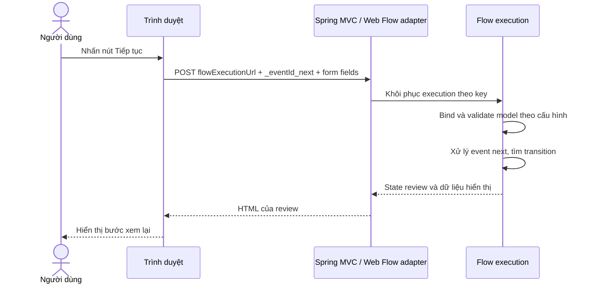

# Phát sự kiện từ nút bấm, form và liên kết trong Spring Web Flow

Trong một hành trình web nhiều bước, nút **Tiếp tục**, **Quay lại**, **Hủy** hoặc **Xác nhận** không chỉ yêu cầu server trả về một trang mới. Mỗi thao tác thể hiện một **event** để Spring Web Flow xác định transition hợp lệ tại state hiện tại. Nhờ đó, cùng một hành trình đăng ký, đặt lịch hoặc thanh toán có thể được mô tả bằng các state, event, transition và subflow thay vì dàn trải quyết định điều hướng trong nhiều Spring MVC controller.

Bài học thuộc chương **Event và transition** của module `SPRING_WEB_FLOW`. Trọng tâm là ba nguồn phát event phổ biến trên giao diện: **nút bấm**, **form** và **liên kết**. Chúng ta cũng phân tích cách giữ flow execution key, khi nào dữ liệu biểu mẫu được bind/validate, sự khác biệt giữa GET và POST, và cách kiểm thử để một thao tác chỉ chuyển đúng state mong muốn.

Sau bài học, bạn có thể:

- Giải thích event ID, transition và flow execution key có trách nhiệm gì.
- Dùng các tham số `_eventId` và `_eventId_<tên-event>` để phát event từ request.
- Xây dựng form có nhiều nút dẫn tới các transition khác nhau.
- Tạo liên kết phát event mà vẫn giữ URL tiếp tục execution hiện tại.
- Chọn đúng cấu hình `bind`/`validate` cho **Tiếp tục**, **Quay lại** và **Hủy**.
- Xử lý những tình huống thường gặp: submit bằng Enter, nút không gửi tham số, request hết hạn, nhấn hai lần, CSRF và thao tác trên nhiều tab.

## 1. Event biến thao tác giao diện thành transition

Trong Spring Web Flow, **flow definition** mô tả các state và transition; **flow execution** là một lượt chạy cụ thể của definition đó. Một event có **ID**, chẳng hạn `next`, `back`, `cancel` hoặc `save`. Khi Web Flow nhận event ở một state, nó tìm transition có điều kiện phù hợp để quyết định bước tiếp theo.

```xml
<view-state id="edit" view="profile/edit">
    <transition on="next" to="review" />
    <transition on="cancel" to="cancelled" />
</view-state>

<view-state id="review" view="profile/review">
    <transition on="back" to="edit" />
    <transition on="save" to="persist" />
</view-state>
```

| Thành phần | Ý nghĩa | Ví dụ |
| --- | --- | --- |
| State hiện tại | Bước đang được execution xử lý | `edit` |
| Event ID | Tên hành động phát ra từ người dùng hoặc action | `next` |
| Transition | Quy tắc phản ứng với event tại state | `on="next" to="review"` |
| Execution key | Nhận diện lượt chạy cần tiếp tục | Tham số `execution` trong URL mặc định |
| Flow scope/model | Dữ liệu đã được lưu trong ngữ cảnh của lượt chạy | `flowScope.profileForm` |

Một event **không tự nói state đích là gì**. ID `next` có thể dẫn từ `edit` sang `review`, nhưng cũng có thể dẫn từ một state khác sang bước tiếp theo tương ứng. Đường đi được quy định bởi các transition của **state hiện tại**, không phải do nút HTML trực tiếp chọn tên view.

Trong ngữ cảnh này, *event Web Flow* là tín hiệu cho state machine. Nó không đồng nghĩa với `ApplicationEvent` của Spring hoặc một sự kiện JavaScript `click`; giao diện chỉ tạo request để Web Flow chuyển thành event xử lý.

### Luồng một thao tác của người dùng



Với request resume thông thường, Web Flow cần **cả thông tin execution và event**. Nếu thiếu execution key, ứng dụng có thể xử lý như một request launch mới hoặc báo lỗi, tùy URL và cấu hình. Nếu có key nhưng đã hết hạn, request cũng không thể tiếp tục thành công chỉ bằng việc gửi lại event ID.

## 2. Hai cách phổ biến để gửi event ID

Trong cơ chế nhận request parameter thông dụng của Spring Web Flow 2.x, client có thể gửi event theo hai dạng:

| Cách gửi | Dữ liệu HTTP | Khi nào tiện dùng |
| --- | --- | --- |
| Tham số cố định | `_eventId=next` | Input ẩn, nút có `name="_eventId"`, hoặc liên kết |
| Tên tham số mang event | `_eventId_next=1` | Nhiều nút submit trong cùng form, mỗi nút phát event riêng |

Ví dụ hai request sau đều thể hiện ý định phát event `next`:

```http
POST /profile?execution=e1s1
Content-Type: application/x-www-form-urlencoded

_eventId=next&fullName=Minh
```

```http
POST /profile?execution=e1s1
Content-Type: application/x-www-form-urlencoded

_eventId_next=1&fullName=Minh
```

Trong ví dụ, `e1s1` là **giá trị minh họa**; format và tên tham số chứa execution phụ thuộc cách cấu hình URL handler/repository. Không tự tạo khóa hay giả định mọi ứng dụng đều dùng đúng chuỗi `e1s1`.

Ở dạng `_eventId_next`, phần hậu tố `next` là tên event; giá trị `1` của nút thường chỉ dùng để trình duyệt gửi tham số đó. Ở dạng `_eventId=next`, giá trị `next` mới là ID của event.

> Nên chọn **một cách biểu diễn event rõ ràng cho từng lần submit**. Không đồng thời gửi `_eventId=save` và `_eventId_cancel=1` trong cùng request rồi dựa vào thứ tự ưu tiên ngầm định để quyết định hành động.

## 3. Ví dụ flow đầy đủ cho một biểu mẫu nhiều bước

Giả sử ứng dụng có một wizard cập nhật thông tin liên hệ. Người dùng nhập dữ liệu tại `edit`, xem lại ở `review`, sau đó `save` hoặc `back`; họ cũng có thể `cancel` trong quá trình này.

```xml
<?xml version="1.0" encoding="UTF-8"?>
<flow xmlns="http://www.springframework.org/schema/webflow"
      xmlns:xsi="http://www.w3.org/2001/XMLSchema-instance"
      xsi:schemaLocation="http://www.springframework.org/schema/webflow
                          http://www.springframework.org/schema/webflow/spring-webflow-2.0.xsd">

    <var name="profileForm" class="com.example.profile.ProfileForm" />

    <view-state id="edit" view="profile/edit" model="profileForm">
        <binder>
            <binding property="fullName" />
            <binding property="email" />
        </binder>
        <transition on="next" to="review" />
        <transition on="cancel" to="cancelled" bind="false" />
    </view-state>

    <view-state id="review" view="profile/review">
        <transition on="back" to="edit" />
        <transition on="save" to="persist" />
        <transition on="cancel" to="cancelled" />
    </view-state>

    <action-state id="persist">
        <evaluate expression="profileService.save(profileForm)" />
        <transition on="success" to="saved" />
        <transition on="rejected" to="edit" />
    </action-state>

    <end-state id="saved" view="profile/saved" />
    <end-state id="cancelled" view="profile/cancelled" />
</flow>
```

`ProfileForm` là Java bean của ứng dụng, có getter/setter cho `fullName` và `email`. `profileService.save(profileForm)` là phương thức do ứng dụng định nghĩa; trong ví dụ nó cần trả kết quả thích hợp, chẳng hạn chuỗi `"success"` hoặc `"rejected"`, để các transition của `action-state` xử lý. Code minh họa chưa bao gồm authentication, kiểm tra quyền, validation, giao dịch, chống lưu trùng hoặc trang JSP thực tế; các phần này cần được triển khai phù hợp với hệ thống.

Đọc flow từ góc độ event:

| State | Event được chấp nhận | Kết quả |
| --- | --- | --- |
| `edit` | `next` | Bind/validate form theo cấu hình và đi tới `review` khi hợp lệ |
| `edit` | `cancel` | Bỏ qua binding theo `bind="false"`, kết thúc ở `cancelled` |
| `review` | `back` | Quay lại `edit`, giữ form model đang sửa |
| `review` | `save` | Đi vào `persist` để gọi service lưu |
| `review` | `cancel` | Kết thúc mà không gọi service lưu |
| `persist` | `success` hoặc `rejected` | Kết thúc thành công hoặc quay lại sửa |

Lưu ý `persist` là **action-state**, nơi kết quả action tạo event để rẽ nhánh mà không chờ người dùng bấm nút ở chính state đó. Event do action sinh ra cũng tham gia cơ chế transition, nhưng không cần một tham số `_eventId` từ trình duyệt.

## 4. Phát event từ nút submit trong form

Nút submit là cách phổ biến nhất khi người dùng vừa nhập dữ liệu vừa quyết định bước tiếp theo.

### 4.1. Một nút, một event cố định

```jsp
<form method="post" action="${flowExecutionUrl}">
    <label for="fullName">Họ và tên</label>
    <input id="fullName" name="fullName" value="${profileForm.fullName}" />

    <label for="email">Email</label>
    <input id="email" name="email" value="${profileForm.email}" />

    <input type="hidden" name="_eventId" value="next" />
    <button type="submit">Tiếp tục</button>
</form>
```

Khi submit, trình duyệt gửi hai field của form và `_eventId=next`. Spring Web Flow nhận event `next`, xử lý model của `view-state` theo lifecycle binding/validation rồi chọn transition `on="next"` nếu có thể.

Mẫu dùng input ẩn phù hợp khi **mọi cách submit form** đều có cùng ý nghĩa. Nếu muốn nhiều nút phát event khác nhau thì tránh giữ một `_eventId` ẩn cố định cùng lúc với các nút event riêng.

### 4.2. Hai nút phát hai event khác nhau

```jsp
<form method="post" action="${flowExecutionUrl}">
    <label for="fullName">Họ và tên</label>
    <input id="fullName" name="fullName" value="${profileForm.fullName}" />

    <label for="email">Email</label>
    <input id="email" name="email" value="${profileForm.email}" />

    <button type="submit" name="_eventId_next" value="1">
        Xem lại
    </button>
    <button type="submit" name="_eventId_cancel" value="1">
        Hủy
    </button>
</form>
```

Nút nào được kích hoạt thì tham số ứng với nút đó được gửi. Ví dụ:

```text
Nhấn "Xem lại": fullName=Minh&email=...&_eventId_next=1
Nhấn "Hủy":     fullName=Minh&email=...&_eventId_cancel=1
```

Các tên nút `_eventId_next` và `_eventId_cancel` phải khớp với ID trong `<transition on="next" ...>` và `<transition on="cancel" ...>`. Giá trị `value="1"` không quyết định tên event ở cách viết này.

Cách khác là dùng cùng tên `_eventId` nhưng khác value:

```jsp
<button type="submit" name="_eventId" value="next">Xem lại</button>
<button type="submit" name="_eventId" value="cancel">Hủy</button>
```

Đây cũng là cách phát event hợp lệ trong cấu hình nhận request parameter thông dụng. Đối với form nhiều nút, chọn một quy ước nhất quán giúp các bài test và việc kiểm tra request rõ ràng hơn.

### 4.3. Gửi event và giá trị form là hai việc khác nhau

Nút `next` không tự bảo đảm dữ liệu người dùng hợp lệ. Với `view-state model="profileForm"`, Web Flow có thể thực hiện binding và validation trước khi transition hoàn tất. Nếu quá trình này thất bại, view thường được hiển thị lại để người dùng sửa lỗi; state có thể vẫn là `edit`.

Về thiết kế, hãy tách ba câu hỏi:

1. Người dùng muốn làm gì? → **event ID**.
2. Những dữ liệu nào được gửi cùng event? → **form fields**.
3. Dữ liệu có hợp lệ và được phép đi tiếp hay không? → **binding, validation, điều kiện transition và service nghiệp vụ**.

Không đặt toàn bộ quyết định nghiệp vụ vào thuộc tính HTML `required`. Validation phía trình duyệt cải thiện trải nghiệm nhưng client có thể bỏ qua; server cần kiểm tra lại.

## 5. Nút Quay lại, Hủy và việc có nên bind form

Với nhiều wizard, người dùng có thể bấm **Hủy** dù form còn trống hoặc sai định dạng. Nếu vẫn yêu cầu validation trước khi xử lý `cancel`, họ có thể bị giữ lại ở bước muốn thoát.

```xml
<view-state id="edit" view="profile/edit" model="profileForm">
    <transition on="next" to="review" />
    <transition on="cancel" to="cancelled" bind="false" />
</view-state>
```

`bind="false"` trên transition yêu cầu bỏ qua binding cho event đó; từ đó cũng không thực hiện validation của model như một lượt submit thông thường. Phù hợp cho `cancel` khi mọi dữ liệu vừa nhập có thể bị bỏ.

Một trường hợp khác là nút **Quay lại**: đôi khi người dùng cần giữ giá trị vừa nhập ở màn hình hiện tại dù chưa đủ điều kiện hợp lệ để đi tiếp. Khi đó có thể giữ binding nhưng tắt validation tại transition:

```xml
<transition on="back" to="previous" validate="false" />
```

Ý định ở đây là: nhận dữ liệu đang nhập vào model nếu có thể bind, nhưng không bắt buộc người dùng hoàn tất validation của bước hiện tại trước khi quay lại. Trong ứng dụng thực tế, dữ liệu sai kiểu vẫn có thể phát sinh lỗi binding; `validate="false"` không có nghĩa mọi request xấu đều được tự động chuyển đổi thành công.

| Event | Cách cấu hình gợi ý | Lý do |
| --- | --- | --- |
| `next` | Binding và validation theo mặc định/cấu hình state | Phải kiểm tra dữ liệu trước khi sang bước kế tiếp |
| `back` | Tùy nhu cầu: `validate="false"` nếu muốn giữ bản nháp | Quay lại mà không buộc hoàn tất dữ liệu của bước đang rời |
| `cancel` | `bind="false"` | Bỏ dữ liệu vừa nhập và cho phép thoát |
| `save` | Kiểm tra lại ở service trước commit | Validation form không thay thế quyền truy cập và điều kiện nghiệp vụ |

**Chú ý:** `bind="false"` có nghĩa những thay đổi chưa submit ở request đó **không được đưa vào model**. Đừng dùng nó cho nút `back` nếu yêu cầu sản phẩm là giữ toàn bộ dữ liệu người dùng vừa nhập trước khi quay về.

## 6. Phát event từ liên kết

Liên kết có thể phát event khi người dùng chỉ cần điều hướng không thay đổi dữ liệu, ví dụ **Quay lại danh sách**, **Xem bước trước** hoặc **Hủy xem**. Cấu hình Web Flow thường đọc `_eventId` từ query string của request GET.

Ví dụ URL tiếp tục flow có dạng:

```http
GET /profile?execution=e1s1&_eventId=back
```

Ở đây:

- `execution=e1s1` (giá trị minh họa) xác định execution cần resume.
- `_eventId=back` cho biết sự kiện muốn phát.
- Transition `on="back"` phải được khai báo tại state hiện tại hoặc được xử lý theo cấu hình của flow.

### 6.1. Không hardcode execution key

Trong JSP tích hợp Web Flow, `${flowExecutionUrl}` thường là URL tiếp tục hiện tại đã chứa thông tin execution. Ví dụ trong **cấu hình URL điển hình**, khi biến này có dạng `/profile?execution=e1s1`, ta có thể nối tham số event bằng dấu `&` đã escape cho HTML:

```jsp
<a href="${flowExecutionUrl}&amp;_eventId=back">
    Quay lại
</a>
```

Ví dụ trên giả định URL đã có query string. Nếu URL chưa có dấu `?`, hoặc ứng dụng dùng URL handler tùy chỉnh, cách nối `&` thủ công có thể sai. Hãy sử dụng bộ dựng URL/URI phù hợp trong view technology đang dùng để thêm `_eventId` một cách an toàn.

Chẳng hạn với JSP sử dụng JSTL core và functions đã khai báo:

```jsp
<c:url var="backUrl" value="${flowExecutionUrl}">
    <c:param name="_eventId" value="back" />
</c:url>
<a href="${fn:escapeXml(backUrl)}">Quay lại</a>
```

Cách này yêu cầu các taglib `c` và `fn` được cấu hình trong view, đồng thời `flowExecutionUrl` có dạng mà bộ dựng URL đang dùng hỗ trợ. Không tự viết giá trị execution key cố định vào link: mỗi execution và mỗi lần resume có thể có khóa hoặc URL phù hợp khác nhau.

### 6.2. Phân biệt liên kết GET với hành động có tác dụng phụ

GET có thể bị trình duyệt, crawler, hệ thống preview link, prefetch hoặc cache thực hiện ngoài một lần bấm chủ động. Vì vậy:

- **Nên** dùng liên kết GET cho điều hướng chỉ đọc hoặc tác vụ không gây thay đổi nghiệp vụ.
- **Nên** dùng form POST cho lưu dữ liệu, gửi yêu cầu có side effect, thanh toán, xóa hoặc xác nhận hành động quan trọng.
- **Không** dựa vào việc gửi event `save` qua query string GET để ghi dữ liệu vào database.

Ngay cả một event `cancel` qua GET cũng cần đánh giá tác động: nếu cancel xóa bản nháp đã lưu hoặc giải phóng tài nguyên có ý nghĩa nghiệp vụ, hãy chọn POST và kiểm soát bảo mật như một thao tác thay đổi trạng thái. Quyết định dựa trên **tác dụng thật sự của event**, không chỉ tên nút.

## 7. Form, link và luồng có JavaScript

JavaScript có thể giúp hiển thị xác nhận hoặc tăng trải nghiệm, nhưng request gửi lên server vẫn cần đúng **execution URL + event ID + dữ liệu cần thiết**.

Ví dụ một nút không submit tự động có thể được điều khiển ở client:

```html
<form id="profileForm" method="post" action="${flowExecutionUrl}">
    <input name="fullName" />
    <input type="hidden" name="_eventId" value="next" />
    <button type="submit">Tiếp tục</button>
</form>
```

Nếu dùng `fetch()` hoặc AJAX thay form mặc định, cần bảo đảm:

1. Request gửi đến đúng execution URL hiện tại.
2. Server nhận event ID theo quy ước Web Flow đã cấu hình.
3. Các form field cần binding được gửi đúng tên và kiểu nội dung.
4. CSRF token được chuyển đúng cách khi bảo mật yêu cầu.
5. Client xử lý response và các tình huống execution hết hạn, validation error hoặc server điều hướng lại.

Web Flow có khả năng tích hợp partial rendering/AJAX tùy stack và cấu hình, nhưng không nên suy ra chỉ cần gửi một sự kiện JavaScript `click` là flow sẽ chuyển state. Sự kiện trình duyệt phải được ánh xạ thành **HTTP request/Web Flow event** hoặc thông qua API tích hợp đã cấu hình.

### Khi dùng phím Enter

Trong HTML, nhấn Enter bên trong một input có thể kích hoạt submit mặc định; hành vi có thể phụ thuộc cấu trúc form và nút submit. Nếu form có nhiều nút, phải kiểm tra thực tế event nào được gửi khi Enter được nhấn.

Một quy ước dễ kiểm soát là đặt nút chính trước và kiểm thử các trình duyệt được hỗ trợ. Với form chỉ có một hành động submit, dùng input ẩn `_eventId=next` cũng giúp event được gửi nhất quán. Không dựa vào giả định rằng nút **Hủy** hay **Lưu** chắc chắn không bao giờ được chọn bằng bàn phím.

## 8. Event không hợp lệ, execution key cũ và thao tác nhiều tab

Phát một event chỉ thành công nếu nó **có ý nghĩa tại state hiện tại** và execution có thể tiếp tục.

| Tình huống | Biểu hiện | Cách xử lý |
| --- | --- | --- |
| Sai tên event | Client gửi `_eventId=continue` nhưng state chỉ có `next` | Đồng bộ HTML với transition; kiểm thử request thực tế |
| Event hợp lệ ở state khác | Người dùng gửi `save` khi vẫn đang ở `edit` | Không giả định flow sẽ bỏ qua thứ tự nghiệp vụ; kiểm tra state và quyền |
| Thiếu execution key | POST về URL launch thay vì URL tiếp tục | Dùng `flowExecutionUrl`; kiểm tra cách Web Flow adapter ánh xạ URL |
| Key đã hết hạn | Trang cũ submit sau thời gian dài | Hiển thị hướng khởi chạy lại/khôi phục draft nếu được hỗ trợ |
| Hai execution song song | Hai tab mở wizard bằng hai lần launch khác nhau | Mỗi form dùng execution URL của chính tab đó |
| Hai tab dùng cùng key | Sao chép URL đang chạy sang tab khác | Có thể phát sinh cạnh tranh state/snapshot; kiểm tra chính sách repository |
| Người dùng bấm hai lần | Hai request `save` gần đồng thời | Chống thao tác trùng tại service, dùng idempotency khi có side effect |
| Nút bị disabled | Trình duyệt không gửi value/name của nút disabled | Kiểm tra trạng thái UI và phương án gửi event thay thế |

Thực tế Web Flow có thể lưu những snapshot của execution phục vụ lịch sử trình duyệt. Nhưng hành vi khôi phục khi back/refresh, chính sách giới hạn snapshot và cách xử lý cạnh tranh tùy execution repository. Không nên coi việc còn URL `?execution=...` là cam kết rằng lượt chạy đó luôn hợp lệ hoặc có thể được replay vô hạn.

### Tại sao server phải kiểm tra event?

Mọi người dùng có thể tự tạo request `_eventId=save` qua công cụ HTTP. Việc một nút **Lưu** chỉ hiển thị ở bước cuối **không phải cơ chế phân quyền**. Transition, validation và service phải bảo vệ thứ tự trạng thái cũng như quyền truy cập dữ liệu; action lưu phải kiểm tra lại điều kiện nghiệp vụ tại thời điểm thực hiện.

Thêm nữa, xử lý POST có side effect cần chống CSRF bằng cơ chế ứng dụng đang sử dụng (ví dụ Spring Security), chống submit trùng, và không tin các field `id`, `ownerId`, `amount` do client gửi nếu chúng không được phép chỉnh sửa.

## 9. Kiểm thử việc phát event

Hãy kiểm thử cả **request mà trình duyệt gửi**, **state Web Flow kết thúc sau request** và **side effect của service**.

| Ca kiểm thử | Dữ liệu / thao tác | Kỳ vọng |
| --- | --- | --- |
| Nút Tiếp tục | POST `_eventId_next=1` với form hợp lệ | Từ `edit` sang `review`, model chứa giá trị mới |
| Nút Hủy | POST `_eventId_cancel=1` với form rỗng | Sang `cancelled`, không bị chặn bởi validation form |
| Nút dùng `_eventId` | POST `_eventId=next` | Chọn cùng transition `next` nếu cấu hình hỗ trợ |
| Form sai | POST `next` với email sai định dạng | Ở lại/sửa lỗi theo validation, không lưu dữ liệu |
| Link Quay lại | GET execution URL + `_eventId=back` từ `review` | Quay lại `edit` trong cùng execution |
| Nút Lưu | POST `_eventId_save=1` từ `review` | Gọi action/service lưu theo định nghĩa, xử lý outcome |
| Event ở sai state | Gửi `save` khi ở `edit` | Không thể tự ý bỏ qua thứ tự lưu hợp lệ |
| Hai nút trong một form | Lần lượt bấm `next` và `cancel` | Request chỉ mang event tương ứng với hành động được chọn |
| Nhấn Enter | Nhấn Enter trong input | Phát event mặc định đã được thiết kế, không lưu nhầm |
| Execution hết hạn | Submit URL đã cũ | Xử lý lỗi khôi phục, không tự sinh hành động lưu |
| Nhấp đôi | Gửi hai lần event `save` | Không tạo hai bản ghi/thanh toán nếu nghiệp vụ yêu cầu duy nhất |
| Thiếu CSRF | POST không có token ở ứng dụng có bật CSRF | Request bị từ chối theo cấu hình bảo mật |

Một quy trình debug hữu ích:

1. Mở Developer Tools của trình duyệt và xem **Network → Request URL, Method, Query String, Form Data**.
2. Xác nhận URL chứa execution key phù hợp, event xuất hiện đúng một lần và field form được gửi đầy đủ.
3. Đặt breakpoint/log có kiểm soát ở transition action hoặc service để xem event được xử lý tại state nào.
4. Quan sát kết quả: state hiện tại, model binding, thông báo validation và dữ liệu database trước/sau.
5. Thử với nút bấm, Enter, link GET, trang cũ, hai tab và submit lặp để phát hiện lỗi ngoài luồng bình thường.

Không ghi token CSRF, execution key còn sử dụng được, thông tin cá nhân hoặc dữ liệu form nhạy cảm vào log công khai. Nếu bật logging debug, giới hạn phạm vi và thời gian sử dụng.

## 10. Bài tập thực hành: đặt lịch ba bước

Xây dựng flow `appointment` có `chooseSlot`, `contact`, `review`, `persist`, `done` và `cancelled`.

1. Ở `chooseSlot`, hiển thị các nút **Tiếp tục** và **Hủy**, phát `next`/`cancel` qua tên tham số `_eventId_...`.
2. Ở `contact`, tạo form cho họ tên và số điện thoại; kiểm tra dữ liệu trước event `next`.
3. Thêm nút **Quay lại** ở `contact`. Thiết kế để người dùng quay lại chọn khung giờ mà không mất dữ liệu đã nhập nếu yêu cầu sản phẩm cần điều đó.
4. Ở `review`, dùng form POST phát `save` để chuyển vào action-state `persist`; cung cấp một link `back` GET chỉ phục vụ điều hướng.
5. Trong service lưu, kiểm tra lại slot còn trống, quyền truy cập và cơ chế chống tạo hai lịch hẹn nếu người dùng gửi `save` hai lần.
6. Mở hai execution độc lập trong hai tab. Xác minh mỗi tab nhận sự kiện qua execution URL của chính nó.
7. Thử submit bằng Enter, event không tồn tại, link có key cũ, form thiếu CSRF token và event `cancel` từ form không hợp lệ.

**Câu hỏi tự kiểm tra:**

- Hai request `_eventId=next` và `_eventId_next=1` truyền ID event theo cách nào?
- Vì sao `on="next"` không có nghĩa nút HTML được quyền tự chọn bất kỳ state đích nào?
- Khi người dùng hủy form sai, `bind="false"` giúp ích gì? Vì sao không nên dùng nó nếu cần giữ bản nháp?
- Tại sao cần gửi event cùng **execution URL** thay vì luôn POST về URL launch?
- Sự khác nhau về rủi ro giữa link GET `back` và link GET `save` là gì?
- Việc ẩn nút `save` khỏi giao diện có thay thế kiểm tra quyền ở service không?

## Ghi nhớ

Trong Spring Web Flow, **nút bấm, form và liên kết phát event thông qua request**, còn **transition của state hiện tại quyết định hướng đi**. Hai quy ước phổ biến là `_eventId=next` và `_eventId_next=1`. Form nên POST tới `flowExecutionUrl` để vừa gửi dữ liệu vừa tiếp tục đúng execution; link GET chỉ nên dùng khi ý nghĩa của event an toàn với GET. Cấu hình `bind`/`validate` giúp điều chỉnh hành vi của nút Quay lại/Hủy; service vẫn phải kiểm tra quyền, dữ liệu và chống thao tác trùng ở những hành động quan trọng. Khi kiểm thử, cần quan sát đồng thời event ID, execution key, state và tác dụng nghiệp vụ của request.
