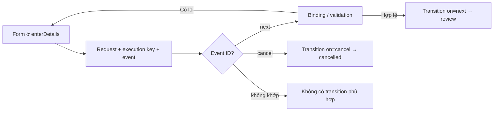

# Tham số `_eventId` và quy ước tên nút sự kiện trong Spring Web Flow

## 1. Vì sao một form cần gửi event?

Trong **Spring Web Flow (SWF)**, một trang thuộc hành trình nhiều bước không chỉ gửi dữ liệu về server. Nó còn cần nói rõ **người dùng muốn thực hiện hành động nào**. Trên cùng một trang đăng ký, người dùng có thể nhấn **Tiếp tục**, **Quay lại**, **Lưu nháp** hoặc **Hủy**. Mỗi hành động có thể kích hoạt một `transition` khác nhau, trong khi dữ liệu biểu mẫu vẫn được xử lý theo quy tắc của `view-state`.

Web Flow sử dụng **event ID** để nhận biết hành động. Với form HTTP trong tích hợp Spring MVC thường gặp, event ID có thể được gửi qua tham số tên `_eventId` hoặc qua **tên nút submit bắt đầu bằng `_eventId_`**.

```text
POST /app/registration?execution=e1s1
Content-Type: application/x-www-form-urlencoded

_eventId=next&fullName=An%20Nguyen&email=an%40example.com
```

Ở ví dụ này:

- `/app/registration` xác định route của flow.
- `execution=e1s1` là **khóa execution do Web Flow cấp**, giúp nhận diện lần chạy cần tiếp tục; định dạng `e1s1` chỉ để minh họa.
- `_eventId=next` yêu cầu phát event tên `next` tại trạng thái hiện tại.
- `fullName` và `email` là dữ liệu biểu mẫu để cơ chế binding/validation xử lý.

**Event ID và execution key là hai khái niệm khác nhau.** Khóa execution chỉ ra *lần chạy nào* cần xử lý; event ID chỉ ra *hành động nào* cần thực hiện bên trong lần chạy ấy.

## 2. Từ event trong HTTP đến transition của flow

Giả sử flow có trạng thái `enterDetails`:

```xml
<view-state id="enterDetails"
            view="registration/details"
            model="registrationForm">
    <transition on="next" to="review" />
    <transition on="cancel" to="cancelled"
                bind="false" validate="false" />
</view-state>
```

Khi request thuộc execution đang ở `enterDetails` mang event `next`, Web Flow tìm transition có `on="next"`. Nếu quá trình xử lý form thành công, execution đi tới `review`. Nếu event là `cancel`, flow có thể đi tới `cancelled` theo transition thứ hai.



Sơ đồ mô tả một cấu hình điển hình. Quy tắc binding và validation có thể được điều chỉnh theo từng transition, và các handler lỗi/event khác cũng có thể tồn tại. **Tham số `_eventId` không tự động chọn state đích**: flow definition mới quyết định sự kiện nào hợp lệ và chuyển tới đâu.

| Thành phần | Vai trò |
| --- | --- |
| `_eventId` | Tên tham số yêu cầu phát một event |
| `next`, `back`, `confirm` | Các **event ID** do người viết flow định nghĩa |
| `<transition on="next" ... />` | Cấu hình cách xử lý event `next` trong state tương ứng |
| `to="review"` | State đích của transition, là tên được khai báo trong flow |
| `execution=...` | Thông tin nhận diện execution đang chạy, độc lập với event ID |
| `model="registrationForm"` | Đối tượng nhận dữ liệu binding nếu state thực hiện binding |

## 3. Cách 1: dùng tham số `_eventId` và đặt event ID trong giá trị

Đây là dạng dễ đọc nhất:

```html
<form method="post" action="/registration?execution=KEY_FROM_FLOW">
    <input name="fullName" type="text">
    <button type="submit" name="_eventId" value="next">
        Tiếp tục
    </button>
</form>
```

Khi bấm nút, trình duyệt gửi cặp tên–giá trị `_eventId=next`. Ở ứng dụng thật, **không hardcode action URL** như ví dụ minh họa: hãy dùng continuation URL mà Web Flow đưa vào view.

Điểm hữu ích của cách này là có thể cho nhiều nút trên một form cùng tên `_eventId`, mỗi nút mang một **giá trị riêng**:

```jsp
<form method="post" action="${flowExecutionUrl}">
    <label for="fullName">Họ tên</label>
    <input id="fullName" name="fullName" type="text">

    <button type="submit" name="_eventId" value="back">
        Quay lại
    </button>
    <button type="submit" name="_eventId" value="next">
        Tiếp tục
    </button>
</form>
```

Với tích hợp Web Flow và JSP phù hợp, `${flowExecutionUrl}` là URL của execution mà framework cung cấp cho view. Trình duyệt thông thường chỉ gửi **nút submit được kích hoạt**, nên người dùng nhấn `Quay lại` sẽ gửi `_eventId=back`; nhấn `Tiếp tục` sẽ gửi `_eventId=next`.

**Cần phân biệt giá trị gửi và nhãn hiển thị.** Dòng chữ `Quay lại` có thể dịch sang ngôn ngữ khác mà không đổi event ID `back`. Flow chỉ so khớp event ID, không đọc text của nút.

### 3.1. Dùng một input ẩn khi form chỉ có một hành động

Nếu form luôn thực hiện `next`, có thể gửi event bằng input ẩn:

```html
<form method="post" action="CONTINUATION_URL">
    <input type="hidden" name="_eventId" value="next">
    <input type="email" name="email" required>
    <button type="submit">Tiếp tục</button>
</form>
```

Giải pháp này phù hợp khi không có lựa chọn event khác. Nếu cùng form có hai nút `back` và `next` nhưng vẫn giữ input ẩn `_eventId=next`, nhấn `back` có thể tạo **hai giá trị event** hoặc gây hành vi khó đoán. Hãy sử dụng một quy ước thống nhất thay vì trộn nhiều cách gửi event trong cùng request.

## 4. Cách 2: đặt event ID vào tên nút `_eventId_<tên-event>`

Web Flow cũng nhận diện event theo **hậu tố tên của submit control**, một quy ước thường thấy trong ứng dụng JSP:

```jsp
<form method="post" action="${flowExecutionUrl}">
    <label for="email">Email</label>
    <input id="email" name="email" type="email">

    <button type="submit" name="_eventId_back" value="back">
        Quay lại
    </button>
    <button type="submit" name="_eventId_next" value="next">
        Tiếp tục
    </button>
</form>
```

Khi nút `Tiếp tục` được kích hoạt, trình duyệt gửi tham số có **tên** `_eventId_next`. Framework xác định event ID `next` từ phần sau tiền tố `_eventId_`. Với quy ước này, event nằm trong **tên điều khiển**; giá trị `value="next"` không phải yếu tố xác định tên event. Tuy vậy, đặt value dễ hiểu giúp inspect request thuận tiện.

So sánh hai yêu cầu POST về mặt ý nghĩa:

```text
Kiểu 1 - event trong value:
_eventId=next&email=an%40example.com

Kiểu 2 - event trong name:
_eventId_next=next&email=an%40example.com

Cả hai đều yêu cầu event tên "next"
trong tích hợp HTTP của Web Flow hỗ trợ quy ước này.
```

| Tiêu chí | `name="_eventId" value="next"` | `name="_eventId_next"` |
| --- | --- | --- |
| Event ID được lấy từ | **Giá trị** của tham số `_eventId` | **Hậu tố** sau `_eventId_` |
| Nhiều nút submit | Cùng `name`, khác `value` | Mỗi nút có `name` riêng |
| Ví dụ nút quay lại | `name="_eventId" value="back"` | `name="_eventId_back"` |
| Ví dụ nút xác nhận | `name="_eventId" value="confirm"` | `name="_eventId_confirm"` |
| Điểm dễ nhầm | Quên đặt `value` đúng | Gõ sai hậu tố trong `name` |

Hãy dùng tên event **ngắn, ổn định và nhất quán**, chẳng hạn `next`, `back`, `saveDraft`, `confirm`, `cancel`. Event ID là một định danh trong cấu hình; nó không tự có ý nghĩa nghiệp vụ đặc biệt cho Web Flow chỉ vì tên được đặt là `save` hay `confirm`.

### 4.1. Những tên giống nhau nhưng không cùng ý nghĩa

```html
<!-- Phát event "next" theo tiền tố _eventId_. -->
<button type="submit" name="_eventId_next">Tiếp tục</button>

<!-- Phát event theo value của tham số _eventId. -->
<button type="submit" name="_eventId" value="next">Tiếp tục</button>

<!-- Không theo quy ước Web Flow: đây chỉ là field thông thường. -->
<button type="submit" name="next" value="yes">Tiếp tục</button>

<!-- Không gửi form khi chỉ được bấm mà không có JavaScript xử lý. -->
<button type="button" name="_eventId_next">Tiếp tục</button>
```

Nút `type="button"` không tự submit; nút `type="submit"` mới tham gia gửi form theo hành vi HTML thông thường. Nút `disabled` cũng không được gửi như một successful control. Những chi tiết HTML này có thể khiến server không nhận được event dù người dùng nhìn thấy nút trên giao diện.

Không nên dựa vào hình ảnh hay vị trí của nút để dự đoán event. Khi cần debug, hãy mở công cụ Network của trình duyệt để xem **Request URL**, **Form Data** và tên tham số thực tế được gửi.

## 5. Flow XML ví dụ: đăng ký nhiều bước với các nút back, next, confirm và cancel

Giả sử ứng dụng có Java class `com.example.signup.SignupForm` và bean Spring `signupService`. Form giữ thông tin người dùng trong suốt flow và gọi service tại bước xác nhận.

```xml
<?xml version="1.0" encoding="UTF-8"?>
<flow xmlns="http://www.springframework.org/schema/webflow"
      xmlns:xsi="http://www.w3.org/2001/XMLSchema-instance"
      xsi:schemaLocation="
        http://www.springframework.org/schema/webflow
        http://www.springframework.org/schema/webflow/spring-webflow.xsd">

    <!-- Form model thuộc execution của hành trình này. -->
    <var name="signupForm"
         class="com.example.signup.SignupForm" />

    <view-state id="enterDetails"
                view="signup/details"
                model="signupForm">
        <binder>
            <binding property="fullName" required="true" />
            <binding property="email" required="true" />
        </binder>

        <transition on="next" to="review" />
        <transition on="cancel" to="cancelled"
                    bind="false" validate="false" />
    </view-state>

    <view-state id="review"
                view="signup/review"
                model="signupForm">
        <transition on="back" to="enterDetails"
                    bind="false" validate="false" />
        <transition on="confirm" to="completed">
            <evaluate expression="signupService.register(signupForm)"
                      result="flowScope.createdAccountId" />
        </transition>
        <transition on="cancel" to="cancelled"
                    bind="false" validate="false" />
    </view-state>

    <end-state id="completed"
               view="externalRedirect:contextRelative:/signup/success" />
    <end-state id="cancelled"
               view="externalRedirect:contextRelative:/signup/cancelled" />
</flow>
```

Flow này minh họa cách **event ID nối nút của view với transition**:

- Tại `enterDetails`, `next` đi tới `review`; `cancel` kết thúc ở `cancelled`.
- Tại `review`, `back` trở lại `enterDetails`; `confirm` gọi `signupService.register(...)` rồi đến `completed`.
- Một event `confirm` gửi ở `enterDetails` **không khớp** transition `confirm` của `review`. Tên event không tạo quyền bỏ qua state.
- Dữ liệu của `signupForm` thuộc execution, cho phép đi qua nhiều view-state theo vòng đời do Web Flow quản lý.

Đây là ví dụ học tập. Để chạy thực tế, ứng dụng cần flow registry/executor, tích hợp Spring MVC, view resolver, hai trang kết thúc, bean service và xử lý lỗi. Service cần validate nghiệp vụ và kiểm tra quyền; lưu tài khoản phải có biện pháp chống yêu cầu xác nhận bị gửi lặp.

### 5.1. JSP của bước nhập

Trang `signup/details` có thể dùng quy ước event trong **giá trị nút**:

```jsp
<form method="post" action="${flowExecutionUrl}">
    <label for="fullName">Họ tên</label>
    <input id="fullName" name="fullName"
           value="${signupForm.fullName}">

    <label for="email">Email</label>
    <input id="email" type="email" name="email"
           value="${signupForm.email}">

    <button type="submit" name="_eventId" value="cancel">
        Hủy
    </button>
    <button type="submit" name="_eventId" value="next">
        Tiếp tục
    </button>
</form>
```

Trong dự án thật, khi render dữ liệu đã nhập vào attribute HTML, cần **escape theo ngữ cảnh** để tránh XSS (ví dụ dùng form tag hoặc bộ công cụ output encoding phù hợp), đồng thời hiển thị lỗi binding/validation và gửi CSRF token theo Spring Security. Đoạn JSP trên tập trung giải thích tham số event.

### 5.2. JSP của bước xem lại

Trang `signup/review` có thể dùng quy ước event trong **tên nút**:

```jsp
<form method="post" action="${flowExecutionUrl}">
    <button type="submit" name="_eventId_back" value="back">
        Quay lại sửa
    </button>
    <button type="submit" name="_eventId_confirm" value="confirm">
        Xác nhận
    </button>
</form>
```

Từ đó Web Flow nhận được `back` hoặc `confirm` theo nút thực sự được nhấn. Đổi nhãn sang `Confirm` hoặc `Hoàn tất` không yêu cầu đổi event ID `confirm`, miễn là tên tham số vẫn đúng.

## 6. Binding và validation phụ thuộc transition được chọn

Ở một `view-state` có `model`, Web Flow có thể bind request parameter lên form và thực hiện validation trước khi đi tiếp. Tuy nhiên **không phải event nào cũng nên bind/validate form như nhau**.

Ví dụ người dùng mới nhập nửa chừng, nhấn `Hủy`. Nếu ứng dụng bắt buộc `email` và `fullName` hợp lệ trước cả khi hủy, người dùng có thể bị mắc kẹt. Trong trường hợp đó, cấu hình:

```xml
<transition on="cancel"
            to="cancelled"
            bind="false"
            validate="false" />
```

giúp chuyển hủy mà không yêu cầu chạy bước binding/validation của form cho transition ấy, theo cơ chế hỗ trợ của Web Flow.

Tương tự, nút `back` từ trang review thường không cần validate lại dữ liệu của view hiện tại:

```xml
<transition on="back"
            to="enterDetails"
            bind="false"
            validate="false" />
```

Ngược lại, event `next` đi vào bước review nên thực hiện binding/validation theo quy tắc nghiệp vụ.

| Event | Thông thường cần binding? | Thông thường cần validation? | Cân nhắc |
| --- | --- | --- | --- |
| `next` | Có, khi thu thập dữ liệu mới | Có | Ngăn chuyển bước với dữ liệu sai |
| `confirm` | Tùy form ở bước xác nhận | Có kiểm tra nghiệp vụ ở service | Không bỏ qua kiểm tra quyền và ràng buộc nghiệp vụ |
| `back` | Có thể không | Thường không | Cho phép trở lại sửa dữ liệu |
| `cancel` | Thường không | Thường không | Không chặn hủy vì field đang rỗng |
| `saveDraft` | Tùy chính sách bản nháp | Có thể dùng quy tắc riêng | Không bắt buộc mọi trường hoàn chỉnh nếu lưu nháp |

**Phân biệt ba tầng kiểm tra:** HTML `required` chỉ là trợ giúp phía browser; binder/validator của Web Flow kiểm tra ở server; service phải kiểm tra nghiệp vụ/authorization cho các thao tác ghi. Một người có thể tự gửi request HTTP không cần bấm nút của giao diện.

### 6.1. Không đặt logic nghiệp vụ chỉ ở tên event

`on="confirm"` có nghĩa là transition lắng nghe event `confirm`, **không có nghĩa** nó tự bảo đảm người dùng đã xem qua toàn bộ các bước, hay việc ghi dữ liệu chỉ chạy một lần. Flow state kiểm soát đường đi, còn service cần kiểm tra các bất biến như tài khoản hợp lệ, trạng thái đơn hàng, quyền chủ sở hữu và điều kiện chống gửi lặp.

## 7. Tham số event khác gì action URL và phương thức HTTP?

Một request POST trong form nhiều bước thường cần đủ ba thông tin:

```text
POST <continuation URL của execution hiện tại>

1. execution key -> xác định hành trình đang chạy
2. event ID      -> chọn transition trong active state
3. form fields   -> dữ liệu để bind/validate
```

Ở tích hợp JSP/Spring MVC thông dụng, view có thể dùng `flowExecutionUrl` để sinh phần URL tiếp tục, ví dụ `/registration?execution=e1s1`. Không nên hardcode key hay gửi mọi form về start URL `/registration`: thiếu key có thể khiến hệ thống khởi chạy flow mới hoặc không thể resume execution đang ở bước hiện tại.

Giá trị `_eventId` **không phụ thuộc** vào:

- URL có chứa chuỗi `next` hay không.
- Tên trang JSP/Thymeleaf đang render.
- Text của nút submit.
- Tên state đích, ví dụ `review`.

Một state `enterDetails` có thể khai báo `<transition on="next" to="review" />`. Event ID vẫn là `next`, trong khi destination ID là `review`.

### 7.1. GET hay POST?

Các ví dụ trong bài dùng `POST` vì chúng gửi dữ liệu form và có thể kích hoạt hành động thay đổi nghiệp vụ. Tránh dùng link GET có `_eventId=confirm` để tạo đơn, thanh toán hay xóa dữ liệu: GET có thể bị preload, cache, mở lại hoặc thu thập tự động. Event trong Web Flow là một khái niệm điều khiển luồng, không tự quy định HTTP method hay tính an toàn của hành động.

Đối với thao tác chuyển bước chỉ đọc, lựa chọn GET/POST còn phụ thuộc cấu hình URL handler và mục tiêu điều hướng, nhưng yêu cầu thay đổi dữ liệu nên dùng phương thức và biện pháp bảo vệ HTTP thích hợp.

### 7.2. Tích hợp với JSF khác với form JSP

Trong ứng dụng có **JSF/Jakarta Faces**, một component như:

```xml
<h:commandButton value="Tiếp tục" action="next" />
```

có thể phát outcome/event tương ứng thông qua cơ chế tích hợp JSF và Web Flow đã cấu hình. Đây là **đường xử lý sự kiện của JSF**, không nên mặc định rằng JSF sẽ tự tạo tham số HTTP `_eventId=next` giống form HTML/JSP. Khi debug, xác định ứng dụng dùng JSP/Spring MVC form submission, Thymeleaf hay JSF component lifecycle, rồi đối chiếu đúng adapter.

## 8. Đặt tên event nhất quán trong dự án

Đặt tên event là một phần của **hợp đồng giữa giao diện và flow definition**. Có thể thống nhất các quy ước sau:

| Nhóm thao tác | Tên event gợi ý | Ghi chú |
| --- | --- | --- |
| Đi bước tiếp | `next` | Chỉ cho phép ở state có transition tương ứng |
| Quay về sửa | `back` | Thường cấu hình bỏ qua validation |
| Xem lại | `review` | Nếu cần một event riêng |
| Lưu bản nháp | `saveDraft` | Service quyết định điều kiện lưu nháp |
| Xác nhận cuối | `confirm` | Gắn với kiểm tra nghiệp vụ và chống duplicate |
| Hủy hành trình | `cancel` | Thường cho phép khi input chưa hoàn chỉnh |
| Thử lại lỗi | `retry` | Dùng khi flow có state phục hồi rõ ràng |

Đây chỉ là quy ước **do nhóm phát triển chọn**, không phải tập từ khóa bắt buộc của Spring Web Flow. Một dự án có thể dùng `continue` hay `submit` nếu flow và view thống nhất. Tên event nên ổn định vì đổi nó ở một bên sẽ khiến request không còn khớp transition.

Nên tránh tên chứa khoảng trắng hoặc ký tự đặc biệt trong HTML field name; nên dùng ASCII, phân biệt rõ chữ hoa/chữ thường theo hợp đồng định danh. Ví dụ, `_eventId_next` và `on="Next"` là hai chuỗi không nhất quán.

### 8.1. Khi có nhiều form hoặc nhiều nút

Nếu view có hai form, một form lưu nháp và một form xác nhận, hãy để **mỗi request chỉ gửi một event rõ ràng**. Tránh đồng thời gửi:

```text
_eventId=next
_eventId_confirm=confirm
```

Framework/adapter có thể có quy tắc ưu tiên cụ thể, nhưng thiết kế không nên phụ thuộc vào thứ tự hoặc cách xử lý nhiều tham số event cùng lúc.

Khi sử dụng JavaScript để submit, vẫn nên giữ semantics HTML chuẩn: truyền event tương ứng bằng một button hoặc input, sử dụng continuation URL hiện tại, và giữ khả năng xử lý server side. Không dùng JavaScript để thay thế validation/authorization.

## 9. Các lỗi thường gặp và cách tìm nguyên nhân

| Triệu chứng | Nguyên nhân có thể | Bước xử lý |
| --- | --- | --- |
| Bấm Next nhưng flow không đổi state | Nút thiếu `name="_eventId"` hoặc `name="_eventId_next"` | Xem Request Payload có trường event không |
| Bấm Back nhưng server nhận Next | Có input hidden `_eventId=next` đồng thời với nút back | Chỉ gửi một event trên mỗi request |
| Đã có event nhưng không chuyển state | Active state không khai báo `on` tương ứng | Kiểm tra active state và transition map |
| Nút không gửi request | Dùng `type="button"` hoặc `disabled` | Kiểm tra DOM và network |
| Chỉ sai khi đổi ngôn ngữ giao diện | Lấy text hiển thị làm event ID hoặc đổi value theo bản dịch | Giữ ID ổn định, dịch riêng nhãn |
| Submit quay lại bước đầu | Form action trỏ tới start URL, thiếu execution key | Dùng continuation URL do Web Flow cung cấp |
| Bấm Next nhưng lại ở cùng form | Binding/conversion/validation thất bại | Hiển thị lỗi và kiểm tra validator/binder |
| Hủy bị chặn vì trường bắt buộc | Transition hủy vẫn bind/validate | Xem `bind="false"`, `validate="false"` theo thiết kế |
| Gửi confirm hai lần tạo hai bản ghi | Side effect thiếu bảo vệ duplicate request | Bổ sung idempotency hoặc ràng buộc ở service |
| AJAX gửi event nhưng flow báo lỗi | Payload không có key/event, CSRF thiếu hoặc integration AJAX khác | Kiểm tra request thực tế và adapter đang dùng |

### 9.1. Quy trình debug một request

Khi người dùng báo “nút Next không hoạt động”, hãy kiểm tra theo thứ tự:

1. **Browser Network:** request có gửi không? Method và action URL là gì?
2. **Continuation URL:** có execution key phù hợp với view hiện tại không?
3. **Form Data:** có `_eventId=next` hoặc field `_eventId_next` không? Có gửi nhiều event không?
4. **Flow state:** execution hiện tại đang ở state nào? State đó có `<transition on="next" ... />` không?
5. **Binding/validation:** request có bị giữ lại do lỗi chuyển kiểu, required field hoặc validator không?
6. **Action:** nếu transition đã chạy, service có ném exception hay trả lỗi nghiệp vụ không?

Đừng ghi thông tin đăng nhập, số thẻ hay toàn bộ form vào log khi chẩn đoán. Có thể dùng trace ID và các field đã loại bỏ dữ liệu nhạy cảm để đối chiếu request với flow execution.

## 10. Kiểm thử event và transition

Nên kiểm thử từ **hai phía**: logic flow nhận event nào tại state nào, và HTTP form thực sự gửi tham số nào.

| Ca thử | Đầu vào / hành động | Kết quả mong đợi |
| --- | --- | --- |
| Event bằng value | `_eventId=next` ở `enterDetails`, dữ liệu hợp lệ | Đi tới `review` |
| Event bằng tên nút | `_eventId_next` ở `enterDetails`, dữ liệu hợp lệ | Đi tới `review` |
| Quay lại | `_eventId_back` ở `review` | Trở về `enterDetails` |
| Hủy form rỗng | `_eventId=cancel` ở `enterDetails` | Tới `cancelled` theo cấu hình bỏ binding/validation |
| Event không hợp lệ | `_eventId=confirm` ở `enterDetails` | Không được bỏ qua logic để tới end-state |
| Lỗi validation | `_eventId=next`, thiếu `email` | Ở lại view hoặc báo lỗi theo flow, không đi tiếp |
| Thiếu key | POST event về start URL | Không được giả định tiếp tục đúng execution cũ |
| Hai event trong payload | Có cả `_eventId=next` và `_eventId_cancel` | Giao diện cần được sửa để không tạo yêu cầu mơ hồ |
| Nhấn Enter | Submit từ input thay vì click chuột | Event nhận được phải đúng hành vi submit mặc định của form |
| Retry confirm | Gửi lại event do double click/mạng | Không tạo nhiều tài khoản/đơn hàng ngoài mong muốn |

### 10.1. Ví dụ kiểm tra bằng HTTP request giả lập

Giả sử đã khởi chạy flow và lấy đúng continuation URL hiện hành:

```http
POST /app/registration?execution=KEY_FROM_FLOW HTTP/1.1
Content-Type: application/x-www-form-urlencoded
Cookie: JSESSIONID=SESSION_FROM_BROWSER

_eventId=next&fullName=An%20Nguyen&email=an%40example.com
```

Đây là minh họa hình dạng request. Key và cookie cần lấy từ session test thật; không tự tạo `KEY_FROM_FLOW` hoặc `SESSION_FROM_BROWSER` để mong framework chấp nhận. Nếu ứng dụng bật Spring Security CSRF, test HTTP cũng cần cung cấp CSRF token hợp lệ.

Kiểm tra flow-level có thể dùng cơ chế kiểm thử flow execution của Spring Web Flow, mock service và assert state. Kiểm tra web-level nên dùng công cụ thích hợp với Spring MVC/JSF integration để xác nhận tham số event và URL do view sinh ra.

## 11. Bài tập thực hành

### Bài 1 — Chọn event từ hai nút

Cho JSP:

```jsp
<form method="post" action="${flowExecutionUrl}">
    <button type="submit" name="_eventId" value="back">Quay lại</button>
    <button type="submit" name="_eventId" value="next">Tiếp tục</button>
</form>
```

**Câu hỏi:** event ID được gửi khi bấm mỗi nút là gì? Nếu người dùng đổi ngôn ngữ, cần đổi `value` không?

**Đáp án:** lần lượt là `back` và `next`. Không cần đổi `value` khi dịch text hiển thị; event ID là hợp đồng với `on="back"` và `on="next"` trong flow.

### Bài 2 — Sửa lỗi tham số

Một nhóm dùng nút:

```html
<button type="submit" name="eventId_confirm">Xác nhận</button>
```

Nhưng flow khai báo:

```xml
<transition on="confirm" to="completed" />
```

**Câu hỏi:** hãy sửa nút theo hai cách Web Flow hỗ trợ.

**Gợi ý đáp án:**

```html
<!-- Cách 1: event ID nằm trong value -->
<button type="submit" name="_eventId" value="confirm">Xác nhận</button>

<!-- Cách 2: event ID nằm trong hậu tố của name -->
<button type="submit" name="_eventId_confirm" value="confirm">Xác nhận</button>
```

### Bài 3 — Hủy khi form nhập dở

Một form đăng ký có hai field bắt buộc. Người dùng nhấn Hủy nhưng Web Flow yêu cầu hoàn thiện email trước. Hãy đề xuất transition cho nút Hủy và giải thích vì sao.

**Gợi ý đáp án:**

```xml
<transition on="cancel" to="cancelled"
            bind="false" validate="false" />
```

Nút có thể mang `_eventId=cancel` hoặc tên `_eventId_cancel`. Cấu hình giúp thực hiện hủy mà không bị ràng buộc bởi lỗi form chưa hoàn chỉnh. Việc hủy các thay đổi nghiệp vụ đã commit là trách nhiệm riêng của service, nếu có.

### Bài 4 — Phát hiện lỗi trong request

Form gửi:

```text
POST /registration?execution=e1s1
_eventId=next&_eventId_cancel=cancel
```

**Câu hỏi:** thiết kế này có vấn đề gì?

**Đáp án:** request mang hai dấu hiệu event khác nhau. Không nên dựa vào thứ tự/ưu tiên không rõ ràng để chọn transition. Sửa form để một thao tác chỉ tạo **một** event, rồi kiểm thử dữ liệu Request Payload thực tế.

## 12. Ghi nhớ

- `_eventId=next` và tham số tên `_eventId_next` là **hai quy ước đưa event ID** từ form HTTP vào Web Flow trong tích hợp tương ứng.
- `on="next"` là điều kiện bắt event của transition, còn `to="review"` là **state đích**; hai tên có thể khác nhau.
- Với nhiều nút, dùng cùng `name="_eventId"` nhưng khác `value`, hoặc mỗi nút có tên `_eventId_<event>`. Đừng tạo nhiều event trong một request.
- Form ở view-state cần submit về **continuation URL của execution hiện hành**; event ID không thay thế execution key.
- `next`, `back`, `cancel` và `confirm` là những **tên do ứng dụng chọn**. Binding, validation, bảo mật và side effect vẫn phải được xử lý theo ý nghĩa từng transition.
- Khi lỗi, xác minh lần lượt **request URL → event parameter → active state → transition → binding/validation → service action**.
