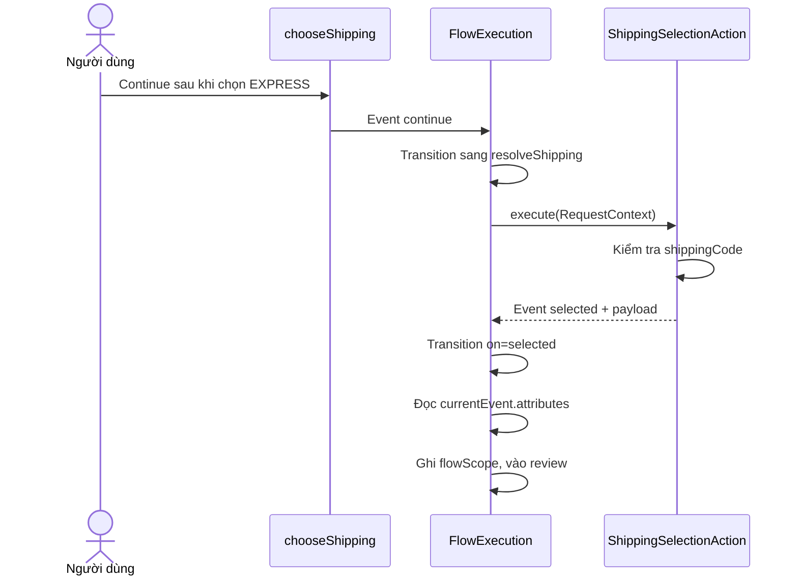
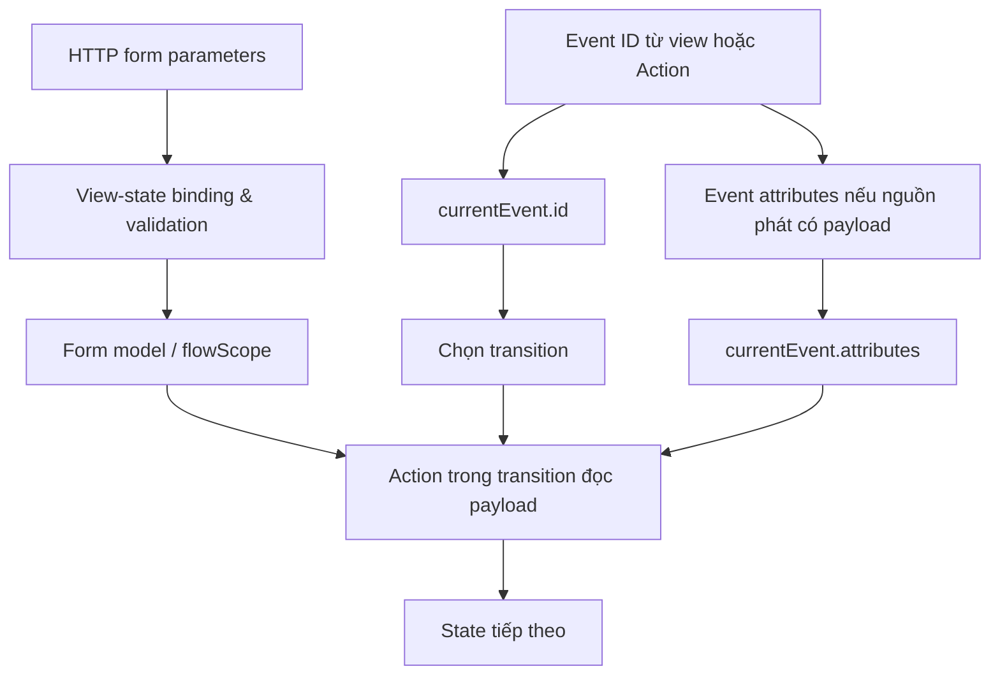

# Đọc currentEvent và các thuộc tính của sự kiện

## 1. Vai trò của `currentEvent` trong Spring Web Flow

**Spring Web Flow (SWF)** mô tả hành trình web nhiều bước bằng `state`, `event` và `transition`. Một state đang chờ có thể nhận event `continue` từ người dùng, một action có thể phát `success`/`error`, hoặc subflow có thể trả một outcome. Engine dùng **ID của event** để lựa chọn transition rồi chuyển đến state tiếp theo.

Trong lúc xử lý, Web Flow cung cấp biến biểu thức đặc biệt **`currentEvent`**. Biến này đại diện cho đối tượng `org.springframework.webflow.execution.Event` hiện tại. Ta có thể đọc ID và những thuộc tính (attributes) do nguồn phát sự kiện gửi kèm.

Ví dụ theo tài liệu Spring Web Flow:

```xml
<transition on="addGuest" to="reviewGuests">
    <evaluate expression="booking.guests.add(currentEvent.attributes.guest)" />
</transition>
```

`on="addGuest"` xác định event nào kích hoạt transition; `currentEvent.attributes.guest` đọc payload mang tên `guest`. **Đoạn này chỉ có ý nghĩa khi event thực sự có attribute `guest`**.

Bài học tập trung vào việc đọc `currentEvent` đúng thời điểm, phân biệt ID với attributes, tạo Event trong Java, sử dụng dữ liệu trong transition và tránh nhầm với `requestParameters`/form binding.

## 2. Cấu trúc một Event

Lớp `Event` kế thừa `java.util.EventObject`, mang một **ID**, một **source**, thời điểm tạo và một **attribute map**.

| Nội dung | Java API | Cú pháp EL | Ý nghĩa |
|---|---|---|---|
| ID | `event.getId()` | `currentEvent.id` | Dùng để chọn transition |
| Attributes | `event.getAttributes()` | `currentEvent.attributes` | Dữ liệu đi kèm event |
| Timestamp | `event.getTimestamp()` | `currentEvent.timestamp` | Thời điểm Event được tạo, milliseconds từ epoch |
| Source | `event.getSource()` | `currentEvent.source` | Đối tượng phát sự kiện |

Ví dụ Event có payload:

```java
import org.springframework.webflow.core.collection.LocalAttributeMap;
import org.springframework.webflow.execution.Event;

LocalAttributeMap<Object> attributes = new LocalAttributeMap<>();
attributes.put("productId", 42L);
attributes.put("quantity", 2);

Event event = new Event(this, "selected", attributes);

// event.getId() -> "selected"
// event.getAttributes().get("productId") -> 42L
// event.getAttributes().get("quantity") -> 2
```

API hỗ trợ `new Event(source, id)` không có payload và `new Event(source, id, attributes)` có payload. `getAttributes()` trả một `AttributeMap` chỉ đọc và **không bao giờ null**; sự kiện không mang payload sẽ có map rỗng. Nguồn phát `source` không mặc định là người dùng hoặc HTTP request: với event do action tạo, nó có thể là chính object action.

**Event ID và payload là hai thành phần độc lập**: hai event cùng ID `selected` vẫn có thể được tạo với payload khác nhau; transition khớp ID không tự bảo đảm payload đúng contract.

## 3. Truy cập `currentEvent` trong biểu thức EL

Các biểu thức được dùng trong định nghĩa flow với Spring EL có thể tham chiếu `currentEvent` tương tự `flowScope`, `requestScope` và `flowRequestContext`.

### 3.1. Đọc ID

```xml
<transition on="approve" to="approved">
    <evaluate expression="auditService.recordEvent(currentEvent.id)" />
</transition>
```

`currentEvent.id` tương ứng `Event.getId()`. Ở transition đơn lẻ `on="approve"`, ID đã hiển nhiên, nên ví dụ chủ yếu để thấy cú pháp. Giá trị này đặc biệt hữu ích khi một action/logic dùng chung muốn phân biệt kết quả vừa phát ra.

### 3.2. Đọc một thuộc tính theo tên

```xml
<transition on="selected" to="review">
    <set name="flowScope.selectedProductId"
         value="currentEvent.attributes.productId" />
</transition>
```

Cũng có thể dùng cú pháp truy cập map:

```xml
<set name="flowScope.selectedProductId"
     value="currentEvent.attributes['productId']" />
```

Hai cách đều đọc khóa `productId` trong payload. Dạng `['productId']` hữu ích khi tên khóa khó diễn tả bằng cú pháp dấu chấm.

### 3.3. Đọc nhiều thuộc tính

```xml
<transition on="selected" to="review">
    <evaluate expression="cartService.recordSelection(
        currentEvent.attributes.productId,
        currentEvent.attributes.quantity)" />
</transition>
```

Mỗi tên thuộc tính phải thống nhất với hợp đồng của **nguồn phát event**. Nếu `quantity` không tồn tại, truy cập có thể trả `null`; service không nên giả định mọi event `selected` đều có dữ liệu đúng kiểu.

### 3.4. Thời điểm phát sự kiện

```xml
<transition on="approved" to="done">
    <evaluate expression="auditService.recordEventTime(
        currentEvent.timestamp)" />
</transition>
```

Timestamp là thời điểm Event được tạo. Nó **khác** với thời điểm commit transaction, lúc trình duyệt hiển thị hay thời điểm hệ thống ngoài xác nhận xử lý thành công. Thông tin audit nghiệp vụ quan trọng nên được ghi ở service/DB trong transaction tương ứng.

## 4. `currentEvent` khác `requestParameters` thế nào?

Giả sử trình duyệt gửi một form:

```http
POST /checkout?execution=e1s1
Content-Type: application/x-www-form-urlencoded

_eventId=continue&shippingCode=EXPRESS
```

Các giá trị có vai trò khác nhau:

- `_eventId=continue` là một kiểu quy ước request Web Flow có thể dùng để nhận **event ID** là `continue`.
- `shippingCode=EXPRESS` là **tham số form/request**; Web Flow có thể bind vào form model theo cấu hình hoặc ứng dụng có thể đọc qua `requestParameters.shippingCode`.
- `currentEvent` là đối tượng **Event** đang được xử lý; bản đồ `attributes` phụ thuộc vào cách nguồn phát event xây dựng payload.

**Không có bảo đảm chung rằng mọi HTTP form field tự động trở thành `currentEvent.attributes.<field>`.** Một Event được tạo từ Action có thể có payload hoàn toàn do server tính ra. Ngược lại, người dùng gửi field trong form không chứng minh Action đã đưa field đó vào attributes.

| Cần biết điều gì? | Dữ liệu nên đọc |
|---|---|
| Event nào đã kích hoạt transition | `currentEvent.id` hoặc thuộc tính `on` |
| Form field hiện tại | Form model sau binding/validation, hoặc `requestParameters` khi chủ đích đọc trực tiếp |
| Kết quả Action gửi kèm Event | `currentEvent.attributes.key` |
| Trạng thái tồn tại qua nhiều bước | `flowScope` hoặc model scope phù hợp |
| Thông báo lỗi form | Binding/validation và `messageContext` |

Đừng coi `currentEvent` như một bản sao của `HttpServletRequest`. Web Flow có tầng trừu tượng request riêng và có thể nhận event từ nhiều nguồn.

## 5. Tạo Event với payload trong Java Action

Hãy xét flow `checkout`. Sau khi người dùng chọn phương thức giao hàng, một action kiểm tra mã đã lưu trong `flowScope.shippingCode`. Action trả `Event` có ID `selected` kèm mã phương thức và số ngày dự kiến; lựa chọn không hợp lệ trả `invalid`.

### 5.1. Java Action triển khai API SWF

```java
package com.example.checkout.flow;

import org.springframework.stereotype.Component;
import org.springframework.webflow.core.collection.LocalAttributeMap;
import org.springframework.webflow.execution.Action;
import org.springframework.webflow.execution.Event;
import org.springframework.webflow.execution.RequestContext;

@Component("shippingSelectionAction")
public final class ShippingSelectionAction implements Action {

    @Override
    public Event execute(RequestContext context) {
        // State chọn giao hàng đã đưa giá trị vào flowScope.
        String code = context.getFlowScope().getString("shippingCode");

        if (!"STANDARD".equals(code) && !"EXPRESS".equals(code)) {
            return new Event(this, "invalid");
        }

        LocalAttributeMap<Object> payload = new LocalAttributeMap<>();
        payload.put("optionCode", code);
        payload.put("estimatedDays",
                "EXPRESS".equals(code) ? 1 : 3);

        return new Event(this, "selected", payload);
    }
}
```

Các bước cần hiểu:

1. `execute(RequestContext)` là phương thức của `org.springframework.webflow.execution.Action`.
2. Giá trị `shippingCode` thuộc execution, không được lưu vào field của singleton Action.
3. Action kiểm tra giá trị thuộc tập cho phép trước khi phát kết quả `selected`.
4. Payload `optionCode`/`estimatedDays` được tạo có chủ đích.
5. Nhánh `invalid` không mang những attributes này; transition lỗi không nên truy cập chúng.

Mẫu trên giúp minh họa Event. Trong ứng dụng thật, tính phí giao hàng hoặc quyền sử dụng phương thức giao hàng cần được kiểm tra thêm ở service nghiệp vụ, không dựa trên số ngày ước tính tự tạo.

### 5.2. Action-state và transition đọc payload

Trong một định nghĩa flow có namespace SWF phù hợp:

```xml
<view-state id="chooseShipping">
    <transition on="continue" to="resolveShipping" />
</view-state>

<action-state id="resolveShipping">
    <evaluate expression="shippingSelectionAction" />

    <transition on="selected" to="review">
        <set name="flowScope.confirmedShippingCode"
             value="currentEvent.attributes.optionCode" />
        <set name="flowScope.estimatedShippingDays"
             value="currentEvent.attributes.estimatedDays" />
    </transition>

    <transition on="invalid" to="chooseShipping" />
</action-state>

<view-state id="review">
    <transition on="back" to="chooseShipping" />
    <transition on="confirm" to="completed" />
</view-state>

<end-state id="completed" />
```

Đây là **đoạn XML minh họa**: giả định `shippingCode` đã được lưu và validate ở màn hình `chooseShipping`, bean `shippingSelectionAction` đã được đăng ký, template/view resolver được cấu hình. Khi dùng thực tế, event `confirm` phải trải qua action kiểm tra điều kiện đặt hàng và transaction phù hợp trước khi hoàn tất.

Khi `ShippingSelectionAction` trả Event `selected`, engine chọn transition `on="selected"`. Trong các action của transition đó:

```text
Event vừa phát:
  id = "selected"
  attributes = {
      optionCode: "EXPRESS",
      estimatedDays: 1
  }

currentEvent.id = "selected"
currentEvent.attributes.optionCode = "EXPRESS"
currentEvent.attributes.estimatedDays = 1

Kết quả:
  flowScope.confirmedShippingCode = "EXPRESS"
  flowScope.estimatedShippingDays = 1
  state tiếp theo = review
```

Nếu Action phát `invalid`, transition `on="invalid"` quay về bước chọn mà không đọc payload chỉ dành cho kết quả thành công.

### 5.3. Hai sự kiện khác nhau trong một hành trình



Event `continue` từ view-state kích hoạt một chuyển trạng thái; sau đó action-state tạo Event **mới** là `selected`. Khi xử lý transition `selected`, `currentEvent` là Event được action tạo, không phải Event `continue` trước đó.

## 6. Đọc Event trong mã Java qua RequestContext

Thay vì EL, mã Java có thể dùng `RequestContext.getCurrentEvent()`:

```java
import org.springframework.webflow.execution.Event;
import org.springframework.webflow.execution.RequestContext;

public final class EventInspector {

    public static void inspect(RequestContext context) {
        Event event = context.getCurrentEvent();
        if (event == null) {
            return;
        }

        String id = event.getId();
        Object optionCode = event.getAttributes().get("optionCode");

        if ("selected".equals(id) && optionCode instanceof String) {
            String code = (String) optionCode;
            // Xử lý theo contract đã validate của ứng dụng.
        }
    }
}
```

**Cần kiểm tra null:** theo Javadoc, `getCurrentEvent()` trả `null` khi chưa có event nào được phát. Ví dụ action ở giai đoạn khởi chạy flow có thể chưa có event từ người dùng. Không dereference `currentEvent.id` trong `on-start` nếu không bảo đảm đã có event.

Dùng getter typed của `AttributeMap` khi phù hợp:

```java
Event event = context.getCurrentEvent();
if (event != null && "selected".equals(event.getId())) {
    String code = event.getAttributes().get("optionCode", String.class);
    // code có thể null nếu payload thiếu key.
}
```

`get(name, Class)` có thể báo lỗi nếu giá trị tồn tại nhưng không đúng kiểu. Do đó, event payload cũng cần một **hợp đồng dữ liệu** (tên key, kiểu, có bắt buộc hay không), tương tự input của flow.

### 6.1. Listener nên dùng chính tham số Event

Trong `FlowExecutionListener`, callback `eventSignaled(RequestContext, Event)` đã có tham số `Event`:

```java
@Override
public void eventSignaled(RequestContext context, Event event) {
    String eventId = event.getId();
    // Chỉ ghi metadata được phép; tránh log toàn bộ attributes.
}
```

Ở callback này, dùng `event` trực tiếp sẽ rõ nghĩa hơn việc đọc lại `context.getCurrentEvent()`. Một event được phát **không bảo đảm** có transition phù hợp hoặc state mới đã được vào. Khi đo điều hướng, cần phân biệt event signaled, transition selected và state entered.

## 7. Khi nào `currentEvent` có thể null hoặc thiếu attributes?

Hai điều kiện cần xét riêng:

- **Chưa có event:** `currentEvent == null`.
- **Có event nhưng payload không có key:** `currentEvent.attributes.optionCode == null`.

Một event không payload vẫn hợp lệ:

```java
Event event = new Event(this, "cancel");
```

Nó có `id="cancel"`, nhưng attributes rỗng. Transition `on="cancel"` có thể được chọn mà không cần payload. Không vì thiếu `optionCode` mà kết luận event `cancel` là sai.

Trong Spring EL có thể kiểm tra giá trị `currentEvent` trước khi đọc:

```xml
<evaluate expression="auditService.record(
    currentEvent != null ? currentEvent.id : 'none')" />
```

Đây là cú pháp điều kiện của **Spring EL**; nếu ứng dụng dùng bộ EL khác, cần kiểm tra tương thích. Thực tế, tốt nhất đặt logic cần `currentEvent` trong transition có hợp đồng event rõ ràng, thay vì đưa biểu thức phụ thuộc event vào mọi action khi flow vừa khởi chạy.

## 8. ID sự kiện không chứng minh payload đã hợp lệ

Xét flow:

```xml
<action-state id="calculate">
    <evaluate expression="pricingAction" />
    <transition on="success" to="review">
        <set name="flowScope.total"
             value="currentEvent.attributes.total" />
    </transition>
    <transition on="error" to="retry" />
</action-state>
```

Transition `success` được chọn theo **ID**. Nếu `pricingAction` trả `Event(this,"success")` mà không có `total`, transition vẫn có thể khớp, nhưng action gán vào `flowScope.total` không có dữ liệu mong đợi. Đây là **lỗi hợp đồng payload của action**, không phải lỗi so khớp tên transition.

Để tránh lỗi này:

1. Liệt kê những **event ID** Action có thể trả.
2. Quy định với từng event ID, những attributes nào bắt buộc và kiểu của chúng.
3. Chỉ phát event thành công khi dữ liệu đã được tính và kiểm tra.
4. Dùng nhánh `error`/`invalid` khi kết quả không đáp ứng hợp đồng.
5. Khi dữ liệu ảnh hưởng bảo mật hoặc giao dịch, tiếp tục kiểm tra quyền/transaction ở service.
6. Không giả định `currentEvent.attributes` có các field không được nguồn phát định nghĩa.

## 9. Vòng đời của currentEvent qua nhiều state và request

Một execution có thể kéo dài nhiều HTTP request, nhưng `currentEvent` là thông tin của **sự kiện hiện được engine xử lý**, không phải lịch sử các event đã xảy ra.

```text
Request A: launch checkout
  → chưa có event được báo, currentEvent có thể null
  → vào view chooseShipping

Request B: submit continue
  → currentEvent.id = continue
  → chuyển sang action-state resolveShipping
  → Action phát Event selected
  → currentEvent.id = selected
  → currentEvent.attributes.optionCode = EXPRESS
  → flowScope ghi lựa chọn, render review

Request C: submit back
  → currentEvent.id = back
  → chuyển về chooseShipping
  → không giả định currentEvent vẫn là selected
```

Vì vậy:

- Nếu cần giá trị ở state sau hoặc request sau, hãy lưu nó có chủ đích vào `flowScope`, model scope hoặc DB.
- Nếu cần lịch sử event cho audit, ghi bản ghi phù hợp tại thời điểm phát/xử lý.
- Không giữ tham chiếu `RequestContext` trong singleton/biến static để dùng ở request sau.
- Không dựa vào `currentEvent` ở thời điểm render lại view, refresh hay khởi chạy flow nếu không có bảo đảm event đã được phát.

## 10. Event và form binding thực sự phối hợp ra sao?

Một flow thường có hai luồng dữ liệu riêng:



Ví dụ `shippingCode=EXPRESS` được bind và validate vào draft. Khi event `continue` làm flow vào action-state, action đọc draft, kiểm tra quy tắc và phát `selected` kèm payload đã chuẩn hóa. Transition `selected` có thể đọc payload đó và lưu trạng thái cần thiết.

Đây là cách làm rõ tầng trách nhiệm:

- **Binding:** chuyển tham số form vào Java model theo trường.
- **Validation:** kiểm tra giá trị hợp lệ và quyền nghiệp vụ.
- **Event:** thông báo kết quả điều khiển luồng.
- **Transition:** quyết định state tiếp theo.
- **Scopes:** duy trì những giá trị thật sự cần qua bước khác.

Không dùng event attributes để thay thế Bean Validation hoặc security checking.

## 11. Bảo mật và logging cho event attributes

Attributes có thể chứa mã đơn, số lượng, thông tin cá nhân hoặc object nghiệp vụ. Khi quan sát hoặc truyền dữ liệu, hãy nhớ:

- **Không log cả payload map:** `event.getAttributes().toString()` có thể đưa mật khẩu, email hoặc dữ liệu giao dịch vào log.
- **Không tin event data vô điều kiện:** nếu thuộc tính bắt nguồn từ trình duyệt, phải validate và authorization trước thao tác nghiệp vụ.
- **Không truyền object graph lớn:** payload Event thường nên chứa ID/code/giá trị kết quả gọn, không gắn entity JPA có quan hệ sâu hoặc file.
- **Không xem timestamp là commit time:** `Event.getTimestamp()` phản ánh lúc Event được tạo; service/DB quyết định thời điểm nghiệp vụ thực sự hoàn tất.
- **Không hiểu source là identity:** `getSource()` có thể là action bean. Thông tin người dùng lấy từ cơ chế xác thực.
- **Không dùng ID ngẫu nhiên/người dùng làm metric labels:** nên ghi những event ID/flow ID/state ID có số lượng hữu hạn; các giá trị riêng tư có chính sách log/tracing riêng.

Khi chỉ cần biết người dùng chuyển sang state nào, việc ghi `stateEntered` có thể hữu ích hơn ghi toàn bộ payload. Khi cần audit kết quả giao dịch, hãy ghi trong transaction/service có cơ chế đảm bảo độ tin cậy.

## 12. Lỗi hay gặp và cách kiểm tra

| Hiện tượng | Nguyên nhân có thể | Cách xác minh |
|---|---|---|
| `currentEvent` null ở `on-start` | Chưa phát event | Không dereference trước event; đặt logic trong transition phù hợp |
| `currentEvent.id` khác tên nút người dùng bấm | Action đã phát event kết quả mới | Kiểm tra thứ tự các state/event trong execution |
| Có `selected` nhưng thiếu `optionCode` | Action không gắn payload hoặc sai key | Kiểm tra constructor `Event` và attributes của kết quả |
| Form có `shippingCode` nhưng `currentEvent.attributes.shippingCode` rỗng | Form field không được copy thành event attribute | Kiểm tra model binding/`requestParameters` |
| Lỗi ép kiểu `String` thành `Long` | Kiểu payload khác hợp đồng | Kiểm tra kiểu trong `LocalAttributeMap` và converter/service |
| Đọc payload ở request sau không còn giá trị | Event đã đổi theo thao tác mới | Lưu dữ liệu cần thiết vào flowScope/model |
| Event được ghi audit nhưng không có state transition | Event không khớp hoặc transition thất bại | Đối chiếu event, transition, exception và state thực tế |
| Flow vào nhánh success dù nghiệp vụ thất bại | Action phát sai ID hoặc chưa kiểm soát lỗi | Xem lại contract transaction/service và event outcome |

Một lỗi đáng chú ý: `Event.getAttributes()` cung cấp giao diện **chỉ đọc**. Việc thêm attribute phải được thiết kế tại nguồn phát event hoặc qua một bản dữ liệu mới; không nên cố sửa map sau khi Event đã phát.

## 13. Ma trận thực hành và bài tập

Dựa trên Java Action và XML flow chọn giao hàng ở phần 5, kiểm tra các tình huống:

| Đầu vào / hành động | Event được phát | Payload kỳ vọng | Kết quả |
|---|---|---|---|
| Chọn `STANDARD` | `selected` | `optionCode=STANDARD`, `estimatedDays=3` | Đến `review` |
| Chọn `EXPRESS` | `selected` | `optionCode=EXPRESS`, `estimatedDays=1` | Đến `review` |
| Chọn mã lạ | `invalid` | Không bắt buộc có payload | Trở về `chooseShipping` |
| Flow vừa khởi chạy | Chưa có event | Không được dereference `currentEvent.id` khi null | Không lỗi đọc expression |
| Người dùng gửi field form | Event từ view theo cấu hình | Form field chưa chắc có trong Event | Đọc qua binding/model |
| Event `selected` bị thiếu `optionCode` | `selected` | Vi phạm contract | Test phát hiện thiếu dữ liệu |
| Sau review người dùng nhấn Back | `back` | Không phụ thuộc payload trước | Quay lại đúng state |

### 13.1. Bài tập đọc event

Cho Java Action:

```java
LocalAttributeMap<Object> attributes = new LocalAttributeMap<>();
attributes.put("documentId", 123L);
attributes.put("valid", true);

return new Event(this, "checked", attributes);
```

Và transition:

```xml
<transition on="checked" to="review">
    <set name="flowScope.documentId"
         value="currentEvent.attributes.documentId" />
</transition>
```

Hãy trả lời:

1. ID nào khiến transition khớp?
2. Dữ liệu `documentId` lấy từ đâu và có kiểu gì?
3. Nếu Event vẫn có ID `checked` nhưng thiếu `documentId`, transition có khớp không?
4. Có thể thay bằng `requestParameters.documentId` khi request không hề có tham số đó không?

**Đáp án:** (1) `checked`; (2) từ payload của Event, kiểu `Long`; (3) ID vẫn có thể khớp nhưng transition action nhận null/sai contract; (4) không, `requestParameters` chỉ phản ánh dữ liệu request, trong khi payload Event có thể được server tạo độc lập.

## 14. Điểm cần ghi nhớ

Trong Spring Web Flow, `currentEvent` cho phép đọc **đối tượng Event hiện được xử lý**. `currentEvent.id` cho biết **điều gì vừa xảy ra**, còn `currentEvent.attributes` cho biết **nguồn phát đã chủ động đính kèm dữ liệu gì**.

Đọc payload trong transition do Event tương ứng kích hoạt hoặc trong Java qua `RequestContext.getCurrentEvent()`, luôn xét trường hợp `null`, thiếu key và kiểu không khớp. Khi cần dữ liệu tồn tại qua nhiều request, chuyển có chủ đích sang `flowScope`/model hoặc kho nghiệp vụ; khi cần form fields, dùng binding/validation.

Cơ chế này kết nối tự nhiên với toàn bộ hành trình **state → event → transition → subflow**: event truyền tín hiệu và payload ngắn hạn; định nghĩa flow chọn đường đi; execution giữ trạng thái phục vụ các bước tiếp theo.

### Tài liệu tham khảo

- [Spring Web Flow 2.5.1 – Expression Language: currentEvent](https://docs.spring.io/spring-webflow/docs/2.5.1.RELEASE/reference/htmlsingle/#_currentevent) – ví dụ chính thức với `currentEvent.attributes.guest`.
- [Spring Web Flow 2.5.1 – Event API](https://docs.spring.io/spring-webflow/docs/2.5.x/api/org/springframework/webflow/execution/Event.html) – `getId()`, `getAttributes()` và `getTimestamp()`.
- [Spring Web Flow 2.5.1 – RequestContext API](https://docs.spring.io/spring-webflow/docs/2.5.x/api/org/springframework/webflow/execution/RequestContext.html) – `getCurrentEvent()` và các scope.
- [Spring Web Flow 2.5.x – Executing actions](https://docs.spring.io/spring-webflow/docs/2.5.x/reference/html/actions.html) – trả Event từ `Action` và xử lý ở action-state.
- [Spring Web Flow 2.5.1 – LocalAttributeMap API](https://docs.spring.io/spring-webflow/docs/2.5.x/api/org/springframework/webflow/core/collection/LocalAttributeMap.html) – payload dạng map và typed getters.
