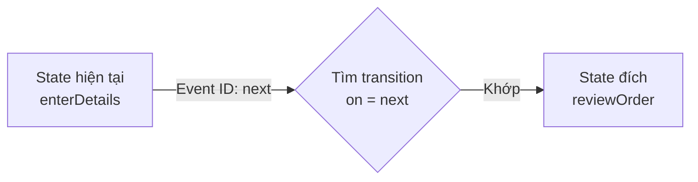

# Khớp sự kiện với transition theo thuộc tính on

Trong **Spring Web Flow**, một hành trình web nhiều bước được mô hình hóa bằng các **state**, **event** và **transition**. Người dùng có thể nhập thông tin ở `view-state`, gửi một thao tác như **Tiếp tục** hoặc **Hủy**, rồi flow quyết định bước kế tiếp. Một `action-state` cũng có thể gọi service và phát kết quả để flow rẽ nhánh. Để những bước đó phối hợp đúng, định nghĩa flow cần biết **event nào sẽ kích hoạt transition nào**.

Thuộc tính `on` của phần tử `<transition>` chính là nơi khai báo mối liên hệ này. Bài học thuộc chương **Event và transition**, tập trung vào **khớp sự kiện với transition theo thuộc tính on**: event được tạo từ đâu, giá trị nào được so khớp, khác biệt giữa `on` và `to`, cách xử lý khi không có transition phù hợp và cách kiểm thử toàn bộ hợp đồng đó trong flow execution.

## 1. Event là tín hiệu, transition là quy tắc điều hướng

Hãy hình dung flow đặt hàng có màn hình nhập đơn, màn hình xem lại và bước gửi đơn. Khi người dùng nhấn nút **Tiếp tục**, ứng dụng phát một event có ID `next`. Flow hiện đang ở `enterDetails` tìm transition có `on="next"` và chuyển đến state được khai báo trong `to`.



Hai khái niệm có vai trò khác nhau:

| Thành phần | Trả lời câu hỏi | Ví dụ |
| --- | --- | --- |
| **Event** | Điều gì vừa xảy ra hoặc được yêu cầu? | `next`, `cancel`, `reserved` |
| **Transition** | Flow phải đi đâu khi nhận event đó? | `on="next" to="reviewOrder"` |
| **State hiện tại** | Flow đang chờ hoặc đang thực thi ở bước nào? | `enterDetails` |
| **State đích** | Flow sẽ đi tới đâu nếu transition được chọn? | `reviewOrder` |

**Event không tự chuyển flow sang state mới.** Nó chỉ cung cấp tín hiệu; transition trong state hiện tại mới định nghĩa hướng đi. Cùng một event ID có thể có ý nghĩa khác nhau ở những state khác nhau vì mỗi state có tập transition riêng.

## 2. Đọc đúng cú pháp on và to

Một transition cơ bản:

```xml
<view-state id="enterDetails" view="checkout/details">
    <transition on="next" to="reviewOrder" />
</view-state>
```

Ý nghĩa:

- `on="next"`: transition này phản hồi event có ID `next`.
- `to="reviewOrder"`: khi transition được chọn, flow chuyển tới state có ID `reviewOrder`.
- `enterDetails`: state hiện tại chứa transition.

**`on` là ID event; `to` là ID state đích.** Không đổi chỗ hai giá trị này:

```xml
<!-- Đúng: event next dẫn tới state reviewOrder. -->
<transition on="next" to="reviewOrder" />

<!-- Sai về ý nghĩa nếu reviewOrder chỉ là state ID,
     còn không có event mang ID reviewOrder. -->
<transition on="reviewOrder" to="next" />
```

Ở ví dụ sai, `next` bị dùng như tên state đích, trong khi nó thường là event người dùng gửi. Một lỗi tương tự là đặt `on="enterDetails"` chỉ vì muốn quay lại state nhập liệu; cần một event có ý nghĩa như `back` hoặc `edit`, rồi khai báo `to="enterDetails"`.

### Một state có thể có nhiều transition

Một `view-state` thường có nhiều thao tác người dùng:

```xml
<view-state id="reviewOrder" view="checkout/review">
    <transition on="back" to="enterDetails" />
    <transition on="confirm" to="submitOrder" />
    <transition on="cancel" to="cancelled" />
</view-state>
```

Tại `reviewOrder`:

- Event `back` quay về `enterDetails`.
- Event `confirm` chuyển tới `submitOrder`.
- Event `cancel` kết thúc theo state `cancelled`.

Tên event mô tả **ý định hoặc kết quả**, còn tên state mô tả **vị trí trong hành trình**. Đặt tên theo vai trò giúp người đọc XML hiểu được luồng mà không phải lần ngược mã giao diện.

## 3. Event đến từ đâu?

Một event có thể được phát ra bởi nhiều nguồn. Cùng một cơ chế transition theo ID được dùng để điều hướng, nhưng cách tạo event khác nhau theo loại state.

| Nguồn | Cách event xuất hiện | Ví dụ |
| --- | --- | --- |
| Người dùng ở `view-state` | Request gửi event ID qua cơ chế của Web Flow | Nút `_eventId_next` phát `next` |
| Action trong `action-state` | Action trả về một `Event` có ID | Service giữ hàng thành công trả `reserved` |
| Flow con trong `subflow-state` | Flow con kết thúc với outcome | End-state `verified` trả outcome `verified` |
| Cơ chế xử lý ngoại lệ | Exception transition dùng tiêu chí ngoại lệ riêng | `on-exception`, không phải event ID thông thường |

Một số ví dụ event:

```text
Từ giao diện:
  next, back, cancel, confirm

Từ action:
  success, rejected, unavailable, failed

Từ subflow:
  verified, declined, completed
```

Không nên đặt tên mọi event là `success` hoặc `error` nếu caller cần phân biệt kết quả nghiệp vụ. `unavailable` có thể có đường phục hồi khác `declined`; `cancel` do người dùng chủ động khác với `failed` do service gặp sự cố.

## 4. Khớp event do người dùng gửi từ view-state

Với `view-state`, người dùng thường tạo event bằng nút submit trong form. Ví dụ:

```xml
<view-state id="enterDetails"
            view="checkout/details"
            model="checkoutForm">
    <transition on="next" to="reviewOrder" />
    <transition on="cancel" to="cancelled"
                bind="false" validate="false" />
</view-state>
```

Trong JSP, một cách gửi event thông dụng là dùng tên button theo quy ước `_eventId_<eventId>`:

```jsp
<form method="post" action="${flowExecutionUrl}">
    <label for="quantity">Số lượng</label>
    <input id="quantity" name="quantity" type="text" />

    <button type="submit" name="_eventId_next">Tiếp tục</button>
    <button type="submit" name="_eventId_cancel">Hủy</button>
</form>
```

Khi người dùng gửi nút **Tiếp tục**, request biểu diễn event `next`; nút **Hủy** biểu diễn event `cancel`. Web Flow tiếp tục execution phù hợp, nhận event và tìm transition trong state hiện tại.

`flowExecutionUrl` là URL tiếp tục execution được Web Flow cung cấp cho view trong cấu hình tương ứng. Không hard-code một URL không có execution key nếu ứng dụng cần resume execution hiện tại.

### Event ID phải khớp với XML

| Tên nút/form | Event được gửi | Transition cần có |
| --- | --- | --- |
| `_eventId_next` | `next` | `<transition on="next" .../>` |
| `_eventId_back` | `back` | `<transition on="back" .../>` |
| `_eventId_confirm` | `confirm` | `<transition on="confirm" .../>` |
| `_eventId_cancel` | `cancel` | `<transition on="cancel" .../>` |

Nếu giao diện gửi `_eventId_continue` nhưng XML chỉ có `on="next"`, hai bên không khớp. Đổi tên nút hoặc transition để cùng tuân theo một hợp đồng; đừng thêm một state mới chỉ để “sửa” tên event.

## 5. Khớp event do action-state trả về

`action-state` thường thực thi một hoặc nhiều action mà không cần view. Action có thể trả về event để chọn transition:

```xml
<action-state id="reserveInventory">
    <evaluate expression="inventoryAction.reserve(flowScope.orderForm)" />

    <transition on="reserved" to="completed" />
    <transition on="unavailable" to="reviewOrder" />
    <transition on="failed" to="technicalError" />
</action-state>
```

Ví dụ Java:

```java
package com.example.checkout;

import org.springframework.stereotype.Component;
import org.springframework.webflow.execution.Event;

@Component("inventoryAction")
public class InventoryAction {

    private final InventoryService inventoryService;

    public InventoryAction(InventoryService inventoryService) {
        this.inventoryService = inventoryService;
    }

    public Event reserve(OrderForm form) {
        ReservationResult result =
            inventoryService.reserve(form.getQuantity());

        if (result == ReservationResult.RESERVED) {
            return new Event(this, "reserved");
        }
        if (result == ReservationResult.OUT_OF_STOCK) {
            return new Event(this, "unavailable");
        }
        return new Event(this, "failed");
    }
}
```

Ở đây `new Event(this, "reserved")` tạo event có ID `reserved`. Engine đối chiếu ID đó với các transition trong `reserveInventory`:

| Event action trả | Transition được chọn | State tiếp theo |
| --- | --- | --- |
| `reserved` | `on="reserved"` | `completed` |
| `unavailable` | `on="unavailable"` | `reviewOrder` |
| `failed` | `on="failed"` | `technicalError` |

**Tên event phải là hợp đồng giữa action và flow XML.** Nếu Java đổi `unavailable` thành `outOfStock` mà XML chưa đổi, transition cũ sẽ không còn khớp. Nên kiểm thử cả action (event trả ra) và flow (state nhận được) để phát hiện thay đổi không đồng bộ.

Lưu ý: đoạn Java giả định `ReservationResult` và `InventoryService` là thành phần ứng dụng. Nếu action ném exception thay vì trả `Event`, phải dùng cơ chế exception handling phù hợp như transition `on-exception`; không mặc định exception tự biến thành event `failed`.

## 6. Khớp outcome từ subflow-state

Khi flow cha gọi flow con, flow con kết thúc tại một `end-state` và trả outcome. Flow cha dùng `on` trong các transition của `subflow-state` để phản hồi outcome đó:

```xml
<subflow-state id="verifyAddress" subflow="addressVerification">
    <input name="address"
           value="flowScope.checkoutForm.shippingAddress" />

    <transition on="verified" to="reviewOrder" />
    <transition on="rejected" to="editAddress" />
</subflow-state>
```

Trong flow con:

```xml
<end-state id="verified" />
<end-state id="rejected" />
```

Khi flow con kết thúc ở `verified`, outcome `verified` trở về flow cha và khớp `on="verified"`. Nếu kết thúc ở `rejected`, flow cha chọn transition tương ứng.

**Outcome của subflow là kết quả ở ranh giới hai flow**, không phải ID state của flow cha. `to="reviewOrder"` vẫn phải tham chiếu state có trong flow cha. Nếu flow con phát outcome mà flow cha không có transition tương ứng, flow cha không có đường đi đã khai báo cho kết quả đó.

Khi flow con cần trả thêm dữ liệu như địa chỉ đã chuẩn hóa, hãy khai báo output mapping riêng. Thuộc tính `on` chỉ dùng để khớp outcome/event; nó không tự truyền các thuộc tính dữ liệu của flow con.

## 7. Phân biệt event ID, event attributes và điều kiện nghiệp vụ

Một `Event` có **ID** và có thể mang thêm **attributes**. Thuộc tính `on` dùng để chọn theo ID event, không phải để so sánh tùy ý mọi dữ liệu trong attributes.

Giả sử event `reserved` còn mang `reservationId` để bước sau ghi nhận mã giữ hàng: transition `on="reserved"` vẫn được chọn theo ID `reserved`; nó không tự kiểm tra giá trị `reservationId`.

Nếu quyết định điều hướng phụ thuộc một giá trị như `eligible`, `amount` hoặc `riskLevel`, hãy đánh giá điều kiện bằng **decision-state**, để action phát ra các event có ý nghĩa riêng, hoặc dùng cơ chế transition criteria phù hợp. Không nhồi điều kiện nghiệp vụ vào chuỗi tên event. Khi cần đưa dữ liệu từ flow con về flow cha, khai báo output mapping; thuộc tính `on` không thay thế hợp đồng dữ liệu đó.

Nếu quyết định chuyển hướng phụ thuộc một giá trị như `eligible`, `amount` hoặc `riskLevel`, hãy biểu diễn điều kiện bằng **decision-state**, action phát event có ý nghĩa hoặc cơ chế transition criteria phù hợp. Đừng nhồi điều kiện nghiệp vụ vào chuỗi tên event.

Ví dụ dùng `decision-state`:

```xml
<decision-state id="checkEligibility">
    <if test="flowScope.customer.eligible"
        then="reviewOrder"
        else="notEligible" />
</decision-state>
```

Ở đây điều kiện boolean quyết định state tiếp theo. Đây không phải tình huống cần tạo một event từ nút người dùng rồi khớp bằng `on`.

## 8. Event được xét trong state hiện tại

Transition được khai báo bên trong state; do đó event phải được hiểu **trong ngữ cảnh state đang hoạt động**.

Ví dụ:

```xml
<view-state id="editAddress" view="checkout/address">
    <transition on="next" to="reviewOrder" />
    <transition on="cancel" to="cancelled" />
</view-state>

<view-state id="reviewOrder" view="checkout/review">
    <transition on="back" to="editAddress" />
    <transition on="confirm" to="submitOrder" />
</view-state>
```

Event `next` ở `editAddress` có thể dẫn tới `reviewOrder`. Nếu `reviewOrder` không khai báo transition `on="next"`, không thể suy ra event đó vẫn dẫn tới `reviewOrder` chỉ vì nó đã được dùng ở state trước.

| State hiện tại | Event | State đích theo cấu hình |
| --- | --- | --- |
| `editAddress` | `next` | `reviewOrder` |
| `editAddress` | `cancel` | `cancelled` |
| `reviewOrder` | `back` | `editAddress` |
| `reviewOrder` | `confirm` | `submitOrder` |

**Không có một bảng transition toàn cục tự động áp dụng cho mọi state.** Nếu một event cần có ý nghĩa chung ở nhiều state, có thể cân nhắc `global-transitions` cho hành vi thực sự chung; nếu đích khác nhau theo state, khai báo transition riêng sẽ rõ ràng hơn.

## 9. Binding và validation có thể ngăn event đi tới transition

Với `view-state` có model, request gửi event có thể đồng thời gửi dữ liệu form. Trước khi transition tiếp tục theo cấu hình thông thường, Web Flow thực hiện binding, conversion và validation tương ứng. Vì vậy **có event được gửi không đồng nghĩa transition chắc chắn được thực thi**.

```xml
<view-state id="enterOrder"
            view="checkout/order"
            model="orderForm">
    <binder>
        <binding property="quantity" required="true" />
    </binder>
    <transition on="next" to="reviewOrder" />
    <transition on="cancel" to="cancelled"
                bind="false" validate="false" />
</view-state>
```

Các tình huống:

| Request | Event ID | Kết quả |
| --- | --- | --- |
| `quantity=3`, form hợp lệ | `next` | Có thể đi tới `reviewOrder` |
| `quantity=abc`, không convert được | `next` | Lỗi binding; ở lại form để sửa |
| `quantity=-2`, convert thành công nhưng validation sai | `next` | Lỗi validation; không sang review |
| Form chưa hoàn chỉnh | `cancel` | Có thể hủy vì transition bỏ binding/validation |

Đây là lý do test cần kiểm tra **event, lỗi form và active state** cùng lúc. Nếu chỉ khẳng định request chứa `_eventId_next` thì chưa chứng minh flow đã chuyển state.

## 10. Event không khớp transition: biểu hiện và nguyên nhân

Nếu event được gửi không có transition tương ứng ở state hiện tại, flow không có quy tắc điều hướng đã khai báo cho tình huống đó. Tùy thời điểm và cấu hình xử lý lỗi, engine có thể phát sinh lỗi dạng **không tìm thấy transition phù hợp** (chẳng hạn `NoMatchingTransitionException`).

Các nguyên nhân phổ biến:

1. **Tên event khác nhau:** giao diện gửi `continue` nhưng XML dùng `next`.
2. **Sai state:** event hợp lệ ở `enterDetails` nhưng được gửi khi execution đang ở `reviewOrder`.
3. **Action đổi event ID:** Java trả `outOfStock` nhưng XML vẫn chờ `unavailable`.
4. **Subflow outcome không được xử lý:** flow con kết thúc `cancelled` nhưng flow cha chỉ có `verified` và `rejected`.
5. **Sai chữ hoa/chữ thường hoặc chính tả:** hai phía không sử dụng cùng một chuỗi ID.
6. **Request không gửi event đúng quy ước:** form thiếu `_eventId_<id>` hoặc gửi sai tham số.
7. **Event bị chặn trước transition:** binding/validation lỗi khiến flow ở lại view-state; người phát triển nhầm rằng `on` không hoạt động.

### Bảng chẩn đoán

| Triệu chứng | Kiểm tra trước tiên |
| --- | --- |
| Nhấn nút nhưng vẫn ở form, có lỗi field | Binding, conversion, validation |
| Nhấn nút nhưng không có lỗi field, flow báo không có transition | Event ID thực tế và transition ở state hiện tại |
| Action chạy nhưng không tới state mong muốn | Event ID action trả và các `on` trong action-state |
| Flow con kết thúc nhưng flow cha lỗi | Outcome của end-state và transition trong subflow-state |
| Event đúng tên nhưng sai state đích | Thuộc tính `to` và state ID tồn tại |
| Chỉ lỗi ở một số request sau Back/Refresh | State hiện tại, execution key và event gửi lại |

## 11. Ví dụ hoàn chỉnh: event điều hướng trong checkout

Flow sau kết hợp event từ form và action, đồng thời thể hiện các đường thành công, từ chối, quay lại và lỗi:

```xml
<?xml version="1.0" encoding="UTF-8"?>
<flow xmlns="http://www.springframework.org/schema/webflow"
      xmlns:xsi="http://www.w3.org/2001/XMLSchema-instance"
      xsi:schemaLocation="
          http://www.springframework.org/schema/webflow
          http://www.springframework.org/schema/webflow/spring-webflow.xsd">

    <var name="orderForm" class="com.example.checkout.OrderForm" />

    <view-state id="enterDetails"
                view="checkout/details"
                model="orderForm">
        <binder>
            <binding property="quantity" required="true" />
        </binder>
        <transition on="next" to="reviewOrder" />
        <transition on="cancel" to="cancelled"
                    bind="false" validate="false" />
    </view-state>

    <view-state id="reviewOrder" view="checkout/review">
        <transition on="back" to="enterDetails" />
        <transition on="confirm" to="reserveInventory" />
    </view-state>

    <action-state id="reserveInventory">
        <evaluate expression="inventoryAction.reserve(flowScope.orderForm)" />
        <transition on="reserved" to="completed" />
        <transition on="unavailable" to="reviewOrder" />
        <transition on="failed" to="technicalError" />
    </action-state>

    <view-state id="technicalError" view="checkout/error">
        <transition on="retry" to="reserveInventory" />
        <transition on="cancel" to="cancelled" />
    </view-state>

    <end-state id="completed" view="checkout/completed" />
    <end-state id="cancelled" />
</flow>
```

Đọc các event theo thứ tự:

| State | Nguồn event | Event ID | State đích |
| --- | --- | --- | --- |
| `enterDetails` | Người dùng nhấn Tiếp tục | `next` | `reviewOrder` |
| `enterDetails` | Người dùng nhấn Hủy | `cancel` | `cancelled` |
| `reviewOrder` | Người dùng nhấn Quay lại | `back` | `enterDetails` |
| `reviewOrder` | Người dùng nhấn Xác nhận | `confirm` | `reserveInventory` |
| `reserveInventory` | Action giữ hàng | `reserved` | `completed` |
| `reserveInventory` | Action giữ hàng | `unavailable` | `reviewOrder` |
| `reserveInventory` | Action giữ hàng | `failed` | `technicalError` |
| `technicalError` | Người dùng nhấn Thử lại | `retry` | `reserveInventory` |
| `technicalError` | Người dùng nhấn Hủy | `cancel` | `cancelled` |

Một event ID có thể được dùng ở nhiều state nhưng có **đích khác nhau theo transition tại state đó**. Ví dụ `cancel` ở `enterDetails` và `technicalError` đều kết thúc `cancelled` trong ví dụ; nếu chính sách hủy khác nhau, có thể khai báo state đích khác nhau mà vẫn giữ event có ý nghĩa.

### Đặt tên event có quy ước

Nên chọn tên ngắn, mô tả hành động hoặc kết quả và dùng thống nhất:

| Nhóm | Tên phù hợp | Tránh dùng nếu không rõ nghĩa |
| --- | --- | --- |
| Người dùng | `next`, `back`, `edit`, `confirm`, `cancel` | `button1`, `click2` |
| Nghiệp vụ | `reserved`, `declined`, `unavailable`, `approved` | `success2`, `result` |
| Tích hợp | `accepted`, `rejected`, `completed` | `done` cho nhiều loại kết quả khác nhau |

Không cần đặt event ID trùng tên method Java. Method `reserve` có thể trả event `reserved`; điều quan trọng là hợp đồng được mô tả và kiểm thử nhất quán.

## 12. Event thông thường và exception transition là hai cơ chế khác nhau

Thuộc tính `on` dùng để khớp event ID. Ngoại lệ Java được xử lý bằng cơ chế riêng, ví dụ `on-exception`:

```xml
<action-state id="chargePayment">
    <evaluate expression="paymentAction.charge(flowScope.orderForm)" />
    <transition on="charged" to="completed" />
    <transition on="declined" to="editPayment" />
    <transition
        on-exception="com.example.checkout.PaymentGatewayUnavailableException"
        to="paymentUnavailable" />
</action-state>
```

| Kết quả | Thuộc tính dùng để xử lý |
| --- | --- |
| Action trả `Event(this, "charged")` | `on="charged"` |
| Action trả `Event(this, "declined")` | `on="declined"` |
| Action ném `PaymentGatewayUnavailableException` và exception được Web Flow xử lý phù hợp | `on-exception="..."` |

Nếu action bắt exception rồi trả `Event(this, "failed")`, flow nhận event `failed`; khi đó phải có `on="failed"` nếu muốn điều hướng. Đừng vừa bắt exception, vừa mong `on-exception` khớp exception đã không còn được ném ra.

Tương tự, lỗi binding/validation thông thường không nên bị nhầm thành event `error`. Chúng thường được xử lý trong chu trình view-state và message context để người dùng sửa dữ liệu.

## 13. Kiểm thử hợp đồng event và transition

Kiểm thử nên bao phủ **cả nơi phát event lẫn nơi nhận event**. Có thể dùng unit test cho action để kiểm tra event ID, sau đó dùng Spring Web Flow Test support để chạy định nghĩa flow thật và xác nhận state đích.

### 13.1. Kiểm thử action trả event đúng

Ví dụ test unit cho action có thể kiểm tra ID:

```java
import static org.junit.jupiter.api.Assertions.assertEquals;

import org.junit.jupiter.api.Test;
import org.springframework.webflow.execution.Event;

class InventoryActionTest {

    @Test
    void returnsUnavailableWhenStockIsInsufficient() {
        // inventoryService trong test được cấu hình trả OUT_OF_STOCK.
        Event event = inventoryAction.reserve(orderForm);

        assertEquals("unavailable", event.getId());
    }
}
```

Đây là test của **nguồn phát event**. Nó chưa chứng minh XML có `<transition on="unavailable" .../>`.

### 13.2. Kiểm thử flow execution chọn state đích

Với test support của Spring Web Flow 2.x, có thể khởi động flow, gửi event qua external context giả lập và kiểm tra state:

```java
// Phác thảo theo phong cách AbstractXmlFlowExecutionTests.
// Resource, action bean và test framework phải được cấu hình
// phù hợp với phiên bản Web Flow của dự án.
public void testNextMovesToReviewOrder() {
    startFlow();

    MockExternalContext context = new MockExternalContext();
    context.setEventId("next");
    resumeFlow(context);

    assertCurrentStateEquals("reviewOrder");
}
```

Ở test này, event `next` được gửi vào execution. Để kiểm tra action-state, fake `inventoryAction` có thể trả lần lượt `reserved`, `unavailable` và `failed`; sau mỗi lượt, assert state đích tương ứng.

### 13.3. Ma trận kiểm thử tối thiểu

| State ban đầu | Event / action result | Kết quả cần xác nhận |
| --- | --- | --- |
| `enterDetails` | `next`, form hợp lệ | `reviewOrder` |
| `enterDetails` | `next`, form lỗi validation | Vẫn ở `enterDetails`, có lỗi |
| `enterDetails` | `cancel`, form chưa hoàn chỉnh | `cancelled` nếu transition bỏ binding/validation |
| `reviewOrder` | `back` | `enterDetails` |
| `reviewOrder` | `confirm` | `reserveInventory` được thực thi |
| `reserveInventory` | `reserved` | `completed` |
| `reserveInventory` | `unavailable` | `reviewOrder` |
| `reserveInventory` | `failed` | `technicalError` |
| `technicalError` | `retry` | `reserveInventory` được gọi lại theo chính sách |
| `technicalError` | `cancel` | `cancelled` |
| `reserveInventory` | Event không có transition | Test phát hiện thiếu hợp đồng event/transition |

Ngoài active state, nên kiểm tra **số lần gọi service**, giá trị trong scope và side effect. Với action giữ hàng hoặc thanh toán, test retry phải xác minh tính idempotent hoặc chính sách chống xử lý trùng tại tầng nghiệp vụ.

## 14. Khi không có transition phù hợp

Nếu event ID không được xử lý bởi transition phù hợp ở state hiện tại, flow không thể tiếp tục theo một đường đi đã khai báo. Trong các tình huống này, cần kiểm tra:

1. Event thực tế engine nhận được là gì? Đọc event ID từ request hoặc action result.
2. Execution đang ở state nào? Không suy state từ URL hay màn hình cũ.
3. State đó khai báo những transition nào?
4. Event có bị binding/validation chặn trước khi đến bước transition không?
5. Event đến từ action có đúng kiểu và ID không?
6. Nếu là subflow, end-state/outcome có đúng không?
7. Nếu event là kết quả exception, có đang dùng nhầm `on` thay cho `on-exception`?

Không nên thêm một transition bắt mọi event chỉ để tránh lỗi mà chưa hiểu event đó đến từ đâu. Một đường fallback rộng có thể che giấu sai hợp đồng giữa view, action và flow.

### Checklist review XML

```text
□ Mỗi event từ view có tên nhất quán với thuộc tính on.
□ Mỗi action-state có danh sách event đầu ra đã biết.
□ Mỗi outcome subflow có transition phù hợp ở flow cha.
□ on chứa event ID, to chứa state ID.
□ State đích tồn tại trong đúng flow definition.
□ Binding/validation được tính đến trước khi transition next chạy.
□ Cancel/back có chính sách binding/validation rõ ràng.
□ Exception được xử lý bằng on-exception khi đúng bản chất.
□ Test bao phủ cả nhánh thành công và nhánh lỗi.
```

## 15. Bài thực hành: đồng bộ event giữa giao diện, action và flow

Hãy xây dựng flow `checkout` gồm `enterDetails`, `reviewOrder`, `reserveInventory`, `technicalError` và các end-state. Tạo các yêu cầu:

1. Form có nút `next`, `cancel`; bảo đảm HTML gửi đúng event ID mà XML khai báo.
2. Từ `reviewOrder`, nút `back` và `confirm` dẫn tới hai state đích khác nhau.
3. `inventoryAction.reserve` trả event `reserved` khi giữ hàng thành công, `unavailable` khi thiếu hàng và `failed` khi lỗi nghiệp vụ đã được phân loại thành event.
4. Khai báo đúng ba transition trong `reserveInventory` và kiểm thử từng state đích.
5. Đổi tạm event Java từ `unavailable` sang `outOfStock` mà chưa sửa XML; xác nhận test phát hiện không khớp.
6. Tạo một subflow trả outcome `verified` và `rejected`; kiểm tra flow cha có transition tương ứng.
7. Gửi `next` với dữ liệu không hợp lệ; xác nhận validation giữ người dùng tại form dù event đã được gửi.
8. Thử một event không được khai báo tại state hiện tại và xác nhận cơ chế lỗi được phát hiện trong test.
9. Viết unit test cho action event ID và flow-execution test cho state đích.

Hoàn thành khi mỗi event có **nguồn phát xác định**, **ID được thống nhất** và **transition đúng trong state hiện tại**. Người đọc có thể lần theo XML để hiểu một nút hoặc một kết quả service sẽ đưa flow đi đâu.

Trong Spring Web Flow, thuộc tính `on` là hợp đồng nối **event ID** với **transition** ở state hiện tại. `to` chỉ rõ state đích; event có thể đến từ request của view, kết quả action hoặc outcome của subflow. Khi đặt tên nhất quán, phân biệt event với exception, xử lý binding/validation đúng thời điểm và kiểm thử cả nguồn phát lẫn state nhận, hành trình nhiều bước sẽ dễ đọc, dễ bảo trì và ít gặp lỗi điều hướng bất ngờ.
