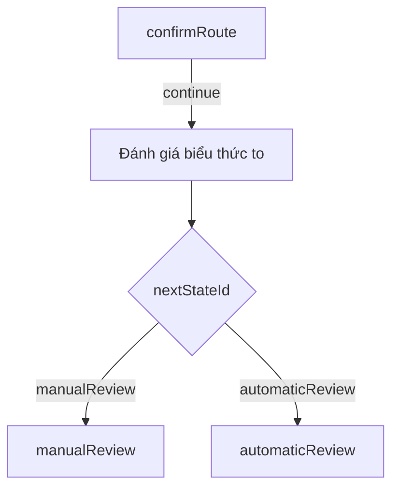

# State đích tĩnh và đích được xác định bằng biểu thức

## 1. Vai trò của state đích trong transition

Trong Spring Web Flow (SWF), **state** biểu diễn một bước của hành trình; **transition** xác định bước tiếp theo khi flow nhận event phù hợp. Ví dụ quy trình đặt lịch:

```text
enterDetails --submit--> review
review       --confirm-> completed
review       --revise--> enterDetails
review       --cancel--> cancelled
```

Hai thuộc tính quan trọng của transition:

- `on`: event ID kích hoạt transition.
- `to`: state ID mà flow sẽ đi tới sau khi transition được thực hiện.

Ví dụ:

```xml
<view-state id="enterDetails" view="booking/details">
    <transition on="submit" to="review" />
</view-state>
```

Event `submit` đưa execution từ state `enterDetails` tới state `review`. Ở đây, `review` là một chuỗi cố định đã được khai báo trong flow definition.

Nhiều quy trình có đường đi cố định, nhưng cũng có quy trình phải chọn bước tiếp theo theo dữ liệu hoặc kết quả xử lý tại thời điểm chạy. Spring Web Flow hỗ trợ **đích tĩnh** và **đích được xác định bằng biểu thức**.

## 2. Đích tĩnh: khai báo trực tiếp state ID

Đích tĩnh là tên state được ghi trực tiếp trong thuộc tính `to`:

```xml
<view-state id="enterDetails" view="booking/details">
    <transition on="submit" to="review" />
    <transition on="cancel" to="cancelled" />
</view-state>

<view-state id="review" view="booking/review">
    <transition on="confirm" to="completed" />
    <transition on="revise" to="enterDetails" />
</view-state>

<end-state id="completed" />
<end-state id="cancelled" />
```

Flow này thể hiện rõ các đường đi. Khi người dùng submit thông tin, flow chuyển sang review; khi xác nhận, flow kết thúc ở completed; khi sửa, flow quay lại enterDetails.

### 2.1. Khi nào nên dùng đích tĩnh?

Đích tĩnh phù hợp khi:

- Quy tắc điều hướng đã biết trước và ít thay đổi.
- Mỗi event có một state đích rõ ràng.
- Các nhánh hữu hạn, dễ liệt kê trong XML.
- Người đọc cần hiểu toàn bộ đường đi mà không phải lần theo biểu thức hoặc code Java.

Ví dụ đăng ký luôn đi qua thông tin cá nhân, xác minh email và hoàn tất. Không cần biểu thức động nếu thứ tự các bước không phụ thuộc dữ liệu runtime.

### 2.2. State ID phải tồn tại trong flow

Giá trị `to="review"` tham chiếu một state ID trong **cùng flow definition**. Nó không phải tên JSP, URL controller, flow ID khác hoặc tên state sẽ được tạo tự động khi request tới.

Nếu flow không có state tương ứng, quá trình build hoặc thực thi sẽ báo lỗi tùy thời điểm phát hiện. State ID phải nhất quán và duy nhất trong phạm vi flow chứa nó.

### 2.3. Event và target là hai khái niệm riêng

Một state có thể có nhiều transition:

```xml
<view-state id="review" view="booking/review">
    <transition on="confirm" to="completed" />
    <transition on="revise" to="enterDetails" />
    <transition on="cancel" to="cancelled" />
</view-state>
```

`confirm`, `revise` và `cancel` là event ID; `completed`, `enterDetails` và `cancelled` là state ID. Tên event không cần trùng tên state đích.

**Event được gửi từ view; flow definition quyết định state đích.**

## 3. Đích động: biểu thức trả về state ID khi chạy

Khi target phụ thuộc dữ liệu runtime, thuộc tính `to` có thể dùng một template expression. Với Spring EL mặc định, khối biểu thức được đặt trong `#{...}`:

```xml
<view-state id="confirmRoute" view="routing/confirm">
    <transition on="continue"
                to="#{flowScope.nextStateId}" />
</view-state>
```

Khi event `continue` được xử lý, Web Flow đánh giá biểu thức `flowScope.nextStateId`. Kết quả phải là **state ID hợp lệ** trong flow hiện tại.

Ví dụ:

| Giá trị runtime của nextStateId | State đích |
| --- | --- |
| `manualReview` | `manualReview` |
| `automaticReview` | `automaticReview` |



Khác với đích tĩnh, flow không cần khai báo một transition riêng trong state nguồn cho từng target. **Biểu thức chọn target ID tại thời điểm thực thi transition.**

### 3.1. So sánh literal và expression

| Khai báo | Ý nghĩa |
| --- | --- |
| `to="review"` | Dùng literal state ID `review` |
| `to="#{flowScope.nextStateId}"` | Đánh giá biểu thức rồi dùng kết quả làm state ID |
| `to="flowScope.nextStateId"` | Chuỗi literal, không tự đọc biến |
| `to="#{flowScope.priority ? 'priorityReview' : 'standardReview'}"` | Chọn một trong hai state ID bằng biểu thức điều kiện |

Không bỏ dấu phân cách `#{...}` rồi mong Web Flow tự hiểu tên biến. Cú pháp biểu thức còn phụ thuộc expression parser được cấu hình; Spring EL là mặc định và được khuyến nghị trong tài liệu hiện hành.

### 3.2. Các dạng biểu thức thường dùng

```xml
<!-- Đọc state ID đã được tính và lưu trong flow scope. -->
<transition on="continue"
            to="#{flowScope.nextStateId}" />

<!-- Chọn một trong hai state ID bằng toán tử điều kiện. -->
<transition on="continue"
            to="#{flowScope.priority ? 'priorityReview' : 'standardReview'}" />

<!-- Gọi phương thức chỉ tính toán target từ ngữ cảnh hiện tại. -->
<transition on="continue"
            to="#{routingPolicy.targetFor(flowScope.caseType)}" />
```

Nên giữ biểu thức ngắn, dễ đọc và có kết quả xác định. Nếu cần truy vấn dữ liệu, kiểm tra nhiều điều kiện hoặc xử lý nghiệp vụ, hãy chuẩn bị kết quả trong service/action trước rồi để `to` chỉ đọc state ID đã được kiểm tra.

## 4. Ví dụ: định tuyến hồ sơ sang duyệt thủ công hoặc tự động

Một ứng dụng tiếp nhận hồ sơ có hai đường xử lý:

- Hồ sơ cần kiểm tra tài liệu đi đến `manualReview`.
- Hồ sơ thông thường đi đến `automaticReview`.

Hai state đích đều được khai báo trong flow. Dữ liệu loại hồ sơ được truyền vào khi launch; service chính sách ánh xạ loại hồ sơ sang một state ID hợp lệ.

### 4.1. Flow XML

```xml
<?xml version="1.0" encoding="UTF-8"?>
<flow xmlns="http://www.springframework.org/schema/webflow"
      xmlns:xsi="http://www.w3.org/2001/XMLSchema-instance"
      xsi:schemaLocation="
          http://www.springframework.org/schema/webflow
          https://www.springframework.org/schema/webflow/spring-webflow.xsd">

    <input name="caseType" required="true" />

    <on-start>
        <evaluate
            expression="routingPolicy.targetFor(caseType)"
            result="flowScope.nextStateId" />
    </on-start>

    <view-state id="confirmRoute"
                view="case/confirm-route">
        <transition on="continue"
                    to="#{flowScope.nextStateId}" />
        <transition on="cancel"
                    to="cancelled" />
    </view-state>

    <view-state id="automaticReview"
                view="case/automatic-review">
        <transition on="complete" to="completed" />
    </view-state>

    <view-state id="manualReview"
                view="case/manual-review">
        <transition on="complete" to="completed" />
    </view-state>

    <end-state id="completed" />
    <end-state id="cancelled" />
</flow>
```

Ví dụ giả định ứng dụng đã đăng ký bean `routingPolicy`, flow registry, view resolver và các view cần thiết. Phương thức `targetFor(caseType)` chỉ được trả về `automaticReview` hoặc `manualReview` sau khi áp dụng chính sách hợp lệ.

### 4.2. Service chính sách

```java
public class RoutingPolicy {

    public String targetFor(String caseType) {
        return switch (caseType) {
            case "STANDARD" -> "automaticReview";
            case "HIGH_RISK", "REQUIRES_DOCUMENT_CHECK" ->
                "manualReview";
            default -> throw new IllegalArgumentException(
                "Unsupported case type"
            );
        };
    }
}
```

Đây là ví dụ minh họa. Ứng dụng thật cần quyết định cách xử lý input không hợp lệ bằng validation hoặc nhánh lỗi phù hợp. Service không nên trả một state ID tùy ý từ request; nó phải ánh xạ dữ liệu đầu vào sang **tập target được cho phép**.

### 4.3. Dòng thực thi

1. Flow nhận input `caseType` khi launch.
2. `on-start` gọi `routingPolicy.targetFor(caseType)`.
3. Kết quả được lưu vào `flowScope.nextStateId`.
4. Flow hiển thị `confirmRoute`.
5. Khi người dùng gửi event `continue`, biểu thức trong `to` được đánh giá.
6. Execution đi tới `manualReview` hoặc `automaticReview`.

Tính target trong `on-start` có nghĩa chính sách được đánh giá một lần cho lần chạy đó. Nếu nghiệp vụ cần tính lại tại thời điểm người dùng bấm Continue, hãy dùng dữ liệu hiện hành hoặc một phương thức resolver thuần. Xác định rõ **thời điểm quyết định** để tránh dùng kết quả cũ.

### 4.4. Biểu thức điều kiện trực tiếp

Nếu quy tắc chỉ có một điều kiện đơn giản, có thể viết:

```xml
<transition on="continue"
            to="#{flowScope.caseType == 'HIGH_RISK' ? 'manualReview' : 'automaticReview'}" />
```

Biểu thức này đưa mọi giá trị khác `HIGH_RISK` tới `automaticReview`. Nếu input có thể chứa giá trị lạ, cách viết đó có thể che giấu lỗi dữ liệu bằng cách chọn nhánh mặc định. Với quy trình quan trọng, hãy validate rõ ràng hoặc dùng service phân loại có allowlist.

## 5. Đích động khác gì decision-state?

Spring Web Flow cung cấp `decision-state` để mô tả rẽ nhánh bằng điều kiện `if/else`. Đây thường là lựa chọn rõ ràng khi có số nhánh hữu hạn:

```xml
<decision-state id="chooseReview">
    <if test="flowScope.caseType == 'HIGH_RISK'"
        then="manualReview"
        else="automaticReview" />
</decision-state>
```

Khi flow đi vào `chooseReview`, điều kiện được đánh giá; nhánh `then` hoặc `else` chọn một state đích tĩnh.

### 5.1. So sánh ba cách định tuyến

| Cách | Cơ chế | Phù hợp khi |
| --- | --- | --- |
| Transition đích tĩnh | `<transition on="submit" to="review" />` | Đường đi đã biết trước |
| Transition đích động | `to="#{flowScope.nextStateId}"` | Target ID được tính từ dữ liệu runtime |
| Decision-state | `<if test="..." then="..." else="..." />` | Rẽ nhánh theo điều kiện với các đích hữu hạn |

### 5.2. Khi nào nên chọn decision-state?

Nếu chỉ có hai trường hợp, decision-state thường dễ đọc hơn việc lưu chuỗi state ID rồi dùng biểu thức trong `to`:

```xml
<decision-state id="checkAge">
    <if test="flowScope.age >= 18"
        then="adultReview"
        else="guardianReview" />
</decision-state>
```

### 5.3. Khi nào nên chọn action-state?

Nếu logic phân loại nằm trong service Java và trả về một kết quả nghiệp vụ, có thể dùng action-state rồi ánh xạ kết quả sang các transition tĩnh:

```xml
<action-state id="classifyCase">
    <evaluate expression="caseClassifier.classify(flowScope.caseData)" />
    <transition on="manual" to="manualReview" />
    <transition on="automatic" to="automaticReview" />
    <transition on="invalid" to="invalidCase" />
</action-state>
```

Khi action trả về chuỗi, Web Flow có thể ánh xạ giá trị đó thành event ID. Các transition của action-state sau đó ánh xạ event tới target tĩnh. Cách này hữu ích khi flow muốn thể hiện tường minh mọi kết quả có thể có.

### 5.4. Khi nào đích động thực sự có ích?

Đích động hữu ích khi:

- Nhiều ngữ cảnh runtime cần chọn target theo cùng một chính sách.
- Target ID được quyết định từ cấu hình hoặc dữ liệu đã được kiểm tra.
- Một bước điều phối cần trả về state ID trong tập state hợp lệ.
- Việc tính target thay đổi theo ngữ cảnh nhưng các state đích vẫn được khai báo trong flow.

Không nên dùng đích động chỉ để rút ngắn vài dòng XML. Nếu các nhánh cố định và có ý nghĩa rõ ràng, transition tĩnh hoặc decision-state dễ đọc, dễ kiểm tra hơn.

## 6. Biểu thức trong thuộc tính to và Expression Language

Spring Web Flow dùng Expression Language (EL) để truy cập flow data và gọi phương thức.

### 6.1. Standard expression

Standard expression được đánh giá trực tiếp:

```xml
<evaluate expression="searchCriteria.nextPage()" />
```

Nó không cần dấu phân cách `#{...}` trong thuộc tính `expression`. Không thêm delimiter vào một standard expression nếu ngữ cảnh không yêu cầu.

### 6.2. Template expression

Template expression cho phép kết hợp văn bản literal với một hay nhiều standard expression. Mỗi khối biểu thức được đặt trong `#{...}`:

```xml
<view-state id="error"
            view="error-#{externalContext.locale}.xhtml" />
```

Với target động, thuộc tính `to` có thể dùng biểu thức trả về state ID:

```xml
<transition on="continue"
            to="#{flowScope.nextStateId}" />
```

Spring EL là parser mặc định và được khuyến nghị trong tài liệu Web Flow hiện hành. Ứng dụng có thể cấu hình Unified EL; cú pháp và cách phân tích biểu thức khi nâng cấp giữa các parser có khác biệt. Hãy kiểm tra `flow-builder-services` và expression parser của dự án trước khi đổi delimiter.

### 6.3. Dữ liệu nào có thể dùng trong biểu thức?

Biểu thức có thể tham chiếu biến và bean mà flow expression context cho phép, ví dụ:

- `flowScope.nextStateId`: target ID đã lưu trong flow scope.
- `flowScope.caseType`: loại hồ sơ của flow.
- `routingPolicy.targetFor(...)`: phương thức bean dùng để tính target.
- `currentEvent.id`: event hiện tại nếu chính sách điều hướng cần xét event.

Nên giữ biểu thức ngắn và dễ kiểm tra. Nếu phải truy vấn nhiều nguồn dữ liệu hoặc xử lý nghiệp vụ, hãy gọi service/action ở điểm phù hợp rồi lưu kết quả.

## 7. Target động không tạo state mới

**Biểu thức chỉ chọn một state đã tồn tại trong flow definition.** Nó không tạo thêm state, không tải một flow XML tùy ý và không tự chuyển sang flow definition khác.

Ví dụ:

```xml
<view-state id="manualReview" view="case/manual-review" />
<view-state id="automaticReview" view="case/automatic-review" />
```

Biểu thức trả `manualReview` hoặc `automaticReview` có thể phân giải tới hai state đó. Nếu trả `paymentFlow` nhưng flow hiện tại không có state ID `paymentFlow`, việc phân giải target sẽ thất bại.

### 7.1. State ID có phạm vi cục bộ

State ID là định danh trong flow chứa state. Một flow khác có state cùng tên `review` không khiến target expression tự động chuyển sang flow kia.

Nếu cần gọi flow definition khác, hãy khai báo `<subflow-state>` và truyền input/output theo hợp đồng subflow:

```xml
<subflow-state id="payment" subflow="paymentFlow">
    <input name="orderId" value="flowScope.orderId" />
    <transition on="paid" to="completed" />
    <transition on="cancelled" to="review" />
</subflow-state>
```

Không dùng target động như một cách thay thế cơ chế gọi subflow.

### 7.2. Target null, rỗng hoặc không tồn tại

Biểu thức target cần trả về state ID hợp lệ. Những trường hợp cần xử lý:

- Giá trị null hoặc chuỗi rỗng.
- Giá trị không nằm trong tập target được phép.
- Sai chữ hoa/chữ thường hoặc sai chính tả.
- State đã đổi tên nhưng service vẫn trả tên cũ.
- Dữ liệu runtime không đủ để xác định đường đi.

Tùy implementation, lỗi có thể xuất hiện khi build/resolve hoặc khi transition được thực hiện. Không nên dựa vào một mã HTTP cố định; hãy xử lý exception theo cấu hình và cung cấp thông báo phù hợp.

## 8. Bảo mật khi dùng target động

Target expression là một phần của flow routing. Nếu target ID lấy trực tiếp từ request, người dùng có thể thử gửi một giá trị khác với lựa chọn trên giao diện.

Ví dụ rủi ro:

```xml
<!-- Không dùng trực tiếp dữ liệu client làm state ID. -->
<transition on="continue"
            to="#{requestParameters.nextState}" />
```

Nếu client gửi `nextState=adminApproval` và flow có state tương ứng, request có thể cố điều hướng tới state đó. Việc state tồn tại không chứng minh người dùng có quyền đi vào nó.

### 8.1. Ánh xạ qua allowlist

Thay vì dùng raw request value:

```java
public String targetFor(String requestedType) {
    return switch (requestedType) {
        case "STANDARD" -> "automaticReview";
        case "HIGH_RISK" -> "manualReview";
        default -> throw new IllegalArgumentException(
            "Unsupported case type"
        );
    };
}
```

Service chỉ trả target ID đã được định nghĩa trước. Với nghiệp vụ có quyền truy cập khác nhau, cần kiểm tra authorization độc lập ở service hoặc flow security rule.

### 8.2. Target state không phải cơ chế phân quyền

Việc người dùng đi tới `manualReview` hay `automaticReview` chỉ mô tả điều hướng. Nó không thay thế:

- Xác thực danh tính người dùng.
- Kiểm tra vai trò/quyền được phép thực hiện thao tác.
- Kiểm tra chủ sở hữu hồ sơ hoặc đơn hàng.
- Kiểm tra điều kiện nghiệp vụ trước khi cập nhật database.

Event có thể được gửi trực tiếp bằng HTTP request; người dùng không nhất thiết phải bấm nút đúng trên giao diện. Mỗi action nhạy cảm phải kiểm tra quyền ở phía server.

### 8.3. Tránh side effect trong biểu thức target

Không nên gọi phương thức tạo đơn hàng, gửi thanh toán, gửi email hoặc cập nhật dữ liệu trong biểu thức target. Logic điều hướng nên có tính xác định và không gây tác dụng phụ.

Hãy dùng biểu thức để **đọc hoặc tính target**. Thực hiện side effect trong action/service được đặt tại state hoặc transition có chủ đích, với transaction và idempotency phù hợp.

## 9. Lỗi thường gặp khi dùng state đích động

| Hiện tượng | Nguyên nhân có thể | Cách xử lý |
| --- | --- | --- |
| Flow không hiểu tên biến trong to | Viết tên biến như literal, thiếu delimiter | Dùng template expression đúng parser |
| Target không được tìm thấy | Biểu thức trả ID không tồn tại trong flow | Kiểm tra state ID và giá trị runtime |
| Chạy nhầm nhánh mặc định | Điều kiện không bao quát input không hợp lệ | Validate input, không để giá trị lạ rơi vào nhánh mặc định |
| Lỗi sau khi đổi expression parser | Khác biệt cú pháp Spring EL và Unified EL | Kiểm tra parser và delimiter |
| Target vẫn là giá trị cũ | Tính target quá sớm hoặc không cập nhật khi ngữ cảnh đổi | Xác định thời điểm quyết định và tính lại khi cần |
| Điều hướng vượt bước | Client có thể kiểm soát target ID | Ánh xạ qua allowlist, kiểm tra authorization |
| Biểu thức khó đọc | Nhồi nhiều điều kiện/lời gọi method vào thuộc tính to | Tách logic sang service/action hoặc decision-state |
| Cố gọi flow khác bằng to | Nhầm state ID với flow ID | Dùng subflow-state |
| Service bị gọi nhiều lần | Biểu thức target có side effect | Giữ biểu thức thuần, chuyển side effect sang action |
| Chỉ lỗi lúc chạy | Giá trị target chỉ xác định ở runtime | Viết test cho từng nhánh và target không hợp lệ |

### 9.1. Quy trình debug

Khi transition không đến đúng state:

1. Xác nhận request gửi đúng event ID.
2. Xác nhận transition được khai báo trong state hiện tại.
3. Kiểm tra thuộc tính `to` đang là literal hay expression.
4. Ghi nhận giá trị expression sau khi đánh giá, không ghi dữ liệu nhạy cảm.
5. Đối chiếu target ID với state trong flow hiện tại.
6. Kiểm tra expression parser và cú pháp delimiter.
7. Nếu target đến từ service, kiểm tra allowlist và input không hợp lệ.
8. Xác nhận action nghiệp vụ chỉ chạy ở state/transition dự kiến.

Phân biệt lỗi **event không khớp**, **expression không đánh giá được**, **target không tồn tại** và **service từ chối nghiệp vụ**. Chúng có nguyên nhân và hướng sửa khác nhau.

## 10. Kiểm thử target tĩnh và target động

Kiểm thử flow nên xác minh **state hiện tại sau event**, không chỉ kiểm tra HTTP request trả status 200.

### 10.1. Ma trận kiểm thử

| Ca thử | Cấu hình/đầu vào | Kết quả mong đợi |
| --- | --- | --- |
| Target tĩnh | `on="submit" to="review"` | Event submit đi tới review |
| Target động nhánh thủ công | `nextStateId=manualReview` | Event continue đi tới manualReview |
| Target động nhánh tự động | `nextStateId=automaticReview` | Event continue đi tới automaticReview |
| Target expression điều kiện | caseType là HIGH_RISK | Chọn manualReview |
| Input không hỗ trợ | caseType ngoài allowlist | Từ chối hoặc đi nhánh lỗi rõ ràng |
| Target rỗng | nextStateId null/rỗng | Không đi nhầm state; lỗi được xử lý |
| Target không tồn tại | nextStateId là ID chưa khai báo | Phát hiện lỗi target resolution |
| Event không đúng | Gửi event chưa khai báo | Không đi qua transition khác ngoài ý muốn |
| Quyền không đủ | Người dùng không có quyền xử lý hồ sơ | Bị chặn dù target ID hợp lệ |
| Service lỗi | Service phân loại ném exception | Xử lý theo exception policy |
| Flow khác có state cùng tên | Target ID trùng ở flow khác nhưng không có trong flow hiện tại | Không tự chuyển sang flow kia |

### 10.2. Pseudocode kiểm thử

```text
startFlow("caseRouting", input = { caseType: "HIGH_RISK" })
assertCurrentState("confirmRoute")

signalEvent("continue")
assertCurrentState("manualReview")

startFlow("caseRouting", input = { caseType: "STANDARD" })
signalEvent("continue")
assertCurrentState("automaticReview")
```

Đây là pseudocode mô tả ý tưởng kiểm thử, không phải API có thể chạy nguyên văn. Dùng test support của phiên bản Spring Web Flow trong dự án, đăng ký bean phụ thuộc và xác minh state thực tế sau mỗi event.

### 10.3. Kiểm thử target tĩnh

Với flow tĩnh, test cần xác minh:

- Event khớp đúng transition.
- State đích đúng như khai báo.
- Event khác không vô tình kích hoạt cùng transition.
- Action nằm trong transition chỉ chạy khi event đó được gửi.

### 10.4. Kiểm thử target động

Với target expression, bổ sung:

- Mỗi giá trị runtime hợp lệ trả về đúng state ID.
- Giá trị không hợp lệ không thể chọn state ngoài allowlist.
- Null/empty/unknown target được xử lý có kiểm soát.
- Thay đổi dữ liệu trước thời điểm transition có ảnh hưởng đúng theo chính sách.
- Không có side effect bị gọi chỉ vì expression được đánh giá.

Nếu flow có nhiều state đích, hãy kiểm thử từng nhánh độc lập để tránh trường hợp một nhánh chạy đúng còn nhánh khác sai tên state.

## 11. Bài tập thực hành

### Bài 1 — Đọc transition tĩnh

Cho:

```xml
<view-state id="enterDetails">
    <transition on="submit" to="review" />
</view-state>
```

**Câu hỏi:** đâu là event, đâu là target?

**Đáp án:** `submit` là event ID; `review` là state ID đích tĩnh.

### Bài 2 — Chuyển sang target động

Flow có hai state `manualReview` và `automaticReview`. Biến `flowScope.nextStateId` chứa một trong hai ID. Hãy khai báo transition:

```xml
<transition on="continue"
            to="#{flowScope.nextStateId}" />
```

**Giải thích:** biểu thức được đánh giá khi transition chạy và kết quả được dùng làm target state ID.

### Bài 3 — Chọn decision-state hay target expression

Một flow chỉ có hai nhánh dựa trên điều kiện `age >= 18`.

**Gợi ý:** dùng decision-state để thể hiện rõ hai đích tĩnh:

```xml
<decision-state id="checkAge">
    <if test="flowScope.age >= 18"
        then="adultReview"
        else="guardianReview" />
</decision-state>
```

Đây là lựa chọn dễ đọc hơn khi chỉ có một điều kiện và hai đích đã biết.

### Bài 4 — Phát hiện lỗ hổng định tuyến

Một flow dùng:

```xml
<transition on="continue"
            to="#{requestParameters.nextState}" />
```

**Câu hỏi:** vì sao thiết kế này rủi ro?

**Đáp án:** client có thể tự gửi giá trị target. Nếu flow có state nhạy cảm, việc điều hướng có thể bỏ qua bước kiểm tra dự kiến. Hãy xác thực input và ánh xạ qua allowlist ở service; kiểm tra quyền ở action/service trước khi cho phép thao tác.

### Bài 5 — Xử lý target không hợp lệ

Service có thể trả `manualReview`, `automaticReview` hoặc null. Hãy đề xuất cách xử lý null.

**Gợi ý:** không để null trở thành target. Kiểm tra kết quả ở service/action trước khi transition, đưa vào state lỗi có chủ đích hoặc ném exception nghiệp vụ được xử lý theo chính sách. Bổ sung test cho trường hợp null.

### Bài 6 — Chọn action-state hay target động

Một phương thức phân loại trả về `manual`, `automatic` hoặc `rejected`. Flow có ba state đích tương ứng.

**Gợi ý:** action-state với ba transition tĩnh thường rõ ràng:

```xml
<action-state id="classify">
    <evaluate expression="caseClassifier.classify(flowScope.caseData)" />
    <transition on="manual" to="manualReview" />
    <transition on="automatic" to="automaticReview" />
    <transition on="rejected" to="rejected" />
</action-state>
```

## 12. Ghi nhớ

- `on` chọn **event kích hoạt**; `to` chọn **state đích**.
- Đích tĩnh là literal state ID, ví dụ `to="review"`.
- Đích động dùng biểu thức để trả về state ID lúc chạy, ví dụ `to="#{flowScope.nextStateId}"` với Spring EL mặc định.
- Biểu thức chỉ chọn state đã khai báo trong **flow hiện tại**; nó không tạo state mới hoặc thay thế `subflow-state`.
- Với rẽ nhánh hữu hạn, `decision-state` hoặc `action-state` với các transition đích tĩnh thường dễ đọc và dễ kiểm thử hơn.
- Target expression nên ngắn, xác định và không có side effect. Logic nghiệp vụ phức tạp nên đặt trong service/action.
- Không lấy raw target ID từ request. Hãy ánh xạ qua allowlist, xác minh target tồn tại và kiểm tra quyền độc lập.
- Kiểm thử target hợp lệ, target null/unknown, event sai, service lỗi và quyền truy cập.

## Tài liệu tham khảo

- Spring Web Flow 3.0 Reference Guide — Expression Language, Standard Expressions và Template Expressions: https://docs.spring.io/spring-webflow/docs/3.0.x/reference/
- Spring Web Flow 3.0.1 API — TransitionDefinition.getTargetStateId(): https://docs.spring.io/spring-webflow/docs/3.0.1/api/org/springframework/webflow/definition/TransitionDefinition.html
- Spring Web Flow 3.0.1 API — DefaultTargetStateResolver: https://docs.spring.io/spring-webflow/docs/3.0.1/api/org/springframework/webflow/engine/support/DefaultTargetStateResolver.html
- Spring Web Flow 3.0.1 API — TargetStateResolver: https://docs.spring.io/spring-webflow/docs/3.0.1/api/org/springframework/webflow/engine/TargetStateResolver.html
