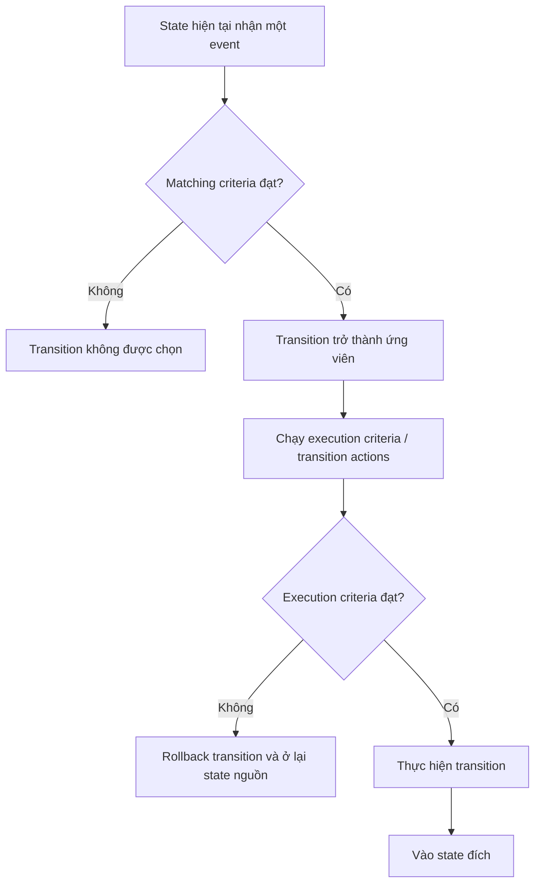

# Điều kiện khớp và điều kiện cho phép thực hiện transition trong Spring Web Flow

Trong **Spring Web Flow** (`SPRING_WEB_FLOW`), một transition là đường đi từ state hiện tại đến state đích. Transition không chỉ trả lời câu hỏi “event nào có thể chọn đường đi này?” mà còn phải trả lời “sau khi đã chọn, có được phép hoàn tất đường đi không?”. Hai câu hỏi đó tương ứng với **matching criteria** (điều kiện khớp) và **execution criteria** (điều kiện thực hiện).

Phân biệt hai điều kiện giúp xử lý chính xác các tình huống như người dùng gửi event `confirm` nhưng nghiệp vụ chưa cho phép xác nhận, service từ chối đặt phòng, một exception cần chuyển tới màn hình xử lý, hoặc một event bất kỳ cần được giữ lại để ghi log. Bài thuộc chương **Event và transition** sẽ giải thích cách Web Flow tìm transition, cách một action có thể chặn transition đã khớp, cách cấu hình XML và cách kiểm thử từng nhánh.

## 1. Hai câu hỏi khác nhau trong một transition

Giả sử flow đặt phòng có state `reviewBooking`. Khi người dùng bấm **Xác nhận**, giao diện phát event `confirm`. Flow có một transition:

```xml
<view-state id="reviewBooking" view="booking/review">
    <transition on="confirm" to="bookingConfirmed" />
</view-state>
```

Có hai việc xảy ra về mặt logic:

1. **Khớp:** event hiện tại có phải `confirm` hay không? Nếu có, transition này trở thành ứng viên.
2. **Cho phép thực hiện:** các action/điều kiện thực thi của transition có chấp nhận thao tác không? Nếu có, flow rời `reviewBooking` và vào `bookingConfirmed`; nếu không, transition bị rollback và flow ở lại state nguồn.



Hai điều kiện này độc lập. Một event có thể khớp transition nhưng nghiệp vụ vẫn từ chối thực hiện. Ngược lại, một action guard trả về `true` cũng không thể làm transition chạy nếu event không khớp transition đó.

## 2. Matching criteria: event nào chọn transition?

**Matching criteria** xác định transition có phù hợp với event được phát ra từ state hiện tại hay không. Trong flow XML, thuộc tính `on` là cách khai báo phổ biến nhất.

Ví dụ:

```xml
<view-state id="editBooking" view="booking/edit">
    <transition on="continue" to="reviewBooking" />
    <transition on="cancel" to="bookingCancelled" />
</view-state>
```

Nếu event ID hiện tại là `continue`, transition đầu khớp. Nếu event ID là `cancel`, transition thứ hai khớp. Nếu event là `saveDraft` và state không có transition nào phù hợp, Web Flow không tự đoán state đích.

Event ID thường đến từ nút, link hoặc action của view. Ví dụ HTML có thể gửi `_eventId_continue` để phát event `continue`. Tên event cần thống nhất giữa view, action và thuộc tính `on`.

| Event được phát | Transition có `on` | Có khớp? |
| --- | --- | --- |
| `continue` | `on="continue"` | Có |
| `cancel` | `on="continue"` | Không |
| `confirm` | `on="confirm"` | Có |
| `Confirm` | `on="confirm"` | Không nên giả định là cùng ID |
| `saveDraft` | `on="continue"` | Không |

Hãy xem event ID là hợp đồng giữa view/action và flow definition. Khi điều tra transition không chạy, ghi nhận **event thực tế** từ request hoặc `RequestContext.getCurrentEvent()` rồi đối chiếu với `on`.

## 3. Khớp mọi event bằng wildcard

Có trường hợp một state cần xử lý event không quan trọng đến việc điều hướng, ví dụ ghi log, hiển thị thông báo chung hoặc đưa người dùng về bước an toàn. Có thể dùng wildcard:

```xml
<view-state id="reviewBooking" view="booking/review">
    <transition on="confirm" to="bookingConfirmed" />
    <transition on="*" to="reviewBooking" />
</view-state>
```

`on="*"` là matching criteria luôn khớp với mọi event ID. Wildcard thường được dùng như nhánh dự phòng khi không có event cụ thể nào được xử lý.

Không nên dùng wildcard như một lối thoát để che lỗi cấu hình. Nếu mọi event đều bị đưa về cùng một state, event gõ sai cũng có thể bị xử lý như event hợp lệ. Hãy chỉ dùng wildcard khi thật sự có chính sách chung cho các event còn lại.

Nếu một state có cả transition cụ thể và wildcard, hãy kiểm thử để xác nhận event cụ thể được xử lý theo ý định và wildcard không nuốt mất nhánh nghiệp vụ. Tránh thiết kế các transition có điều kiện khớp chồng lấn mà không có quy tắc lựa chọn rõ ràng.

## 4. Transition không khai báo on

Trong Flow Definition Language, transition có thể được cấu hình mà không khai báo `on`. Khi đó transition không giới hạn vào một event ID cụ thể và có thể khớp bất kể event nào xảy ra trong state nguồn.

Ví dụ minh họa:

```xml
<view-state id="showNotice" view="notice">
    <transition to="finish" />
</view-state>
```

Cách viết này chỉ nên dùng khi mọi event tại state đều phải dẫn tới cùng một kết quả. Với form có nhiều nút như `continue`, `back` và `cancel`, nên khai báo event tường minh để tránh mọi thao tác vô tình đi cùng một đường.

Nếu mục tiêu là một transition dự phòng, `on="*"` diễn đạt ý định rõ ràng hơn trong flow definition. Trong code review, hãy hỏi liệu transition không có `on` có thực sự cần áp dụng cho mọi event không.

## 5. Khớp theo exception bằng on-exception

Transition cũng có thể được kích hoạt khi một exception cụ thể xuất hiện trong quá trình xử lý state. Dùng thuộc tính `on-exception` với tên đầy đủ của class exception.

Ví dụ service tra cứu khách hàng ném `CustomerNotFoundException`:

```xml
<action-state id="lookupCustomer">
    <evaluate expression="customerService.findByPhone(flowScope.phone)"
              result="flowScope.customer" />

    <transition on-exception="com.example.customer.CustomerNotFoundException"
                to="registerCustomer" />

    <transition on="success" to="reviewCustomer" />
</action-state>
```

Trong trường hợp exception khớp với kiểu được khai báo, transition xử lý exception có thể dẫn flow sang `registerCustomer`. Đây là **matching theo exception**, khác với matching theo event ID.

Một số điểm cần kiểm tra:

- Tên class trong `on-exception` phải đúng package và class đang được ném.
- Xác định exception thực tế trong chuỗi `Caused by`; service có thể bọc exception gốc trong một exception khác.
- Chỉ dùng nhánh exception cho tình huống có cách phục hồi phù hợp.
- Không biến mọi exception kỹ thuật thành một màn hình nghiệp vụ chung nếu ứng dụng cần ghi log, rollback hoặc báo lỗi hạ tầng riêng.

Ví dụ này chỉ minh họa matching theo exception. Nếu muốn dùng exception handler cấp flow hoặc handler tùy chỉnh, cần cấu hình theo cơ chế exception handling riêng của Web Flow.

## 6. Global transitions: một matching rule dùng chung nhiều view-state

Nếu nhiều view-state cùng có event `cancel` dẫn đến một end-state, có thể khai báo global transition:

```xml
<flow xmlns="http://www.springframework.org/schema/webflow"
      xmlns:xsi="http://www.w3.org/2001/XMLSchema-instance"
      xsi:schemaLocation="
          http://www.springframework.org/schema/webflow
          http://www.springframework.org/schema/webflow/spring-webflow.xsd">

    <global-transitions>
        <transition on="cancel" to="bookingCancelled" />
    </global-transitions>

    <view-state id="enterBooking" view="booking/enter">
        <transition on="continue" to="reviewBooking" />
    </view-state>

    <view-state id="reviewBooking" view="booking/review">
        <transition on="confirm" to="bookingConfirmed" />
        <transition on="revise" to="enterBooking" />
    </view-state>

    <end-state id="bookingConfirmed" />
    <end-state id="bookingCancelled" />
</flow>
```

Global transition được áp dụng cho các view-state trong flow theo cơ chế tích hợp của Web Flow. Nó giúp tránh lặp cùng một matching rule trong nhiều state.

Cần xác nhận event dùng chung thực sự có cùng ý nghĩa ở tất cả view-state. Nếu nút `cancel` ở một màn hình cần lưu draft, còn ở màn hình khác cần hủy toàn bộ booking, hãy dùng event riêng hoặc transition cục bộ để tránh áp dụng nhầm hành vi.

## 7. Execution criteria: transition đã khớp có được phép hoàn tất?

**Execution criteria** là điều kiện quyết định một transition đã khớp có được phép hoàn tất hay phải rollback. API `Transition` của Spring Web Flow phân biệt rõ:

- `getMatchingCriteria()` trả về điều kiện xác định transition có khớp event hay không.
- `getExecutionCriteria()` trả về điều kiện xác định transition đã khớp có được hoàn tất hay rollback.
- `matches(RequestContext)` kiểm tra khả năng khớp.
- `canExecute(RequestContext)` kiểm tra transition có thể hoàn tất hay phải rollback.

Nếu execution criteria không đạt, flow không đi vào state đích. Với view-state, hành vi thường thấy là render lại view hiện tại để người dùng xử lý thông báo hoặc sửa dữ liệu.

Trong Flow XML, cách thường dùng để kiểm soát điều kiện thực hiện là đặt **transition actions** bên trong phần tử `<transition>`. Action có thể kiểm tra quyền, trạng thái nghiệp vụ hoặc kết quả gọi service trước khi flow rời state.

Ví dụ:

```xml
<view-state id="reviewBooking" view="booking/review">
    <transition on="confirm" to="bookingConfirmed">
        <evaluate expression="bookingGuard.canConfirm(booking, currentUser, messageContext)" />
    </transition>
</view-state>
```

Nếu `canConfirm(...)` trả về giá trị cho phép, transition hoàn tất. Nếu action trả về kết quả từ chối, flow ở lại `reviewBooking`. Nhờ vậy, event `confirm` vẫn có thể khớp đúng nhưng việc xác nhận chưa được thực hiện.

**Không nhầm execution criteria với một thuộc tính XML `if` trên transition.** Cú pháp chuẩn thường biểu đạt matching bằng `on`/`on-exception`, còn điều kiện thực hiện của view transition được thể hiện qua kết quả transition action. Phần tử `<if>` thuộc `decision-state` và có vai trò chọn state theo biểu thức điều kiện.

## 8. Dùng Boolean để cho phép hoặc ngăn transition

Một POJO method được gọi trong transition có thể trả về `boolean`:

- `true`: cho phép transition tiếp tục.
- `false`: ngăn transition rời state nguồn.

Ví dụ Java:

```java
package com.example.booking;

import org.springframework.binding.message.MessageBuilder;
import org.springframework.binding.message.MessageContext;

public class BookingGuard {

    private BookingService bookingService;

    public boolean canConfirm(
            Booking booking,
            User currentUser,
            MessageContext messages) {

        if (!bookingService.isOwnedBy(booking, currentUser)) {
            messages.addMessage(new MessageBuilder()
                    .error()
                    .defaultText("Bạn không có quyền xác nhận đặt phòng này.")
                    .build());
            return false;
        }

        if (!bookingService.isStillAvailable(booking)) {
            messages.addMessage(new MessageBuilder()
                    .error()
                    .defaultText("Phòng vừa được đặt bởi khách khác.")
                    .build());
            return false;
        }

        return true;
    }
}
```

Khai báo trong flow:

```xml
<view-state id="reviewBooking" view="booking/review">
    <transition on="confirm" to="bookingConfirmed">
        <evaluate expression="bookingGuard.canConfirm(booking, currentUser, messageContext)" />
    </transition>
</view-state>
```

Nếu đặt phòng không còn khả dụng, method thêm lỗi vào `MessageContext` và trả `false`. Flow không chuyển sang `bookingConfirmed`; view hiện tại có thể hiển thị thông báo để người dùng chọn phương án khác.

Guard nên kiểm tra điều kiện và trả kết quả. Việc tạo đặt phòng/ghi thanh toán nên nằm trong service có transaction và hợp đồng rõ ràng. Không nên thực hiện một thao tác ghi không thể hoàn tác trước khi biết transition sẽ được phép hoàn tất.

## 9. Dùng String result để cho phép hoặc ngăn transition

Với POJO action trả về `String`, Web Flow có quy ước kết quả cho transition action. Các giá trị `"success"`, `"yes"` hoặc `"true"` cho phép transition; giá trị chuỗi khác sẽ ngăn transition.

Ví dụ:

```java
public String validateConfirmation(Booking booking) {
    if (booking.getGuestName() == null
            || booking.getGuestName().isBlank()) {
        return "missingGuest";
    }

    if (!bookingService.isStillAvailable(booking)) {
        return "unavailable";
    }

    return "success";
}
```

Đoạn này minh họa quy ước cho phép/chặn của **transition action**. Nếu muốn hiển thị lỗi cụ thể cho người dùng, hãy thêm message vào `MessageContext` hoặc dùng một action wrapper phù hợp trước khi trả kết quả.

Không nhầm quy tắc String này với **action-state outcome mapping**. Trong `action-state`, String thường trở thành event ID chính xác để chọn transition, ví dụ `"unavailable"` khớp `on="unavailable"`. Trong transition action của `view-state`, kết quả được dùng như một cổng cho phép hay ngăn transition hiện tại.

## 10. Phân biệt action-state outcome với transition action guard

Hai đoạn XML dưới đây trông gần giống nhau nhưng có ý nghĩa khác:

**Trường hợp A — action-state:** method trả về kết quả để chọn transition tiếp theo.

```xml
<action-state id="checkAvailability">
    <evaluate expression="bookingService.checkAvailability(booking)" />
    <transition on="yes" to="reviewBooking" />
    <transition on="no" to="chooseAnotherRoom" />
</action-state>
```

Nếu method trả `true`, Web Flow ánh xạ thành event `yes`; nếu trả `false`, event là `no`. Event đó được matching với các transition trong action-state.

**Trường hợp B — transition action trong view-state:** method quyết định transition hiện tại có được hoàn tất không.

```xml
<view-state id="reviewBooking" view="booking/review">
    <transition on="confirm" to="bookingConfirmed">
        <evaluate expression="bookingGuard.canConfirm(booking)" />
    </transition>
</view-state>
```

Ở đây event `confirm` đã chọn transition. Kết quả của `canConfirm` đóng vai trò **execution gate**: cho phép hoặc ngăn transition đó.

| Tiêu chí | Action-state outcome | View-state transition action |
| --- | --- | --- |
| Vai trò | Chọn nhánh transition dựa trên outcome của action | Cho phép/ngăn transition đã khớp |
| Event | Outcome của action được ánh xạ thành event | Event ban đầu như `confirm`, `continue` |
| Boolean | `true → yes`, `false → no` | `true` cho phép, `false` chặn |
| String | Chuỗi là event ID | `success`/`yes`/`true` cho phép; chuỗi khác chặn |
| Khi thất bại | Có thể đi nhánh lỗi nếu khai báo transition tương ứng | Ở lại state nguồn/rollback transition |

Đây là một trong những điểm quan trọng nhất khi đọc log: nếu action-state trả event `no` thì hãy tìm transition `on="no"`; nếu transition action trả `false` thì hãy tìm lý do khiến transition không rời state nguồn.

## 11. Các transition action được chạy theo thứ tự

Một transition có thể chứa nhiều action. Web Flow chạy các action theo thứ tự khai báo. Nếu một action trả về kết quả ngăn transition, các action còn lại không được chạy.

Ví dụ:

```xml
<view-state id="reviewBooking" view="booking/review">
    <transition on="confirm" to="bookingConfirmed">
        <evaluate expression="bookingGuard.checkPermission(booking, currentUser, messageContext)" />
        <evaluate expression="bookingGuard.checkAvailability(booking, messageContext)" />
        <evaluate expression="bookingGuard.checkPrice(booking, messageContext)" />
    </transition>
</view-state>
```

Thứ tự trên có ý nghĩa:

1. Kiểm tra quyền trước.
2. Kiểm tra phòng còn khả dụng.
3. Kiểm tra giá và điều kiện cuối.

Nếu bước kiểm tra quyền trả kết quả từ chối, kiểm tra tồn kho và giá không chạy. Nếu bước kiểm tra tồn kho từ chối, bước kiểm tra giá cũng không chạy.

Chỉ đưa các kiểm tra có thể thực hiện an toàn vào chuỗi này. Nếu action đầu đã tạo giao dịch thanh toán hoặc gửi thông báo ra hệ thống ngoài, action sau có thể chặn transition nhưng không tự động hoàn tác tác dụng phụ đó. Các thao tác ghi quan trọng cần được đóng gói trong service transaction hoặc có cơ chế bù trừ.

## 12. Transition không có state đích vẫn có matching và execution criteria

Một transition từ view-state có thể không khai báo `to`. Đây là event handler: action được chạy, sau đó view hiện tại được render lại hoặc render fragment.

Ví dụ:

```xml
<view-state id="searchResults" view="search/results">
    <transition on="nextPage">
        <evaluate expression="searchCriteria.nextPage()" />
        <render fragments="resultsTable" />
    </transition>
</view-state>
```

Event `nextPage` vẫn cần khớp với `on`. Action phân trang phải thực hiện thành công để fragment được cập nhật theo ý định.

Nếu transition action chặn thực hiện, state vẫn là `searchResults` và phần render theo hành động không được hoàn tất như nhánh thành công. Vì thế, khi debug Ajax event, hãy kiểm tra cả event ID, kết quả action và danh sách fragment.

## 13. Binding và validation không phải matching criteria

Trong view-state có model, Web Flow thường thực hiện binding dữ liệu form và validation trước khi tạo event có thể điều khiển transition. Nếu binding thất bại, view được render lại để người dùng sửa.

Các thuộc tính `bind` và `validate` trên transition điều chỉnh quy trình binding/validation cho event đó:

```xml
<view-state id="editBooking"
            view="booking/edit"
            model="booking">
    <transition on="continue"
                to="reviewBooking"
                bind="true"
                validate="true" />

    <transition on="cancel"
                to="bookingCancelled"
                bind="false" />
</view-state>
```

| Thuộc tính | Tác dụng | Không có nghĩa là |
| --- | --- | --- |
| `on` | Chọn transition theo event ID | Không kiểm tra dữ liệu model |
| `bind` | Cho phép hoặc bỏ qua binding model | Không chọn event |
| `validate` | Cho phép hoặc bỏ qua model validation | Không thay thế matching criteria |
| Transition action | Kiểm tra điều kiện thực hiện transition | Không tự đổi event ID |
| `to` | Chỉ định state đích | Không quyết định event nào khớp |

Ví dụ, `validate="false"` có thể hữu ích cho nút Quay lại khi người dùng chưa hoàn thành form; dữ liệu vẫn có thể được bind nhưng validation model bị bỏ qua. `bind="false"` bỏ qua binding cho event đó.

Không dùng `bind="false"` hoặc `validate="false"` như một cách bảo vệ quyền. Phân quyền và bất biến nghiệp vụ phải được kiểm tra ở server, thường trong transition action hoặc service nghiệp vụ.

## 14. Decision-state là một cách điều hướng khác

Nếu mục tiêu chỉ là kiểm tra một biểu thức Boolean rồi chọn state đích, `decision-state` thường dễ đọc hơn một action-state có hai transition yes/no.

```xml
<decision-state id="checkEligibility">
    <if test="bookingService.isEligible(booking)"
        then="reviewBooking"
        else="manualReview" />
</decision-state>
```

Trong ví dụ:

- `test` là biểu thức quyết định.
- `then` là state đích khi điều kiện đúng.
- `else` là state đích khi điều kiện sai.

`decision-state` không phải một transition có event matching rồi execution guard. Nó là state chuyên để đánh giá điều kiện và định tuyến. Không thêm thuộc tính `if` lên `<transition>` theo suy đoán; nếu cần một điều kiện Boolean để chọn state, hãy dùng `decision-state` hoặc transition action guard phù hợp.

## 15. API: TransitionCriteria, matchingCriteria và executionCriteria

Ở tầng Java API, Spring Web Flow biểu diễn điều kiện transition bằng interface `org.springframework.webflow.engine.TransitionCriteria`. Interface này có phương thức `test(RequestContext)` trả về `boolean`.

Class `org.springframework.webflow.engine.Transition` lưu hai criteria riêng:

| API | Ý nghĩa |
| --- | --- |
| `getMatchingCriteria()` | Lấy điều kiện khớp event/exception |
| `setMatchingCriteria(...)` | Gắn điều kiện khớp |
| `getExecutionCriteria()` | Lấy điều kiện hoàn tất hay rollback |
| `setExecutionCriteria(...)` | Gắn điều kiện thực hiện |
| `matches(RequestContext)` | Kiểm tra transition có khớp request context không |
| `canExecute(RequestContext)` | Kiểm tra transition có được phép hoàn tất không |
| `getTargetStateResolver()` | Lấy cơ chế xác định state đích |

Một số implementation criteria trong framework:

- `DefaultTransitionCriteria`: đánh giá một expression trong request context.
- `WildcardTransitionCriteria`: luôn khớp; event ID wildcard là `*`.
- `NotTransitionCriteria`: đảo kết quả của một criteria khác.
- `TransitionCriteriaChain`: chạy chuỗi criteria theo thứ tự, tương đương logic AND.
- `ActionTransitionCriteria`: chạy một Action và so sánh event result với danh sách event ID được coi là đúng.

Các API này hữu ích khi xây dựng flow bằng Java, viết builder tùy chỉnh hoặc tích hợp logic điều kiện đặc biệt. Phần lớn flow XML thông thường chỉ cần `on`, `on-exception` và transition actions; không cần tự tạo implementation `TransitionCriteria`.

## 16. Chẩn đoán khi transition không chạy

Hãy phân loại lỗi theo giai đoạn thay vì chỉ xem state đích không xuất hiện.

| Triệu chứng | Giai đoạn có thể lỗi | Cách kiểm tra |
| --- | --- | --- |
| Bấm nút nhưng flow báo không có transition phù hợp | Matching | Event ID thực tế, thuộc tính `on`, wildcard và global transition |
| Event đúng nhưng nhánh exception không chạy | Matching exception | Class exception, package và chuỗi `Caused by` |
| Transition được chọn nhưng vẫn ở state nguồn | Execution criteria | Kết quả transition action, Boolean/String guard |
| View hiện thông báo validation và không chuyển state | Binding/validation trước event | Binding errors, validator và `validate` |
| Nút Hủy không đi được khi form chưa hoàn tất | Binding/validation trên event Hủy | `bind="false"` hoặc `validate="false"` theo UX |
| Transition vào state sai | Target state | Giá trị `to`, flow definition và target resolver nếu tùy chỉnh |
| Action thứ hai không chạy | Chuỗi transition actions | Kết quả của action đứng trước |
| Event Ajax cập nhật sai fragment | Event handler/render | Event ID, execution gate và fragment ID |
| Event Cancel hoạt động ở state này nhưng không ở state khác | Global/local transition | Kiểm tra state nào có global transition và state nào có transition cục bộ |
| Một event bất kỳ bị đưa vào nhánh dự phòng | Wildcard matching | Kiểm tra `on="*"` và các event cụ thể |

Bật log Web Flow trong môi trường phát triển khi cần:

```properties
logging.level.org.springframework.webflow=DEBUG
```

Khi đọc log, ghi lại:

1. Flow ID và state nguồn.
2. Event ID hoặc exception class.
3. Transition nào khớp.
4. Transition action nào được chạy.
5. Giá trị trả về của action guard.
6. Flow có vào state đích hay rollback về state nguồn.

Không ghi payload chứa dữ liệu cá nhân, token hoặc thông tin thanh toán vào log dùng chung.

## 17. Kiểm thử matching và execution criteria riêng biệt

Một integration test tốt nên chứng minh hai điều kiện bằng các trường hợp độc lập.

| Test case | Event/exception | Kết quả guard | Kết quả mong đợi |
| --- | --- | --- | --- |
| Confirm hợp lệ | `confirm` khớp `on="confirm"` | `true` | Sang `bookingConfirmed` |
| Event khác | `cancel` trong khi chỉ có `on="confirm"` | Không được gọi guard | Không chọn transition confirm |
| Confirm bị từ chối | `confirm` khớp | `false` | Ở lại `reviewBooking` |
| Guard trả String thành công | `confirm` khớp | `"success"` | Transition được phép hoàn tất |
| Guard trả String lỗi | `confirm` khớp | `"unavailable"` | Transition bị ngăn; hiển thị lỗi theo thiết kế |
| Wildcard | Event không có transition cụ thể | Guard cho phép | Đi theo nhánh dự phòng |
| Exception cụ thể | Exception khớp `on-exception` | Không áp dụng guard event thường | Đi đến state xử lý exception |
| Validation thất bại | Event submit từ form có model | Chưa tới transition action | Ở lại view với validation errors |
| Hủy form chưa hợp lệ | Event `cancel` | Binding bỏ qua theo cấu hình | Đi đến state Hủy |

Với Web Flow test framework, hãy kiểm tra state cuối bằng assertion như `assertCurrentStateEquals(...)` và kiểm tra outcome nếu flow đã kết thúc. Unit test cho guard method không thay thế integration test vì nó không xác nhận event matching và transition rollback của framework.

## 18. Bài thực hành: event confirm khớp nhưng flow không rời state

Flow:

```xml
<view-state id="reviewOrder" view="order/review">
    <transition on="confirm" to="orderConfirmed">
        <evaluate expression="orderGuard.canConfirm(order, messageContext)" />
    </transition>
    <transition on="cancel" to="orderCancelled" />
</view-state>

<end-state id="orderConfirmed" />
<end-state id="orderCancelled" />
```

Guard:

```java
public boolean canConfirm(Order order, MessageContext messages) {
    if (!orderService.isStillAvailable(order)) {
        messages.addMessage(new MessageBuilder()
                .error()
                .defaultText("Một sản phẩm đã hết hàng.")
                .build());
        return false;
    }
    return true;
}
```

Người dùng bấm **Xác nhận**. Network cho thấy event `confirm` được gửi đúng, nhưng flow vẫn hiển thị `order/review`.

**Câu hỏi:**

1. Event `confirm` có khớp transition không?
2. Nếu guard trả `false`, điều gì xảy ra với transition?
3. Vì sao state `orderConfirmed` không được vào?
4. Nên đặt breakpoint hoặc assertion ở đâu?
5. Nếu muốn xử lý exception `InventoryUnavailableException` bằng một state riêng, matching criteria nên khai báo thế nào?

**Gợi ý lời giải:**

- `confirm` khớp `on="confirm"` nên transition trở thành ứng viên.
- Guard trả `false`, vì vậy execution criteria không cho transition hoàn tất; flow rollback và ở lại state nguồn.
- `orderConfirmed` không được vào vì transition bị ngăn trước khi chuyển state.
- Kiểm tra method `canConfirm`, trạng thái tồn kho, message context và state cuối trong integration test.
- Nếu exception được phát ra và cần route riêng, có thể khai báo `on-exception` với tên đầy đủ của `InventoryUnavailableException` và state xử lý tương ứng; cần kiểm tra exception thực tế được ném hoặc bọc.

**Điểm cần nhớ:** Một transition có hai giai đoạn: **matching criteria** xác định event/exception nào chọn nó; **execution criteria** xác định transition đã khớp có được phép hoàn tất hay rollback. Trong flow XML, `on`, `on-exception` và `on="*"` biểu đạt matching; các action lồng trong transition có thể kiểm tra quyền hoặc nghiệp vụ và ngăn transition bằng kết quả từ chối. Tách hai giai đoạn này giúp chẩn đoán chính xác vì sao event đúng nhưng flow vẫn ở state cũ.

## Tài liệu tham khảo chính thức

- [Spring Web Flow 2.5.1 Reference Guide — Transition actions](https://docs.spring.io/spring-webflow/docs/2.5.1.RELEASE/reference/html/views.html)
- [Spring Web Flow 2.5.1 API — Transition](https://docs.spring.io/spring-webflow/docs/2.5.1.RELEASE/api/org/springframework/webflow/engine/Transition.html)
- [Spring Web Flow 2.5.x API — TransitionCriteria](https://docs.spring.io/spring-webflow/docs/2.5.x/api/org/springframework/webflow/engine/TransitionCriteria.html)
- [Spring Web Flow 2.5.x API — WildcardTransitionCriteria](https://docs.spring.io/spring-webflow/docs/2.5.x/api/org/springframework/webflow/engine/WildcardTransitionCriteria.html)
- [Spring Web Flow 2.5.x API — DefaultTransitionCriteria](https://docs.spring.io/spring-webflow/docs/2.5.x/api/org/springframework/webflow/engine/support/DefaultTransitionCriteria.html)
- [Spring Web Flow 2.5.x API — ActionTransitionCriteria](https://docs.spring.io/spring-webflow/docs/2.5.x/api/org/springframework/webflow/engine/support/ActionTransitionCriteria.html)

Đối chiếu tài liệu và API đúng phiên bản đang dùng, đặc biệt nếu ứng dụng đã tùy biến transition criteria, flow builder hoặc exception handling.
